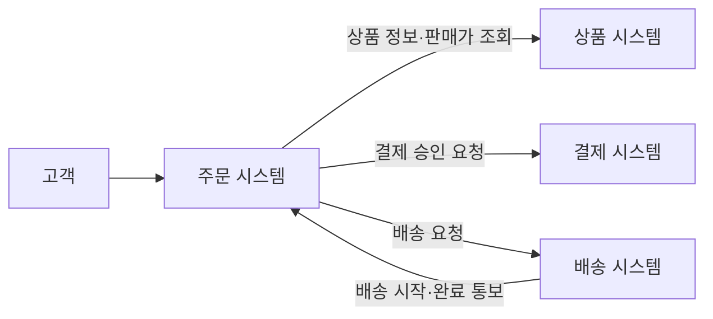
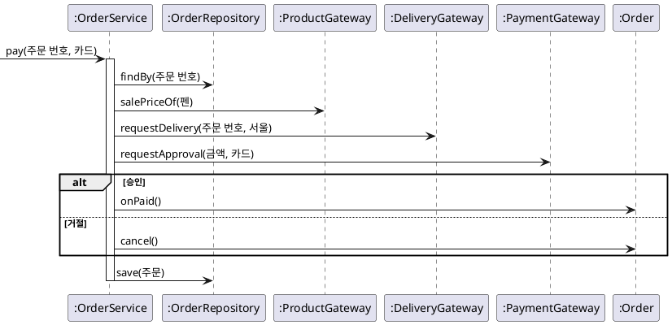
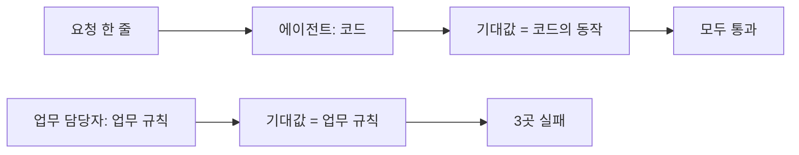
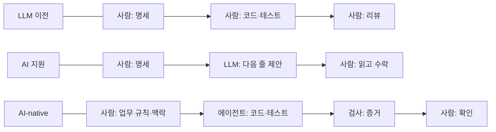

--------------------
Session 명: 01. 사람의 일과 AI의 일
--------------------

## 목차

01. 세션 목표
02. 첫 시도는 10분에 끝났다
03. 테스트가 통과해도 업무는 틀린다
04. AI는 옮기는 일만 줄인다
05. 업무 규칙은 회사가 정한다
06. 3가지 방식은 작업의 단위가 다르다
07. 사람이 결정하고 AI가 지원한다
08. 원칙은 변하지 않는다
09. AI에게 맡기기 전의 4가지 질문
10. 결정에는 검사가 짝으로 있다
11. 검사가 없는 일은 맡기지 않는다
12. 4가지 요소를 갖춰야 AI-native다
13. 실습 환경을 설치 스크립트로 갖춘다
14. 실습 1 — 업무 조건 확인
15. 요약

## 01. 세션 목표

AI는 업무 규칙을 코드로 옮기는 비용을 거의 없앴다. 그러나 **무엇이 옳은 결과인지의 판단과 책임**은 사람에게 있다.

- 요청 한 줄에서 **정해야 할 업무 조건**을 뽑고, 미정으로 남길 것을 구분한다.
- 요청에 없는 업무 규칙을 LLM이 **추측으로 채운 자리**를 찾아낸다.
- **본질적 복잡성과 우연적 복잡성**을 구분하고, AI 이후에도 **변하지 않는 5가지 원칙**을 이해한다.
- **LLM 이전·AI 지원·AI-native**와 규율이 없는 **바이브 코딩**을 작업의 단위와 검증 방법으로 구분한다.
- 공학 활동마다 **주도하는 쪽**을 선택하고, **맡기기 전의 4가지 질문**을 이해한다.
- **결정과 그것을 측정하는 검사**가 짝이라는 것과, AI-native가 **4가지 요소**로 성립하는 것을 설명한다.

**강사 노트**

- 세션 전체가 하나의 장면으로 이어진다 — 첫 시도 → 비어 있던 결정 → 사람과 AI가 나누는 일 → 결정과 검사의 짝 → 과정의 지도.
- 내용은 2026-10 기준이다. 도구·모델의 능력에 관한 서술은 과정을 열 때마다 원문으로 다시 확인한다.
- LLM이라는 도구의 성질과 활용 방식을 고르는 일은 "세션 02. LLM이라는 도구"가 맡는다. 이 세션은 사람과 AI가 나누는 일까지다.

---

## 02. 첫 시도는 10분에 끝났다

## 주문 시스템을 빈 저장소에서 만든다

생활용품 온라인 쇼핑몰이 외부 솔루션으로 받던 주문을 **직접 만든 주문 시스템**으로 처리한다. 상품·결제·배송 시스템은 이미 운영 중이고, 주문 시스템은 그것들에 요청을 보내고 통보를 받는다. 확인에 사용할 주문은 펜 2개, 판매가 각 1,000원, 배송지 서울이며 **주문 금액은 2,000원**이다.

**도식 — Mermaid — 주문 시스템과 외부 시스템**



- 첫 기능은 **주문한다** 하나다 — 배송지를 정하면 주문이 **결제대기**로 생기고, 카드 결제가 승인되면 **결제완료**가 되어 배송을 요청한다.
- 출발점은 **빈 git 저장소**다. 업무 담당자 1명이 주문 정책을 정하고, 테크 리드 1명과 개발자 2명이 코딩 에이전트를 사용하여 개발한다.

**강사 노트**

- 사례는 "객체지향 분석과 설계 실무" 과정과 같은 주문 시스템이며 이름과 값도 같다. 이 과정만 듣는 수강생을 위해 필요한 전제만 소개한다.
- 펜 2개·1,000원·서울·2,000원은 과정의 모든 세션이 쓰는 값이다(`course-design.md`의 공통 전제).
- 이 한 과제가 과정의 유일한 과제다. 실습도 같은 과제를 수강생이 빈 저장소에서 직접 만든다.

---

## 요청 한 줄을 그대로 맡겼다

업무 담당자가 준 요청은 한 줄이었다. 테크 리드가 그 한 줄을 코딩 에이전트에게 주자 **10분 만에** 돌아가는 코드가 나왔고, 테스트까지 전부 통과했다.

"장바구니에 담은 상품을 결제하면 주문이 되고 배송이 시작되게 해 주세요."

- **에이전트가 자바 파일 15개와 테스트 3개를 생성했다** — 테스트는 모두 통과했다.
- **데모도 성공했다** — 펜 2개를 카드로 결제하자 주문이 결제완료가 되고 시스템이 배송을 요청했다.
- 팀이 **업무 담당자에게 리뷰를 요청했다** — 코드와 데모만으로는 **무엇을 더 확인해야 하는지** 알 수 없었다.
- **코드는 실제로 돌아갔다** — 컴파일되고 외부 시스템 3개를 호출하며 주문의 상태도 바꾼다. 돌아가는 것과 **실제 업무**는 다른 문제이다.

**강사 노트**

- 10분, 파일 15개, 테스트 3개는 교육용 가정이다. 파일 수는 `code/s01/order/`와 같다.
- 수강생에게 묻는다: 여기서 받아들여도 되는가? 무엇을 확인하면 되는가?
- 요청 한 줄은 공통 전제의 문장 그대로다. 뒤 세션이 같은 문장에서 요구사항을 뽑는다.

---

## 03. 테스트가 통과해도 업무는 틀린다

## 업무 담당자가 문제 3가지를 찾았다

리뷰에서 업무 담당자가 결과에서 **문제 3가지**를 찾아냈다. 코드가 고장 난 것이 아니라, 요청 한 줄에 없던 업무 규칙을 에이전트가 **묻지 않고 임의로 선택한** 것이다. 그 3가지는 주문 금액, 배송 요청, 결제 거절이다.

**표 — 리뷰가 찾아낸 문제와 비어 있던 업무 규칙**

| 고객과 회사가 겪는 일 | 에이전트가 임의로 선택한 것 | 업무 담당자가 정한 업무 규칙 |
|---|---|---|
| 2,000원에 주문한 고객에게 2,400원을 청구한다 | 결제 시점의 판매가로 계산 | 주문이 생길 때의 판매가로 정한다 |
| 돈을 받지 않은 주문이 배송 준비에 들어간다 | 승인 요청 전에 배송 요청 | 결제가 승인된 뒤에만 요청한다 |
| 거절된 고객이 다시 결제할 수 없다 | 거절되면 주문을 취소 | 결제대기로 남겨 다시 결제한다 |

- 에이전트가 고른 답은 **다른 쇼핑몰에서는 맞는 답**이다. 그래서 **코드만으로는** 틀린 것을 알 수 없다.

**강사 노트**

- 첫째 행은 결제 직전에 펜 판매가가 1,200원으로 오른 경우다. 2,400원은 그 값으로 다시 계산한 결과다.
- 셋째 행에서 에이전트는 공통 전제에 없는 취소됨 상태까지 만들어 사용했다. 취소는 이번 과제의 범위 밖이다.
- 업무 규칙을 명시하는 일은 "세션 03. 요구사항"에서 시작한다.

---

## 코드가 비어 있던 결정을 채웠다

에이전트가 생성한 결제 코드는 요청에 없던 업무 규칙 3가지를 모두 **스스로 정했다**. 3가지 모두 **문법은 맞고 컴파일도 된다**.

1. **주문 금액** — 결제할 때 판매가를 다시 조회해 계산한다.
2. **배송 요청** — 결제 승인을 요청하기 전에 배송을 요청한다.
3. **결제 거절** — 거절되면 주문을 취소한다.

**도식 — PlantUML — 첫 시도의 결제 시퀀스**



**페이지 분할**

```java
public class OrderService {
    // ... 필드와 생성자 생략
    public void pay(OrderNumber number, PaymentMethod method) {
        Order order = repository.findBy(number);
        Money amount = Money.ZERO;
        for (OrderItem item : order.items()) {
            // ① 결제 시점의 판매가로 다시 계산
            Money salePrice = productGateway.salePriceOf(item.productNumber());
            amount = amount.plus(salePrice.times(item.quantity().value()));
        }
        // ② 승인 전에 배송 요청
        deliveryGateway.requestDelivery(number.value(), order.shippingAddress());
        if (paymentGateway.requestApproval(amount, method)) order.onPaid();
        else order.cancel();   // ③ 거절되면 취소됨
        repository.save(order);
    }
}
```

**강사 노트**

- 전체 코드는 `code/s01/order/`다. 첫 시도의 결제 코드는 LLM이 흔히 내는 추측을 모아 만든 교육용 예이며, 수강생의 LLM은 다른 곳을 추측할 수 있다.
- 코드가 보장하는 것: 승인되면 결제완료가 된다. 보장하지 않는 것: 주문 금액, 배송 요청의 시점, 거절 뒤의 상태 — 모두 업무 규칙이 정해야 하는 것이다.
- 코드의 영문 이름은 설계 이름이다. 본문에서는 결제한다·주문 금액처럼 한글로 부른다.

---

## 기대값이 코드에서 나왔다

에이전트가 생성한 테스트 3개는 업무 규칙이 아니라 **자기가 작성한 코드의 동작**을 기대값으로 삼았고, 그래서 전부 통과했다. 업무 규칙을 기대값으로 삼으면 같은 코드가 **3곳에서 실패한다** — 기대값이 추측이면 통과도 그 추측을 확인한다.

**인용문**

코드에서 테스트를 만드는 것은 AI를 SW 공학에 사용할 때 **잘 알려진 함정**이며, 그 코드가 할 일을 한다는 **보장이 없기** 때문이다, "Deriving tests from code is a well-known AI4SE pitfall, since there is no guarantee that the code does what it is supposed to do.", [Hassan 외 2026]

**도식 — Mermaid — 기대값은 어디서 오는가?**



**표 — 같은 코드, 두 테스트의 결과**

| 확인하는 것 | 에이전트의 테스트 | 업무 규칙의 테스트 |
|---|---|---|
| 승인되면 결제완료 | 통과 | 통과 |
| 주문 금액 | 판매가 × 수량 — 통과 | 판매가가 올라도 2,000원 — 실패 |
| 결제 거절 | 취소된다 — 통과 | 결제대기, 배송 요청 없음 — 실패 |

**강사 노트**

- 두 테스트는 `code/s01/order/test/`의 `AgentWrittenTest`와 `PayTest`다. javac로 컴파일하고 각각 실행해 결과를 대조한다.
- 기대값을 업무 규칙에서 정하는 일은 "세션 03. 요구사항"이 다룬다.
- 인용 근거: [Hassan 외 2026] 원문 확인. AI4SE는 "AI for SE"의 약어로 원문의 표기다. 저자들은 같은 대목에서 코딩 도구의 "Write unit tests for this function" 화면을 그 관행의 예로 든다.

---

## 04. AI는 옮기는 일만 줄인다

소프트웨어를 만드는 어려움은 **본질**과 **우연**으로 나뉜다. 첫 시도에서 업무 규칙은 비어 있었고 그것을 코드로 옮기는 일은 10분에 끝났다. AI가 줄인 것은 업무 규칙이 아니라 **그것을 코드로 옮기는 일**이다.

**인용문**

아리스토텔레스를 따라 나는 소프트웨어의 어려움을 **본질**, 곧 소프트웨어의 본성에 본래 있는 어려움과 **우연**, 곧 오늘날 소프트웨어를 만드는 데 따라붙지만 본래적이지는 않은 어려움으로 나눈다, "Following Aristotle, I divide them into essence, the difficulties inherent in the nature of the software, and accidents, those difficulties which today attend its production but which are not inherent", [Brooks 1986]

**표 — 첫 시도에서 나뉜 두 어려움**

| 구분 | 첫 시도에서 | 누가 하는가? |
|---|---|---|
| **본질적 복잡성** — 업무 규칙 | 주문 금액 2,000원, 배송 요청의 시점, 거절 뒤의 상태 | 업무 담당자와 개발자가 정한다 |
| **우연적 복잡성** — 코드로 옮기는 일 | 자바 파일 15개, 반복문, 외부 호출, 테스트 틀 | 에이전트가 10분에 생성했다 |

- **병목은 본질적 복잡성에 있다** — 주문 금액·배송 요청·결제 거절을 결정하고 검증하는 일이다.
  - 사람이 **병목**이며 AI가 병목이 아니다, "humans are the bottleneck, not the AI.", [Hassan 외 2026]

**강사 노트**

- 인용 근거: [Brooks 1986]·[Hassan 외 2026] 원문 확인. Brooks는 본질·우연을 가른 뒤 어려운 부분이 개념 구조의 명세·설계·검증이라고 적는다.
- 본질적 복잡성을 업무 규칙에, 우연적 복잡성을 업무 규칙을 코드로 옮기는 일에 대응시킨 것은 이 과정의 해석이다. Brooks의 문장이 아니다.
- [Hassan 외 2026]의 저자들은 사람의 의도 표현 능력이 한계이므로 모델이 얼마나 강력해져도 이 문제가 남는다고 적는다.

---

## 05. 업무 규칙은 회사가 정한다

업무 규칙은 **업무 담당자가 아는 도메인 지식**이다. 코드나 공개된 자료에 있지 않고 회사의 가격 정책·물류 운영·고객과의 약속이 정한다. 그래서 2,400원은 틀린 계산이 아니라 **다른 쇼핑몰에서는 맞는 답일 수 있고**, 주어지지 않으면 LLM이 그중 하나를 임의로 선택한다.

**인용문**

소프트웨어 시스템을 만드는 일에서 가장 어려운 부분은 **정확히 무엇을 만들지 결정하는 것**이다, "The hardest single part of building a software system is deciding precisely what to build.", [Brooks 1986]

**표 — 회사마다 달라지는 업무 규칙**

| 업무 규칙 | 회사마다 달라지는 이유 |
|---|---|
| **주문 금액** | 주문할 때 보여 준 가격을 고객에게 보장할지는 회사의 가격 정책이다 |
| **배송 요청** | 결제 확인 전에 배송 준비를 시작할지는 물류 운영과 감수할 위험의 문제다 |
| **결제 거절** | 거절된 주문을 남겨 다시 결제받을지는 고객 경험과 재고 운영의 선택이다 |

- **LLM은 이 회사의 업무 규칙을 모른다** — 주문 금액을 결제 시점으로 계산한 것은 학습한 자료에 그런 쇼핑몰이 더 많았기 때문이다.
  - LLM은 특정 도메인 지식을 **충분히 학습하지 못했을 수** 있다, "LLMs may have limited training on specific domain knowledge", [Gao 외 2025]

**강사 노트**

- 인용 근거: [Brooks 1986]·[Gao 외 2025] 원문 확인. [Gao 외 2025]는 요구공학자가 응용 도메인을 이해해야 정확하고 완전한 요구를 뽑는다는 대목에서 이 한계를 든다.
- "학습한 자료에 그런 쇼핑몰이 더 많았다"는 이 과정의 설명이며 출처로 인용하지 않는다. 비결정성과 작화의 정의는 "세션 02. LLM이라는 도구"가 맡는다.
- 업무 규칙을 용어집·개념과 관계로 명시하는 일은 "세션 04. 도메인 모델 — 정적 관점", 사건과 전이로 명시하는 일은 "세션 05. 도메인 모델 — 동적 관점"이 다룬다.

---

## 06. 3가지 방식은 작업의 단위가 다르다

## 무엇이 방식을 결정하는가?

LLM 이전·AI 지원·AI-native를 결정하는 것은 사용하는 도구가 아니라 **한 번에 맡기는 작업의 단위**와 **결과를 받아들이는 방법**이다. 첫 시도는 과제 하나를 통째로 맡겼으므로 AI-native의 겉모양을 갖췄지만, 받아들이는 방법이 데모와 자기 테스트뿐이었다.

**인용문**

소프트웨어 공학 3.0은 **AI-native**다, "We thus say that SE 3.0 is AI-native.", [Hassan 외 2026]

**표 — 개발 방식의 구분**

| 구분 | 작업의 단위 | 누가 무엇을 하는가? | 검증 |
|---|---|---|---|
| **LLM 이전** | 사람이 작성하는 코드 | 사람이 명세·설계·코드·테스트를 작성한다 | 사람이 작성한 테스트와 리뷰 |
| **AI 지원**(AI-assisted) | LLM의 제안 하나 | 사람이 흐름을 쥐고 제안을 받아들인다 | 제안마다 사람이 읽는다 |
| **AI-native** | 맡긴 과제 하나 | 사람이 결정하고 에이전트가 실행한다 | 검사가 낸 증거와 사람의 확인 |

- **책임은 3가지 방식에서 같다** — 옳은 결과의 판단과 책임은 사람에게 있다.
- 코드 중심을 **SE 1.0**, AI 지원을 **SE 2.0**, AI-native를 **SE 3.0**이라고도 부른다.

**강사 노트**

- 인용 근거: [Hassan 외 2026] 원문 확인. SE 1.0·2.0·3.0의 구분과 "AI-native"라는 이름이 이 논문의 것이다.
- 작업의 단위·검증 열로 다시 쓴 것과 활동별 역할 구분은 이 과정이 그 위에 둔 것이다(`course-design.md`의 「원전 적용 결정」).
- 저자들이 제안한 기술 스택과 소스 코드를 사람에게 감춘다는 입장은 쓰지 않는다. 이 과정은 사람이 코드와 증거를 읽어 판정한다.

---

## 같은 과제를 3가지 방식으로

주문한다를 3가지 방식으로 개발하면 **사람이 손을 대는 자리**가 달라진다. LLM 이전에는 코드를, AI 지원에서는 제안마다의 수락을, AI-native에서는 **맡기기 전의 결정과 받아들일 때의 증거**를 사람이 담당한다.

**도식 — Mermaid — 3가지 방식에서 사람이 손대는 자리**



- **첫 시도에는 에이전트가 실행하는 자리만 있었다** — 업무 규칙과 맥락을 주지 않았고, 증거는 에이전트가 생성한 테스트뿐이었다.
- **AI 지원의 병목은 사람의 리뷰다** — 제안이 많아질수록 읽는 양이 늘고, 읽지 않으면 그대로 들어온다.

**강사 노트**

- 같은 과제를 실제로 3가지 방식으로 실행해 개입·턴·시간·토큰을 비교하는 일은 "세션 02. LLM이라는 도구"가 맡는다. 여기서는 사람의 자리만 구분한다.
- 검사를 파이프라인으로 모아 에이전트가 스스로 돌리게 하는 일은 "세션 10. 검사 파이프라인"이 다룬다.

---

## 바이브 코딩은 규율의 부재다

결과만 보고 코드를 읽지 않는 것을 **바이브 코딩**(vibe coding)이라고 부른다. 개발 방식의 한 구분이 아니라 **규율이 없는 사용**이며, AI 지원에서도 AI-native에서도 생긴다. 첫 시도에서 팀이 데모 성공만 보고 다 됐다고 판단한 것이 그 사례이다.

**인용문**

바이브 코딩에서는 코드가 아니라 **시스템의 동작만** 신경 쓴다, "In vibe coding you don't care about the code, just the behavior of the system.", [Beck 2025]

  - 증강 코딩에서는 **코드와 그 복잡도·테스트와 그 커버리지**를 신경 쓴다, "In augmented coding you care about the code, its complexity, the tests, & their coverage.", [Beck 2025]

**인용문**

숙련자가 LLM으로 일을 빠르게 하면서도 자기가 만든 소프트웨어에 **당당하고 자신 있게 책임을 진다**, "seasoned professionals accelerate their work with LLMs while staying proudly and confidently accountable for the software they produce", [Willison 2025b]

- 숙련자가 규율을 지키며 LLM을 사용하는 방식을 **바이브 엔지니어링**(vibe engineering)이라고 부른다.
- **AI는 팀이 이미 하는 방식을 빠르게 한다** — 업무 규칙·테스트·리뷰가 있는 팀에서는 좋은 결과를, 없는 팀에서는 나쁜 결과를 더 빨리 만든다.

**강사 노트**

- 인용 근거: Kent Beck, "Augmented Coding: Beyond the Vibes"(2025), Simon Willison, "Vibe engineering"(2025) 원문 확인. Willison 인용은 문장에서 핵심 구만 옮긴 것이다. 바이브 엔지니어링이라는 이름은 그 글의 제목이며 본문이 밝힌다.
- "이미 하는 방식을 빠르게 한다"는 이 과정의 설명이다. 출처로 인용하지 않는다.
- 수강생에게 자기 팀이 코드를 읽는지, 무엇을 보고 받아들이는지 먼저 말하게 한다.

---

## 07. 사람이 결정하고 AI가 지원한다

## 주도는 4단계로 나뉜다

활동을 사람과 AI가 반씩 나누는 것이 아니다. 활동마다 **누가 주도하는지**가 4단계 가운데 하나로 결정된다. 주문 금액을 정하는 일은 사람이 주도하고, 그 금액을 계산하는 코드를 만드는 일은 AI가 주도하며, 금액이 2,000원인지 측정하는 일은 기계가 판정한다.

**인용문**

사람이 **조종하고** 에이전트가 **실행한다**, "Humans steer. Agents execute.", [Lopopolo 2026]

**도식 — SVG — 주도의 4단계**

```svg
<svg xmlns="http://www.w3.org/2000/svg" viewBox="0 0 960 340" width="960" height="340" font-family="sans-serif">
  <g>
    <rect x="6" y="10" width="948" height="74" rx="8" fill="#e8eff8" stroke="#2b5fa8" stroke-width="2"/>
    <text x="34" y="53" font-size="16" font-weight="bold" fill="#1b3f70">사람 주도</text>
    <line x1="230" y1="20" x2="230" y2="74" stroke="#9db8d8"/>
    <text x="256" y="40" font-size="13" fill="#1b3f70">사람이 정하고 AI는 초안과 대안만 낸다</text>
    <text x="256" y="66" font-size="13" fill="#8e2a1e">문제와 의도, 아키텍처와 설계, 위임의 경계, 결과 판단</text>
  </g>
  <g>
    <rect x="6" y="94" width="948" height="74" rx="8" fill="#f8fafc" stroke="#64748b" stroke-width="1.5"/>
    <text x="34" y="137" font-size="16" font-weight="bold" fill="#1e293b">함께</text>
    <line x1="230" y1="104" x2="230" y2="158" stroke="#cbd5e1"/>
    <text x="256" y="124" font-size="13" fill="#334155">AI가 초안을 내고 사람이 확정한다</text>
    <text x="256" y="150" font-size="13" fill="#8e2a1e">요구사항, 정적 모델, 동적 모델</text>
  </g>
  <g>
    <rect x="6" y="178" width="948" height="74" rx="8" fill="#f8fafc" stroke="#64748b" stroke-width="1.5"/>
    <text x="34" y="221" font-size="16" font-weight="bold" fill="#1e293b">AI 주도</text>
    <line x1="230" y1="188" x2="230" y2="242" stroke="#cbd5e1"/>
    <text x="256" y="208" font-size="13" fill="#334155">사람은 통과의 뜻만 정하고 AI가 실행한다</text>
    <text x="256" y="234" font-size="13" fill="#8e2a1e">구현 — 2,000원을 계산하는 코드와 테스트</text>
  </g>
  <g>
    <rect x="6" y="262" width="948" height="74" rx="8" fill="#e8f1e8" stroke="#2f6b35" stroke-width="1.5"/>
    <text x="34" y="305" font-size="16" font-weight="bold" fill="#245128">자동 판정</text>
    <line x1="230" y1="272" x2="230" y2="326" stroke="#8ab08e"/>
    <text x="256" y="292" font-size="13" fill="#1f2e20">기계가 결정적으로 판정하고 사람은 결과만 읽는다</text>
    <text x="256" y="318" font-size="13" fill="#8e2a1e">컴파일, 금액 계산 테스트, 의존 규칙 검사</text>
  </g>
</svg>
```

- **전부 사람 주도이면 AI를 쓰지 않는 것이고, 전부 AI 주도이면 책임질 사람이 없다**. 활동마다 이 자리를 선택하는 것이 판단이다.

**강사 노트**

- 인용 근거: Ryan Lopopolo, "Harness engineering: leveraging Codex in an agent-first world", OpenAI, 2026 영문 원문 확인(openai.com이 한국어판으로 자동 전환하므로 영문판으로 확인).
- 한 팀(OpenAI 내부 제품)의 경험이다. 글도 비슷한 투자 없이 일반화된다고 가정하지 말라고 밝힌다.
- 4단계의 이름은 이 과정의 구분이다(`course-design.md`의 「AI-native를 이루는 4가지 요소」).

---

## 활동마다 주도가 다르다

활동마다 **사람이 결정할 것**과 **AI가 지원할 것**이 다르다. 결정을 AI에게 넘기면 첫 시도처럼 AI의 추측이 결과에 섞인다. 그래서 활동마다 주도하는 쪽을 먼저 정하고, AI에게는 결정이 아니라 **초안과 질문**을 맡긴다.

**표 — 활동마다 주도와 각자의 몫**

| 활동 | 주도 | 사람이 결정한다 | AI가 지원한다 |
|---|---|---|---|
| **문제·의도** | 사람 주도 | 문제와 위험 수용 | 빠진 결정을 질문한다 |
| **요구사항** | 함께 | 범위·제외·미정 | 초안과 애매한 질문 |
| **정적·동적 모델** | 함께 | 개념·관계·전이 | 초안과 누락 제시 |
| **아키텍처·설계** | 사람 주도 | 경계·책임·계약 | 대안과 불일치 지적 |
| **위임** | 사람 주도 | 맥락·권한·종료 조건 | 경계 안에서 실행 |
| **구현·검증** | AI 주도 · 자동 판정 | 무엇이 통과인가? | 코드·테스트와 수정 |
| **결과 판단** | 사람 주도 | 수용과 되돌림 | 완료의 증거 제시 |

- **AI는 임의로 결정하지 않고 질문하게 한다** — "결제가 거절되면 주문은 어떻게 되는가?"를 AI가 정하지 않고 업무 담당자에게 되묻게 한다.

**강사 노트**

- 이 역할 구분은 이 과정의 구분이다(`course-design.md`의 「활동마다 사람과 AI」). 과정 설계의 11행을 7행으로 묶었다.
- 각 행이 뒤 세션의 주제다 — 요구사항은 "세션 03. 요구사항", 모델은 "세션 04. 도메인 모델 — 정적 관점"과 "세션 05. 도메인 모델 — 동적 관점", 경계와 책임은 "세션 06. 아키텍처"와 "세션 07. 설계 — 책임과 협력", 위임은 "세션 08. 위임 — 과제와 맥락"과 "세션 09. 위임 — 권한과 경계"다.
- 수강생에게 자기 팀이 지금 어느 행을 AI에게 넘기고 있는지 말하게 한다.

---

## 08. 원칙은 변하지 않는다

공학의 원칙은 AI 이후에도 **그대로 있다**. 달라지는 것은 그 원칙을 적용하는 산출물의 양과 속도다. 그래서 원칙을 지키는 팀에서는 결과가 더 빨리 좋아지고, **원칙이 없는 팀에서는 문제도 더 빨리 번진다**.

**도식 — SVG — 바뀌지 않는 5가지와 AI 이후 달라지는 것**

```svg
<svg xmlns="http://www.w3.org/2000/svg" viewBox="0 0 960 372" width="960" height="372" font-family="sans-serif">
  <g>
    <rect x="6" y="10" width="948" height="64" rx="8" fill="#f8fafc" stroke="#64748b" stroke-width="1.5"/>
    <text x="34" y="48" font-size="16" font-weight="bold" fill="#1e293b">올바른 문제를 정의한다</text>
    <line x1="340" y1="20" x2="340" y2="64" stroke="#cbd5e1"/>
    <text x="366" y="48" font-size="13" fill="#334155">AI가 빠진 결정을 질문으로 드러낸다 — 요청 한 줄에 없던 업무 규칙 3가지</text>
  </g>
  <g>
    <rect x="6" y="82" width="948" height="64" rx="8" fill="#f8fafc" stroke="#64748b" stroke-width="1.5"/>
    <text x="34" y="120" font-size="16" font-weight="bold" fill="#1e293b">복잡성을 관리한다</text>
    <line x1="340" y1="92" x2="340" y2="136" stroke="#cbd5e1"/>
    <text x="366" y="120" font-size="13" fill="#334155">대안을 생성하는 비용이 떨어져 선택하고 통제하는 일이 중요해진다</text>
  </g>
  <g>
    <rect x="6" y="154" width="948" height="64" rx="8" fill="#f8fafc" stroke="#64748b" stroke-width="1.5"/>
    <text x="34" y="192" font-size="16" font-weight="bold" fill="#1e293b">응집도·결합도·모듈성을 지킨다</text>
    <line x1="340" y1="164" x2="340" y2="208" stroke="#cbd5e1"/>
    <text x="366" y="192" font-size="13" fill="#334155">에이전트가 생성한 코드에도 같은 기준을 적용하고 검사로 판정한다</text>
  </g>
  <g>
    <rect x="6" y="226" width="948" height="64" rx="8" fill="#e8eff8" stroke="#2b5fa8" stroke-width="2"/>
    <text x="34" y="264" font-size="16" font-weight="bold" fill="#1b3f70">요구사항을 독립적으로 검증한다</text>
    <line x1="340" y1="236" x2="340" y2="280" stroke="#9db8d8"/>
    <text x="366" y="264" font-size="13" fill="#1b3f70">기대값을 코드 밖에서 결정하는 일이 더 중요해진다 — 2,000원</text>
  </g>
  <g>
    <rect x="6" y="298" width="948" height="64" rx="8" fill="#f8fafc" stroke="#64748b" stroke-width="1.5"/>
    <text x="34" y="336" font-size="16" font-weight="bold" fill="#1e293b">품질 속성을 만족한다</text>
    <line x1="340" y1="308" x2="340" y2="352" stroke="#cbd5e1"/>
    <text x="366" y="336" font-size="13" fill="#334155">응답 성능·접근 통제·장애 대응을 자동으로 측정하고 고친다</text>
  </g>
</svg>
```

- **AI는 원칙을 대신하지 않는다** — 같은 5가지를 **더 많은 산출물에 더 빨리** 적용하는 것이 달라진 점이다.

**강사 노트**

- 5가지는 특정 원전의 분류가 아니라 분야에 통용되는 원칙을 이 과정의 말로 적은 것이다. 응집도·결합도의 정의는 "세션 06. 아키텍처"가, 요구사항의 검증은 "세션 03. 요구사항"이 맡는다.
- 품질 관점의 이름(응답 성능·접근 통제·장애 대응)은 "세션 03. 요구사항"의 품질 요구사항과 같은 이름이다.
- 수강생이 자기 팀에서 이미 하는 일을 먼저 말하게 한 뒤 오른쪽을 짚는다.

---

## 09. AI에게 맡기기 전의 4가지 질문

활동을 AI에게 맡기기 전에 다음 4가지를 질문한다 — 무엇이 **쉬워졌고**, 그래서 무엇이 **달라지며**, 무엇이 조용히 **깨지고**, 그래서 무엇을 **갖춰야** 맡길 수 있는가다. 첫 시도는 앞의 둘만 보고 뒤의 둘을 비워 둔 결과이며, 네 번째 답이 곧 검사다.

**도식 — SVG — 코드 작성을 맡기기 전의 4가지 질문**

```svg
<svg xmlns="http://www.w3.org/2000/svg" viewBox="0 0 960 340" width="960" height="340" font-family="sans-serif">
  <g>
    <rect x="6" y="10" width="948" height="74" rx="8" fill="#eef2f7" stroke="#64748b" stroke-width="1.5"/>
    <text x="34" y="53" font-size="16" font-weight="bold" fill="#1e293b">쉬워진 일</text>
    <line x1="230" y1="20" x2="230" y2="74" stroke="#94a3b8"/>
    <text x="256" y="40" font-size="13" fill="#334155">요청 한 줄에서 자바 파일 15개와 테스트 3개를 10분에 생성한다</text>
    <text x="256" y="66" font-size="13" fill="#334155">카드 승인까지 돌아가는 데모가 함께 나온다</text>
  </g>
  <g>
    <rect x="6" y="94" width="948" height="74" rx="8" fill="#eef2f7" stroke="#64748b" stroke-width="1.5"/>
    <text x="34" y="137" font-size="16" font-weight="bold" fill="#1e293b">달라지는 것</text>
    <line x1="230" y1="104" x2="230" y2="158" stroke="#94a3b8"/>
    <text x="256" y="124" font-size="13" fill="#334155">구현과 반복 작업에 드는 사람의 시간이 거의 들지 않는다</text>
    <text x="256" y="150" font-size="13" fill="#334155">설계 대안을 싸게 탐색하고 고치는 대신 다시 받는다</text>
  </g>
  <g>
    <rect x="6" y="178" width="948" height="74" rx="8" fill="#fdecec" stroke="#c0392b" stroke-width="1.5"/>
    <text x="34" y="221" font-size="16" font-weight="bold" fill="#8e2a1e">깨지는 것</text>
    <line x1="230" y1="188" x2="230" y2="242" stroke="#d98b80"/>
    <text x="256" y="208" font-size="13" fill="#3b1f1a">정하지 않은 업무 규칙을 추측으로 채운다 — 2,400원을 청구한다</text>
    <text x="256" y="234" font-size="13" fill="#3b1f1a">코드에서 끌어낸 기대값이 그 추측을 통과시킨다</text>
  </g>
  <g>
    <rect x="6" y="262" width="948" height="74" rx="8" fill="#e8f1e8" stroke="#2f6b35" stroke-width="1.5"/>
    <text x="34" y="305" font-size="16" font-weight="bold" fill="#245128">갖춰야 할 것</text>
    <line x1="230" y1="272" x2="230" y2="326" stroke="#8ab08e"/>
    <text x="256" y="292" font-size="13" fill="#1f2e20">업무 규칙을 사람이 정해 기대값으로 적는다 — 판매가가 올라도 2,000원</text>
    <text x="256" y="318" font-size="13" fill="#1f2e20">그 기대값을 측정하는 검사를 코드 밖에 두고 변경될 때마다 실행한다</text>
  </g>
</svg>
```

- **깨지는 것을 확인하고도 갖춰야 할 것이 없으면 맡길 수 없다** — 4번째 질문의 답이 그 활동의 검사다.

**강사 노트**

- 이 4가지는 과정 전체의 반복 틀이다. 세션마다 같은 자리에서 같은 4가지를 묻고, 수강생은 열두 번 같은 질문을 받는다.
- 여기의 답은 코드 작성을 맡길 때의 답이다. 요구사항·모델·설계를 맡길 때의 답은 각 세션이 채운다.

---

## 10. 결정에는 검사가 짝으로 있다

## 검사가 없으면 결정대로 했는지 모른다

사람이 내린 결정은 **그 결정을 측정하는 검사**와 짝을 이뤄야 한다. 짝이 없는 결정은 결정대로 했는지 아무도 모르고, 측정하지 못하는 일은 에이전트에게 맡길 수 없다. 주문 금액을 2,000원으로 정한 결정은 금액 계산 테스트가 측정하고, 배송 요청의 순서는 금지된 순서 검사가 측정한다.

**도식 — SVG — 결정과 그 결정을 측정하는 검사**

```svg
<svg xmlns="http://www.w3.org/2000/svg" viewBox="0 0 960 356" width="960" height="356" font-family="sans-serif">
  <text x="190" y="34" font-size="16" font-weight="bold" text-anchor="middle" fill="#1b3f70">사람이 결정한다</text>
  <text x="690" y="34" font-size="16" font-weight="bold" text-anchor="middle" fill="#245128">그 결정을 측정하는 검사</text>
  <g>
    <rect x="30" y="50" width="320" height="50" rx="6" fill="#e8eff8" stroke="#2b5fa8" stroke-width="1.5"/>
    <text x="190" y="81" font-size="13" text-anchor="middle" fill="#1b3f70">요구사항 — 받아들일 조건</text>
    <line x1="350" y1="75" x2="420" y2="75" stroke="#475569" stroke-width="2"/>
    <polygon points="430,75 416,69 416,81" fill="#475569"/>
    <rect x="430" y="50" width="500" height="50" rx="6" fill="#e8f1e8" stroke="#2f6b35" stroke-width="1.5"/>
    <text x="680" y="81" font-size="13" text-anchor="middle" fill="#245128">수용 기준을 실행하는 수용 테스트</text>
  </g>
  <g>
    <rect x="30" y="110" width="320" height="50" rx="6" fill="#e8eff8" stroke="#2b5fa8" stroke-width="1.5"/>
    <text x="190" y="141" font-size="13" text-anchor="middle" fill="#1b3f70">정적 모델 — 개념·관계·조건</text>
    <line x1="350" y1="135" x2="420" y2="135" stroke="#475569" stroke-width="2"/>
    <polygon points="430,135 416,129 416,141" fill="#475569"/>
    <rect x="430" y="110" width="500" height="50" rx="6" fill="#e8f1e8" stroke="#2f6b35" stroke-width="1.5"/>
    <text x="680" y="141" font-size="13" text-anchor="middle" fill="#245128">불변 조건 테스트 — 판매가가 올라도 2,000원</text>
  </g>
  <g>
    <rect x="30" y="170" width="320" height="50" rx="6" fill="#e8eff8" stroke="#2b5fa8" stroke-width="1.5"/>
    <text x="190" y="201" font-size="13" text-anchor="middle" fill="#1b3f70">동적 모델 — 사건·상태·전이</text>
    <line x1="350" y1="195" x2="420" y2="195" stroke="#475569" stroke-width="2"/>
    <polygon points="430,195 416,189 416,201" fill="#475569"/>
    <rect x="430" y="170" width="500" height="50" rx="6" fill="#e8f1e8" stroke="#2f6b35" stroke-width="1.5"/>
    <text x="680" y="201" font-size="13" text-anchor="middle" fill="#245128">상태 전이 테스트와 금지된 순서 검사</text>
  </g>
  <g>
    <rect x="30" y="230" width="320" height="50" rx="6" fill="#e8eff8" stroke="#2b5fa8" stroke-width="1.5"/>
    <text x="190" y="261" font-size="13" text-anchor="middle" fill="#1b3f70">아키텍처 — 무엇이 무엇을 아는가</text>
    <line x1="350" y1="255" x2="420" y2="255" stroke="#475569" stroke-width="2"/>
    <polygon points="430,255 416,249 416,261" fill="#475569"/>
    <rect x="430" y="230" width="500" height="50" rx="6" fill="#e8f1e8" stroke="#2f6b35" stroke-width="1.5"/>
    <text x="680" y="261" font-size="13" text-anchor="middle" fill="#245128">의존 규칙 검사와 대역을 쓴 통합 테스트</text>
  </g>
  <g>
    <rect x="30" y="290" width="320" height="50" rx="6" fill="#e8eff8" stroke="#2b5fa8" stroke-width="1.5"/>
    <text x="190" y="321" font-size="13" text-anchor="middle" fill="#1b3f70">설계 — 책임·협력·계약</text>
    <line x1="350" y1="315" x2="420" y2="315" stroke="#475569" stroke-width="2"/>
    <polygon points="430,315 416,309 416,321" fill="#475569"/>
    <rect x="430" y="290" width="500" height="50" rx="6" fill="#e8f1e8" stroke="#2f6b35" stroke-width="1.5"/>
    <text x="680" y="321" font-size="13" text-anchor="middle" fill="#245128">사전·사후조건을 측정하는 단위 테스트</text>
  </g>
</svg>
```

- **왼쪽에서 정하지 않은 것은 오른쪽에 검사가 없다** — 비워 둔 칸은 에이전트가 추측으로 채우고, 그 추측을 잡아낼 검사도 없다.

**강사 노트**

- 결정과 검증을 짝지어 보는 틀은 V 모델의 대응 관계를 이 과정에 적용한 것이다. 단계의 순서가 아니라 대응 관계로만 쓴다(`course-design.md`의 「원전 적용 결정」).
- 왼쪽은 "세션 03. 요구사항"부터 "세션 07. 설계 — 책임과 협력"까지가 하나씩 채우고, 오른쪽 전체를 명령 하나로 모으는 일은 "세션 10. 검사 파이프라인"이 맡는다.
- 세션의 순서는 학습 순서다. 실제로는 작업 단위마다 이 짝을 한 바퀴 돈다.

---

## 문제 3가지와 관련 있는 결정

첫 시도의 문제 3가지는 코드의 결함이 아니라 **비어 있는 결정**이다. 2,400원은 단가를 언제 확정하는지 정하지 않아서, 승인 전 배송 요청과 거절 뒤의 취소는 사건의 순서와 전이를 정하지 않아서 생겼다. 그래서 고칠 자리는 코드가 아니라 그 결정이다.

**표 — 문제와 수정해야 할 결정**

| 첫 시도의 문제 | 비어 있는 결정 | 그 결정을 측정하는 검사 |
|---|---|---|
| 2,400원을 청구한다 | 단가를 언제 확정하는가? — 정적 모델 | 주문 금액의 불변 조건 테스트 |
| 승인 전에 배송을 요청한다 | 요청의 순서 — 동적 모델 | 금지된 순서 검사 |
| 거절된 주문을 취소한다 | 거절 뒤의 전이 — 동적 모델 | 상태 전이 테스트 |

- **정하지 않은 것에는 기대값이 없다** — 에이전트의 테스트 3개가 모두 통과한 이유이며, 통과는 비어 있던 결정을 드러내지 못한다.
- **통과는 작성한 검사만큼만 보장한다** — 주문 금액을 측정하는 검사가 없으면 2,400원을 청구하는 코드도 통과한다.

**강사 노트**

- 첫 열은 「업무 담당자가 문제 3가지를 찾았다」의 첫 열과 같은 세 문제다. 같은 사건을 결정의 공백으로 다시 읽는다.
- 수강생에게 세 문제가 각각 정적인지 동적인지 먼저 묻는다. 단가의 확정 시점은 속성의 결정이고, 순서와 전이는 사건의 결정이다.
- 녹색이 보장하지 않는 것은 "세션 10. 검사 파이프라인"이 다시 다룬다.

---

## 11. 검사가 없는 일은 맡기지 않는다

맡기지 않는 작업은 3가지다 — **AI가 하지 못하는 작업**, **AI를 사용할 이유가 없는 작업**, **완료를 판정할 수 없는 작업**이다. 주문 금액을 정하는 일은 첫째이고, 코드 형식과 의존 규칙을 보는 일은 둘째이며, 받아들일 기준을 정하지 않은 일은 셋째다.

**표 — 맡기지 않는 작업 3가지**

| 맡기지 않는 작업 | 주문한다에서 | 대신 무엇을 하는가? |
|---|---|---|
| **AI가 하지 못하는 작업** | 업무 규칙 3가지를 정하는 일 | 업무 담당자가 정하고 AI는 질문을 찾는다 |
| **AI를 사용할 이유가 없는 작업** | 코드 형식·의존 규칙 검사 | 포매터와 정적 검사가 결정적으로 판정한다 |
| **완료를 판정할 수 없는 작업** | 배송 요청 실패의 처리 | 미정으로 적어 두고 닿으면 멈춰 묻게 한다 |

**인용문**

에이전트는 **결정적·규칙 기반 방식이 적합하지 않은** 일에 적합하다, "agents are uniquely suited to workflows where traditional deterministic and rule-based approaches fall short", [OpenAI 2025]

**인용문**

**초기 속도 이득**이 하류의 유지보수 문제로 **완전히 상쇄될 위험**이 있다, "initial speed gains risk being fully canceled out by downstream maintainability problems.", [Hassan 외 2026]

- **생성량으로 판단하지 않는다** — 10분과 파일 15개가 아니라 **검토·수정에 든 시간과 남는 부채**로 득실을 센다.

**강사 노트**

- 인용 근거: OpenAI, "A practical guide to building agents"(2025) 원문 확인(받은 PDF). 두 인용은 원문에서 이어지는 대목이며, Otherwise는 그 기준을 충족하지 못한 경우를 가리킨다.
- 인용 근거: [Hassan 외 2026] 원문 확인. 저자들은 한 코딩 도구의 선행 연구를 들어 단기 속도는 올랐지만 복잡도와 정적 분석 경고가 쌓여 장기 생산성을 해쳤다고 적는다.
- 작업 특성으로 활용 방식(수작업·대화형 보조·워크플로·에이전트)을 고르는 일은 "세션 02. LLM이라는 도구"가, 비용 대비 효과의 판단은 "세션 11. 비용과 평가"가 맡는다.
- 배송 요청 실패의 처리는 과정이 끝까지 미정으로 두는 항목이다. "세션 12. 종합 실행"에서 거두어진다.

---

## 12. 4가지 요소를 갖춰야 AI-native다

AI-native는 LLM을 도입하면 완성되는 것이 아니다. **4가지 요소를 갖춰야** 성립하고, 첫 시도에는 둘째만 있었다. 나머지 셋은 사람이 결정하고 환경으로 갖춰야 하는 것이다.

**도식 — SVG — AI-native를 이루는 4가지 요소**

```svg
<svg xmlns="http://www.w3.org/2000/svg" viewBox="0 0 960 340" width="960" height="340" font-family="sans-serif">
  <g>
    <rect x="6" y="10" width="948" height="74" rx="8" fill="#e8eff8" stroke="#2b5fa8" stroke-width="2"/>
    <text x="34" y="53" font-size="16" font-weight="bold" fill="#1b3f70">명세·모델·맥락</text>
    <line x1="250" y1="20" x2="250" y2="74" stroke="#9db8d8"/>
    <text x="276" y="40" font-size="13" fill="#1b3f70">요구사항·용어집·도메인 모델·의존 규칙·설계를 글로 남긴다</text>
    <text x="276" y="66" font-size="13" fill="#8e2a1e">대화 기록만으로 프로젝트의 진실을 관리하지 않는다</text>
  </g>
  <g>
    <rect x="6" y="94" width="948" height="74" rx="8" fill="#f8fafc" stroke="#64748b" stroke-width="1.5"/>
    <text x="34" y="137" font-size="16" font-weight="bold" fill="#1e293b">LLM과 에이전트</text>
    <line x1="250" y1="104" x2="250" y2="158" stroke="#cbd5e1"/>
    <text x="276" y="124" font-size="13" fill="#334155">과제를 수행하고 도구를 부르는 실행 주체다</text>
    <text x="276" y="150" font-size="13" fill="#8e2a1e">첫 시도에 있던 것은 이 하나뿐이었다</text>
  </g>
  <g>
    <rect x="6" y="178" width="948" height="74" rx="8" fill="#f8fafc" stroke="#64748b" stroke-width="1.5"/>
    <text x="34" y="221" font-size="16" font-weight="bold" fill="#1e293b">권한과 변경 통제</text>
    <line x1="250" y1="188" x2="250" y2="242" stroke="#cbd5e1"/>
    <text x="276" y="208" font-size="13" fill="#334155">접근할 자원과 동작을 좁히고 되돌리기 어려운 변경은 사람이 승인한다</text>
    <text x="276" y="234" font-size="13" fill="#8e2a1e">무엇을 보고 무엇을 했는지 기록으로 남긴다</text>
  </g>
  <g>
    <rect x="6" y="262" width="948" height="74" rx="8" fill="#e8f1e8" stroke="#2f6b35" stroke-width="1.5"/>
    <text x="34" y="305" font-size="16" font-weight="bold" fill="#245128">실행 가능한 검사</text>
    <line x1="250" y1="272" x2="250" y2="326" stroke="#8ab08e"/>
    <text x="276" y="292" font-size="13" fill="#1f2e20">버전 관리·자동 테스트·정적 분석·의존 규칙 검사로 결과를 가린다</text>
    <text x="276" y="318" font-size="13" fill="#8e2a1e">사람이 보기 전에 에이전트의 루프 안에서 돈다</text>
  </g>
</svg>
```

- **첫째 요소는 사람이 완성한다** — 요구사항부터 설계까지가 명세·모델·맥락이 되고, 그것이 에이전트에게 읽힐 것이다.
- **셋째와 넷째 요소는 한 번 맡겨 본 뒤에 정한다** — 무엇을 금지하고 무엇을 측정해야 하는지는 실행 기록을 보고 확인한다.

**강사 노트**

- 첫째 층은 "세션 03. 요구사항"~"세션 07. 설계 — 책임과 협력", 둘째 층은 "세션 02. LLM이라는 도구"와 "세션 08. 위임 — 과제와 맥락", 셋째 층은 "세션 09. 위임 — 권한과 경계", 넷째 층은 "세션 10. 검사 파이프라인"이 갖춘다. 그 뒤 "세션 11. 비용과 평가"와 "세션 12. 종합 실행"이 계속 맡길지 판단하고 기능을 끝낸다.
- 산출물을 모두 만들어야 하는 것은 아니다. 무엇을 넣을지는 도메인·기술 복잡성이 정하며 그 판단은 "세션 03. 요구사항"에서 경로와 함께 다룬다.
- 강의 내용의 마지막 장이다. 여기까지 보인 뒤 실습 환경으로 넘어간다.

---

## 13. 실습 환경을 설치 스크립트로 갖춘다

실습은 **자기 PC의 저장소 한 곳에서** 끝까지 진행한다. 실습 1~7의 산출물이 `docs`에 모이고, "세션 08. 위임 — 과제와 맥락"부터는 같은 저장소에서 에이전트가 그것을 읽는다. 도구는 **과정이 제공하는 설치 스크립트**로 설치한다 — **Windows**의 PowerShell에서 `.\setup-order-system.ps1`을, **macOS**의 터미널에서 `sh setup-order-system.sh`를 실행한다. 저장소는 홈 폴더 아래 `order-system`에 만들어진다.

**표 — 스크립트가 설치하는 환경과 도구**

| 도구 | 버전 | 무엇에 사용하는가? | 설치 확인 |
|---|---|---|---|
| **Claude Code** | 최신 | 코딩 에이전트 | `claude --version` |
| **JDK** | 17 이상(21을 설치한다) | 자바 컴파일과 실행 | `java -version` |
| **Gradle** | 최신 | 빌드와 검사 명령 | `gradle -v` |
| **Git** | 최신 | 변경 이력과 커밋 | `git --version` |
| **`order-system` 저장소** | — | 산출물·코드·검사를 모으는 곳 | `git status` |

저장소는 홈 폴더 아래 **`order-system`**에 만들어지고, 그 안의 `docs`가 실습 산출물이 모이는 곳이다.

```text
# setup-order-system.ps1 — Windows PowerShell
function Install-IfMissing($command, $wingetId, $label) {
    if (Get-Command $command -ErrorAction SilentlyContinue) { return }
    winget install --id $wingetId --accept-package-agreements
}

Install-IfMissing "git"    "Git.Git"              "Git"
Install-IfMissing "java"   "Microsoft.OpenJDK.21" "JDK 21"
Install-IfMissing "gradle" "Gradle.Gradle"        "Gradle"
Install-IfMissing "claude" "Anthropic.ClaudeCode" "Claude Code"

$repo = Join-Path $HOME "order-system"
if (-not (Test-Path $repo)) {
    New-Item -ItemType Directory -Path $repo | Out-Null
    New-Item -ItemType Directory -Path (Join-Path $repo "docs") | Out-Null
    git -C $repo init | Out-Null
}

git --version; java -version; gradle -v --quiet; claude --version
# ... 설치 확인 출력과 로그인 안내 생략
```

- **로그인만 사람이 한다** — 스크립트가 끝나면 `claude`를 실행해 **Claude Team 계정으로 로그인**하고 대화가 되는지 확인한다.
- **첫날에 필요한 것은 에이전트와 Git뿐이다** — JDK와 Gradle은 둘째 날 코드를 만들 때 사용한다.

**강사 노트**

- 위 발췌의 원본과 macOS판은 `code/s01/setup/`에 있다 — Windows는 `setup-order-system.ps1`, macOS는 `setup-order-system.sh`다. 수강생에게 파일로 배포한다.
- 스크립트는 `winget`(macOS는 Homebrew)으로 도구를 설치하고, `order-system` 폴더를 만들어 `git init`한 뒤 `docs`를 둔다. 이미 설치된 도구는 건너뛴다.
- `winget`은 Windows 10·11의 App Installer에 들어 있다. 없거나 사내 정책으로 막히면 제품 설치 파일로 설치한다. 사내망에서 설치와 로그인이 막히는지 미리 확인한다.
- 저장소는 각자 자기 PC에 두고 혼자 관리한다. 원격 저장소·push·공유는 필요 없고 결과 공유는 화면이나 파일로 한다.
- 설치 명령과 버전은 2026-10 기준이다. 과정을 열 때마다 제품 안내로 확인한다.
- 저장소 초기화와 빌드 구성의 지시문은 "세션 08. 위임 — 과제와 맥락"이, 검사 명령을 만드는 일은 "세션 10. 검사 파이프라인"이 안내한다.

---

## 14. 실습 1 — 업무 조건 확인

①로 시작해 답·질문·수정 요청을 주고받으며 요구사항을 쓰기 전에 **정해야 할 업무 조건**을 뽑는다. ②~④는 보완 예시이며 ⑤로 MD를 만들고 필요하면 보완·재생성한다.

**프롬프트 — 요청사항 포함**
  + ① "쇼핑몰의 주문 시스템을 빈 저장소에서 새로 만든다. 업무 담당자의 요청은 '장바구니에 담은 상품을 결제하면 주문이 되고 배송이 시작되게 해 주세요' 한 줄이다. 요구사항을 정의하기 전에 **내가 정해야 할 업무 조건**은 무엇인가?"
  + ② "고객이 배송지를 정하고 카드로 **결제까지 마치는 범위**만 다루자. 상품·결제·배송은 이미 운영 중인 외부 시스템이며 화면과 기술 설계는 제외해라."
  + ③ "[앞선 질문에 대한 답] 주문 금액은 주문이 생길 때의 판매가로 정한다. 배송은 결제가 승인된 뒤에만 요청한다. 결제가 거절되면 결제대기로 남겨 다른 카드로 다시 결제한다. [추가 질문·수정 요청] 이 셋 말고 **요구사항을 쓰기 전에 꼭 정해야 할 조건**이 더 있는가? 필요한 이유도 설명해라."
  + ④ "[앞선 질문에 대한 답]과 [추가 질문·수정 요청]을 적는다. 이번 범위에서 정하지 않을 것은 **미정으로 남긴다**."
  + ⑤ "지금까지 합의한 "주문한다"의 업무 조건을 다음 실습에 사용할 간결한 **Markdown 파일**로 생성해라. 외부 시스템은 연계 대상으로 두고 화면·기술 설계와 결제 이후 운영은 제외해라. 모든 경우를 나열하지 말고 합의한 조건과 요구사항 작성에 꼭 필요한 미정 사항만 해당 위치에 표시해라. 새 결정을 추가하거나 폐기한 안을 되살리지 마라. 요구사항 정의서나 기능 목록을 미리 작성하지 말고 업무 조건과 미정 사항만 짧은 항목으로 정리해라. 항목마다 한 줄로 쓰고 도식 없이 한 쪽 분량으로 줄여라."

**점검 항목**
  1. **필요성** — 결제까지 마치는 범위에 실제로 필요한 조건인가?
  2. **범위** — 화면·기술 설계나 외부 시스템의 재구현이 섞였는가?
  3. **판단** — 사람이 정하지 않은 정책을 AI가 확정했는가?
  4. **미정** — 정하지 않기로 한 것이 미정으로 남아 있는가?
  5. **종료** — 이제 요구사항을 작성할 수 있는가? 그렇다면 탐색을 끝낸다.

**결과물**
  + `주문한다-업무조건.md` — 합의한 업무 조건을 담아 저장소의 `docs`에 두고 커밋한다. **실습 2의 투입물**이다

**강사 노트**

- 강의가 업무 규칙 3가지를 이미 보였으므로, 실습은 규칙을 새로 만드는 것이 아니라 요청 한 줄에서 정해야 할 조건을 뽑는 연습이다. 수강생이 그 셋 말고 무엇을 더 찾아내는지가 결과물의 차이다.
- 수강생이 다르게 정해도 된다. 다른 결정이 뒤 실습의 모델·설계·검사를 어떻게 바꾸는지 보는 것이 실습 흐름의 목적이다.
- Claude Team 등에서 renderer 없이 수행한다. ②~④에는 실제 받은 질문의 답과 검토 의견을 붙인다. 기본 문구만 기계적으로 반복하지 않는다.
- ⑤ 이후에도 MD의 누락·불일치·폐기한 안의 재등장을 검토하고 보완·재생성을 반복한다. 최종 MD를 `docs`에 두면 뒤 실습이 파일 이름으로 가리킬 수 있고 "세션 08. 위임 — 과제와 맥락"에서 에이전트가 읽을 맥락이 된다.
- ①~⑤는 대화 횟수가 아니라 단계다. 받은 답을 읽고 필요한 만큼 추가·반복한다.
- 강사 예시의 실제 대화는 `code/s01/exercise-conversation/order/`다.

---

## 15. 요약

### 세션 핵심

- AI는 **업무 규칙을 코드로 옮기는 일**을 아주 빠르게 수행하고, **업무 규칙을 정하는 일**은 사람에게 있다.
- 업무 규칙은 **회사가 정한 도메인 지식**이다. 주어지지 않으면 LLM이 그럴듯한 답을 임의로 선택한다.
- **LLM 이전·AI 지원·AI-native**는 작업의 단위와 검증 방법이 다르고, 책임은 3가지에서 같다.
- 활동마다 **주도하는 쪽**을 선택하고, 결정마다 **그 결정을 측정하는 검사**를 짝으로 둔다.
- **명세·모델·맥락, LLM과 에이전트, 권한, 검사** 4가지 요소를 갖춰야 AI-native가 성립한다.

### 다음 세션

"세션 02. LLM이라는 도구"는 같은 질문에 다른 답이 돌아오는 도구의 성질과 비용의 구조를 보고, 작업마다 가장 단순한 충분한 활용 방식을 선택한다.

**강사 노트**

- 모델에서 보완된 것 — 없다. 업무 규칙 3가지가 리뷰에서 처음 드러났을 뿐이며, 모델로 적는 일은 뒤 세션이 한다.
- 첫 시도의 실패는 AI의 실패가 아니라 사람의 몫(업무 규칙과 검사)이 빠진 것이다. 다음 세션부터 그 몫을 하나씩 채운다.

---

## 별첨. 실습 답

## “주문한다” 업무 조건

**실제 LLM 응답**

**문서 형식 — 10pt**

### 범위

- 대상: 고객이 장바구니에서 주문을 시작하고, 배송지를 확정한 뒤 카드 결제 승인을 받아 주문이 성립할 때까지다.
- 연계 대상(이미 운영 중인 외부 시스템): 상품 시스템(판매가, 재고), 결제 시스템(카드 승인), 배송 시스템(배송 요청 수신).
- 제외: 화면, 기술 설계, 결제 이후 운영(취소, 환불, 반품, 교환, 배송 진행), 카드 외 결제 수단, 배송비, 쿠폰과 할인.

### 주문 생성

- 고객이 배송지를 확정하면 주문이 생기고, 주문 상태는 결제대기가 된다.
- 주문자와 수령인은 같은 사람으로 본다.
- [미정 H] 비회원 주문을 허용하는지, 허용한다면 결제대기 주문을 다시 찾을 때 본인을 어떻게 확인하는지 정해지지 않았다.

### 주문 금액

- 주문 금액은 항목마다 주문 생성 시점의 판매가(단가)에 수량을 곱해 모두 더한 값이다.
- 주문이 생긴 뒤 판매가가 오르거나 내려도 주문 금액은 바뀌지 않으며, 그 금액을 청구한다.

### 결제대기

- 결제대기 중에는 상품, 수량, 배송지를 바꿀 수 없다. 바꾸려면 새로 주문한다.
- 카드 결제가 거절되면 주문을 취소하지 않고 결제대기로 남겨, 고객이 다른 카드로 다시 결제할 수 있게 한다.
- [미정 B] 결제대기의 기한과 기한이 지난 뒤의 처리가 정해지지 않았다. 구현에서 만료, 취소, 삭제, 결제 차단을 임의로 정하지 않는다.

### 결제와 주문 성립

- 결제 수단은 카드뿐이다.
- 카드 승인이 완료된 때 주문이 성립한다.
- 결제 시스템의 응답을 확정할 수 없으면 그 응답을 실패로 바꾸지 않는다.
- [미정 F] 응답을 확정할 수 없을 때 이후 처리(재결제 허용 여부 포함)가 정해지지 않았다. 구현에서 성공이나 실패를 임의로 확정하지 않는다.

### 재고

- 재고는 상품 시스템의 판단을 그대로 따르며, 주문 쪽에서 재고를 따로 확보하지 않는다.
- [미정 E] 승인 뒤 재고가 없을 때의 처리가 정해지지 않았다. 구현에서 승인 취소나 주문 상태 변경을 임의로 하지 않는다.

### 배송 요청

- 배송 시스템에는 카드 승인 뒤에만 배송을 요청한다.
- [미정 G] 승인 뒤 배송 요청이 실패했을 때의 처리가 정해지지 않았다. 구현에서 승인 취소, 주문 상태 변경, 재요청 주체와 방식을 임의로 정하지 않는다.
- [미정 I] 주문 확인 통지를 이 시스템이 보내는지, 다른 시스템의 통지로 대신하는지 정해지지 않았다.

**강사 노트**

- 실제 실행 기록은 `code/s01/exercise-conversation/order/`다. `prompt-01.txt`~`prompt-05.txt`가 실제 입력, `claude-response-01.md`~`-05.md`가 실제 응답이며 이 답은 ⑤ 응답의 **전문**이다. 제목 단계만 Session Source로 바꿨다.
- ③에서 사람이 업무 규칙 3가지를 답하자 LLM이 **그 결정에서 새로 생기는 빈칸**을 찾아냈다 — 결제대기에 기한이 없다는 것, 판매가가 내려간 경우, 승인 뒤 재고가 없는 경우다. 요청 한 줄에는 없던 질문이다.
- ④의 응답이 "미정은 아무것도 적지 않는다는 뜻이 아니다"를 분명히 했다. 미정에는 **현재 머무는 상태와 구현이 임의로 하지 말아야 할 것**을 함께 적는다. 이 구분이 "세션 03. 요구사항"의 범위·제외·미정으로 이어진다.
- 미정 G(승인 뒤 배송 요청 실패)는 강의의 미정과 같은 항목이다. 강의에서는 "세션 12. 종합 실행"에서 거두어진다.
- 수강생의 답은 이와 다를 수 있다. 업무 규칙을 다르게 정하면 미정의 목록도 달라진다.
- **실제로 실행한 프롬프트** — 아래가 이 별첨을 만든 입력 그대로다. 본문 실습의 ①~⑤는 수강생용 문구이고, 실제 실행은 앞 응답을 읽고 답한 내용이 붙어 길다. 원본은 `code/s01/exercise-conversation/order/prompt-NN.txt`다.
  1. 실제 프롬프트 1
    쇼핑몰의 주문 시스템을 빈 저장소에서 새로 만든다. 업무 담당자의 요청은 "장바구니에 담은 상품을 결제하면 주문이 되고 배송이 시작되게 해 주세요" 한 줄이다. 요구사항을 정의하기 전에 내가 정해야 할 업무 조건은 무엇인가?
  2. 실제 프롬프트 2
    고객이 배송지를 정하고 카드로 결제까지 마치는 범위만 다루자. 상품·결제·배송은 이미 운영 중인 외부 시스템이며 화면과 기술 설계는 제외해라.
  3. 실제 프롬프트 3
    [앞선 질문에 대한 답]
    - 주문 금액: 주문이 생길 때의 판매가로 정한다. 결제 직전에 판매가가 올라도 주문할 때의 금액을 청구한다.
    - 배송 요청: 결제가 승인된 뒤에만 배송 시스템에 요청한다.
    - 결제 거절: 주문을 취소하지 않고 결제대기로 남겨 다른 카드로 다시 결제할 수 있게 한다.
    - 주문 성립: 카드 승인이 완료된 때다. 재고는 상품 시스템의 판단을 그대로 따른다.
    - 주문자와 수령인은 같은 사람으로 본다. 카드 외 결제 수단은 이번 범위가 아니다.

    [추가 질문·수정 요청]
    이 셋 말고 요구사항을 쓰기 전에 꼭 정해야 할 조건이 더 있는가? 필요한 이유도 설명해라. 지금 정하지 않아도 요구사항을 쓸 수 있는 것은 그렇다고 말해라.
  4. 실제 프롬프트 4
    [앞선 질문에 대한 답]
    - A 주문이 생기는 때: 고객이 배송지를 확정하면 주문이 생기고 그때의 판매가로 주문 금액이 정해진다. 상태는 결제대기다.
    - C 주문 금액: 항목의 단가 x 수량의 합이다. 배송비와 쿠폰·할인은 이번 범위가 아니다. 판매가가 내려가도 주문할 때의 금액을 유지한다.
    - D 결제대기 중 변경: 상품·수량·배송지를 바꿀 수 없다. 바꾸려면 새로 주문한다.
    - E 재고: 상품 시스템의 판단을 그대로 따르고, 주문 쪽에서 재고를 따로 확보하지 않는다.

    [추가 질문·수정 요청]
    다음 4가지는 이번 범위에서 정하지 않고 미정으로 남긴다. 미정인 채로 요구사항을 쓸 수 있는지, 미정이라서 구현에서 임의로 정해지면 안 되는 것이 무엇인지 한 줄씩 밝혀라.
    - B 결제대기의 기한과 기한이 지난 뒤의 처리
    - E 승인 뒤 재고가 없는 경우의 처리
    - F 결제 시스템의 응답을 확인할 수 없는 경우의 처리(확정할 수 없는 응답을 실패로 바꾸지 않는다는 것만 정했다)
    - G 결제가 승인된 뒤 배송 요청이 실패한 경우의 처리
  5. 실제 프롬프트 5
    지금까지 합의한 "주문한다"의 업무 조건을 다음 실습에 사용할 간결한 Markdown 파일로 생성해라. 외부 시스템은 연계 대상으로 두고 화면·기술 설계와 결제 이후 운영은 제외해라. 모든 경우를 나열하지 말고 합의한 조건과 요구사항 작성에 꼭 필요한 미정 사항만 해당 위치에 표시해라. 새 결정을 추가하거나 폐기한 안을 되살리지 마라. 요구사항 정의서나 기능 목록을 미리 작성하지 말고 업무 조건과 미정 사항만 짧은 항목으로 정리해라. 항목마다 한 줄로 쓰고 도식 없이 한 쪽 분량으로 줄여라.
