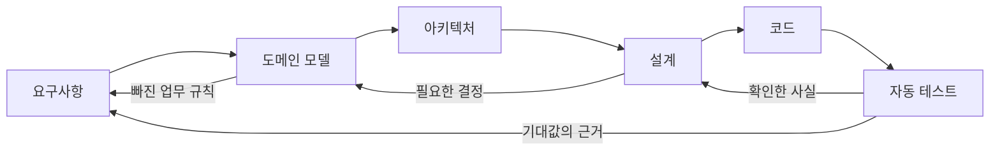
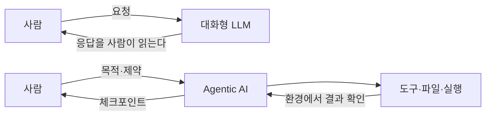

--------------------
Session 명: 01. AI-native SW 공학 개요
--------------------

## 목차

01. 세션 목표
02. AI와 LLM이 바꾼 것
03. SW 공학의 본질과 AI의 변화
04. 공학 활동과 산출물
05. 인간과 AI의 협업
06. Prompt Engineering의 기본
07. 대화형 LLM과 Agentic AI
08. 실습 환경 설정
09. 요약

## 01. 세션 목표

AI는 코드를 개발하는 부담을 크게 줄였다. **무엇을 만들지 정하는 일**과 **그 결과에 대한 책임**은 사람에게 있다.

- **AI와 LLM이 무엇을 바꿨는지 사실로 확인한다** — 싸진 것은 **코드를 얻는 일**이고 **병목은 정하고 판정하는 쪽**으로 옮겨 갔으며, 도구는 **이미 가진 역량을 증폭한다**.
- **유지되는 원칙과 달라지는 수행 방식을 구분한다** — 소프트웨어가 어려운 이유와 판단 기준은 그대로이고, 누가 무엇을 만들고 무엇으로 확인하는지가 달라진다.
- **사람과 AI가 각각 못 하는 것을 알고 일을 나눈다** — AI가 **어려워하는 일과 그 결과의 모습**, 사람이 **놓치는 자리**를 보고 **업무 규칙을 정하는 일·코드를 만드는 일·결과를 확인하는 일**로 나눈다.
- **AI를 쓰는 방식을 선택하고 그에 맞게 갖춘다** — 요청을 **목적·입력·제약·기대 결과·피드백**으로 구성하고, **대화형 LLM과 Agentic AI** 가운데 작업에 맞는 쪽을 선택하며 **맡기려면 무엇을 미리 갖춰야 하는지** 안다.

**강사 노트**

- 이 세션은 과정의 지도다. 어휘와 판단의 틀을 주고, 활동마다의 깊이는 해당 세션이 맡는다.
- 거버닝 메시지는 "SW 공학의 목적과 본질적 원칙은 유지되지만 수행 방식은 달라진다"다. 02가 「달라진다」를 사실로 세우고, 03이 「유지된다」를, 04와 05가 「수행 방식」을, 06과 07이 그 수행에 쓰는 도구를 받친다.
- 목표 네 줄이 본문 여섯 주제를 덮고 요약 네 줄이 그것을 그대로 확인한다 — 첫 줄은 02, 둘째 줄은 03·04, 셋째 줄은 03의 한계와 05, 넷째 줄은 06·07이다.
- **목표를 먼저 보이고 02가 그 목표를 사실로 받친다.** 첫 줄이 왜 거기 있는지는 02의 세 장이 답한다 — 목표를 읽을 때 수긍되지 않아도 02를 지나면 수긍된다.
- 목표의 「어려워하는 일」과 「놓치는 자리」는 승인 Course Design의 교육 목표 3(인간과 AI의 능력과 제약을 식별한다)에서 왔다. 그 둘을 빼면 이 세션은 목표 3을 덮지 못한다.
- 강의는 30분이고 환경 설정이 20분이다. 08은 안내 1분이며 나머지는 수강생의 설치 시간이다.

---

## 02. AI와 LLM이 바꾼 것

## 코드를 얻는 일이 싸졌다

**LLM이 코드를 쓰는 것은 이제 전제다.** 싸진 것은 코드를 얻는 일이고, 그만큼 **무엇을 만들지 정하는 일**이 전체 비용에서 차지하는 몫이 커졌다.

- **몇 초에 얻는다** — 익숙한 골격, 다른 형태로의 변환, 테스트 코드는 사람이 며칠을 쓰던 일이었다.
- **정하지 않은 것이 드러난다** — 코드를 얻는 데 시간이 걸리지 않으면 그 코드가 **무엇을 해야 하는지 정하지 않은 상태**가 그대로 드러난다.
- **병목이 옮겨 갔다** — 일의 속도를 정하는 것은 더 빨리 만드는 쪽이 아니라 **무엇을 만들지 정하고 그 결과를 판정하는 쪽**이다.

**인용문**

병목은 **AI가 아니라 사람**이다, "humans are the bottleneck, not the ai", [Hassan 외 2026]

**강사 노트**

- 이 장이 본문의 출발점이다. 「AI가 무엇을 못 하는가」로 시작하지 않고 **무엇이 실제로 달라졌는지**로 시작한다 — 달라진 것을 먼저 인정해야 뒤의 균형이 설득된다.
- 관통 사례(쇼핑몰 「주문한다」)는 이 장에서 쓰지 않는다. 사례는 「03. SW 공학의 본질과 AI의 변화」의 한 줄 요청에서 세운다.
- 인용은 **병목의 자리**를 받치는 범위에서 쓴다. 저자들은 AI 시대의 SW 공학 비전을 논하며 사람의 검토·판단이 처리량을 제한한다고 적었다.
- "그럼 개발자가 필요 없어지나"를 물으면 이 장의 셋째 줄로 답한다. 없어지는 것이 아니라 **하는 일이 옮겨 간다**.

---

## 빨라졌다는 느낌과 측정이 어긋났다

**느낌은 증거가 아니다.** 숙련 개발자를 측정했더니 AI를 쓴 쪽이 **19% 더 오래 걸렸고**, 당사자들은 그것을 겪은 뒤에도 빨라졌다고 믿었다.

- **기대는 24% 단축** — 재기 전에는 AI가 작업 시간을 그만큼 줄여 줄 것으로 예상했다.
- **측정은 19% 지연** — 같은 사람들이 **자기 저장소의 실제 과제**를 수행한 결과다.
- **겪은 뒤에도 20% 단축으로 느꼈다** — 느려지는 것을 **직접 경험한 뒤에도** 빨라졌다고 믿었다.
- **부분의 속도는 전체의 생산성이 아니다** — 생성은 몇 초지만 **읽고 판정하고 고쳐 넣는 시간**은 사람의 것이다. 코드가 나오는 속도만으로 AI 활용의 효과를 판단하지 않는다.

**인용문**

개발자가 AI 도구를 쓸 수 있을 때 같은 과제를 끝내는 데 **19% 더 걸렸다**, "when developers are allowed to use ai tools, they take 19% longer to complete issues", [METR 2025]

**강사 노트**

- 기대 24%·체감 20%의 근거는 같은 글의 "developers expected ai to speed them up by 24%, and even after experiencing the slowdown, they still believed ai had sped them up by 20%"다([METR 2025]).
- 이 연구는 **경험 있는 오픈소스 개발자**가 **자기 저장소의 실제 과제**를 수행한 조건의 측정이다. 익숙하지 않은 코드나 새 프로젝트로 일반화하지 않는다.
- 이 장의 쓸모는 숫자가 아니라 **느낌과 측정이 어긋난다**는 사실이다. 그래서 이 과정은 판정 수단을 갖추는 일을 계속 다룬다.
- 반론이 나오면 받아 준다 — 빨라진 경험도 사실이다. 가릴 수 없는 것은 **무엇이 빨라졌는지 재지 않은 상태**다.

---

## 같은 도구가 사람에 따라 다른 결과를 낸다

**같은 도구를 써도 결과가 같지 않다.** 공학 역량과 활용 조건이 결과를 가른다 — 그래서 AI를 쓸수록 공학이 덜 필요해지지 않는다.

- **요구를 분명히 할 수 있는 사람이 더 좋은 결과를 얻는다** — 같은 모델에 같은 도구를 써도 요청이 담은 결정의 양이 다르다.
- **판정 기준이 있는 사람만 결과를 받아들일지 정할 수 있다** — 기준이 없으면 돌아가는 것을 보고 받아들이게 된다.
- **당장의 속도만으로 판단하지 않는다** — 빨리 얻은 코드가 **나중의 유지보수 문제**로 돌아오면 초기 이득은 상쇄된다.

**인용문**

AI 도구는 **이미 가진 전문성**을 증폭한다, "ai tools amplify existing expertise. the more skills and experience you have as a software engineer the faster and better the results you can get from working with llms and coding agents", [Willison 2025b]

**강사 노트**

- 셋째 줄의 근거는 "initial speed gains risk being fully canceled out by downstream maintainability problems"다([Hassan 외 2026]).
- 이 장이 남기는 질문은 **그 역량이 무엇인가**다. 앞 장에서 읽은 목표 네 줄이 그 답의 목록이고, 03부터가 하나씩 받는다. 목표로 한 번 돌아가 첫 줄을 다시 읽는다.
- 수강생의 경력이 섞여 있으면 이 장에서 한 번 묻는다 — 지금 쓰고 있는 도구와 그 결과를 무엇으로 확인하는지. 07의 방식 선택에서 다시 쓴다.

---

## 03. SW 공학의 본질과 AI의 변화

## AI는 본질적 어려움을 없애지 못한다

AI는 구현의 부담을 줄이지만 **SW 공학의 본질적 어려움을 대체하지는 않는다.** 잘하는 일과 어려워하는 일을 섞으면 "AI가 다 한다"와 "AI는 쓸 수 없다"가 모두 나온다.

- **AI가 잘하는 일** — 반복되는 코드 작성, 다른 형태로의 변환, 테스트 코드 작성, 익숙한 골격 채우기다. 사람보다 빠르고 싸다.
- **AI가 하지 못하는 일** — 요청에 없는 업무 결정을 **제안하거나 임의로 채울 수는 있어도**, 그것이 업무적으로 맞는지 **판정**할 수 없다. 자기 결과의 판정, 같은 입력에 **같은 결과**, 주어지지 않은 **맥락의 사실**도 같다.
- **사람이 해야 할 일** — 목표와 요구사항을 명확히 하고, **업무 규칙과 수용 조건을 결정하고 확인하는 일**이다. 무엇을 만들어야 하는지는 그것을 요청한 사람만 안다.

브룩스는 소프트웨어의 어려움을 **본질과 우연**으로 40년 전에 나눴다. 도구가 좋아지면 줄어드는 쪽은 우연이다.

**인용문**

나는 어려움을 **본질**, 곧 소프트웨어의 본성에 내재한 어려움과, **우연**, 곧 오늘의 생산 과정에 따라붙지만 내재하지는 않은 어려움으로 나눈다, "following aristotle, i divide them into essence, the difficulties inherent in the nature of the software, and accidents, those difficulties which today attend its production but which are not inherent", [Brooks 1986]

**강사 노트**

- 인용은 **구분의 근거**로만 쓴다. "AI도 본질적 어려움을 없애지 못한다"는 **이 과정의 판단**이다 — 브룩스는 AI에 대해 말하지 않았다.
- 브룩스가 essence의 내용으로 든 특성은 복잡성·순응성(Conformity)·변경 가능성·비가시성이다. 이 과정이 다루는 어려움은 복잡성·불확실성·변경·협업이고, 겹치는 것은 복잡성과 변경뿐이므로 두 목록을 하나로 나열하지 않는다.
- 질문이 나오면 쓸 근거 — 복잡성이 본질 쪽이라는 브룩스의 문장은 "the complexity of software is an essential property, not an accidental one"이다.
- "그러면 AI로 무엇이 실제로 줄었나"를 물으면 첫 줄로 돌아간다. 줄어든 것을 부정하지 않는 것이 이 장의 균형이다.

---

## 유지되는 것과 달라지는 것

**무엇을 만들지 정하는 일이 가장 어렵다.** 요청에 없는 조건은 AI가 알 수 없다.

업무 담당자가 준 요청은 한 줄이다.

"장바구니에 담은 상품을 결제하면 주문이 되고 배송이 시작되게 해 주세요."

- 이 한 줄로 요청하면 **실행되는 코드**가 나온다. 그러나 **정해지지 않은 조건**이 남아 있다 — 결제가 거절되면 주문을 어떻게 처리하는가? 이런 빈칸이 더 있다.
- **AI가 수행할 수 있는 일** — 주문을 만들고 상태를 바꾸고 외부 시스템을 호출하는 코드와 테스트다.
- **사람이 확인하고 결정할 일** — 빈칸을 찾아 업무 담당자에게 묻고, 정한 규칙을 기록한다.
- 정하지 않으면 **AI가 임의로 채우고, 그 결과는 고장 난 코드가 아니라 그럴듯한 코드로 나타난다** — 요청에 없던 규칙이 들어가 있고, 코드와 테스트를 함께 생성하면 **잘못 가정한 규칙에 맞춰 테스트까지 통과할 위험**이 있다. 돌아가는 것을 보고는 알 수 없고, **무엇을 정해야 하는지 알아야** 빈칸이 보인다.

**인용문**

소프트웨어 시스템을 만드는 일에서 **가장 어려운 단 하나의 부분**은 무엇을 만들지 정확히 정하는 것이다, "the hardest single part of building a software system is deciding precisely what to build", [Brooks 1986]

**강사 노트**

- 요청 한 줄은 `course-design.md`의 공통 전제에 있는 문장 그대로다. 과정의 모든 세션과 실습이 같은 요청에서 출발한다.
- **결제 거절은 질문으로만 둔다.** 취소인지, 기다리는지, 다른 길이 있는지 **어느 쪽도 말하지 않는다.** 그 답을 식별하는 것이 "세션 02. 요구사항"의 첫 실습 과제다.
- 수강생이 답을 물으면 "업무 담당자만 정할 수 있고, 그것을 알아내는 방법이 다음 세션"이라고 답한다.
- 이 장이 브룩스의 두 번째 인용을 받친다 — 코드를 만드는 일이 아니라 **무엇을 만들지 정하는 일**이 남은 어려움이다.

---

## 04. 공학 활동과 산출물

## 활동마다 다른 결정을 내린다

요구·분석·설계·구현·테스트는 **서로 다른 질문**에 답한다. 결정이 섞여 있으면 **어느 결정이 틀렸는지 가릴 수 없고**, 가릴 수 없으면 고칠 수 없다.

**도식 — Mermaid — 활동의 결정과 산출물, 그리고 피드백**

- 앞으로 가는 화살표는 **결정을 넘긴다**. 돌아오는 화살표는 **피드백**이다 — 검증 결과에 따라 앞의 요구사항·모델·설계를 **다시 검토하고 고치는 일**이다.
- 실제 작업은 이 흐름을 **반복한다.** 한 번에 끝나는 절차가 아니다.
- 구현도 **선행 결정을 옮기는 일만이 아니다** — 코드에서 비로소 드러나는 기술적 판단이 있고, 그 판단이 앞 결정을 고치게 만든다.

**강사 노트**

- 이 도식이 과정 전체의 지도다. 노드마다 어느 세션이 맡는지 짚는다 — 요구사항은 "세션 02. 요구사항", 도메인 모델은 "세션 03. 도메인 모델 — 정적 관점"과 "세션 04. 도메인 모델 — 동적 관점", 아키텍처는 "세션 05. 아키텍처", 설계는 "세션 06. 설계", 코드는 "세션 07. 설계에서 코드로", 자동 테스트는 "세션 08. 자동 테스트와 CI로 확인"이다.
- 피드백 화살표를 빠르게 지나가지 않는다. 한 방향으로만 읽히면 이 흐름을 단계별 절차로 오해한다.

---

## 활동마다 AI가 하는 일이 다르다

**AI는 모든 활동에 참여하지만 맡는 몫과 사람이 확인할 것은 활동마다 다르다.** 어느 활동에서든 AI가 내놓는 것은 **초안과 반복**이고, 달라지는 것은 **무엇을 보고 받아들이느냐**다.

**표 — 활동마다 AI가 하는 일과 사람이 확인할 것**

| 활동 | AI가 하는 일 | 사람이 확인할 것 |
|---|---|---|
| 요구사항 | 질문과 초안을 쓴다 | 업무 의도·규칙·범위 |
| 도메인 모델 | 개념·관계·상태의 초안을 만든다 | 업무 의미와 정합성 |
| 아키텍처·설계 | 대안을 만들고 영향을 짚는다 | 품질 속성·제약과 Trade-off |
| 코드 | 생성·수정·변환을 반복한다 | 설계·계약·업무 규칙과의 일치 |
| 자동 테스트 | 테스트를 만들고 실행한다 | 기대값의 근거와 테스트의 적절성 |

- **아래로 갈수록 기계가 판정할 수 있다** — 코드와 테스트는 컴파일과 실행으로 틀렸음을 바로 안다. **위로 갈수록 업무 담당자만 판정할 수 있다.**
- **그래서 위가 비면 아래의 확인이 모두 흔들린다** — 결제 거절의 처리를 정하지 않으면 AI는 다섯 활동 모두에서 그럴듯한 초안을 내놓지만, 그 어느 것도 **맞는지 판정할 근거가 없다.**
- **빨라지는 쪽과 줄지 않는 쪽이 갈린다** — 왼쪽 칸은 AI로 싸졌고, 오른쪽 칸은 사람의 시간으로 남는다.

**강사 노트**

- 이 장이 거버닝 메시지의 「수행 방식은 달라진다」를 활동 단위로 보이는 자리다. 승인 Course Design의 교육 목표 2(활동별로 달라지는 수행 방식을 안다)가 이 장을 요구한다.
- **깊이는 여기서 주지 않는다.** 각 활동에서 실제로 무엇을 어떻게 요청하고 확인하는지는 그 활동을 맡는 세션이 사례로 다룬다 — 이 표는 어느 세션에서 무엇을 배울지 가리키는 지도다.
- 오른쪽 칸을 빠르게 지나가지 않는다. 수강생이 기억할 것은 왼쪽이 아니라 **오른쪽**이다.
- 자기 업무의 활동 하나를 떠올려 오른쪽 칸을 채워 보게 한다. 답을 받지는 않는다.

---

## 산출물은 결정을 기록해 전달한다

산출물은 **결정한 내용을 기록한 것**이다. 다른 사람과 AI가 그 기록을 읽고 이해하고, 구현하고, 검증한다.

**표 — 활동의 질문과 검증 기준**

| 활동 | 무엇을 결정하는가? | 무엇으로 검증하는가? |
|---|---|---|
| 요구사항 | 누가 어떤 결과를 왜 원하는가? | 업무 담당자의 확인, 수용 기준 |
| 도메인 모델 | 업무 개념이 무엇을 뜻하고 어떻게 행동하는가? | 업무 규칙과의 대조, 정적·동적 교차 검증 |
| 아키텍처·설계 | 어떤 구조와 협력으로 실현하는가? | 품질 속성의 충족, 의존 규칙 |
| 코드 | 어떻게 실행하는가? | 컴파일, 정적 검사 |
| 자동 테스트 | 기대한 조건을 지키는가? | 실행 결과 |

- **필수적인 것은 판단이고 문서의 형식은 선택할 수 있다** — 무엇을 원하는지, 무엇이면 된 것인지, 무엇을 코드와 테스트에서 확인하는지는 반드시 정한다. 요구사항 정의서·사용자 스토리·도메인 모델은 그것을 적는 방법이고, 업무와 기술의 복잡성을 보고 **필요한 것만** 만든다.
- **산출물을 만들지 결정하는 질문** — 그 산출물이 **AI의 결과나 사람의 확인에 영향을 미치는가?** 생성 부담은 줄어들지만 **읽고 확인하는 일까지 줄지는 않는다.**
- 결제 거절의 처리를 정했다면 **요구사항에 적어야** AI가 그대로 구현하고 테스트가 그 조건을 확인한다. 적지 않으면 다음 사람도, AI도 그 결정을 알 수 없다.

**강사 노트**

- 표의 「무엇으로 검증하는가」는 그 활동의 결정을 **가장 싸게 확인하는 수단**이라는 뜻이다. 먼 검증으로 가까운 결정을 확인하면 무엇이 틀렸는지 가릴 수 없다.
- 「검사 통과는 검사한 조건에 관한 증거이며 전체 품질을 보장하지 않는다」를 여기서 한 번 말해 둔다. "세션 08. 자동 테스트와 CI로 확인"이 이어받는다.
- 두 복잡성으로 중간 산출물을 고르는 것은 `guides/sw-engineering-principles.md`의 과정 공통 원칙이다. **문서를 남기지 않는 선택은 판단을 건너뛰는 것과 다르다.**
- 어떤 형식을 쓸지는 이 세션이 정하지 않는다. 요구사항의 형식은 "세션 02. 요구사항"이, 모델의 형식은 그 뒤 두 세션이 정한다.

---

## 05. 인간과 AI의 협업

## 역할은 작업에 따라 달라진다

**사람과 AI는 서로 다른 것을 못한다.** AI는 요청에 없는 것을 모르고, 사람은 **모르는 빈칸을 알아보기 어렵고 많은 양을 끝까지 꼼꼼히 읽지 못한다.** 그래서 분업은 고정적인 것이 아니라 아래 요소를 보고 작업마다 다시 나눈다.

**표 — 분업을 판단하는 요소**

| 요소 | 무엇을 묻는가? |
|---|---|
| 능력 | 그 일을 해낼 수 있는가? |
| 지식 | 판단에 필요한 업무 지식이 있는가? |
| 맥락 | 선행 결정이 전달됐는가? |
| 권한 | 결정할 자격이 있는가? |
| 책임 | 결과를 제공하는 사람이 누구인가? |
| 검증 가능성 | 결과를 확인할 수단이 있는가? |
| 위험 | 틀리면 무엇을 잃는가? |
| 복구 가능성 | 롤백할 수 있는가? |
| 비용 | 시간과 비용이 얼마나 드는가? |

**강사 노트**

- 표의 아홉 줄을 차례로 읽지 않는다. 다음 장의 3가지 일을 짚으면서 그때 결정적인 요소만 가리킨다.
- 과정이 쓰지 않는 배치 — "AI는 실행만, 사람은 결정과 검증만"처럼 역할을 고정하는 구분이다. 일자 구분도 역할 경계가 아니다.
- 수강생의 직무에 따라 결정적인 요소가 달라진다. "세션 12. 내 일에 적용하기"가 이 표를 다시 쓴다.

---

## 결제 거절의 처리에서 역할을 나눈다

업무 담당자가 "결제가 거절되면 어떻게 하는가"에 답하면, 그 하나의 결정이 **규칙을 정하는 일·코드를 쓰는 일·결과를 확인하는 일** 3가지로 갈라지고 일마다 맡는 쪽이 다르다.

- **업무 규칙을 정하는 일 — 사람이 책임진다** — 업무 담당자에게 물어 확정하고 요구사항에 적는다. **지식과 권한**의 문제라 조건이 달라져도 이 하나는 바뀌지 않는다.
- **코드를 작성하는 일 — 조건이 맞으면 맡긴다** — 규칙과 설계가 정해져 있으면 **능력과 비용**에서 AI가 낫다. 규칙이 정해지지 않았으면 맡길 수 없다.
- **결과를 확인하는 일 — 실행은 맡기고 수용은 사람이 한다** — 테스트는 기계가 돌리지만 **그 결과를 받아들일지**는 기준을 가진 사람이 정한다. 결제는 돈이 걸려 **위험**이 크고, 테스트로 확인할 수 있어 **검증 가능성**은 높다.
- **순서가 고정된 것도 아니다** — 코드를 써 보고 규칙의 빈칸이 드러나면 업무 담당자에게 **다시 묻는다.**

**강사 노트**

- 이 장이 앞 표의 적용이다. 아홉 요소 가운데 이 작업에서 결정적인 것은 **지식·권한·능력·비용·위험·검증 가능성**이고, 나머지는 다른 작업에서 결정적이 된다.
- 수강생에게 자기 업무의 작업 하나를 떠올려 같은 식으로 3가지로 갈라 보게 한다. 답을 받지는 않는다 — "세션 12. 내 일에 적용하기"의 준비다.

---

## AI가 만든 결과의 책임은 사람에게 있다

AI의 활용 범위가 넓어져도 **그 결과에 대한 책임은 사람에게 있다.**

- 책임은 그 소프트웨어를 **개발하고 제공하는 조직과 담당자**에게 있다. **AI가 만들었다는 것은 책임을 덜어 주는 근거가 되지 않는다.**
- 그래서 "AI가 할 수 있는가"만 묻지 않고 **"무엇으로 확인할 것인가"**를 함께 묻는다.
- 확인할 수단이 없는 일을 맡기면, **결과가 맞는지 모르는 채로 그 결과를 고객에게 제공하게 된다.**

**인용문**

숙련된 전문가는 LLM으로 작업을 가속하면서도 자신이 만든 소프트웨어에 **당당하고 분명하게 책임을 진다**, "seasoned professionals accelerate their work with llms while staying proudly and confidently accountable for the software they produce", [Willison 2025b]

**강사 노트**

- Willison의 글은 독립 실무 분석이다. 보편 공학 원칙으로 일반화하지 않고 「책임의 소재」를 받치는 범위에서 쓴다.
- 실증 연구를 묻는 수강생에게 — 조건이 결과를 바꾼다. 숙련 개발자가 익숙한 저장소에서 더 느려진 측정도 있고([METR 2025]), 조직 수준에서 AI가 기존의 강점과 약점을 모두 키운다는 보고도 있다("ai is an amplifier", [DORA 2025]). 둘을 한쪽 결론으로 합치지 않는다.
- 이 장은 2분을 넘기지 않는다. 책임을 길게 말하면 과정이 위험 교육처럼 읽힌다.

---

## 06. Prompt Engineering의 기본

**무엇을 시키고 무엇을 금지했는지에 따라 결과가 달라진다.** 그래서 AI 상호작용은 요령이 아니라 구성의 문제이고, 구성에서 묻는 것은 **목적·입력·제약·기대 결과·피드백** 5가지다. 아래는 **결제 거절의 처리를 정하기 전에 확인할 질문을 뽑는 요청**을 그 5가지로 구성한 것이다.

- **목적** — 무엇을 위해 하는 일인가? 업무 담당자에게 물을 질문을 뽑는 것이고, 요구사항을 쓰기 전에 쓴다.
- **입력** — 무엇을 제공하는가? 업무 요청 한 줄과 지금까지 확정된 업무 규칙, 주문 상태의 의미다.
- **제약** — 무엇을 하지 말아야 하는가? **정해지지 않은 규칙을 임의로 정하지 않는다**, 구현 방법은 쓰지 않는다.
- **기대 결과** — 어떤 모습이면 되는가? 질문 목록과 각 질문이 필요한 이유, 한 쪽 분량이다.
- **피드백** — 잘못되었을 때 무엇을 피드백하는가? AI가 임의로 정한 항목을 **지목해 질문으로 바꾸게 한다.** 정확한 요청을 한 번에 찾는 것이 아니라 **고쳐 가는 고리를 설계하는 것**이다.

**강사 노트**

- 환경 설정의 마지막 단계에서 수강생이 같은 요청을 두 번 보낸다 — 목적과 제약 없이 한 번, 5가지를 갖춰 한 번이다.
- **같은 입력에 같은 결과가 오지 않는다.** 그래서 다시 실행할 수 있다는 것과 같은 결과가 나온다는 것은 다르다. 재현성을 묻는 질문에만 답하고 본문에서는 다루지 않는다 — "세션 10. AI 활용 및 통제 기법"이 평가와 함께 다룬다.
- 프롬프트 작성 요령 목록은 과정의 제외 범위다. 요령을 묻는 질문은 "무엇을 확인하려는 요청인가"로 되돌린다.
- 맥락을 고르고 관리하는 방법은 "세션 07. 설계에서 코드로"의 Context Engineering이 맡는다. 여기서는 5가지까지다.

---

## 07. 대화형 LLM과 Agentic AI

## 반복을 누가 돌리는가?

대화형 LLM과 Agentic AI의 차이는 능력의 크기가 아니라 **반복을 누가 돌리고 결과를 어디서 확인하는가**다.

**도식 — Mermaid — 두 방식의 반복 구조와 통제 지점**

- **대화형 LLM** — 사람이 응답을 읽고 다음 요청을 이어 간다. 확인은 **사람이 매 회** 한다.
- **Agentic AI** — AI가 도구를 사용하고 **실행 결과를 바탕으로 여러 작업을 이어 간다.** 사람은 **체크포인트**에서 개입한다.
- **확인 지점이 다르다** — 실행 환경은 컴파일·테스트처럼 **기술적으로 판정할 수 있는 것**만 알려 준다. **업무적으로 맞는지는 사람이 확인한다.**

**강사 노트**

- 인용으로 받칠 수 있는 대목 — 에이전트가 각 단계에서 환경으로부터 "ground truth"를 얻는 것이 결정적이라는 것, 그리고 체크포인트나 막힌 지점에서 사람의 피드백을 위해 멈출 수 있다는 것이다([Anthropic 2024]).
- **Agentic이 업무적 정확성을 스스로 판정한다고 말하지 않는다.** 환경이 주는 판정은 실행이 되는지, 테스트가 통과하는지까지다.
- 제품 화면이나 명령 이름을 보이지 않는다. 다음 20분에 수강생이 직접 Agentic 도구를 설치하므로 여기서는 구조만 본다.
- 작업 분해·도구 설계·자율성 수준의 구성 방법은 "세션 10. AI 활용 및 통제 기법"이 맡는다.

---

## 맡기려면 미리 갖춰야 할 것이 있다

대화형에서는 사람이 매 회 읽고 다음 요청을 만든다. **Agentic에서는 그 판단을 미리 심어 두어야 한다** — AI가 스스로 하지 못하는 것을 사람이 환경으로 메운다.

**표 — Agentic에 맡기기 전에 갖출 것**

| 갖출 것 | 무엇을 정하는가? | 어디서 배우는가? |
|---|---|---|
| 맥락 | 무엇을 읽게 할 것인가? | "세션 07. 설계에서 코드로" |
| 도구와 권한 | 무엇을 하게 할 것인가? | "세션 08. 자동 테스트와 CI로 확인" |
| 검증 수단 | 무엇으로 판정할 것인가? | "세션 08. 자동 테스트와 CI로 확인" |
| 멈추는 자리 | 언제 사람에게 오는가? | "세션 10. AI 활용 및 통제 기법" |

- **검증 수단이 없으면 환경은 아무 말도 못 한다** — 테스트와 정적 검사가 있어야 실행 결과가 판정이 된다. 그것이 없는 일을 맡기면 결과를 읽어 줄 사람이 다시 필요하다.
- **둘 다 요청과 맥락이 필요하다 — 다른 것은 갖추는 시점이다** — 대화형은 매 회 사람이 보충하지만, Agentic은 실행이 이어지는 동안 사람이 끼어들지 않으므로 **미리 환경에 넣어 두어야 한다.** 「AI-native」라고 부르는 수행 방식의 변화가 그 차이다.

**강사 노트**

- 이 장은 지도다. 넷을 설명하지 않고 **이름과 그 세션만 짚는다.** 맥락을 고르는 방법은 "세션 07. 설계에서 코드로", Guardrails와 Harness는 "세션 08. 자동 테스트와 CI로 확인", 작업 분해와 자율성 수준은 "세션 10. AI 활용 및 통제 기법"이 맡는다. 여기서 깊이 들어가면 뒤 세션이 빈다.
- 20분 뒤 수강생이 설치하는 것이 바로 이 환경이다 — `./gradlew check`가 「검증 수단」이고 배포 폴더가 「도구와 권한」의 범위다. 환경 설정을 이 장과 이어서 말한다.
- 3분이다. 표를 한 줄씩 읽지 말고 마지막 문장으로 닫는다.

---

## 작업에 맞는 방식을 선택한다

**인용문**

에이전트는 LLM이 **자신의 절차와 도구 사용을 스스로 지시하며** 과제를 어떻게 달성할지에 대한 **통제를 유지하는** 시스템이다, "agents, on the other hand, are systems where llms dynamically direct their own processes and tool usage, maintaining control over how they accomplish tasks", [Anthropic 2024]

- **한 가지 조건으로 정해지지 않는다** — **작업의 복잡성과 반복성, 도구 접근, 검증 가능성, 위험, 실행 시간과 비용**을 함께 본다.
- **실행 시간과 비용은 성능과 교환된다** — Agentic은 여러 번 실행하므로 작업이 끝날 때까지 걸리는 시간(지연, latency)과 비용이 늘며, **그만큼 더 나은 결과를 얻을 때만** 맞는 교환이다.
- **골라 보기** — 업무 담당자에게 물을 **질문 몇 개를 쓰는 일**은 대화형으로 족하다. **여러 파일을 고치고 테스트를 반복 실행하는 일**은 도구 접근과 검증 수단이 있는 Agentic이 낫다. **판정할 수 없고 되돌리기 어려운 일**은 범위를 좁히거나 사람이 한다.
- 이 과정의 실습에서는 요구사항과 모델은 **대화형**으로 다루고, 반복이 많고 **실행 결과 판정이 가능한** 구현과 검증은 **Agentic** 도구로 수행한다.

**인용문**

에이전트 시스템은 더 나은 과제 수행을 위해 흔히 **지연과 비용을 내주며**, 이 **교환이 언제 타당한지** 고려해야 한다, "agentic systems often trade latency and cost for better task performance, and you should consider when this tradeoff makes sense", [Anthropic 2024]

**강사 노트**

- 지연(latency)은 **요청을 보낸 뒤 작업이 끝날 때까지 걸리는 시간**이다. Agentic은 도구 실행과 재시도를 여러 번 거치므로 한 번의 응답보다 오래 걸린다.
- 가장 단순한 해법에서 시작하고 필요할 때만 복잡성을 더하라는 같은 글의 권고도 함께 쓸 수 있다 — 에이전트 시스템을 아예 만들지 않는 선택도 포함한다.
- [Anthropic 2024]는 벤더의 기술 원리 자료다. 원리와 적용 범위에서 쓰고 보편 공학 원칙으로 일반화하지 않는다.
- Guardrails와 Harness는 "세션 08. 자동 테스트와 CI로 확인"에서 처음 다룬다. 질문이 나오면 그 세션을 가리킨다.

---

## 08. 실습 환경 설정

## 설치 순서와 실행 명령

이후 실습에서 코드를 생성하고 **로컬에서 검증**하기 위한 환경을 각자 PC에 설치한다. 준비물은 받은 **`AI_native` 폴더**와 Claude 계정이고, 모든 작업은 **다운로드 폴더의 `AI_native`** 안에서 한다.

**표 — 5단계의 터미널·명령·확인**

| 단계 | 터미널 | 실행 명령 | 확인할 결과 |
|---|---|---|---|
| 1 | — | 폴더를 다운로드 폴더에 복사 | `bootstrap.ps1`이 보인다 |
| 2 | PowerShell | `bootstrap.ps1 실행` | Git과 Git Bash가 PASS |
| 3 | Git Bash | `./setup.sh` | 마지막 줄이 `FAIL 0` |
| 4 | Git Bash | `claude` | 로그인하면 대화가 시작 |
| 5 | Git Bash | `./verify.sh` | `FAIL 0`이고 요약이 PASS |

- **2단계 PowerShell** — 탐색기에서 `AI_native` 폴더를 열고 주소창에 `powershell`을 입력한 뒤, `powershell -ExecutionPolicy Bypass -File bootstrap.ps1`을 실행한다.
- **3~5단계 Git Bash** — 같은 폴더에서 마우스 오른쪽, `Git Bash Here`를 선택한다. 3개 단계를 **그 한 창에서** 이어 한다.
- 폴더를 다른 곳으로 옮기지 않는다. 스크립트가 **자기 폴더를 기준으로** 나머지 파일을 찾으므로 경로를 입력할 일이 없다.

**강사 노트**

- 20분 목표 배분 — Git 확보 4분, 도구와 의존성 6분, 로그인 3분, `verify.sh` 5분, 마무리 2분. **추정이며 파일럿에서 확정한다.**
- **13분에 분기한다.** 그때 3단계를 넘지 못한 수강생은 대체 경로로 돌리고 세션을 끝낸다. 20분을 넘겨 "세션 02. 요구사항"을 밀지 않는다.
- 사전 안내로 계정 발급과 `AI_native` 폴더를 미리 보낸 상태를 전제한다. 사내 네트워크에서 설치 패키지를 받지 못하면 폴더의 오프라인 설치 파일이 유일한 경로다.
- 다운로드 폴더의 위치를 불러 주지 않는다 — OneDrive로 옮겨져 있을 수 있다. 탐색기에서 폴더를 열고 주소창에 `powershell`을 입력하는 방법이 위치와 무관하게 통한다.
- 사용자 이름이 한글이거나 경로에 공백이 있으면 `setup.sh`가 같은 폴더의 짧은 이름으로 도구를 설치한다. 얻지 못하면 그 사실과 원인을 알린다 — **그 조건은 검증되지 않았다.**
- 배포 폴더의 원본은 저장소의 `sessions/code/s01/`이다 — `code/s01/bootstrap.ps1`, `code/s01/setup.sh`, `code/s01/verify.sh`, 최소 Java 검증 프로젝트 `code/s01/project`, 품질 게이트 검출 확인용 예시 `code/s01/samples`, 줄바꿈 규칙 `code/s01/.gitattributes`, 생성물 제외 `code/s01/.gitignore`다.
- 흔한 실패와 조치, 설치 파일의 준비 방법은 `code/s01/README.md`가 소유한다. **설치 파일은 저장소에 없다.**

---

## 검증 결과 확인과 대체 경로

`verify.sh`는 항목마다 **PASS·FAIL·미검증**을 낸다. 마지막 줄의 요약을 보고 다음을 판단한다.

- **모두 PASS이면 끝이다** — Java 21, Git, Claude Code, Gradle Wrapper가 실행되고 `./gradlew check`가 **컴파일·Checkstyle·JUnit**을 통과했다는 뜻이다.
- **이것은 로컬 품질 게이트 PASS다.** 이 과정은 CI 파이프라인을 만들지 않으므로 「CI 통과」라고 말하지 않는다. **실행한 검사가 통과했다는 증거이며** 코드가 업무 규칙에 맞다는 뜻도 아니다.
- **FAIL이면 출력의 원인 줄을 그대로 읽는다.** 네트워크 차단, 설치 권한, 경로에 들어간 한글·공백이 흔한 원인이고, 조치가 함께 출력된다.
- **미검증은 PASS가 아니다** — 로그인처럼 스크립트가 판정하지 않는 항목이다.
- **20분에 끝나지 않으면 이어지는 휴식 10분에 계속한다.** 그래도 준비되지 않으면 **대화형 Claude로 이후 실습에 참여한다.**

대체 경로는 **공식 경로이며 예외 처리가 아니다.** 실습의 공학 활동은 같고, **실제 빌드·정적 검사·테스트 실행을 거치지 않는다**는 점만 다르다.

**강사 노트**

- 강사가 개입하는 기준 — 같은 FAIL이 3명 이상에게 나오면 전체에 알리고, 1~2명이면 대체 경로로 보낸 뒤 휴식 시간에 본다. 개인 PC의 보안 정책은 교육 시간에 풀지 않는다.
- 대체 경로로 간 수강생의 산출물에는 **실행 검증이 없다**는 것을 본인이 알고 있어야 한다. "세션 07. 설계에서 코드로"와 "세션 08. 자동 테스트와 CI로 확인"에서 그 차이를 다시 밝힌다.

---

## 09. 요약

### 세션 핵심

- **AI와 LLM이 바꾼 것** — 싸진 것은 **코드를 얻는 일**이고 병목은 **정하고 판정하는 쪽**으로 옮겨 갔다. 느낌과 측정은 어긋날 수 있으며 도구는 **이미 가진 역량을 증폭한다.**
- **목적과 본질적 원칙은 유지되고 수행 방식이 달라진다** — 남은 어려움은 **무엇을 만들지 정하는 일**이다. 활동마다 결정과 **검증 기준**이 다르고 **산출물**이 그 결정을 기록해 사람과 AI에게 전달한다.
- **사람과 AI가 각각 못 하는 것을 보고 역할을 나눈다** — AI는 **요청에 없는 업무 결정과 자기 결과의 업무적 판정**을 못 하고 사람은 **빈칸을 알아보기 어렵다.** **정하는 일·만드는 일·확인하는 일**을 작업마다 다시 나누며 책임은 사람에게 있다.
- **방식을 선택하고 그에 맞게 갖춘다** — 요청을 **목적·입력·제약·기대 결과·피드백**으로 구성하고 작업 특성으로 **대화형과 Agentic**을 고른다. Agentic에는 **맥락·도구와 권한·검증 수단·멈추는 자리**가 필요하며, 오늘 설치한 **로컬 품질 게이트**가 그 검증 수단의 시작이다.

### 다음 세션

"세션 02. 요구사항"은 요구와 요구사항을 가르고 이벤트 관점으로 도출한다. 첫 실습에서 오늘 본 요청 한 줄을 받아 **업무 담당자에게 확인할 질문**을 식별한다.

**강사 노트**

- 모델에서 보완된 것 — 없다. 오늘은 활동과 산출물의 지도를 그렸을 뿐이며, 도메인 모델을 적는 일은 "세션 03. 도메인 모델 — 정적 관점"부터다.
- 요약 네 줄이 목표 네 줄과 1:1로 대응하고, 목차의 본문 주제를 빠짐없이 닫는다 — 첫 줄이 02, 둘째 줄이 03·04, 셋째 줄이 05, 넷째 줄이 06·07과 08의 품질 게이트다. 대응이 깨지면 둘 중 하나가 틀린 것이다.
- **새 개념을 꺼내지 않는다.** 본문에서 쓴 말로만 닫는다.
- **답을 말하지 않고 끝낸다** — 결제 거절의 처리는 다음 세션의 실습에서 수강생이 질문으로 찾아낸다.
- 환경 설정이 끝나지 않은 수강생을 확인하고 휴식 시간의 계속 진행을 안내한 뒤 마친다.
