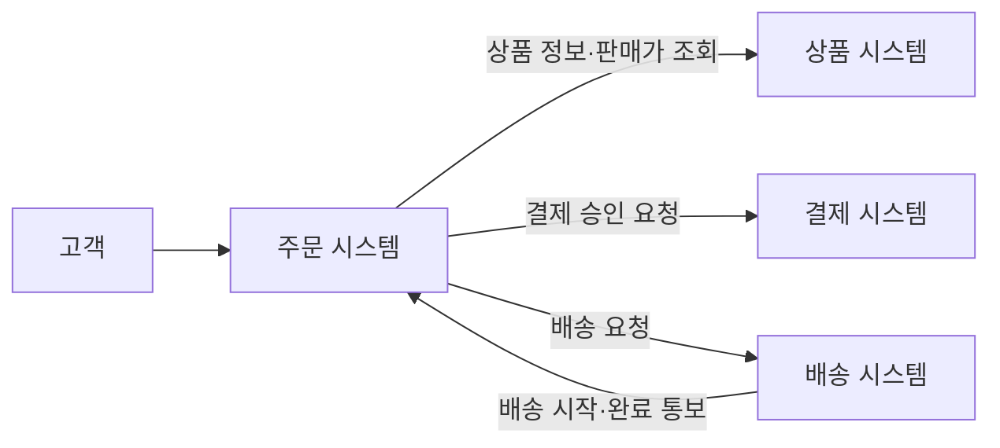
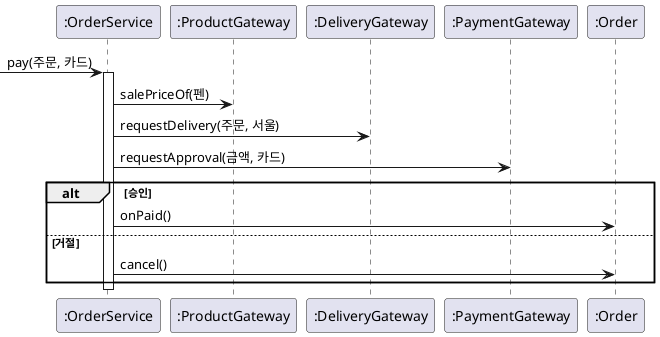
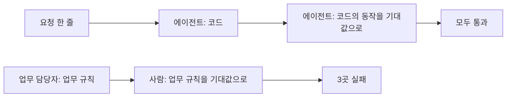
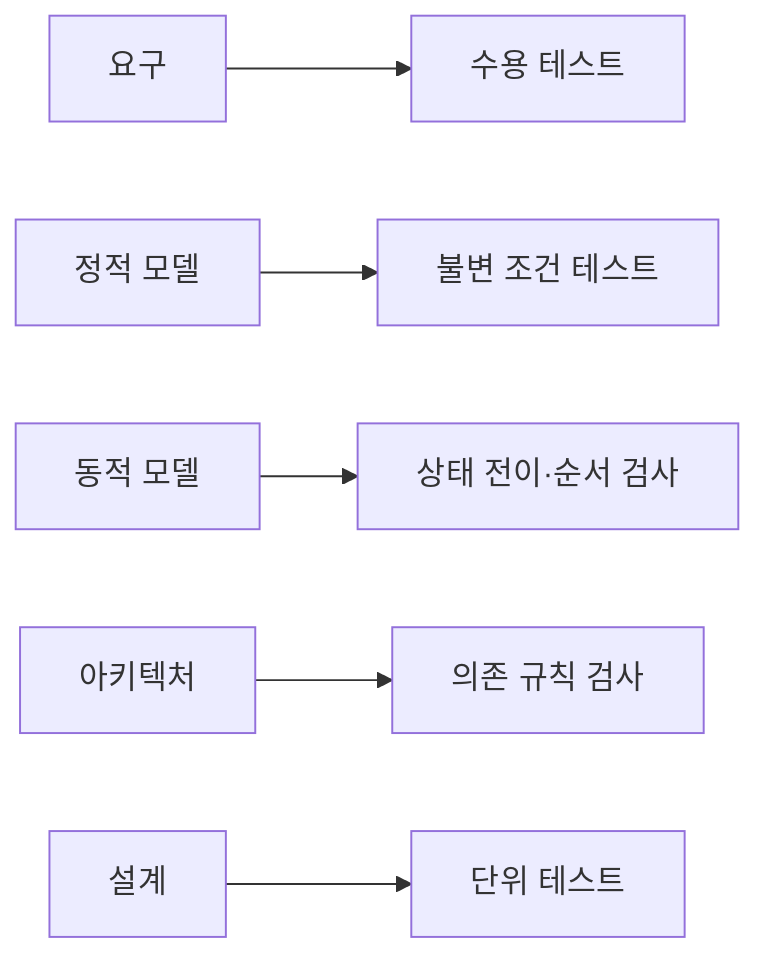
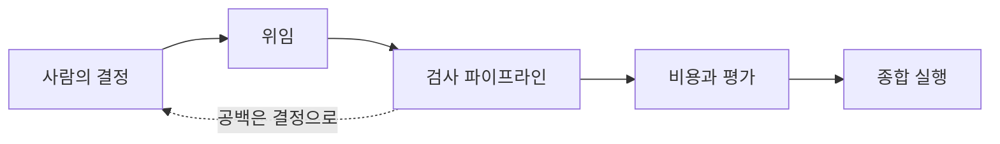

--------------------
Session 명: 01. 사람의 일과 AI의 일
--------------------

## 목차

01. 세션 목표
02. 첫 시도
03. AI가 바꾼 것과 바꾸지 못한 것
04. 개발 방식의 구분
05. 사람과 AI가 하는 일
06. 결정과 검사의 짝
07. 맡길 작업과 맡기지 않을 작업
08. 실습 환경 준비
09. 실습 1 — 업무 조건 확인
10. 요약

## 01. 세션 목표

AI는 코드를 만드는 비용을 크게 줄인다. 그러나 **무엇을 만들지와 무엇이 옳은 결과인지**는 여전히 사람이 정한다.

- AI가 SW 공학에서 **바꾼 것과 바꾸지 못한 것**을 본질적·우연적 복잡성으로 설명한다.
- **달라지는 5가지**와 **변하지 않는 공학 원칙**을 구분한다.
- **업무 규칙**은 도메인 지식이며 주어지지 않으면 LLM이 추측으로 채운다는 것을 코드와 테스트로 확인한다.
- **LLM 이전·AI 지원·AI-native** 개발을 구분하고, 규율이 없는 사용과 구분한다.
- 공학 활동마다 **사람이 결정할 것과 AI가 지원할 것**을 나눈다.
- 사람이 내린 결정마다 그 결정을 확인하는 **검사가 짝으로** 있어야 하는 이유를 말한다.
- 프로젝트가 **어떤 상황인지** 판단해 접근법을 선택하고, AI에게 **맡기지 않을 작업**을 선택한다.

**강사 노트**

- 세션 전체가 하나의 시나리오(쇼핑몰 주문 시스템의 첫 시도)로 이어진다. 사건 → 원인 → 새 일하는 방식 → 결정과 검사의 짝 → 과정의 지도 순서다.
- 내용은 2026-10 기준이다. 도구·모델의 능력에 관한 서술은 과정을 열 때마다 원문으로 다시 확인한다.
- LLM이라는 도구의 성질과 활용 방식의 선택은 "세션 02. LLM이라는 도구"가 맡는다. 이 세션은 사람과 AI가 나누는 일까지다.

---

## 02. 첫 시도

## 쇼핑몰의 주문 시스템

생활용품 쇼핑몰에 주문 시스템을 **새로** 만든다. 첫 기능은 고객의 결제까지 포함하는 **"주문한다"**이다.

**도식 — Mermaid — 주문 시스템과 외부 시스템**



1. 고객이 펜 2개(개당 1,000원)를 장바구니에 담는다.
2. 배송지(서울)를 정하면 주문이 생기고 주문 금액 2,000원이 결정된다.
3. 카드 결제가 승인되면 결제완료가 되고 배송을 요청한다.

**강사 노트**

- 사례는 "객체지향 분석과 설계 실무" 과정과 같은 주문 시스템이며 이름도 같다. 이 과정만 듣는 수강생을 위해 필요한 전제만 소개한다.
- 상품·결제·배송 시스템은 이미 운영 중인 외부 시스템이다. 주문 시스템은 이들과 요청·통보를 주고받는다.
- 업무 담당자 한 명이 주문 정책을 정하고, 개발자 3명(테크 리드 한 명, 개발자 2명)이 코딩 에이전트를 쓴다.
- 이 한 과제가 과정의 유일한 과제다. 실습도 같은 과제를 수강생이 직접 만든다(`course-design.md`의 「사례·실습 방향」).

---

## 요청 한 줄과 10분

업무 담당자가 준 요청은 한 줄뿐이었다. 테크 리드가 그 한 줄을 그대로 코딩 에이전트에게 주자 **10분 만에** 코드와 테스트가 나왔다.

> "장바구니에 담은 상품을 결제하면 주문이 되고 배송이 시작되게 해 주세요."

- **에이전트가 자바 파일 15개와 테스트 3개를 생성했다** — 테스트는 모두 통과했다.
- **데모도 성공했다** — 펜 2개를 카드로 결제하자 주문이 결제완료가 되고 시스템이 배송을 요청했다.
- **팀은 "다 됐다"고 판단했다** — 업무 담당자에게 리뷰를 요청했다.

**강사 노트**

- 10분, 파일 15개, 테스트 3개는 교육용 가정이다. 파일 수는 `code/s01/order/`와 같다.
- 수강생에게 묻는다: 여기서 받아들여도 되는가? 무엇을 확인하면 되는가?

---

## 리뷰에서 나온 문제 3가지

테스트는 모두 통과했지만, 업무 담당자가 결과에서 **3가지 문제를 발견했다**.

**표 — 리뷰에서 나온 문제와 원인**

| 고객과 회사가 겪는 일 | 에이전트가 고른 것 | 업무 담당자가 정한 업무 규칙 |
|---|---|---|
| 2,000원에 주문한 고객에게 2,400원을 청구한다 | 결제할 때의 판매가로 계산 | 주문할 때의 판매가로 정한다 |
| 돈을 받지 않은 주문이 배송 준비에 들어간다 | 결제 승인 전에 배송 요청 | 결제가 승인된 뒤에만 배송을 요청한다 |
| 결제가 거절된 고객이 다시 결제할 수 없다 | 결제가 거절되면 주문 취소 | 결제대기로 남겨 다른 카드로 다시 결제한다 |

- **3가지 모두 요청에 없던 업무 규칙이다** — 주문 금액·배송 요청·결제 거절을 에이전트가 묻지 않고 임의로 선택했다.

**강사 노트**

- 첫 번째 줄은 결제 직전에 펜 판매가가 1,200원으로 오른 경우다.
- 세 번째 줄에서 에이전트는 공통 전제에 없는 **취소됨 상태까지 만들어** 썼다. 취소는 이번 과제의 범위 밖이다.
- 에이전트가 고른 답은 다른 쇼핑몰에서는 맞을 수 있는 답이다. 그래서 코드만 봐서는 틀린 줄 모른다.

---

## 추측으로 채운 코드

에이전트가 생성한 결제 코드는 요청에 없던 업무 규칙 3가지를 모두 **스스로 정했다**.

**도식 — PlantUML — 첫 시도의 결제 시퀀스**



1. **주문 금액** — 결제할 때 판매가를 다시 조회해 계산한다.
2. **배송 요청** — 결제 승인을 요청하기 전에 배송을 요청한다.
3. **결제 거절** — 거절되면 주문을 취소한다.

**페이지 분할**

```java
public class OrderService {
    // ... 필드와 생성자 생략
    public void pay(OrderNumber number, PaymentMethod method) {
        Order order = repository.findBy(number);
        Money amount = Money.ZERO;
        for (OrderItem item : order.items()) {
            // ① 결제 시점의 판매가로 다시 계산
            Money salePrice = productGateway.salePriceOf(item.productNumber());
            amount = amount.plus(salePrice.times(item.quantity().value()));
        }
        // ② 승인 전에 배송 요청
        deliveryGateway.requestDelivery(number.value(), order.shippingAddress());
        if (paymentGateway.requestApproval(amount, method)) order.onPaid();
        else order.cancel();   // ③ 거절되면 취소됨
        repository.save(order);
    }
}
```

**강사 노트**

- 전체 코드는 `code/s01/order/`다. 첫 시도의 결제 코드는 LLM이 흔히 내는 추측을 모아 만든 교육용 예이며, 수강생의 LLM은 다른 곳을 추측할 수 있다.
- 코드가 보장하는 것: 승인되면 결제완료가 된다. 보장하지 않는 것: 주문 금액, 배송 요청의 시점, 거절 뒤 상태 — 모두 업무 규칙이 정해야 하는 것이다.
- 코드의 영문 이름은 설계 이름이다. 본문에서는 결제한다·주문 금액처럼 한글로 부른다.

---

## 자기 코드를 확인한 테스트

**에이전트가 생성한 테스트**는 업무 규칙이 아니라 **자기가 작성한 코드의 동작**을 기대값으로 삼았다. 업무 규칙을 반영한 테스트로 같은 코드를 확인하자 3곳에서 실패했다.

**인용문**

코드에서 테스트를 만드는 것은 AI를 SW 공학에 사용할 때 **잘 알려진 함정**이며, 그 코드가 할 일을 한다는 **보장이 없기** 때문이다, "Deriving tests from code is a well-known AI4SE pitfall, since there is no guarantee that the code does what it is supposed to do.", [Hassan 외 2026]

**도식 — Mermaid — 기대값은 어디서 오는가?**



**표 — 같은 코드, 두 테스트의 결과**

| 확인하는 것 | 에이전트의 테스트 | 업무 규칙의 테스트 |
|---|---|---|
| 승인되면 결제완료 | 통과 | 통과 |
| 주문 금액 | 판매가 × 수량 — 통과 | 판매가가 올라도 2,000원 — 실패 |
| 결제 거절 | 취소된다 — 통과 | 결제대기, 배송 요청 없음 — 실패 |

**강사 노트**

- 두 테스트는 `code/s01/order/test/`의 `AgentWrittenTest`와 `PayTest`다. javac로 컴파일하고 각각 실행해 결과를 대조한다.
- 테스트가 통과했다는 것은 "코드가 기대값대로 동작한다"는 뜻이다. 기대값이 추측이면 통과도 추측을 확인했을 뿐이다. 기대값을 업무 규칙에서 정하는 일은 "세션 03. 요구와 수용 기준"이 다룬다.
- 인용 근거: [Hassan 외 2026] 원문 확인. AI4SE는 "AI for SE"의 약어로 원문의 표기다. 저자들은 같은 대목에서 코딩 도구의 "Write unit tests for this function" 화면을 그 관행의 예로 든다.

---

## 03. AI가 바꾼 것과 바꾸지 못한 것

## 본질적 복잡성과 우연적 복잡성

**인용문**

아리스토텔레스를 따라 나는 소프트웨어의 어려움을 **본질**, 곧 소프트웨어의 본성에 본래 있는 어려움과 **우연**, 곧 오늘날 소프트웨어를 만드는 데 따라붙지만 본래적이지는 않은 어려움으로 나눈다, "Following Aristotle, I divide them into essence, the difficulties inherent in the nature of the software, and accidents, those difficulties which today attend its production but which are not inherent", [Brooks 1986]

  - 소프트웨어를 만드는 어려운 부분은 이 개념 구조의 **명세·설계·검증**이며 그것을 **표현하는 것**이 아니다, "I believe the hard part of building software to be the specification, design, and testing of this conceptual construct, not the labor of representing it", [Brooks 1986]

**표 — 첫 시도에서 본 두 복잡성**

| 구분 | 첫 시도에서 | 누가 하는가? |
|---|---|---|
| **본질적 복잡성** — 업무 규칙 | 주문 금액, 배송 요청, 결제 거절 | 업무 담당자와 개발자가 정한다 |
| **우연적 복잡성** — 업무 규칙을 코드로 옮기는 일 | 파일 15개·반복문·외부 호출·테스트 틀 | AI가 10분 만에 생성했다 |

- **AI는 우연적 복잡성을 줄인다** — 업무 규칙을 코드로 옮기는 일은 10분에 끝난다.
- **병목은 본질적 복잡성에 있다** — 주문 금액·배송 요청·결제 거절을 결정하고 검증하는 일이다.

**강사 노트**

- 인용 근거: Frederick P. Brooks Jr., "No Silver Bullet — Essence and Accidents of Software Engineering", 1986 원문 확인. 두 인용은 원문에서 이어지는 대목이다 — 앞이 본질·우연의 정의, 뒤가 어려운 부분이 무엇인지다.
- 둘째 인용의 원문은 "…testing the fidelity of the representation."으로 이어지며, PDF의 쪽 번호가 문장 중간에 있어 앞부분까지 인용했다.
- 본질적 복잡성을 업무 규칙에, 우연적 복잡성을 업무 규칙을 코드로 옮기는 일에 대응시킨 것은 이 과정의 해석이다. Brooks의 문장이 아니다.

---

## 5가지가 달라진다

코드를 만드는 비용이 떨어지면 **5가지가 함께 달라진다**. 얻는 것만 고려하면 누적된 복잡도와 틀린 가정을 나중에 비용으로 지불한다.

**표 — 달라지는 5가지**

| 달라지는 것 | 얻는 것 | 잃는 것·위험 |
|---|---|---|
| **코드 생산의 경제성** | 구현과 반복 작업이 싸진다 | 생성량과 함께 복잡도가 쌓인다 |
| **병목의 자리** | 설계 대안을 싸게 탐색한다 | 틀린 가정이 더 빨리 코드로 퍼진다 |
| **검증의 무게** | 테스트·정적 분석이 많아진다 | 코드와 테스트가 같은 가정을 공유한다 |
| **일하는 단위** | 피드백이 빨라진다 | 잘못된 변경이 연쇄로 퍼진다 |
| **평가의 기준** | 작은 팀이 넓은 범위를 맡는다 | 코드를 모르면 장애 대응이 무너진다 |

**인용문**

사람이 **병목**이며 AI가 병목이 아니다, "humans are the bottleneck, not the AI.", [Hassan 외 2026]

- **사람은 의도를 한 번에 분명히 말하지 못한다** — 요청 한 줄에서 업무 규칙 3가지가 빠졌고, 모델이 강해져도 이 한계는 남는다.
- **검사를 자동화해야 속도가 이득으로 남는다** — 생성한 결과가 업무 규칙대로인지 **자동으로 확인하지 못하면** 사람이 전부 읽어야 한다.

**강사 노트**

- 인용 근거: [Hassan 외 2026] 원문 확인. 저자들은 사람의 의도 표현 능력이 한계이므로 모델이 얼마나 강력해져도 이 문제가 남는다고 적는다.
- 5가지의 묶음은 이 과정의 정리다. 각 행의 잃는 쪽은 뒤 세션이 하나씩 받는다 — 복잡도는 "세션 10. 비용과 평가", 같은 가정은 "세션 09. 검사 파이프라인", 연쇄 확산은 "세션 08. 위임"이다.
- 얻는 쪽만 세는 판단은 「상황이 정하는 접근」에서 다시 짚는다.

---

## 변하지 않는 공학 원칙

달라지는 것이 5가지여도 **공학의 원칙은 그대로**다. 바뀌는 것은 그 원칙을 적용하는 대상의 양과 속도다.

**표 — 원칙과 AI 이후 달라지는 것**

| 변하지 않는 원칙 | AI 이후 달라지는 것 |
|---|---|
| **올바른 문제를 정의한다** | AI가 빠진 결정을 질문으로 드러낸다 |
| **복잡성을 관리한다** | 대안이 많아져 고르고 통제하는 일이 커진다 |
| **응집도·결합도를 지킨다** | AI가 만든 코드에도 같은 원칙을 적용한다 |
| **요구를 검증한다** | 기대값을 코드와 별도로 결정하는 일이 중요해진다 |
| **품질 속성을 만족한다** | 성능·보안·유지보수성을 자동으로 측정하고 고친다 |
| **운영하며 개선한다** | 운영 데이터 분석과 변경의 일부를 맡긴다 |

- **AI는 원칙을 대신하지 않는다** — 같은 6원칙을 **더 많은 산출물에 더 빨리** 적용하는 것이 달라진 점이다.
- **기대값은 코드와 별도로 결정한다** — 테스트를 작성하는 일은 빨라지고, 주문 금액 2,000원처럼 **무엇을 통과로 볼지 결정하는 일**이 더 중요해진다.

**강사 노트**

- 6원칙은 이 과정이 요구·모델·아키텍처·설계·검사로 다루는 축과 짝이 맞는다. 수강생이 자기 팀에서 이미 하는 일을 먼저 말하게 한 뒤 오른쪽 열을 짚는다.
- 왼쪽 열은 특정 원전의 분류가 아니라 분야에 통용되는 원칙을 이 과정의 말로 적은 것이다. 응집도·결합도의 정의는 "세션 06. 아키텍처"가, 요구의 검증은 "세션 03. 요구와 수용 기준"이 맡는다.
- 기대값을 코드에서 끌어오면 안 되는 이유는 「자기 코드를 확인한 테스트」에서 이미 보였다. 여기서는 원칙 쪽에서 다시 짚는다.

---

## 업무 규칙은 도메인 지식이다

**인용문**

소프트웨어 시스템을 만드는 일에서 가장 어려운 부분은 **정확히 무엇을 만들지 결정하는 것**이다, "The hardest single part of building a software system is deciding precisely what to build.", [Brooks 1986]

**업무 규칙은 업무 담당자가 아는 도메인 지식이다.** 코드나 공개된 자료에 있지 않고, 회사의 정책·운영 방식·고객과의 약속이 정한다.

**표 — 회사마다 달라지는 업무 규칙**

| 업무 규칙 | 회사마다 달라지는 이유 |
|---|---|
| **주문 금액** | 주문할 때 보여 준 가격을 고객에게 보장할지는 회사의 가격 정책이다 |
| **배송 요청** | 결제 확인 전에 배송 준비를 시작할지는 물류 운영과 위험을 감수하는 정도의 문제다 |
| **결제 거절** | 거절된 주문을 남겨 다시 결제받을지, 바로 정리할지는 고객 경험과 재고 운영의 선택이다 |

- **LLM은 업무 규칙을 모른다** — 주어지지 않으면 임의의 답을 선택한다. 2,400원은 다른 쇼핑몰에서 맞는 답일 수 있다.
  - LLM은 특정 도메인 지식을 **충분히 학습하지 못했을 수** 있다, "LLMs may have limited training on specific domain knowledge", [Gao 외 2025]

**강사 노트**

- 인용 근거: Brooks(1986)·[Gao 외 2025] 원문 확인. [Gao 외 2025]는 요구공학자가 응용 도메인을 이해해야 정확하고 완전한 요구를 뽑는다는 대목에서 이 한계를 든다.
- "LLM은 임의의 답을 선택한다"는 이 과정의 설명이다. 출처로 인용하지 않는다.
- 업무 규칙을 용어집·개념과 관계로 명시하는 일은 "세션 04. 정적 모델", 사건과 상태로 명시하는 일은 "세션 05. 동적 모델"이 다룬다.

---

## 04. 개발 방식의 구분

## 3가지 개발 방식

**3가지 개발 방식**(LLM 이전·AI 지원·AI-native)을 가르는 것은 도구가 아니라 **작업의 단위와 사람·LLM의 일, 결과를 확인하는 방법**이다.

**인용문**

그래서 소프트웨어 공학 3.0은 **AI-native**다, "We thus say that SE 3.0 is AI-native.", [Hassan 외 2026]

**표 — 개발 방식의 구분**

| 구분 | 작업의 단위 | 누가 무엇을 하는가? | 검증 |
|---|---|---|---|
| **LLM 이전** | 사람이 작성하는 코드 | 사람이 명세·설계·코드·테스트를 작성한다 | 사람이 작성한 테스트와 리뷰 |
| **AI 지원**(AI-assisted) | LLM의 제안 하나 | 사람이 흐름을 쥐고 제안을 받아들인다 | 제안마다 사람이 읽는다 |
| **AI-native** | 맡긴 과제 하나 | 사람이 정하고 에이전트가 실행한다 | 검사의 증거와 사람의 확인 |

- **사람의 일은 코드 작성에서 결정으로 바뀐다** — 사람은 업무 규칙을 정하고 검증한다.
- **책임은 세 방식에서 같다** — 옳은 결과의 판단과 책임은 사람에게 있다.
- **모든 작업을 에이전트에게 맡기지 않는다** — 작업마다 가장 단순한 형태를 고른다.
- 코드 중심을 **SE 1.0**, AI 지원을 **SE 2.0**, AI-native를 **SE 3.0**이라고도 부른다.

**강사 노트**

- 인용 근거: [Hassan 외 2026] 원문 확인. SE 1.0·2.0·3.0의 구분과 "AI-native"라는 이름이 이 논문의 것이다. 저자들은 사람과 AI의 공생 관계를 말한 뒤 이 문장을 둔다.
- 표의 3행은 그 구분과 같은 자리를 구분한다. 다만 작업의 단위·검증 열로 다시 쓴 것과 활동별 역할 구분은 이 과정이 그 위에 둔 것이다(`course-design.md`의 「원전 적용 결정」).
- 저자들이 제안한 기술 스택과 코드를 사람에게 감춘다는 입장은 쓰지 않는다. 이 과정은 사람이 코드와 증거를 읽어 판정한다.
- AI 지원의 병목은 사람의 리뷰다. 형태의 선택은 "세션 02. LLM이라는 도구"에서 다룬다.

---

## 같은 과제, 3가지 방식

"주문한다"를 각기 다른 3가지 방식으로 개발하면 **사람이 하는 일**이 달라진다.

**도식 — Mermaid — 3가지 방식의 흐름**


- **LLM 이전** — 사람이 결제 코드와 테스트를 작성한다.
- **AI 지원** — LLM이 제안하고 사람이 받아들인다.
- **AI-native** — 에이전트가 코드와 테스트를 생성하고, 사람은 검사의 결과로 판단한다.

**강사 노트**

- 첫 시도는 AI-native의 겉모양(에이전트가 과제를 실행)만 있고, 사람의 몫(업무 규칙·맥락·검사·확인)이 빠졌다.
- 검사를 파이프라인으로 모아 에이전트가 스스로 돌리게 하는 일은 "세션 09. 검사 파이프라인"이 다룬다.

---

## 바이브 코딩과 규율

결과만 보고 받아들이는 방식을 **바이브 코딩**(vibe coding)이라고 부른다.

**인용문**

바이브 코딩에서는 코드가 아니라 **시스템의 동작만** 신경 쓴다, "In vibe coding you don't care about the code, just the behavior of the system.", [Beck 2025]

**인용문**

증강 코딩에서는 **코드와 그 복잡도·테스트와 그 커버리지**를 신경 쓴다, "In augmented coding you care about the code, its complexity, the tests, & their coverage.", [Beck 2025]

- 숙련자가 규율을 지키며 LLM을 사용하는 방식을 **바이브 엔지니어링**(vibe engineering)이라고 부른다.

**인용문**

숙련자가 LLM으로 일을 빠르게 하면서도 자기가 만든 소프트웨어에 **당당하고 자신 있게 책임을 진다**, "seasoned professionals accelerate their work with LLMs while staying proudly and confidently accountable for the software they produce", [Willison 2025b]

- **AI는 팀이 이미 하는 방식을 빠르게 한다** — 업무 규칙·테스트·리뷰가 있는 팀에서는 좋은 결과를, 없는 팀에서는 나쁜 결과를 더 빨리 만든다.

**강사 노트**

- 인용 근거: Kent Beck, "Augmented Coding: Beyond the Vibes"(2025), Simon Willison, "Vibe engineering"(2025) 원문 확인. Willison 인용은 문장에서 핵심 구만 옮긴 것이다. 바이브 엔지니어링이라는 이름은 그 글의 제목이며 인용문이 아니라 본문이 밝힌다.
- 바이브 코딩은 개발 방식의 한 구분이 아니라 규율이 없는 사용이다. AI 지원과 AI-native 어디에서나 생길 수 있다.
- "이미 하는 방식을 빠르게 한다"는 이 과정의 설명이다. 출처로 인용하지 않는다.

---

## 05. 사람과 AI가 하는 일

## 사람이 조종하고 에이전트가 실행한다

**인용문**

사람이 **조종하고** 에이전트가 **실행한다**, "Humans steer. Agents execute.", [Lopopolo 2026]

**인용문**

사람은 늘 루프 안에 있지만 **예전과 다른 추상 수준**에서 일한다 — 일의 우선순위를 정하고 사용자 피드백을 **수용 기준**으로 옮기고 **결과를 확인**한다, "Humans always remain in the loop, but work at a different layer of abstraction than we used to. We prioritize work, translate user feedback into acceptance criteria, and validate outcomes.", [Lopopolo 2026]

- **우선순위를 사람이 정한다** — 첫 릴리스에 "주문한다"를 포함한다.
- **수용 기준을 사람이 정한다** — 업무 규칙 3가지를 허용·거절 예시로 옮긴다.
- **결과를 사람이 확인한다** — 데모가 아니라 업무 규칙의 테스트 결과를 보고 받아들일지 판단한다.

**강사 노트**

- 인용 근거: Ryan Lopopolo, "Harness engineering: leveraging Codex in an agent-first world", OpenAI, 2026 영문 원문 확인(openai.com이 한국어판으로 자동 전환하므로 영문판으로 확인).
- 한 팀(OpenAI 내부 제품)의 경험이다. 글도 비슷한 투자 없이 일반화된다고 가정하지 말라고 밝힌다.

---

## 활동마다 누가 결정하는가?

사람은 **결정하고**, AI는 **초안과 검사로 지원한다**. 결정을 AI에게 넘기면 첫 시도처럼 AI의 추측이 결과에 섞인다.

**표 — 활동마다 사람의 일과 AI의 일**

| 활동 | 사람이 한다 | AI가 한다 |
|---|---|---|
| **문제·의도** | 문제와 의도, 위험 수용을 정한다 | 빠진 결정을 질문으로 드러낸다 |
| **요구** | 범위·제외·미정과 기대값을 확정한다 | 초안을 작성하고 애매한 것을 묻는다 |
| **정적 모델** | 업무 개념·관계·불변 조건을 결정한다 | 초안을 작성하고 모순과 누락을 낸다 |
| **동적 모델** | 사건과 상태·전이를 결정한다 | 초안을 작성하고 빠진 전이를 묻는다 |
| **아키텍처** | 무엇이 무엇을 알아야 하는지 정한다 | 대안을 비교하고 위반을 검사한다 |
| **설계** | 책임 배치와 협력, 작업 단위를 정한다 | 설계 대안을 내고 불일치를 짚는다 |
| **위임** | 읽힐 것과 권한, 종료 조건을 정한다 | 경계 안에서 일하고 막히면 묻는다 |
| **구현·검증** | 무엇이 통과를 뜻하는지 정한다 | 코드와 테스트를 만들고 스스로 고친다 |
| **결과 판단** | 증거를 보고 수용하거나 되돌린다 | 완료의 증거를 제시한다 |
| **보완·판단** | 모델에 반영할지, 계속 맡길지 정한다 | 잘못된 곳과 개선을 제안한다 |

- **에이전트가 결정하지 않고 묻게 한다** — "결제가 거절되면 주문은 어떻게 되나요?"를 정하는 것은 업무 담당자와 개발자다.

**강사 노트**

- 이 역할 구분은 이 과정의 구분이다(`course-design.md`의 「과정 전체 판단 원칙」).
- 표의 행 하나하나가 뒤 세션의 주제다. 각 행의 결정을 무엇으로 확인하는지는 「06. 결정과 검사의 짝」에서 이어 본다.

---

## 06. 결정과 검사의 짝

## 결정마다 검사가 있다

사람이 내린 결정은 **그 결정을 확인하는 검사**와 짝을 이뤄야 한다. 짝이 없는 결정은 지켜졌는지 아무도 모른다.

**도식 — Mermaid — 결정과 그 결정을 확인하는 검사**



- **정하지 않은 것은 검사로 만들 수 없다** — 검사가 없는 일은 에이전트에게 맡길 수 없다.
- **에이전트가 사람에게 보이기 전에 검사를 실행한다** — 실패한 검사를 읽고 스스로 고친다.

**강사 노트**

- 결정과 검증을 층마다 짝지어 보는 틀은 V 모델의 대응 관계다. 단계의 순서가 아니라 대응 관계로만 쓴다(`course-design.md`의 「원전 적용 결정」).
- 짝의 왼쪽은 "세션 03. 요구와 수용 기준"부터 "세션 07. 설계 — 책임과 협력"까지가, 오른쪽을 파이프라인으로 모으는 일은 "세션 09. 검사 파이프라인"이 맡는다.

---

## 첫 시도에서 비어 있던 결정

첫 시도의 문제 3가지는 코드의 결함이 아니다. **정하지 않은 업무 규칙**을 에이전트가 추측으로 채운 것이다.

**표 — 문제 3가지가 가리키는 결정**

| 첫 시도의 문제 | 비어 있던 결정 | 그 결정을 확인하는 검사 |
|---|---|---|
| 2,400원을 청구한다 | 단가를 언제 확정하는가 — 정적 모델 | 주문 금액의 불변 조건 테스트 |
| 승인 전에 배송을 요청한다 | 요청의 순서 — 동적 모델 | 금지된 순서 검사 |
| 거절된 주문을 취소한다 | 거절 뒤의 전이 — 동적 모델 | 상태 전이 테스트 |

- **정하지 않은 것에는 기대값이 없다** — 에이전트의 테스트 3개가 모두 통과한 이유이며, 통과는 정하지 않은 것을 드러내지 못한다.
- **품질은 작성한 검사만큼만 보장한다** — 주문 금액을 측정하는 검사가 없으면 2,400원을 청구해도 통과한다.

**강사 노트**

- 왼쪽 열은 「리뷰에서 나온 문제 3가지」의 첫 열과 같은 세 문제다. 같은 사건을 결정의 공백으로 다시 읽는다.
- 단가의 확정 시점은 정적 모델의 속성 결정이고, 배송 요청의 순서와 거절 뒤의 전이는 동적 모델의 결정이다. 수강생에게 먼저 어느 쪽인지 묻는다.

---

## 개발 생명주기는 어떻게 달라지는가?

개발 생명주기(software development lifecycle, SDLC)의 활동은 **그대로 남는다**. 달라지는 것은 활동마다 **누가 끌고 가는지, 산출물을 만드는 비용, 검증하는 시점**이다.

**인용문**

소프트웨어 공학 3.0은 개발을 더 이상 코드가 아니라 **의도**가 끌고 가는 **의도 중심** 접근으로 바꾸는 전환이다, "SE 3.0 marks a paradigm shift towards an intent-centric approach, where development is no longer driven by code but by intents", [Hassan 외 2026]

**표 — 활동마다 달라지는 것**

| 활동 | 누가 끌고 가는가? | AI 이후 달라지는 것 |
|---|---|---|
| **의도와 목표** | 사람 | 빠진 결정이 질문으로 드러난다 |
| **요구와 분석** | 사람과 AI | 초안이 싸지고 확정은 사람이 한다 |
| **아키텍처와 설계** | 사람 | 대안 비교와 불일치 지적을 맡긴다 |
| **구현** | AI | 코드·테스트·문서를 한 번에 만든다 |
| **검증** | 자동화 | 사람이 보기 전에 루프 안에서 돈다 |
| **배포와 운영** | 사람과 AI | 운영 데이터 분석의 일부를 맡긴다 |

- **코드는 수단이다** — 공학이 늘 해 온 일은 의도를 품질 있는 소프트웨어로 바꾸는 것이다, "Code is just a means to an end.", [Hassan 외 2026]
- **6개 활동은 절차가 아니다** — 작업 단위 하나마다 전부 한 번씩 수행한다.
- **구현이 빨라도 분석은 줄지 않는다** — 무엇을 만들지 결정하는 일은 사람의 몫으로 남는다.
- **검증은 구현 뒤에 시작하지 않는다** — 받아들일 조건을 요구에서 결정해 계속 확인한다.

**강사 노트**

- 인용 근거: [Hassan 외 2026] 원문 확인. 두 인용은 같은 절의 대목이다 — 앞이 의도 중심이라는 전환, 뒤가 그래서 코드가 무엇이 되는지다. 저자들은 소프트웨어 공학이 늘 의도를 품질 있는 소프트웨어로 바꾸는 일이었다고 적은 뒤 뒤 문장을 둔다.
- 의도는 활동을 없애지 않는다. 표의 첫 행이 의도이고 나머지 다섯이 그것을 실현하는 활동이다. 의도만 말하면 된다는 뜻으로 읽히지 않게 한다.
- 「배포와 운영」은 표에 자리만 두고 범위 밖이다. 파이프라인 구성과 배포 전략은 DevOps가 맡는다.
- 활동 이름은 분야에 통용되는 생명주기 활동을 이 과정의 말로 적은 것이다. 특정 원전의 단계 구분이 아니며 폭포수의 순서로 읽히지 않게 한다.
- 이 6단계를 결정하는 영역과 증거를 받는 영역으로 다시 그린 것이 세션 끝의 「과정의 지도」다.

---

## 07. 맡길 작업과 맡기지 않을 작업

## 맡기지 않는 작업 3가지

맡기지 않는 작업은 3가지다 — **AI가 하지 못하는 작업**, **사용할 이유가 없는 작업**, **완료를 판정할 수 없는 작업**이다.

- **AI가 하지 못하는 작업** — 답과 책임이 사람에게 있다.
  - **업무 규칙 정하기** — 답은 업무 담당자가 안다. AI는 질문을 찾는다.
  - **되돌리기 어려운 작업의 실행** — 책임은 사람이 진다. AI는 초안만 작성한다.
- **AI를 사용할 이유가 없는 작업** — 늘 같은 결과가 나와야 한다.
  - **코드 형식·의존 규칙 검사** — 포매터와 정적 검사가 한다.

**인용문**

에이전트는 **결정적·규칙 기반 방식이 잘 듣지 않는** 일에 맞는다, "agents are uniquely suited to workflows where traditional deterministic and rule-based approaches fall short", [OpenAI 2025]

  - 에이전트를 만들기 전에 **그 조건을 분명히 충족하는지 확인한다** — 아니면 결정적인 해법으로 충분할 수 있다, "Before committing to building an agent, validate that your use case can meet these criteria clearly. Otherwise, a deterministic solution may suffice.", [OpenAI 2025]

- **완료를 판정할 수 없는 작업** — 받아들일 기준이 없으면 검사도 없고, 검사가 없으면 맡기지 않는다.

**강사 노트**

- 인용 근거: OpenAI, "A practical guide to building agents"(2025) 원문 확인(받은 PDF).
- **두 인용은 원문에서 이어지는 대목이다.** 앞 문장이 에이전트가 맞는 자리를 말하고(결정적·규칙 기반 방식이 잘 듣지 않는 일), 그 뒤에 복잡한 판단·유지하기 어려운 규칙·비정형 데이터 셋을 기준으로 든 다음 뒤 문장이 온다. 그래서 Otherwise는 **그 기준을 충족하지 못한 경우**다 — 충족하면 에이전트가 맞고, 충족하지 못하면 결정적 해법으로 충분하다. 인용 하나만 보이면 "이 기준"이 무엇인지 알 수 없어 거꾸로 읽히므로 둘을 함께 둔다.
- 포매터·정적 검사·빌드 도구는 뒤에서 에이전트의 결과를 확인하는 검사가 된다.
- 작업 특성으로 활용 방식(수작업·대화형 보조·워크플로·에이전트)을 고르는 일은 "세션 02. LLM이라는 도구"가 맡는다. 비용 대비 효과의 판단은 "세션 10. 비용과 평가"다.

---

## 상황이 정하는 접근

모든 프로젝트에 같은 수준의 자율성을 적용할 이유는 없다. **무엇이 이미 명시되어 있고 무엇을 검사할 수 있는지**가 어디서 시작할지를 정한다.

**표 — 상황별 접근**

| 상황 | 접근 |
|---|---|
| **규칙이 분명한 반복 작업** | 자동화부터 적극 적용한다 |
| **복잡하고 자주 바뀌는 업무** | 사람이 분석·설계하고 AI가 구현한다 |
| **안전·규제의 영향이 큰 시스템** | 독립 검증과 승인을 함께 둔다 |
| **명세와 테스트가 없는 레거시** | 맥락을 복원하고 검사를 먼저 갖춘다 |
| **요구가 불명확한 신규 사업** | 대안을 탐색하고 목표는 사람이 정한다 |

**인용문**

**초기 속도 이득**이 하류의 유지보수 문제로 **완전히 상쇄될 위험**이 있다, "initial speed gains risk being fully canceled out by downstream maintainability problems.", [Hassan 외 2026]

- **생성량으로 판단하지 않는다** — 생성한 양이 아니라 **검토·수정에 든 시간과 남는 부채**로 득실을 측정한다.
- **검사가 없으면 자율성을 올리지 않는다** — 5가지 상황을 가르는 것은 **검사할 수 있는 것**의 차이다.

**강사 노트**

- 인용 근거: [Hassan 외 2026] 원문 확인. 저자들은 한 코딩 도구를 다룬 선행 연구를 들어 단기 속도는 올랐지만 복잡도와 정적 분석 경고가 지속해 쌓여 장기 생산성을 해쳤다고 적는다. 인용은 그 대목에 대한 저자들의 평가다.
- 수강생에게 자기 프로젝트가 5가지 중 어디인지 먼저 말하게 한다. 2가지 이상에 걸치면 가장 보수적인 쪽을 고른다.
- 5가지 상황의 묶음은 이 과정의 정리다. 표의 접근은 시작 지점이며 고정된 처방이 아니다.
- 단기·중기·장기의 비용과 평가 세트로 계속 맡길지 판단하는 일은 "세션 10. 비용과 평가"가 맡는다. 여기서는 시작 지점을 고르는 것까지다.

---

## 과정의 지도

남은 10세션은 사람이 **결정하는 영역**과 에이전트에게 **맡기고 증거를 받는 영역**으로 나뉜다. 실습은 "주문한다" 하나로 두 영역을 모두 거친다.

**도식 — Mermaid — 과정의 지도**



- **사람이 결정하는 것은 5가지다** — 요구와 수용 기준, 정적 모델, 동적 모델, 아키텍처, 설계와 작업 단위다.
- **에이전트가 하는 일은 4가지다** — 맡은 작업의 구현, 검사 실행과 수정, 완료의 증거 제시, 비용과 결과의 기록이다.
- **오래 남는 산출물은 5가지다** — 요구사항 정의서·용어집·정적 모델·상태 기계·의존 규칙과 검사 결과이다.
- **검사와 권한은 한 번 맡겨 본 뒤에 결정한다** — 무엇을 검사하고 무엇을 금지할지는 미리 알 수 없다.

**강사 노트**

- 왼쪽 다섯은 "세션 03. 요구와 수용 기준"~"세션 07. 설계 — 책임과 협력", 오른쪽 넷은 "세션 08. 위임"~"세션 11. 종합 실행"이다. 이 세션과 "세션 02. LLM이라는 도구"는 두 쪽에 들어가기 전의 준비다.
- 산출물을 모두 만들어야 하는 것은 아니다. 무엇을 넣을지는 도메인·기술 복잡성이 정하며, 그 판단은 "세션 03. 요구와 수용 기준"에서 경로와 함께 다룬다.
- 강의 내용의 마지막 장이다. 맡길 작업과 상황까지 본 뒤에 남은 세션의 순서를 보이고 실습 환경으로 넘어간다.
- 세션의 순서는 학습 순서다. 실제로는 작업 단위마다 결정과 검사를 함께 수행한다 — 「결정마다 검사가 있다」에서 이미 보였으므로 본문에서는 뺐다.

---

## 08. 실습 환경 준비

첫 실습부터 **자기 저장소에 산출물을 모으고**, **"세션 08. 위임"부터는 같은 저장소에서 코드와 검사를 돌린다**. **Windows**에서 5가지를 준비한다 — 명령은 PowerShell에서 실행한다.

1. **코딩 에이전트** — Claude Code를 설치하고 **Claude Team 계정으로 로그인**한다. `claude`를 실행해 대화가 되면 된다.
2. **JDK 17 이상** — `winget install Microsoft.OpenJDK.21`로 설치하고 `java -version`으로 확인한다.
3. **Gradle** — `winget install Gradle.Gradle`로 설치하고 `gradle -v`로 확인한다.
4. **Git** — `winget install Git.Git`로 설치하고 `git config --global user.name`과 `user.email`을 설정한다.
5. **실습 저장소** — **자기 PC에** `order-system` 폴더를 만들어 `git init`하고 그 안에 `docs` 폴더를 둔다.

- **산출물은 한 저장소에 모은다** — 실습 1~7의 MD가 `docs`에 쌓이고, 실습 8에서 에이전트가 읽는다.
- **사내망에서 설치와 로그인이 막히는지 미리 확인한다**.

**강사 노트**

- 수강생 환경은 Windows를 전제한다. macOS 수강생은 Homebrew로 같은 셋을 설치한다 — `brew install openjdk@21 gradle git`.
- 저장소는 **각자 자기 PC에 두고 혼자 관리한다**. 원격 저장소·push·공유는 필요 없고, 결과 공유는 화면이나 파일로 한다.
- 저장소 이름 `order-system`과 폴더 `docs`는 과정이 정한 이름이다. 다른 이름을 써도 되지만 한 사람이 한 저장소를 끝까지 쓰는 것이 중요하다. 첫날에 필요한 것은 에이전트와 Git뿐이고 JDK·Gradle은 둘째 날에 쓴다.
- `winget`은 Windows 10·11의 App Installer에 들어 있다. 없거나 사내 정책으로 막히면 제품 설치 파일로 설치한다.
- Claude Code의 설치 절차와 설치 명령·버전은 2026-10 기준이다. 과정을 열 때마다 제품 안내로 확인한다.
- Gradle은 실습 8에서 `gradle init`으로 래퍼를 만든 뒤에는 저장소의 `gradlew`로 실행된다. 처음 한 번만 설치가 필요하다.
- 저장소 초기화와 빌드 구성의 지시문은 "세션 08. 위임"이, 검사 명령을 만드는 일은 "세션 09. 검사 파이프라인"이 안내한다.

---

## 09. 실습 1 — 업무 조건 확인

**①로 시작해 답·질문·수정 요청을 주고받는다.** ②~④는 보완 예시다. ⑤로 MD를 만들고 필요하면 보완·재생성한다.

**프롬프트 — 요청사항 포함**
  + ① "쇼핑몰의 주문 시스템을 빈 저장소에서 새로 만든다. 업무 담당자의 요청은 '장바구니에 담은 상품을 결제하면 주문이 되고 배송이 시작되게 해 주세요' 한 줄이다. 요구사항을 정의하기 전에 **내가 정해야 할 업무 조건**은 무엇인가?"
  + ② "고객이 배송지를 정하고 카드로 **결제까지 마치는 범위**만 다루자. 상품·결제·배송은 이미 운영 중인 외부 시스템이며 화면과 기술 설계는 제외해라."
  + ③ "[앞선 질문에 대한 답] 주문 금액은 주문이 생길 때의 판매가로 정한다. 배송은 결제가 승인된 뒤에만 요청한다. 결제가 거절되면 결제대기로 남겨 다른 카드로 다시 결제한다. [추가 질문·수정 요청] 이 셋 말고 **요구사항을 쓰기 전에 꼭 정해야 할 조건**이 더 있는가? 필요한 이유도 설명해라."
  + ④ "[앞선 질문에 대한 답]과 [추가 질문·수정 요청]을 적는다. 이번 범위에서 정하지 않을 것은 **미정으로 남긴다**."
  + ⑤ "지금까지 합의한 "주문한다"의 업무 조건을 다음 실습에 사용할 간결한 **Markdown 파일**로 생성해라. 외부 시스템은 연계 대상으로 두고 화면·기술 설계와 결제 이후 운영은 제외해라. 모든 경우를 나열하지 말고 합의한 조건과 요구사항 작성에 꼭 필요한 미정 사항만 해당 위치에 표시해라. 새 결정을 추가하거나 폐기한 안을 되살리지 마라. 요구사항 정의서나 기능 목록을 미리 작성하지 말고 업무 조건과 미정 사항만 짧은 항목으로 정리해라. 항목마다 한 줄로 쓰고 도식 없이 한 쪽 분량으로 줄여라."

**점검 항목**
  1. **필요성** — 결제까지 마치는 범위에 실제로 필요한 조건인가?
  2. **범위** — 화면·기술 설계나 외부 시스템의 재구현이 섞였는가?
  3. **판단** — 사람이 정하지 않은 정책을 AI가 확정했는가?
  4. **미정** — 정하지 않기로 한 것이 미정으로 남아 있는가?
  5. **종료** — 이제 요구사항을 작성할 수 있는가? 그렇다면 탐색을 끝낸다.

**결과물**
  + `주문한다-업무조건.md` — 합의한 업무 조건을 확인하고 저장소의 `docs`에 두어 커밋한다. **실습 2의 투입물**이다

**강사 노트**

- 강의가 업무 규칙 3가지를 이미 보였으므로, 실습은 규칙을 새로 만드는 것이 아니라 **요청 한 줄에서 정해야 할 조건을 뽑는 연습**이다. 수강생이 그 셋 말고 무엇을 더 찾아내는지가 결과물의 차이다.
- 수강생이 다르게 정해도 된다. 다른 결정이 뒤 실습의 모델·설계·검사를 어떻게 바꾸는지 보는 것이 이 실습 흐름의 목적이다.
- Claude Team 등에서 renderer 없이 수행한다. ②~④에는 실제 받은 질문의 답과 검토 의견을 붙인다. 기본 문구만 기계적으로 반복하지 않는다.
- ⑤ 이후에도 MD의 누락·불일치·폐기한 안의 재등장을 검토하고 보완·재생성을 반복한다. 최종 MD를 저장소의 `docs`에 두면 뒤 실습이 파일 이름으로 그것을 가리킬 수 있고, 실습 8에서 에이전트가 읽을 맥락이 된다.
- ①~⑤는 대화 횟수가 아니라 단계다. 받은 답을 읽고 필요한 만큼 추가·반복한다.
- 강사 예시의 실제 대화는 `code/s01/exercise-conversation/order/`다.

---

## 10. 요약

AI는 업무 규칙을 코드로 옮기고, 업무 규칙을 **정하고 명시하고 검증하는 일**은 사람에게 남는다.

### 사람의 일과 AI의 일

- **바꾼 것과 바꾸지 못한 것** — 코드로 옮기는 일은 AI가 하고, 업무 규칙은 사람이 정한다
- **원칙과 상황** — 5가지가 달라져도 공학 원칙은 남고, 검사할 수 있는 것이 시작 지점을 정한다
- **업무 규칙은 도메인 지식** — 주어지지 않으면 LLM이 추측으로 채운다
- **개발 방식** — LLM 이전·AI 지원·AI-native는 작업의 단위와 검증이 다르다
- **역할** — 사람이 조종하고 에이전트가 실행한다
- **결정과 검사의 짝** — 검사가 없는 것은 맡길 수 없다

### 다음 세션

- "**세션 02. LLM이라는 도구**" — 도구의 성질과 비용의 구조를 알고 활용 방식을 고른다.

**강사 노트**

- 첫 시도의 실패는 AI의 실패가 아니라 사람의 몫(업무 규칙·검사)이 빠진 것이다. 다음 세션부터 그 몫을 하나씩 채운다.
- 모델에서 보완된 것 — 없다. 업무 규칙 3가지가 리뷰에서 처음 드러났을 뿐이며, 모델로 적는 일은 뒤 세션이 한다.

---

## 별첨. 실습 답

## “주문한다” 업무 조건

**실제 LLM 응답**

**문서 형식 — 10pt**

### 범위

- 대상: 고객이 장바구니에서 주문을 시작하고, 배송지를 확정한 뒤 카드 결제 승인을 받아 주문이 성립할 때까지다.
- 연계 대상(이미 운영 중인 외부 시스템): 상품 시스템(판매가, 재고), 결제 시스템(카드 승인), 배송 시스템(배송 요청 수신).
- 제외: 화면, 기술 설계, 결제 이후 운영(취소, 환불, 반품, 교환, 배송 진행), 카드 외 결제 수단, 배송비, 쿠폰과 할인.

### 주문 생성

- 고객이 배송지를 확정하면 주문이 생기고, 주문 상태는 결제대기가 된다.
- 주문자와 수령인은 같은 사람으로 본다.
- [미정 H] 비회원 주문을 허용하는지, 허용한다면 결제대기 주문을 다시 찾을 때 본인을 어떻게 확인하는지 정해지지 않았다.

### 주문 금액

- 주문 금액은 항목마다 주문 생성 시점의 판매가(단가)에 수량을 곱해 모두 더한 값이다.
- 주문이 생긴 뒤 판매가가 오르거나 내려도 주문 금액은 바뀌지 않으며, 그 금액을 청구한다.

### 결제대기

- 결제대기 중에는 상품, 수량, 배송지를 바꿀 수 없다. 바꾸려면 새로 주문한다.
- 카드 결제가 거절되면 주문을 취소하지 않고 결제대기로 남겨, 고객이 다른 카드로 다시 결제할 수 있게 한다.
- [미정 B] 결제대기의 기한과 기한이 지난 뒤의 처리가 정해지지 않았다. 구현에서 만료, 취소, 삭제, 결제 차단을 임의로 정하지 않는다.

### 결제와 주문 성립

- 결제 수단은 카드뿐이다.
- 카드 승인이 완료된 때 주문이 성립한다.
- 결제 시스템의 응답을 확정할 수 없으면 그 응답을 실패로 바꾸지 않는다.
- [미정 F] 응답을 확정할 수 없을 때 이후 처리(재결제 허용 여부 포함)가 정해지지 않았다. 구현에서 성공이나 실패를 임의로 확정하지 않는다.

### 재고

- 재고는 상품 시스템의 판단을 그대로 따르며, 주문 쪽에서 재고를 따로 확보하지 않는다.
- [미정 E] 승인 뒤 재고가 없을 때의 처리가 정해지지 않았다. 구현에서 승인 취소나 주문 상태 변경을 임의로 하지 않는다.

### 배송 요청

- 배송 시스템에는 카드 승인 뒤에만 배송을 요청한다.
- [미정 G] 승인 뒤 배송 요청이 실패했을 때의 처리가 정해지지 않았다. 구현에서 승인 취소, 주문 상태 변경, 재요청 주체와 방식을 임의로 정하지 않는다.
- [미정 I] 주문 확인 통지를 이 시스템이 보내는지, 다른 시스템의 통지로 대신하는지 정해지지 않았다.

**강사 노트**

- 실제 실행 기록은 `code/s01/exercise-conversation/order/`다. `prompt-01.txt`~`prompt-05.txt`가 실제 입력, `claude-response-01.md`~`-05.md`가 실제 응답이며 이 답은 ⑤ 응답의 **전문**이다. 제목 단계만 Session Source로 바꿨다.
- ③에서 사람이 업무 규칙 3가지를 답하자 LLM이 **그 결정에서 새로 생기는 빈칸**을 찾아냈다 — 결제대기에 기한이 없다는 것, 판매가가 내려간 경우, 승인 뒤 재고가 없는 경우다. 요청 한 줄에는 없던 질문이다.
- ④의 응답이 "미정은 아무것도 적지 않는다는 뜻이 아니다"를 분명히 했다. 미정에는 **현재 머무는 상태와 구현이 임의로 하지 말아야 할 것**을 함께 적는다. 이 구분이 "세션 03. 요구와 수용 기준"의 범위·제외·미정으로 이어진다.
- 미정 G(승인 뒤 배송 요청 실패)는 강의의 미정과 같은 항목이다. 강의에서는 "세션 11. 종합 실행"에서 거두어진다.
- 수강생의 답은 이와 다를 수 있다. 업무 규칙을 다르게 정하면 미정의 목록도 달라진다.
- **실제로 실행한 프롬프트** — 아래가 이 별첨을 만든 입력 그대로다. 본문 실습의 ①~⑤는 수강생용 문구이고, 실제 실행은 앞 응답을 읽고 답한 내용이 붙어 길다. 원본은 `code/s01/exercise-conversation/order/prompt-NN.txt`다.
  1. 실제 프롬프트 1
    쇼핑몰의 주문 시스템을 빈 저장소에서 새로 만든다. 업무 담당자의 요청은 "장바구니에 담은 상품을 결제하면 주문이 되고 배송이 시작되게 해 주세요" 한 줄이다. 요구사항을 정의하기 전에 내가 정해야 할 업무 조건은 무엇인가?
  2. 실제 프롬프트 2
    고객이 배송지를 정하고 카드로 결제까지 마치는 범위만 다루자. 상품·결제·배송은 이미 운영 중인 외부 시스템이며 화면과 기술 설계는 제외해라.
  3. 실제 프롬프트 3
    [앞선 질문에 대한 답]
    - 주문 금액: 주문이 생길 때의 판매가로 정한다. 결제 직전에 판매가가 올라도 주문할 때의 금액을 청구한다.
    - 배송 요청: 결제가 승인된 뒤에만 배송 시스템에 요청한다.
    - 결제 거절: 주문을 취소하지 않고 결제대기로 남겨 다른 카드로 다시 결제할 수 있게 한다.
    - 주문 성립: 카드 승인이 완료된 때다. 재고는 상품 시스템의 판단을 그대로 따른다.
    - 주문자와 수령인은 같은 사람으로 본다. 카드 외 결제 수단은 이번 범위가 아니다.

    [추가 질문·수정 요청]
    이 셋 말고 요구사항을 쓰기 전에 꼭 정해야 할 조건이 더 있는가? 필요한 이유도 설명해라. 지금 정하지 않아도 요구사항을 쓸 수 있는 것은 그렇다고 말해라.
  4. 실제 프롬프트 4
    [앞선 질문에 대한 답]
    - A 주문이 생기는 때: 고객이 배송지를 확정하면 주문이 생기고 그때의 판매가로 주문 금액이 정해진다. 상태는 결제대기다.
    - C 주문 금액: 항목의 단가 x 수량의 합이다. 배송비와 쿠폰·할인은 이번 범위가 아니다. 판매가가 내려가도 주문할 때의 금액을 유지한다.
    - D 결제대기 중 변경: 상품·수량·배송지를 바꿀 수 없다. 바꾸려면 새로 주문한다.
    - E 재고: 상품 시스템의 판단을 그대로 따르고, 주문 쪽에서 재고를 따로 확보하지 않는다.

    [추가 질문·수정 요청]
    다음 4가지는 이번 범위에서 정하지 않고 미정으로 남긴다. 미정인 채로 요구사항을 쓸 수 있는지, 미정이라서 구현에서 임의로 정해지면 안 되는 것이 무엇인지 한 줄씩 밝혀라.
    - B 결제대기의 기한과 기한이 지난 뒤의 처리
    - E 승인 뒤 재고가 없는 경우의 처리
    - F 결제 시스템의 응답을 확인할 수 없는 경우의 처리(확정할 수 없는 응답을 실패로 바꾸지 않는다는 것만 정했다)
    - G 결제가 승인된 뒤 배송 요청이 실패한 경우의 처리
  5. 실제 프롬프트 5
    지금까지 합의한 "주문한다"의 업무 조건을 다음 실습에 사용할 간결한 Markdown 파일로 생성해라. 외부 시스템은 연계 대상으로 두고 화면·기술 설계와 결제 이후 운영은 제외해라. 모든 경우를 나열하지 말고 합의한 조건과 요구사항 작성에 꼭 필요한 미정 사항만 해당 위치에 표시해라. 새 결정을 추가하거나 폐기한 안을 되살리지 마라. 요구사항 정의서나 기능 목록을 미리 작성하지 말고 업무 조건과 미정 사항만 짧은 항목으로 정리해라. 항목마다 한 줄로 쓰고 도식 없이 한 쪽 분량으로 줄여라.