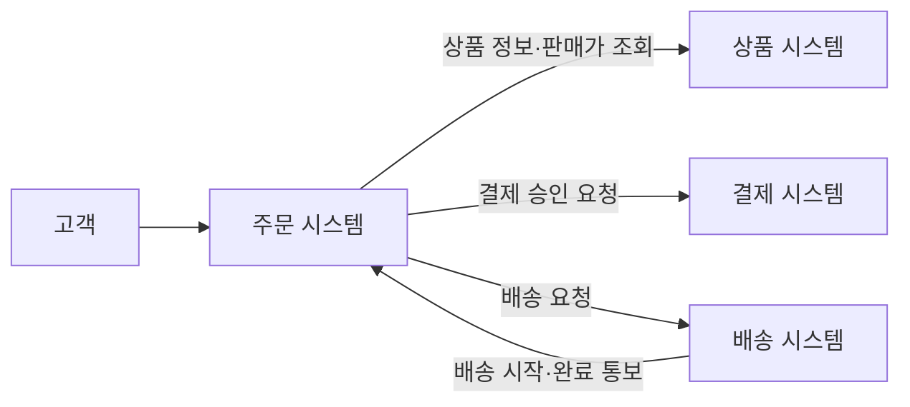
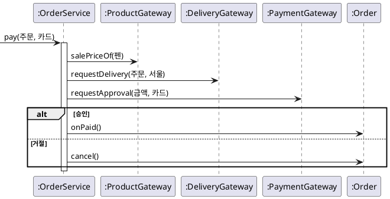
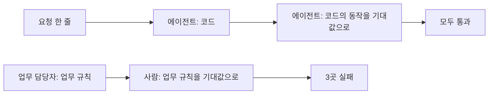
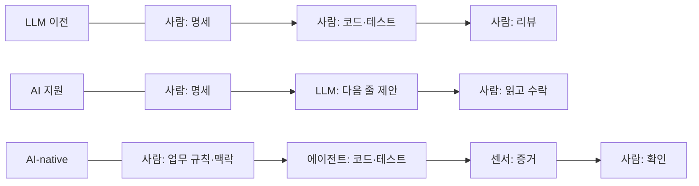
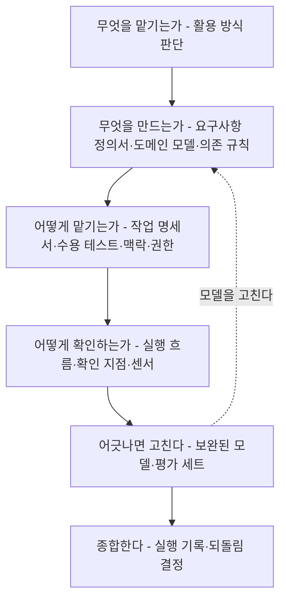

--------------------
Session 명: 01. 사람의 일과 AI의 일
--------------------

## 목차

01. 세션 목표
02. 첫 시도
03. AI가 바꾼 것과 바꾸지 못한 것
04. LLM이라는 새 재료
05. 개발 방식의 구분
06. 사람과 AI의 역할
07. 작업 특성
08. AI 활용 방식
09. 자율성을 높이는 조건
10. 과정의 지도
11. 실습 — 업무 조건 확인
12. 요약

## 01. 세션 목표

AI는 코드를 만드는 비용을 크게 줄였다. 그러나 **무엇을 만들지와 무엇이 옳은 결과인지**는 여전히 사람이 정한다.

- AI가 SW 공학에서 **바꾼 것과 바꾸지 못한 것**을 본질적·우연적 복잡성으로 설명한다.
- **업무 규칙**은 도메인 지식이며, 주어지지 않으면 LLM이 추측으로 채운다는 것을 코드와 테스트로 확인한다.
- LLM의 성질 — **그럴듯한 추측, 비결정성, 맥락의 한계** — 을 설명한다.
- **LLM 이전·AI 지원·AI-native** 개발을 구분하고, 규율이 없는 사용과 가른다.
- 활동마다 **사람이 결정할 것과 AI가 지원할 것**을 나눈다.
- **작업 특성 4가지**로 수작업·대화형 보조·워크플로·에이전트 중 가장 단순한 충분한 방식을 고른다.
- 자율성을 높이는 데 필요한 **증거**를 말한다.

**강사 노트**

- 세션 전체가 하나의 시나리오(쇼핑몰 주문 시스템의 첫 시도)로 이어진다. 사건 → 원인 → 새 일하는 방식 → 무엇을 어떻게 맡길지 → 과정의 지도 순서다.
- 내용은 2026-10 기준이다. 도구·모델의 능력에 관한 서술은 과정을 열 때마다 원문으로 다시 확인한다.

---

## 02. 첫 시도

## 쇼핑몰의 주문 시스템

생활용품 쇼핑몰이 주문 시스템을 **빈 저장소에서 새로** 만든다. 첫 기능은 고객이 결제까지 마치는 **"주문한다"**이다.

**도식 — Mermaid — 주문 시스템과 외부 시스템**



1. 고객이 펜 2개(개당 1,000원)를 장바구니에 담는다.
2. 배송지(서울)를 정하면 주문이 생기고 주문 금액 2,000원이 정해진다.
3. 카드 결제가 승인되면 결제완료가 되고 배송을 요청한다.

**강사 노트**

- 사례는 "객체지향 분석과 설계 실무" 과정과 같은 주문 시스템이며 이름도 같다. 이 과정만 듣는 수강생을 위해 필요한 전제만 소개한다.
- 상품·결제·배송 시스템은 이미 운영 중인 외부 시스템이다. 주문 시스템은 이들과 요청·통보를 주고받는다.
- 업무 담당자 한 명이 주문 정책을 정하고, 개발자 세 명(테크 리드 한 명, 개발자 두 명)이 코딩 에이전트를 쓴다.

---

## 요청 한 줄과 10분

업무 담당자가 준 요청은 아래 한 줄뿐이었다. 테크 리드가 이 한 줄을 그대로 코딩 에이전트에게 주자 **10분 만에** 코드와 테스트가 나왔다.

> "장바구니에 담은 상품을 결제하면 주문이 되고 배송이 시작되게 해 주세요."

- **결과** — 자바 파일 15개와 테스트 3개를 만들었다. 테스트는 모두 통과했다.
- **데모** — 펜 2개를 카드로 결제하자 결제완료가 되고 배송이 요청되었다.
- **팀의 판단** — "다 됐다"고 보고 업무 담당자에게 리뷰를 요청했다.

**강사 노트**

- 10분, 파일 15개, 테스트 3개는 교육용 가정이다. 파일 수는 `code/s01/order/`와 같다.
- 수강생에게 묻는다: 여기서 받아들여도 되는가? 무엇을 확인하면 되는가?

---

## 리뷰에서 나온 문제 3가지

테스트는 모두 통과했지만, 업무 담당자가 결과를 보자 **고객과 회사가 실제로 겪게 될 문제** 세 가지가 드러났다.

**표 — 리뷰에서 나온 문제와 원인**

| 고객과 회사가 겪는 일 | 에이전트가 고른 것 | 업무 담당자가 정한 업무 규칙 |
|---|---|---|
| 2,000원에 주문한 고객에게 2,400원을 청구한다 | 결제할 때의 판매가로 계산 | 주문할 때의 판매가로 정한다 |
| 돈을 받지 않은 주문이 배송 준비에 들어간다 | 결제 승인 전에 배송 요청 | 결제가 승인된 뒤에만 배송을 요청한다 |
| 결제가 거절된 고객이 다시 결제할 수 없다 | 결제가 거절되면 주문 취소 | 결제대기로 남겨 다른 카드로 다시 결제한다 |

- **공통점** — 3가지 모두 요청 한 줄에 없던 **업무 규칙**이다. 에이전트는 묻지 않고 골랐다.

**강사 노트**

- 첫 번째 줄은 결제 직전에 펜 판매가가 1,200원으로 오른 경우다.
- 에이전트가 고른 답은 다른 쇼핑몰에서는 맞을 수 있는 답이다. 그래서 코드만 봐서는 틀린 줄 모른다.

---

## 추측으로 채운 코드

에이전트가 만든 결제 코드는 요청에 없던 업무 규칙 세 가지를 모두 **스스로 정해 채웠다**.

**도식 — PlantUML — 첫 시도의 결제 시퀀스**



1. **주문 금액** — 결제할 때 판매가를 다시 조회해 계산한다.
2. **배송 요청** — 결제 승인을 요청하기 전에 배송을 요청한다.
3. **결제 거절** — 거절되면 주문을 취소한다.

**페이지 분할**

```java
public class OrderService {
    // ... 필드와 생성자 생략
    public void pay(OrderNumber number, PaymentMethod method) {
        Order order = repository.findBy(number);
        Money amount = Money.ZERO;
        for (OrderItem item : order.items()) {
            // ① 결제 시점의 판매가로 다시 계산
            Money salePrice = productGateway.salePriceOf(item.productNumber());
            amount = amount.plus(salePrice.times(item.quantity().value()));
        }
        // ② 승인 전에 배송 요청
        deliveryGateway.requestDelivery(number.value(), order.shippingAddress());
        if (paymentGateway.requestApproval(amount, method)) order.onPaid();
        else order.cancel();   // ③ 거절되면 취소됨
        repository.save(order);
    }
}
```

**강사 노트**

- 전체 코드는 `code/s01/order/`다. 첫 시도의 결제 코드는 LLM이 흔히 내는 추측을 모아 만든 교육용 예이며, 수강생의 LLM은 다른 곳을 추측할 수 있다.
- 코드가 보장하는 것: 승인되면 결제완료가 된다. 보장하지 않는 것: 주문 금액, 배송 요청의 시점, 거절 뒤 상태 — 모두 업무 규칙이 정해야 하는 것이다.
- 코드의 영문 이름은 설계 이름이다. 본문에서는 결제한다·주문 금액처럼 한글로 부른다.

---

## 자기 코드를 확인한 테스트

에이전트가 만든 테스트는 업무 규칙이 아니라 **자기가 쓴 코드의 동작**을 기대값으로 삼았다. 같은 코드를 업무 규칙으로 확인하면 세 곳에서 실패한다.

**도식 — Mermaid — 기대값은 어디서 오는가?**



**표 — 같은 코드, 두 테스트의 결과**

| 확인하는 것 | 에이전트의 테스트 | 업무 규칙의 테스트 |
|---|---|---|
| 승인되면 결제완료 | 통과 | 통과 |
| 주문 금액 | 판매가 × 수량 — 통과 | 판매가가 올라도 2,000원 — 실패 |
| 결제 거절 | 취소된다 — 통과 | 결제대기, 배송 요청 없음 — 실패 |

**강사 노트**

- 두 테스트는 `code/s01/order/test/`의 `AgentWrittenTest`와 `PayTest`다. javac로 컴파일하고 각각 실행해 결과를 대조한다.
- 테스트가 통과했다는 것은 "코드가 기대값대로 동작한다"는 뜻이다. 기대값이 추측이면 통과도 추측을 확인했을 뿐이다. 기대값을 업무 규칙에서 정하는 일은 "세션 05. 작업 명세와 수용 기준"이 다룬다.

---

## 03. AI가 바꾼 것과 바꾸지 못한 것

## 본질적 복잡성과 우연적 복잡성

**인용문**

아리스토텔레스를 따라 나는 소프트웨어의 어려움을 **본질**, 곧 소프트웨어의 본성에 본래 있는 어려움과 **우연**, 곧 오늘날 소프트웨어를 만드는 데 따라붙지만 본래적이지는 않은 어려움으로 나눈다, "Following Aristotle, I divide them into essence, the difficulties inherent in the nature of the software, and accidents, those difficulties which today attend its production but which are not inherent", [Brooks 1986]

  - 소프트웨어를 만드는 어려운 부분은 이 개념 구조의 **명세·설계·검증**이며 그것을 **표현하는 노동**이 아니다, "I believe the hard part of building software to be the specification, design, and testing of this conceptual construct, not the labor of representing it", [Brooks 1986]

**표 — 첫 시도에서 본 두 복잡성**

| 구분 | 첫 시도에서 | 누가 하는가? |
|---|---|---|
| **본질적 복잡성** — 업무 규칙 | 주문 금액, 배송 요청, 결제 거절 | 업무 담당자와 개발자가 정한다 |
| **우연적 복잡성** — 업무 규칙을 코드로 옮기는 일 | 파일 15개·반복문·외부 호출·테스트 틀 | AI가 10분 만에 만들었다 |

- **AI가 줄인 것** — 업무 규칙을 코드로 옮기는 노동이다.
- **병목의 이동** — 이제 시간은 업무 규칙을 찾고, 정하고, 검증하는 데 든다.

**강사 노트**

- 인용 근거: Frederick P. Brooks Jr., "No Silver Bullet — Essence and Accidents of Software Engineering", 1986 원문 확인. 두 인용은 원문에서 이어지는 대목이다 — 앞이 본질·우연의 정의, 뒤가 어려운 부분이 무엇인지다.
- 둘째 인용의 원문은 "…testing the fidelity of the representation."으로 이어지며, PDF의 쪽 번호가 문장 중간에 있어 앞부분까지 인용했다.
- 본질적 복잡성을 업무 규칙에, 우연적 복잡성을 업무 규칙을 코드로 옮기는 일에 대응시킨 것은 이 과정의 해석이다. Brooks의 문장이 아니다.

---

## 업무 규칙은 도메인 지식이다

**인용문**

소프트웨어 시스템을 만드는 일에서 가장 어려운 부분은 **정확히 무엇을 만들지 결정하는 것**이다, "The hardest single part of building a software system is deciding precisely what to build.", [Brooks 1986]

**업무 규칙은 업무 담당자가 아는 도메인 지식이다.** 코드나 공개된 자료에 있지 않고, 회사의 정책·운영 방식·고객과의 약속이 정한다.

**표 — 회사마다 달라지는 업무 규칙**

| 업무 규칙 | 회사마다 달라지는 이유 |
|---|---|
| **주문 금액** | 주문할 때 보여 준 가격을 고객에게 보장할지는 회사의 가격 정책이다 |
| **배송 요청** | 결제 확인 전에 배송 준비를 시작할지는 물류 운영과 위험을 감수하는 정도의 문제다 |
| **결제 거절** | 거절된 주문을 남겨 다시 결제받을지, 바로 정리할지는 고객 경험과 재고 운영의 선택이다 |

- **LLM은 이 지식을 모른다** — 주어지지 않으면 흔히 보이는 답을 고른다. 그 답은 다른 회사에서는 맞는 답이라 틀린 줄 알기 어렵다.

**강사 노트**

- 인용 근거: Brooks(1986) 원문 확인.
- "LLM은 흔히 보이는 답을 고른다"는 이 과정의 설명이다. 출처로 인용하지 않는다.
- 업무 규칙을 용어집·개념과 관계·상태 기계로 명시하는 일은 "세션 03. 도메인 모델"이 다룬다.

---

## 04. LLM이라는 새 재료

## 그럴듯한 추측과 비결정성

LLM은 엔지니어가 써 온 도구와 성질이 다르다. 같은 입력에 같은 결과를 내는 컴파일러와 달리, **모르는 것을 그럴듯하게 채우고 매번 다르게 답한다**.

**인용문**

**작화**(confabulation)는 자신 있게 말하지만 **틀리거나 거짓인 내용**을 만들어 내는 것이다, "Confabulation: The production of confidently stated but erroneous or false content", [NIST 2024]

- **그럴듯한 추측** — 2,400원을 청구하는 코드도 컴파일되고 테스트를 통과했다. 그럴듯할수록 틀린 줄 모른다.
- **비결정성** — 같은 요청을 다시 주면 결제 거절을 결제대기로 처리한 코드가 나오기도 한다. 한 번 맞은 결과는 **증거가 아니다**.

**강사 노트**

- 인용 근거: NIST, *Artificial Intelligence Risk Management Framework: Generative Artificial Intelligence Profile*(NIST AI 600-1), 2024의 Confabulation 항목 원문 확인. 같은 항목은 이것을 흔히 "환각(hallucination)"이라 부른다고 적는다.
- 비결정성은 이 과정의 설명이다. 수강생의 LLM으로 같은 요청을 두 번 보내 차이를 확인하게 할 수 있다.

---

## 맥락의 한계

LLM은 **그 작업에서 읽을 수 있는 것만** 보고 판단한다. 업무 담당자와 합의한 규칙이라도 맥락에 넣어 주지 않으면 알지 못한다.

**인용문**

맥락은 **한정된 자원**으로 다뤄야 하며 더 넣을수록 **한계 효용이 줄어든다**, "Context, therefore, must be treated as a finite resource with diminishing marginal returns.", [Anthropic 2025c]

- **주어진 것만 안다** — 맥락은 요청, 열어 본 파일, 이전 대화다. 작업이 끝나면 기억하지 않는다.
- **한 번에 볼 수 있는 양이 정해져 있다** — 이 한도를 맥락 창(context window)이라 부른다.
- **많이 넣는다고 좋아지지 않는다** — 맥락이 길어질수록 중요한 내용을 놓친다. 그래서 판단에 영향을 주는 자료만 골라 준다.

**강사 노트**

- 인용 근거: Anthropic, "Effective context engineering for AI agents"(2025) 원문 확인.
- 무엇을 골라 줄지는 "세션 06. 맥락 구성"에서 다룬다. 결제 연동 매뉴얼 200쪽을 통째로 준 장면이 그 세션의 사례다.

---

## 05. 개발 방식의 구분

## 3가지 개발 방식

세 방식을 가르는 것은 쓰는 도구가 아니다. **맡기는 작업의 단위와, 사람과 LLM이 하는 일과, 무엇으로 결과를 확인하는지**가 다르다.

**표 — 개발 방식의 구분**

| 구분 | 작업의 단위 | 누가 무엇을 하는가? | 검증 |
|---|---|---|---|
| **LLM 이전** | 사람이 쓰는 코드 | 사람이 명세·설계·코드·테스트를 쓴다 | 사람이 쓴 테스트와 리뷰 |
| **AI 지원**(AI-assisted) | LLM의 제안 하나 | 사람이 흐름을 쥐고 제안을 받아들인다 | 제안마다 사람이 읽는다 |
| **AI-native** | 맡긴 과제 하나 | 사람이 정하고 에이전트가 실행한다 | 센서의 증거와 사람의 확인 |

- **바뀌는 것** — 사람의 일의 위치다. 코드를 쓰고 읽던 일이 업무 규칙을 정하고 명시하고 검증하는 일로 옮겨 간다.
- **바뀌지 않는 것** — 무엇이 옳은 결과인지의 판단과 책임은 사람에게 있다.
- **AI-native는 "모두 에이전트"가 아니다** — 작업마다 가장 단순한 충분한 형태를 고른다.

**강사 노트**

- 3가지 구분은 원전의 분류가 아니라 이 과정의 구분이다(`course-design.md`의 「원전 적용 결정」).
- AI 지원의 병목은 사람의 리뷰다. 형태의 선택은 「08. AI 활용 방식」에서 다룬다.

---

## 같은 과제, 3가지 방식

같은 "주문한다"를 세 방식으로 개발하면 **사람이 직접 손대는 자리**가 달라진다.

**도식 — Mermaid — 3가지 방식의 흐름**



- **LLM 이전** — 사람이 결제 코드와 테스트를 쓴다.
- **AI 지원** — LLM이 다음 줄을 제안하고 사람이 받아들인다.
- **AI-native** — 에이전트가 코드와 테스트를 만들고, 사람은 센서의 결과로 판단한다.

**강사 노트**

- 첫 시도는 AI-native의 겉모양(에이전트가 과제를 실행)만 있고, 사람의 몫(업무 규칙·맥락·센서·확인)이 빠졌다.
- 센서는 실행 뒤에 결과의 증거를 내는 검사다. 센서를 설계하고 유지하는 일은 "세션 09. 검증 하네스"가 다룬다.

---

## 바이브 코딩과 규율

첫 시도는 데모 한 번을 보고 받아들일 뻔했다. 결과의 동작만 보고 받아들이는 방식이 **바이브 코딩**(vibe coding)이다.

**인용문**

바이브 코딩에서는 코드가 아니라 **시스템의 동작만** 신경 쓴다, "In vibe coding you don't care about the code, just the behavior of the system.", [Beck 2025]

**인용문**

증강 코딩에서는 **코드와 그 복잡도·테스트와 그 커버리지**를 신경 쓴다, "In augmented coding you care about the code, its complexity, the tests, & their coverage.", [Beck 2025]

**인용문**

숙련자가 LLM으로 일을 빠르게 하면서도 **자기가 만든 소프트웨어에 책임을 지는** 방식을 바이브 엔지니어링(vibe engineering)이라 부른다, "seasoned professionals accelerate their work with LLMs while staying proudly and confidently accountable for the software they produce", [Willison 2025b]

- **AI는 팀의 습관을 키운다** — 업무 규칙·테스트·리뷰가 있는 팀에서는 좋은 결과를, 없는 팀에서는 나쁜 결과를 더 빨리 만든다.

**강사 노트**

- 인용 근거: Kent Beck, "Augmented Coding: Beyond the Vibes"(2025), Simon Willison, "Vibe engineering"(2025) 원문 확인. Willison 인용은 요약이다.
- 바이브 코딩은 개발 방식의 한 구분이 아니라 규율이 없는 사용이다. AI 지원과 AI-native 어디에서나 생길 수 있다.
- "습관을 키운다"는 이 과정의 설명이다. 출처로 인용하지 않는다.

---

## 06. 사람과 AI의 역할

## 사람이 조종하고 에이전트가 실행한다

**인용문**

사람이 **조종하고** 에이전트가 **실행한다**, "Humans steer. Agents execute.", [Lopopolo 2026]

**인용문**

사람은 늘 루프 안에 있지만 **예전과 다른 추상 수준**에서 일한다 — 일의 우선순위를 정하고 사용자 피드백을 **수용 기준**으로 옮기고 **결과를 확인**한다, "Humans always remain in the loop, but work at a different layer of abstraction than we used to. We prioritize work, translate user feedback into acceptance criteria, and validate outcomes.", [Lopopolo 2026]

- **우선순위** — 첫 릴리스에 "주문한다"를 먼저 맡기기로 정한다.
- **수용 기준** — 업무 규칙 3가지를 허용·거절 예시로 옮긴다.
- **결과 확인** — 데모가 아니라 업무 규칙의 테스트로 받아들인다.

**강사 노트**

- 인용 근거: Ryan Lopopolo, "Harness engineering: leveraging Codex in an agent-first world", OpenAI, 2026 영문 원문 확인(openai.com이 한국어판으로 자동 전환하므로 영문판으로 확인).
- 한 팀(OpenAI 내부 제품)의 경험이다. 글도 비슷한 투자 없이 일반화된다고 가정하지 말라고 밝힌다.

---

## 활동마다 사람과 AI

사람은 **결정하고**, AI는 **초안과 검사로 지원한다**. 결정을 AI에게 넘기면 첫 시도처럼 추측이 결과에 들어온다.

**표 — 활동마다 사람의 일과 AI의 일**

| 활동 | 사람이 한다 | AI가 한다 |
|---|---|---|
| **문제·의도** | 문제와 의도, 위험 수용을 정한다 | 빠진 결정을 질문으로 드러낸다 |
| **요구·명세** | 요구와 기대값을 확정한다 | 초안을 쓰고 애매한 것을 묻는다 |
| **도메인 모델** | 업무 개념과 규칙을 결정한다 | 초안을 쓰고 모순과 누락을 낸다 |
| **아키텍처** | 무엇이 무엇을 알아야 하는지 정한다 | 규칙 위반을 검사한다 |
| **맥락·경계** | 읽힐 것과 권한, 종료 조건을 정한다 | 경계 안에서 찾아 읽고 일한다 |
| **실행** | — | 코드와 테스트를 만들고 실행한다 |
| **검증** | 무엇을 어떻게 검증할지 정한다 | 센서의 결과를 보고 스스로 고친다 |
| **결과 판단** | 증거를 보고 수용하거나 되돌린다 | 완료의 증거를 제시한다 |
| **실패·보완** | 모델에 반영할지 결정한다 | 잘못된 곳과 개선을 제안한다 |

- **예** — 에이전트는 "결제가 거절되면 주문은 어떻게 되나요?"를 정하지 않고 묻는다. 정하는 것은 업무 담당자와 개발자다.

**강사 노트**

- 이 역할 구분은 이 과정의 구분이다(`course-design.md`의 「과정 전체 판단 원칙」).
- 표의 행 하나하나가 뒤 세션의 주제다. 각 행에서 남는 산출물은 「10. 과정의 지도」에서 이어 본다.

---

## 07. 작업 특성

작업 특성은 그 작업을 **AI에게 맡겨도 되는지, 맡긴다면 어떤 방식으로 맡길지**를 가르는 성질이다.

**인용문**

코딩 에이전트는 **자동 테스트로 검증**하고 테스트 결과에 따라 고칠 수 있으며 문제가 **잘 정의되어** 있고 품질을 **객관적으로 잴 수** 있을 때 특히 효과적이다, "Code solutions are verifiable through automated tests; Agents can iterate on solutions using test results as feedback; The problem space is well-defined and structured; and Output quality can be measured objectively.", [Anthropic 2024]

**표 — 작업 특성 4가지**

| 작업 특성 | 질문 | 예 |
|---|---|---|
| **업무 규칙의 확정** | 무엇이 옳은 결과인지 정해졌는가? | 주문 금액을 언제의 가격으로 할지 정했는가? |
| **절차의 확정** | 끝내기까지의 작업 순서를 미리 적을 수 있는가? | 연동 코드: 문서 확인 → 코드 작성 → 테스트 |
| **결과의 자동 확인** | 결과가 옳은지 테스트로 확인할 수 있는가? | 주문 금액은 수용 테스트로, 릴리스 노트는 사람이 |
| **되돌리기 쉬움** | 잘못되었을 때 이전 상태로 정확히 돌릴 수 있는가? | 코드는 이전 커밋으로, 운영 데이터는 어렵다 |

**강사 노트**

- 인용 근거: Anthropic, "Building effective agents"(2024)의 코딩 에이전트 사례 원문 확인. 한글은 요약이다.
- 작업 특성을 4가지로 묶은 것은 이 과정의 정리다. 원문의 "잘 정의된 문제"와 "자동 테스트로 검증"을 바탕으로 업무 규칙과 되돌리기를 더했다.

---

## 08. AI 활용 방식

## 증강 LLM과 4가지 방식

수작업에서 에이전트로 갈수록 **작업 순서를 정하는 쪽이 사람에서 LLM으로 옮겨 간다**. 쓰는 LLM은 같다 — 넷 모두 검색·도구·기억을 붙인 **증강 LLM** 위에서 돈다.

**인용문**

에이전트 시스템의 기본 구성 요소는 검색·도구·기억 같은 **증강을 더한 LLM**이다, "The basic building block of agentic systems is an LLM enhanced with augmentations such as retrieval, tools, and memory.", [Anthropic 2024]

**표 — AI 활용 방식 4가지**

| 방식 | 절차 결정 | 실행 | 사람 확인 | 예 |
|---|---|---|---|---|
| **수작업** | 사람 | 사람 | 하면서 | 사람이 이관 스크립트를 실행하고 건수·금액을 대조한다 |
| **대화형 보조** | 사람 | 사람(LLM은 답·초안) | 답마다 | LLM이 릴리스 노트 초안을 쓰고 사람이 고친다 |
| **워크플로** | 사람이 정한 순서 | LLM | 정한 지점 | LLM이 정해 둔 순서대로 연동 코드를 만든다 |
| **에이전트** | LLM | LLM | 끝에서 | LLM이 파일을 찾고 고치고 테스트를 돌려 구현한다 |

- **자율성** — LLM이 사람의 확인 없이 스스로 정하는 범위다. 아래로 갈수록 넓어진다.

**강사 노트**

- 인용 근거: Anthropic, "Building effective agents"(2024) 원문 확인. 네 방식 가운데 수작업과 대화형 보조는 이 과정이 더한 비교 대상이다.
- 증강 LLM의 검색은 저장소의 코드·문서 읽기, 도구는 빌드·테스트 실행, 기억은 작업 사이의 진행 기록이다.
- 수작업도 결정적인 도구(스크립트·템플릿)를 쓴다. 사람이 실행하고 결과를 직접 확인한다는 점이 다르다.

---

## 워크플로와 에이전트

LLM에게 실행을 맡기는 두 형태가 **워크플로**(workflow)와 **에이전트**(agent)다. 가르는 것은 **단계를 누가 정하는가**이다.

**인용문**

워크플로는 LLM과 도구가 **미리 정한 코드 경로**로 조율되는 시스템이다, "Workflows are systems where LLMs and tools are orchestrated through predefined code paths.", [Anthropic 2024]

**인용문**

에이전트는 LLM이 **자기 과정과 도구 사용을 스스로 정하면서** 일을 어떻게 이룰지 통제하는 시스템이다, "Agents, on the other hand, are systems where LLMs dynamically direct their own processes and tool usage, maintaining control over how they accomplish tasks.", [Anthropic 2024]

**인용문**

워크플로는 잘 정의된 작업에 **예측 가능성과 일관성**을 주고 에이전트는 **유연성과 모델 주도의 결정**이 대규모로 필요할 때 더 나은 선택이다, "workflows offer predictability and consistency for well-defined tasks, whereas agents are the better option when flexibility and model-driven decision-making are needed at scale.", [Anthropic 2024]

- **예** — "명세 확인 → 구현 → 테스트"를 정해 두고 단계마다 LLM을 부르면 워크플로다. 첫 시도처럼 과제만 주고 파일을 찾고 고치고 테스트를 돌리게 하면 에이전트다.

**강사 노트**

- 인용 근거: Anthropic, "Building effective agents"(2024) 원문 확인. 위임 형태에 관한 이 과정의 기준 원전이다.
- 워크플로의 패턴과 사람의 확인 지점을 설계하는 일은 "세션 08. 실행 흐름"이 다룬다.

---

## 선택의 순서

작업 특성을 차례로 물으면 **가장 단순하면서도 충분한 방식**에 이른다. 업무 규칙이 정해졌는지와 되돌릴 수 있는지를 먼저 묻는다. 이 둘은 모델이 좋아져도 달라지지 않기 때문이다.

**표 — 활용 방식의 선택**

| 순서 | 질문 | "아니오"이면 | "예"이면 |
|---|---|---|---|
| 1 | 업무 규칙이 정해졌나? | 사람이 먼저 정한다 | 2로 |
| 2 | 되돌리기 쉬운가? | 수작업 | 3으로 |
| 3 | 결과를 자동으로 확인할 수 있나? | 대화형 보조 | 4로 |
| 4 | 절차가 정해졌나? | 에이전트 | 워크플로 |

**인용문**

에이전트는 필요한 **단계 수를 예측하기 어렵고** 고정된 경로를 코드로 정할 수 없는 열린 문제에 쓸 수 있다, "Agents can be used for open-ended problems where it's difficult or impossible to predict the required number of steps, and where you can't hardcode a fixed path.", [Anthropic 2024]

- **에이전트는 마지막** — 앞의 질문을 모두 통과하고, 절차를 미리 정할 수 없을 때만 고른다.

**강사 노트**

- 질문의 순서는 이 과정의 정리다. 인용 근거: Anthropic(2024) 원문 확인.
- 방식은 작업의 이름이 아니라 그 시점의 작업 특성으로 정한다. 같은 구현이라도 업무 규칙이 정해지기 전과 후가 다르다.

---

## AI에게 맡기지 않는 작업

맡기지 않는 작업은 두 가지다. **AI가 할 수 없는 작업**과 **AI를 쓸 이유가 없는 작업**이다.

- **AI가 할 수 없는 작업** — 답과 책임이 AI 밖에 있다.
  - **업무 규칙 정하기** — 답은 업무 담당자가 안다. 사람이 정하고 AI는 질문을 찾는다.
  - **되돌리기 어려운 작업의 실행** — 책임은 사람이 진다. 사람이 실행하고 AI는 초안만 쓴다.
- **AI가 필요 없는 작업** — 늘 같은 결과가 필요하다.
  - **저장소 골격·코드 형식·의존 규칙** — AI는 매번 다르게 만든다. 템플릿·포매터·정적 검사로 한다.

**인용문**

사용 사례가 기준을 분명히 충족하지 않으면 **결정적인 해법으로 충분**할 수 있다, "Before committing to building an agent, validate that your use case can meet these criteria clearly. Otherwise, a deterministic solution may suffice.", [OpenAI 2025]

**강사 노트**

- 인용 근거: OpenAI, "A practical guide to building agents"(2025) 원문 확인(받은 PDF). 한글은 요약이다.
- 포매터·정적 검사·빌드 도구는 뒤에서 에이전트의 결과를 확인하는 센서가 된다.

---

## 주문 기능 개발의 활용 방식

첫 릴리스에 해야 할 일 여섯 가지를 작업 특성으로 따져 보면, **에이전트에게 맡긴 것은 하나뿐**이다.

**표 — 주문 첫 릴리스의 활용 방식**

| 작업 | 작업 특성 | 방식 | 부적합한 방식 |
|---|---|---|---|
| **업무 규칙 정하기** | 업무 규칙 미정 — 업무 담당자만 안다 | 수작업 + 대화형 보조 | 에이전트 — 추측한다 |
| **저장소 골격** | 늘 같은 결과가 필요하다 | 수작업(템플릿) | 에이전트 — 매번 다르다 |
| **주문 금액·상태 구현** | 테스트로 확인되나 고칠 곳을 미리 모른다 | 에이전트 | 워크플로 — 순서를 못 적는다 |
| **결제·배송 연동 코드** | 문서가 정확해 순서를 적을 수 있다 | 워크플로 | 에이전트 — 대가가 크다 |
| **주문 데이터 이관** | 이전 상태로 돌리기 어렵다 | 수작업 | 워크플로·에이전트 |
| **릴리스 노트** | 테스트로 확인할 수 없다 | 대화형 보조 | 에이전트 |

- **이관은 왜 되돌리기 어려운가?** — 옮긴 주문은 곧바로 고객이 조회하고 배송이 진행된다. 잘못 옮긴 것을 나중에 알면 데이터는 고쳐도, 그사이 고객에게 일어난 일은 되돌릴 수 없다.

**강사 노트**

- 업무 규칙 정하기는 업무 담당자와 사람이 정하고, LLM은 대화형 보조로 빠진 질문을 찾는 데 쓴다.
- 주문 데이터 이관은 외부 솔루션에서 옮겨 오는 이 시나리오의 작업이다. LLM이 변환 스크립트 초안을 쓸 수 있지만, 실행과 확인은 사람이 한다.
- 결제 연동 문서가 부실하다면 같은 작업도 에이전트 + 사람 리뷰가 맞는 답이 된다. 수강생에게 먼저 고르게 하고 이유를 비교한다.

---

## 09. 자율성을 높이는 조건

## 자율성의 대가

자율성을 높이면 **사람이 결과를 확인하는 시점이 뒤로 밀리고, 그사이 오류가 쌓이는 범위도 넓어진다**. 작업이 크고 반복이 많을수록 그 비용이 커진다.

**인용문**

에이전트 시스템은 더 나은 작업 성능을 얻는 대신 **지연과 비용**을 치르는 경우가 많으므로 그 교환이 언제 맞는지 따져야 한다, "Agentic systems often trade latency and cost for better task performance, and you should consider when this tradeoff makes sense.", [Anthropic 2024]

**인용문**

에이전트의 자율성은 **더 높은 비용과 오류가 누적될 가능성**을 뜻한다, "The autonomous nature of agents means higher costs, and the potential for compounding errors.", [Anthropic 2024]

**표 — 활용 방식의 대가**

| 방식 | 사람 확인 | 오류가 쌓이는 범위 | 비용이 커지는 때 |
|---|---|---|---|
| **대화형 보조** | 답마다 | 답 하나 | 질문이 많아질 때(사람의 시간) |
| **워크플로** | 정한 지점마다 | 한 단계 안 | 단계마다 맥락을 새로 읽을 때 |
| **에이전트** | 끝에서 | 여러 단계에 걸쳐 | 반복 실행이 길어질 때 |

**강사 노트**

- 인용 근거: Anthropic(2024) 원문 확인. 표는 이 과정의 정리다.

---

## 세 방식의 시연 기록

같은 작업을 세 방식으로 **실제로 실행했다**. 세 번 모두 같은 업무 규칙과 같은 수용 테스트를 주었고, 달랐던 것은 **사람이 개입한 자리와 쓴 토큰**이다.

**표 — 주문 금액 구현의 시연 기록**

| 방식 | 사람이 개입한 곳 | LLM 호출·턴 | LLM 시간 | 출력 토큰 | 입력 토큰 |
|---|---|---|---|---|---|
| **대화형 보조** | 질문·붙여 넣기·테스트 실행 7번 | 2·2 | 20초 | 1,608 | 56,810 |
| **워크플로** | 단계 3개의 실행 | 3·24 | 66초 | 6,333 | 402,181 |
| **에이전트** | 과제 하나와 결과 확인 | 1·11 | 34초 | 3,367 | 339,270 |

- **업무 규칙이 있으면 셋 다 지킨다** — 첫 시도와 달리 업무 규칙과 수용 테스트를 주었기 때문이다.
- **대화형 보조** — 토큰이 가장 적다. 대신 맥락을 사람이 골라 붙여야 하고, 빠뜨리면 LLM이 추측한다.
- **워크플로** — 단계마다 새로 시작해 파일을 다시 읽어 **에이전트보다 토큰을 더 썼다**. 대신 중간 결과를 본다.
- **에이전트** — 사람의 개입이 가장 적다. 대신 확인이 **끝에 몰린다**.

**강사 노트**

- 저장소와 실행 기록은 `code/s01/demo/`에 있다. 2026-10-07에 Claude Code 2.1.292(비대화형 실행, 모델 claude-opus-5-5)로 실행한 한 번의 기록이다.
- 대화형 보조의 첫 답은 컴파일 오류였다. 질문에 붙이지 않은 `Product`의 메서드 이름을 추측했기 때문이다.
- LLM 시간은 도구가 보고한 시간의 합이며 사람이 붙여 넣고 테스트를 돌린 시간은 넣지 않았다. 입력 토큰에는 도구의 시스템 프롬프트와 도구 정의가 포함된다.
- 강의장에서는 수강생의 도구로 다시 실행한다. 결과는 매번 달라질 수 있다(비결정성).

---

## 자율성의 계단

**가장 단순한 방식으로 시작하고, 맡겨도 된다는 증거가 분명할 때만 자율성을 높인다.**

**인용문**

LLM으로 애플리케이션을 만들 때는 **가능한 가장 단순한 해법**을 찾고 필요할 때만 복잡도를 높인다 — 에이전트 시스템을 **아예 만들지 않는 것**일 수도 있다, "When building applications with LLMs, we recommend finding the simplest solution possible, and only increasing complexity when needed. This might mean not building agentic systems at all.", [Anthropic 2024]

**표 — 자율성의 계단**

| 지금 | 다음 | 필요한 증거 |
|---|---|---|
| **대화형 보조** | 워크플로 | 업무 규칙과 수용 테스트가 생겼다 |
| **워크플로** | 에이전트 | 테스트 통과와 실패 기록이 쌓였다 |
| **에이전트** | 사람 확인을 줄인 에이전트 | 평가 세트를 통과했다 |

- **계단마다 증거** — 한 단계 올리려면 아래 단계에서 쌓은 증거가 필요하다.
- **예** — 결제 연동 코드는 첫 릴리스에서 워크플로로 만들고, 테스트가 쌓인 다음 릴리스에서 에이전트로 올린다.

**강사 노트**

- 인용 근거: Anthropic(2024) 원문 확인.
- 실패 기록은 "세션 10. 실패와 모델 보완", 평가 세트는 "세션 11. 평가와 운영"에서 다룬다.
- 첫 시도는 증거 없이 가장 높은 자율성에서 시작했다. 데모 한 번은 증거가 아니다.

---

## 10. 과정의 지도

## 관통 사례 — 주문과 정기배송

강의는 **주문 시스템을 새로 개발**하는 과제로 열한 세션을 관통한다. 실습은 기존 쇼핑몰과 연계하는 **정기배송 기능**을 개발하며, 먼저 사람이 정할 업무 조건을 확인한다.

**표 — 강의와 실습의 과제**

| 구분 | 강의 — 주문 시스템 | 실습 — 정기배송 시스템 |
|---|---|---|
| **출발** | 빈 저장소와 요청 한 줄 | 기존 쇼핑몰에 정기배송 기능 추가 |
| **첫 기능** | "주문한다" | "정기배송을 신청한다" |
| **두 번째 기능** | "주문을 취소한다" | "배송지를 변경한다" |
| **외부 시스템** | 상품·결제·배송 | 기존 회원·상품·결제·배송 |
| **사례 값** | 펜 2개, 판매가 1,000원, 배송지 서울 | 휴지 1묶음 10,000원, 2주 주기, 3개월 |

- **강의가 답을 미리 보이지 않는다** — 실습의 정기배송은 수강생이 자기 LLM으로 만들고, 그 결과가 다음 실습의 입력이 된다.

**강사 노트**

- 주문 시스템의 이름과 값, 정기배송의 이름과 규칙은 `course-design.md`의 공통 전제가 원천이다. "객체지향 분석과 설계 실무" 과정과 같게 맞춘다.
- 강의의 두 번째 기능 "주문을 취소한다"는 마지막 세션에서 산출물을 모아 에이전트에게 맡기는 과제다.

---

## 열두 활동에서 남는 산출물

**배치 — 좌우**

활동마다 사람이 내릴 결정이 있고, 그 결정은 **다음 작업의 입력이 되는 산출물**로 남는다. 남은 세션이 이 순서로 산출물을 하나씩 만든다.

**도식 — Mermaid — 과정의 지도**



- **오래 남는 것** — 요구사항 정의서·도메인 모델·의존 규칙이다. 작업 명세서와 수용 테스트는 작업마다 새로 쓴다.
- **학습 순서이지 개발 절차가 아니다** — 실제 개발에서는 뒤 활동이 앞 산출물을 고친다. 점선이 그 되돌림이다.
- **모두 합친 것이 위임 패키지** — 마지막 세션에서 이 묶음으로 다음 기능을 맡긴다.

**강사 노트**

- 다섯 묶음이 열두 세션에 대응한다. 무엇을 맡기는가는 이 세션, 무엇을 만드는가는 요구·도메인 모델·아키텍처, 어떻게 맡기는가는 명세·맥락·권한, 실행과 확인은 흐름과 하네스, 보완은 실패와 평가다.
- 산출물을 모두 만들어야 하는 것은 아니다. 무엇을 넣을지는 도메인·기술 복잡성이 정하며, 그 판단은 "세션 02. 요구와 유저 스토리"에서 경로와 함께 다룬다.

---

## 11. 실습 — 업무 조건 확인

**①로 시작해 답·질문·수정 요청을 주고받는다.** ②~④는 보완 예시다. ⑤로 MD를 만들고 필요하면 보완·재생성한다.

**프롬프트 — 요청사항 포함**
  + ① “기존 쇼핑몰에 정기배송 신청 기능을 추가하려고 한다. 요구사항을 정의하기 전에 내가 결정해야 할 **핵심 업무 조건**은 무엇인가?”
  + ② “고객이 **처음 정기배송을 신청**하는 경우만 다루자. 기존 회원·상품·결제·배송 기능은 연계해서 사용한다. 화면과 기술 설계는 제외해라.”
  + ③ “계약 기간은 3개월 또는 6개월, 배송 주기는 2주 또는 4주다. 첫 배송일은 고객이 선택하고 자동 갱신은 하지 않는다. 이 조건에서 신청 기능을 정의하려면 **꼭 더 결정해야** 할 것이 있는가? 필요한 이유도 설명해라.”
  + ④ “계약은 첫 배송일부터 시작한다. 신청할 때 기존 상품·수량·배송지를 선택하고, 기존 결제수단으로 배송 회차마다 결제한다. **첫 결제에 성공하면** 신청이 완료된다.”
  + ⑤ “지금까지 합의한 정기배송 최초 신청의 업무 조건을 다음 실습에 사용할 간결한 **Markdown 파일**로 생성해라. 기존 기능은 연계 대상으로 두고 화면·기술 설계와 신청 이후 운영은 제외해라. 모든 경우를 나열하지 말고 합의한 조건과 요구사항 작성에 꼭 필요한 미정 사항만 해당 위치에 표시해라. 새 결정을 추가하거나 폐기한 안을 되살리지 마라. 요구사항 정의서나 기능 목록을 미리 작성하지 말고 업무 조건과 필요한 미정 사항만 짧은 항목으로 정리해라.”

**점검 항목**
  1. **필요성** — 첫 신청 기능에 실제로 필요한 내용인가?
  2. **범위** — 기술·화면 설계나 기존 쇼핑몰 기능의 재구현이 섞였는가?
  3. **판단** — 사람이 정하지 않은 정책을 AI가 확정했는가?
  4. **종료** — 이제 요구사항을 작성할 수 있는가? 그렇다면 탐색을 끝낸다.

**결과물**
  + **합의한 업무 조건의 최종 MD 파일**. 마지막 합의를 확인하고 실습 2에 첨부한다.

**강사 노트**

- Codex·ChatGPT·Claude Team 등에서 renderer 없이 수행한다. ②~④에는 실제 받은 질문의 답과 검토 의견을 붙인다. 기본 문구만 기계적으로 반복하지 않는다.
- ⑤ 이후에도 MD의 누락·불일치·폐기한 안의 재등장을 검토하고 보완·재생성을 반복한다. 다음 작업이 가능하면 탐색을 끝낸다. 제출 여부와 무관하게 최종 MD를 저장해 다음 실습에 명시적으로 첨부한다.
- 최종 MD가 실습 원본이고 교재 슬라이드는 별도 제작물이다. 환경별 파일 생성·다운로드와 도식 표시를 사전에 확인한다. 도식 코드만 보이는 경우를 시각 검토 완료로 보지 않는다.

- 목적은 요구사항을 쓰기 전에 사람이 결정할 업무 조건이 있음을 이해하는 것이다. 상세 요구사항 정의서나 설계는 만들지 않는다.
- ①~⑤는 대화 횟수가 아니라 단계다. ②~④는 보완 대화 예시이며 수강생에 따라 두 번 또는 열 번이 될 수 있다. 받은 답을 읽고 필요한 만큼 추가·반복한다.
- 점검 항목은 매 답변을 읽을 때 사용한다. 기술·화면 설계, 기존 기능 재구현, 범위 밖 운영 또는 AI가 채운 미정 정책을 발견하면 다음 요청에 보완 내용을 넣는다.
- 강사 예시는 code/s01/exercise-conversation/focused-prompts/의 실제 대화다. 앞선 질문에 답하며 확정한 업무 조건을 이어 받아 새 ⑤로 파일화했다. templates.json은 학습자용 기본 문구, prompt-*.txt와 conversation.md는 실제 입력·응답이다.
- 기존 상품 조회 기능의 구현은 연계 대상이며, 정기배송을 허용할 상품을 정하는 것은 새로운 업무 결정일 수 있다.

---

## 12. 요약

AI는 업무 규칙을 코드로 옮기는 일을 줄였고, 그것을 **정하고 명시하고 검증하는 일**은 사람에게 남는다.

### 사람의 일과 AI의 일

- **바꾼 것과 바꾸지 못한 것** — 코드로 옮기는 일은 AI가, 업무 규칙은 사람이 정한다
- **LLM의 성질** — 그럴듯한 추측·비결정성·맥락의 한계. 빈칸은 추측으로 채운다
- **역할** — 사람이 조종하고 에이전트가 실행한다. 활동마다 사람이 결정한다
- **활용 방식** — 작업 특성 4가지로 가장 단순한 충분한 방식을 고른다
- **자율성과 산출물** — 증거가 분명할 때만 올린다. 결정은 다음 작업의 입력으로 남는다

### 다음 세션

- "**세션 02. 요구와 유저 스토리**" — 요청 한 줄을 요구사항과 유저 스토리로 구체화한다.

**강사 노트**

- 첫 시도의 실패는 AI의 실패가 아니라 사람의 몫(업무 규칙·검증)이 빠진 것이다. 다음 세션부터 그 몫을 하나씩 채운다.
- 이 세션에서 보완된 모델은 없다. 업무 규칙 3가지가 리뷰에서 처음 드러났을 뿐이며, 모델로 적는 일은 뒤 세션이 한다.

---

## 별첨. 실습 답

## 정기배송 최초 신청 업무 조건

**문서 형식 — 10pt**

**실제 LLM 응답**

### 1. 범위

- 기존 회원이 정기배송을 최초 신청하는 업무만 다룬다.
- 회원·상품·결제수단·배송지·주문·결제·배송 기능은 기존 기능과 정책을 연계하여 사용한다.
- 화면 및 기술 설계는 제외한다.
- 신청 완료 이후의 변경, 해지, 결제 실패, 품절·단종 대응 등 운영 업무는 제외한다.

### 2. 신청 대상 정보

- 고객은 기존 상품과 수량을 선택한다.
- 고객은 기존 배송지를 선택한다.
- 고객은 기존 결제수단을 선택한다.
- 상품·수량·배송지·결제수단의 유효성은 기존 정책을 따른다.

### 3. 계약 조건

- 계약기간은 3개월 또는 6개월 중에서 선택한다.
- 배송 주기는 2주 또는 4주 중에서 선택한다.
- 계약은 고객이 선택한 첫 배송일부터 시작한다.
- 계약기간이 끝나면 자동 종료하며 자동 갱신하지 않는다.
- 재이용하려면 별도의 신규 신청이 필요하다.

#### 미정 사항

- 계약 종료일 산정 기준
- 종료일과 같은 날로 예정된 배송 회차의 포함 여부

### 4. 첫 배송일

- 고객이 첫 배송일을 선택한다.
- 선택한 첫 배송일이 계약 시작일이자 첫 회차 배송일이다.

#### 미정 사항

- 신청일로부터 첫 배송일까지 필요한 최소 준비기간
- 휴일 또는 배송 불가일에 대한 날짜 적용 기준

### 5. 배송 회차

- 첫 배송일을 기준으로 선택한 주기마다 배송 회차를 산정한다.
- 배송 회차별로 기존 주문·배송 기능을 연계한다.

#### 미정 사항

- 계약 종료 기준에 따른 총 배송 횟수와 마지막 배송일

### 6. 결제 및 신청 완료

- 기존 결제수단으로 배송 회차마다 결제한다.
- 최초 신청 과정에서 첫 회차를 결제한다.
- 첫 회차 결제에 성공하면 정기배송 신청이 완료된다.
- 첫 회차 결제에 실패하면 신청은 완료되지 않는다.

#### 미정 사항

- 첫 결제 실패 건의 보관 또는 무효 처리 기준
- 각 회차 결제금액에 적용할 상품 가격, 할인 및 배송비 기준

### 7. 신청 시 확정할 계약 정보

- 선택 상품과 수량
- 배송지와 결제수단
- 계약기간과 배송 주기
- 첫 배송일과 계약 종료일
- 총 배송 횟수와 예정 배송일
- 첫 회차 결제금액
- 회차별 결제금액 결정 기준
- 자동 갱신 없이 종료된다는 조건

**강사 노트**

- code/s01/exercise-conversation/focused-prompts/codex-response-05.md의 실제 최종 MD 전체를 사용했다. 발췌·요약·문장 수정·강조 추가 없이 제목 단계와 목록 들여쓰기만 대응했다. 도식 원본은 그대로 보존한다.
- ①~⑤는 단계이며 실제 대화의 횟수는 예시다. 이전 실제 대화의 합의 내용을 이어 새 ⑤를 실행했다. 실제 입력·응답은 conversation.md, 학습자용 기본 문구는 templates.json에 보존한다. 마지막 파일을 검토한 뒤 보완·재생성할 수 있다.
- 다음 실습에는 최종 MD를 명시적으로 첨부한다. 교재의 슬라이드 배치와 업무 산출물의 구성은 별개다.

---

