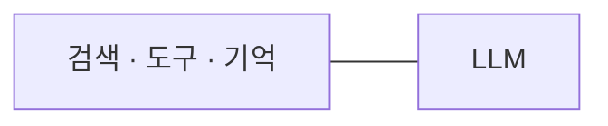
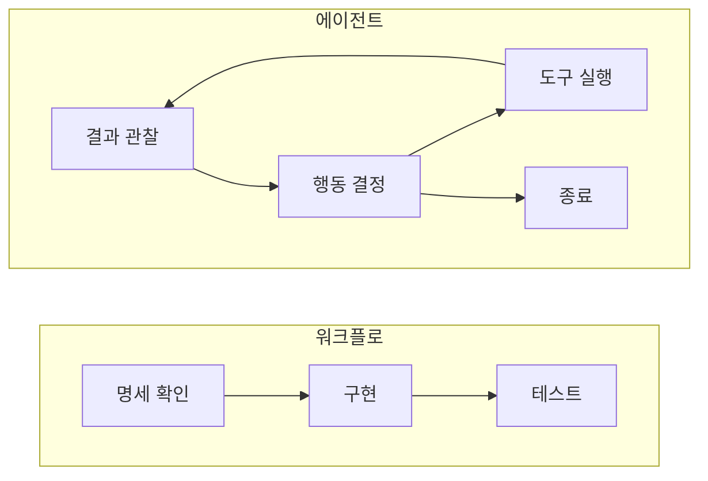
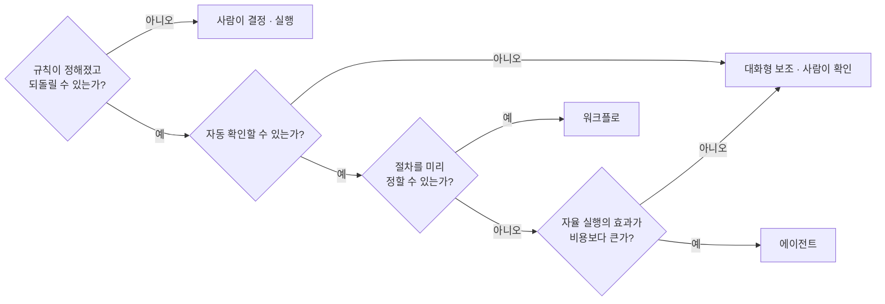
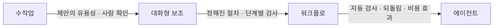

--------------------
Session 명: 02. LLM이라는 재료
--------------------

## 목차

01. 세션 목표
02. LLM의 성질
03. 비용의 구조
04. 작업 특성
05. 활용 방식
06. 자율성
07. 세 방식의 실행 기록
08. 잘못된 관행
09. 실습 — 활용 방식 고르기
10. 요약

## 01. 세션 목표

LLM은 빈칸을 추측으로 채우는 **비결정적 재료**이며, **형태는 작업이 고르고 비용이 그 선택을 제약한다**.

- **그럴듯한 추측과 비결정성**이 검증에 미치는 영향을 설명한다.
- **맥락 창의 한계**와 입력·출력·캐시의 비용 구조를 설명한다.
- **작업 특성 네 가지**로 맡겨도 되는지 판단한다.
- 수작업·대화형 보조·워크플로·에이전트 중 **가장 단순한 충분한 방식**을 고른다.
- **자율성을 높일 증거**와 실행 기록의 비교 한계를 설명한다.

**강사 노트**

- 1시간 세션이다. 성질·비용을 활용 방식 선택의 근거로 연결하고 실습에서 자기 판단을 남긴다.
- "세션 01. 사람의 일과 AI의 일"의 첫 시도를 재료의 성질로 다시 설명한다. 새 구현 코드는 넣지 않는다.

---

## 02. LLM의 성질

## 그럴듯한 추측과 비결정성

같은 입력에 같은 결과를 내는 컴파일러와 달리 LLM은 모르는 것을 **그럴듯하게 채우고 같은 요청에도 다르게 답할 수 있다**.

**인용문**

작화(confabulation)는 **자신 있게 말하지만 틀리거나 거짓인 내용**을 만들어 내는 것이다, "Confabulation: The production of confidently stated but erroneous or false content", [NIST 2024]

- **비결정성**은 같은 요청에서도 다른 답이 나올 수 있다는 뜻이다. 답이 반드시 매번 달라진다는 뜻은 아니다.
- **빈 업무 규칙**은 추측으로 채워진다. 첫 시도는 펜 값이 1,200원으로 바뀌자 2개에 2,400원을 청구했다.
  - 업무 담당자가 정한 **주문 시점의 단가**를 쓰면 금액은 2,000원이다.
- **컴파일과 자체 테스트 통과**는 업무 규칙의 정확성을 보장하지 않는다. 잘못 추측한 규칙으로 테스트까지 쓰면 둘이 함께 틀린다.

**강사 노트**

- NIST AI 600-1의 작화 정의는 원문 확인 기록에 있다. 개발 사례는 그 정의의 적용이며 NIST의 사례가 아니다.
- "세션 01. 사람의 일과 AI의 일"의 「02. 첫 시도」 코드를 다시 읽히지 말고 2,400원과 2,000원의 차이를 묻는다.

---

## 맥락 창의 한계

모델은 **맥락에 없는 업무 규칙을 알 수 없고**, 많이 넣어도 놓칠 수 있다.

**인용문**

LLM에게는 많은 양의 맥락을 읽을 때 끌어다 쓰는 **주의 예산**이 있다, "LLMs have an \"attention budget\" that they draw on when parsing large volumes of context", [Anthropic 2025c]

  - 맥락 창의 토큰이 늘어날수록 모델이 그 맥락에서 **정보를 정확히 떠올리는 능력이 낮아진다**, "as the number of tokens in the context window increases, the model’s ability to accurately recall information from that context decreases", [Anthropic 2025c]

- **맥락**은 모델이 그 순간 읽는 입력 전체이고, **맥락 창**은 한 번에 다룰 수 있는 한도다.
- 처음 요청에 빠진 **주문 금액·배송 요청·결제 거절 규칙**은 학습된 일반 지식으로 알 수 없다. 합의한 업무 규칙을 제공해야 한다.
- 결제 매뉴얼 **200쪽 전부**보다 현재 연동에 필요한 규격과 오류 조건을 골라 준다. 한도 안에 들어가도 규칙을 놓칠 수 있다.

**도식 — SVG — 맥락 창의 두 한계**

```svg
<svg xmlns="http://www.w3.org/2000/svg" width="740" height="156" viewBox="0 0 740 156" role="img" aria-label="맥락 창의 한도와 긴 입력에서 규칙을 놓치는 문제를 구분한 개념도">
<g font-family="Malgun Gothic, sans-serif" font-size="14" fill="#222">
<text x="16" y="22" font-size="19.6">한도 안에 넣기</text><text x="390" y="22" font-size="19.6">필요한 규칙 찾아 쓰기</text>
<rect x="16" y="40" width="330" height="92" rx="4" fill="none" stroke="#333"/>
<rect x="27" y="52" width="145" height="29" fill="#e9eff8"/><text x="38" y="72">요청 · 업무 규칙</text>
<rect x="27" y="89" width="260" height="29" fill="#f0f0f0"/><text x="38" y="109">대화 · 도구 결과 · 문서</text>
<rect x="390" y="40" width="330" height="92" rx="4" fill="none" stroke="#333"/>
<text x="404" y="65" fill="#888">문서 · 이력 · 문서 · 이력 · 문서</text>
<rect x="404" y="76" width="220" height="24" fill="#fff1ca"/><text x="412" y="94">규칙: 승인 뒤에만 배송 요청</text>
<text x="404" y="119" fill="#888">문서 · 도구 결과 · 문서 · 이력</text>
</g></svg>
```

**강사 노트**

- [Anthropic 2025c]의 주의 예산과 맥락 부패 설명을 확인했다. 모델마다 같은 길이에서 같은 비율로 나빠진다는 수치 주장은 하지 않는다.
- 도식은 개념도이며 막대 길이·면적은 실제 토큰 수를 나타내지 않는다. 200쪽 결제 매뉴얼은 교육용 가정이다.
- "모델에게 없는 것"은 이번 회사가 정한 규칙을 뜻한다. 사전학습 지식·검색·외부 기록이 없다는 뜻이 아니다. 필요한 원천을 읽게 하는 방법은 "세션 08. 위임"에서 다룬다.

---

## 03. 비용의 구조

## 맥락은 호출마다 다시 들어간다

토큰 비용은 **출력뿐 아니라 턴마다 다시 들어가는 입력**에서도 나온다.

- **토큰**은 입력과 출력을 세는 단위다. 한글 한 글자나 영어 한 단어와 일대일로 같지 않다.
- 모델에 다시 요청할 때 **기존 대화·도구 정의·읽은 파일·도구 결과**가 입력에 포함된다. 계속 쌓인 이력이 반복 처리된다.
- 주문 금액 구현 1회 위임은 **11턴, 출력 3,367토큰, 입력 339,270토큰**이었다(2026-10 기준).
  - 입력은 **캐시 생성 19,110 + 캐시 읽기 320,142 + 일반 입력 18**이다. 위임 한 번과 모델 턴 한 번은 다르다.

**인용문**

시스템은 지정한 캐시 경계까지의 프롬프트 앞부분이 최근 요청에서 캐시됐는지 확인하고, 있으면 **캐시를 써서 처리 시간과 비용을 줄인다**, "The system checks if a prompt prefix, up to a specified cache breakpoint, is already cached from a recent query. If found, it uses the cached version, reducing processing time and costs.", [Anthropic: Prompt caching]

**도식 — SVG — 턴마다 다시 들어가는 맥락**

```svg
<svg xmlns="http://www.w3.org/2000/svg" width="700" height="152" viewBox="0 0 700 152" role="img" aria-label="기존 맥락에 새 결과가 붙어 다음 턴의 입력으로 다시 들어가는 개념도. 세 턴은 실제 측정값이 아니다">
<g font-family="Malgun Gothic, sans-serif" font-size="14" fill="#222">
<rect x="105" y="5" width="14" height="14" fill="#dbe8fa"/><text x="127" y="17">처음 읽는 입력</text><rect x="300" y="5" width="14" height="14" fill="#ddd"/><text x="322" y="17">재사용 입력(캐시 가능)</text><rect x="565" y="5" width="14" height="14" fill="#f4dba7"/><text x="587" y="17">출력</text>
<text x="15" y="54">턴 1</text><rect x="105" y="32" width="175" height="30" fill="#dbe8fa"/><rect x="296" y="32" width="45" height="30" fill="#f4dba7"/>
<text x="15" y="94">턴 2</text><rect x="105" y="72" width="220" height="30" fill="#ddd"/><rect x="325" y="72" width="75" height="30" fill="#dbe8fa"/><rect x="416" y="72" width="45" height="30" fill="#f4dba7"/>
<text x="15" y="134">턴 3</text><rect x="105" y="112" width="340" height="30" fill="#ddd"/><rect x="445" y="112" width="75" height="30" fill="#dbe8fa"/><rect x="536" y="112" width="45" height="30" fill="#f4dba7"/>
</g></svg>
```

**강사 노트**

- 실제 과금에는 출력·캐시 생성·읽기·일반 입력 각각의 단가가 적용된다. 입력이 항상 비용의 대부분이라는 주장은 하지 않는다.
- 개념도는 11턴 중 세 턴의 계측 그래프가 아니다. 길이·비율은 개념을 설명하는 교육용 가정이다. 캐시된 입력도 입력 집계에 포함되며 무료라는 뜻이 아니다.
- 시연 근거: code/s01/demo/demo-results/results.json의 agent.runs[0].usage. 실행 일자 2026-10-07, Claude Code 2.1.292, claude-opus-5-5, OpenJDK 26이다. 교재 작성 월은 2026-10이고 그 시점에 기록을 정리했다. 현재 도구로 다시 실행한 결과라는 뜻은 아니다.
- 캐싱 문장은 원문 확인 기록에 있다. 캐시 조건·유효 기간·단가는 제공자와 모델에 따라 달라지므로 여기서는 금액으로 환산하지 않는다.

---

## 무엇이 비용을 늘리는가?

비용은 **단가·턴 수·맥락 길이·재시도 횟수**에 따라 달라진다.

**인용문**

에이전트는 대화보다 토큰을 약 **4배**, 여러 에이전트 시스템은 약 **15배** 쓴다, "agents typically use about 4× more tokens than chat interactions, and multi-agent systems use about 15× more tokens than chats", [Anthropic 2025a]

- **단가가 같아도** 긴 맥락을 여러 번 읽으면 총비용이 커진다. 단가가 다른 모델은 같은 과제의 성공률과 함께 비교한다.
- **11턴의 재읽기**를 출력 3,367토큰만 보고 판단하면 입력 비용을 놓친다. 캐시는 반복 처리의 단가를 낮추지만 불필요한 턴을 없애지는 않는다.

**표 — 비용을 늘리는 것과 줄이는 것**

| 요인 | 늘리는 행동 | 줄이는 행동 |
|---|---|---|
| **맥락 길이** | 저장소 전체를 매번 제공 | 필요한 원천만 읽게 함 |
| **턴 수** | 작은 요청을 따로 반복 | 한 작업의 조건을 함께 전달 |
| **재시도** | 같은 요청을 그대로 재전송 | 실패한 규칙·검사를 보완 |
| **병렬 실행** | 모든 일을 여러 에이전트에 | 독립 과제일 때만 나눔 |

**강사 노트**

- [Anthropic 2025a]는 여러 에이전트 연구 시스템을 만든 경험에서 제시한 관찰이다. 모든 코딩 과제·모델의 보편 배수나 요금 배수가 아니다.
- 토큰 단가도 비용을 바꾼다. lead는 단가만으로 선택하는 오해를 겨냥한다. 실제 비용 대비 효과와 모델 비교는 "세션 10. 비용과 평가"가 맡는다.
- 요청을 모으는 것은 무관한 과제를 한 번에 맡기라는 뜻이 아니다. 규칙·검사·종료 조건이 함께 있는 작은 단위가 기준이다.

---

## 04. 작업 특성

**작업 특성**은 그 작업을 맡겨도 되는지, 맡긴다면 어떤 방식으로 맡길지를 가르는 성질이다.

**인용문**

코딩 결과는 자동 테스트로 검증할 수 있고 에이전트는 테스트 결과로 고칠 수 있으며, **문제가 잘 정의되고 품질을 객관적으로 잴 수 있다**, "Code solutions are verifiable through automated tests; agents can iterate on solutions using test results as feedback; the problem space is well-defined and structured; and output quality can be measured objectively", [Anthropic 2024]

**표 — 작업 특성 네 가지**

| 특성 | 확인할 질문 | 주문 기능 개발의 예 |
|---|---|---|
| **업무 규칙의 확정** | 기대 결과를 사람이 정했는가? | 주문 시점 단가로 2,000원 |
| **절차의 확정** | 실행 경로를 미리 정할 수 있는가? | 명세 확인 → 구현 → 테스트 |
| **결과의 자동 확인** | 틀린 결과를 검사가 잡는가? | 판매가 변경 뒤에도 2,000원 |
| **되돌리기 쉬움** | 실패를 작은 범위에서 복구하는가? | 코드 변경 ↔ 운영 데이터 이관 |

- **테스트로 확인되는 코드 변경**과 **되돌리기 어려운 데이터 이관 실행**은 같은 수준으로 맡기지 않는다. 이관 스크립트 초안과 운영 실행도 나눠 판단한다.

**강사 노트**

- 네 특성은 course-design.md가 정한 활용 방식 판단 기준이다. Anthropic이 이 네 가지로 분류했다는 뜻이 아니다.
- 자동 테스트의 유용성과 그 테스트가 업무 규칙을 담았는지는 별개다. 첫 시도의 자체 테스트는 잘못된 금액도 통과시켰다.

---

## 05. 활용 방식

## LLM 활용의 4가지 방식

수작업에서 에이전트로 갈수록 **작업 순서 결정이** 사람에서 LLM으로 옮겨 간다.

**인용문**

에이전트 시스템의 기본 구성 요소는 검색·도구·기억 같은 **증강을 더한 LLM**이다, "The basic building block of agentic systems is an LLM enhanced with augmentations such as retrieval, tools, and memory.", [Anthropic 2024]

**도식 — Mermaid — 증강 LLM의 구성**



**표 — AI 활용 방식 네 가지**

| 방식 | 작업 순서 결정 | 주문 기능 개발의 예 |
|---|---|---|
| **수작업** | 사람이 판단하고 실행 | 운영 이관 실행 |
| **대화형 보조** | 사람이 제안별로 받아 실행 | 릴리스 노트 초안 |
| **워크플로** | 사람이 미리 적은 코드 경로 | 규격이 정해진 연동 코드 |
| **에이전트** | LLM이 결과를 보고 다음 행동 | 검사하며 주문 금액 구현 |

**강사 노트**

- 네 방식은 수업의 선택 틀이다. [Anthropic 2024]가 정의한 구분은 워크플로와 에이전트이며 대화형 보조·수작업을 그 앞에 놓았다.
- 도식의 선은 LLM에 검색·도구·기억을 더하는 구성을 나타낸다. 기억은 외부에 남긴 정보를 다시 읽는 기능을 포함한다.
- 도구 사용만으로 에이전트가 되는 것은 아니다. 작업 순서 결정의 차이는 네 방식의 비교에 담고 다음 항목은 실행 결과에 대한 대응을 구체화한다.

---

## 워크플로와 에이전트

**경로의 예측 가능성**이 필요하면 워크플로, **실행 중 판단의 유연성**이 필요하면 에이전트를 고른다.

**인용문**

워크플로는 잘 정의된 작업에 **예측 가능성과 일관성**을 주고 에이전트는 유연성과 모델 주도의 결정이 대규모로 필요할 때 더 나은 선택이다, "Workflows offer predictability and consistency for well-defined tasks, whereas agents are the better option when flexibility and model-driven decision-making are needed at scale", [Anthropic 2024]

**도식 — Mermaid — 정해진 경로와 결과에 따른 반복**



- **테스트 실패 뒤의 수정·재검사**도 미리 코드로 정하면 워크플로다. 반복 여부만으로 두 형태를 가르지 않는다.

**강사 노트**

- 앞 항목은 네 방식에서 작업 순서를 결정하는 주체를 비교한다. 이 항목은 경로의 예측 가능성과 판단의 유연성이 필요한 조건, 실패 뒤 대응을 비교한다.
- 앞 항목의 표와 겹치던 두 정의 인용과 설명을 제거하고, 기존에 원문 확인한 적합성 비교 인용을 그대로 유지했다. 워크플로에도 조건 분기·재시도를 코드로 넣을 수 있다.
- 첫 시도는 과제만 준 에이전트였다. 에이전트라는 형태 자체가 실패 원인이 아니라 비어 있던 결정·검사가 문제였다.

---

## 선택의 순서

**업무 규칙이 정해졌는지와 되돌릴 수 있는지**를 먼저 묻고, 에이전트는 마지막에 고른다.

**인용문**

LLM으로 애플리케이션을 만들 때는 **가능한 가장 단순한 해법**을 찾고 필요할 때만 복잡도를 높인다 — 에이전트 시스템을 아예 만들지 않는 것일 수도 있다, "When building applications with LLMs, we recommend finding the simplest solution possible, and only increasing complexity when needed. This might mean not building agentic systems at all", [Anthropic 2024]

  - 에이전트는 필요한 단계 수를 예측하기 어렵고 **고정 경로를 코드로 정할 수 없는 열린 문제**에 쓸 수 있다, "Agents can be used for open-ended problems where it’s difficult or impossible to predict the required number of steps, and where you can’t hardcode a fixed path", [Anthropic 2024]

**도식 — Mermaid — 활용 방식 선택의 순서**



- **연동 코드**는 규격과 단계가 정해져 워크플로로, **주문 금액 구현**은 작은 코드 변경을 테스트로 고쳐 가도록 에이전트로 맡긴다.

**강사 노트**

- 흐름도는 원전의 분류도를 복제한 것이 아니라 네 작업 특성을 적용한 수업의 판단 순서다. 사람이 결정·실행하는 작업도 초안 작성에는 대화형 보조를 쓸 수 있다.
- 주문 금액 구현은 두 형태 모두 가능하다. 이 사례는 구현·검사·수정의 세부 행동을 LLM이 고르게 하고 결과를 자동 검사하므로 에이전트를 택한다. 워크플로를 만들고 유지하는 비용도 비교한다.
- 규칙이 정해져도 자동 확인이 없다면 열린 과제라는 이유만으로 에이전트를 택하지 않는다.

---

## 주문 첫 릴리스의 여섯 가지 일

첫 릴리스의 일 여섯 가지를 따져 보면 **에이전트에게 맡긴 것은 하나뿐**이다.

**표 — 주문 첫 릴리스의 활용 방식**

| 일 | 활용 방식 | 판단 근거 |
|---|---|---|
| **업무 규칙 정하기** | 수작업 | 답과 책임이 업무 담당자에게 있음 |
| **저장소 골격** | 워크플로 | 생성 절차·구조 검사를 고정 가능 |
| **주문 금액 구현** | 에이전트 | 작은 변경·자동 검사·되돌림 가능 |
| **연동 코드** | 워크플로 | 규격 확인 → 생성 → 검사로 고정 |
| **데이터 이관** | 수작업 | 운영 데이터 변경을 되돌리기 어려움 |
| **릴리스 노트** | 대화형 보조 | 문장 초안은 쓰되 사람이 확인 |

- **한 일 전체를 한 방식으로 고정하지 않는다.** 데이터 이관의 실행은 사람이 하면서 스크립트 초안은 LLM의 도움으로 만들 수 있다.
- **첫 릴리스의 조건**이 달라지면 선택도 바뀐다. 저장소 골격은 검증된 생성 절차가 있고, 연동 코드는 규격이 제공된 경우다.

**강사 노트**

- 여섯 일은 방식 선택을 설명하는 교육용 작업 목록이다. "세션 07. 설계 — 책임과 협력"에서 나누는 주문한다의 구현 작업 단위 네 가지와 범위가 다르다.
- 이관은 강의 시나리오의 외부 솔루션에서 옮기는 운영 작업이다. 실습은 빈 저장소이므로 이관 작업을 억지로 넣지 않는다.
- 저장소 골격 생성 절차와 연동 코드의 순서가 고정돼 있다는 가정은 이 비교 범위에만 적용한다.

---

## 06. 자율성

## 자율성의 대가

자율성을 높이면 **사람이 확인하는 시점이 뒤로 밀리고** 그사이 오류가 쌓이는 범위도 넓어진다.

- **자율성**은 LLM이 사람의 확인 없이 스스로 정하는 범위다. 코드 생성량이나 도구 개수로 재지 않는다.

**인용문**

에이전트 시스템은 더 나은 작업 성능을 얻는 대신 **지연과 비용**을 치르는 경우가 많으므로 그 교환이 언제 맞는지 따져야 한다, "Agentic systems often trade latency and cost for better task performance, and you should consider when this tradeoff makes sense", [Anthropic 2024]

  - 에이전트의 자율성은 **더 높은 비용과 오류가 누적될 가능성**을 뜻한다, "The autonomous nature of agents means higher costs, and the potential for compounding errors", [Anthropic 2024]

- **연동 규격을 잘못 읽은 채** 구현·테스트까지 스스로 이어 가면 오류도 이어진다. 확인 지점과 실행 범위를 먼저 정한다.

**표 — 활용 방식의 대가**

| 방식 | 사람이 확인하는 때 | 오류가 쌓이는 범위 | 비용이 커지는 때 |
|---|---|---|---|
| **대화형 보조** | 제안 하나마다 | 채택한 제안 | 복사·확인을 반복 |
| **워크플로** | 정해 둔 확인 지점 | 한 단계 또는 정한 경로 | 단계별 긴 입력 |
| **에이전트** | 정한 종료·중단 시점 | 스스로 이어 간 행동 | 탐색·수정 루프 반복 |

**강사 노트**

- 사람의 확인 시점은 설계에 따라 앞당길 수 있다. 자율성의 대가는 중간 검사가 없는 무제한 실행을 뜻하지 않는다.
- 수작업은 LLM 자율성이 없으므로 비교에서 뺐다. 전체 비용에는 사람의 검토·재작업 시간도 포함한다.

---

## 자율성의 계단

**가장 단순한 방식**으로 시작하고, 맡겨도 된다는 **증거가 분명할 때만 자율성을 높인다**.

  - 에이전트 시스템을 몇 가지 넓은 단계로 나눌 수 있으며 각 단계는 **앞 단계의 능력 위에 쌓인다**, "We can classify agentic systems into a few broad levels, each building on the capabilities of the last.", [Blount 외 2026]

**도식 — Mermaid — 자율성을 높이는 증거**



- **워크플로로 연동 코드**를 만들고 규격과 오류 조건을 검사한다. 반복해 쌓인 테스트가 잘못된 응답 처리도 잡는지 본다.
- **자동 검사의 범위·되돌림·비용 효과**가 확인되면 에이전트가 고치며 실행하게 할 수 있다. 테스트 개수만 많다고 자율성을 올리지 않는다.
- **실패가 늘거나 조건이 바뀌면** 자율성을 낮추고 원인이 된 규칙·검사·실행 범위를 고친다.

**강사 노트**

- [Blount 외 2026]는 능력이 쌓이는 단계라는 보완 관점으로 승인됐다. Google 원전의 단계 이름을 네 활용 방식으로 번역한 것이 아니다. 도식은 수업의 적용이다.
- 계단은 반드시 끝까지 올라가는 성숙도 점수가 아니다. 충분한 방식에서 멈춘다. 승인·금지·중단 조건의 구체화는 "세션 08. 위임"이 맡는다.

---

## 07. 세 방식의 실행 기록

같은 업무 규칙과 수용 테스트를 준 이번 실행에서 세 방식 모두 통과했고, 달랐던 것은 **사람이 개입한 자리와 쓴 토큰**이다.

**표 — 주문 금액 구현의 실행 기록 (2026-10 기준)**

| 방식 | 호출 / 턴 | LLM 시간 | 입력 토큰 | 출력 토큰 |
|---|---|---|---|---|
| **대화형 보조** | 2 / 2 | 20초 | 56,810 | 1,608 |
| **워크플로** | 3 / 24 | 66초 | 402,181 | 6,333 |
| **에이전트** | 1 / 11 | 34초 | 339,270 | 3,367 |

- **대화형 보조**는 사람이 코드를 붙이고 테스트했다. 첫 답의 컴파일 오류를 다시 알려 준 뒤 통과했다.
- **워크플로**는 계획·코드·테스트의 세 요청으로 실행했다. 코드 단계에서 테스트를 시도했지만 단계별 권한이 막았다.
- **에이전트**는 과제 하나를 받고 읽기·편집·테스트를 반복했다. 수용 테스트는 바꾸지 않았다.
- **한 번의 기록**이므로 방식별 우열을 일반화할 수 없다. LLM 시간에는 사람의 복사·실행·검토 시간이 빠져 있다.

**강사 노트**

- 실행 일자: 2026-10-07. 도구: Claude Code 2.1.292(claude -p), 모델: claude-opus-5-5, OpenJDK 26. 교재 작성 월 2026-10을 본문에 표기했다. 시연을 재실행한 날짜라는 뜻은 아니다.
- 원본: code/s01/demo/demo-results/README.md와 results.json. 같은 규칙·수용 테스트를 둔 저장소 사본 세 벌에서 실행했다. 일반 입력·캐시 생성·캐시 읽기를 합친 입력 집계다.
- 호출은 시연 실행기가 보낸 요청 횟수이고 턴은 CLI가 보고한 num_turns의 합이다. 워크플로 단계 안에서도 도구를 쓰는 여러 턴이 있었다. 형태는 턴 수가 아니라 상위 경로를 누가 정했는지로 구분한다.
- "규칙을 지켰다"는 제공한 수용 테스트가 통과했다는 범위다. 운영 품질 전체의 증거는 아니다. 토큰 단가가 달라 입력·출력 토큰을 단순 합산한 값을 비용으로 읽지 않는다.

---

## 08. 잘못된 관행

**한 번 맞은 결과**를 증거로 삼고, **맥락을 통째로 넣고**, 같은 요청을 다시 보내는 것이 이 재료를 잘못 쓰는 방식이다.

**표 — LLM을 재료로 쓸 때의 잘못된 관행**

| 관행 | 생기는 문제 | 수정 |
|---|---|---|
| **데모 한 번으로 채택** | 다른 입력·실행의 실패를 놓침 | 대표 예·거절 예로 반복 검증 |
| **저장소 전체 붙여 넣기** | 필요한 규칙이 묻히고 입력 증가 | 현재 작업의 원천만 선택 |
| **같은 요청 재시도** | 빈 결정은 그대로 남음 | 실패 원인·규칙·검사를 보완 |
| **모든 일을 에이전트로** | 불필요한 탐색·검토 비용 | 가장 단순한 충분한 방식 |
| **자체 테스트만 신뢰** | 잘못 추측한 규칙도 통과 | 사람이 정한 수용 예로 확인 |

- **2,400원 청구**를 새 실행에서 우연히 2,000원으로 고쳐도 근거가 생긴 것은 아니다. 주문 시점 단가라는 규칙과 가격 변경 예를 제공한다.

**강사 노트**

- 학습자에게 "다시 해 봐" 전에 무엇을 바꿀지 묻는다. 문장 재작성보다 빈 결정과 실패를 재는 검사가 먼저다.
- 여러 실행으로 성능을 재는 구체적인 평가 구성은 "세션 10. 비용과 평가"로 연결한다.

---

## 09. 실습 — 활용 방식 고르기

**실습 1의 업무 조건**을 주고 방식과 근거를 검토한다. ①로 시작하고 ②~④에는 **받은 질문의 답과 수정 요청**을 함께 적는다.

**프롬프트 — 요청사항 포함**
  + ① "실습 1의 업무 조건을 읽고 첫 주문 기능 개발의 일 목록을 만들어라. **작업 특성 네 가지**로 나누고 가장 단순한 충분한 활용 방식과 근거를 제안해라. 미정인 조건은 질문해라."
  + ② "[앞선 질문에 대한 답]과 [추가 질문·수정 요청]을 적는다. **업무 규칙의 결정·초안 작성·운영 실행**을 한 일로 묶지 마라."
  + ③ "[앞선 질문에 대한 답]과 [추가 질문·수정 요청]을 적는다. 에이전트로 고른 일은 **자동 검사와 되돌림**이 가능한지, 워크플로면 충분하지 않은지 다시 따져라."
  + ④ "[앞선 질문에 대한 답]과 [추가 질문·수정 요청]을 적는다. **비용과 사람의 확인 시점**을 비교하고 충분한 방식에서 멈춰라."
  + ⑤ "합의한 일 목록과 작업 특성·활용 방식·근거를 간결한 **Markdown 파일**로 생성해라. 새 정책·구현을 추가하지 말고, 미정과 자율성을 올릴 조건은 필요한 일에만 짧게 남겨라."

**점검 항목**
  1. **범위** — 첫 주문 기능에 필요한 일인가?
  2. **분리** — 규칙의 결정과 초안·운영 실행을 나눴는가?
  3. **검사** — 자동 확인과 되돌림의 근거가 있는가?
  4. **선택** — 더 단순한 방식으로 충분하지 않은가?
  5. **대가** — 비용과 사람의 확인 시점을 함께 따졌는가?

**결과물**
  + **활용 방식 판단의 최종 MD 파일**을 저장소의 `docs`에 두고 커밋한다. 실습 3에서는 실습 1의 업무 조건과 함께 읽는다.

**강사 노트**

- ①에는 실제 실습 1의 MD를 함께 제공한다. ②~④는 고정 횟수가 아니라 보완 단계다. 질문이 없으면 검토 결과와 수정 요청만 적고 ⑤로 파일화한다. 필요하면 보완하고 다시 생성한다.
- 강사 예시는 code/s02/exercise-conversation/order/에 실제 입력·응답·실행 근거를 남긴다. 강의의 여섯 일을 실습에 강제하지 않는다. 빈 저장소 실습에는 운영 이관이 필요 없다.
- 실제 질문에 답한 뒤 다음 요청을 작성한다. 미정 H·B·F·E·G·I를 에이전트가 정책으로 정하지 않게 확인한다.

---

## 10. 요약

**형태는 작업이 고르고 비용이 그 선택을 제약한다**.

### LLM이라는 재료

- **그럴듯한 추측·비결정성**에는 사람이 정한 규칙과 검사가 필요하다.
- **맥락은 한정**되고 매 턴 다시 들어간다. 긴 맥락·반복·재시도는 비용을 늘린다.
- **작업 특성 네 가지**로 가장 단순한 충분한 활용 방식을 고른다.
- **자율성**은 자동 검사·되돌림·비용 효과의 증거가 있을 때 높인다.

### 다음 세션

- "세션 03. 요구와 수용 기준" — 사람이 원하는 결과를 **요구사항과 수용 기준**으로 정한다.

**강사 노트**

- 형식을 고른 뒤에는 무엇을 만들어야 하는지의 합의가 필요하다. 실습 2의 판단은 뒤 실습에서 검사·설계가 생기며 바뀔 수 있다.

---

## 별첨. 실습 답

## 첫 주문 기능 개발 활용 방식

**실제 LLM 응답**

**문서 형식 — 10pt**

현재는 활용 방식만 선택한다. 요구·모델·설계·코드·검사·완료 조건의 내용은 만들지 않으며, 실습 1의 미정 정책도 확정하지 않는다. 운영 시스템과 실제 고객 데이터는 사용하지 않고 외부 부작용은 없으며, 로컬 변경은 Git으로 되돌릴 수 있다.

1. **업무 조건 결정**
  - **특성:** 업무 규칙—확정 조건과 의도적 미정이 구분됨 / 절차—담당자가 정책과 경계를 확인 / 자동 확인—정책 타당성은 자동 판정 불가 / 되돌림—문서 수정은 쉬우나 정책 결정은 사람의 책임
  - **선택·근거와 사람 확인 시점:** **수작업**. LLM은 질문·정리만 보조하며 담당자가 답마다 확인한다.

2. **요구·모델·설계 초안**
  - **특성:** 업무 규칙—확정 범위만 반영하고 미정 사항을 대신 결정하지 않아야 함 / 절차—아직 마련되지 않음 / 자동 확인—검사와 완료 조건이 없음 / 되돌림—Git으로 쉬움
  - **선택·근거와 사람 확인 시점:** **대화형 보조**. 담당자가 LLM의 답마다 검토한다.

3. **저장소 골격**
  - **특성:** 업무 규칙—기술과 구성 규칙이 아직 정해지지 않음 / 절차—생성 순서와 명령이 없음 / 자동 확인—빌드·검사 환경이 필요함 / 되돌림—Git으로 쉬움
  - **선택·근거와 사람 확인 시점:** 현재는 **대화형 보조**. 담당자가 LLM의 답마다 확인한다.

4. **확정 범위 코드 구현**
  - **특성:** 업무 규칙—확정 조건만 구현하고 미정 분기를 정책화하지 않아야 함 / 절차—설계와 구현 절차가 없음 / 자동 확인—완료 조건과 자동 검사가 아직 없음 / 되돌림—작은 로컬 변경으로 Git 복구 가능
  - **선택·근거와 사람 확인 시점:** 현재는 **대화형 보조**. 담당자가 LLM의 답마다 정책 침범과 오류를 확인한다.

5. **검사 작성·실행**
  - **특성:** 업무 규칙—확인 대상과 기대 결과가 아직 정해지지 않음 / 절차—작성·실행 절차가 없음 / 자동 확인—검사를 마련하고 실제 오류를 잡는지 사람의 확인이 필요함 / 되돌림—Git으로 쉬움
  - **선택·근거와 사람 확인 시점:** 현재 검사 초안은 **대화형 보조** 대상이다. 담당자가 LLM의 답마다 확인한다.

6. **릴리스 설명**
  - **특성:** 업무 규칙—확정 범위·제외 범위·미정 사항을 구분해야 함 / 절차—작성·승인 절차가 없음 / 자동 확인—실제 변경 내역과 검사 결과가 필요함 / 되돌림—Git으로 쉬움
  - **선택·근거와 사람 확인 시점:** 현재는 **대화형 보조**, 최종 확인과 승인은 **수작업**이다. 초안은 답마다, 승인은 공개 전에 확인한다.

### 공통 전환 조건

현재는 담당자의 수작업 결정과 LLM 대화형 보조가 가장 단순하고 충분하다. 비용은 아직 계측하지 않았으며, 별도 실행 체계 구성과 검토 비용을 줄이는 선택이다.

절차를 고정할 수 있으면 일반 자동화 또는 워크플로를 사용한다. 명확한 완료 조건을 자동 검사로 판정할 수 있고, 그 검사가 실제 오류를 잡는다고 사람이 확인한 뒤에도 실행 결과에 따라 다음 행동을 정해야 하여 절차를 사전에 고정하기 어려울 때만 에이전트를 검토한다. 사람은 대화형 보조에서는 답마다, 워크플로에서는 정한 단계마다, 에이전트에서는 종료·중단 시점에 확인한다.

**강사 노트**

- 실제 최종 응답 `code/s02/exercise-conversation/order/codex-response-05.md`의 전제와 여섯 일, 이어지는 「공통 전환 조건」까지가 원본 문서 전체다. 배포 MD인 `활용-방식-판단.md`는 응답과 바이트가 같다. 제목 단계와 목록 들여쓰기만 Session Source에 대응했고 문장·순서·강조는 바꾸지 않았다.
- 2026-10-22에 tools/run-exercise-turn.py로 Codex CLI의 ①~⑤를 실제 실행했다. ④에서 요청 제한(429)이 두 차례 발생했고 Claude CLI도 세션 한도로 실패했다. 실패 근거와 이후 성공한 실행을 함께 남겼다.
- 초기 초안은 주문 실행 흐름과 개발 작업을 혼동하고 검사 실행을 LLM 워크플로로 분류했다. ②~④에서 이를 고쳤다. 요구·모델·검사가 아직 없는 현재 선택과 준비 후의 조건부 선택을 나눈 결과다.
- 실습 1의 업무 조건은 input-s01.md에 그대로 보존했다. 강의의 여섯 일과 실습의 여섯 일은 같지 않아도 된다. 빈 저장소 실습에는 운영 이관이 없다.
