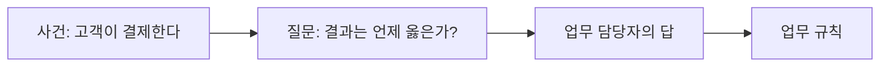
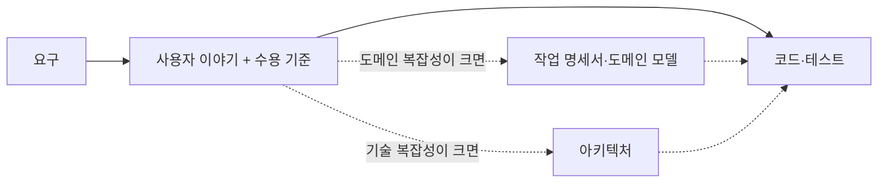

--------------------
Session 명: 02. 요구와 사용자 이야기
--------------------

## 목차

01. 세션 목표
02. 문제에서 요구사항으로
03. 요구를 담는 형식
04. 사용자 이야기
05. 요구사항 정의서와 작업 명세서
06. 품질 요구사항
07. 명세 주도 개발
08. 시연 — LLM이 쓴 요구 초안
09. 잘못된 관행
10. 실습 — 요구사항 정의서와 사용자 이야기
11. 요약

## 01. 세션 목표

요구는 **사람이 정한다**. LLM은 초안을 쓰고 모르는 것을 질문으로 남긴다.

- 요청에 섞인 **문제·요구·요구사항·해결책**을 가른다.
- 요구를 담는 **네 형식**을 구분하고, 사용자 이야기를 작업 단위로 쓴다.
- 사용자 이야기를 **카드·대화·확인**으로 쓰고 **수용 기준**을 붙인다.
- **요구사항 정의서와 작업 명세서**를 범위와 수명으로 나눈다.
- **품질 속성**을 이번 기능에서 확인할 조건과 합격 기준으로 구체화한다.
- **명세 주도 개발**이 무엇을 정하는지 말하고, 명세를 얼마나 남길지 고른다.
- LLM이 쓴 초안에서 **사람이 확정할 것**과 **되물을 것**을 가른다.

**강사 노트**

- "세션 01. 사람의 일과 AI의 일"의 첫 시도는 요청 한 줄에서 바로 코드로 갔다. 이 세션은 그 사이에 빠져 있던 요구와 요구사항을 채운다.
- 수용 기준을 테스트로 바꾸고 작업 명세서를 쓰는 일은 "세션 05. 작업 명세와 수용 기준"이 맡는다.

---

## 02. 문제에서 요구사항으로

## 문제·요구·요구사항·해결책

업무 담당자의 요청 한 줄에는 **문제와 요구와 요구사항과 해결책**이 섞여 있다. 이 가운데 해결책은 요구사항이 아니다.

**인용문**

요구사항은 시스템이 따라야 할 **능력과 조건**이다, "Requirements are capabilities and conditions to which the system … must conform", [Larman 2004]

**표 — 요청에 섞인 것**

| 구분 | 핵심 질문 | 주문의 요청에서 |
|---|---|---|
| **문제/기회** | 무엇이 부족한가? | 외부 솔루션으로는 주문 정책을 바꿀 수 없다 |
| **요구** | 무엇을 원하는가? | 고객이 결제하면 주문이 되고 배송이 시작되어야 한다 |
| **요구사항** | 시스템이 무엇을 충족해야 하는가? | 주문 금액·배송 요청·결제 거절의 업무 규칙과 그 예 |
| **해결책** | 어떻게 충족하는가? | 클래스, 저장 방식, 외부 호출 방식 |

- **요청 원문** — "장바구니에 담은 상품을 결제하면 주문이 되고 배송이 시작되게 해 주세요."
- **주체가 바뀐다** — 요구는 사람이 원하는 것이고, 요구사항은 **시스템이 충족할 것**이다. 요구 하나가 요구사항 여럿을 낳는다.

**강사 노트**

- 이 틀은 "객체지향 분석과 설계 실무" 과정의 요구 분석 세션과 같다. 인용 근거: Craig Larman, *Applying UML and Patterns*, 3rd ed., 2004 원문 확인.
- 문제/기회 행은 교육용 가정이다. 실제 문제는 요청자에게 확인한다.

---

## 업무 규칙 찾기

**무엇이 옳은 결과인가**에 대한 답이 업무 규칙이다. 요청 문장에는 그 답이 없으므로 업무 담당자에게 물어서 확인한다.

**도식 — Mermaid — 업무 규칙을 찾는 흐름**



**표 — 질문과 업무 규칙**

| 질문 | 업무 담당자의 답(업무 규칙) |
|---|---|
| 주문 금액은 어느 시점의 가격인가? | 주문이 생길 때의 판매가로 정한다 |
| 배송은 언제 요청하나? | 결제가 승인된 뒤에만 한다 |
| 결제가 거절되면 주문은 어떻게 되나? | 결제대기로 남고, 다른 카드로 다시 결제한다 |

**강사 노트**

- 시나리오에서 이 답은 업무 담당자와의 30분 회의에서 정했다. "세션 01. 사람의 일과 AI의 일"의 「02. 첫 시도」는 이 질문을 묻지 않고 에이전트가 답을 골랐다.
- 질문은 사건에서 나온다. 사건을 먼저 적고 그 결과가 언제 옳은지를 묻는 순서다.

---

## 내용·형식·문서

요구와 요구사항은 **내용**, 사용자 이야기(user story)는 그것을 담는 **형식**, 요구사항 정의서는 담아서 **유지하는 문서**다. 셋을 같은 층에 놓으면 무엇을 고르는 문제인지 흐려진다.

**표 — 세 층과 주문 사례**

| 층 | 무엇인가? | 주문 사례 |
|---|---|---|
| **내용** — 요구 | 이해관계자가 원하는 것 | 결제하면 주문이 되고 배송이 시작된다 |
| **내용** — 요구사항 | 시스템이 충족할 능력과 조건 | 업무 규칙 3가지와 그 예 |
| **형식** — 사용자 이야기 | 요구를 담는 작은 가치 단위 | 주문한다 · 결제한다 · 거절 뒤 다시 결제한다 |
| **문서** — 요구사항 정의서 | 시스템 전체의 요구사항 명세 | 스토리·업무 규칙·용어집을 한 벌로 유지 |
| **문서** — 작업 명세서 | 스토리 하나의 작업용 명세 | "주문한다"를 맡길 때 쓰고 끝낸다 |

- **경쟁하지 않는다** — "스토리만 쓰고 문서는 쓰지 않는다"는 형식의 선택이 아니라 **얼마나 남기는가**의 선택이다.
- **가리키고 베끼지 않는다** — 작업 명세서는 정의서의 업무 규칙과 용어를 다시 쓰지 않는다.

**강사 노트**

- 산출물의 이름과 범위·수명은 `guides/sw-engineering-principles.md` 7절을 따른다.
- 이 세 층이 이 세션의 순서다. 형식은 「03. 요구를 담는 형식」과 「04. 사용자 이야기」가, 문서는 「05. 요구사항 정의서와 작업 명세서」가 펼친다.

---

## 03. 요구를 담는 형식

요구를 담는 형식은 모두 **이벤트에서 출발한다**. 형식마다 보는 관점과 다루는 작업의 크기가 다를 뿐이다.

**인용문**

도메인 이벤트는 도메인 전문가가 관심을 두는 **무언가가 일어난 것**이다, "Something happened that domain experts care about.", [Evans 2015]

**표 — 형식별로 보는 이벤트**

| 형식 | 보는 이벤트 | AI-native에서의 쓰임 |
|---|---|---|
| **이벤트–반응 목록** | 외부에서 일어나 시스템이 반응해야 하는 자극 | 업무 규칙을 찾기 시작하는 목록 |
| **유스케이스** | 액터가 목표를 위해 시스템과 주고받는 상호작용 | 기능 전체의 흐름을 알려 주는 입력 |
| **사용자 이야기** | 사용자가 원하는 작은 가치의 행위 | **AI가 처리하는 작업 단위** |
| **도메인 이벤트** | 업무 전문가가 관심을 두는, 이미 일어난 사건 | 상태가 바뀌는 사건 — 상태 기계의 전이 |

- **뼈대는 사용자 이야기** — 이벤트–반응 목록과 유스케이스는 정의와 쓰임만 알아 두고, 맡기는 단위는 사용자 이야기로 쓴다.
- **분기는 형식이 아니라 모델이 맡는다** — 거절·중복·금지된 전이는 대안 흐름으로 늘리지 않고 상태 기계와 업무 규칙 목록으로 적는다.

**강사 노트**

- 표는 "객체지향 분석과 설계 실무" 과정의 이벤트 중심 기법을 재사용했다. 인용 근거: Eric Evans, *Domain-Driven Design Reference*(2015)의 Domain Events 원문 확인.
- 상태 기계는 "세션 03. 도메인 모델"에서 만든다. 유스케이스의 표기와 작성법은 OOAD 과정이 맡는다.

---

## 04. 사용자 이야기

## 카드·대화·확인

**사용자 이야기는 AI에게 맡기는 작업의 단위**가 된다. 한 번에 만들고 한 번에 확인할 수 있는 크기이기 때문이다.

**인용문**

사용자 이야기에는 결정적인 세 가지 면이 있고 이를 **카드·대화·확인**이라 부를 수 있다, "User stories have three critical aspects. We can call these Card, Conversation, and Confirmation.", [Jeffries 2001]

  - **카드** — 스토리를 짧게 적어 둔 것. 요구사항 전체가 아니라 대화를 시작하는 메모다.
  - **대화** — 세부는 고객과 개발자가 대화로 채운다. 업무 규칙이 여기서 나온다.
  - **확인** — 스토리가 끝났는지 **수용 기준**으로 확인한다.

- **AI-native에서의 대화** — 업무 규칙은 업무 담당자와의 대화에서 정하고, LLM과의 대화에서는 빠진 질문을 찾는다.

**강사 노트**

- 인용 근거: Ron Jeffries, "Essential XP: Card, Conversation, Confirmation"(2001) 원문 확인. 세 요소의 설명은 원문의 각 절을 요약했다.
- 카드만 주고 맡기면 첫 시도와 같아진다. 대화에서 나온 업무 규칙과 확인의 기준이 함께 가야 한다.

---

## 스토리의 문형

사용자 이야기는 **누가 무엇을 왜** 원하는지를 한 문장으로 쓴다. 그중 "왜"가 그 스토리로 얻는 가치를 드러낸다.

```text
As a [누가]
I want [무엇을]
so that [왜]
```

**인용문**

이 문형의 강점은 스토리를 처음 정의할 때 **그 스토리를 전달하는 가치**를 밝히게 한다는 것이다, "Its strength is that it forces you to identify the value of delivering a story when you first define it.", [North 2006]

- **주문** — 고객으로서 장바구니에 담은 상품을 결제해 주문하고 싶다. 상품을 배송받기 위해서다.
- **정기배송** — 고객으로서 생필품을 정한 주기로 받도록 신청하고 결제하고 싶다. 매번 주문하지 않기 위해서다.
- **"왜"가 없으면** — 가치를 말하지 못하는 스토리는 범위에서 뺄 후보다.

**강사 노트**

- 인용 근거: Dan North, "Introducing BDD"(2006) 원문 확인. 원문은 가치가 없는 스토리가 "so that I just do, ok?"처럼 끝난다고 적는다.
- 문형은 필수 양식이 아니다. 누가·무엇을·왜가 드러나면 된다.

---

## 스토리와 수용 기준

스토리는 **수용 기준이 붙어야** 확인할 수 있는 명세가 된다. 수용 기준은 업무 규칙을 대표하는 예로 쓴다.

```text
US-2. 주문 결제
고객으로서, 결제대기인 주문을 결제하고 싶다. 그래야 배송이 시작된다.

수용 기준
1. 펜 2개를 2,000원에 주문한 뒤 판매가가 1,200원이 되어도, 결제는 2,000원을 요청한다.
2. 결제가 승인되면 배송 요청이 배송 시스템에 한 번 간다.
3. 결제가 승인되지 않은 주문에는 배송 요청이 가지 않는다.
```

- **대표 예로 쓴다** — 업무 규칙 하나에 예 하나가 붙어, 지켰는지를 값으로 확인할 수 있다.
- **사람이 확정한다** — 기대값 2,000원은 업무 담당자의 답에서 오며 LLM이 고르지 않는다.
- **스토리와 함께 산다** — 수용 기준은 요구사항 정의서에 스토리와 붙여 두고, 작업을 맡길 때 그대로 쓴다.

**강사 노트**

- 사례 값은 공통 전제의 주문 예다 — 펜 2개, 판매가 1,000원, 주문 금액 2,000원.
- 예를 Given-When-Then으로 쓰고 수용 테스트 코드로 바꾸는 일은 "세션 05. 작업 명세와 수용 기준"이 다룬다. 여기서는 기준이 스토리에 붙는다는 것까지다.

---

## 좋은 사용자 이야기 — INVEST

좋은 사용자 이야기의 조건을 모은 것이 **INVEST**다. AI에게 맡길 때는 그중에서도 **작고(S) 확인할 수 있어야(T)** 한다.

**인용문**

좋은 스토리는 **독립적·협상 가능·가치·추정 가능·작음·테스트 가능**의 6가지 조건을 갖춘다, "good stories are: I – Independent N – Negotiable V – Valuable E – Estimable S – Small T – Testable", [Wake 2003]

**표 — INVEST와 AI에게 맡기는 작업**

| 조건 | 뜻 | AI에게 맡길 때 |
|---|---|---|
| **독립적**(Independent) | 다른 스토리와 겹치지 않고 순서를 바꿀 수 있다 | 작업을 따로 맡기고 따로 확인한다 |
| **협상 가능**(Negotiable) | 세부는 대화로 함께 채운다 | 업무 규칙은 사람이 정하고 명세에 쓴다 |
| **가치**(Valuable) | 고객에게 가치가 있다 | 기술 작업이 아니라 고객의 결과로 쓴다 |
| **추정 가능**(Estimable) | 우선순위를 정할 만큼 크기를 안다 | 모르는 것이 많으면 먼저 질문을 찾는다 |
| **작음**(Small) | 길어야 몇 주, 짧게는 며칠 | 한 번 맡겨 끝까지 확인할 크기 |
| **테스트 가능**(Testable) | 테스트를 쓸 수 있을 만큼 안다 | 에이전트의 완료를 테스트로 확인한다 |

**강사 노트**

- 인용 근거: Bill Wake, "INVEST in Good Stories, and SMART Tasks"(2003) 원문 확인. 표의 "뜻"은 원문의 각 절을 요약했고, "AI에게 맡길 때"는 적용이다.
- 원문은 테스트 가능을 이렇게 설명한다: 스토리 카드를 쓰는 것은 "테스트를 쓸 수 있을 만큼 원하는 것을 안다"는 약속이다.

---

## 스토리 나누기

스토리는 화면·서버·DB 같은 **층으로 나누지 않고 기능을 세로로** 자른다. 한 조각만 만들어도 고객에게 가치가 있어야 한다.

**인용문**

고객에게 케이크 전체의 본질을 주는 가장 좋은 방법은 **층을 세로로 자르는 것**이다, "We want to give the customer the essence of the whole cake, and the best way is to slice vertically through the layers.", [Wake 2003]

**표 — "주문한다"를 나누는 두 방법**

| 나누는 방법 | 조각 | 문제 |
|---|---|---|
| **층으로**(가로) | 주문 테이블, 결제 연동 모듈, 주문 화면 | 한 조각만으로는 고객이 주문할 수 없다 |
| **업무 규칙으로**(세로) | 승인되면 배송을 요청한다 · 거절되면 다시 결제한다 | 없다 — 조각마다 고객이 결과를 얻는다 |

- **나누는 기준은 업무 규칙** — 주문 금액 규칙은 결제 스토리와 함께 만들고, 결제 거절 규칙은 따로 만든다. 조각마다 따로 맡기고 따로 확인한다.

**강사 노트**

- 원문은 개발자가 한 번에 한 층만 "제대로" 만들고 싶어 하지만, 화면이 없는 데이터베이스 층은 고객에게 가치가 적다고 적는다.
- 강의 시연의 세 스토리는 나누는 기준을 보이기 위한 예다. 실습은 정기배송 최초 신청 하나를 사용자 이야기 하나로 다룬다.

---

## 05. 요구사항 정의서와 작업 명세서

## 사용자 이야기를 정의서에 담는다

**사용자 이야기**는 고객의 가치와 원하는 행위를 표현한다. **요구사항 정의서**는 그 이야기를 실현하기 위한 기능·업무 규칙·품질·수용 기준을 담아 유지한다.

**표 — 요청에서 요구사항 정의서로**

| 표현 | 주문 사례에서 담는 내용 |
|---|---|
| **요청** | 장바구니 상품을 결제하고 배송받게 해 주세요 |
| **사용자 이야기** | 고객으로서 원하는 상품을 받기 위해 장바구니 상품을 주문하고 싶다 |
| **요구사항 정의서** | 이야기와 금액·승인·거절 규칙, 필요한 품질과 수용 기준 |

- **하나의 고객 가치** — 정보 입력·계산·결제를 화면이나 처리 단계라는 이유만으로 별도 이야기로 나누지 않는다.
- **이야기만으로 부족하다** — 한 문장이 정하지 않은 성공·실패 결과와 업무 조건은 대화로 확인해 정의서에 반영한다.
- **설계는 다음 결정** — 무엇을 충족할지는 정의서에, 어떤 구조와 기술로 실현할지는 설계에 둔다.

**강사 노트**

- 실습에서는 정기배송 전체가 아니라 최초 신청을 하나의 사용자 이야기로 다룬다. 실습 1의 요청은 개발 의도이며, 이번 실습에서 사용자와 가치가 드러나는 이야기로 표현한다.
- 정의서는 사용자 이야기와 경쟁하는 별도 형식이 아니다. 문서 안에 이야기 하나와 그 조건을 담는다. 더 큰 제품에서는 여러 이야기가 하나의 정의서에 담길 수 있다.
- 이야기가 너무 커지면 고객 가치가 유지되는 단위로 나눌 수 있다. 여기서는 먼저 최초 신청을 끝까지 이해하고, 이야기의 수를 늘리는 것이 목적이 아님을 설명한다.

---

## 요구에서 코드까지

**요구 → 사용자 이야기(수용 기준 포함) → 코드·테스트**의 뼈대는 바뀌지 않는다. 중간 산출물은 **도메인·기술 복잡성**의 두 축으로 고른다.

**도식 — Mermaid — 불변의 뼈대와 중간 산출물**



**표 — 두 축으로 고르는 중간 산출물**

| | 기술 복잡성 낮음 | 기술 복잡성 높음 |
|---|---|---|
| **도메인 복잡성 낮음** | 스토리와 예 → 코드 | + 아키텍처 |
| **도메인 복잡성 높음** | + 작업 명세서 + 도메인 모델 | 모두 |

- **사다리가 아니다** — 도메인만 복잡하면 아키텍처는 뺀다.
- **주문한다는 둘 다 중간** — 업무 규칙 3가지와 외부 연동이 있어 넷을 넣는다.

**강사 노트**

- 두 축의 정리는 원전의 분류가 아니다(`guides/sw-engineering-principles.md` 7절).
- 넣는 기준은 하나다 — 그 산출물이 에이전트의 결과나 사람의 확인을 바꾸는가? 바꾸지 않으면 넣지 않는다.

---

## 범위와 수명

같은 요구사항이라도 **시스템 전체에 오래 남는 것**은 요구사항 정의서에, **스토리 하나에 쓰고 끝나는 것**은 작업 명세서에 둔다.

**인용문**

메모리 뱅크는 코드베이스의 **모든 AI 코딩 세션**에 관련되고 명세는 그 기능을 만들거나 바꾸는 **작업에만** 관련된다, "These files are relevant across all AI coding sessions in the codebase, whereas specs only relevant to the tasks that actually create or change that particular functionality.", [Böckeler 2025]

**표 — 두 문서의 범위와 수명**

| 문서 | 담는 것 | 범위 | 수명 |
|---|---|---|---|
| **요구사항 정의서** | 스토리와 수용 기준, 업무 규칙, 용어집, 품질 요구 | 시스템 전체 | 유지한다 |
| **작업 명세서** | 스토리 하나와 업무 규칙의 예, 범위·제외·미정 | 스토리 하나 | 작업과 함께 끝난다 |

- **용어집은 정의서에** — "단가"의 정의는 작업마다 다시 쓰지 않는다. 작업 명세서는 그 정의를 가리킨다.
- **오래 남는 것이 다음 작업의 입력** — 정의서를 유지하지 않으면 다음 작업이 같은 질문을 처음부터 다시 한다.

**강사 노트**

- 인용 근거: Birgitta Böckeler, "Understanding Spec-Driven-Development"(2025) 원문 확인. 원문은 일반 맥락 문서를 도구들의 이름을 따라 "메모리 뱅크"라 부른다(Kiro는 steering, spec-kit은 constitution).
- 작업 명세서를 쓰는 일은 "세션 05. 작업 명세와 수용 기준", 맥락으로 주는 일은 "세션 06. 맥락 구성"이 맡는다.

---

## 06. 품질 요구사항

## 기능과 필요한 품질

**기능 요구사항**은 시스템이 할 일을, **품질 요구사항**은 그 기능이 충족할 수준과 조건을 정한다. 사용자 이야기 하나에도 둘이 함께 필요하다.

**표 — 주문에서 확인할 기능과 품질**

| 구분 | 확인할 질문 | 주문 사례 |
|---|---|---|
| **기능** | 어떤 결과가 필요한가? | 결제 승인 뒤 주문을 확정한다 |
| **성능** | 어떤 부하에서 얼마나 빨라야 하나? | 정상 부하에서 주문 결과의 응답시간 |
| **신뢰성** | 반복·장애에도 무엇을 지켜야 하나? | 같은 요청의 재전송이 중복 청구를 만들지 않음 |
| **보안** | 누가 어떤 정보에 접근할 수 있나? | 본인 주문만 조회·변경 가능 |

- **필요한 품질만** — 속성 목록을 모두 채우지 않고 이번 사용자 이야기의 위험과 고객의 기대를 확인한다.
- **해결 수단과 구분** — 응답시간은 요구사항이고 캐시·DB·서버 수는 이를 실현하는 설계다.

**강사 노트**

- 품질 속성은 어떤 품질을 보는지의 관점이며, 품질 요구사항은 이번 기능에서 그 속성을 충족할 조건을 구체적으로 적은 것이다. 표는 전체 품질 분류 체계가 아니라 이 사례에서 고른 예다.
- 기능과 품질은 배타적인 칸이 아니다. 중복 청구 방지는 고객이 보는 동작과 장애 상황의 신뢰성을 함께 제한한다. 같은 규칙을 다른 문장으로 중복 관리하지 않는다.
- 보안과 접근권한을 요구사항에서 제외하지 않는다. 화면 배치·암호화 수단·통신 규격을 미리 선택하지 않는다는 뜻이다.

---

## 품질을 확인 가능한 기준으로

**시험 조건과 합격 기준**을 함께 적어야 품질을 확인할 수 있다. 수치나 정책을 모르면 LLM이 채우지 않고 사람이 결정한다.

**표 — 막연한 표현에서 확인 기준으로**

| 막연한 표현 | 확인할 기준 |
|---|---|
| **빠르게 처리한다** | 동시 주문 100건·외부 응답 1초 이내에서 95%가 3초 이내 |
| **안정적으로 처리한다** | 동일 주문 요청을 반복해도 주문과 청구가 중복되지 않음 |
| **안전하게 보호한다** | 다른 회원의 주문 조회·변경을 거부하고 정보가 노출되지 않음 |

- **기준의 근거** — 고객과 합의한 값인지, 기존 정책을 준용한 것인지, 교육용 가정인지 밝힌다.
- **기존 정책은 준용** — 가용성·복구 등 합의된 공통 기준을 기능마다 다시 만들지 않는다.
- **결과를 요구한다** — 중복 방지를 요구하되 키·잠금·트랜잭션 같은 구현 수단은 설계에서 정한다.

**강사 노트**

- 동시 100건·외부 응답 1초·95% 3초는 설명을 위한 교육용 가정이며 표준이나 실제 시스템의 운영 보장 수치가 아니다. 성능 기준에는 시작·종료 시점도 필요하다. 이 예는 고객의 주문 요청부터 결과 수신까지를 뜻한다.
- 실제 시험의 표본·측정 방식은 합의된 시험 정책을 따른다. 이 세션에서 성능 시험 도구나 부하 설계까지 만들지 않는다.
- 품질 요구사항은 실습 1에 소급해 모든 결정을 요구하는 것이 아니라 실습 2의 대화에서 발견하고 확정하는 내용이다. 뒤 설계는 이 조건을 실현할 책임과 협력을 정한다.

---

## 07. 명세 주도 개발

## 명세 주도 개발이란?

**명세 주도 개발(SDD)**은 AI에게 코드를 맡기기 전에 **명세를 먼저 쓰고**, 그 명세를 사람과 AI가 함께 따르는 기준으로 삼는 방식이다.

**인용문**

명세 주도 개발은 AI로 코드를 쓰기 전에 **명세를 먼저 쓰는 것**이고 그 명세가 **사람과 AI의 기준**이 된다, "Spec-driven development means writing a “spec” before writing code with AI (“documentation first”). The spec becomes the source of truth for the human and the AI.", [Böckeler 2025]

**인용문**

명세는 자연어로 쓴 **구조화된 행위 중심의 산출물**로 소프트웨어의 기능을 표현하고 AI 코딩 에이전트의 안내가 된다, "A spec is a structured, behavior-oriented artifact - or a set of related artifacts - written in natural language that expresses software functionality and serves as guidance to AI coding agents.", [Böckeler 2025]

- **새 산출물이 아니다** — 오래 써 온 **요구사항 정의**를 다시 부르는 이름이다. 이름이 바뀌었다고 따로 만들지 않는다.
- **정하는 것** — 명세를 **언제** 쓰고 **얼마나 오래** 남길지다. 명세에 **무엇을 쓸지**는 요구공학이 답해 온 질문이다.

**강사 노트**

- 인용 근거: Böckeler(2025) 원문 확인. 명세에 관한 이 과정의 기준 원전이며 한글은 요약이다.
- 원문은 SDD의 정의가 아직 움직인다고 적고, 명세를 고쳐 가며 유지하는 쪽과 명세를 주된 산출물로 두는 쪽을 함께 소개한다.

---

## 얼마나 남기는가?

같은 명세라도 **작업이 끝난 뒤 무엇을 남기는가**가 다르다. 세 수준은 사람이 고치는 것이 달라진다.

  - **명세 먼저** — 잘 생각한 명세를 먼저 쓰고 그 작업의 AI 지원 개발 흐름에서 쓴다, "Spec-first: A well thought-out spec is written first, and then used in the AI-assisted development workflow for the task at hand.", [Böckeler 2025]
  - **명세 고정** — 작업이 끝난 뒤에도 명세를 남겨 그 기능의 발전과 유지보수에 계속 쓴다, "Spec-anchored: The spec is kept even after the task is complete, to continue using it for evolution and maintenance of the respective feature.", [Böckeler 2025]
  - **명세가 원천** — 명세가 시간이 지나도 주된 원천 파일이고 사람은 명세만 고치며 코드는 건드리지 않는다, "Spec-as-source: The spec is the main source file over time, and only the spec is edited by the human, the human never touches the code.", [Böckeler 2025]

- **이 과정은 명세 먼저** — 작업 명세서는 작업과 함께 끝내고, 오래 남길 것은 요구사항 정의서와 도메인 모델에 적는다.

**표 — 수준별로 사람이 고치는 것**

| 수준 | 사람이 고치는 것 | 명세는 |
|---|---|---|
| **명세 먼저** | 코드 | 작업이 끝나면 할 일을 다 했다 |
| **명세 고정** | 명세와 코드를 함께 | 둘이 어긋나지 않게 유지해야 한다 |
| **명세가 원천** | 명세만 | 코드는 명세에서 다시 생성된다 |

**강사 노트**

- 인용 근거: Böckeler(2025) 원문 확인. 원문은 찾아본 SDD 접근이 모두 명세 먼저였고, 모두가 명세 고정이나 명세가 원천을 지향하지는 않는다고 적는다.
- 명세 고정은 작업 명세서를 요구사항 정의서처럼 유지하는 것이다. 그러면 유지할 곳이 두 군데가 된다.

---

## 08. 시연 — LLM이 쓴 요구 초안

## 초안이 쓴 것

**문서 형식**

요청 한 줄과 회의 메모만 주자 LLM은 **근거가 있는 것만 쓰고 모르는 것은 질문으로 남긴** 초안을 냈다.

- **용어**

  - **판매가** — 상품 시스템이 관리하는 상품의 현재 판매 가격 (근거: 회의 메모)
  - **주문 금액** — 주문이 생길 때의 판매가로 정한 금액. 그 뒤에는 바뀌지 않음 (근거: 회의 메모)
  - **결제대기** — 주문이 생겼지만 결제가 아직 승인되지 않은 주문 상태 (근거: 회의 메모)

- **사용자 이야기**

  - **US-1 장바구니 상품 주문** — 주문이 생기고 상태는 결제대기가 된다. 주문이 생길 때의 판매가로 주문 금액이 정해진다.
  - **US-2 주문 결제** — 승인되면 배송 요청이 간다. 승인되지 않은 주문에는 가지 않는다.
  - **US-3 거절 후 다시 결제** — 거절되면 결제대기로 남고, 다른 카드로 다시 결제할 수 있다.

- **업무 규칙**

  - **BR-1 주문 금액** · **BR-2 배송 요청** · **BR-3 결제 거절** (근거: 모두 회의 메모)

- **미정 질문 15가지**

  - **주문이 언제 생기는가** · 금액 구성 · 판매가가 내리면 · 재고 · 결제대기 기한 · 재결제 횟수 · **승인 뒤 상태 이름** · 배송 요청 실패 · 취소와 환불의 범위 ......

**강사 노트**

- 시연 기록은 `code/s02/demo-results/`다. 2026-10-18에 Claude Code 2.1.302(비대화형, 도구 없음, 모델 claude-opus-5-5)로 실행했고 46초·출력 4,668토큰이다.
- 초안 전문은 `draft.md`다. 슬라이드는 용어 8개 중 셋, 질문 15가지 중 아홉을 발췌했다.
- 같은 시연을 다시 하면 결과는 달라진다(비결정성). 강의장에서는 수강생의 도구로 다시 실행한다.

---

## 사람이 답한다

초안의 질문에 사람이 답하면 그 답이 **요구사항과 용어와 범위**가 된다. 이번에 답하지 않을 것은 제외나 미정으로 남긴다.

**표 — 초안의 질문과 사람의 답**

| 초안의 질문 | 사람의 답 | 어디로 가는가? |
|---|---|---|
| 주문은 언제 생기나? | 배송지를 정하면 결제대기로 생긴다 | 요구사항 — US-1 |
| 판매가가 내리면? | 올라도 내려도 주문할 때의 값이다 | 업무 규칙 — 주문 금액 |
| 승인 뒤 상태의 이름은? | 결제완료·배송중·배송완료 | 용어집과 상태 기계 |
| 배송 요청이 실패하면? | 아직 정하지 않았다 | 미정으로 남긴다 |
| 취소·환불·배송지 변경은? | 이번 범위가 아니다 | 제외 |

- **추측하지 않은 것이 성과다** — 초안은 요청과 메모에 없는 업무 규칙을 만들지 않았고, 승인 뒤의 상태 이름도 짓지 않았다.
- **스스로 찾은 모순** — 요청의 "결제하면 주문이 된다"와 메모의 "거절되면 결제대기로 남는다"가 어긋난다는 것을 초안이 첫 질문으로 올렸다.

**강사 노트**

- 상태 이름과 전이는 "세션 03. 도메인 모델"에서 확정한다. 미정으로 남긴 배송 요청 실패는 "세션 05. 작업 명세와 수용 기준"에서 다시 묻는다.
- 수강생에게 묻는다: 질문 15가지에 모두 답해야 시작할 수 있는가? 답하지 않아도 되는 질문은 무엇으로 가리는가?

---

## 09. 잘못된 관행

LLM에게 요구를 적게 하면 **개발자가 주어인 스토리**나 **기술 작업**이 섞이기 쉽다.

**인용문**

LLM 도구가 작은 버그를 고치며 쓴 스토리 — **개발자로서** 변환 함수가 경계 사례를 우아하게 처리하기를 원한다, "User story: As a developer, I want the transformation function to handle edge cases gracefully, so that the system remains robust when new category formats are introduced.", [Böckeler 2025]

**표 — 요구를 적을 때의 잘못된 관행**

| 관행 | 예 | 바로잡기 |
|---|---|---|
| **개발자가 주어** | 개발자로서 결제 함수가 견고하기를 원한다 | 고객의 결과로 쓴다 |
| **기술 작업** | 주문 테이블을 만든다 | 고객이 얻는 결과로 세로로 나눈다 |
| **"왜"가 없음** | 고객으로서 결제 버튼을 원한다 | 가치를 말하지 못하면 범위에서 뺀다 |
| **확인할 수 없음** | 결제가 빠르면 좋겠다 | 확인할 수 있는 예와 기준을 붙인다 |
| **해결책이 섞임** | 주문 서비스에서 판매가를 다시 조회한다 | 무엇을 충족할지만 쓰고 방법은 맡긴다 |

**강사 노트**

- 인용은 Böckeler가 Kiro로 작은 버그를 고치려 했을 때 요구 문서에 생긴 스토리 가운데 하나다. 한글은 요약이다.
- 마지막 행은 "세션 01. 사람의 일과 AI의 일"의 첫 시도가 고른 잘못된 계산을 지시로 바꾼 것이다. 틀린 해결책을 명세에 쓰면 그대로 코드가 된다.

---

## 10. 실습 — 요구사항 정의서와 사용자 이야기

**①로 시작해 답·질문·수정 요청을 주고받는다.** ②~④는 보완 예시다. ⑤로 MD를 만들고 필요하면 보완·재생성한다.

**프롬프트 — 요청사항 포함**
  + ① “아래 실습 1의 업무 조건 메모를 바탕으로 정기배송 최초 신청을 **하나의 사용자 이야기**로 표현하고, 요구사항 초안을 짧게 작성해라. 화면·기술 설계와 신청 이후 운영 정책은 제외하고 기존 쇼핑몰 기능은 연계 대상으로 보아라. 작성에 꼭 필요한 미정 사항만 질문해라.”
  + ② “앞선 질문에 대한 **아래 답**을 반영해 기능 요구사항을 보완해라. 내가 정하지 않은 업무 규칙을 추가하지 마라.”
  + ③ “앞선 질문에 대한 답과 수정 요청을 반영해라. 최초 신청에서 중요한 **품질 속성**을 제안하고, 확인 가능한 요구사항으로 정하기 위해 필요한 기준을 질문해라. 기존 쇼핑몰의 품질 정책은 준용한다.”
  + ④ “아래 답과 품질 기준을 반영해 요구사항을 보완해라. 모호하거나 **확인할 수 없는** 표현과 근거 없는 정책이 남았는지 검토해라.”
  + ⑤ “지금까지 합의한 정기배송 최초 신청의 요구사항 정의서를 다음 실습에 사용할 간결한 **Markdown 파일**로 생성해라. 사용자 이야기 하나와 업무 규칙·기능 요구사항·품질 요구사항·대표 수용 기준을 담고, 사람의 답과 피드백을 본문에 반영해라. 별도 Q&A·중복 요약·설계·코드·범위 밖 운영은 제외해라. 새 결정을 추가하거나 폐기한 안을 되살리지 마라.”

**점검 항목**
  1. **이야기** — 최초 신청 하나에 고객과 가치가 드러나는가?
  2. **일관성** — 실습 1의 조건과 사람이 답한 내용을 반영했는가?
  3. **품질** — 시험 조건과 합격 기준이 확인 가능하며 근거가 있는가?
  4. **범위** — 화면·기술 설계, 기존 기능 재구현, 신청 이후 운영을 제외했는가?
  5. **확인** — 성공·결제 실패·중복 요청의 결과를 확인할 수 있는가?

**결과물**
  + **사용자 이야기 하나를 포함한 요구사항 정의서 MD 파일**. 마지막 합의를 확인하고 실습 3에 첨부한다.

**강사 노트**

- Codex·ChatGPT·Claude Team 등에서 renderer 없이 수행한다. ②~④에는 실제 받은 질문의 답과 검토 의견을 붙인다. 기본 문구만 기계적으로 반복하지 않는다.
- ⑤ 이후에도 MD의 누락·불일치·폐기한 안의 재등장을 검토하고 보완·재생성을 반복한다. 다음 작업이 가능하면 탐색을 끝낸다. 제출 여부와 무관하게 최종 MD를 저장해 다음 실습에 명시적으로 첨부한다.
- 최종 MD가 실습 원본이고 교재 슬라이드는 별도 제작물이다. 환경별 파일 생성·다운로드와 도식 표시를 사전에 확인한다. 도식 코드만 보이는 경우를 시각 검토 완료로 보지 않는다.

- 실습 1은 요청과 업무 조건 메모를 만들었다. 실습 2는 이를 고객의 가치를 나타내는 사용자 이야기 하나로 표현하고 요구사항 정의서로 구체화한다. 사용자 이야기는 문서 안에 담는 형식이다.
- 첫 입력에 실습 1의 업무 조건 메모를 함께 붙인다. 실제 예시는 code/s02/exercise-conversation/input-s01.md를 그대로 사용했다.
- ②~④의 문구만 입력하지 않는다. 수강생이 앞선 질문의 답을 함께 쓰고 필요한 추가 질문·수정 요청을 덧붙인다. 예: [앞선 질문에 대한 답] ... / [추가 질문·수정 요청] ...
- 기본 답변은 실습용 업무·품질 조건 자료를 참고하고 자신의 판단으로 보완한다. 판단하기 어려운 것은 임의 확정하지 않고 재질문한다. 모든 경우를 답하는 것이 아니라 최초 신청에 필요한 조건만 정한다.
- 실제 입력·응답 전체는 code/s02/exercise-conversation/conversation.md, 기본 조건은 exercise-conditions.md에 보존한다. ②는 실제 첫 질문에 답했고 ③은 기능 검토 후 품질 기준을 질문했고 ④는 실제 품질 질문에 답했다.
- 성능 시험의 동시 100건·95% 3초·외부 응답 1초는 실습용 가정이다. 실제 운영에서 합의한 목표처럼 설명하지 않는다. 품질 속성 전체를 나열하거나 새로운 운영 시스템을 설계하지 않는다.

---

## 11. 요약

요구는 사람이 정하고, LLM은 초안을 쓰고 **모르는 것을 질문으로** 남긴다.

### 요구와 사용자 이야기의 핵심

- **이야기와 정의서** — 고객의 가치·행위를 이야기로 쓰고 조건을 정의서에 담는다
- **요구사항** — 기능과 품질을 명시하고 시험 조건과 합격 기준을 붙인다
- **범위와 수명** — 요구사항 정의서는 유지하고 작업 명세서는 작업과 끝난다
- **명세 주도 개발** — 언제 쓰고 얼마나 남길지의 문제다. 이 과정은 명세 먼저다
- **모델에서 보완된 것** — 용어집의 첫 항목과 요구사항 정의서가 생겼다

### 다음 세션

- "**세션 03. 도메인 모델**" — 요구의 용어·개념·상태를 모델로 명시한다.

**강사 노트**

- 실습의 요청은 하나의 사용자 이야기와 기능·품질 요구사항으로 구체화됐다. 다음 세션은 이 정의서의 용어·개념·상태를 모델로 명시한다.

---

## 별첨. 실습 답

## 정기배송 최초 신청 요구사항 정의서

**문서 형식 — 10pt**

**실제 LLM 응답**

### 사용자 이야기

기존 회원으로서 반복 주문의 수고를 줄이기 위해 원하는 상품을 정해진 주기로 배송받는 정기배송을 신청하고 싶다.

### 업무 규칙

1. 정기배송은 자동 갱신하지 않으며 계약기간이 끝나면 종료한다.
2. 계약기간은 3개월 또는 6개월, 배송 주기는 2주 또는 4주로 한다.
3. 첫 배송일은 신청일에 3일을 더한 날짜부터 선택할 수 있으며 해당 날짜를 포함한다. 배송 가능 여부는 기존 쇼핑몰 배송 달력을 따른다.
4. 첫 배송일을 계약 시작일로 한다.
5. 계약 종료일은 첫 배송일에 계약 개월 수를 더한 날짜로 한다. 해당 월에 같은 날짜가 없으면 그달의 말일로 하며, 종료일은 계약기간에 포함하지 않는다.
6. 첫 배송일을 첫 회차로 하고 이후 선택한 배송 주기마다 배송 예정일을 산정한다. 계약 종료일보다 이른 회차만 포함한다.
7. 상품 가격·할인·배송비는 신청 시점의 기존 쇼핑몰 정책으로 산정하며, 산정된 회차별 결제금액은 계약기간 동안 유지한다.
8. 첫 회차는 신청 시 결제하고 이후 회차는 각 배송 예정일 3일 전에 결제한다.
9. 첫 회차 결제 성공이 확인된 경우에만 신청을 완료한다. 결제 실패 시 신청은 완료되지 않으며, 결과를 확인할 수 없으면 완료로 단정하지 않고 결과 확인이 필요함을 안내한다.
10. 동일한 신청의 반복 전송으로 계약이나 첫 회차 결제가 중복되어서는 안 된다. 별개의 신규 신청은 제한하지 않는다.
11. 회원·상품·배송지·결제수단·배송 달력과 일반 주문 정책은 기존 쇼핑몰 기능 및 정책을 연계한다.

### 기능 요구사항

1. 기존 회원은 상품과 수량, 자신이 등록한 배송지와 결제수단을 선택할 수 있어야 한다.
2. 회원은 계약기간, 배송 주기와 첫 배송일을 선택할 수 있어야 한다.
3. 신청 완료 전에 다음 내용을 회원에게 고지해야 한다.

  - 선택한 상품과 수량
  - 배송지와 결제수단
  - 계약기간·계약 시작일·계약 종료일
  - 배송 주기와 첫 배송일
  - 총 배송 횟수와 회차별 예정 배송일
  - 첫 회차 결제금액
  - 계약기간 동안 유지되는 회차별 결제금액
  - 첫 회차와 이후 회차의 결제 시점
  - 자동 갱신 없이 계약기간 종료 시 종료된다는 사실

4. 신청 과정에서 첫 회차 결제를 수행하고 결제 결과에 따라 신청 결과를 안내해야 한다.
5. 동일한 신청이 반복 전송되어도 하나의 계약과 한 번의 첫 회차 결제만 처리해야 한다.

### 품질 요구사항

1. 동시 신청 100건이고 각 외부 연계가 1초 이내에 응답하는 정상 시험 조건에서, 신청 요청부터 결과 수신까지 전체 요청의 95% 이상이 3초 이내여야 한다. 이는 실습 검증 기준이며 실제 운영 보장 수치는 아니다. 이를 초과하는 부하는 기존 쇼핑몰 정책을 따른다.
2. 회원은 자신의 배송지와 결제수단만 선택하고 자신의 정기배송 신청 정보에만 접근할 수 있어야 한다. 다른 회원의 정보는 조회하거나 변경할 수 없어야 한다.
3. 운영시간·가용성·복구·기록 보존·보안·개인정보 보호는 기존 쇼핑몰 정책을 준용한다.

### 대표 수용 기준

- **일정 계산:** 첫 배송일이 2027-11-03이고 계약기간이 3개월, 배송 주기가 2주이면 계약 종료일은 2028-02-03이며 해당 날짜는 제외한다. 배송 예정일은 2027-11-03, 11-17, 12-01, 12-15, 12-29, 2028-01-12, 01-26의 총 7회다.
- **월말 계산:** 첫 배송일이 2027-01-31이고 계약기간이 3개월이면 계약 종료일은 2027-04-30이며 해당 날짜는 제외한다. 시험 날짜는 기존 배송 달력에서 허용된 것으로 본다.
- **금액 유지:** 휴지 1묶음의 신청 시 가격이 10,000원이고 할인과 배송비가 각각 0원이면 회차별 결제금액은 10,000원이다. 이후 상품 가격이 변경되어도 계약기간 동안 같은 금액을 유지한다.
- **신청 결과:** 첫 회차 결제 성공이 확인되면 신청 완료로 안내하고, 실패하면 신청 미완료로 안내한다. 결제 결과를 확인할 수 없으면 결과 확인이 필요함을 안내한다.
- **반복 전송:** 동일한 신청을 반복 전송해도 생성되는 계약과 실행되는 첫 회차 결제는 각각 하나여야 한다.

**강사 노트**

- code/s02/exercise-conversation/codex-response-05.md의 실제 최종 MD 전체를 사용했다. 발췌·요약·문장 수정·강조 추가 없이 제목 단계와 목록 들여쓰기만 대응했다. 도식 원본은 그대로 보존한다.
- ①~⑤는 단계이며 실제 대화의 횟수는 예시다. 이전 실제 대화의 합의 내용을 이어 새 ⑤를 실행했다. 실제 입력·응답은 conversation.md, 학습자용 기본 문구는 templates.json에 보존한다. 마지막 파일을 검토한 뒤 보완·재생성할 수 있다.
- 다음 실습에는 최종 MD를 명시적으로 첨부한다. 교재의 슬라이드 배치와 업무 산출물의 구성은 별개다.

---

