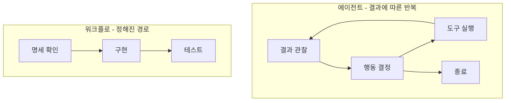
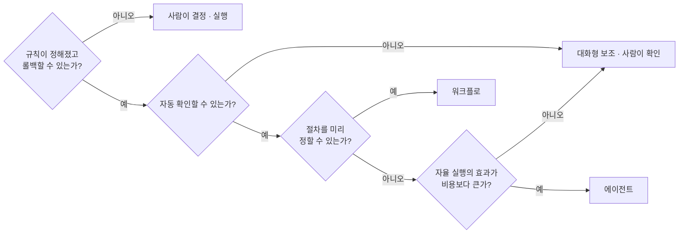

--------------------
Session 명: 02. LLM이라는 도구
--------------------

## 목차

01. 세션 목표
02. 같은 입력에 다른 답이 나왔다
03. LLM은 빈칸을 추측으로 채운다
04. 맥락은 호출마다 다시 비용을 낸다
05. 수작업에서 에이전트까지
06. 작업 특성이 맡길 형태를 결정한다
07. 중요도와 복잡성이 상한을 정한다
08. 같은 과제를 3가지 방식으로 실행했다
09. AI에게 맡기기 전의 4가지 질문
10. 자율성에는 대가가 있다
11. 첫 릴리스의 작업 6가지를 나눈다
12. 잘못된 관행
13. 실습 2 — 활용 방식 고르기
14. 요약

## 01. 세션 목표

LLM은 모르는 것을 그럴듯하게 채우는 **비결정적 도구**다. 작업마다 **가장 단순한 충분한 형태**를 선택하고, 비용과 증거가 그 선택을 제약한다.

- **맥락에 넣지 않은 업무 규칙**은 모델에게 없다는 것을 알고, 지어낸 답을 **컴파일·테스트가 잡는 것과 잡지 못하는 것**으로 구분할 수 있다.
- **맥락 창의 한도**와 **맥락 부패**를 구분하고, 호출마다 다시 들어가는 **입력 토큰**에서 비용이 생기는 자리를 찾을 수 있다.
- **수작업·대화형 보조·워크플로·에이전트**를 **경로를 누가 정하는가**로 구분할 수 있다.
- **업무 규칙·절차·자동 확인·롤백**의 4가지 특성으로 가장 단순한 충분한 형태를 고르고 **그 근거를 적을 수 있다**.
- **시스템 중요도와 도메인 복잡성**이 정하는 **자율성의 상한**을 읽고, 한 단 올릴 **증거**를 정할 수 있다.
- 같은 과제를 **대화형 보조·워크플로·에이전트로 돌린 기록**에서 개입한 자리·턴·토큰을 비교하고, 한 번의 기록으로 우열을 가릴 수 없는 이유를 설명할 수 있다.

**강사 노트**

- 1시간 세션이다. 도구의 성질과 비용을 활용 방식 선택의 근거로 잇고, 실습에서 수강생이 자기 판단을 남긴다.
- "세션 01. 사람의 일과 AI의 일"의 첫 시도를 도구의 성질로 다시 설명한다. 새 구현 코드는 넣지 않는다.
- **도구**라는 말을 쓰는 근거는 [Fowler 2025]의 "non-deterministic tools"다. 이 세션 뒤쪽의 **도구**(검색·도구·기억, 도구 실행)는 LLM이 호출하는 기능을 뜻하므로 「05. 수작업에서 에이전트까지」에서 구분해 말한다.

---

## 02. 같은 입력에 다른 답이 나왔다

확인에 사용할 주문은 **펜 2개, 판매가 각 1,000원**, 배송지 서울이고 주문 금액은 **2,000원**이다. 그 금액을 계산하는 코드를 3가지 방식에 **똑같이 요청했다** — 업무 규칙 문서와 고칠 자바 파일 2개(`Order.java`·`OrderItem.java`)를 셋 모두에 그대로 주었다. 그런데 대화형 보조의 첫 답은 `Product`에 **없는 메서드** `productNumber()`를 지어내 컴파일에서 멈췄고, 에이전트는 실제 이름인 `number()`로 맞췄다.

**인용문**

LLM은 우리에게 **비결정적 도구로 프로그래밍한다는 것**이 무엇을 뜻하는지 생각하게 만든다, "forcing us to consider what it means to program with non-deterministic tools", [Fowler 2025]

```text
./order/OrderItem.java:20: error: cannot find symbol
        return new OrderItem(product.productNumber(), product.salePrice(), quantity);
                                    ^
  symbol:   method productNumber()
  location: variable product of type Product
1 error
```

- 두 답 모두 **문법은 맞았다**. 틀린 쪽은 메서드 이름을 묻지 않고 **임의로 선택했다**.
- 컴파일러는 같은 입력에 **같은 결과**를 낸다. 그 컴파일러에 넣을 코드를 만드는 LLM이 **같은 입력에 다른 답**을 낸다.

**강사 노트**

- 출력은 `code/s01/demo/demo-results/chat-test1.txt`의 기록 그대로다. 실행 일자 2026-10-07, Claude Code 2.1.292, 모델 claude-opus-5-5, OpenJDK 26이다.
- 인용 근거: Martin Fowler, "LLMs bring new nature of abstraction"(2025) 원문 확인. 추상 수준이 올라가는 한편 비결정적 도구로 프로그래밍하게 됐다는 대목이며, 이 과정이 LLM을 **도구**라고 부르는 근거다.
- 같은 시연을 다시 하면 어느 쪽이 틀릴지 달라진다. 수치와 성패는 이 실행 한 번의 기록이다.

---

## 03. LLM은 빈칸을 추측으로 채운다

## 모르는 것을 자신 있게 지어낸다

모르는 것을 자신 있게 지어내는 것을 **작화**라 한다. `productNumber()`는 그럴듯한 이름이었고 컴파일러가 바로 잡아 주었지만, 지어낸 것이 **업무 규칙**이면 컴파일도 테스트도 통과한다 — 판매가가 1,200원으로 오른 펜 2개에 2,400원을 청구한 첫 시도가 그 결과다.

**인용문**

작화(confabulation)는 **자신 있게 말하지만 틀리거나 거짓인 내용**을 만들어 내는 것이다, "Confabulation: The production of confidently stated but erroneous or false content", [NIST 2024]

**표 — 지어낸 것과 그것을 잡는 검사**

| 지어낸 것 | 잡는 검사 | 잡지 못하면 |
|---|---|---|
| **없는 메서드 `productNumber()`** | 컴파일 | 컴파일에서 멈춘다 |
| **결제 시점에 판매가를 다시 조회** | 사람이 정한 수용 테스트 | 2,400원을 청구한다 |
| **승인 전에 보낸 배송 요청** | 금지된 순서 검사 | 거절된 주문이 배송된다 |

- **비결정성**은 같은 요청에서 다른 답이 나올 수 있다는 뜻이다. 매번 달라진다는 뜻은 아니다.
- 잘못 추측한 규칙으로 **테스트까지 생성하면** 코드와 기대값이 함께 틀려 둘이 서로를 통과시킨다.

**강사 노트**

- NIST AI 600-1의 작화 정의는 원문 확인 기록에 있다. 위 3가지는 그 정의를 개발 사례에 적용한 것이며 NIST의 사례가 아니다.
- 2,400원과 승인 전 배송 요청은 "세션 01. 사람의 일과 AI의 일"의 첫 시도에서 나온 것이다. 코드를 다시 읽히지 말고 2,400원과 2,000원의 차이를 묻는다.
- 금지된 순서 검사는 "세션 10. 검사 파이프라인"에서 실제로 만든다. 여기서는 잡는 자리가 있다는 것만 짚는다.

---

## 맥락에 없는 업무 규칙은 알 수 없다

**맥락**은 LLM이 그 순간 읽는 입력 전체이고, **맥락 창**은 LLM이 한 번에 읽을 수 있는 그 입력의 한도다. 주문 금액·배송 요청·결제 거절 3가지 규칙은 이 회사의 업무 담당자가 정한 것이라 공개된 자료에 없으므로, 맥락에 넣지 않으면 LLM에게는 없는 것이다.

**도식 — SVG — 맥락 창에 들어가는 것**

```svg
<svg xmlns="http://www.w3.org/2000/svg" viewBox="0 0 960 252" width="960" height="252" font-family="sans-serif" role="img" aria-label="맥락 창에 사람이 넣어 준 것과 넣지 않아 모델에게 없는 것을 가른 개념도">
  <rect x="6" y="6" width="948" height="46" rx="8" fill="#e2e8f0" stroke="#475569" stroke-width="1.5"/>
  <text x="34" y="37" font-size="23" font-weight="bold" fill="#1e293b">맥락 창 — 한 번에 읽을 수 있는 한도</text>
  <g>
    <rect x="6" y="58" width="948" height="90" rx="8" fill="#f8fafc" stroke="#64748b" stroke-width="1.5"/>
    <text x="34" y="111" font-size="23" font-weight="bold" fill="#1e293b">넣어 준 것</text>
    <line x1="230" y1="70" x2="230" y2="136" stroke="#cbd5e1"/>
    <text x="256" y="92" font-size="19" fill="#334155">요청 한 줄과 업무 규칙 3가지 — 주문 금액·배송 요청·결제 거절</text>
    <text x="256" y="126" font-size="19" fill="#334155">고칠 자바 파일 2개, 수용 테스트, 그때까지의 대화와 테스트 출력</text>
  </g>
  <g>
    <rect x="6" y="156" width="948" height="90" rx="8" fill="#fdecec" stroke="#c0392b" stroke-width="1.5"/>
    <text x="34" y="209" font-size="23" font-weight="bold" fill="#8e2a1e">넣지 않은 것</text>
    <line x1="230" y1="168" x2="230" y2="234" stroke="#d98b80"/>
    <text x="256" y="190" font-size="19" fill="#3b1f1a">맥락에 없는 업무 규칙은 LLM에게 없는 것이다</text>
    <text x="256" y="224" font-size="19" fill="#3b1f1a">비워 두면 비는 것이 아니라 그럴듯한 추측으로 채워진다</text>
  </g>
</svg>
```

- 3가지 방식 모두에 **업무 규칙 문서와 수용 테스트**를 맥락에 넣었다. 그래서 세 번 다 2,000원이 나왔다.

**강사 노트**

- 도식은 개념도이며 띠의 길이는 실제 토큰 수를 나타내지 않는다.
- 맥락에 무엇을 넣고 무엇을 찾아 읽게 할지 고르는 일은 "세션 08. 위임 — 과제와 맥락"이 맡는다. 여기서는 한도와 성질까지다.
- "모델에게 없는 것"은 이번 회사가 정한 규칙을 뜻한다. 검색이나 외부 기록이 없다는 뜻이 아니다.

---

## 맥락이 길어지면 정확히 찾지 못한다

한도 안에 **넣는 것**과 그 안에서 **찾아 쓰는 것**은 다른 문제다. 맥락이 길어지며 정보를 정확히 찾아 쓰는 능력이 떨어지는 것을 **맥락 부패**(context rot)라 한다. 결제 연동에 필요한 것은 매뉴얼 200쪽 가운데 **121쪽 한 줄**인데, 통째로 넣으면 그 한 줄이 나머지에 묻힌다 — **그 부분만 골라 주면 찾는다.**

**인용문**

LLM이 많은 양의 맥락을 읽을 때 꺼내 쓰는 **주의 예산**이 있다, "LLMs have an \"attention budget\" that they draw on when parsing large volumes of context", [Anthropic 2025c]

  - 맥락 창의 토큰이 늘어날수록 LLM이 그 맥락에서 **정보를 정확히 찾아내는 능력이 낮아진다**, "as the number of tokens in the context window increases, the model’s ability to accurately recall information from that context decreases", [Anthropic 2025c]

**도식 — SVG — 통째로 넣은 결제 매뉴얼 200쪽**

```svg
<svg xmlns="http://www.w3.org/2000/svg" viewBox="0 0 960 196" width="960" height="196" font-family="sans-serif" role="img" aria-label="결제 매뉴얼 200쪽을 통째로 넣으면 연동에 필요한 한 줄이 가운데에 묻히는 개념도">
  <rect x="6" y="6" width="948" height="56" rx="8" fill="#f1f3f5" stroke="#adb5bd" stroke-width="1.5"/>
  <text x="34" y="42" font-size="23" font-weight="bold" fill="#6c757d">1~120쪽</text>
  <line x1="230" y1="18" x2="230" y2="50" stroke="#ced4da"/>
  <text x="256" y="42" font-size="19" fill="#6c757d">가맹점 등록, 정산 주기, 할부와 부분 취소</text>
  <rect x="6" y="70" width="948" height="56" rx="8" fill="#fff1ca" stroke="#b8860b" stroke-width="2"/>
  <text x="34" y="106" font-size="23" font-weight="bold" fill="#7a5901">121쪽</text>
  <line x1="230" y1="82" x2="230" y2="114" stroke="#d8b96a"/>
  <text x="256" y="106" font-size="19" fill="#5a4201">승인 거절 응답의 종류와 뜻</text>
  <text x="620" y="106" font-size="19" fill="#8e2a1e">이번 연동에 필요한 한 줄</text>
  <rect x="6" y="134" width="948" height="56" rx="8" fill="#f1f3f5" stroke="#adb5bd" stroke-width="1.5"/>
  <text x="34" y="170" font-size="23" font-weight="bold" fill="#6c757d">122~200쪽</text>
  <line x1="230" y1="146" x2="230" y2="178" stroke="#ced4da"/>
  <text x="256" y="170" font-size="19" fill="#6c757d">정기 결제, 해외 결제, 장애 시 재처리 절차</text>
</svg>
```

- 200쪽도 한도 안에는 들어간다. 갈리는 것은 양이 아니라 **찾아 쓰는 정확성**이며, 현재 판단에 필요한 **규격과 오류 조건만** 골라 준다.

**강사 노트**

- [Anthropic 2025c]의 주의 예산과 회수 능력 저하를 원문으로 확인했다. 모델마다 같은 길이에서 같은 비율로 나빠진다는 수치 주장은 하지 않는다.
- 200쪽 결제 매뉴얼과 절의 이름은 개념 설명용 가정이다(`course-design.md`의 활용 방식 비교의 가정). 실제 결제 규격이 아니다.
- 맥락 부패는 용어표가 이 세션에서 정의하라고 지정한 말이다. 뒤 세션은 이 이름을 그대로 쓴다.

---

## 04. 맥락은 호출마다 다시 비용을 낸다

## 위임 한 번이 호출 11번이었다

**토큰**은 모델이 입력과 출력을 세는 단위이고 과금의 단위다. 주문 금액 구현을 에이전트에게 한 번 맡긴 것은 모델 호출 **11번**이었고, 출력은 3,367토큰인데 입력은 **339,270토큰**이었다 — 턴마다 그때까지의 대화·도구 정의·읽은 파일·도구 결과가 입력에 다시 들어가기 때문이다.

**도식 — SVG — 턴마다 다시 들어가는 입력**

```svg
<svg xmlns="http://www.w3.org/2000/svg" viewBox="0 0 960 238" width="960" height="238" font-family="sans-serif" role="img" aria-label="턴이 진행될수록 앞 턴의 입력이 다시 들어가 입력이 커지는 개념도. 띠의 길이는 실제 측정값이 아니다">
  <rect x="60" y="12" width="20" height="20" fill="#e2e8f0" stroke="#94a3b8"/>
  <text x="88" y="30" font-size="19" fill="#334155">다시 들어가는 입력</text>
  <rect x="300" y="12" width="20" height="20" fill="#dbe8fa" stroke="#2b5fa8"/>
  <text x="328" y="30" font-size="19" fill="#334155">이번 턴에 새로 읽는 입력</text>
  <rect x="640" y="12" width="20" height="20" fill="#f4dba7" stroke="#b8860b"/>
  <text x="668" y="30" font-size="19" fill="#334155">출력</text>
  <text x="20" y="80" font-size="23" font-weight="bold" fill="#1e293b">턴 1</text>
  <rect x="120" y="54" width="220" height="36" fill="#dbe8fa" stroke="#2b5fa8"/>
  <rect x="344" y="54" width="48" height="36" fill="#f4dba7" stroke="#b8860b"/>
  <text x="20" y="140" font-size="23" font-weight="bold" fill="#1e293b">턴 5</text>
  <rect x="120" y="114" width="330" height="36" fill="#e2e8f0" stroke="#94a3b8"/>
  <rect x="454" y="114" width="80" height="36" fill="#dbe8fa" stroke="#2b5fa8"/>
  <rect x="538" y="114" width="48" height="36" fill="#f4dba7" stroke="#b8860b"/>
  <text x="20" y="200" font-size="23" font-weight="bold" fill="#1e293b">턴 11</text>
  <rect x="120" y="174" width="620" height="36" fill="#e2e8f0" stroke="#94a3b8"/>
  <rect x="744" y="174" width="80" height="36" fill="#dbe8fa" stroke="#2b5fa8"/>
  <rect x="828" y="174" width="48" height="36" fill="#f4dba7" stroke="#b8860b"/>
  <text x="120" y="232" font-size="19" fill="#64748b">턴이 늘수록 새로 읽는 양은 그대로인데 다시 들어가는 양이 커진다</text>
</svg>
```

**인용문**

시스템은 지정한 캐시 경계까지의 프롬프트 앞부분이 최근 요청에서 캐시됐는지 확인하고, 있으면 **캐시를 써서 처리 시간과 비용을 줄인다**, "The system checks if a prompt prefix, up to a specified cache breakpoint, is already cached from a recent query. If found, it uses the cached version, reducing processing time and costs.", [Anthropic: Prompt caching]

- 입력 339,270토큰은 **캐시 생성 19,110 + 캐시 읽기 320,142 + 일반 입력 18**의 합이다.
- 캐시된 입력도 **입력으로 센다**. 단가가 낮아질 뿐 공짜가 아니다.

**강사 노트**

- 시연 근거: `code/s01/demo/demo-results/results.json`의 `agent.runs[0].usage`. 실행 일자 2026-10-07, Claude Code 2.1.292, claude-opus-5-5, OpenJDK 26이며 교재 작성 월은 2026-10이다.
- 도식은 11턴 중 세 턴의 계측 그래프가 아니다. 띠의 길이와 비율은 개념 설명용 가정이다.
- 캐싱 문장은 원문 확인 기록에 있다. 캐시 조건·유효 기간·단가는 제공자와 모델에 따라 달라지므로 금액으로 환산하지 않는다.

---

## 비용을 늘리는 것은 길이와 반복이다

단가가 같아도 **긴 맥락을 여러 번** 읽으면 총비용이 늘어난다. 저장소를 통째로 넣는 것과 같은 요청을 그대로 다시 보내는 것은 둘 다 입력을 곱하는 일이며, 캐시는 반복 처리의 단가를 낮추지만 **불필요한 턴을 없애지는 않는다**.

**인용문**

에이전트는 대화보다 토큰을 약 **4배**, 여러 에이전트 시스템은 약 **15배** 쓴다, "agents typically use about 4× more tokens than chat interactions, and multi-agent systems use about 15× more tokens than chats", [Anthropic 2025a]

**표 — 비용을 늘리는 것과 줄이는 것**

| 요인 | 늘리는 행동 | 줄이는 행동 |
|---|---|---|
| **맥락 길이** | 저장소 전체를 매번 제공 | 필요한 원천만 읽게 함 |
| **턴 수** | 작은 요청을 따로 반복 | 한 작업의 조건을 함께 전달 |
| **재시도** | 같은 요청을 그대로 재전송 | 실패한 규칙·검사를 보완 |
| **병렬 실행** | 모든 일을 여러 에이전트에 | 독립 과제일 때만 나눔 |

- 출력 3,367토큰만 보고 판단하면 **11턴의 재읽기**가 셈에서 빠진다.

**강사 노트**

- [Anthropic 2025a]는 여러 에이전트 연구 시스템을 만든 경험에서 제시한 관찰이다. 모든 코딩 과제·모델의 보편 배수나 요금 배수가 아니다.
- 요청을 모으는 것은 무관한 과제를 한 번에 맡기라는 뜻이 아니다. 규칙·검사·종료 조건이 함께 있는 작은 단위가 기준이다.
- 사람의 검토·수정 시간까지 합친 비용 대비 효과의 판단은 "세션 11. 비용과 평가"가 맡는다.

---

## 05. 수작업에서 에이전트까지

## 경로를 정하는 주체가 형태를 구분한다

LLM을 쓰는 방식은 **수작업·대화형 보조·워크플로·에이전트** 4가지로 가른다. 가르는 기준은 도구의 종류가 아니라 **작업의 경로를 누가 정하는가**다 — 수작업은 사람이 판단하고 실행하며, 대화형 보조는 제안마다 사람이 받아 실행하고, 워크플로는 사람이 미리 적은 코드 경로를 따르며, 에이전트는 결과를 보고 다음 행동을 스스로 정한다.

**표 — AI 활용 방식 4가지**

| 방식 | 작업의 경로를 정하는 쪽 | 주문 기능 개발의 예 |
|---|---|---|
| **수작업** | 사람이 판단하고 실행한다 | 운영 데이터 이관 실행 |
| **대화형 보조** | 사람이 제안마다 받아 실행한다 | 릴리스 노트 초안 |
| **워크플로** | 사람이 미리 적은 코드 경로 | 규격이 정해진 연동 코드 |
| **에이전트** | LLM이 결과를 보고 다음 행동을 정한다 | 검사하며 주문 금액 구현 |

- 4가지는 **도구가 아니라 자리**다. 같은 코딩 에이전트로도 제안만 받으면 대화형 보조이고, 경로를 미리 적어 두면 워크플로다.

**강사 노트**

- 4가지는 과정이 정한 선택의 틀이다(`course-design.md`). [Anthropic 2024]가 정의한 구분은 워크플로와 에이전트이며 대화형 보조·수작업을 그 앞에 놓은 것은 이 과정이다.
- 표의 예는 「11. 첫 릴리스의 작업 6가지를 나눈다」에서 판단 근거와 함께 다시 나온다. 여기서는 형태의 뜻만 가른다.
- **이 장이 절의 첫 장이다**(2026-11-08 수기 검토). 증강 LLM을 먼저 설명하면 4가지가 무엇인지 모르는 채로 "4가지 형태의 출발"을 듣게 된다.

---

## 검색·도구·기억을 붙여 쓴다

4가지 가운데 워크플로와 에이전트는 LLM이 **스스로 무언가를 읽고 실행**해야 성립한다. 그 능력은 모델 자체에 없고 검색·도구·기억을 붙여 만든다 — 그렇게 붙인 것을 **증강 LLM**이라 하며, 시연에서 업무 규칙 문서를 읽고 테스트 실행 명령 `sh run-tests.sh`를 돌린 것도 LLM이 아니라 **LLM이 호출한 도구**다.

**인용문**

에이전트 시스템의 기본 구성 요소는 검색·도구·기억 같은 **증강을 더한 LLM**이다, "The basic building block of agentic systems is an LLM enhanced with augmentations such as retrieval, tools, and memory.", [Anthropic 2024]

**도식 — SVG — 증강 LLM의 구성**

```svg
<svg xmlns="http://www.w3.org/2000/svg" viewBox="0 0 960 216" width="960" height="216" font-family="sans-serif" role="img" aria-label="LLM에 검색·도구·기억을 붙인 증강 LLM이 저장소의 문서와 코드를 읽고 테스트를 실행하는 구성도">
  <rect x="20" y="70" width="190" height="76" rx="6" fill="#e8eff8" stroke="#2b5fa8" stroke-width="2"/>
  <text x="115" y="118" font-size="23" font-weight="bold" fill="#1b3f70" text-anchor="middle">LLM</text>
  <line x1="210" y1="108" x2="254" y2="48" stroke="#475569" stroke-width="2"/>
  <line x1="210" y1="108" x2="254" y2="108" stroke="#475569" stroke-width="2"/>
  <line x1="210" y1="108" x2="254" y2="168" stroke="#475569" stroke-width="2"/>
  <rect x="254" y="20" width="686" height="56" rx="6" fill="#ffffff" stroke="#64748b" stroke-width="1.5"/>
  <text x="274" y="56" font-size="19" fill="#334155">검색 - 저장소에서 업무 규칙 문서와 자바 파일을 읽는다</text>
  <rect x="254" y="80" width="686" height="56" rx="6" fill="#ffffff" stroke="#64748b" stroke-width="1.5"/>
  <text x="274" y="116" font-size="19" fill="#334155">도구 - 파일을 고치고 sh run-tests.sh를 실행한다</text>
  <rect x="254" y="140" width="686" height="56" rx="6" fill="#ffffff" stroke="#64748b" stroke-width="1.5"/>
  <text x="274" y="176" font-size="19" fill="#334155">기억 - 앞 턴에서 읽은 것을 다시 맥락에 넣는다</text>
</svg>
```

- 여기서 **도구**(tool)는 LLM이 호출하는 기능이다. 사람이 사용하는 도구인 **LLM 자체**와 구분한다.
- **도구를 사용하는 것만으로** 에이전트가 되지 않는다. 같은 증강을 워크플로도 대화형 보조도 쓴다.

**강사 노트**

- 도식의 선은 호출의 방향이 아니라 무엇에 무엇을 붙였는지를 나타낸다. 저장소는 증강 LLM 밖에 있다.
- 기억은 외부에 남긴 정보를 다시 읽는 기능을 포함한다. 맥락을 선별해 다시 넣는 방법은 "세션 08. 위임 — 과제와 맥락"이 다룬다.

---

## 워크플로와 에이전트

경로의 **예측 가능성**이 필요하면 워크플로, 실행 중 **판단의 유연성**이 필요하면 에이전트다. 테스트가 실패하면 고쳐 다시 돌리는 반복도 미리 코드로 적어 두면 워크플로이므로, 반복이 있는지로 둘을 가르지 않는다.

**인용문**

워크플로는 잘 정의된 작업에 **예측 가능성과 일관성**을 주고 에이전트는 유연성과 모델 주도의 결정이 대규모로 필요할 때 더 나은 선택이다, "Workflows offer predictability and consistency for well-defined tasks, whereas agents are the better option when flexibility and model-driven decision-making are needed at scale", [Anthropic 2024]

**도식 — Mermaid — 워크플로와 에이전트**



- 실제 시연의 워크플로는 **계획·코드·테스트의 요청 3개**였고, 단계마다 그 단계에 필요한 동작만 허용했다.

**강사 노트**

- 앞 항목은 경로를 정하는 주체를 가르고, 이 항목은 경로의 예측 가능성과 판단의 유연성 중 무엇이 필요한지를 가른다.
- 워크플로에도 조건 분기와 재시도를 코드로 넣을 수 있다. 첫 시도는 과제만 준 에이전트였고, 실패 원인은 방식이 아니라 비어 있던 결정과 검사였다.

---

## 06. 작업 특성이 맡길 형태를 결정한다

## 업무 규칙·경로·검사·롤백을 묻는다

작업을 보고 묻는 것은 4가지다 — 기대 결과를 사람이 정했는가, 실행 경로를 미리 정할 수 있는가, 틀린 결과를 검사가 잡는가, 실패를 작은 범위에서 **롤백**할 수 있는가. **주문 금액 구현은 4가지 모두 예**이고, **운영 데이터 이관은 롤백에서 아니오**다.

**인용문**

코딩은 **자동 테스트로 검증할 수 있고**, 에이전트가 테스트 결과를 피드백 삼아 고칠 수 있으며, **문제가 잘 정의되어 있고**, **결과의 품질을 객관적으로 잴 수 있다**, "Code solutions are verifiable through automated tests; agents can iterate on solutions using test results as feedback; the problem space is well-defined and structured; and output quality can be measured objectively", [Anthropic 2024]

  - 이 4가지가 **코딩이 에이전트에 적합한 이유**로 꼽힌 것이고, 아래 표의 질문은 그것을 **작업 하나하나에 묻는 형태**로 바꾼 것이다.

**표 — 작업 특성 4가지**

| 특성 | 확인할 질문 | 주문 금액 구현에서 |
|---|---|---|
| **업무 규칙의 확정** | 기대 결과를 사람이 정했는가? | 주문 시점 단가로 2,000원 |
| **절차의 확정** | 실행 경로를 미리 정할 수 있는가? | 규칙 확인 → 구현 → 테스트 |
| **결과의 자동 확인** | 틀린 결과를 검사가 잡는가? | 판매가가 1,200원이 되어도 2,000원 |
| **롤백 쉬움** | 실패를 작은 범위에서 롤백하는가? | 자바 파일 2개의 변경 |

- 자동 테스트가 있다는 것과 그 테스트가 **업무 규칙을 담았다**는 것은 다르다. 첫 시도의 자체 테스트는 2,400원도 통과시켰다.

**강사 노트**

- 업무 규칙·절차·자동 확인·롤백의 4가지는 `course-design.md`가 정한 활용 방식 판단 기준이다. Anthropic이 그렇게 분류했다는 뜻이 아니다.
- 이관 스크립트의 초안과 운영 실행은 다른 일로 나눠 판단한다. 같은 일로 묶으면 롤백의 답이 하나로 뭉개진다.

---

## 묻는 순서가 형태를 좁힌다

업무 규칙·절차·자동 확인·롤백을 **묻는 순서**가 형태를 좁힌다. 규칙과 롤백을 먼저 묻고, 자동 확인이 없으면 사람이 답마다 보며, 경로를 미리 적을 수 있으면 워크플로에서 멈춘다 — 에이전트는 마지막에 선택한다.

**인용문**

LLM으로 애플리케이션을 만들 때는 **가능한 가장 단순한 해법**을 찾고 필요할 때만 복잡도를 높인다 — 에이전트 시스템을 아예 만들지 않는 것일 수도 있다, "When building applications with LLMs, we recommend finding the simplest solution possible, and only increasing complexity when needed. This might mean not building agentic systems at all", [Anthropic 2024]

**도식 — Mermaid — 활용 방식 선택의 순서**



- 에이전트는 필요한 단계 수를 예측하기 어렵고 **고정 경로를 코드로 정할 수 없는 열린 문제**에 쓸 수 있다, "Agents can be used for open-ended problems where it’s difficult or impossible to predict the required number of steps, and where you can’t hardcode a fixed path", [Anthropic 2024]
- **연동 코드**는 규격과 단계가 정해져 워크플로이고, **주문 금액 구현**은 작은 변경을 테스트로 고쳐 가므로 에이전트다.

**강사 노트**

- 흐름도는 원전의 분류도를 복제한 것이 아니라 4가지 작업 특성을 적용한 수업의 판단 순서다. 사람이 결정·실행하는 작업도 초안 작성에는 대화형 보조를 쓸 수 있다.
- 주문 금액 구현은 두 형태 모두 가능하다. 구현·검사·수정의 세부 행동을 LLM이 고르게 하고 결과를 자동 검사하므로 에이전트를 택했으며, 워크플로를 만들고 유지하는 비용도 함께 비교한다.
- 규칙이 정해져도 자동 확인이 없다면 열린 과제라는 이유만으로 에이전트를 택하지 않는다.

---

## 07. 중요도와 복잡성이 상한을 정한다

작업 하나의 특성만으로 형태가 정해지지 않는다. 그 작업이 놓인 **시스템의 중요도**와 **도메인의 복잡성**이 올릴 수 있는 자율성의 상한을 정하고, 주문 시스템은 안전·보안·규제가 걸리지 않지만 업무 규칙 3가지와 외부 연동 3개가 얽혀 있어 **사람이 분석·설계하고 AI가 구현·검증하는 칸**이다.

**도식 — SVG — 자율성의 상한**

```svg
<svg xmlns="http://www.w3.org/2000/svg" viewBox="0 0 960 376" width="960" height="376" font-family="sans-serif" role="img" aria-label="시스템 중요도와 도메인 복잡성의 네 칸마다 올릴 수 있는 자율성이 다른 것을 보인 개념도. 주문한다는 중요도 낮음과 복잡성 높음 칸이다">
  <rect x="6" y="6" width="948" height="46" rx="6" fill="#e2e8f0" stroke="#475569" stroke-width="1.5"/>
  <text x="26" y="38" font-size="23" font-weight="bold" fill="#1e293b">시스템 중요도 낮음 — 안전·보안·규제가 걸리지 않는다</text>
  <rect x="6" y="60" width="470" height="122" rx="6" fill="#f8fafc" stroke="#64748b" stroke-width="1.5"/>
  <text x="26" y="98" font-size="23" font-weight="bold" fill="#1e293b">복잡성 낮음 — 반복·테스트·문서화</text>
  <text x="26" y="134" font-size="19" fill="#334155">자동화를 적극 적용한다</text>
  <text x="26" y="166" font-size="19" fill="#334155">사람은 결과만 확인한다</text>
  <rect x="484" y="60" width="470" height="122" rx="6" fill="#e8eff8" stroke="#2b5fa8" stroke-width="2"/>
  <text x="504" y="98" font-size="23" font-weight="bold" fill="#1b3f70">복잡성 높음 — 복잡한 도메인</text>
  <text x="504" y="134" font-size="19" fill="#1b3f70">사람이 분석·설계하고 AI가 구현·검증</text>
  <text x="504" y="166" font-size="19" fill="#8e2a1e">주문한다가 이 칸이다 — 잦은 변경</text>
  <rect x="6" y="194" width="948" height="46" rx="6" fill="#e2e8f0" stroke="#475569" stroke-width="1.5"/>
  <text x="26" y="226" font-size="23" font-weight="bold" fill="#1e293b">시스템 중요도 높음 — 사람·자산·규제에 직접 영향을 준다</text>
  <rect x="6" y="248" width="470" height="122" rx="6" fill="#f8fafc" stroke="#64748b" stroke-width="1.5"/>
  <text x="26" y="286" font-size="23" font-weight="bold" fill="#1e293b">복잡성 낮음 — 안전·보안·규제</text>
  <text x="26" y="322" font-size="19" fill="#334155">독립 검증과 사람의 승인을 끼운다</text>
  <text x="26" y="354" font-size="19" fill="#334155">자율성의 상한이 가장 낮다</text>
  <rect x="484" y="248" width="470" height="122" rx="6" fill="#f8fafc" stroke="#64748b" stroke-width="1.5"/>
  <text x="504" y="286" font-size="23" font-weight="bold" fill="#1e293b">복잡성 높음 — 요구가 불명확</text>
  <text x="504" y="322" font-size="19" fill="#334155">목표는 사람이 정하고 탐색은 AI가</text>
  <text x="504" y="354" font-size="19" fill="#334155">검사를 먼저 만들 수 없다</text>
</svg>
```

- 상한은 작업 특성보다 **먼저** 본다. 상한을 넘는 선택은 4가지 특성이 전부 예여도 하지 않는다.
- 같은 주문 금액 구현도 **규제 대상 시스템**에 있으면 에이전트가 아니라 사람의 승인을 끼운 워크플로다.

**강사 노트**

- 네 칸은 `course-design.md`의 「자율성의 상한」을 그대로 쓴 것이며 원전의 분류가 아니다. 주문한다는 둘째 칸이다.
- 결제 승인은 외부 결제 시스템이 하고 이 시스템은 그 결과를 받는다. 그래서 중요도 칸이 아래로 내려가지 않는다는 점을 짚는다.
- 상한 안에서 어디까지 올릴지는 증거가 정한다. 그 증거는 「10. 자율성에는 대가가 있다」의 「증거가 쌓일 때만 한 단 올린다」가 다룬다.

---

## 08. 같은 과제를 3가지 방식으로 실행했다

## 같은 규칙과 같은 파일 2개를 주었다

**기록 그대로**

**문서 형식 — 10pt**

3가지 방식 모두 같은 저장소 사본에서 실행했다. 셋에 똑같이 준 것은 **파일 3개**다 — 업무 규칙 `docs/business-rule.md`(단가·주문 금액·판매가 변경의 규칙), 수용 테스트 `test/AmountTest.java`(펜 2개가 2,000원인지 재는 테스트), 실행 명령 `sh run-tests.sh`(컴파일하고 그 테스트를 돌리는 스크립트). 고칠 코드는 `order/OrderItem.java`와 `order/Order.java` 둘이다.

### 대화형 보조 — ①

- 다음 업무 규칙대로 OrderItem.confirm과 Order.totalAmount를 구현한 두 자바 파일의 전체 코드를 써줘. 설명 없이 코드만 답해줘.
  - [업무 규칙] 단가 — 주문이 생길 때 상품의 판매가로 정한 주문 항목의 가격. 그 뒤로 바뀌지 않는다.
  - 주문 금액 — 주문 항목마다 단가 × 수량의 합.
  - 주문 뒤에 상품의 판매가가 바뀌어도 주문 금액은 바뀌지 않는다.
  - 예: 펜 2개(판매가 1,000원)를 주문하면 주문 금액은 2,000원이다. 그 뒤 펜의 판매가가 1,200원이 되어도 주문 금액은 2,000원이다.
  - [order/OrderItem.java] ...... [order/Order.java] ...... 두 파일의 전문을 붙였다

### 워크플로 — ① ② ③

- docs/business-rule.md를 읽고, 이 업무 규칙을 구현하려면 어느 클래스의 어느 메서드를 어떻게 바꿔야 하는지 목록으로 적어줘. 코드는 바꾸지 마.
- 다음 계획대로 코드를 바꿔줘. test/ 폴더는 바꾸지 마. [계획] ...... ①의 답을 그대로 붙였다
- sh run-tests.sh로 테스트를 실행하고 출력을 그대로 보고해줘. 코드는 바꾸지 마.

### 에이전트 — ①

- docs/business-rule.md의 업무 규칙대로 구현해서 sh run-tests.sh가 통과하게 해줘. test/ 폴더의 테스트는 바꾸지 마. 끝나면 테스트 출력을 보여줘.

**강사 노트**

- 원본은 `code/s01/demo/demo-results/`의 `chat-prompt1.txt`·`workflow-prompts.txt`·`agent-prompt.txt`다. 문장과 순서는 입력 그대로이며, 붙인 자바 파일 전문과 워크플로 ②의 계획 본문만 `......`로 발췌 표시했다.
- 대화형 보조는 도구가 없어 규칙과 파일을 프롬프트에 붙여야 했고, 나머지 둘은 저장소를 읽게 했다. 같은 내용이 어디에 들어갔는지를 비교한다.
- 수강생에게는 세 프롬프트의 길이가 아니라 **무엇을 사람이 미리 정했는지**를 묻는다.

---

## 돌아온 것은 자바 파일 2개의 변경이었다

**기록 그대로**

```text
 public class OrderItem {
     private final ProductNumber productNumber;
+    private final Money unitPrice;
     private final Quantity quantity;
...
     public static OrderItem confirm(Product product, Quantity quantity) {
-        throw new UnsupportedOperationException("구현 필요");
+        return new OrderItem(product.number(), product.salePrice(), quantity);
     }
+    // 단가 × 수량
+    public Money amount() { return unitPrice.times(quantity.value()); }
...
     public Money totalAmount() {
-        throw new UnsupportedOperationException("구현 필요");
+        return items.stream().map(OrderItem::amount).reduce(Money.ZERO, Money::plus);
     }
```

```text
통과  주문 금액은 단가 × 수량의 합
통과  판매가가 바뀌어도 주문 금액은 그대로
```

**강사 노트**

- 원본은 `code/s01/demo/demo-results/agent.diff`와 `chat-test2.txt`다. 파일 머리말과 줄 번호만 뺐고 바뀐 줄은 그대로다. 생략은 `...` 줄로 표시했다.
- 세 방식의 변경 결과는 서로 조금씩 다르다. 에이전트의 것을 보이는 이유는 사람의 손이 가장 적게 닿은 기록이기 때문이다.
- 단가를 필드로 더해 주문할 때의 판매가를 복사한 것이 업무 규칙과 맞는 판단이다. 같은 규칙을 주지 않았다면 결제 시점에 다시 조회하는 코드가 왔다.

---

## 개입한 자리와 토큰이 달랐다

대화형 보조·워크플로·에이전트 **모두 같은 수용 테스트를 통과했다**. 달라진 것은 사람이 개입한 자리와 들어간 토큰이며, 대화형 보조는 호출 2번·입력 56,810토큰으로 가장 적게 썼지만 사람이 코드를 붙여 넣고 테스트를 돌렸고, 워크플로는 호출 3번에 24턴·입력 402,181토큰으로 가장 많이 썼다.

**표 — 주문 금액 구현의 실행 기록 (2026-10 기준)**

| 방식 | 호출 / 턴 | LLM 시간 | 토큰 입력 / 출력 | 사람이 한 일 |
|---|---|---|---|---|
| **대화형 보조** | 2 / 2 | 20초 | 56,810 / 1,608 | 코드를 붙여 넣고 테스트를 돌렸다 |
| **워크플로** | 3 / 24 | 66초 | 402,181 / 6,333 | 프롬프트 3개를 미리 적었다 |
| **에이전트** | 1 / 11 | 34초 | 339,270 / 3,367 | 과제를 주고 마지막 출력을 보았다 |

- 워크플로는 2단계에서 **테스트를 돌리려다 멈췄다**. 그 단계에 허용하지 않은 동작이었다.
- **한 번의 기록**이므로 방식 사이의 우열을 일반화할 수 없다. 같은 시연을 다시 하면 결과가 달라진다.
- LLM 시간에는 사람이 **붙여 넣고 실행하고 검토한 시간**이 빠져 있다.

**강사 노트**

- 원본: `code/s01/demo/demo-results/README.md`와 `results.json`. 같은 규칙·수용 테스트를 둔 저장소 사본 3벌에서 따로 실행했다.
- 호출은 시연 실행기가 보낸 요청 횟수이고 턴은 CLI가 보고한 `num_turns`의 합이다. 워크플로 단계 안에서도 도구를 사용하는 여러 턴이 있었다. 형태는 턴 수가 아니라 상위 경로를 누가 정했는지로 가른다.
- "규칙을 지켰다"는 제공한 수용 테스트가 통과했다는 범위다. 토큰 단가가 달라 입력·출력을 단순 합산한 값을 비용으로 읽지 않는다.
- 단계마다 동작을 좁히는 일은 "세션 09. 위임 — 권한과 경계"가 다룬다. 여기서는 그 제한이 실제로 멈춰 세웠다는 사실만 짚는다.

---

## 09. AI에게 맡기기 전의 4가지 질문

같은 4가지를 이 활동에서도 묻는다 — 무엇이 쉬워졌고, 그래서 무엇이 달라지며, 무엇이 조용히 깨지고, 그래서 무엇을 갖춰야 맡길 수 있는가다. 앞의 실행 기록은 **쉬워진 일과 달라지는 것**을 보여 주고, **깨지는 것과 갖춰야 할 것은 그 기록에 없다**.

**도식 — SVG — AI에게 맡기기 전의 4가지 질문**

```svg
<svg xmlns="http://www.w3.org/2000/svg" viewBox="0 0 960 380" width="960" height="380" font-family="sans-serif" role="img" aria-label="주문 금액 구현을 LLM에 맡기기 전에 묻는 쉬워진 일, 달라지는 것, 깨지는 것, 갖춰야 할 것을 적은 도식">
  <g>
    <rect x="6" y="6" width="948" height="86" rx="8" fill="#eef2f7" stroke="#64748b" stroke-width="1.5"/>
    <text x="34" y="58" font-size="23" font-weight="bold" fill="#1e293b">쉬워진 일</text>
    <line x1="230" y1="16" x2="230" y2="82" stroke="#94a3b8"/>
    <text x="256" y="38" font-size="19" fill="#334155">과제 한 줄로 자바 파일 2개를 34초에 고쳐 통과시킨다</text>
    <text x="256" y="72" font-size="19" fill="#334155">실패한 테스트 출력을 읽고 사람 없이 다시 고친다</text>
  </g>
  <g>
    <rect x="6" y="100" width="948" height="86" rx="8" fill="#eef2f7" stroke="#64748b" stroke-width="1.5"/>
    <text x="34" y="152" font-size="23" font-weight="bold" fill="#1e293b">달라지는 것</text>
    <line x1="230" y1="110" x2="230" y2="176" stroke="#94a3b8"/>
    <text x="256" y="132" font-size="19" fill="#334155">사람이 코드를 붙여 넣고 테스트를 돌리는 일이 없어진다</text>
    <text x="256" y="166" font-size="19" fill="#334155">작업의 경로를 정하는 일이 사람에서 모델로 옮겨 간다</text>
  </g>
  <g>
    <rect x="6" y="194" width="948" height="86" rx="8" fill="#fdecec" stroke="#c0392b" stroke-width="1.5"/>
    <text x="34" y="246" font-size="23" font-weight="bold" fill="#8e2a1e">깨지는 것</text>
    <line x1="230" y1="204" x2="230" y2="270" stroke="#d98b80"/>
    <text x="256" y="226" font-size="19" fill="#3b1f1a">비어 있던 업무 규칙을 임의로 선택한다 — 2,400원</text>
    <text x="256" y="260" font-size="19" fill="#3b1f1a">한 번 통과한 것이 다음 실행에서 통과하지 않는다</text>
  </g>
  <g>
    <rect x="6" y="288" width="948" height="86" rx="8" fill="#e8f1e8" stroke="#2f6b35" stroke-width="1.5"/>
    <text x="34" y="340" font-size="23" font-weight="bold" fill="#245128">갖춰야 할 것</text>
    <line x1="230" y1="298" x2="230" y2="364" stroke="#8ab08e"/>
    <text x="256" y="320" font-size="19" fill="#1f2e20">사람이 정한 업무 규칙과 그것을 재는 수용 테스트</text>
    <text x="256" y="354" font-size="19" fill="#1f2e20">롤백할 수 있는 작은 변경 범위와 멈출 조건</text>
  </g>
</svg>
```

- 바뀌지 않는 것은 **무엇이 옳은 결과인지의 판단**이다. 바뀌는 것은 그 결과를 누가 만드는가다.

**강사 노트**

- 4가지는 과정 전체의 반복 틀이다. 세션마다 같은 자리에서 같은 4가지를 묻는다.
- 네 번째 칸이 이 과정의 검사다. 깨지는 것만 적고 갖춰야 할 것을 비워 두면 맡길 근거가 없다.

---

## 10. 자율성에는 대가가 있다

## 확인하는 시점이 뒤로 밀린다

**자율성**은 LLM이 사람의 확인 없이 스스로 정하는 범위이며, 코드 생성량이나 도구 개수로 재지 않는다. 그것을 올리면 사람이 확인하는 시점이 뒤로 밀린다 — 에이전트가 11턴을 돌 때 사람이 본 것은 마지막 테스트 출력뿐이었으므로, 연동 규격을 잘못 읽었다면 **구현과 테스트까지 함께 틀린 채로** 돌아왔을 것이다.

**인용문**

에이전트 시스템은 더 나은 작업 성능을 얻는 대신 **지연과 비용**을 치르는 경우가 많으므로 그 득실이 언제 맞는지 따져야 한다, "Agentic systems often trade latency and cost for better task performance, and you should consider when this tradeoff makes sense", [Anthropic 2024]

  - 에이전트의 자율성은 **더 높은 비용과 오류가 누적될 가능성**을 뜻한다, "The autonomous nature of agents means higher costs, and the potential for compounding errors", [Anthropic 2024]

**표 — 활용 방식의 대가**

| 방식 | 사람이 확인하는 때 | 오류가 쌓이는 범위 | 비용이 커지는 때 |
|---|---|---|---|
| **대화형 보조** | 제안 하나마다 | 채택한 제안 | 복사·확인을 반복 |
| **워크플로** | 정해 둔 단계마다 | 한 단계 또는 정한 경로 | 단계마다 긴 입력 |
| **에이전트** | 정한 종료·중단 시점 | 스스로 이어 간 행동 | 탐색·수정 루프 반복 |

**강사 노트**

- 사람이 보는 자리는 설계로 앞당길 수 있다. 자율성의 대가는 중간 확인이 없는 무제한 실행을 뜻하지 않는다. 그 자리를 어디에 둘지는 "세션 09. 위임 — 권한과 경계"가 정한다.
- 수작업은 LLM 자율성이 없으므로 비교에서 뺐다. 전체 비용에는 사람의 검토·재작업 시간도 포함한다.

---

## 증거가 쌓일 때만 한 단계 올린다

한 단계 올릴 근거는 느낌이 아니라 **증거**다. 가장 단순한 형태에서 시작해 그 단계에서 모은 증거가 다음 단계를 허락할 때만 올린다 — 주문 금액 구현을 에이전트에 맡긴 근거는 **수용 테스트가 틀린 금액을 실제로 잡았다**는 것이다.

- 에이전트 시스템을 몇 가지 넓은 단계로 나눌 수 있으며 각 단계는 **앞 단계의 능력 위에 쌓인다**, "We can classify agentic systems into a few broad levels, each building on the capabilities of the last.", [Blount 외 2026]

**도식 — SVG — 자율성을 한 단 올리는 증거**

```svg
<svg xmlns="http://www.w3.org/2000/svg" viewBox="0 0 960 362" width="960" height="362" font-family="sans-serif" role="img" aria-label="수작업에서 대화형 보조, 워크플로, 에이전트로 한 단씩 올릴 때 요구되는 증거를 사이에 적은 도식">
  <rect x="6" y="6" width="948" height="58" rx="8" fill="#e8eff8" stroke="#2b5fa8" stroke-width="2"/>
  <text x="34" y="42" font-size="23" font-weight="bold" fill="#1b3f70">에이전트</text>
  <line x1="230" y1="16" x2="230" y2="54" stroke="#9db8d8"/>
  <text x="256" y="42" font-size="19" fill="#1b3f70">LLM이 결과를 보고 다음 행동을 정한다 — 금액 구현</text>
  <polygon points="98,96 118,96 108,74" fill="#2f6b35"/>
  <text x="256" y="92" font-size="19" fill="#245128">올리는 증거 — 틀린 결과를 잡은 검사와 롤백할 수 있는 범위</text>
  <rect x="6" y="106" width="948" height="58" rx="8" fill="#f8fafc" stroke="#64748b" stroke-width="1.5"/>
  <text x="34" y="142" font-size="23" font-weight="bold" fill="#1e293b">워크플로</text>
  <line x1="230" y1="116" x2="230" y2="154" stroke="#cbd5e1"/>
  <text x="256" y="142" font-size="19" fill="#334155">사람이 미리 적은 코드 경로를 따른다 — 연동 코드</text>
  <polygon points="98,196 118,196 108,174" fill="#2f6b35"/>
  <text x="256" y="192" font-size="19" fill="#245128">올리는 증거 — 절차를 고정할 수 있고 단계마다 검사가 있다</text>
  <rect x="6" y="206" width="948" height="58" rx="8" fill="#f8fafc" stroke="#64748b" stroke-width="1.5"/>
  <text x="34" y="242" font-size="23" font-weight="bold" fill="#1e293b">대화형 보조</text>
  <line x1="230" y1="216" x2="230" y2="254" stroke="#cbd5e1"/>
  <text x="256" y="242" font-size="19" fill="#334155">사람이 제안마다 받아 실행한다 — 릴리스 노트 초안</text>
  <polygon points="98,296 118,296 108,274" fill="#2f6b35"/>
  <text x="256" y="292" font-size="19" fill="#245128">올리는 증거 — 제안이 쓸 만하고 사람이 답마다 확인한다</text>
  <rect x="6" y="306" width="948" height="50" rx="8" fill="#f8fafc" stroke="#64748b" stroke-width="1.5"/>
  <text x="34" y="338" font-size="23" font-weight="bold" fill="#1e293b">수작업</text>
  <line x1="230" y1="314" x2="230" y2="348" stroke="#cbd5e1"/>
  <text x="256" y="338" font-size="19" fill="#334155">사람이 판단하고 실행한다 — 운영 데이터 이관</text>
</svg>
```

- **끝까지 올라가는 것**이 목표가 아니다. 실패가 늘거나 조건이 바뀌면 한 단계 내리고 원인이 된 규칙·검사·범위를 고친다.
- 도식은 **아래에서 위로** 읽는다. 수작업이 가장 단순한 출발이고, 사이의 녹색 줄이 그 위로 올라가기 위해 있어야 할 증거다.

**강사 노트**

- [Blount 외 2026]은 능력이 쌓이는 단계라는 보완 관점으로 승인됐다. Google 원전의 단계 이름을 4가지 활용 방식으로 번역한 것이 아니며 도식은 수업의 적용이다.
- 자율성을 계약으로 적는 일은 "세션 08. 위임 — 과제와 맥락"이, 그 증거가 검사 출력이 되는 일은 "세션 10. 검사 파이프라인"이 맡는다.

---

## 11. 첫 릴리스의 작업 6가지를 나눈다

첫 릴리스까지의 작업은 **업무 규칙 정하기·저장소 골격·주문 금액 구현·연동 코드·데이터 이관·릴리스 노트** 6가지다. 같은 질문을 적용하면 에이전트에게 맡기는 것은 **주문 금액 구현 하나**이고, 나머지는 수작업 2가지(업무 규칙 정하기·데이터 이관)·워크플로 2가지(저장소 골격·연동 코드)·대화형 보조 1가지(릴리스 노트)다. 가장 단순한 충분한 형태를 고른 결과이지 에이전트를 아껴 쓴 결과가 아니다.

**표 — 주문 첫 릴리스의 활용 방식**

| 일 | 활용 방식 | 판단 근거 |
|---|---|---|
| **업무 규칙 정하기** | 수작업 | 답과 책임이 업무 담당자에게 있음 |
| **저장소 골격** | 워크플로 | 생성 절차·구조 검사를 고정 가능 |
| **주문 금액 구현** | 에이전트 | 작은 변경·자동 검사·롤백 가능 |
| **연동 코드** | 워크플로 | 규격 확인 → 생성 → 검사로 고정 |
| **데이터 이관** | 수작업 | 운영 데이터 변경은 롤백이 어려움 |
| **릴리스 노트** | 대화형 보조 | 문장 초안은 쓰되 사람이 확인 |

- 일 하나를 **한 형태로 고정하지 않는다**. 데이터 이관의 실행은 수작업이고 그 스크립트 초안은 대화형 보조다.
- **조건이 바뀌면 선택도 바뀐다**. 저장소 골격은 검증된 생성 절차가 있고, 연동 코드는 규격이 제공된 경우다.

**강사 노트**

- 6가지는 형태 선택을 설명하는 교육용 작업 목록이다. "세션 07. 설계 — 책임과 협력"에서 나누는 주문한다의 구현 작업 단위 4개와 범위가 다르다.
- 이관은 강의 시나리오의 외부 솔루션에서 옮기는 운영 작업이다. 실습은 빈 저장소이므로 이관 작업을 억지로 넣지 않는다.
- 저장소 골격의 생성 절차와 연동 코드의 순서가 고정돼 있다는 가정은 이 비교 범위에만 적용한다(`course-design.md`의 활용 방식 비교의 가정).

---

## 12. 잘못된 관행

잘못된 관행은 모두 **빈 결정을 보완하지 않고 입력과 실행만 늘린다**. 넣는 양과 시도 횟수로는 정하지 않은 규칙이 채워지지 않는다.

**표 — LLM을 사용할 때의 잘못된 관행**

| 관행 | 생기는 문제 | 수정 |
|---|---|---|
| **데모 한 번으로 채택** | 다른 입력·실행의 실패를 놓침 | 대표 예·거절 예로 반복 검증 |
| **저장소 전체 붙여 넣기** | 필요한 규칙이 묻히고 입력 증가 | 현재 작업의 원천만 선택 |
| **같은 요청 재시도** | 빈 결정은 그대로 남음 | 실패 원인·규칙·검사를 보완 |
| **모든 일을 에이전트로** | 불필요한 탐색·검토 비용 | 충분한 것 중 가장 단순한 형태 |
| **자체 테스트만 신뢰** | 잘못 추측한 규칙도 통과 | 사람이 정한 수용 예로 확인 |

- **같은 요청을 다시 보내** 2,400원이 2,000원으로 바뀌어도 규칙이 정해진 것은 아니다.
  - **주문 시점 단가**라는 규칙과 판매가가 바뀐 예를 주어야 다음 실행에서도 2,000원이 나온다.

**강사 노트**

- 학습자에게 "다시 해 봐" 전에 무엇을 바꿀지 묻는다. 문장을 다시 쓰는 것보다 빈 결정과 실패를 확인하는 검사가 먼저다.
- 여러 번 실행해 품질을 재는 평가의 구성은 "세션 11. 비용과 평가"가 맡는다.

---

## 13. 실습 2 — 활용 방식 고르기

①로 시작하고 ②~④에는 **받은 질문의 답과 수정 요청**을 함께 적어 형태와 근거를 검토한다.

**투입물**
  + 실습 1의 **업무 조건**(`주문한다-업무조건.md`)

**프롬프트 — 요청사항 포함**
  + ① "실습 1의 업무 조건을 읽고 첫 주문 기능 개발의 일 목록을 만들어라. **작업 특성 4가지**로 나누고 가장 단순한 충분한 활용 방식과 근거를 제안해라. 미정인 조건은 질문해라."
  + ② "[앞선 질문에 대한 답]과 [추가 질문·수정 요청]을 적는다. **업무 규칙의 결정·초안 작성·운영 실행**을 한 일로 묶지 마라."
  + ③ "[앞선 질문에 대한 답]과 [추가 질문·수정 요청]을 적는다. 에이전트로 고른 일은 **자동 검사와 되돌림**이 가능한지, 워크플로면 충분하지 않은지 다시 따져라."
  + ④ "[앞선 질문에 대한 답]과 [추가 질문·수정 요청]을 적는다. **비용과 사람의 확인 시점**을 비교하고 충분한 형태에서 멈춰라."
  + ⑤ "합의한 일 목록과 작업 특성·활용 방식·근거를 간결한 **Markdown 파일**로 생성해라. 새 정책·구현을 추가하지 말고, 미정과 자율성을 올릴 조건은 필요한 일에만 짧게 남겨라."

**점검 항목**
  1. **범위** — 첫 주문 기능에 필요한 일인가?
  2. **분리** — 규칙의 결정과 초안·운영 실행을 나눴는가?
  3. **검사** — 자동 확인과 롤백의 근거가 있는가?
  4. **선택** — 더 단순한 형태로 충분하지 않은가?
  5. **대가** — 비용과 사람의 확인 시점을 함께 따졌는가?

**결과물**
  + `활용-방식-판단.md` — 저장소의 `docs`에 두고 커밋한다. **실습 3의 투입물**이며 실습 1의 업무 조건과 함께 읽는다

**강사 노트**

- ①에는 실제 실습 1의 MD를 함께 제공한다. ②~④는 고정 횟수가 아니라 보완 단계다. 질문이 없으면 검토 결과와 수정 요청만 적고 ⑤로 파일화한다. 필요하면 보완하고 다시 생성한다.
- 강사 예시는 `code/s02/exercise-conversation/order/`에 실제 입력·응답·실행 근거를 남긴다. 강의의 6가지 일을 실습에 강제하지 않는다. 빈 저장소 실습에는 운영 이관이 필요 없다.
- 실제 질문에 답한 뒤 다음 요청을 작성한다. 미정 H·B·F·E·G·I를 에이전트가 정책으로 정하지 않게 확인한다.

---

## 14. 요약

### 세션 핵심

- LLM은 모르는 것을 **자신 있게 지어내고** 같은 요청에 다른 답을 보여 준다.
- 맥락에 **없는 업무 규칙**은 LLM에게 없는 것이고, 긴 맥락에서는 넣어도 찾지 못한다.
- 비용은 **호출마다 다시 들어가는 입력**에서 생긴다. 위임 한 번이 호출 11번이었다.
- **업무 규칙·절차·자동 확인·롤백**으로 적절한 형태를 고르고, 중요도와 복잡성이 **올릴 수 있는 자율성의 상한**을 정한다.
- 자율성은 **자동 검사·롤백·비용 효과의 증거**가 있을 때만 한 단계 올린다.

### 다음 세션

"세션 03. 요구사항"은 맡길 것이 충족할 조건을 **검증 가능하게** 적는다.

**강사 노트**

- 모델에서 보완된 것 — 없다. 이 세션이 남기는 것은 활용 방식의 판단이며, 모델은 "세션 03. 요구사항"부터 쌓인다.
- 형태를 고른 뒤에는 무엇을 만들어야 하는지의 합의가 필요하다. 실습 2의 판단은 뒤 실습에서 검사와 설계가 생기며 바뀔 수 있다.

---

## 별첨. 실습 답

## 첫 주문 기능 개발 활용 방식

**실제 LLM 응답**

**문서 형식 — 10pt**

현재는 활용 방식만 선택한다. 요구·모델·설계·코드·검사·완료 조건의 내용은 만들지 않으며, 실습 1의 미정 정책도 확정하지 않는다. 운영 시스템과 실제 고객 데이터는 사용하지 않고 외부 부작용은 없으며, 로컬 변경은 Git으로 되돌릴 수 있다.

1. **업무 조건 결정**
  - **특성:** 업무 규칙—확정 조건과 의도적 미정이 구분됨 / 절차—담당자가 정책과 경계를 확인 / 자동 확인—정책 타당성은 자동 판정 불가 / 되돌림—문서 수정은 쉬우나 정책 결정은 사람의 책임
  - **선택·근거와 사람 확인 시점:** **수작업**. LLM은 질문·정리만 보조하며 담당자가 답마다 확인한다.

2. **요구·모델·설계 초안**
  - **특성:** 업무 규칙—확정 범위만 반영하고 미정 사항을 대신 결정하지 않아야 함 / 절차—아직 마련되지 않음 / 자동 확인—검사와 완료 조건이 없음 / 되돌림—Git으로 쉬움
  - **선택·근거와 사람 확인 시점:** **대화형 보조**. 담당자가 LLM의 답마다 검토한다.

3. **저장소 골격**
  - **특성:** 업무 규칙—기술과 구성 규칙이 아직 정해지지 않음 / 절차—생성 순서와 명령이 없음 / 자동 확인—빌드·검사 환경이 필요함 / 되돌림—Git으로 쉬움
  - **선택·근거와 사람 확인 시점:** 현재는 **대화형 보조**. 담당자가 LLM의 답마다 확인한다.

4. **확정 범위 코드 구현**
  - **특성:** 업무 규칙—확정 조건만 구현하고 미정 분기를 정책화하지 않아야 함 / 절차—설계와 구현 절차가 없음 / 자동 확인—완료 조건과 자동 검사가 아직 없음 / 되돌림—작은 로컬 변경으로 Git 복구 가능
  - **선택·근거와 사람 확인 시점:** 현재는 **대화형 보조**. 담당자가 LLM의 답마다 정책 침범과 오류를 확인한다.

5. **검사 작성·실행**
  - **특성:** 업무 규칙—확인 대상과 기대 결과가 아직 정해지지 않음 / 절차—작성·실행 절차가 없음 / 자동 확인—검사를 마련하고 실제 오류를 잡는지 사람의 확인이 필요함 / 되돌림—Git으로 쉬움
  - **선택·근거와 사람 확인 시점:** 현재 검사 초안은 **대화형 보조** 대상이다. 담당자가 LLM의 답마다 확인한다.

6. **릴리스 설명**
  - **특성:** 업무 규칙—확정 범위·제외 범위·미정 사항을 구분해야 함 / 절차—작성·승인 절차가 없음 / 자동 확인—실제 변경 내역과 검사 결과가 필요함 / 되돌림—Git으로 쉬움
  - **선택·근거와 사람 확인 시점:** 현재는 **대화형 보조**, 최종 확인과 승인은 **수작업**이다. 초안은 답마다, 승인은 공개 전에 확인한다.

### 공통 전환 조건

현재는 담당자의 수작업 결정과 LLM 대화형 보조가 가장 단순하고 충분하다. 비용은 아직 계측하지 않았으며, 별도 실행 체계 구성과 검토 비용을 줄이는 선택이다.

절차를 고정할 수 있으면 일반 자동화 또는 워크플로를 사용한다. 명확한 완료 조건을 자동 검사로 판정할 수 있고, 그 검사가 실제 오류를 잡는다고 사람이 확인한 뒤에도 실행 결과에 따라 다음 행동을 정해야 하여 절차를 사전에 고정하기 어려울 때만 에이전트를 검토한다. 사람은 대화형 보조에서는 답마다, 워크플로에서는 정한 단계마다, 에이전트에서는 종료·중단 시점에 확인한다.

**강사 노트**

- 실제 최종 응답 `code/s02/exercise-conversation/order/codex-response-05.md`의 전제와 여섯 일, 이어지는 「공통 전환 조건」까지가 원본 문서 전체다. 배포 MD인 `활용-방식-판단.md`는 응답과 바이트가 같다. 제목 단계와 목록 들여쓰기만 Session Source에 대응했고 문장·순서·강조는 바꾸지 않았다.
- 2026-10-22에 tools/run-exercise-turn.py로 Codex CLI의 ①~⑤를 실제 실행했다. ④에서 요청 제한(429)이 두 차례 발생했고 Claude CLI도 세션 한도로 실패했다. 실패 근거와 이후 성공한 실행을 함께 남겼다.
- 초기 초안은 주문 실행 흐름과 개발 작업을 혼동하고 검사 실행을 LLM 워크플로로 분류했다. ②~④에서 이를 고쳤다. 요구·모델·검사가 아직 없는 현재 선택과 준비 후의 조건부 선택을 나눈 결과다.
- 실습 1의 업무 조건은 input-s01.md에 그대로 보존했다. 강의의 여섯 일과 실습의 여섯 일은 같지 않아도 된다. 빈 저장소 실습에는 운영 이관이 없다.
- **실제로 실행한 프롬프트** — 아래가 이 별첨을 만든 입력 그대로다. 본문 실습의 ①~⑤는 수강생용 문구이고, 실제 실행은 앞 응답을 읽고 답한 내용이 붙어 길다. 원본은 `code/s02/exercise-conversation/order/prompt-NN.txt`다.
  1. 실제 프롬프트 1
    실습 1에서 합의한 업무 조건으로 쇼핑몰의 첫 주문 기능을 개발한다. 개발에 필요한 일 목록을 만들고 각 일의 업무 규칙 확정·절차 확정·결과의 자동 확인·되돌리기 쉬움을 살펴, 수작업·대화형 보조·워크플로·에이전트 중 충분한 가장 단순한 활용 방식을 제안해라. 아직 정하지 않은 조건은 질문하고 정책을 대신 정하지 마라. 대화창에서 검토할 간결한 초안으로 답해라.

    [실습 1의 업무 조건]
    # "주문한다" 업무 조건

    ## 범위
    - 대상: 고객이 장바구니에서 주문을 시작하고, 배송지를 확정한 뒤 카드 결제 승인을 받아 주문이 성립할 때까지다.
    - 연계 대상(이미 운영 중인 외부 시스템): 상품 시스템(판매가, 재고), 결제 시스템(카드 승인), 배송 시스템(배송 요청 수신).
    - 제외: 화면, 기술 설계, 결제 이후 운영(취소, 환불, 반품, 교환, 배송 진행), 카드 외 결제 수단, 배송비, 쿠폰과 할인.

    ## 주문 생성
    - 고객이 배송지를 확정하면 주문이 생기고, 주문 상태는 결제대기가 된다.
    - 주문자와 수령인은 같은 사람으로 본다.
    - [미정 H] 비회원 주문을 허용하는지, 허용한다면 결제대기 주문을 다시 찾을 때 본인을 어떻게 확인하는지 정해지지 않았다.

    ## 주문 금액
    - 주문 금액은 항목마다 주문 생성 시점의 판매가(단가)에 수량을 곱해 모두 더한 값이다.
    - 주문이 생긴 뒤 판매가가 오르거나 내려도 주문 금액은 바뀌지 않으며, 그 금액을 청구한다.

    ## 결제대기
    - 결제대기 중에는 상품, 수량, 배송지를 바꿀 수 없다. 바꾸려면 새로 주문한다.
    - 카드 결제가 거절되면 주문을 취소하지 않고 결제대기로 남겨, 고객이 다른 카드로 다시 결제할 수 있게 한다.
    - [미정 B] 결제대기의 기한과 기한이 지난 뒤의 처리가 정해지지 않았다. 구현에서 만료, 취소, 삭제, 결제 차단을 임의로 정하지 않는다.

    ## 결제와 주문 성립
    - 결제 수단은 카드뿐이다.
    - 카드 승인이 완료된 때 주문이 성립한다.
    - 결제 시스템의 응답을 확정할 수 없으면 그 응답을 실패로 바꾸지 않는다.
    - [미정 F] 응답을 확정할 수 없을 때 이후 처리(재결제 허용 여부 포함)가 정해지지 않았다. 구현에서 성공이나 실패를 임의로 확정하지 않는다.

    ## 재고
    - 재고는 상품 시스템의 판단을 그대로 따르며, 주문 쪽에서 재고를 따로 확보하지 않는다.
    - [미정 E] 승인 뒤 재고가 없을 때의 처리가 정해지지 않았다. 구현에서 승인 취소나 주문 상태 변경을 임의로 하지 않는다.

    ## 배송 요청
    - 배송 시스템에는 카드 승인 뒤에만 배송을 요청한다.
    - [미정 G] 승인 뒤 배송 요청이 실패했을 때의 처리가 정해지지 않았다. 구현에서 승인 취소, 주문 상태 변경, 재요청 주체와 방식을 임의로 정하지 않는다.
    - [미정 I] 주문 확인 통지를 이 시스템이 보내는지, 다른 시스템의 통지로 대신하는지 정해지지 않았다.
  2. 실제 프롬프트 2
    [앞선 질문에 대한 답]
    H·B·F·E·G·I는 실습 1에서 의도적으로 미정으로 남겼으므로 지금 결정하지 않는다. 재고 판단 시점과 중복 처리도 이번 활용 방식 판단에서 새로 정하지 않는다. 개발할 일은 확정된 범위와 미정 분기를 구분하면 된다. 운영 결제·배송 호출과 실제 고객 데이터는 쓰지 않고 인터페이스와 테스트 대역만 쓴다. 실습은 빈 로컬 저장소라 데이터 이관은 없다.
    [추가 질문·수정 요청]
    목록이 기능 흐름의 분기와 미정 질문 위주다. 업무 규칙의 결정·초안 작성·코드 구현·운영 실행을 구분해 첫 기능 개발에 필요한 일 목록으로 고쳐라. 필요한 일은 업무 조건 확인, 요구와 수용 기준, 모델·설계, 저장소 골격, 코드 구현과 검사, 릴리스 설명의 수준에서 간결하게 묶어라. 업무 담당자의 결정은 수작업이고 LLM은 질문·초안을 돕는다고 구분해라. 미정을 자동화해 워크플로로 전환한다고 쓰지 마라. 아직 없는 테스트를 이미 있다고 판정하지 말고 준비 조건으로 표시해라. 개발 절차와 주문 실행 흐름을 혼동하지 말고 도식은 생략해라.
  3. 실제 프롬프트 3
    [앞선 질문에 대한 답]
    검사·설계·완료条件은 뒤 실습에서 만든다. 지금은 활용 방식 선택을 위한 준비 조건만 적는다. 업무 정책은 미정으로 유지하며 미정 분기의 반환값·새 상태·실패 처리도 여기서 설계하지 않는다. 구현은 로컬의 작은 변경이고 Git으로 되돌릴 수 있다.
    [추가 질문·수정 요청]
    에이전트로 고른 일이 없다면 억지로 추가하지 마라. 다만 '범위가 작아서 에이전트가 불필요'라는 일반화는 고쳐라. 자동 검사와 되돌림이 준비되면 작은 코드 작업도 에이전트에 맡길 수 있다. 현재와 준비 후의 선택을 구분해라. 반대로 gradle check 같은 결정적인 검사 명령 자체는 LLM 워크플로가 아니라 일반 자동화다. 워크플로는 LLM과 도구를 미리 정한 코드 경로로 조율할 때만 쓰는 용어다. 일이 너무 세분됐다. 업무 조건 결정, 요구·모델·설계 초안, 저장소 골격, 확정 범위 코드 구현, 검사 작성·실행, 릴리스 설명 수준으로 묶고 업무 규칙·절차·자동 확인·되돌림 네 특성을 빠뜨리지 마라. 뒤 실습의 요구사항·모델·인터페이스를 지금 만들지는 마라.
  4. 실제 프롬프트 4
    [앞선 질문에 대한 답]
    현재는 담당자가 결정하고 LLM 초안을 매번 확인하는 방식으로 충분하다. 지금 에이전트를 쓸 필요는 없다. 뒤 실습에서 검사가 생겨도 실제로 오류를 잡는지 사람이 확인한 뒤 전환 여부를 판단한다. 코드 변경은 Git으로 되돌리되 외부 부작용은 이 실습에 없다.
    [추가 질문·수정 요청]
    표현을 고쳐라. '완료 조건이 결정적' 대신 '완료 조건이 명확하고 자동 검사로 판정 가능'이라고 해라. 에이전트는 절차를 사전에 고정할 수 없어 실행 결과로 다음 행동을 정해야 할 때 검토한다. 절차를 고정할 수 있으면 워크플로 또는 일반 자동화로 충분하다. 자율성이 높다고 좋은 것이 아니다. 현재 선택의 근거에 비용과 사람의 확인 시점을 짧게 더해라. 대화형 보조는 답마다, 워크플로는 정한 단계마다, 에이전트는 종료·중단 시점에 사람이 확인한다. 단가·횟수·시간은 아직 재지 않았으니 수치를 만들지 마라. 최종 문서는 여섯 일만 남기고 준비 후 선택은 조건부로 써라. 표 대신 일별 짧은 목록으로 정리할 수 있다. 요구·모델·코드 내용은 만들지 마라.
  5. 실제 프롬프트 5
    합의한 첫 주문 기능 개발의 일 목록과 작업 특성·활용 방식·근거를 간결한 Markdown 파일로 생성해라. 새 정책·구현을 추가하지 말고 미정과 자율성을 올릴 조건은 필요한 일에만 짧게 남겨라.
    마지막 초안의 여섯 일과 현재 선택을 그대로 유지해라. 지금은 요구·모델·설계·코드·검사 내용을 만들지 않는다는 범위를 유지해라. 실습 1에서 미정으로 남긴 조건을 확정하지 마라. 문서는 짧은 전제 한 문단, 여섯 일의 번호 목록, 공통 전환 조건만 남겨라. 각 일은 '특성: 업무 규칙 / 절차 / 자동 확인 / 되돌림', '선택·근거와 사람 확인 시점'의 짧은 두 항목으로 묶어라. 같은 조건을 각 일마다 반복하지 말고 공통 조건에 한 번만 써라. 비용은 계측 전이라 수치를 쓰지 말고 현재는 실행 체계 구성과 검토 비용을 줄이는 선택임을 짧게 밝힌다. 도식이나 큰 표, 부가 체크리스트, 다음 실습의 실제 산출물을 추가하지 마라. 앞에서 합의한 내용만 파일화해라.