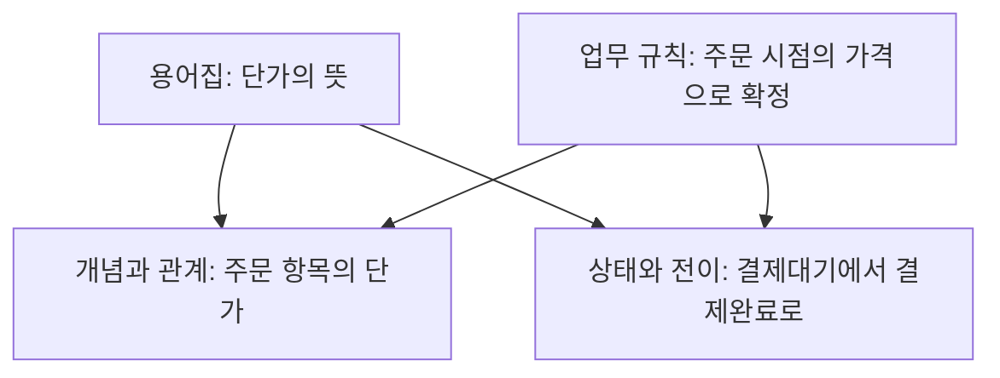
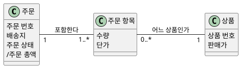
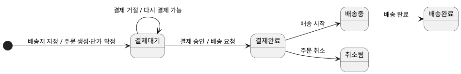
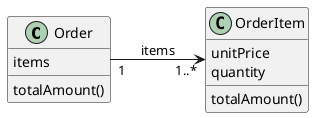
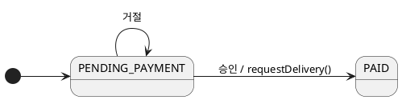
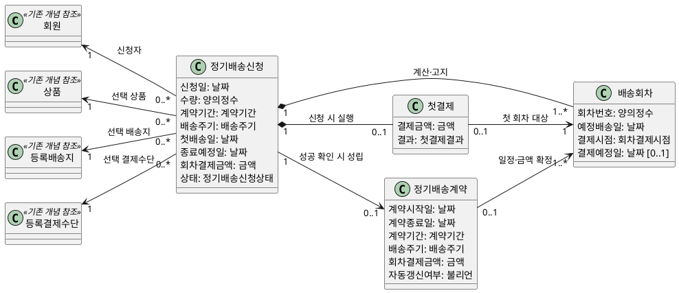
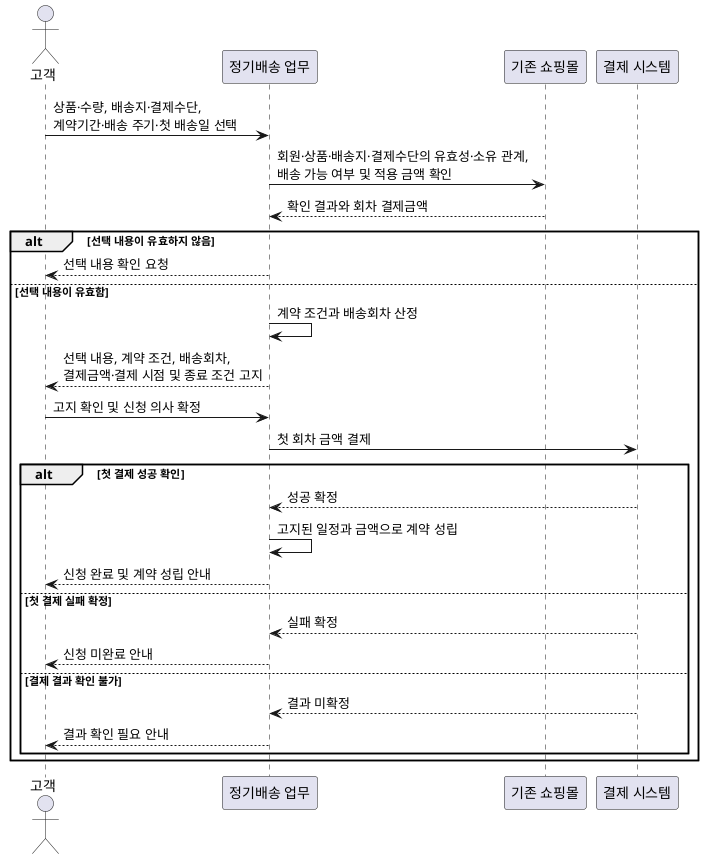
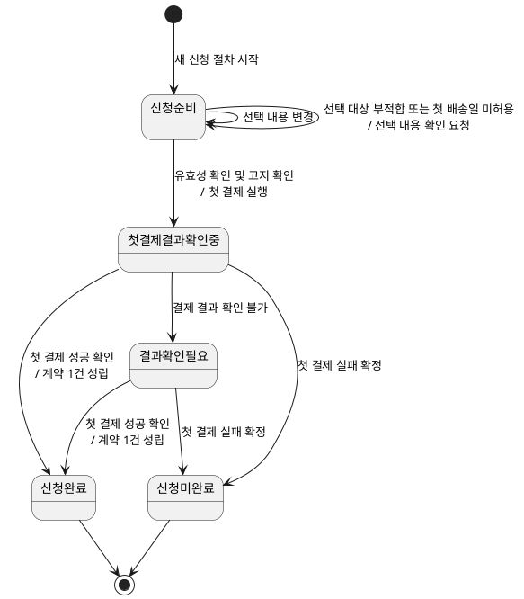

--------------------
Session 명: 03. 도메인 모델
--------------------

## 목차

01. 세션 목표
02. 도메인 모델이 명시하는 것
03. 분석·설계·구현
04. 용어집
05. 개념과 관계
06. 상태와 전이
07. 업무 규칙과 대표 예
08. 모델을 만들 때 사람과 AI
09. 모델에서 코드와 테스트로
10. 잘못된 관행
11. 실습 — 도메인 모델
12. 요약

## 01. 세션 목표

**도메인 모델**은 AI에게 주는 자료가 아니라 사람이 정한 업무의 의미다.

- **용어·개념·관계·상태·규칙**으로 업무의 의미를 설명한다.
- **분석·설계·구현**에서 각각 무엇을 결정하는지 구분한다.
- 같은 사례로 **개념 모델과 상태 기계**의 모순을 찾는다.
- LLM의 초안에서 **추측·모순·누락**을 찾아 확인 질문으로 바꾼다.
- 모델의 결정이 **코드와 테스트**의 어디에 이어지는지 확인한다.

**강사 노트**

- "세션 02. 요구와 사용자 이야기"에서 확인한 주문의 요구사항을 입력으로 쓴다. 도메인 모델은 그 요구사항이 쓰는 말의 구조를 밝힌다.
- 목표는 UML 표기 숙련이 아니라 다음 작업자가 핵심 의미를 추측하지 않아도 되는 수준이다.

---

## 02. 도메인 모델이 명시하는 것

## 같은 업무를 설명하는 여러 관점

**도메인 모델**은 업무의 개념과 관계, 상태와 규칙을 서로 일관되게 설명한다. 용어집은 그 설명에 쓸 말의 뜻을 맞춘다.

**도식 — Mermaid — 주문의 의미를 함께 설명하는 관점**



- **개념 모델**은 업무에 존재하는 개념과 그 관계를 표현한다. 주문과 주문 항목, 상품이 무엇으로 연결되는지 묻는다.
- **상태 기계**는 사건이 일어났을 때 허용되는 상태 변화를 표현한다. 결제가 거절되면 주문이 어떻게 되는지 묻는다.
- **교차 검토**는 같은 예를 두 관점으로 설명해 보는 일이다. 항목의 단가는 고정인데 총액이 현재 판매가를 따라가면 모순이다.

**강사 노트**

- 이 과정은 용어집·개념 모델·상태 기계와 이를 제약하는 규칙을 함께 다룬다. 모든 도메인 모델이 반드시 이 문서 묶음을 가져야 한다는 뜻은 아니다.
- 도식의 주문 항목과 단가는 「09. 모델에서 코드와 테스트로」에서 필드와 계산으로 연결한다. 상태는 enum과 상태 변경 메서드로 연결한다.

---

## 개념 모델과 온톨로지

**개념 모델**은 업무에서 중요한 개념과 관계를 드러낸다. **온톨로지**는 개념과 관계 등의 의미를 명시적으로 정의한 체계다.

**인용문**

도메인 모델은 한 영역의 **개념 클래스나 실제 상황의 객체**를 시각적으로 표현한 것이다, "A domain model is a visual representation of conceptual classes or real-situation objects in a domain", [Larman 2004]

**인용문**

온톨로지는 **개념화의 명시적 명세**다, "An ontology is an explicit specification of a conceptualization.", [Gruber 1993]

- **Larman의 정의**는 개념 클래스 중심의 모델을 설명한다. 상태와 업무 규칙까지 모두 이 인용의 정의에 포함시키지는 않는다.
- **공통 관심**은 말의 뜻과 관계를 명시한다는 것이다. 온톨로지라는 이름을 붙인다고 업무 담당자의 확인을 대신하지는 못한다.
- **필요한 깊이**는 다음 결정이 정한다. 가격의 뜻을 나누면 오류가 드러나는 사례에 복잡한 지식 표현 언어부터 도입할 이유는 없다.

**강사 노트**

- Larman, Applying UML and Patterns, 3rd ed.; Gruber, A Translation Approach to Portable Ontology Specifications, 1993. 두 영문은 verify-quote.js로 원문을 확인했다.
- 온톨로지와 개념 모델이 완전히 같은 산출물이라는 인상을 주지 않는다. 형식 언어·추론 엔진은 이 세션의 범위가 아니다.

---

## 03. 분석·설계·구현

**분석**은 업무의 의미를 밝히고, **설계**는 그 의미를 지킬 책임과 협력을 정하며, **구현**은 이를 실행 가능한 코드로 만든다.

**표 — 주문 금액에 관한 서로 다른 결정**

| 관점 | 결정할 질문 | 주문 사례의 결정 |
|---|---|---|
| **분석** | 어떤 금액이 주문의 금액인가? | 주문 시점의 판매가를 단가로 확정한다 |
| **설계** | 누가 그 의미를 지키는가? | 주문 항목이 확정 단가를 보관하고 금액을 계산한다 |
| **구현** | 그 결정을 어떻게 실행하는가? | 단가 필드에 복사하고 수량을 곱한다 |

- **요구사항**은 시스템이 충족할 결과를 말한다. 분석은 그 결과에 쓰인 가격·주문·항목의 뜻을 서로 맞춘다.
- **설계의 선택**은 하나가 아니다. 개념 사이에 관계가 있다고 해서 참조 방향·테이블·API가 자동으로 정해지지는 않는다.
- **되돌림**은 필요하다. 구현 중 단가의 확정 시점이 모호하다는 사실을 발견하면 계산 코드를 추측해서 채우지 않고 요구와 모델을 확인한다.

**강사 노트**

- 이 세 관점은 반드시 한 번씩 순서대로 끝내는 단계가 아니다. 작은 범위를 끝까지 만들면서 되돌아간다.
- 외부 시스템 경계와 의존 규칙은 다음 세션에서 다룬다. 여기서는 코드에 연결하는 데 필요한 책임 선택만 예로 든다.

---

## 04. 용어집

## 이름이 같으면 뜻도 같아야 한다

**용어집**은 업무에서 쓰는 말의 뜻과 경계를 합의한 기록이다. 같은 말을 코드·대화·모델에서 같은 뜻으로 쓴다.

**인용문**

모델을 **언어의 뼈대**로 삼는다, "Use the model as the backbone of a language.", [Evans 2015]

**표 — 주문에서 구분해야 하는 말**

| 용어 | 뜻 | 구분해야 할 것 |
|---|---|---|
| **상품** | 판매 대상으로 관리되는 것 | 특정 주문에 담긴 항목과 다르다 |
| **주문 항목** | 주문에 포함된 상품·수량·확정 단가의 묶음 | 상품의 현재 정보만 참조해서는 안 된다 |
| **판매가** | 상품의 현재 판매 가격 | 상품 정책에 따라 바뀔 수 있다 |
| **단가** | 주문이 생길 때 확정한 항목당 가격 | 이후 판매가가 바뀌어도 유지한다 |
| **주문 총액** | 각 항목의 단가 × 수량을 합한 금액 | 현재 판매가로 다시 계산하지 않는다 |

**강사 노트**

- Evans, Domain-Driven Design Reference, 2015, Ubiquitous Language. 원문 확인 완료.
- 영한 식별자 연결은 과정 설계의 영한 용어집을 따른다. 본문에서는 뜻을 먼저 합의하고 코드에서 unitPrice와 salePrice를 연결한다.

---

## 가격을 판매가와 단가로 나누기

**가격**이라는 말만으로는 현재 판매 조건과 이미 성립한 주문의 조건을 구분할 수 없다. 두 의미를 나누면 모델의 속성과 규칙도 달라진다.

**인용문**

**언어가 바뀌면 모델도 바뀐다**는 것을 인식한다, "Recognize that a change in the language is a change to the model.", [Evans 2015]

**표 — 같은 상품, 서로 다른 시점의 금액**

| 시점 | 상품의 판매가 | 주문 항목의 단가 | 펜 2개의 주문 총액 |
|---|---|---|---|
| **주문 생성** | 1,000원 | 1,000원으로 확정 | 2,000원 |
| **판매가 변경** | 1,200원 | 1,000원 유지 | 2,000원 유지 |

- **발견**은 이름 하나를 바꾸는 데서 끝나지 않는다. 상품에는 판매가가, 주문 항목에는 단가가 필요하다는 관계가 드러난다.
- **현행화**는 요구사항 정의서의 용어와 도메인 모델에 반영한다. 작업할 때마다 별도의 가격 정의를 새로 만들지 않는다.

**강사 노트**

- 배송지를 지정하면 결제대기 주문이 생기고 그때의 판매가가 단가로 확정된다. 결제 승인 때 확정하는 것으로 시점을 바꾸지 않는다.
- 할인·세금·통화 환산은 이 사례에 주어지지 않았다. 별도 정책을 추가하지 않는다.

---

## 05. 개념과 관계

## 주문·주문 항목·상품

**개념 모델**은 업무에서 구분되는 대상과 그 관계를 표현한다. 속성은 각 대상에서 알아야 할 업무 정보를 뜻한다.

**도식 — PlantUML — 주문의 개념과 관계**



- **다중성**은 관계에 참여하는 개수를 뜻한다. 주문 하나에는 항목이 하나 이상이고, 각 항목은 상품 하나에 해당한다.
- **파생 속성**인 주문 총액은 항목별 단가 × 수량의 합이다. 앞의 `/`는 다른 정보에서 계산한다는 표시다.
- **속성의 의미**를 먼저 정한다. 단가는 확정 금액이고 수량은 주문 개수이며, 배송지는 이 주문을 보낼 주소다.

**강사 노트**

- 선은 업무상의 관계다. 탐색 방향·외래 키·데이터베이스 테이블을 뜻하지 않는다. 합성 여부는 이 설명에 필요하지 않아 선택하지 않았다.
- 「09. 모델에서 코드와 테스트로」의 Order.items와 OrderItem.unitPrice가 관계·속성을 구현하는 한 설계 예다.

---

## 하나의 주문으로 관계 확인하기

**구체적인 주문**을 모델에 대입하면 개념을 빠뜨렸거나 같은 정보를 잘못 연결한 부분을 찾을 수 있다.

**표 — 펜 2개를 서울로 주문한 경우**

| 대상 | 이 사례에 있는 정보 | 확인할 의미 |
|---|---|---|
| **상품** | 펜, 판매가 1,000원 | 현재 판매 조건이다 |
| **주문 항목** | 펜, 수량 2, 단가 1,000원 | 이 주문의 가격 조건이다 |
| **주문** | 배송지 서울, 결제대기, 총액 2,000원 | 배송지 지정 때 생성되었다 |

- **상품만 참조**하고 단가를 두지 않으면 판매가 변경 후 과거 주문 금액을 설명할 수 없다.
- **상품과 항목을 합치면** 같은 펜을 서로 다른 단가로 주문한 두 주문을 구분하기 어렵다.
- **충분한 모델**은 이 차이를 설명한다. 다음 판단에 쓰이지 않는 속성과 관계는 미리 늘리지 않는다.

**강사 노트**

- 객체 다이어그램 표기까지 추가로 가르치기보다 표의 각 행을 개념 모델의 박스에 대응시킨다.
- 상품이 판매 중지되거나 삭제되는 경우는 현재 요구에 없다. 보존 정책이 필요해지면 별도로 확인한다.

---

## 06. 상태와 전이

## 사건이 상태를 바꾼다

**상태 기계**는 대상이 처한 상태와 사건에 따른 변화를 표현한다. 상태 이름만 나열하면 결제 거절 뒤의 행동을 설명할 수 없다.

**도식 — PlantUML — 주문의 상태와 전이**



- **결제 거절**은 취소 전이가 아니다. 주문은 결제대기로 남고 다른 카드로 다시 결제할 수 있다.
- **배송 요청**은 결제 승인 뒤의 행동이다. 요청을 보냈다는 이유만으로 배송중이 되지는 않는다.
- **초기 화살표**는 주문의 생성 시점을 나타낸다. 주문하기 전의 화면 진행을 주문 상태로 만들지 않는다.

**강사 노트**

- 상태 이름은 과정 공통 전제 그대로다. 취소 처리중 같은 새 상태는 추가하지 않는다.
- 도식은 업무 수준의 사건과 결과를 표현한다. 통신의 동기·비동기 방식이나 장애 복구 방식을 결정하지 않는다.
- 코드의 OrderStatus는 이 상태들을 유지한다. 실행 예는 결제대기에서 결제완료로 바뀌는 부분만 구현한다.

---

## 금지된 전이와 아직 모르는 전이

**금지**는 확인한 규칙에 어긋나는 행동이고, **미정**은 아직 정책을 확인하지 못한 상황이다. 화살표가 없다는 이유만으로 둘을 같게 취급하지 않는다.

**표 — 전이의 판단 근거**

| 상황 | 판단 | 모델과 테스트에서 |
|---|---|---|
| **승인 전 배송 요청** | 승인 뒤에만 요청한다는 규칙 위반 | 금지하며 요청하지 않았음을 검사한다 |
| **결제 거절 후 재결제** | 결제대기를 유지하는 허용 행동 | 자기 전이와 재시도 예로 확인한다 |
| **승인 후 배송 요청 실패** | 주문·재시도의 처리 정책 미정 | 질문으로 남기고 기대 상태를 정하지 않는다 |

- **확인 질문**은 구체적으로 쓴다. “배송 요청에 실패하면 승인된 결제를 유지하고 재시도하는가? 고객에게 어떤 결과를 알리는가?”
- **테스트의 경계**도 같다. 미정인 상황을 취소·롤백·성공 중 하나로 고정하면 코드가 업무 결정을 대신한다.

**강사 노트**

- 정상 승인 뒤 결제완료라는 사실과 배송 요청 실패 처리 정책의 미정은 구분한다. 실패 후 보상·재시도·통지 정책을 이 세션에서 정하지 않는다.
- 금지된 전이를 확인했다면 근거 규칙을 기록한다. 모든 상태 쌍의 전이를 채우는 것이 목표가 아니다.

---

## 07. 업무 규칙과 대표 예

**업무 규칙**은 어떤 결과가 옳은지 정한다. 대표 예는 규칙을 특정 사건과 값에 적용해 해석을 확인한다.

**표 — 주문의 세 규칙과 대표 예**

| 규칙 | 대표 예 | 모델에서 확인할 것 |
|---|---|---|
| **금액 확정** | 펜 2개 × 단가 1,000원 = 2,000원 | 단가는 주문 항목, 총액은 항목 금액의 합 |
| **승인 후 배송** | 2,000원 승인 → 결제완료 → 배송 요청 | 승인 전에는 배송을 요청하지 않는다 |
| **거절 후 재결제** | 거절 → 결제대기 → 다른 카드로 재결제 | 거절이 주문 취소나 주문 재생성을 뜻하지 않는다 |

- **변경 예**를 더한다. 판매가가 1,200원이 되어도 기존 주문의 단가와 총액은 1,000원·2,000원이다.
- **반례**도 묻는다. 거절을 취소로 처리하거나 승인 전 배송을 요청하면 어느 규칙을 위반하는가?
- **하나의 원천**을 둔다. 업무 규칙은 요구사항 정의서에서 유지하고 모델은 그 규칙이 적용되는 개념·상태를 명시한다.

**강사 노트**

- 대표 예를 예상한 다음 코드를 실행한다. 모델과 코드가 일치해도 최초 업무 규칙이 잘못되었을 가능성은 별도로 검토한다.
- 실패한 네트워크 요청의 재시도 횟수 같은 기술 정책을 이 세 규칙에 섞지 않는다.

---

## 08. 모델을 만들 때 사람과 AI

## 초안과 확정의 책임

**AI**는 모델의 후보와 검토 질문을 만든다. **사람**은 근거를 확인해 업무의 의미를 확정한다. 그 판단은 도구가 달라져도 필요하다.

**표 — 모델을 만드는 역할과 확인 결과**

| 작업 | AI가 도울 일 | 사람이 확인할 일 |
|---|---|---|
| **초안 작성** | 요구사항에서 개념·관계·상태 후보 추출 | 주어진 사실과 모델의 해석이 맞는가? |
| **모순 검토** | 용어집·상태 기계·규칙을 교차 비교 | 실제 모순인가, 서로 다른 의미인가? |
| **누락 질문** | 규칙에 없는 실패·경계 사례 제안 | 지금 결정할 것과 미룰 것은 무엇인가? |
| **확정·현행화** | 확인받은 변경을 관련 모델에 반영 | 근거 없이 바뀐 이름·상태·규칙이 없는가? |

- **입력**은 요구사항 정의서와 공통 용어다. “쇼핑몰 도메인 모델을 만들어라”만 주면 흔한 쇼핑몰 관행이 우리 정책을 대신할 수 있다.
- **검토 요청**에는 근거와 질문을 함께 요구한다. “원문에 없는 정책은 확정하지 말고, 어느 문장 때문에 어떤 질문이 필요한지 표시하라.”
- **완료 판단**은 산출물의 양이 아니다. 다음 설계와 구현이 중요한 업무 의미를 추측하지 않아도 되는가를 본다.

**강사 노트**

- 본질은 주문의 의미·규칙이고, LLM과 프롬프트는 그 의미를 찾고 검증하는 보조 수단이다. 프롬프트 기법 자체를 목표로 바꾸지 않는다.
- 모든 질문을 미정으로 남기는 것도 책임 회피다. 필요한 정책은 업무 담당자에게 확인해 닫는다.

---

## 교육용 초안 검토 예

**초안의 그럴듯함**보다 요구사항과 일치하는지가 중요하다. 아래는 오류를 구별하기 위해 만든 교육용 예이며 실제 LLM 실행 기록은 아니다.

**표 — 초안의 문장을 근거로 검토하기**

| 초안의 문장 | 문제 | 피드백 |
|---|---|---|
| **“가격은 상품에만 둔다”** | 현재 판매가와 주문 단가를 혼동 | 주문 시점 금액을 어떻게 보존하는지 설명하라 |
| **“결제 거절 시 취소됨”** | 거절 뒤 재결제 규칙과 모순 | 결제대기를 유지하는 자기 전이로 고쳐라 |
| **“배송 실패는 자동 환불”** | 미정인 정책을 추측 | 요구에 근거가 없으므로 확인 질문으로 돌려라 |
| **“주문과 항목이 연결됨”** | 개수와 항목의 의미 누락 | 주문 하나의 항목 수와 단가·수량의 뜻을 적어라 |

- **고친 뒤 재검토**한다. 상태 기계만 고치고 용어집·규칙·코드에 취소 처리 흔적이 남지 않았는지 본다.
- **보완 기록**에는 바꾼 것과 이유를 남긴다. 확인한 규칙과 아직 확인하지 않은 질문을 같은 확정 문장으로 쓰지 않는다.

**강사 노트**

- 실제 도구 출력으로 오해하지 않도록 교육용 예임을 본문에 명시했다.
- 표의 검토 기준을 그대로 실습의 피드백에 쓴다. 새 프롬프트 기법 목록을 늘리지 않는다.

---

## 09. 모델에서 코드와 테스트로

## 개념과 속성을 코드에 연결하기

**코드로 옮길 때는 설계 결정이 더해진다.** 아래 예는 주문이 항목 목록을 갖고, 항목이 확정 단가와 수량으로 금액을 계산하도록 정했다.

**도식 — PlantUML — 코드에 연결할 주문 구조**



```java
final class OrderItem {
    private final Money unitPrice;
    private final Quantity quantity;
// ... 생성자와 확정 메서드 생략
    Money totalAmount() {
        return new Money(unitPrice.won() * quantity.count());
    }
}
```

**강사 노트**

- 원본: code/s03/DomainModelExample.java. 상품 참조·주문 식별·배송지는 이 계산 발췌에서 생략했다. 전체 예제도 영속성이나 운영용 결제 구현은 아니다.
- 생성 시 상품의 판매가를 Money 값으로 복사해 확정한다. 상품의 현재 판매가로 항목 금액을 계산하지 않는다.
- 관계의 방향과 금액 계산 책임은 설계의 선택이다. 개념 모델의 모든 박스를 테이블이나 클래스로 자동 변환하는 예가 아니다.

---

## 상태와 승인 후 행동을 코드에 연결하기

**상태 변경과 외부 요청은 다른 결정**이다. 다섯 상태 중 결제대기의 승인·거절만 구현한다. Runnable은 배송 요청을 대신하는 테스트 연결점이며, 실제 연동·실패 복구는 생략했다.

**도식 — PlantUML — 구현할 결제 결과의 두 경로**



```java
    void pay(boolean approved, Runnable requestDelivery) {
        if (approved) {
            onPaid();
            requestDelivery.run();
        }
    }

    private void onPaid() {
        status = OrderStatus.PAID;
    }
```

**강사 노트**

- 이 pay 예제의 입력은 결제대기 주문에 돌아온 승인·거절 결과다. boolean은 결과를 단순화한 교육용 표현이며 실제 결제 프로토콜이 아니다.
- 중복 승인·다른 상태의 결제·배송 요청 실패는 이 실행 예의 계약 밖이다. 관련 정책을 예외 분기나 테스트 기대값으로 새로 정하지 않았다.
- 전체 enum: PENDING_PAYMENT, PAID, IN_DELIVERY, DELIVERED, CANCELLED. 앞 도식의 다섯 상태를 삭제하지 않는다.

---

## 대표 예를 실행해 확인하기

**테스트는 확인한 업무 규칙을 실행 가능한 예로 만든다.** 실행 전에 결과를 예측하고, 다르면 규칙·모델·코드 중 어디가 어긋났는지 찾는다.

**표 — 실행 예의 입력과 관찰 결과**

| 검사할 예 | 입력·사건 | 기대 결과 |
|---|---|---|
| **금액 보존** | 펜 2개 확정 뒤 판매가 1,200원으로 변경 | 단가 1,000원, 총액 2,000원 |
| **승인** | 결제대기 주문에 승인 결과 | 결제완료, 그 뒤 배송 요청 1회 |
| **거절** | 결제대기 주문에 거절 결과 | 결제대기 유지, 배송 요청 0회 |
| **재결제** | 거절된 주문에 승인 결과 | 같은 주문이 결제완료, 배송 요청 1회 |

- **금지의 검사**는 승인 전 배송을 요청하지 않았는지 확인한다. 거절 경로를 실행해 요청 횟수가 0인지 본다.
- **검증의 한계**를 남긴다. 배송 요청 실패의 주문 처리·보상·재시도 정책은 미정이므로 테스트 기대값을 만들지 않았다.
- **발견을 되돌린다.** 테스트를 쓰다가 요구에 없는 판단이 필요하면 요구와 모델을 보완한 뒤 구현한다.

**강사 노트**

- 원본의 main이 네 대표 예를 실제 실행한다. 실행 방법은 code/s03/README.md에 둔다.
- 이 표는 운영용 결제의 검증 범위를 뜻하지 않는다. 멱등성·저장·외부 장애는 다음 설계와 검증 활동의 대상이다.

---

## 10. 잘못된 관행

**모델의 품질**은 그림의 정교함보다 업무 의미를 정확히 설명하는지로 판단한다.

**표 — 흔한 오류와 보완 방향**

| 잘못된 관행 | 생기는 문제 | 보완 방향 |
|---|---|---|
| **테이블부터 그린다** | 저장 구조가 업무 개념을 대신한다 | 개념·관계의 뜻을 확인한 뒤 저장 구조를 정한다 |
| **LLM의 관행을 채택한다** | 거절 시 취소 같은 추측이 규칙이 된다 | 원문 근거를 요구하고 사람에게 확인한다 |
| **없는 화살표는 모두 금지한다** | 미정 정책이 거절 코드로 굳어진다 | 금지 근거와 미정 질문을 구분한다 |
| **모든 개념을 상세화한다** | 다음 결정에 쓰지 않는 모델이 늘어난다 | 구현과 검증에 필요한 범위부터 끝까지 잇는다 |
| **코드와 다른 모델을 둔다** | 다음 작업자가 서로 다른 의미를 받는다 | 의미가 바뀌면 용어·모델·대표 예를 함께 보완한다 |

**강사 노트**

- 저장 구조나 상세 UML 자체가 잘못인 것은 아니다. 업무 의미의 확인을 대신하거나 현재 필요보다 앞서 나가는 것이 문제다.
- AI가 구현을 빨리 만들수록 초안의 잘못된 의미가 코드와 테스트에 함께 퍼질 수 있음을 짚는다.

---

## 11. 실습 — 도메인 모델

**①로 시작해 답·질문·수정 요청을 주고받는다.** ②~④는 보완 예시다. ⑤로 MD를 만들고 필요하면 보완·재생성한다.

**프롬프트 — 요청사항 포함**
  + ① “아래 실습 2의 요구사항 정의서에서 최초 정기배송 신청에 필요한 **용어와 업무 규칙**을 짧게 정리해라. 뜻이 불명확하거나 서로 맞지 않는 내용은 질문해라. 구현 구조와 DB·API·코드는 제외해라.”
  + ② “앞선 질문에 대한 아래 답과 수정 요청을 반영해라. 업무 개념의 속성·관계·다중성을 **클래스 다이어그램**으로 대화창에 보여주고 주요 관계를 설명해라. 불명확한 의미는 질문하고 구현 클래스·DB 테이블은 설계하지 마라.”
  + ③ “아래 답과 수정 요청을 반영해라. 최초 신청의 업무 상호작용을 **시퀀스 다이어그램**으로, 사건에 따른 신청 상태 변화를 상태 머신 다이어그램으로 대화창에 보여줘라. 정적 모델과의 불일치나 미정 사항은 질문하고 구현 객체·API 호출은 설계하지 마라.”
  + ④ “아래 답과 수정 요청을 반영해라. 실습 2의 대표 수용 기준으로 용어·업무 규칙과 세 다이어그램의 **일관성**을 검토해라. 보완한 다이어그램을 대화창에 다시 보여주고 다른 모델에 영향이 있으면 함께 갱신해라. 새 정책이나 범위 밖 모델을 추가하지 마라.”
  + ⑤ “지금까지 합의한 도메인 모델을 다음 실습에 사용할 간결한 **Markdown 파일**로 생성해라. 용어와 업무 규칙은 하나의 상위 절 안에서 별도 소제목으로 구분해라. 대화창에서 검토한 최종 클래스·시퀀스·상태 머신 다이어그램은 독립 절에 재사용 가능한 원본과 필요한 설명을 포함해라. 실습 2의 날짜·금액 조건을 반복하지 말고 참조해라. 새 결정을 추가하거나 폐기한 안을 되살리지 마라. 남은 미결 사항은 해당 항목에 이유와 영향을 표시해라.”

**점검 항목**
  1. **용어** — 신청과 계약, 판매가와 확정 금액의 뜻이 명확한가?
  2. **정적 모델** — 필요한 업무 개념·속성·관계·다중성이 일관되는가?
  3. **동적 모델** — 상호작용과 사건·상태 변화가 같은 업무를 설명하는가?
  4. **일관성** — 일정·금액·결제 결과·중복 방지의 수용 기준을 설명하는가?
  5. **범위** — 기존 기능 재구현과 설계·DB·API·운영 모델을 추가하지 않았는가?

**결과물**
  + **용어·업무 규칙·세 다이어그램 원본을 포함한 최종 MD 파일**. 마지막 합의를 확인하고 실습 4에 첨부한다.

**강사 노트**

- Codex·ChatGPT·Claude Team 등에서 renderer 없이 수행한다. ②~④에는 실제 받은 질문의 답과 검토 의견을 붙인다. 기본 문구만 기계적으로 반복하지 않는다.
- ⑤ 이후에도 MD의 누락·불일치·폐기한 안의 재등장을 검토하고 보완·재생성을 반복한다. 다음 작업이 가능하면 탐색을 끝낸다. 제출 여부와 무관하게 최종 MD를 저장해 다음 실습에 명시적으로 첨부한다.
- 최종 MD가 실습 원본이고 교재 슬라이드는 별도 제작물이다. 환경별 파일 생성·다운로드와 도식 표시를 사전에 확인한다. 도식 코드만 보이는 경우를 시각 검토 완료로 보지 않는다.

- 수강생이 만든 실습 2의 요구사항 정의서를 첫 프롬프트에 붙인다. 실제 강사 예시 입력은 code/s03/exercise-conversation/input-s02.md다.
- ②~④는 기본 문구만 입력하지 않는다. [앞선 질문에 대한 답]과 [추가 질문·수정 요청]을 함께 작성한다. 질문이 없으면 검토 결과와 필요한 수정 요청만 적는다.
- 정적 모델은 클래스 다이어그램, 동적 모델은 시퀀스 다이어그램과 상태 머신 다이어그램으로 표현한다. 분석의 업무 개념·상호작용·상태를 다루며 컨트롤러·서비스·DB·API 설계로 바꾸지 않는다.
- 실제 입력·응답은 code/s03/exercise-conversation/에 보존한다. 클래스는 ②, 시퀀스·상태 머신은 ③에서 대화창에 표시하며 ④에서 바뀐 도식을 다시 검토한다. 최종 MD는 PPT 분량·배치 조건 없이 생성한다.
- 실습 2의 회차별 10,000원과 첫 회차 신청 시 결제를 유지한다. 예전 실습의 일시불 70,000원이나 거절 후 재결제 규칙을 소급하지 않는다.

---

## 12. 요약

### 도메인 모델은 사람이 정한 업무의 의미다

- **용어집**은 같은 말을 같은 뜻으로 쓰게 한다.
- **개념과 관계**는 업무의 구조를, **상태와 규칙**은 사건에 따른 변화를 설명한다.
- **사람**은 의미를 확정하고, **AI**는 초안과 교차 검토를 돕는다.
- **코드와 테스트**로 연결해 확인하고, 새로 발견한 의미는 모델에 되돌린다.

### 다음 세션

- "세션 04. 아키텍처" — 이 의미를 지킬 시스템 경계와 의존 규칙, 외부 연동을 정한다.

**강사 노트**

- 문서가 많아졌는지가 아니라 구현자가 주문 단가와 결제 거절의 의미를 추측하지 않아도 되는지로 마무리한다.

---

## 별첨. 실습 답

## 실습 3 정기배송 최초 신청 도메인 모델

**문서 형식 — 10pt**

**실제 LLM 응답**

### 1. 용어와 업무 규칙

### 1.1 용어

- **정기배송 신청:** 고객이 상품 한 종류와 수량, 본인의 등록 배송지·결제수단 및 배송 조건을 선택하여 계약 체결을 요청하는 과정이다.
- **정기배송 계약:** 첫 결제 성공이 확인될 때 정기배송 신청으로부터 성립하는 계약이다.
- **배송회차:** 신청 시 계산하여 고객에게 고지하는 예정 일정이다. 실제 배송 실행이나 운영 상태를 뜻하지 않는다.
- **첫 결제:** 첫 회차 금액을 신청 시 결제하는 행위다.
- **회차 결제금액:** 신청 시 확정하여 모든 배송회차에 동일하게 적용하는 금액이다.
- **동일 신청:** 고객이 한 번의 신청 의사로 시작한 신청이 반복 전달된 경우다. 선택 내용이 같다는 사실만으로 동일 신청이 되지는 않는다.
- **별개 신규 신청:** 고객이 신청 절차를 새로 시작하고 별도로 신청 의사를 확인한 신청이다.

### 1.2 업무 규칙

- 한 신청에서는 상품 한 종류와 수량을 선택한다.
- 기존 회원·상품·등록 배송지·등록 결제수단은 기존 쇼핑몰의 개념을 참조하며 내부 구조를 새로 정의하지 않는다.
- 고객은 본인의 유효한 등록 배송지와 등록 결제수단만 선택할 수 있다.
- 선택 대상이 유효하지 않거나 본인 소유가 아니거나 첫 배송일이 허용되지 않으면 선택 내용 확인을 요청하고 `신청준비` 상태를 유지한다. 이때 첫 결제를 실행하지 않는다.
- 날짜 산정, 배송회차 계산, 월말 처리, 금액 산정·유지 및 검증값은 **실습 2 요구사항 정의서와 대표 수용 기준**을 따른다.
- 신청 완료 전 선택 내용, 계약 조건, 배송 일정과 횟수, 결제금액과 결제 시점, 금액 유지 및 자동 갱신 없음을 고지한다.
- 첫 회차는 신청 시 결제하며 배송일 기준의 결제 예정일을 갖지 않는다. 이후 회차만 실습 2에서 정한 결제 예정일을 갖는다.
- 첫 결제 성공이 확인된 경우에만 신청이 완료되고 신청당 최대 하나의 계약이 성립한다.
- 첫 결제 실패가 확정되면 신청은 미완료되고 계약은 성립하지 않는다. 다시 신청하려면 별개의 신규 신청을 시작해야 한다.
- 결제 결과를 확인할 수 없으면 실패로 취급하지 않고 `결과확인필요` 상태로 둔다. 이후 결제 시스템의 결과 확인을 통해 성공 또는 실패가 확정된다.
- 계약이 성립하면 신청 시 고지한 배송회차와 회차 결제금액이 계약 내용으로 확정된다.
- 동일 신청의 반복 전달은 추가 청구, 추가 계약, 회차 추가 또는 상태 변화를 일으키지 않는다. 결과가 확정되었으면 기존 결과를, 아직 확정되지 않았으면 결과 확인 필요를 안내한다.
- 별개의 신규 신청은 허용한다. 동일 신청을 식별하는 기술적 방식은 설계에서 결정한다.
- 결제 결과를 통지하거나 조회하는 기술적 방식과 고객 알림 수단은 설계에서 결정한다.
- 이후 배송 운영, 후속 결제 실행, 배송 불가일 조정, 계약 변경 및 해지는 이 모델의 범위에서 제외한다.

**강사 노트**

- code/s03/exercise-conversation/codex-response-05.md에서 해당 절의 원문을 발췌했다. 문장·도식 원본은 수정하지 않았다.
- ①~⑤는 단계이며 실제 대화의 횟수는 예시다. 이전 실제 대화의 합의 내용을 이어 새 ⑤를 실행했다. 실제 입력·응답은 conversation.md, 학습자용 기본 문구는 templates.json에 보존한다. 마지막 파일을 검토한 뒤 보완·재생성할 수 있다.
- 발췌 범위: 용어·업무 규칙 절 전체와 세 다이어그램 원본이다. 도식 전후의 설명문은 최종 MD에서 읽으며 슬라이드에 중복하지 않는다.
- 다음 실습에는 최종 MD를 명시적으로 첨부한다. 교재의 슬라이드 배치와 업무 산출물의 구성은 별개다.

---

## 2. 클래스 다이어그램

**문서 형식 — 10pt**

**실제 LLM 응답**



**강사 노트**

- code/s03/exercise-conversation/codex-response-05.md에서 해당 절의 원문을 발췌했다. 문장·도식 원본은 수정하지 않았다.
- ①~⑤는 단계이며 실제 대화의 횟수는 예시다. 이전 실제 대화의 합의 내용을 이어 새 ⑤를 실행했다. 실제 입력·응답은 conversation.md, 학습자용 기본 문구는 templates.json에 보존한다. 마지막 파일을 검토한 뒤 보완·재생성할 수 있다.
- 발췌 범위: 용어·업무 규칙 절 전체와 세 다이어그램 원본이다. 도식 전후의 설명문은 최종 MD에서 읽으며 슬라이드에 중복하지 않는다.
- 다음 실습에는 최종 MD를 명시적으로 첨부한다. 교재의 슬라이드 배치와 업무 산출물의 구성은 별개다.

---

## 3. 시퀀스 다이어그램

**문서 형식 — 10pt**

**실제 LLM 응답**



**강사 노트**

- code/s03/exercise-conversation/codex-response-05.md에서 해당 절의 원문을 발췌했다. 문장·도식 원본은 수정하지 않았다.
- ①~⑤는 단계이며 실제 대화의 횟수는 예시다. 이전 실제 대화의 합의 내용을 이어 새 ⑤를 실행했다. 실제 입력·응답은 conversation.md, 학습자용 기본 문구는 templates.json에 보존한다. 마지막 파일을 검토한 뒤 보완·재생성할 수 있다.
- 발췌 범위: 용어·업무 규칙 절 전체와 세 다이어그램 원본이다. 도식 전후의 설명문은 최종 MD에서 읽으며 슬라이드에 중복하지 않는다.
- 다음 실습에는 최종 MD를 명시적으로 첨부한다. 교재의 슬라이드 배치와 업무 산출물의 구성은 별개다.

---

## 4. 상태 머신 다이어그램

**문서 형식 — 10pt**

**실제 LLM 응답**



**강사 노트**

- code/s03/exercise-conversation/codex-response-05.md에서 해당 절의 원문을 발췌했다. 문장·도식 원본은 수정하지 않았다.
- ①~⑤는 단계이며 실제 대화의 횟수는 예시다. 이전 실제 대화의 합의 내용을 이어 새 ⑤를 실행했다. 실제 입력·응답은 conversation.md, 학습자용 기본 문구는 templates.json에 보존한다. 마지막 파일을 검토한 뒤 보완·재생성할 수 있다.
- 발췌 범위: 용어·업무 규칙 절 전체와 세 다이어그램 원본이다. 도식 전후의 설명문은 최종 MD에서 읽으며 슬라이드에 중복하지 않는다.
- 다음 실습에는 최종 MD를 명시적으로 첨부한다. 교재의 슬라이드 배치와 업무 산출물의 구성은 별개다.

---

