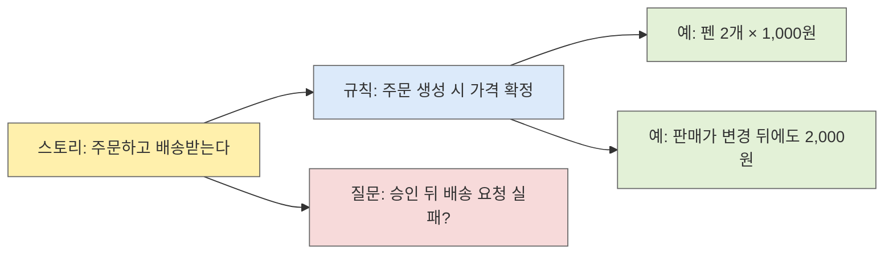
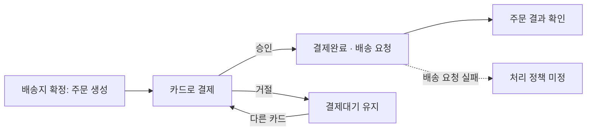
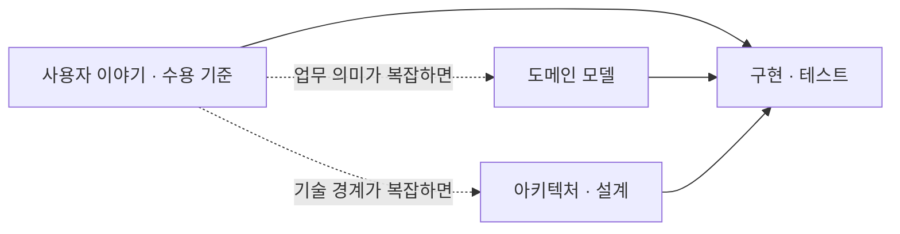

--------------------
Session 명: 03. 요구와 수용 기준
--------------------

## 목차

01. 세션 목표
02. 요청 한 줄에 요구사항은 없다
03. 요구사항은 능력과 조건이다
04. 검증할 수 없으면 요구사항이 아니다
05. 스토리는 어떻게 자라는가?
06. 무엇을 받아들일 것인가?
07. 분기에서 무엇을 약속하는가?
08. 품질 요구는 조건과 수치로 바꾼다
09. 명세는 어디에 남는가?
10. 중간 산출물은 복잡성이 정한다
11. 초안은 빈칸을 질문으로 되돌렸다
12. AI에게 맡기기 전의 4가지 질문
13. SDD는 새 단계를 더하지 않는다
14. 잘못된 관행
15. 실습 3 — 요구사항 정의서와 수용 기준
16. 요약

## 01. 세션 목표

요구사항은 **검증할 수 있을 때** 요구사항이고, **미정으로 남긴 것은 AI가 대신 결정한다**.

- **요구**와 **요구사항**을 가르고, 요구사항을 기능·업무 규칙·품질로 나눈다.
- **검증 가능함·명확함·단일함**으로 모호한 표현을 관찰할 결과로 바꾼다.
- 작업 단위마다 **사용자 이야기와 수용 기준**을 짝으로 적는다.
- 기대값을 **전제·사건·기대 결과**로 적고 허용과 금지를 함께 확인한다.
- 흐름의 분기에서 **범위·제외·미정**을 가른다.
- **요구사항 정의서와 작업 명세서**를 범위와 수명으로 나누어 AI의 입력으로 둔다.
- LLM 초안이 **근거 없이 확정한 것**을 질문으로 되돌린다.

**강사 노트**

- 1시간 30분 세션이다. "세션 02. LLM이라는 도구"가 맡길 형태를 골랐다면, 이 세션은 무엇을 맡기고 무엇으로 받아들일지 정한다.
- 입력은 업무 담당자의 요청 한 줄과 30분 회의 메모다. 정적·동적 모델과 설계의 상세는 뒤 세션이 맡는다.

---

## 02. 요청 한 줄에 요구사항은 없다

업무 담당자의 요청 한 줄은 고객이 **원하는 결과**를 말하고 시스템이 **충족할 조건**은 말하지 않는다 — 언제의 가격으로 청구하는지, 언제 배송을 요청하는지, 거절된 주문을 어떻게 둘지가 비어 있다. 확인에 사용할 주문은 **펜 2개**, 판매가 각 1,000원, 배송지 서울이고 금액은 **2,000원**이다.

"장바구니에 담은 상품을 결제하면 주문이 되고 배송이 시작되게 해 주세요."

**도식 — SVG — 요청 한 줄이 비워 둔 결정 3가지**

```svg
<svg xmlns="http://www.w3.org/2000/svg" viewBox="0 0 960 244" width="960" height="244" font-family="sans-serif" role="img" aria-label="요청 한 줄이 답하지 않은 주문 금액·배송 요청·결제 거절 3가지 결정과 업무 담당자가 정한 규칙, 요청만 보고 만든 코드가 임의로 선택한 값을 가른 개념도">
  <g>
    <rect x="6" y="6" width="948" height="72" rx="8" fill="#f8fafc" stroke="#64748b" stroke-width="1.5"/>
    <text x="34" y="50" font-size="23" font-weight="bold" fill="#1e293b">주문 금액</text>
    <line x1="230" y1="14" x2="230" y2="70" stroke="#cbd5e1"/>
    <text x="256" y="34" font-size="19" fill="#334155">주문이 생길 때의 판매가로 정한다 — 펜 2개면 2,000원</text>
    <text x="256" y="64" font-size="19" fill="#8e2a1e">요청만 보고 만든 코드는 결제 시점의 값으로 2,400원을 청구했다</text>
  </g>
  <g>
    <rect x="6" y="86" width="948" height="72" rx="8" fill="#f8fafc" stroke="#64748b" stroke-width="1.5"/>
    <text x="34" y="130" font-size="23" font-weight="bold" fill="#1e293b">배송 요청</text>
    <line x1="230" y1="94" x2="230" y2="150" stroke="#cbd5e1"/>
    <text x="256" y="114" font-size="19" fill="#334155">결제가 승인된 뒤에만 한다</text>
    <text x="256" y="144" font-size="19" fill="#8e2a1e">거절된 주문에도 배송 요청이 나갔다</text>
  </g>
  <g>
    <rect x="6" y="166" width="948" height="72" rx="8" fill="#f8fafc" stroke="#64748b" stroke-width="1.5"/>
    <text x="34" y="210" font-size="23" font-weight="bold" fill="#1e293b">결제 거절</text>
    <line x1="230" y1="174" x2="230" y2="230" stroke="#cbd5e1"/>
    <text x="256" y="194" font-size="19" fill="#334155">주문은 결제대기로 남고 다른 카드로 다시 결제한다</text>
    <text x="256" y="224" font-size="19" fill="#8e2a1e">거절된 주문을 취소해 다시 결제할 수 없었다</text>
  </g>
</svg>
```

- 비어 있던 결정은 **업무 담당자가 정한다**. LLM이 지어내지 않고 물어서 채운다.
- **해결책을 먼저 골라도 요구사항은 비어 있다** — 라이브러리 선택은 확정 시점을 답하지 않는다.

**강사 노트**

- "세션 01. 사람의 일과 AI의 일"의 「03. 테스트가 통과해도 업무는 틀린다」에서 업무 담당자 리뷰가 찾아낸 문제 3가지가 이 3가지 결정이다.
- 업무 규칙 3가지와 주문 생성 시점은 course-design.md의 공통 전제다. 규칙을 개발자나 LLM이 정한 것으로 설명하지 않는다.
- 요청 한 줄에 없는 도입 배경·장애 수치를 설명을 위해 만들지 않는다.

---

## 03. 요구사항은 능력과 조건이다

요구는 이해관계자가 원하는 것이고, 요구사항은 **시스템이 충족할 능력과 조건**이다. 고객이 원하는 결과는 결제하고 배송받는 것이고, 시스템이 충족할 조건은 승인 뒤에만 배송을 요청하는 것이다. 요구사항은 **기능·업무 규칙·품질** 3가지로 나뉜다.

**인용문**

요구사항은 시스템이 따라야 할 **능력과 조건**이다, "Requirements are capabilities and conditions to which the system … must conform", [Larman 2004]

**도식 — SVG — 요구사항의 3가지 종류**

```svg
<svg xmlns="http://www.w3.org/2000/svg" viewBox="0 0 960 288" width="960" height="288" font-family="sans-serif" role="img" aria-label="기능 요구사항·업무 규칙·품질 요구사항이 각각 무엇을 정하는지와 주문한다의 예를 적은 개념도">
  <g>
    <rect x="6" y="6" width="948" height="86" rx="8" fill="#eef2f7" stroke="#64748b" stroke-width="1.5"/>
    <text x="34" y="58" font-size="23" font-weight="bold" fill="#1e293b">기능 요구사항</text>
    <line x1="256" y1="16" x2="256" y2="82" stroke="#94a3b8"/>
    <text x="282" y="38" font-size="19" fill="#334155">시스템이 제공할 결과 — 배송지를 확정하면 주문이 생긴다</text>
    <text x="282" y="72" font-size="19" fill="#334155">승인되면 결제완료가 되고 배송 시스템에 배송을 요청한다</text>
  </g>
  <g>
    <rect x="6" y="100" width="948" height="86" rx="8" fill="#e8eff8" stroke="#2b5fa8" stroke-width="2"/>
    <text x="34" y="152" font-size="23" font-weight="bold" fill="#1b3f70">업무 규칙</text>
    <line x1="256" y1="110" x2="256" y2="176" stroke="#9db8d8"/>
    <text x="282" y="132" font-size="19" fill="#1b3f70">결과를 가르는 회사의 결정 — 주문 금액은 주문 생성 시점의 값</text>
    <text x="282" y="166" font-size="19" fill="#1b3f70">업무 담당자가 정하고 개발자나 LLM이 정하지 않는다</text>
  </g>
  <g>
    <rect x="6" y="194" width="948" height="86" rx="8" fill="#eef2f7" stroke="#64748b" stroke-width="1.5"/>
    <text x="34" y="246" font-size="23" font-weight="bold" fill="#1e293b">품질 요구사항</text>
    <line x1="256" y1="204" x2="256" y2="270" stroke="#94a3b8"/>
    <text x="282" y="226" font-size="19" fill="#334155">어떤 조건에서 어느 수준으로 제공하는가</text>
    <text x="282" y="260" font-size="19" fill="#334155">응답 성능·접근 통제·장애 대응을 조건과 수치로 바꾼다</text>
  </g>
</svg>
```

- **업무 규칙이 기능의 결과를 가른다** — 같은 결제 기능이 2,000원을 청구할지 2,400원을 청구할지는 규칙이 정한다.

**강사 노트**

- 3가지는 같은 요구사항 정의서에 절을 나눠 들어간다. 종류마다 문서를 따로 만들지 않는다는 것을 짚는다.
- Larman 원문의 요구사항 정의를 확인했다. 요구와 요구사항의 구분은 sw-engineering-principles.md의 「요구에서 코드까지의 경로」를 주문 사례에 적용한 것이다.
- 품질 요구사항의 3가지 관점은 「08. 품질 요구는 조건과 수치로 바꾼다」에서 다룬다. 여기서는 종류만 가른다.

---

## 04. 검증할 수 없으면 요구사항이 아니다

요구사항이 요구사항이 되는 조건은 **검증할 수 있는가**다. "금액이 정확하다"는 읽는 사람마다 다른 금액을 떠올리므로 무엇을 확인해야 통과인지 말하지 않는다. 자격요건 3가지로 판정하고, 어긴 표현은 **관찰할 결과**로 바꿔 적는다.

- **검증 가능함** — 충족 여부를 측정하거나 증명할 수 있는가?
- **명확함** — 읽는 사람이 달라도 같은 뜻으로 읽히는가?
- **단일함** — 한 가지 결과만 적었는가?

**표 — 모호한 표현을 관찰할 결과로**

| 모호한 표현 | 어긴 자격요건 | 관찰할 결과 |
|---|---|---|
| **금액이 정확하다** | 명확함 | 판매가가 1,200원이 되어도 2,000원을 청구한다 |
| **거절을 처리한다** | 검증 가능함 | 결제대기로 남고 배송 요청은 0회다 |
| **거절되면 남기고 다시 결제한다** | 단일함 | 상태와 재결제를 기준 2개로 나눈다 |

- 바꿔 적은 쪽은 **구현 방법이 아니라 받아들일 결과**다. 2,000원을 어떻게 계산하는지는 요구사항이 정하지 않는다.

**강사 노트**

- 자격요건 3가지의 이름은 ISO/IEC/IEEE 29148:2018의 개별 요구사항 특성에서 가져왔다. 열네 특성 전부는 "객체지향 분석과 설계 실무"가 좋은 요구사항의 자격요건으로 다루고, 이 과정은 수용 기준을 판정하는 3가지만 사용한다.
- 표준 본문은 유료라 공식 미리보기의 목차로 절의 구분만 확인했으므로 그 범위의 주장만 한다.
- 왼쪽 표현을 보이고 어느 자격요건을 어겼는지 수강생에게 먼저 묻는다.

---

## 05. 스토리는 어떻게 자라는가?

## 카드는 대화를 시작할 만큼만 적는다

사용자 이야기는 완성된 명세가 아니라 **대화의 약속**이다. 카드는 누가 무엇을 왜 원하는지만 적고, 규칙은 **대화**에서 합의하며, 합의한 것은 **확인**에서 관찰할 값으로 적는다. 요구를 담는 형식은 여럿이지만 이 과정은 사용자 이야기로 쓰고 **수용 기준과 예**로 확인한다.

**인용문**

사용자 이야기에는 **카드·대화·확인**이라는 3가지 핵심 관점이 있다, "User stories have three critical aspects. We can call these Card, Conversation, and Confirmation.", [Jeffries 2001]

**도식 — SVG — 카드·대화·확인**

```svg
<svg xmlns="http://www.w3.org/2000/svg" viewBox="0 0 960 288" width="960" height="288" font-family="sans-serif" role="img" aria-label="사용자 이야기의 카드·대화·확인 3가지 관점이 주문한다에서 각각 무엇을 담는지 적은 개념도">
  <g>
    <rect x="6" y="6" width="948" height="86" rx="8" fill="#f8fafc" stroke="#64748b" stroke-width="1.5"/>
    <text x="34" y="58" font-size="23" font-weight="bold" fill="#1e293b">카드</text>
    <line x1="200" y1="16" x2="200" y2="82" stroke="#cbd5e1"/>
    <text x="226" y="38" font-size="19" fill="#334155">대화를 시작할 만큼만 적는다 — 결제하고 배송받는다</text>
    <text x="226" y="72" font-size="19" fill="#334155">요청 한 줄은 가격·승인·거절의 규칙을 담지 않는다</text>
  </g>
  <g>
    <rect x="6" y="100" width="948" height="86" rx="8" fill="#e8eff8" stroke="#2b5fa8" stroke-width="2"/>
    <text x="34" y="152" font-size="23" font-weight="bold" fill="#1b3f70">대화</text>
    <line x1="200" y1="110" x2="200" y2="176" stroke="#9db8d8"/>
    <text x="226" y="132" font-size="19" fill="#1b3f70">결과를 가르는 규칙을 업무 담당자와 합의한다</text>
    <text x="226" y="166" font-size="19" fill="#1b3f70">주문 금액의 확정 시점과 거절 뒤 처리를 여기서 정한다</text>
  </g>
  <g>
    <rect x="6" y="194" width="948" height="86" rx="8" fill="#e8f1e8" stroke="#2f6b35" stroke-width="1.5"/>
    <text x="34" y="246" font-size="23" font-weight="bold" fill="#245128">확인</text>
    <line x1="200" y1="204" x2="200" y2="270" stroke="#8ab08e"/>
    <text x="226" y="226" font-size="19" fill="#1f2e20">합의를 관찰할 값으로 적는다 — 2,000원·결제완료</text>
    <text x="226" y="260" font-size="19" fill="#1f2e20">말로 이해했다고 끝내지 않고 배송 요청 1회까지 적는다</text>
  </g>
</svg>
```

- 3가지는 **한 번 거치는 단계가 아니다**. 수용 기준을 적다 보면 대화로 돌아간다 — 거절 뒤 재결제가 그렇게 드러났다.

**강사 노트**

- Jeffries, Essential XP: Card, Conversation, Confirmation(2001) 원문 확인. 3가지 관점을 고정된 개발 단계로 설명하지 않는다.
- 4가지 형식의 작성법은 다루지 않는다. 유스케이스의 상세 표기법은 "객체지향 분석과 설계 실무"의 범위이고, 도메인 이벤트는 「07. 분기에서 무엇을 약속하는가?」의 「분기가 빠진 요구를 드러낸다」에서 사건의 이름으로 다룬다.
- 스토리의 템플릿과 점검은 「작게 나누되 가치는 자르지 않는다」가 맡는다. 3가지 관점의 정의를 거기서 반복하지 않는다.

---

## 작게 나누되 가치는 자르지 않는다

스토리는 **고객이 얻는 가치** 하나를 담는 작은 단위다. 작게 만드는 것은 가치를 자르는 것이 아니라 **범위와 조건**을 줄이는 것이고, 테스트를 작성할 수 있을 만큼 뜻이 분명해야 작다고 할 수 있다.

**인용문**

스토리 카드를 작성한다는 것은 **원하는 것을 충분히 이해해 테스트를 작성할 수 있다**는 암묵적 약속이다, "Writing a story card carries an implicit promise: \"I understand what I want well enough that I could write a test for it.\"", [Wake 2003]

**표 — INVEST로 점검한 주문 스토리**

| 속성 | 뜻 | "주문한다"에서 확인한 것 |
|---|---|---|
| **Independent** | 독립적 | 상품·결제·배송 시스템이 운영 중이라 이 스토리만으로 끝난다 |
| **Negotiable** | 협상 가능 | 가격 확정 시점을 구현이 아니라 업무 담당자와의 대화로 정했다 |
| **Valuable** | 가치 있음 | 고객이 2,000원을 결제하고 서울로 배송받는다 |
| **Estimable** | 추정 가능 | 배송 요청 실패의 처리가 미정이라 그만큼 불확실하다 |
| **Small** | 작음 | 취소·환불·배송지 변경을 빼 범위를 한정했다 |
| **Testable** | 테스트 가능 | 2,000원·결제완료·배송 요청 1회로 확인한다 |

- **기술 층으로 쪼개지 않는다** — 결제 화면·주문 테이블만으로는 고객이 주문을 끝내지 못한다.

**강사 노트**

- Wake, INVEST in Good Stories, and SMART Tasks(2003)에서 6가지 속성과 Testable의 인용을 확인했다. 오른쪽 열은 주문 사례에 적용한 것이다.
- "주문한다"는 과정의 유일한 과제다. 이 장에서 별도 기능이나 추가 스토리를 만들지 않는다.
- 스토리 하나가 구현 작업 하나라는 뜻은 아니다. 작업 단위는 "세션 07. 설계 — 책임과 협력"이 나눈다.

---

## 06. 무엇을 받아들일 것인가?

## 수용 기준은 허용과 금지를 함께 적는다

수용 기준은 구현 방법이 아니라 **받아들일 결과**를 정한다. 업무 규칙 3가지에 예를 하나씩 두고 기본인 승인을 더해 4가지로 확인하며, 전제의 **카드 X는 거절되고 카드 Y는 승인된다**.

**인용문**

스토리의 행동은 곧 **수용 기준**이며, 시스템이 그 기준을 모두 충족하면 올바르게 행동하는 것이다, "A story’s behaviour is simply its acceptance criteria: if the system fulfils all the acceptance criteria, it’s behaving correctly; if it doesn’t, it isn’t", [North 2006]

**표 — "주문한다"의 수용 예 4가지**

| 예 | 전제·사건 | 기대 결과 |
|---|---|---|
| **승인** | 펜 2개·각 1,000원·카드 Y로 결제 | 2,000원·결제완료·서울 배송 요청 1회 |
| **가격 변경** | 주문 뒤 판매가 1,200원·카드 Y로 결제 | 청구 금액은 2,000원·결제완료 |
| **거절** | 카드 X로 결제·거절 | 결제대기·배송 요청 0회 |
| **재결제** | 카드 X 거절 뒤 같은 주문을 카드 Y로 | 결제완료·배송 요청 총 1회 |

- 거절 예에 **배송 요청 0회**를 함께 적어야 배송까지 요청해 버린 구현이 걸린다.
- **기대값의 근거는 업무 담당자가 정한 규칙**이다. 구현 결과를 복사하면 2,400원이 기준이 된다.

**강사 노트**

- North, Introducing BDD(2006)를 제공받은 원문으로 확인했다. 인용이 말하는 올바름은 주어진 수용 기준의 충족 범위이며 기준 자체의 누락까지 없다는 뜻은 아니다.
- 수용 기준은 조건이고 수용 테스트는 그 조건을 실행해 확인하는 수단이다. 검사 구성은 "세션 09. 검사 파이프라인"이 맡는다.
- 예 4가지는 공통 전제의 업무 규칙 3가지를 관찰하는 대표 예다. 모든 입력·장애 조합을 검증했다는 뜻이 아니다.

---

## 예는 대화에서 나온다

수용 기준의 예는 **업무 담당자와의 대화**에서 나온다. 구체적인 예로 기대 행동을 합의하는 협업 방식을 **행위 주도 개발**(BDD, Behaviour-Driven Development)이라 하고, 그 대화를 짧게 끝내는 방법이 **예시 매핑**이다.

**인용문**

BDD는 **업무 담당자와 기술 담당자 사이의 간극**을 줄이는 소프트웨어 팀의 협업 방식이다, "BDD is a way for software teams to work that closes the gap between business people and technical people", [Cucumber]

**인용문**

예시 매핑은 이 대화를 **짧고 생산적으로** 만들도록 설계된 방법이다, "Example Mapping is a method designed to make this conversation short and very productive.", [Cucumber: Example Mapping]

**도식 — Mermaid — 주문 스토리의 예시 매핑**



- **답하지 못한 질문을 새 규칙처럼 만들지 않는다** — 승인 뒤 배송 요청 실패의 처리는 미정으로 남긴다.
- **색은 예시 매핑의 표기다** — 스토리 노랑·규칙 파랑·예 초록·질문 빨강이다.

**강사 노트**

- Cucumber 공식 BDD 문서의 정의와 Example Mapping의 카드 색을 원문 확인했다. 카드 색을 외우는 것이 목표가 아니라 규칙·예·질문의 연결이 목표다.
- 발견·정식화·자동화는 **활동**, 예시 매핑은 발견의 **방법**, 전제·사건·기대 결과는 정식화의 **표기**다. 수강생이 셋을 나란한 선택지로 읽지 않게 이 자리에서 밝힌다.
- 도식은 업무 규칙 3가지 가운데 금액 규칙과 남은 질문을 대표로 보인 것이다. 원문의 this conversation은 수용 기준을 논의하는 대화를 가리킨다.

---

## 전제·사건·기대 결과로 적는다

발견한 예를 같은 뜻으로 읽히게 적는 뼈대가 **전제·사건·기대 결과**다. 준비할 상황, 발생한 사건, 관찰할 금액·상태·외부 요청을 차례로 적으면 그 문장이 그대로 수용 테스트가 된다.

**인용문**

**초기 맥락**이 주어지고 **사건**이 발생하면 **결과**를 확인한다, "Given some initial context (the givens), When an event occurs, Then ensure some outcomes", [North 2006]

```gherkin
Scenario: 거절 뒤 다른 카드로 결제한다
  Given 펜 2개, 주문 시 판매가 1000원, 배송지 서울의 결제대기 주문
    And 카드 X는 거절되고 카드 Y는 승인된다
  When 카드 X로 결제한 뒤 같은 주문을 카드 Y로 다시 결제한다
  Then 같은 주문은 결제완료다
    And 청구 금액은 2000원이다
    And 서울로의 배송 요청은 모두 합해 1회다
```

- **표기이지 활동이 아니다** — 이 형식으로 적었다고 발견의 대화를 한 것은 아니다. 적을 예는 대화에서 나온다.
- **재결제 예가 거절 예를 대신하지 않는다** — 거절 직후의 결제대기와 배송 요청 0회를 따로 확인한다.

**강사 노트**

- North 원문의 상황·사건·결과 문형을 주문 사례에 적용했다. Gherkin은 요구 예의 표현이며 이 세션에서 실행 코드를 만들었다는 뜻이 아니다.
- 도구 설치나 스텝 정의 구현은 다루지 않는다. 업무 수준의 사건을 화면 클릭이나 DB 필드 변경으로 바꾸지 않는다.

---

## 07. 분기에서 무엇을 약속하는가?

## 분기가 빠진 요구를 드러낸다

기본 흐름만 보면 요구는 다 적힌 것처럼 보인다. 결제 결과가 갈리는 자리에서 분기를 따라가면 **승인 외의 경로**가 드러나고, 거기서 아직 답하지 못한 요구가 나온다. 기본 흐름은 배송지 확정부터 주문 결과 확인까지이고, 카드 거절과 배송 요청 실패가 그 밖의 경로다.

**도식 — Mermaid — 주문 결제의 분기**



- **거절은 알려진 반응이다** — 주문은 결제대기로 남고 고객은 다른 카드로 다시 결제한다.
- **배송 요청 실패는 아직 모르는 반응이다** — 승인은 끝났는데 다음에 무엇을 할지가 정해지지 않았다.
- **도메인 이벤트는 업무에서 발생한 사건의 이름**이다 — 결제되었다·배송이 시작되었다가 "주문한다"의 사건이다.
- 도메인의 활동에 관한 정보를 **일련의 개별 이벤트**로 모델링한다, "Model information about activity in the domain as a series of discrete events.", [Evans 2015]

**강사 노트**

- Evans, Domain-Driven Design Reference(2015)의 Domain Event 설명에서 인용했다. 도메인 이벤트를 메시지 큐나 비동기 통신으로 한정하지 않는다. "결제되었다"는 공통 용어의 사건이며 새 이벤트 타입이나 코드 이름을 만들지 않는다.
- 흐름은 공통 전제의 기본 흐름 3~5를 분기로 펼친 개념도다. 상태 기계나 통신 프로토콜이 아니며 상태 전이의 상세는 "세션 05. 동적 모델"이 맡는다. 같은 분기를 2곳에 적지 않는다.
- 대안·예외의 명칭보다 각 경우의 결과가 확정됐는지 묻는 것이 중요하다.
- 가격 변경은 별도 고객 행동이 아니라 같은 결제 흐름에서 금액 규칙을 확인하는 전제다.

---

## 미정을 제외로 숨기지 않는다

**제외**는 이번에 하지 않기로 합의한 것이고, **미정**은 아직 답하지 못한 것이다. 둘을 같은 칸에 적으면 아무도 다시 묻지 않고, 비어 있는 결정은 AI가 그럴듯한 추측으로 채운다. 승인 뒤 배송 요청 실패는 미정으로 남겨 질문으로 되돌린다.

**도식 — SVG — 범위·제외·미정**

```svg
<svg xmlns="http://www.w3.org/2000/svg" viewBox="0 0 960 288" width="960" height="288" font-family="sans-serif" role="img" aria-label="주문한다에서 이번에 약속하는 범위, 하지 않기로 한 제외, 아직 답하지 못한 미정을 가르고 각각 요구사항 정의서에 남길 것을 적은 개념도">
  <g>
    <rect x="6" y="6" width="948" height="86" rx="8" fill="#e8f1e8" stroke="#2f6b35" stroke-width="1.5"/>
    <text x="34" y="58" font-size="23" font-weight="bold" fill="#245128">범위</text>
    <line x1="200" y1="16" x2="200" y2="82" stroke="#8ab08e"/>
    <text x="226" y="38" font-size="19" fill="#1f2e20">배송지 확정부터 카드 결제와 결과 확인까지</text>
    <text x="226" y="72" font-size="19" fill="#1f2e20">승인·가격 변경·거절·재결제의 기대 결과를 적는다</text>
  </g>
  <g>
    <rect x="6" y="100" width="948" height="86" rx="8" fill="#f8fafc" stroke="#64748b" stroke-width="1.5"/>
    <text x="34" y="152" font-size="23" font-weight="bold" fill="#1e293b">제외</text>
    <line x1="200" y1="110" x2="200" y2="176" stroke="#cbd5e1"/>
    <text x="226" y="132" font-size="19" fill="#334155">이번에 하지 않기로 합의한 것 — 취소·환불·배송 진행</text>
    <text x="226" y="166" font-size="19" fill="#334155">하지 않는다고 명시해 다시 묻지 않게 한다</text>
  </g>
  <g>
    <rect x="6" y="194" width="948" height="86" rx="8" fill="#fdecec" stroke="#c0392b" stroke-width="1.5"/>
    <text x="34" y="246" font-size="23" font-weight="bold" fill="#8e2a1e">미정</text>
    <line x1="200" y1="204" x2="200" y2="270" stroke="#d98b80"/>
    <text x="226" y="226" font-size="19" fill="#3b1f1a">아직 답하지 못한 것 — 승인 뒤 배송 요청 실패</text>
    <text x="226" y="260" font-size="19" fill="#3b1f1a">질문과 미확정 사실로 남겨 업무 담당자에게 되돌린다</text>
  </g>
</svg>
```

- **범위는 승인 뒤 배송 요청까지다**. 실제 배송 진행은 배송 시스템이 맡는다.
- 미정을 비워 두면 AI가 **취소나 자동 재요청을 임의로 선택한다**.

**강사 노트**

- 배송 요청 실패는 "세션 11. 종합 실행"에서 발견과 되돌림을 다루도록 공통 전제에 남아 있다. 그 전에는 기대 상태나 자동 복구 정책을 만들지 않는다.
- 앞 장은 분기를 찾는 일이고 이 장은 각 분기를 어디까지 약속할지 정하는 일이다. 같은 흐름도를 반복하지 않는다.

---

## 08. 품질 요구는 조건과 수치로 바꾼다

요구사항이 어떤 결과를 제공할지 정한다면, 품질 요구사항은 그 결과를 **어떤 조건에서 어느 수준으로** 제공할지 정한다. 빠르다·안전하다 같은 말은 측정할 수 없으므로 조건과 수치로 바꿔야 검사가 된다. "주문한다"에서 묻는 관점은 **응답 성능·접근 통제·장애 대응** 3가지다.

**표 — 품질 요구를 검증 가능하게 만드는 질문**

| 품질 관점 | 요구 후보 | 검증 가능하게 만드는 질문 |
|---|---|---|
| **응답 성능** | 주문이 빠르게 처리된다 | 부하·측정 구간·허용 지연은? |
| **접근 통제** | 남의 주문을 바꿀 수 없다 | 누가 어떤 주문에 무엇을 하는가? |
| **장애 대응** | 요청 실패에도 주문이 남는다 | 유실의 정의와 후속 정책은? |

- **응답 성능**은 측정의 시작과 끝, 동시 요청 수, 외부 시스템의 응답 조건을 함께 정한다. 목표 시간과 그 안에 끝나야 할 비율을 합의한다.
- **접근 통제**는 누가 어떤 주문에 어떤 행동을 할 수 있는지 정한다. 본인 확인과 결제대기 주문의 변경 허용은 서로 다른 규칙이다.
- **장애 대응**은 실패한 지점과 지켜야 할 결과를 정한다. 배송 요청 실패 뒤 취소·재요청은 업무 담당자의 결정이 필요하다.

**강사 노트**

- 강의 시연의 회의 메모에는 품질 목표가 없다. 동시 100건·외부 응답 1초·95% 이상 3초는 course-design.md의 실습 품질 기준이며 강의 사례의 확정 요구가 아니다. 본문은 목표를 합의할 때 필요한 조건만 설명하고 실습 수치를 가져오지 않는다.
- 품질 관점의 이름과 검증 가능하게 만드는 질문은 "객체지향 분석과 설계 실무"의 품질속성 취급과 같게 적는다. 기준은 ISO/IEC 25010:2023의 품질 모델이며 공식 초록의 범위만 확인했다.
- 그 과정이 함께 다루는 사용 편의·변경 용이성은 "주문한다"의 범위에 없어 제외했다. 근거 없이 측정 수치나 서비스 수준을 확정하지 않는다.

---

## 09. 명세는 어디에 남는가?

## 범위와 수명이 문서를 가른다

같은 요구사항을 적는 문서가 2개인 이유는 **범위와 수명**이 다르기 때문이다. 요구사항 정의서는 시스템 전체의 요구를 담아 유지하고, 작업 명세서는 지금 구현할 스토리 하나를 담아 그 작업이 끝나면 역할이 끝난다.

**도식 — SVG — 명세 문서 2개의 범위와 수명**

```svg
<svg xmlns="http://www.w3.org/2000/svg" viewBox="0 0 960 194" width="960" height="194" font-family="sans-serif" role="img" aria-label="요구사항 정의서와 작업 명세서가 담는 범위와 수명을 가른 개념도">
  <g>
    <rect x="6" y="6" width="948" height="86" rx="8" fill="#e8eff8" stroke="#2b5fa8" stroke-width="2"/>
    <text x="34" y="58" font-size="23" font-weight="bold" fill="#1b3f70">요구사항 정의서</text>
    <line x1="256" y1="16" x2="256" y2="82" stroke="#9db8d8"/>
    <text x="282" y="38" font-size="19" fill="#1b3f70">시스템 전체의 요구를 담고 변경하며 유지한다</text>
    <text x="282" y="72" font-size="19" fill="#1b3f70">기능·업무 규칙·품질·용어집 — 주문 금액 규칙의 원천</text>
  </g>
  <g>
    <rect x="6" y="100" width="948" height="86" rx="8" fill="#f8fafc" stroke="#64748b" stroke-width="1.5"/>
    <text x="34" y="152" font-size="23" font-weight="bold" fill="#1e293b">작업 명세서</text>
    <line x1="256" y1="110" x2="256" y2="176" stroke="#cbd5e1"/>
    <text x="282" y="132" font-size="19" fill="#334155">지금 구현할 스토리 하나의 범위와 확인할 결과를 담는다</text>
    <text x="282" y="166" font-size="19" fill="#334155">정의서를 가리키고, 작업이 끝나면 역할이 끝난다</text>
  </g>
</svg>
```

- **작업 명세서는 정의서를 복제하지 않고 가리킨다**. 같은 업무 규칙을 2곳에 적으면 변경할 때 달라진다.
- **문서 이름을 늘리는 것이 명세가 아니다**. 스토리 하나로 충분하면 별도 작업 문서를 만들지 않는다.

**강사 노트**

- 범위·수명과 참조 방식은 sw-engineering-principles.md의 「요구에서 코드까지의 경로」를 따른다. 어떤 SDD 도구의 디렉터리 구조도 표준으로 삼지 않는다.
- 기능이 하나인 첫 정의서와 그 기능의 작업 명세서는 내용이 많이 겹칠 수 있다. 그렇다고 두 문서의 범위가 같은 개념이 되는 것은 아니다.
- 작업 단위로 쪼개는 것은 "세션 07. 설계 — 책임과 협력"의 결정이다.

---

## “주문한다” 요구사항 정의서

요구사항 정의서 한 장은 스토리·흐름·업무 규칙·용어·수용 예·미정을 **절로 나눠** 담는다. 같은 규칙을 절마다 다시 적지 않고, 모델·설계·코드는 이 문서가 정하지 않는다.

**문서 형식 — 10pt**

### 목적과 범위

- 고객이 **배송지를 확정하고 카드로 결제한다**. 상품·결제·배송은 외부 시스템이다.
- **취소·환불·배송 진행**은 제외한다. 화면·기술 설계는 이 문서에서 정하지 않는다.

### 사용자 이야기

- 고객으로서 선택한 상품의 배송지를 정하고 **카드로 결제해 배송받고 싶다**.

### 기능과 흐름

1. 배송지를 확정하면 주문이 결제대기로 생긴다.
2. 카드 승인을 요청한다. 승인되면 결제완료가 되고 배송을 요청한다.
3. 거절되면 결제대기로 남고 같은 주문을 다른 카드로 다시 결제할 수 있다.
4. 고객은 주문 결과를 확인한다.

### 업무 규칙

- **주문 금액**은 주문 생성 시점의 판매가와 수량으로 정하고 이후 판매가가 바뀌어도 유지한다.
- **배송 요청**은 승인 뒤에만 한다. 거절된 주문을 취소하지 않는다.

### 용어집의 시작

- **주문**(Order): 배송지 확정 시 생기는 주문. 승인 전에는 결제대기다.
- **주문 항목**(OrderItem): 주문한 상품과 수량에 관한 항목이다.
- **판매가**(salePrice): 상품 시스템이 제공하는 현재 가격이다.
- **주문 금액**(totalAmount): 주문 생성 시 가격으로 확정한 금액이다.

### 수용 기준의 대표 예

- **승인**: 펜 2개·각 1,000원·서울 → 2,000원 청구·결제완료·배송 요청 1회.
- **가격 변경**: 주문 후 판매가 1,200원 → 청구 금액 2,000원 유지.
- **거절**: 결제대기 유지·배송 요청 0회. 다른 카드 승인 뒤에는 같은 주문이 결제완료다.

### 품질과 미정

- **응답시간**의 측정 조건·목표와 **접근 권한**의 사용자·허용 행동은 업무 담당자에게 확인한다.
- **승인 뒤 배송 요청 실패**의 후속 처리는 미정이다. 취소·재요청을 임의로 정하지 않는다.

**강사 노트**

- 문서 형식의 강의 예다. course-design.md의 공통 전제만 담고 실습 1의 미정 H·B·F·E·G·I를 강의 정책으로 가져오지 않는다.
- 용어집의 영문명은 공통 영한 용어집을 따른다. 가격의 현재 값과 확정 값을 구분하는 상세는 "세션 04. 정적 모델"이 이어 간다.
- 수용 예 4가지 전체는 「06. 무엇을 받아들일 것인가?」의 「수용 기준은 허용과 금지를 함께 적는다」에서 확인한다. 이 문서는 거절과 재결제를 한 항목에 이어 적었다.

---

## 10. 중간 산출물은 복잡성이 정한다

불변의 뼈대는 **사용자 이야기와 수용 기준에서 코드·테스트까지**다. 도메인 모델과 아키텍처는 언제나 거치는 단계가 아니라, 업무 의미가 복잡하거나 기술 경계가 복잡할 때 더하는 중간 산출물이다. "주문한다"는 복잡성 2가지가 모두 중간이어서 용어집과 정적·동적 모델, 의존 규칙을 가볍게 더한다.

**도식 — Mermaid — 요구에서 구현·검증으로 가는 경로**



- **가격의 시점과 상태의 뜻이 흔들리면 도메인 모델이 필요하다** — 판매가와 단가를 가르는 일이 그 자리다.
- **넣는 기준은 그 산출물이 결과를 바꾸는가**다. 사람의 확인을 바꾸지 않으면 넣지 않는다.

**강사 노트**

- sw-engineering-principles.md의 도메인·기술 복잡성 두 축을 따른다. 실습의 작은 작업에서도 수용 기준과 검사는 빠지지 않는다.
- 화살표는 입력 관계이며 모든 프로젝트가 같은 문서 순서를 거쳐야 한다는 뜻이 아니다.
- 도메인 모델은 "세션 04. 정적 모델"·"세션 05. 동적 모델", 아키텍처와 설계는 "세션 06. 아키텍처"·"세션 07. 설계 — 책임과 협력"이 상세화한다.

---

## 11. 초안은 빈칸을 질문으로 되돌렸다

## 요청 한 줄과 회의 메모만 주었다

초안을 맡길 때 준 것은 **요청 한 줄과 30분 회의 메모**뿐이다. 그 밖의 정책은 주지 않았고, 모르는 것은 정하지 말고 미정 질문으로 남기라고 적었다.

**기록 그대로**

```text
다음 요청과 회의 메모로 주문 시스템의 요구사항 정의서 초안을 써줘. 유저 스토리와
업무 규칙, 용어, 범위와 제외를 담고, 모르는 것은 정하지 말고 미정 질문으로 남겨줘.

[요청]
장바구니에 담은 상품을 결제하면 주문이 되고 배송이 시작되게 해 주세요.

[회의 메모 — 업무 담당자와 30분]
- 주문 금액: 주문이 생길 때의 판매가로 정한다. 결제 직전에 판매가가 올라도 주문 금액은 그대로다.
- 배송 요청: 결제가 승인된 뒤에만 한다.
- 결제 거절: 주문은 결제대기로 남고, 고객은 다른 카드로 다시 결제할 수 있다.
- 상품·결제·배송 시스템은 이미 운영 중이다.
```

**강사 노트**

- 프롬프트와 메모는 `code/s02/demo-results/prompt.txt`의 입력 그대로다. 줄이거나 고쳐 읽지 않는다.
- 메모의 3가지는 「02. 요청 한 줄에 요구사항은 없다」에서 업무 담당자가 정한 규칙과 같다. 같은 결정이 어디서 왔는지 연결한다.
- 품질 목표·운영 정책은 메모에 없다. 초안이 그 자리를 질문으로 남겼는지 다음 장에서 확인한다.

---

## 돌아온 초안은 근거를 칸마다 적었다

**기록 그대로**

**문서 형식 — 10pt**

근거는 요청 한 줄과 업무 담당자와의 30분 회의 메모뿐입니다. 이 두 곳에 없는 내용은 정하지 않고 「6. 미정 질문」에 남겼습니다.

### 1. 배경

- **해석 메모**: 회의 메모에 "결제가 거절되어도 주문은 결제대기로 남는다"는 내용이 있습니다. 그래서 주문은 결제 결과보다 먼저 생기고 결제 승인은 그 뒤에 온다고 읽었습니다. 요청 문장의 "결제하면 주문이 된다"와 순서가 다르므로 Q1로 확인합니다.

### 2. 용어

| 용어 | 정의 | 근거 |
|---|---|---|
| 판매가 | 상품 시스템이 관리하는 상품의 현재 판매 가격 | 회의 메모 |
| 주문 | 장바구니 상품으로 만들어지는 거래 단위. 결제와 배송 요청의 대상 | 요청·회의 메모 |
| 주문 금액 | 주문이 생길 때의 판매가로 정한 금액. 그 뒤에는 바뀌지 않음 | 회의 메모 |
| 결제대기 | 주문이 생겼지만 결제가 아직 승인되지 않은 주문 상태 | 회의 메모 |

- 주문 상태 값 가운데 확인된 것은 **결제대기** 하나입니다. 결제가 승인된 뒤의 상태와 배송이 요청된 뒤의 상태가 각각 무엇인지는 아직 모릅니다(Q6).

### 3. 유저 스토리와 수용 기준

- **US-1. 장바구니 상품 주문**
  - 고객으로서, 장바구니에 담은 상품을 주문하고 싶다. 그래야 그 상품을 결제하고 받을 수 있다.
  - 주문이 생긴 뒤 결제 직전에 판매가가 올라도, 주문 금액은 그대로다.
- **US-2. 주문 결제**
  - 결제가 승인되지 않은 주문에는 배송 요청이 가지 않는다.
- **US-3. 결제 거절 후 다시 결제**
  - 결제대기로 남은 주문은 고객이 다른 카드로 다시 결제할 수 있다.

### 4. 업무 규칙

| 번호 | 규칙 | 근거 |
|---|---|---|
| BR-1 | 주문 금액은 주문이 생길 때의 판매가로 정하고, 그 뒤 판매가가 바뀌어도 바꾸지 않는다. | 회의 메모 |
| BR-2 | 배송 요청은 결제가 승인된 주문에만 한다. | 회의 메모 |
| BR-3 | 결제가 거절된 주문은 결제대기로 남고, 다른 카드로 다시 결제할 수 있다. | 회의 메모 |

### 6. 미정 질문

- **주문과 금액**
  1. 주문은 정확히 언제 생기나요? '주문하기'를 누를 때인가요, 결제를 시작할 때인가요? 요청 문장의 "결제하면 주문이 된다"와 맞추어 확인이 필요합니다.
- **결제**
  6. 결제가 승인된 뒤의 주문 상태와 배송이 요청된 뒤의 주문 상태는 이름이 무엇인가요?
- **배송**
  12. 배송 요청이 실패하면 다시 요청하나요? 고객에게 알리나요?
- **기타**
  15. 주문 취소·환불·배송지 변경이 이번 범위에 들어가나요?

......

**강사 노트**

- `code/s02/demo-results/draft.md`의 머리말과 1~4·6절의 발췌다. 절 번호·질문 번호·문장·표·강조가 모두 초안의 것이며 저자가 고쳐 쓰지 않는다. 5절 「범위와 제외」와 초안 맨 끝의 안내 문단은 뺐다.
- 발췌 범위 — 1절은 해석 메모, 2절 용어는 8개 가운데 5개, 3절은 US-1~3의 대표 문장, 6절은 질문 15가지 가운데 1·6·12·15를 **원래 번호 그대로** 보이고 나머지는 `......`로 줄였다. 요청 원문은 앞 장에 있고 전문은 `draft.md`에서 함께 읽는다.
- 묶음(US-1~3과 질문의 4묶음)은 상위 bullet으로 두고 거기 속한 줄을 들여썼다. 원문의 굵게 표시한 머리말이 묶음 이름이다.
- 초안은 용어마다 근거를 요청·회의 메모 가운데 어디인지 적었다. 근거 칸이 비는 항목을 만들지 않은 것이 이 초안의 쓸모다.
- Q1·Q6은 초안이 본문에서 가리킨 질문 번호다. 본문의 판단과 질문이 같은 번호로 이어지는지 함께 읽는다. 초안 전문은 같은 폴더의 `draft.md`에 있다.

---

## 미정 질문 15가지에 사람이 답한다

초안의 가치는 빈칸을 그럴듯하게 채우는 대신 **질문을 드러내는 데** 있다. 모르는 것을 질문 15가지로 남겼고, 사람이 답한 것은 요구사항 정의서로 들어가며 답하지 못한 것은 **미정**으로 남는다.

**표 — 초안의 질문과 사람의 결정**

| 초안이 남긴 질문 | 드러난 빈 결정 | 업무 담당자의 결정 |
|---|---|---|
| 주문은 언제 생기나요? | 요청과 회의 메모의 생성 시점 | 배송지를 확정할 때 |
| 승인 뒤의 상태 이름은? | 승인 결과를 표현할 업무 상태 | 결제완료 |
| 취소·환불이 범위인가요? | 이번에 약속할 기능의 경계 | 이번 범위에서 제외 |
| 배송 요청이 실패하면? | 실패 뒤 처리 정책 | 아직 정하지 못함 |

- 요청의 "결제하면 주문이 된다"대로면 거절된 주문은 없는 것이 된다. 업무 담당자는 **배송지를 확정할 때** 주문이 생긴다고 정했다.
- **내린 결정은 그것을 확인하는 예에 함께 적는다** — 판매가가 1,200원이 된 뒤에도 기대값은 2,000원이다.
- **미정이 있으면 그 경우까지 완료했다고 주장하지 않는다**. 배송 요청 실패는 "세션 11. 종합 실행"에서 거두어진다.

**강사 노트**

- 실제 기록: `code/s02/demo-results/`의 `prompt.txt`·`draft.md`·`result.json`·`README.md`. 최초 실행 위치를 보존해 provenance가 바뀌지 않게 했다.
- 본문 시연은 2026-10 기준이다. 실행일 2026-10-18, Claude Code 2.1.302(`claude -p`, 도구 없음), claude-opus-5-5. 46.0초·출력 4,668토큰은 그 실행 한 번의 기록이며 이번 작성일의 재실행이 아니다.
- 질문은 원문을 발췌하되 표에서는 문장을 짧게 적었다. 15가지 전체는 앞 장과 원본에 있다.
- 답은 초안이 스스로 정한 것이 아니다. course-design.md의 공통 전제에 확정된 강의의 업무 결정을 적용했다. 실습 1에는 강의보다 많은 미정 사항이 있으므로 이 답을 실습의 미정 전부에 대한 답으로 복사하지 않는다.

---

## 12. AI에게 맡기기 전의 4가지 질문

초안을 생성하는 비용이 거의 0이 되면 사람에게 남는 일은 **읽고 판단하는 일**이다. 무엇이 쉬워졌고, 무엇이 달라지며, 무엇이 조용히 깨지고, 무엇을 갖춰야 맡길 수 있는지를 맡기기 전에 확인한다.

**도식 — SVG — AI에게 맡기기 전의 4가지 질문**

```svg
<svg xmlns="http://www.w3.org/2000/svg" viewBox="0 0 960 380" width="960" height="380" font-family="sans-serif" role="img" aria-label="요구사항 초안을 LLM에 맡기기 전에 묻는 쉬워진 일, 달라지는 것, 깨지는 것, 갖춰야 할 것을 적은 도식">
  <g>
    <rect x="6" y="6" width="948" height="86" rx="8" fill="#eef2f7" stroke="#64748b" stroke-width="1.5"/>
    <text x="34" y="58" font-size="23" font-weight="bold" fill="#1e293b">쉬워진 일</text>
    <line x1="230" y1="16" x2="230" y2="82" stroke="#94a3b8"/>
    <text x="256" y="38" font-size="19" fill="#334155">요청 한 줄과 회의 메모로 정의서 초안을 46초에 생성한다</text>
    <text x="256" y="72" font-size="19" fill="#334155">모르는 것을 미정 질문 15가지로 함께 적어 준다</text>
  </g>
  <g>
    <rect x="6" y="100" width="948" height="86" rx="8" fill="#eef2f7" stroke="#64748b" stroke-width="1.5"/>
    <text x="34" y="152" font-size="23" font-weight="bold" fill="#1e293b">달라지는 것</text>
    <line x1="230" y1="110" x2="230" y2="176" stroke="#94a3b8"/>
    <text x="256" y="132" font-size="19" fill="#334155">용어마다 근거를 적어 빈칸이 어디인지 먼저 보인다</text>
    <text x="256" y="166" font-size="19" fill="#334155">사람의 일이 받아쓰기에서 질문에 답하는 일로 옮겨 간다</text>
  </g>
  <g>
    <rect x="6" y="194" width="948" height="86" rx="8" fill="#fdecec" stroke="#c0392b" stroke-width="1.5"/>
    <text x="34" y="246" font-size="23" font-weight="bold" fill="#8e2a1e">깨지는 것</text>
    <line x1="230" y1="204" x2="230" y2="270" stroke="#d98b80"/>
    <text x="256" y="226" font-size="19" fill="#3b1f1a">메모에 없는 규칙을 그럴듯하게 확정한다 — 자동 재요청</text>
    <text x="256" y="260" font-size="19" fill="#3b1f1a">미정을 제외로 바꾸면 그 분기는 아무도 다시 묻지 않는다</text>
  </g>
  <g>
    <rect x="6" y="288" width="948" height="86" rx="8" fill="#e8f1e8" stroke="#2f6b35" stroke-width="1.5"/>
    <text x="34" y="340" font-size="23" font-weight="bold" fill="#245128">갖춰야 할 것</text>
    <line x1="230" y1="298" x2="230" y2="364" stroke="#8ab08e"/>
    <text x="256" y="320" font-size="19" fill="#1f2e20">금액·상태·외부 요청으로 관찰할 기대값을 사람이 확정한다</text>
    <text x="256" y="354" font-size="19" fill="#1f2e20">미정 목록을 남겨 업무 담당자에게 되돌릴 자리를 둔다</text>
  </g>
</svg>
```

- 바뀌지 않는 것은 **무엇을 받아들일지의 결정**이다. 바뀌는 것은 그 초안을 누가 생성하는가다.

**강사 노트**

- 4가지는 과정 전체의 반복 틀이다. 세션마다 같은 자리에서 같은 4가지를 묻는다.
- 46초와 질문 15가지는 「요청 한 줄과 회의 메모만 주었다」의 실제 실행 기록이다. 다시 실행하면 결과는 달라질 수 있다.

---

## 13. SDD는 새 단계를 더하지 않는다

명세 주도 개발(SDD, Spec-Driven Development)은 새로운 분석·설계 단계를 더하는 것이 아니라, 이미 하던 요구사항 명세·도메인 분석·설계의 결정을 **AI가 읽을 수 있게 남기는 것**이다. 활동 5가지는 그대로이고, 주문 금액 규칙 같은 결정이 **어디에 어떤 형태로** 적히는가가 달라진다.

**인용문**

명세 주도 개발은 AI로 코드를 작성하기 전에 **명세를 작성하는 것**이며, 명세가 사람과 AI의 **사실의 원천**이 된다, "Spec-driven development means writing a \"spec\" before writing code with AI (\"documentation first\"). The spec becomes the source of truth for the human and the AI", [Böckeler 2025]

**표 — 기존 활동과 AI가 읽는 것**

| 기존 활동 | 사람이 결정하는 것 | AI가 읽는 것 |
|---|---|---|
| **요구 확인** | 원하는 결과와 그 이유 | 업무 조건과 사용자 이야기 |
| **요구사항 명세** | 기능·업무 규칙·품질·기대 결과 | 요구사항 정의서와 작업 명세서 |
| **도메인 분석** | 업무 개념·관계·규칙 | 도메인 모델과 용어집 |
| **설계** | 책임·협력·경계 | 설계와 연동 규격·의존 규칙 |
| **검증** | 무엇이 통과를 뜻하는가? | 수용 기준과 검사 결과 |

- **온톨로지는 네 번째 산출물이 아니다** — 개념과 관계의 뜻을 명시한다는 관점이며 도메인 모델과 관심이 겹친다.
- 온톨로지는 **개념화의 명시적 명세**다, "An ontology is an explicit specification of a conceptualization.", [Gruber 1993]
- **명세의 상세함은 분량이 아니라 빠진 결정이 기준이다**. 항목을 늘려도 가격 확정 시점이 없으면 판매가가 1,200원이 된 뒤의 청구 금액을 판단할 수 없다.
- **미정은 자세히 적는 것으로 채워지지 않는다**. 배송 요청 실패의 처리는 업무 담당자에게 묻고, 답을 받기 전에는 기대값을 만들지 않는다.
- **구현과 검사에서 발견한 것은 원인이 된 결정으로 돌아간다**. 먼저 작성했다는 이유로 명세를 고정하지 않는다.

**강사 노트**

- Böckeler의 SDD 작업상 정의와 Gruber, A Translation Approach to Portable Ontology Specifications(1993)를 원문 확인했다. 온톨로지와 도메인 모델이 모든 분야에서 같은 산출물이라는 주장은 하지 않는다.
- 기존 공학 활동과의 대응은 sw-engineering-principles.md와 과정의 원전 적용 결정이다. 모든 분석·설계 산출물을 하나의 요구사항 명세로 취급하지 않는다.
- specification은 정밀하게 표현했다는 성질이며 대상에 따라 요구사항의 명세·개념화의 명세가 된다. 개념 모델의 상세는 "세션 04. 정적 모델"이 맡고 형식 언어·추론 엔진은 범위 밖이다.
- 문서 과잉은 Böckeler의 SDD 도구 사용 경험에 나온다. 작은 버그 하나가 사용자 이야기 4개·수용 기준 16개가 된 사례인데, 그 버그가 무엇인지 모르면 수만 남으므로 본문에 싣지 않는다. 수강생이 물으면 출처를 들어 말한다.

---

## 14. 잘못된 관행

잘못된 관행은 모두 같다 — **업무 담당자에게 물어야 할 것을 묻지 않고 문서로 채운다**. 칸을 채우고 테스트를 통과시켜도 빠진 결정은 그대로 남아 구현에서 틀린 값으로 나타난다.

**표 — 요구 명세의 잘못된 관행**

| 관행 | 놓치는 것 | 고치는 법 |
|---|---|---|
| **요청을 그대로 명세로** | 가격·승인·거절의 규칙 | 사건과 기대 결과를 질문한다 |
| **템플릿만 채우기** | 대화와 수용 기준 | 구체적인 예로 뜻을 합의한다 |
| **승인 예만 확인** | 가격 변경·거절·재결제 | 규칙을 가르는 대표 예를 더한다 |
| **미정을 제외로 바꾸기** | 아직 답하지 못한 정책 | 질문과 미확정 사실을 남긴다 |
| **명세에 모두 복제** | 명세·모델·설계의 책임 | 대상과 원천을 가려 참조한다 |

- 첫 시도의 **2,400원**은 가격 확정 시점을 비워 둔 채 코드와 테스트까지 간 결과다. 요청을 되풀이하지 않고 **빠진 결정과 기대값**에 반영한다.

**강사 노트**

- 「13. SDD는 새 단계를 더하지 않는다」의 구분을 적용해 spec이라는 이름만으로 새 문서를 더하거나 모든 모델을 넣지 않게 한다.
- 수용 기준이 정해졌어도 그 기준을 확인하는 테스트가 맞는지는 별도 검증이 필요하다. 검사 구성은 "세션 09. 검사 파이프라인"이 맡는다.

---

## 15. 실습 3 — 요구사항 정의서와 수용 기준

②~④에는 **질문의 답과 수정 요청**을 함께 적어 초안을 완성한다.

**투입물**
  + 실습 1의 **업무 조건**(`주문한다-업무조건.md`)과 실습 2의 **활용 방식 판단**(`활용-방식-판단.md`)

**프롬프트 — 요청사항 포함**
  + ① "실습 1의 업무 조건을 읽고 "주문한다"의 요구사항 정의서 초안을 제안해라. **사용자 이야기 하나·규칙·용어·흐름·수용 기준**을 담고 없는 정책은 질문해라. 모델·설계·코드는 만들지 마라."
  + ② "[앞선 질문에 대한 답]과 [추가 질문·수정 요청]을 적는다. **범위·제외·미정**을 구분하고 업무 조건에 없는 시점·상태·후속 처리를 임의로 정하지 마라."
  + ③ "[앞선 질문에 대한 답]과 [추가 질문·수정 요청]을 적는다. **승인·가격 변경·거절·재결제**의 전제와 금액·상태·배송 요청 기대값을 구체화해라."
  + ④ "[앞선 질문에 대한 답]과 [추가 질문·수정 요청]을 적는다. **품질 기준의 조건과 확인 방법**을 보완하고 불가피한 미정만 이유와 함께 남겨라."
  + ⑤ "합의한 요구사항 정의서를 간결한 **Markdown 파일**로 생성해라. 스토리·기능과 흐름·업무 규칙·용어·품질·수용 기준·범위·제외·미정을 담고 새 정책이나 설계를 추가하지 마라."

**점검 항목**
  1. **근거** — 실습 1에 없는 정책을 확정했는가?
  2. **경계** — 범위·제외·미정이 구분되는가?
  3. **기대값** — 금액·상태·배송 요청으로 확인할 수 있는가?
  4. **품질** — 시험 조건과 관찰할 결과가 명확한가?
  5. **원천** — 용어·규칙·예가 일치하고 모델·설계가 섞이지 않았는가?

**결과물**
  + `주문한다-요구사항-정의서.md` — 수용 기준을 담아 저장소의 `docs`에 두고 커밋한다. **실습 4의 투입물**이며 그 뒤로도 업무 의미를 분석하는 입력이다

**강사 노트**

- 실습 2에서 고른 대화형 보조 방식으로 초안마다 사람이 검토한다. 실제 입력·응답·실행 근거는 `code/s03/exercise-conversation/order/`에 남긴다.
- ①에는 실습 1의 실제 최종 MD를 첨부한다. ②~④는 보완 단계이며 받은 질문에 답한 뒤 다음 요청을 작성한다. 필요하면 반복하고 ⑤로 합의만 파일화한다.
- 기본 품질 조건은 course-design.md의 실습 품질 기준이다. 상품·수량·주소와 운영 정책은 수강생이 정한다. 강사 예시는 펜 2개·각 1,000원·서울이다.
- 실습 1의 H·B·F·E·G·I는 이번에도 정책이 없으면 유지한다. 새로 발견한 질문은 근거와 함께 더하되 임의의 성공·실패로 확정하지 않는다.
- ※ 현행화 기준: 수용 예 4가지와 용어집의 첫 항목은 실습 4의 투입물이 되므로 요구사항 정의서에 반영한다. 미정 H·B·F·E·G·I와 재고 판단 시점은 기록만 하고 확정하지 않는다.

---

## 16. 요약

### 세션 핵심

- **요구사항은 검증할 수 있을 때 요구사항이다** — 검증 가능함·명확함·단일함으로 판정한다.
- **수용 기준은 금액·상태·외부 요청으로 관찰할 기대값**이고 허용과 금지를 함께 적는다.
- 흐름의 분기에서 **범위·제외·미정**을 가르고, 미정을 제외로 숨기지 않는다.
- **미정으로 남긴 것은 AI가 대신 결정한다** — 그래서 질문과 미확정 사실을 문서에 남긴다.
- **SDD는 새 단계가 아니라** 기존 명세·분석·설계를 AI의 입력과 검증 근거로 두는 것이다.

### 다음 세션

"세션 04. 정적 모델"은 요구사항이 사용하는 **개념·관계·조건의 뜻**을 정의한다.

**강사 노트**

- 모델에서 보완된 것 — 용어집의 첫 항목과 요구사항 정의서가 생기고, 승인 뒤 배송 요청 실패가 미정 목록의 첫 항목이 된다.
- 요구사항 정의서·용어집의 시작·수용 예 4가지·미정 질문이 뒤 세션의 입력이다. 다음 세션이 현재의 미정을 대신 정하지 않게 한다.

---

## 별첨. 실습 답

## “주문한다” 요구사항 정의서

**실제 LLM 응답**

**문서 형식 — 10pt**

고객이 장바구니의 상품과 수량을 바탕으로 배송지를 지정하고, 카드 승인을 받아 주문을 성립시킨 뒤 그 결과를 확인할 때까지의 요구사항과 수용 기준을 정의한다.

### 목적과 범위

- 상품 조회와 장바구니 구성은 전제다.
- 상세 범위는 공통 흐름 3~5단계인 배송지 지정, 결제, 주문 결과 확인이다.
- 상품·결제·배송 시스템은 외부 시스템으로 연계하며 내부 기능은 재구현하지 않는다.

### 사용자 이야기

고객으로서 장바구니의 상품과 수량을 기준으로 배송지를 지정하고 카드 승인을 받아 주문을 성립시킨 뒤 그 결과를 확인하고 싶다.

### 핵심 기능과 업무 규칙

- 배송지를 지정하면 주문 생성 시점의 판매가로 주문 금액을 확정하고 `결제대기` 주문을 생성한다.
- 주문자와 수령인은 같은 사람으로 본다.
- 주문 금액은 각 주문 항목의 주문 생성 시점 판매가에 수량을 곱하여 합한 금액이다.
- 주문 생성 뒤 판매가가 변경되어도 주문 금액과 카드 승인 요청 금액은 바뀌지 않는다.
- `결제대기` 주문의 상품·수량·배송지는 변경할 수 없다. 변경하려면 새 주문을 생성한다.
- 결제 수단은 카드만 허용한다.
- 카드 승인이 거절되면 같은 주문을 `결제대기`로 유지하며 다른 카드로 재결제할 수 있다.
- 카드 승인이 완료되면 같은 주문이 성립하고 상태가 `결제완료`가 된다.
- 배송 요청은 카드 승인 완료 뒤 해당 주문의 확정된 배송지로 보낸다.
- 주문 쪽에서 재고를 별도로 확보하지 않고 상품 시스템의 판단을 따른다.
- 결제 응답을 확정할 수 없으면 승인 또는 거절로 간주하지 않는다.
- 본인 주문에 대해서만 조회 또는 변경 요청의 권한을 인정한다. 권한이 있더라도 실제 변경 가능 여부에는 주문 상태와 업무 규칙을 적용한다.
- 다른 고객의 주문에 대한 조회·변경 요청은 거절한다.

### 기본 용어집

- **주문(Order):** 배송지가 지정되어 생성된 거래 기록
- **주문 항목(OrderItem):** 주문에 포함된 상품, 수량 및 주문 생성 시점의 판매가
- **판매가(salePrice):** 상품 시스템이 제공하는 상품 가격
- **주문 금액(totalAmount):** 각 주문 항목의 주문 생성 시점 판매가에 수량을 곱하여 합한 금액
- **주문 생성:** 배송지 지정에 따라 주문이 기록되고 `결제대기`가 되는 것
- **결제대기(PENDING_PAYMENT):** 주문은 생성됐지만 카드 승인이 완료되지 않은 상태
- **주문 성립:** 카드 승인이 완료되어 같은 주문이 `결제완료`가 되는 것
- **결제완료(PAID):** 카드 승인이 완료되어 주문이 성립한 상태
- **주문 결과 확인:** 카드 승인 응답에 따른 주문 상태와 결과를 확인하는 것

### 공통 흐름

1. **상품 조회 — 전제:** 고객이 상품을 조회한다.
2. **장바구니 — 전제:** 고객이 상품과 수량을 장바구니에 담는다.
3. **배송지 지정:** 배송지를 지정하면 주문 생성 시점의 판매가로 주문 금액을 확정하고 `결제대기` 주문을 생성한다.
4. **결제:** 고객이 주문 금액으로 카드 승인을 요청한다.
  - 승인되면 같은 주문이 `결제완료`가 되고 배송을 요청한다.
  - 거절되면 같은 주문을 `결제대기`로 유지하고 배송을 요청하지 않는다. 고객은 다른 카드로 재결제할 수 있다.
5. **주문 결과 확인:** 고객이 카드 승인 응답에 따른 주문 결과를 확인한다. 이는 별도 통지 여부나 담당 시스템을 확정하지 않는다.

### 대표 수용 예

공통 전제는 펜 2개, 주문 생성 시 판매가 개당 1,000원, 주문 금액 2,000원, 배송지 서울인 같은 주문이다.

#### 1. 카드 승인

- **전제:** 주문 상태가 `결제대기`다.
- **사건:** 카드 Y에 2,000원으로 승인을 요청하고 승인 응답을 받는다.
- **기대 결과:** 같은 주문이 `결제완료`가 되고 승인 결과와 승인 요청 금액 2,000원을 확인할 수 있다. 서울로의 배송 요청은 1회다.

#### 2. 주문 생성 뒤 가격 변경

- **전제:** 주문 상태가 `결제대기`다.
- **사건:** 펜 판매가가 개당 1,200원으로 오른 뒤 카드 Y에 승인을 요청하고 승인 응답을 받는다.
- **기대 결과:** 같은 주문의 주문 금액과 승인 요청 금액은 2,000원이고 상태는 `결제완료`다. 승인 결과를 확인할 수 있으며 서울로의 배송 요청은 1회다.

#### 3. 카드 승인 거절

- **전제:** 주문 상태가 `결제대기`다.
- **사건:** 카드 X에 2,000원으로 승인을 요청하고 거절 응답을 받는다.
- **기대 결과:** 같은 주문이 `결제대기`로 유지되고 배송 요청은 0회다. 다른 카드로 같은 주문의 결제를 다시 요청할 수 있다.

#### 4. 거절 뒤 같은 주문의 재결제

- **전제:** 카드 X의 승인이 거절된 주문이 `결제대기`이고 배송 요청은 0회다.
- **사건:** 카드 Y에 같은 주문의 결제를 2,000원으로 다시 요청하고 승인 응답을 받는다.
- **기대 결과:** 새 주문이 생성되지 않고 같은 주문이 `결제완료`가 된다. 카드 Y의 승인 요청 금액은 2,000원이며, 카드 X의 거절부터 카드 Y의 승인까지 서울로의 배송 요청은 총 1회다.

### 품질·접근 기준

#### 정상 품질 시험

- **전제:** 상품·결제·배송 외부 시스템은 정상 응답을 주는 테스트 대역이며, 각 외부 응답은 1초 이내다.
- **사건:** 공통 흐름 4의 카드 결제 요청을 동시에 100건 실행한다.
- **기대 결과:** 공통 흐름 4의 카드 결제 요청부터 5의 결과 수신까지 측정했을 때 100건 중 95건 이상이 각각 3초 이내에 완료된다.
- 이 기준은 실습 시험용이며 실제 운영 환경의 보장 값이 아니다.

#### 주문 접근

- 본인 주문에 대해서만 조회 또는 변경 요청의 권한을 인정한다.
- 다른 고객의 주문에 대한 조회·변경 요청은 거절한다.
- 본인 주문이더라도 변경 가능 여부는 업무 규칙에 따른다. 따라서 `결제대기` 주문의 상품·수량·배송지는 변경할 수 없으며, 바꾸려면 새 주문을 생성한다.
- 인증 방식, 거절 응답 코드 및 화면 표현은 정하지 않는다.

### 기능 제외 범위

- 화면과 사용자 인터페이스
- 상품·결제·배송 시스템 내부 기능의 재구현
- 주문 성립 이후의 취소·환불·반품·교환 및 배송 진행
- 카드 외 결제 수단
- 배송비
- 쿠폰과 할인

### 이번 문서에서 다루지 않는 산출물

- 도메인 모델
- 아키텍처
- 기술 설계
- 구현 코드

이는 이번 요구사항 문서에서 작성하지 않는 산출물의 구분이며, 해당 시스템 기능을 제외한다는 뜻이 아니다.

### 미정 사항

- 다음 항목은 담당자 확인이 필요하며 완료된 정책으로 간주하지 않는다.
  - **`[H]` 비회원 주문과 본인 확인:** 비회원 주문을 허용하는가? 허용한다면 결제대기 주문의 본인을 어떻게 확인하는가? 비회원의 접근 조건이 제시되지 않았다.
  - **`[B]` 결제대기 기한:** 기한은 얼마이며 경과 후 어떻게 처리하는가? 기한과 만료 정책이 제시되지 않았다.
  - **`[F]` 결제 응답 미확정:** 이후 어떻게 처리하며 재결제를 허용하는가? 성공이나 실패로 확정하지 않는다는 조건만 제시됐다.
  - **`[E]` 승인 뒤 재고 부족:** 카드 승인 뒤 재고가 없으면 어떻게 처리하는가? 승인과 주문의 처리 기준이 제시되지 않았다.
  - **`[G]` 배송 요청 실패:** 승인 뒤 배송 요청이 실패하면 어떻게 처리하는가? 주문·승인에 미치는 영향과 재요청 기준이 제시되지 않았다.
  - **`[I]` 주문 확인 통지:** 별도 통지가 필요한가? 필요하다면 어느 시스템이 담당하는가? 통지 주체가 정해지지 않았다.
  - **재고 판단 시점:** 상품 시스템에 언제 재고 판단을 요청하는가? 상품 시스템의 판단을 따른다는 조건만 있고 시점은 제시되지 않았다.
  - **승인 전 재고 부족:** 승인 전에 재고 부족으로 판단되면 어떻게 처리하는가? 해당 분기의 정책이 제시되지 않았다.

**강사 노트**

- `code/s03/exercise-conversation/order/codex-response-05.md`의 실제 최종 MD 전문이다. 제목 단계와 목록 들여쓰기만 Session Source에 맞췄다. 문장·순서·강조는 바꾸지 않았다. 배포 MD인 `주문한다-요구사항-정의서.md`는 응답과 바이트가 같다.
- 2026-10-22에 `tools/run-exercise-turn.py`로 Codex CLI의 ①~⑤를 실제 실행했다. ⑤의 첫 응답이 산출물의 구분을 기능 제외로 다시 섞어 `finalization-rounds/01/`에 보존하고 피드백 후 재생성했다.
- ②에서 재고 판단 시점의 추측을 제거했다. ④~⑤에서 본인 주문 접근 권한과 결제대기 중 변경 금지를 구분했다. 이 발견은 앞 실습의 정책을 새로 정하는 것이 아니라 합의의 일관성을 확인한 것이다.
- 실습 1에서 이어 받은 조건은 `input-s01.md`다. 재고 판단 시점·승인 전 재고 부족의 질문이 추가로 드러났지만 답을 임의로 정하지 않았다.
- 강의의 배송 요청 실패 하나와 달리 실습의 H·B·F·E·G·I는 수강생이 앞서 남긴 미정이다. 강의의 답을 실습 정책으로 복사하지 않는다.
- **실제로 실행한 프롬프트** — 아래가 이 별첨을 만든 입력 그대로다. 본문 실습의 ①~⑤는 수강생용 문구이고, 실제 실행은 앞 응답을 읽고 답한 내용이 붙어 길다. 원본은 `code/s03/exercise-conversation/order/prompt-NN.txt`다.
  1. 실제 프롬프트 1
    실습 1의 업무 조건을 읽고 "주문한다"의 요구사항 정의서 초안을 제안해라. 실습 2에서 이 일은 대화형 보조로 하고 사람이 초안마다 검토하기로 했다. 사용자 이야기 하나, 기능·업무 규칙·용어, 기본·대안·예외 흐름, 범위·제외·미정, 수용 기준을 포함해라. 요구사항을 쓰되 도메인 모델·아키텍처·기술 설계·코드는 만들지 마라. 실습 1에 없는 정책을 결정하지 말고 질문으로 남겨라. 조건이 부족하면 지금 필요한 질문을 하고 대화창에서 검토할 간결한 초안으로 답해라. 예시의 상품·수량·주소와 품질 목표는 아직 주어지지 않았다. 임의로 정하지 마라.

    [실습 1의 최종 업무 조건]
    # "주문한다" 업무 조건

    ## 범위
    - 대상: 고객이 장바구니에서 주문을 시작하고, 배송지를 확정한 뒤 카드 결제 승인을 받아 주문이 성립할 때까지다.
    - 연계 대상(이미 운영 중인 외부 시스템): 상품 시스템(판매가, 재고), 결제 시스템(카드 승인), 배송 시스템(배송 요청 수신).
    - 제외: 화면, 기술 설계, 결제 이후 운영(취소, 환불, 반품, 교환, 배송 진행), 카드 외 결제 수단, 배송비, 쿠폰과 할인.

    ## 주문 생성
    - 고객이 배송지를 확정하면 주문이 생기고, 주문 상태는 결제대기가 된다.
    - 주문자와 수령인은 같은 사람으로 본다.
    - [미정 H] 비회원 주문을 허용하는지, 허용한다면 결제대기 주문을 다시 찾을 때 본인을 어떻게 확인하는지 정해지지 않았다.

    ## 주문 금액
    - 주문 금액은 항목마다 주문 생성 시점의 판매가(단가)에 수량을 곱해 모두 더한 값이다.
    - 주문이 생긴 뒤 판매가가 오르거나 내려도 주문 금액은 바뀌지 않으며, 그 금액을 청구한다.

    ## 결제대기
    - 결제대기 중에는 상품, 수량, 배송지를 바꿀 수 없다. 바꾸려면 새로 주문한다.
    - 카드 결제가 거절되면 주문을 취소하지 않고 결제대기로 남겨, 고객이 다른 카드로 다시 결제할 수 있게 한다.
    - [미정 B] 결제대기의 기한과 기한이 지난 뒤의 처리가 정해지지 않았다. 구현에서 만료, 취소, 삭제, 결제 차단을 임의로 정하지 않는다.

    ## 결제와 주문 성립
    - 결제 수단은 카드뿐이다.
    - 카드 승인이 완료된 때 주문이 성립한다.
    - 결제 시스템의 응답을 확정할 수 없으면 그 응답을 실패로 바꾸지 않는다.
    - [미정 F] 응답을 확정할 수 없을 때 이후 처리(재결제 허용 여부 포함)가 정해지지 않았다. 구현에서 성공이나 실패를 임의로 확정하지 않는다.

    ## 재고
    - 재고는 상품 시스템의 판단을 그대로 따르며, 주문 쪽에서 재고를 따로 확보하지 않는다.
    - [미정 E] 승인 뒤 재고가 없을 때의 처리가 정해지지 않았다. 구현에서 승인 취소나 주문 상태 변경을 임의로 하지 않는다.

    ## 배송 요청
    - 배송 시스템에는 카드 승인 뒤에만 배송을 요청한다.
    - [미정 G] 승인 뒤 배송 요청이 실패했을 때의 처리가 정해지지 않았다. 구현에서 승인 취소, 주문 상태 변경, 재요청 주체와 방식을 임의로 정하지 않는다.
    - [미정 I] 주문 확인 통지를 이 시스템이 보내는지, 다른 시스템의 통지로 대신하는지 정해지지 않았다.
  2. 실제 프롬프트 2
    [앞선 질문에 대한 답]
    실습 예는 펜 2개·주문 생성 시 판매가 1,000원·배송지 서울로 하자. 카드 승인 뒤의 상태명은 결제완료다. 실습 품질 기준은 정상 시험에서 동시 요청 100건, 각 외부 응답 1초 이내일 때 요청부터 결과 수신까지 95% 이상 3초 이내이며, 본인의 주문만 조회·변경한다. 실습용 조건이며 운영 보장 수치가 아니다.
    비회원과 본인 확인(H), 결제대기 기한(B), 결제 응답 불명 처리(F), 승인 뒤 재고 부족(E), 승인 뒤 배송 요청 실패(G), 통지 담당(I)는 실습 1처럼 미정으로 남긴다. 재고 판단 시점도 지금 정하지 않는다. 승인 전 재고 부족이나 중복 요청 같은 새 정책을 여기서 더 만들지 않는다.
    [추가 질문·수정 요청]
    기능 요구사항의 '주문을 생성할 때 ... 재고 판단을 사용'은 근거 없는 시점 확정이다. 판매가를 확정하는 시점과 재고 판단 시점을 분리해 고쳐라. 주문 생성과 승인 뒤 주문 성립의 뜻도 구분해라. 외부 시스템은 상품·결제·배송이며 그 내부를 재구현하지 않는다. 요구의 범위에서 '도메인 모델 제외'라고 쓰면 시스템 기능의 제외로 오해한다. 도메인 모델·설계·코드는 이번 작성 산출물에서 다루지 않는다는 뜻으로 분리해라. 주문한다의 사용자 이야기는 하나로 유지하고 수용 기준은 관찰할 금액·상태·배송 요청으로 써라. 모든 오류를 나열하기보다 확정된 기본·대안 흐름과 대표 미정 분기를 간결하게 정리해라.
  3. 실제 프롬프트 3
    [앞선 질문에 대한 답]
    수용 예의 가격 변경은 주문 생성 후 펜 판매가가 1,200원으로 오른 경우로 한다. 카드 X는 거절되고 카드 Y는 승인된다. 네 대표 예는 승인, 가격 변경, 거절, 거절 뒤 같은 주문의 재결제다. 승인 예에서는 서울로 배송 요청 1회, 거절 직후에는 0회, X 거절 후 Y 승인까지 모두 합해 1회여야 한다. 청구 금액은 네 예에서 2,000원이다. 거절 직후는 결제대기, 승인 뒤는 결제완료다. 재고 확인 시점은 여전히 미정이다.
    [추가 질문·수정 요청]
    네 대표 예를 각각 전제·사건·기대 결과로 간결하게 적고, 미정 분기를 거절 테스트의 기대값으로 확정하지 마라. 배송 요청 실패를 취소나 자동 재요청으로 처리하는 기준도 만들지 마라. 같은 주문인지와 요청 횟수가 관찰 가능하게 써라. 기본 흐름은 공통 흐름 번호 1 상품 조회, 2 장바구니, 3 배송지 지정, 4 결제, 5 주문 결과 확인을 따르되 1~2는 전제이고 이번 상세 범위는 3~5다. 주문 결과 확인은 응답 결과를 확인하는 뜻이며 I의 별도 통지 주체를 확정하는 말이 아니다. 재고 판단 시점을 기능 요구사항으로 고정한 문장은 제거됐는지 확인해라. 반복되는 같은 규칙과 긴 항목은 합치되 정의와 관찰 결과가 없어지지 않게 해라. 문형·흐름·수용 예가 서로 다른 이름과 값을 쓰지 않는지 확인해라.
  4. 실제 프롬프트 4
    [앞선 질문에 대한 답]
    품질 시험의 관찰 구간은 공통 흐름 4의 카드 결제 요청부터 5의 결과 수신까지다. 외부 시스템은 실습에서는 테스트 대역으로 정상 응답을 주고, 동시에 결제 요청 100건을 실행한다. 각 외부 응답이 1초 이내라는 조건에서 100건 중 95건 이상이 3초 이내인지 확인한다. 실제 운영의 보장 값이 아니다. 본인 주문 접근 허용, 다른 고객의 주문 조회·변경 요청 거절을 확인한다. 접근 제한의 인증 방식·응답 코드·화면은 지금 설계하지 않는다.
    [추가 질문·수정 요청]
    네 예의 2,000원은 결제 시스템에 승인을 요청하는 금액이다. 카드 X가 거절되면 실제 청구가 완료됐다고 적지 마라. 승인 예와 가격 변경 예는 승인 결과와 금액을, 거절 예는 결제대기·배송 0회·다른 카드 재결제 가능을, 재결제 예는 같은 주문·승인 요청 금액·배송 총 1회를 확인해라.
    대표 수용 예를 Given/When/Then(전제/사건/기대 결과)로 표현하되 Markdown의 짧은 목록으로 충분하다. 재고 판단 시점 등 원래 조건에 없는 질문은 발견 근거를 한 줄 남기고 미정으로 보존한다. 미정 B·F·E·G·H·I와 재고 판단 시점의 답을 새로 만들지 마라. '미정이니 운영에서도 아무 행동을 하지 않는다'를 정책으로 확정하지 마라. 필요한 정책을 담당자에게 확인해야 하며 그 분기까지 완료했다고 주장하지 않는다는 뜻이다. 조건·정의·흐름을 반복해 길어진 부분을 간결하게 묶고, 용어집에는 주문·주문 항목·판매가·주문 금액처럼 뒤 실습에서 읽을 기본 용어도 짧게 남겨라. 요구 명세에 분석·설계 산출물을 섞지 마라.
  5. 실제 프롬프트 5
    최종 MD를 검토하니 앞서 합의한 구분이 누락됐다. 다음 2곳을 고쳐 합의 결과의 Markdown 문서 본문 전체를 다시 생성해라. 다른 정책이나 모델·설계를 새로 만들지 마라.

    1. '제외 사항' 마지막의 '도메인 모델, 아키텍처, 기술 설계 및 구현 코드'는 시스템 기능의 제외가 아니다. 그 항목만 별도 '이번 문서에서 다루지 않는 산출물'로 구분하고, 시스템 기능을 제외한다는 뜻이 아님을 짧게 밝혀라. 취소·환불·배송 진행, 카드 외 수단, 배송비·쿠폰 등 기능 범위의 제외와 섞지 마라. 이 구분은 ②에서 이미 합의했다.
    2. 다음 실습의 용어집에 쓸 공통 영문 표기를 기본 용어에만 병기해라. 주문(Order), 주문 항목(OrderItem), 판매가(salePrice), 주문 금액(totalAmount), 결제대기(PENDING_PAYMENT), 결제완료(PAID)가 사람의 지정이다. 코드·클래스·속성 설계를 하라는 뜻이 아니라 같은 뜻을 같은 이름으로 부르기 위한 표기다. 주어진 표기 외의 새 영문 이름은 만들지 마라. 주문 생성과 주문 성립의 차이는 기존 흐름·설명에서 유지한다.
