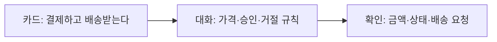
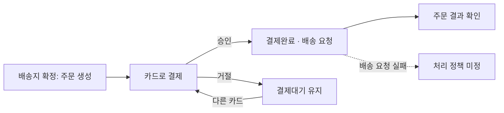
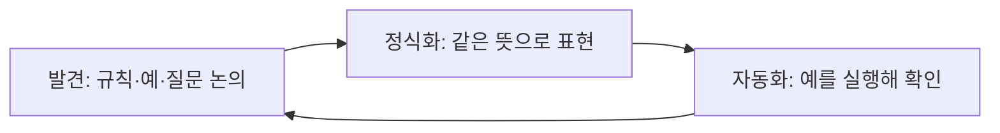
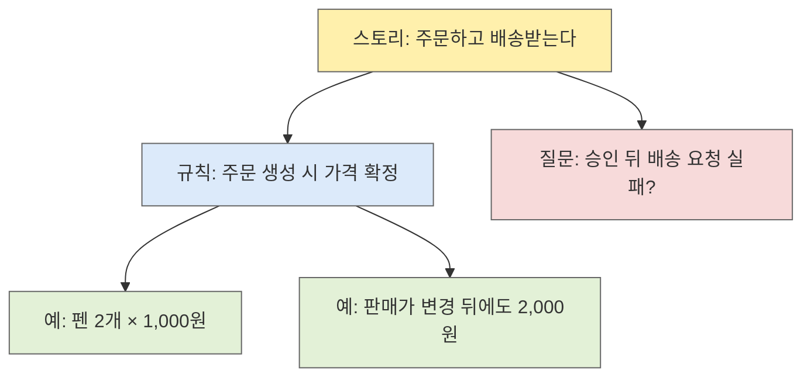
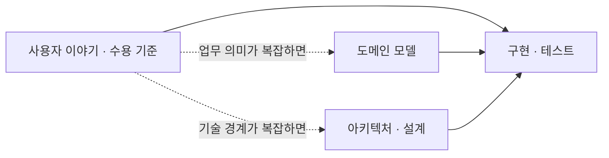

--------------------
Session 명: 03. 요구와 수용 기준
--------------------

## 목차

01. 세션 목표
02. 문제에서 요구사항으로
03. 요구를 담는 형식
04. 사용자 이야기
05. 흐름의 분기
06. 수용 기준
07. 예로 명세하기
08. 품질 요구사항
09. 요구사항 정의서와 작업 명세서
10. 명세 주도 개발
11. 시연 — LLM이 쓴 요구 초안
12. 잘못된 관행
13. 실습 3 — 요구사항 정의서와 수용 기준
14. 요약

## 01. 세션 목표

**요구는 사람이 정하고**, 받아들일 조건은 **관찰 가능한 기대값**으로 작성한다.

- 문제·요구·요구사항·해결책을 **구분**한다.
- 사용자 이야기를 **대화와 확인**으로 구체화한다.
- 흐름의 분기에서 **범위·제외·미정**을 구분한다.
- 업무 규칙을 **수용 기준과 구체적인 예**로 작성한다.
- 명세·모델·설계와 **SDD·온톨로지의 관계**를 설명한다.
- LLM 초안의 추측을 고쳐 **요구사항 정의서**를 완성한다.

**강사 노트**

- 1시간 30분 세션이다. "세션 02. LLM이라는 재료"가 맡기는 형태를 골랐다면, 이제 무엇을 맡기고 무엇으로 받아들일지 정한다.
- 정적·동적 모델과 설계의 상세를 앞당기지 않는다. 요구에서 합의한 결과가 뒤 모델·검사의 입력이 된다.

---

## 02. 문제에서 요구사항으로

## 문제·요구·요구사항·해결책

**원하는 결과**와 그것을 실현할 **해결책**을 구분해야 요구사항을 정할 수 있다.

**인용문**

요구사항은 시스템이 따라야 할 **능력과 조건**이다, "Requirements are capabilities and conditions to which the system … must conform", [Larman 2004]

**표 — 요청을 구체화하는 네 관점**

| 관점 | 확인할 질문 | 주문 사례 |
|---|---|---|
| **문제·기회** | 무엇을 바꾸려는가? | 주문 과정에서 해결할 불편·손실 |
| **요구** | 누가 어떤 결과를 원하는가? | 고객이 상품을 결제하고 배송받음 |
| **요구사항** | 시스템이 무엇을 충족하는가? | 승인 뒤에만 배송을 요청함 |
| **해결책** | 어떻게 실현하는가? | 연동 구조·사용할 기술 |

- **요청 한 줄**에 없는 도입 이유나 비용 절감 효과를 지어내지 않는다. 필요한 이유는 업무 담당자에게 묻는다.
- **화면·기술 이름**을 먼저 정해도 가격 확정 시점이나 거절 뒤 결과는 정해지지 않는다.

**강사 노트**

- Larman 원문의 요구사항 정의를 확인했다. 네 관점의 비교는 sw-engineering-principles.md를 주문 사례에 적용한 것이다.
- 자체 시스템 도입 배경은 과정 설계에 있지만 구체적인 장애·손실 수치는 없다. 설명을 위해 가공한 사업 문제를 추가하지 않는다.

---

## 업무 규칙 찾기

요청에서 답하지 않은 **업무 규칙**은 구현 전에 **업무 담당자에게 묻는다**.

> 장바구니에 담은 상품을 결제하면 주문이 되고 배송이 시작되게 해 주세요.

**표 — 요청에 빠진 질문과 합의한 규칙**

| 질문 | 업무 담당자의 답 | 확인할 예 |
|---|---|---|
| 언제의 가격으로 청구하는가? | 주문 생성 시점 판매가 | 판매가 변경 뒤에도 2,000원 |
| 언제 배송을 요청하는가? | 결제가 승인된 뒤 | 거절이면 배송 요청 0회 |
| 거절된 주문은 어떻게 하는가? | 결제대기 유지·다른 카드 허용 | 같은 주문으로 다시 결제 |

- **주문 생성**은 배송지를 확정한 때이고, **결제 승인**은 생성된 주문의 결제를 마치는 사건이다.
- **확정하지 못한 정책**은 질문으로 남긴다. 승인 뒤 배송 요청 실패를 임의로 취소나 자동 재요청으로 바꾸지 않는다.

**강사 노트**

- 세 규칙과 주문 생성 시점은 course-design.md 공통 전제다. 규칙을 개발자나 LLM이 정한 것으로 설명하지 않는다.
- "세션 01. 사람의 일과 AI의 일"의 「02. 첫 시도」에서 잘못된 코드와 테스트가 함께 통과한 이유를 이 빈 결정에 연결한다.

---

## 03. 요구를 담는 형식

형식이 달라도 요구는 **사건과 그에 대한 결과**를 설명한다.

**표 — 같은 주문 장면을 표현하는 형식**

| 형식 | 중심 | 주문 장면의 표현 |
|---|---|---|
| **이벤트–반응 목록** | 사건과 시스템 반응 | 결제 승인 → 결제완료·배송 요청 |
| **유스케이스** | 목표를 이루는 상호작용 | 배송지 지정부터 결제 결과 확인까지 |
| **사용자 이야기** | 사용자가 얻는 가치 | 고객이 결제하고 상품을 배송받음 |
| **도메인 이벤트** | 업무에서 발생한 사건 | 결제되었다 |

**인용문**

도메인의 활동에 관한 정보를 **일련의 개별 이벤트**로 모델링한다, "Model information about activity in the domain as a series of discrete events.", [Evans 2015]

- **표현을 네 벌 만들 필요는 없다.** 스토리로 가치를 정하고 분기와 수용 예를 보완하면, 빠진 결과를 확인할 수 있다.
- **문형**보다 중요한 것은 배송 요청이 승인 전인지 후인지 같은 업무 의미다.

**강사 노트**

- Evans, Domain-Driven Design Reference(2015)의 Domain Event 설명에서 인용했다. 도메인 이벤트를 메시지 큐나 비동기 통신으로 한정하지 않는다.
- 유스케이스의 상세 표기법은 "객체지향 분석과 설계 실무"의 범위다. 여기서는 형식이 답하는 질문과 표현 수준을 비교한다.
- "결제되었다"는 공통 용어의 사건이다. 이 장면에 새 이벤트 타입이나 코드 이름을 만들지 않는다.

---

## 04. 사용자 이야기

## 카드·대화·확인

사용자 이야기는 **짧은 기록**으로 시작해 **대화와 확인**으로 뜻을 채운다.

**인용문**

사용자 이야기에는 **카드·대화·확인**이라는 3가지 핵심 측면이 있다, "User stories have three critical aspects. We can call these Card, Conversation, and Confirmation.", [Jeffries 2001]

**도식 — Mermaid — 사용자 이야기를 구체화하는 세 측면**



- **카드**는 대화를 시작할 만큼만 적는다. 요청 한 줄이 모든 규칙을 담았다고 보지 않는다.
- **대화**에서 주문 생성 시점과 거절 뒤 처리처럼 결과를 좌우하는 규칙을 합의한다.
- **확인**은 합의한 결과를 수용 기준과 예로 남기는 일이다. 구두로 이해했다고 끝내지 않는다.

**강사 노트**

- Jeffries, Essential XP: Card, Conversation, Confirmation(2001) 원문 확인. 화살표는 의미를 채우는 관계이며 한 번만 거치는 고정 개발 단계가 아니다.
- 스토리의 문형과 속성은 뒤 항목에서 다룬다. 세 측면의 정의를 그 항목마다 반복하지 않는다.

---

## 문형과 가치

사용자 이야기의 문형은 **누가 무엇을 왜 원하는지** 드러내는 출발점이다.

```text
고객으로서
선택한 상품의 배송지를 정하고 카드로 결제하고 싶다.
상품을 주문하고 배송받기 위해서다.
```

- **역할**은 고객이고, **원하는 결과**는 상품을 주문하고 배송받는 것이다. 화면의 버튼이나 구현 클래스를 스토리의 중심으로 삼지 않는다.
- **문형을 채웠어도** 가격 확정·승인 전 배송 금지·거절 뒤 재결제는 아직 빠져 있다. 규칙과 수용 기준으로 보완한다.
- **기술 작업**은 구현을 위한 일이다. "결제 연동 클래스를 만든다"만으로 고객이 얻는 가치를 대신하지 않는다.

**강사 노트**

- 역할·행동·이유를 드러내는 문형을 주문 사례에 적용했다. 반드시 이 세 줄이나 특정 문구로만 써야 사용자 이야기가 된다는 규칙으로 제시하지 않는다.
- 사용자 이야기 하나가 구현 작업 하나라는 뜻은 아니다. 구현 단위는 "세션 07. 설계 — 책임과 협력"에서 나눈다.

---

## INVEST

좋은 스토리는 **가치를 전달하는 작은 단위**이며, **확인할 수 있어야 한다**.

**인용문**

스토리 카드를 쓴다는 것은 **원하는 것을 충분히 이해해 테스트를 쓸 수 있다**는 암묵적 약속이다, "Writing a story card carries an implicit promise: \"I understand what I want well enough that I could write a test for it.\"", [Wake 2003]

**표 — INVEST로 주문 스토리 점검하기**

| 속성 | 뜻 | 점검 |
|---|---|---|
| **Independent** | 독립적 | 다른 스토리와의 의존을 줄임 |
| **Negotiable** | 협상 가능 | 구현을 고정하지 않고 대화함 |
| **Valuable** | 가치 있음 | 고객의 주문 완료에 기여함 |
| **Estimable** | 추정 가능 | 미정과 복잡성을 드러냄 |
| **Small** | 작음 | 이번에 끝낼 범위를 한정함 |
| **Testable** | 테스트 가능 | 승인·거절의 결과를 확인함 |

- **작게 만든다**고 화면·DB·연동 작업을 각각 고객 스토리로 바꾸지 않는다. 가치를 유지한 채 범위와 조건을 줄인다.

**강사 노트**

- Wake, INVEST in Good Stories, and SMART Tasks(2003)에서 여섯 속성과 Testable의 인용을 확인했다. 오른쪽 점검은 주문 사례에 적용한 것이다.
- "주문한다"는 과정의 유일한 과제다. 이 항목에서 별도 기능이나 추가 스토리를 만들지 않는다.

---

## 05. 흐름의 분기

## 기본·대안·예외

흐름의 **분기**를 따라가면 정상 승인만으로 보이지 않던 **요구**가 드러난다.

- **기본 흐름**은 고객이 배송지를 정하고 카드 승인을 받아 주문 결과를 확인하는 경로다.
- **대안 흐름**은 카드 거절처럼 결과가 달라지는 경로다. 거절되면 결제대기로 남고 다른 카드로 다시 결제한다.
- **예외 흐름**은 기대한 처리를 계속할 수 없는 경로다. 승인 뒤 배송 요청 실패는 처리 정책이 미정이다.

**도식 — Mermaid — 주문 결제의 분기**



**강사 노트**

- 흐름은 공통 흐름 3~5의 분기를 보여 주는 개념도다. 상태 기계나 통신 프로토콜이 아니다. 상태 전이의 상세는 "세션 05. 동적 모델"이 맡는다.
- 대안·예외의 명칭보다 각 경우의 결과가 확정됐는지 묻는 것이 중요하다. 거절은 알려진 반응이고, 배송 요청 실패의 후속 반응은 아직 모른다.
- 가격 변경은 별도 고객 행동이 아니라 같은 결제 흐름에서 금액 규칙을 확인하는 전제다.

---

## 범위·제외·미정

**제외**는 이번에 하지 않기로 한 것이고, **미정**은 아직 답하지 못한 것이다.

**표 — 주문한다에서 약속하는 범위**

| 구분 | 내용 | 요구사항에 남길 것 |
|---|---|---|
| **범위** | 배송지 확정부터 카드 결제까지 | 기본·거절·재결제의 기대 결과 |
| **제외** | 취소·환불·배송 진행 | 이번 기능에 넣지 않는다고 명시 |
| **미정** | 승인 뒤 배송 요청 실패 | 정책 질문과 미확정 사실 |

- **이번 범위**에는 승인 뒤 배송 요청을 보내는 것까지 포함한다. 실제 배송 진행은 외부 배송 시스템이 맡는다.
- **미정을 제외로 숨기지 않는다.** 승인 뒤 실패를 어떻게 처리할지 모른다는 사실이 사라지면 AI가 취소나 재요청을 추측한다.
- **확정된 결과**는 남기고, **미정인 후속 처리**만 질문으로 둔다. 취소·재요청 정책을 기대값으로 지어내지 않는다.

**강사 노트**

- 배송 요청 실패는 "세션 11. 종합 실행"에서 발견과 되돌림을 다루도록 공통 전제에 남아 있다. 그 전에는 기대 상태나 자동 복구 정책을 만들지 않는다.
- 앞 항목은 분기를 찾는 일이고 이 항목은 각 분기를 어디까지 약속할지 정하는 일이다. 같은 흐름도를 반복하지 않는다.

---

## 06. 수용 기준

## 결과를 받아들일 조건

수용 기준은 **구현 방법**이 아니라 **받아들일 결과**를 정한다.

**인용문**

스토리의 행동은 **수용 기준**이며, 시스템이 기준을 모두 충족하면 올바르게 행동하고 그렇지 않으면 올바르지 않은 것이다, "A story’s behaviour is simply its acceptance criteria: if the system fulfils all the acceptance criteria, it’s behaving correctly; if it doesn’t, it isn’t", [North 2006]

**표 — 모호한 판단을 관찰할 결과로**

| 모호한 표현 | 수용 기준 |
|---|---|
| **금액이 정확하다** | 주문 후 판매가가 바뀌어도 2,000원 청구 |
| **거절을 처리한다** | 결제대기 유지·배송 요청 0회 |
| **다시 결제할 수 있다** | 같은 주문을 다른 카드로 승인 가능 |

- **허용과 금지**를 함께 확인한다. 거절 뒤 상태만 맞아도 배송 요청이 잘못 나갔을 수 있다.
- **기대값의 근거**는 업무 담당자가 정한 규칙이다. 구현이 낸 결과를 그대로 기대값으로 복사하지 않는다.
- **세 특성으로 판정한다** — 좋은 요구사항의 자격요건 가운데 수용 기준에 바로 쓰이는 셋이다.
  - **검증 가능함** — 충족 여부를 증명·측정할 수 있게 작성했는가?
  - **명확함** — 하나로만 해석되게 작성했는가?
  - **단일함** — 한 가지 결과만 기술하는가?

**강사 노트**

- North, Introducing BDD(2006), 제공받은 원문으로 확인했다. 인용에서 말하는 올바름은 주어진 수용 기준의 충족 범위다. 기준 자체의 누락까지 없다는 뜻은 아니다.
- 수용 기준은 조건이고 수용 테스트는 그 조건을 실행해 확인하는 수단이다. 구체적인 테스트 구현은 뒤 세션이 맡는다.
- 세 특성의 이름은 ISO/IEC/IEEE 29148:2018의 개별 요구사항 특성에서 가져왔다. 열네 특성 전부는 "객체지향 분석과 설계 실무"가 좋은 요구사항의 자격요건으로 다루고, 이 과정은 수용 기준을 판정하는 셋만 쓴다. 표준 본문은 유료라 공식 미리보기의 목차로 절의 구분만 확인했으므로 그 범위의 주장만 한다.
- 모호한 표현의 왼쪽 열은 세 특성 중 명확함·검증 가능함을 어긴 예다. 수강생에게 어느 특성을 어겼는지 먼저 묻는다.

---

## 4가지 대표 예

대표 예는 **규칙이 서로 다른 결과를 만드는 장면**에서 고른다.

**표 — 주문의 수용 예 4가지**

| 예 | 전제·사건 | 기대 결과 |
|---|---|---|
| **승인** | 펜 2개·각 1,000원·카드 승인 | 2,000원·결제완료·서울 배송 요청 1회 |
| **가격 변경** | 주문 뒤 판매가 1,200원·결제 | 청구 금액은 2,000원 |
| **거절** | 카드 X로 결제·거절 | 결제대기·배송 요청 0회 |
| **재결제** | X 거절 뒤 같은 주문을 Y로 승인 | 결제완료·배송 요청 총 1회 |

- **전제**를 고정한다. 배송지 서울을 확정할 때 주문이 생기고 금액 2,000원이 결정된다.
- **누락한 경로**가 첫 시도의 오류를 숨긴다. 승인만 확인하면 가격 변경·거절·재결제의 잘못을 잡을 수 없다.
- **배송 요청 실패 뒤의 처리**는 기대값으로 지어내지 않는다. 정책 합의가 먼저다.

**강사 노트**

- 네 예는 공통 전제의 업무 규칙 3가지를 관찰하는 대표 예다. 모든 입력·장애 조합을 검증했다는 뜻이 아니다.
- 가격 변경 예도 결제 시스템이 승인하는 조건이다. 금액이 바뀌지 않는지를 분리해 확인한다.

---

## 07. 예로 명세하기

## BDD

업무 담당자와 개발자는 **구체적인 예**로 **기대 행동**을 합의한다.

**인용문**

BDD는 **업무 담당자와 기술 담당자 사이의 간극**을 줄이는 소프트웨어 팀의 협업 방식이다, "BDD is a way for software teams to work that closes the gap between business people and technical people", [Cucumber]

**도식 — Mermaid — BDD의 협업 활동**



- **발견**에서는 가격을 언제 확정하는지 묻고, **정식화**에서는 가격 변경 뒤에도 청구할 금액을 적는다.
- **자동화**는 합의한 뜻을 확인한다. 테스트를 통과시키려고 기대값부터 고치면 합의가 사라진다.
- **행위 주도 개발(BDD)**은 협업 방식이다. Gherkin 문법이나 특정 테스트 도구를 사용한다는 사실만으로 완성되지 않는다.

**주석**

BDD — Behaviour-Driven Development

**강사 노트**

- Cucumber 공식 BDD 문서의 정의를 원문 확인했다. Discovery·Formulation·Automation은 그 문서의 세 활동이다. 그림은 주문 사례에 적용했다.
- "카드·대화·확인"은 사용자 이야기의 세 측면이고, 이 항목은 업무와 개발이 예를 발견하고 실행 가능한 확인으로 이어 가는 협업을 설명한다.

---

## 예시 매핑

**규칙을 예로 설명**하고, 설명하지 못한 것은 **질문**으로 남긴다.

**인용문**

예시 매핑은 이 대화를 **짧고 생산적으로** 만들도록 설계된 방법이다, "Example Mapping is a method designed to make this conversation short and very productive.", [Cucumber: Example Mapping]

**도식 — Mermaid — 주문 스토리의 규칙·예·질문**



- **같은 규칙 아래의 예**를 비교한다. 가격이 바뀌기 전후에도 2,000원이어야 한다는 뜻을 맞춘다.
- **답하지 못한 질문**을 새 규칙처럼 만들지 않는다. 배송 요청 실패의 처리는 미정으로 남긴다.

**강사 노트**

- Cucumber Example Mapping의 스토리 노랑·규칙 파랑·예 초록·질문 빨강을 원문으로 확인했다. 카드 색을 외우는 것이 목표가 아니라 규칙·예·질문의 연결이 목표다.
- this conversation은 수용 기준을 논의하는 대화를 가리킨다. 그림은 세 규칙 중 금액 규칙과 남은 질문을 대표로 보인 것이다.

---

## 전제·사건·기대 결과

실행 예는 **어떤 상황에서 무엇이 일어나면 어떤 결과가 필요한지** 적는다.

**인용문**

**초기 맥락**이 주어지고 **사건**이 발생하면 **결과**를 확인한다, "Given some initial context (the givens), When an event occurs, Then ensure some outcomes", [North 2006]

```gherkin
Scenario: 거절 뒤 다른 카드로 결제한다
  Given 펜 2개, 주문 시 판매가 1000원, 배송지 서울의 결제대기 주문
    And 카드 X는 거절되고 카드 Y는 승인된다
  When 카드 X로 결제한 뒤 같은 주문을 카드 Y로 다시 결제한다
  Then 같은 주문은 결제완료다
    And 청구 금액은 2000원이다
    And 서울로의 배송 요청은 모두 합해 1회다
```

- **전제**는 상황, **사건**은 행동, **기대 결과**는 관찰할 금액·상태·외부 요청이다.
- **재결제 예**만으로 거절 직후의 결과를 대신하지 않는다. 거절 예에서 결제대기와 배송 요청 0회도 따로 확인한다.

**강사 노트**

- North 원문의 상황·사건·결과 문형을 적용했다. Gherkin은 요구 예의 표현이며 이 세션에서 실행 코드를 만들었다는 뜻이 아니다.
- 도구 설치나 스텝 정의 구현은 다루지 않는다. 업무 수준의 사건을 UI 클릭이나 DB 필드 변경으로 바꾸지 않는다.

---

## 08. 품질 요구사항

요구가 어떤 결과를 제공할지 정한다면, 품질 요구는 그 결과를 **어떤 조건에서 어느 수준으로** 제공할지 정한다.

**표 — 품질 요구를 검증 가능하게**

| 품질 관점 | 요구 후보 | 검증 가능하게 만들기 위한 질문 |
|---|---|---|
| **응답 성능** | 주문이 빠르게 처리된다 | 부하·측정 구간·허용 지연은? |
| **접근 통제** | 남의 주문을 바꿀 수 없다 | 누가 어떤 주문에 무엇을 하는가? |
| **장애 대응** | 요청 실패에도 주문이 남는다 | 유실의 정의와 후속 정책은? |

- **좋은 상태라는 표현으로 두지 않는다** — 세 관점 모두 조건과 측정 가능한 기준으로 바꿔야 검사가 된다.
- **응답 성능**은 측정의 시작·끝, 요청 부하, 외부 시스템의 응답 조건을 함께 정한다. 목표 시간과 그 안에 끝나야 할 비율을 합의한다.
- **접근 통제**는 누가 어떤 주문에 어떤 행동을 할 수 있는지 정한다. 본인 확인과 결제대기 주문의 변경 허용 여부는 서로 다른 규칙이다.
- **장애 대응**은 실패한 지점과 지켜야 할 결과를 정한다. 배송 요청 실패 뒤 취소·재요청 여부는 업무 담당자의 결정이 필요하다.

**강사 노트**

- 수치는 course-design.md의 실습 품질 기준이다. 실제 운영 서비스의 성능 측정값이나 보장 수치가 아니다.
- 강의 시연의 회의 메모에는 품질 목표가 없다. 동시 100건·외부 응답 1초·95% 이상 3초는 실습의 정상 시험 조건이며 강의 사례의 확정 요구가 아니다. 본문은 목표를 합의할 때 필요한 조건을 설명하고 실습 수치를 가져오지 않는다.
- 동시 요청 수와 외부 응답은 재현 조건이다. 측정 구간은 카드 결제 요청부터 결과 수신까지로 실습 대화에서 확인한다.
- 품질 관점의 이름과 검증 가능하게 만드는 질문은 "객체지향 분석과 설계 실무"의 품질속성 취급과 같게 쓴다. 기준은 ISO/IEC 25010:2023의 품질 모델이며, 표준 본문이 아니라 공식 초록의 범위만 확인했으므로 그 범위의 주장만 한다.
- 그 과정이 함께 다루는 사용 편의·변경 용이성은 주문한다의 범위에 없어 제외했다. 세 관점만으로 설명이 성립한다.
- 관점의 이름은 인용한 품질 모델의 특성을 이 과정의 말로 옮긴 것이다. 근거 없이 측정 수치나 서비스 수준을 확정하지 않는다.

---

## 09. 요구사항 정의서와 작업 명세서

## 범위와 수명

요구사항 정의서는 **시스템의 요구**를 유지하고, 작업 명세서는 **현재 구현할 범위**와 확인할 결과를 정한다.

**표 — 두 명세 문서의 범위와 수명**

| 문서 | 범위 | 담거나 가리키는 것 | 수명 |
|---|---|---|---|
| **요구사항 정의서** | 시스템 전체 | 기능·규칙·품질·용어 | 변경하며 유지 |
| **작업 명세서** | 현재 구현할 작업 | 관련 요구·수용 기준·원천 참조 | 해당 작업 동안 |

- **명세**는 대상의 성질과 충족할 조건을 명확히 적은 것이다. "정확히 계산한다"보다 가격 확정 시점과 계산 규칙이 있어야 구현과 검사가 가능하다.
- **작업 명세서**는 기존 정의서·모델·설계를 가리킨다. 같은 업무 규칙을 따로 복제해 두면 변경할 때 어긋난다.
- **이름이 다른 문서**를 늘리는 것보다 현재 작업에 빠진 결정을 확인한다. 스토리 하나로 충분하면 별도 작업 문서를 만들 필요는 없다.

**강사 노트**

- 범위·수명과 참조 방식은 sw-engineering-principles.md의 요구에서 코드까지의 경로를 따른다. 어떤 SDD 도구의 디렉터리 구조도 표준으로 삼지 않는다.
- 기능이 하나인 첫 정의서와 그 기능의 작업 명세서는 내용이 많이 겹칠 수 있다. 그렇다고 두 문서의 범위가 같은 개념이 되는 것은 아니다.

---

## 주문한다의 요구사항 정의서

요구사항 정의서는 **스토리·규칙·용어·품질·범위와 미정**을 함께 보존한다.

**문서 형식 — 10pt**

### 목적과 범위

- 고객이 **배송지를 확정하고 카드 결제를 마친다**. 상품·결제·배송은 외부 시스템이다.
- **취소·환불·배송 진행**은 제외한다. 화면·기술 설계는 이 문서에서 정하지 않는다.

### 사용자 이야기

- 고객으로서 선택한 상품의 배송지를 정하고 **카드로 결제해 배송받고 싶다**.

### 기능과 흐름

1. 배송지를 확정하면 주문이 결제대기로 생긴다.
2. 카드 승인을 요청한다. 승인되면 결제완료가 되고 배송을 요청한다.
3. 거절되면 결제대기로 남고 같은 주문을 다른 카드로 다시 결제할 수 있다.
4. 고객은 주문 결과를 확인한다.

### 업무 규칙

- **주문 금액**은 주문 생성 시점의 판매가와 수량으로 정하고 이후 판매가가 바뀌어도 유지한다.
- **배송 요청**은 승인 뒤에만 한다. 거절된 주문을 취소하지 않는다.

### 용어집의 시작

- **주문**(Order): 배송지 확정 시 생기는 주문. 승인 전에는 결제대기다.
- **주문 항목**(OrderItem): 주문한 상품과 수량에 관한 항목이다.
- **판매가**(salePrice): 상품 시스템이 제공하는 현재 가격이다.
- **주문 금액**(totalAmount): 주문 생성 시 가격으로 확정한 금액이다.

### 수용 기준의 대표 예

- **승인**: 펜 2개·각 1,000원·서울 → 2,000원 청구·결제완료·배송 요청 1회.
- **가격 변경**: 주문 후 판매가 1,200원 → 청구 금액 2,000원 유지.
- **거절**: 결제대기 유지·배송 요청 0회. 다른 카드 승인 뒤에는 같은 주문이 결제완료다.

### 품질과 미정

- **응답시간**의 측정 조건·목표와 **접근 권한**의 사용자·허용 행동은 업무 담당자에게 확인한다.
- **승인 뒤 배송 요청 실패**의 후속 처리는 미정이다. 취소·재요청을 임의로 정하지 않는다.

**강사 노트**

- 문서 형식의 강의 예다. course-design.md 공통 전제만 담고 실습 1의 별도 미정 H·B·F·E·G·I를 강의 정책으로 가져오지 않는다.
- 용어집의 영문명은 공통 영한 용어집을 따른다. 모델에서 가격의 현재 값과 확정 값을 구분하는 상세는 "세션 04. 정적 모델"에서 이어 간다.
- 수용 기준 전체의 대표 네 예는 「06. 수용 기준」의 「4가지 대표 예」에서 확인한다. 문서 예는 거절과 재결제를 한 항목에 이어 적었다.

---

## 요구에서 코드까지

수용 기준은 **코드로 가는 모든 경로**에 필요하고, 모델과 아키텍처는 **복잡성에 따라 더한다**.

**도식 — Mermaid — 요구에서 구현·검증으로 가는 경로**



- **작은 변경**은 스토리와 수용 예로 충분할 수 있다. 모델을 만들기 위한 모델을 추가하지 않는다.
- **가격의 시점과 상태의 의미**가 혼동되면 도메인 모델이 필요하다. 외부 연동의 책임·경계는 설계가 정한다.
- **화살표는 입력 관계**다. 모든 프로젝트가 동일한 문서 순서를 거쳐야 한다는 뜻이 아니다.

**강사 노트**

- sw-engineering-principles.md의 도메인·기술 복잡성 두 축을 따른다. 실습의 작은 작업도 수용 기준과 검사는 빠지지 않는다.
- 도메인 모델은 "세션 04. 정적 모델"·"세션 05. 동적 모델", 아키텍처와 설계는 "세션 06. 아키텍처"·"세션 07. 설계 — 책임과 협력"이 상세화한다.

---

## 10. 명세 주도 개발

## 기존 분석·설계와 SDD

SDD는 **기존 요구 명세·분석·설계**를 AI 구현의 입력으로 사용하는 접근이다.

**인용문**

명세 주도 개발은 AI로 코드를 쓰기 전에 **명세를 쓰는 것**이며, 명세가 사람과 AI의 **사실의 원천**이 된다, "Spec-driven development means writing a \"spec\" before writing code with AI (\"documentation first\"). The spec becomes the source of truth for the human and the AI", [Böckeler 2025]

**표 — 기존 공학 활동과 SDD에서 읽는 내용**

| 기존 활동 | 결정 | AI가 읽는 내용 |
|---|---|---|
| **요구 확인** | 원하는 결과·이유 | 업무 조건·사용자 이야기 |
| **요구사항 명세** | 기능·규칙·품질·기대 결과 | 정의서·작업 명세서 |
| **도메인 분석** | 업무 개념·관계·규칙 | 도메인 모델·용어집 |
| **설계** | 책임·협력·경계 | 설계·연동 규격·의존 규칙 |
| **검증** | 결정을 확인하는 조건 | 수용 기준·검사 결과 |

**강사 노트**

- Böckeler의 SDD 작업상 정의를 원문 확인했다. 기존 공학 활동에 대한 대응은 sw-engineering-principles.md와 승인된 과정의 원전 적용 결정이다.
- 모든 분석·설계 산출물을 하나의 요구사항 명세로 취급하지 않는다. 사용자 요청은 새 용어가 별개 체계로 읽히는 혼선을 막는 것이며 활동의 책임 구분을 없애는 것이 아니다.

---

## 명세·모델·온톨로지의 위치

요구사항은 **필요한 결과**, 도메인 모델과 온톨로지는 **개념의 의미**, 설계는 **실현 방법**을 명시한다.

**인용문**

온톨로지는 **개념화의 명시적 명세**다, "An ontology is an explicit specification of a conceptualization.", [Gruber 1993]

**표 — 무엇을 명시하는가?**

| 표현 | 질문 | 주문의 예 |
|---|---|---|
| **요구사항 명세** | 어떤 결과가 필요한가? | 가격이 바뀌어도 2,000원 청구 |
| **도메인 모델** | 그 결과가 업무에서 무슨 뜻인가? | 현재 가격과 주문 시점 값의 구분 |
| **온톨로지 관점** | 개념과 관계의 의미가 분명한가? | 상품·주문 항목·금액의 의미 |
| **설계** | 누가 어떻게 실현하는가? | 가격 보존·계산의 책임과 협력 |

- **온톨로지의 명세**는 개념의 의미를 명시한다는 뜻이다. 요구사항 정의서와 같은 문서라는 뜻이 아니다.
- **도메인 모델과 온톨로지**는 업무 의미를 명시하는 관심이 겹친다. 같은 업무를 두 벌로 다시 작성하는 단계로 만들지 않는다.
- **같은 spec에 담더라도** 요구·모델·설계·검사의 역할은 구분한다.

**강사 노트**

- Gruber, A Translation Approach to Portable Ontology Specifications(1993) 원문 확인. 온톨로지와 도메인 모델이 모든 분야에서 동일한 산출물이라는 주장은 하지 않는다.
- "specification"은 정밀하게 표현했다는 성질이며 대상에 따라 요구사항의 명세·개념화의 명세가 된다. 이 교재는 SDD의 요구 명세와 분석·설계의 산출물을 구분한다.
- 온톨로지의 위치는 여기서 밝히고 개념 모델의 상세는 "세션 04. 정적 모델"이 맡는다. 형식 언어·추론 엔진은 범위 밖이다.

---

## 명세의 적정 수준

명세의 상세함은 **구현과 검사에 필요한 결정**을 기준으로 정한다.

**인용문**

요구 문서는 이 작은 버그를 **사용자 이야기 4개와 수용 기준 16개**로 바꾸었다, "The requirements document turned this small bug into 4 \"user stories\" with a total of 16 acceptance criteria", [Böckeler 2025]

- **문서의 분량**보다 빠진 결정을 본다. 가격 확정 시점이 없으면 항목을 늘려도 가격 변경 뒤의 청구 금액을 판단할 수 없다.
- **주문 금액 규칙**을 정의서·작업 명세서·모델마다 문장으로 복제하면 변경할 원천이 늘어난다. 원천은 유지하고 필요한 곳에서 가리킨다.
- **미정인 정책**은 자세히 작성하는 것으로 해결되지 않는다. 승인 뒤 배송 요청 실패의 처리는 업무 담당자에게 물어야 한다.
- **구현·검사에서 발견한 것**은 원인이 된 결정으로 되돌린다. 먼저 작성했다는 이유로 명세를 영원히 고정하지 않는다.

**강사 노트**

- Böckeler 원문의 도구 사용 경험 중 문서 과잉 사례다. 그 통계를 일반화하거나 새 도메인 사례로 전개하지 않는다.
- 요구사항 정의서는 유지하되 작업 문서는 수명과 효용을 보고 남긴다. 이 판단을 spec 파일을 무조건 유지·재생성하는 규칙으로 바꾸지 않는다.

---

## 11. 시연 — LLM이 쓴 요구 초안

## 초안이 남긴 질문

요구 초안의 가치는 **빈칸을 그럴듯하게 채우는 대신 질문으로 드러내는 데** 있다.

- **요청과 회의 메모**를 받은 LLM은 규칙을 정리하고, **주문 생성 시점·상태·실패 처리·범위**에서 확인할 질문을 남겼다.

**표 — 실제 초안이 남긴 질문의 발췌**

| 초안의 질문 | 드러난 빈 결정 |
|---|---|
| 주문은 정확히 언제 생기나요? | 요청과 회의 메모의 생성 시점 |
| 결제가 승인된 뒤의 상태 이름은 무엇인가요? | 승인 결과를 표현할 업무 상태 |
| 배송 요청이 실패하면 다시 요청하나요? | 실패 뒤 처리 정책 |
| 주문 취소·환불·배송지 변경이 범위에 들어가나요? | 이번에 약속할 기능의 경계 |

- **질문을 남겼다는 사실**도 검토한다. 알려 준 조건을 놓쳐 다시 묻는지, 근거 없는 규칙을 추가했는지 함께 확인한다.

**강사 노트**

- 실제 기록: code/s02/demo-results/prompt.txt·draft.md·result.json·README.md. 최초 실행 위치를 보존해 provenance가 바뀌지 않게 했다.
- 본문 시연은 2026-10 기준이다. 실제 초안은 규칙 3가지와 질문 15가지를 담았다. 실행일 2026-10-18, Claude Code 2.1.302(claude -p, 도구 없음), claude-opus-5-5. 46.0초·출력 4,668토큰은 그 실행 한 번의 기록이며 이번 작성일의 재실행이 아니다.
- 질문은 원문을 발췌하되 표에서는 문장 일부를 짧게 표시했다. 15가지 전체와 초안의 용어·규칙은 원본에 있다. 실제 LLM 응답 전문인 별첨과 달리 이 항목은 시연 설명이다.

---

## 사람이 답한다

**사람이 답한 조건**은 요구에 반영하고, **답하지 못한 정책**은 미정으로 유지한다.

**표 — 질문에 대한 사람의 결정**

| 질문 | 업무 담당자의 결정 | 반영할 곳 |
|---|---|---|
| **주문 생성 시점** | 배송지를 확정할 때 | 용어·기능 흐름 |
| **승인 뒤 상태** | 결제완료 | 수용 기준 |
| **취소·환불** | 이번 범위에서 제외 | 제외 범위 |
| **배송 요청 실패** | 아직 정하지 못함 | 미정 질문 |

- **요청의 "결제하면 주문이 된다"**를 그대로 복사하지 않는다. 승인 전에 결제대기 주문이 있어야 거절 뒤 같은 주문을 다시 결제할 수 있다.
- **결정은 관련 예에도 반영**한다. 주문 생성 시 가격을 확정했다면 가격 변경 예의 기대값도 2,000원이다.
- **미정이 남아 있으면** 그 경우까지 구현·완료했다고 주장하지 않는다. 필요한 정책은 업무 담당자에게 되돌린다.

**강사 노트**

- 답은 code/s02/demo-results의 초안이 스스로 정한 것이 아니다. course-design.md 공통 전제에 확정된 강의의 업무 결정을 적용했다.
- 실습 1에는 강의보다 많은 미정 사항이 있다. 강의의 이 답을 실습의 미정 정책 전부에 대한 답으로 복사하지 않는다.

---

## 12. 잘못된 관행

**템플릿 작성·테스트 통과**만으로 요구의 합의를 보장하지는 못한다.

**표 — 요구 명세의 잘못된 관행**

| 관행 | 놓치는 것 | 수정 |
|---|---|---|
| **요청을 그대로 명세로** | 가격·승인·거절의 규칙 | 사건과 기대 결과를 질문 |
| **문형만 채우기** | 대화와 수용 기준 | 구체적인 예로 뜻을 합의 |
| **승인 예만 확인** | 가격 변경·거절·재결제 | 규칙을 구분하는 대표 예 추가 |
| **미정을 제외로 바꾸기** | 아직 답하지 못한 정책 | 질문과 미확정 사실 유지 |
| **spec에 모두 복제** | 명세·모델·설계의 책임 | 대상과 원천을 구분해 참조 |

- **명세의 빈칸**은 구현과 검사에도 번진다. 구현이 잘못됐을 때 요청을 반복하기보다 빠진 결정과 기대값을 고친다.

**강사 노트**

- 「10. 명세 주도 개발」의 구분을 적용해 spec이라는 이름만으로 새 문서를 추가하거나 모든 모델을 넣지 않게 한다.
- 수용 기준이 정해졌어도 그 기준을 확인하는 테스트가 맞는지는 별도 검증이 필요하다. 구체적인 검사 구성은 "세션 09. 검사 파이프라인"이 맡는다.

---

## 13. 실습 3 — 요구사항 정의서와 수용 기준

②~④에는 **질문의 답과 수정 요청**을 함께 적어 초안을 완성한다.

**투입물**
  + 실습 1의 **업무 조건**(`주문한다-업무조건.md`)과 실습 2의 **활용 방식 판단**(`활용-방식-판단.md`)

**프롬프트 — 요청사항 포함**
  + ① "실습 1의 업무 조건을 읽고 "주문한다"의 요구사항 정의서 초안을 제안해라. **사용자 이야기 하나·규칙·용어·흐름·수용 기준**을 담고 없는 정책은 질문해라. 모델·설계·코드는 만들지 마라."
  + ② "[앞선 질문에 대한 답]과 [추가 질문·수정 요청]을 적는다. **범위·제외·미정**을 구분하고 업무 조건에 없는 시점·상태·후속 처리를 임의로 정하지 마라."
  + ③ "[앞선 질문에 대한 답]과 [추가 질문·수정 요청]을 적는다. **승인·가격 변경·거절·재결제**의 전제와 금액·상태·배송 요청 기대값을 구체화해라."
  + ④ "[앞선 질문에 대한 답]과 [추가 질문·수정 요청]을 적는다. **품질 기준의 조건과 확인 방법**을 보완하고 불가피한 미정만 이유와 함께 남겨라."
  + ⑤ "합의한 요구사항 정의서를 간결한 **Markdown 파일**로 생성해라. 스토리·기능과 흐름·업무 규칙·용어·품질·수용 기준·범위·제외·미정을 담고 새 정책이나 설계를 추가하지 마라."

**점검 항목**
  1. **근거** — 실습 1에 없는 정책을 확정했는가?
  2. **경계** — 범위·제외·미정이 구분되는가?
  3. **기대값** — 금액·상태·배송 요청으로 확인할 수 있는가?
  4. **품질** — 시험 조건과 관찰할 결과가 명확한가?
  5. **원천** — 용어·규칙·예가 일치하고 모델·설계가 섞이지 않았는가?

**결과물**
  + `주문한다-요구사항-정의서.md` — 수용 기준을 담아 저장소의 `docs`에 두고 커밋한다. **실습 4의 투입물**이며 그 뒤로도 업무 의미를 분석하는 입력이다

**강사 노트**

- 실습 2에서 고른 대화형 보조 방식으로 초안마다 사람이 검토한다. 실제 입력·응답·실행 근거는 code/s03/exercise-conversation/order/에 남긴다.
- ①에는 실습 1의 실제 최종 MD를 첨부한다. ②~④는 보완 단계이며 받은 질문에 답한 뒤 다음 요청을 쓴다. 필요하면 반복하고 ⑤로 합의만 파일화한다.
- 기본 품질 조건은 course-design.md의 실습 품질 기준이다. 상품·수량·주소와 운영 정책은 수강생이 정한다. 강사 예시는 펜 2개·각 1,000원·서울이다.
- 실습 1의 H·B·F·E·G·I는 이번에도 정책이 없으면 유지한다. 기능 목록을 만들면서 새로 발견한 질문은 근거와 함께 더하되 임의의 성공·실패로 확정하지 않는다.
- 앞 실습으로 되돌릴 발견은 이 노트에 남기고 별첨의 실제 응답을 저자가 고쳐 쓰지 않는다.

---

## 14. 요약

**원하는 결과와 범위는 사람이 정하고**, **수용 기준**으로 받아들일 조건을 남긴다.

### 요구와 수용 기준

- **사용자 이야기**는 대화로 구체화하고 구체적인 예로 확인한다.
- 흐름의 분기에서 **범위·제외·미정**을 구분한다.
- **수용 기준**은 금액·상태·외부 요청으로 관찰할 기대값이다.
- **SDD**는 기존 명세·분석·설계를 AI 구현에 사용하고, **온톨로지**는 업무 의미를 명시한다.

### 다음 세션

- "세션 04. 정적 모델" — 요구가 쓰는 **개념·관계·규칙의 의미**를 분명히 한다.

**강사 노트**

- 모델에서 보완된 것 — 용어집의 첫 항목과 요구사항 정의서가 생기고, 미정 목록이 시작된다.
- 요구사항 정의서·용어집의 시작·수용 예·미정 질문이 뒤 세션의 입력이다. 다음 세션이 현재의 미정을 대신 정하지 않게 한다.

---

## 별첨. 실습 답

## “주문한다” 요구사항 정의서

**실제 LLM 응답**

**문서 형식 — 10pt**

고객이 장바구니의 상품과 수량을 바탕으로 배송지를 지정하고, 카드 승인을 받아 주문을 성립시킨 뒤 그 결과를 확인할 때까지의 요구사항과 수용 기준을 정의한다.

### 목적과 범위

- 상품 조회와 장바구니 구성은 전제다.
- 상세 범위는 공통 흐름 3~5단계인 배송지 지정, 결제, 주문 결과 확인이다.
- 상품·결제·배송 시스템은 외부 시스템으로 연계하며 내부 기능은 재구현하지 않는다.

### 사용자 이야기

고객으로서 장바구니의 상품과 수량을 기준으로 배송지를 지정하고 카드 승인을 받아 주문을 성립시킨 뒤 그 결과를 확인하고 싶다.

### 핵심 기능과 업무 규칙

- 배송지를 지정하면 주문 생성 시점의 판매가로 주문 금액을 확정하고 `결제대기` 주문을 생성한다.
- 주문자와 수령인은 같은 사람으로 본다.
- 주문 금액은 각 주문 항목의 주문 생성 시점 판매가에 수량을 곱하여 합한 금액이다.
- 주문 생성 뒤 판매가가 변경되어도 주문 금액과 카드 승인 요청 금액은 바뀌지 않는다.
- `결제대기` 주문의 상품·수량·배송지는 변경할 수 없다. 변경하려면 새 주문을 생성한다.
- 결제 수단은 카드만 허용한다.
- 카드 승인이 거절되면 같은 주문을 `결제대기`로 유지하며 다른 카드로 재결제할 수 있다.
- 카드 승인이 완료되면 같은 주문이 성립하고 상태가 `결제완료`가 된다.
- 배송 요청은 카드 승인 완료 뒤 해당 주문의 확정된 배송지로 보낸다.
- 주문 쪽에서 재고를 별도로 확보하지 않고 상품 시스템의 판단을 따른다.
- 결제 응답을 확정할 수 없으면 승인 또는 거절로 간주하지 않는다.
- 본인 주문에 대해서만 조회 또는 변경 요청의 권한을 인정한다. 권한이 있더라도 실제 변경 가능 여부에는 주문 상태와 업무 규칙을 적용한다.
- 다른 고객의 주문에 대한 조회·변경 요청은 거절한다.

### 기본 용어집

- **주문(Order):** 배송지가 지정되어 생성된 거래 기록
- **주문 항목(OrderItem):** 주문에 포함된 상품, 수량 및 주문 생성 시점의 판매가
- **판매가(salePrice):** 상품 시스템이 제공하는 상품 가격
- **주문 금액(totalAmount):** 각 주문 항목의 주문 생성 시점 판매가에 수량을 곱하여 합한 금액
- **주문 생성:** 배송지 지정에 따라 주문이 기록되고 `결제대기`가 되는 것
- **결제대기(PENDING_PAYMENT):** 주문은 생성됐지만 카드 승인이 완료되지 않은 상태
- **주문 성립:** 카드 승인이 완료되어 같은 주문이 `결제완료`가 되는 것
- **결제완료(PAID):** 카드 승인이 완료되어 주문이 성립한 상태
- **주문 결과 확인:** 카드 승인 응답에 따른 주문 상태와 결과를 확인하는 것

### 공통 흐름

1. **상품 조회 — 전제:** 고객이 상품을 조회한다.
2. **장바구니 — 전제:** 고객이 상품과 수량을 장바구니에 담는다.
3. **배송지 지정:** 배송지를 지정하면 주문 생성 시점의 판매가로 주문 금액을 확정하고 `결제대기` 주문을 생성한다.
4. **결제:** 고객이 주문 금액으로 카드 승인을 요청한다.
  - 승인되면 같은 주문이 `결제완료`가 되고 배송을 요청한다.
  - 거절되면 같은 주문을 `결제대기`로 유지하고 배송을 요청하지 않는다. 고객은 다른 카드로 재결제할 수 있다.
5. **주문 결과 확인:** 고객이 카드 승인 응답에 따른 주문 결과를 확인한다. 이는 별도 통지 여부나 담당 시스템을 확정하지 않는다.

### 대표 수용 예

공통 전제는 펜 2개, 주문 생성 시 판매가 개당 1,000원, 주문 금액 2,000원, 배송지 서울인 같은 주문이다.

#### 1. 카드 승인

- **전제:** 주문 상태가 `결제대기`다.
- **사건:** 카드 Y에 2,000원으로 승인을 요청하고 승인 응답을 받는다.
- **기대 결과:** 같은 주문이 `결제완료`가 되고 승인 결과와 승인 요청 금액 2,000원을 확인할 수 있다. 서울로의 배송 요청은 1회다.

#### 2. 주문 생성 뒤 가격 변경

- **전제:** 주문 상태가 `결제대기`다.
- **사건:** 펜 판매가가 개당 1,200원으로 오른 뒤 카드 Y에 승인을 요청하고 승인 응답을 받는다.
- **기대 결과:** 같은 주문의 주문 금액과 승인 요청 금액은 2,000원이고 상태는 `결제완료`다. 승인 결과를 확인할 수 있으며 서울로의 배송 요청은 1회다.

#### 3. 카드 승인 거절

- **전제:** 주문 상태가 `결제대기`다.
- **사건:** 카드 X에 2,000원으로 승인을 요청하고 거절 응답을 받는다.
- **기대 결과:** 같은 주문이 `결제대기`로 유지되고 배송 요청은 0회다. 다른 카드로 같은 주문의 결제를 다시 요청할 수 있다.

#### 4. 거절 뒤 같은 주문의 재결제

- **전제:** 카드 X의 승인이 거절된 주문이 `결제대기`이고 배송 요청은 0회다.
- **사건:** 카드 Y에 같은 주문의 결제를 2,000원으로 다시 요청하고 승인 응답을 받는다.
- **기대 결과:** 새 주문이 생성되지 않고 같은 주문이 `결제완료`가 된다. 카드 Y의 승인 요청 금액은 2,000원이며, 카드 X의 거절부터 카드 Y의 승인까지 서울로의 배송 요청은 총 1회다.

### 품질·접근 기준

#### 정상 품질 시험

- **전제:** 상품·결제·배송 외부 시스템은 정상 응답을 주는 테스트 대역이며, 각 외부 응답은 1초 이내다.
- **사건:** 공통 흐름 4의 카드 결제 요청을 동시에 100건 실행한다.
- **기대 결과:** 공통 흐름 4의 카드 결제 요청부터 5의 결과 수신까지 측정했을 때 100건 중 95건 이상이 각각 3초 이내에 완료된다.
- 이 기준은 실습 시험용이며 실제 운영 환경의 보장 값이 아니다.

#### 주문 접근

- 본인 주문에 대해서만 조회 또는 변경 요청의 권한을 인정한다.
- 다른 고객의 주문에 대한 조회·변경 요청은 거절한다.
- 본인 주문이더라도 변경 가능 여부는 업무 규칙에 따른다. 따라서 `결제대기` 주문의 상품·수량·배송지는 변경할 수 없으며, 바꾸려면 새 주문을 생성한다.
- 인증 방식, 거절 응답 코드 및 화면 표현은 정하지 않는다.

### 기능 제외 범위

- 화면과 사용자 인터페이스
- 상품·결제·배송 시스템 내부 기능의 재구현
- 주문 성립 이후의 취소·환불·반품·교환 및 배송 진행
- 카드 외 결제 수단
- 배송비
- 쿠폰과 할인

### 이번 문서에서 다루지 않는 산출물

- 도메인 모델
- 아키텍처
- 기술 설계
- 구현 코드

이는 이번 요구사항 문서에서 작성하지 않는 산출물의 구분이며, 해당 시스템 기능을 제외한다는 뜻이 아니다.

### 미정 사항

다음 항목은 담당자 확인이 필요하며 완료된 정책으로 간주하지 않는다.

- **`[H]` 비회원 주문과 본인 확인:** 비회원 주문을 허용하는가? 허용한다면 결제대기 주문의 본인을 어떻게 확인하는가? 비회원의 접근 조건이 제시되지 않았다.
- **`[B]` 결제대기 기한:** 기한은 얼마이며 경과 후 어떻게 처리하는가? 기한과 만료 정책이 제시되지 않았다.
- **`[F]` 결제 응답 미확정:** 이후 어떻게 처리하며 재결제를 허용하는가? 성공이나 실패로 확정하지 않는다는 조건만 제시됐다.
- **`[E]` 승인 뒤 재고 부족:** 카드 승인 뒤 재고가 없으면 어떻게 처리하는가? 승인과 주문의 처리 기준이 제시되지 않았다.
- **`[G]` 배송 요청 실패:** 승인 뒤 배송 요청이 실패하면 어떻게 처리하는가? 주문·승인에 미치는 영향과 재요청 기준이 제시되지 않았다.
- **`[I]` 주문 확인 통지:** 별도 통지가 필요한가? 필요하다면 어느 시스템이 담당하는가? 통지 주체가 정해지지 않았다.
- **재고 판단 시점:** 상품 시스템에 언제 재고 판단을 요청하는가? 상품 시스템의 판단을 따른다는 조건만 있고 시점은 제시되지 않았다.
- **승인 전 재고 부족:** 승인 전에 재고 부족으로 판단되면 어떻게 처리하는가? 해당 분기의 정책이 제시되지 않았다.

**강사 노트**

- code/s03/exercise-conversation/order/codex-response-05.md의 실제 최종 MD 전문이다. 제목 단계와 목록 들여쓰기만 Session Source에 맞췄다. 문장·순서·강조는 바꾸지 않았다. 배포 MD인 주문한다-요구사항-정의서.md는 응답과 바이트가 같다.
- 2026-10-22에 tools/run-exercise-turn.py로 Codex CLI의 ①~⑤를 실제 실행했다. ⑤의 첫 응답이 산출물의 구분을 기능 제외로 다시 섞어 finalization-rounds/01/에 보존하고 피드백 후 재생성했다.
- ②에서 재고 판단 시점의 추측을 제거했다. ④~⑤에서 본인 주문 접근 권한과 결제대기 중 변경 금지를 구분했다. 이 발견은 앞 실습의 정책을 새로 정하는 것이 아니라 합의의 일관성을 확인한 것이다.
- 실습 1에서 이어 받은 조건은 input-s01.md다. 재고 판단 시점·승인 전 재고 부족의 질문이 추가로 드러났지만 답을 임의로 정하지 않았다. 다음 실습에서도 해당 미정과 발견 근거를 함께 읽는다.
- 강의의 배송 요청 실패 하나와 달리 실습의 H·B·F·E·G·I 등은 수강생이 앞서 남긴 미정이다. 강의의 답을 실습 정책으로 복사하지 않는다.
- **실제로 실행한 프롬프트** — 아래가 이 별첨을 만든 입력 그대로다. 본문 실습의 ①~⑤는 수강생용 문구이고, 실제 실행은 앞 응답을 읽고 답한 내용이 붙어 길다. 원본은 `code/s03/exercise-conversation/order/prompt-NN.txt`다.
  1. 실제 프롬프트 1
    실습 1의 업무 조건을 읽고 "주문한다"의 요구사항 정의서 초안을 제안해라. 실습 2에서 이 일은 대화형 보조로 하고 사람이 초안마다 검토하기로 했다. 사용자 이야기 하나, 기능·업무 규칙·용어, 기본·대안·예외 흐름, 범위·제외·미정, 수용 기준을 포함해라. 요구사항을 쓰되 도메인 모델·아키텍처·기술 설계·코드는 만들지 마라. 실습 1에 없는 정책을 결정하지 말고 질문으로 남겨라. 조건이 부족하면 지금 필요한 질문을 하고 대화창에서 검토할 간결한 초안으로 답해라. 예시의 상품·수량·주소와 품질 목표는 아직 주어지지 않았다. 임의로 정하지 마라.

    [실습 1의 최종 업무 조건]
    # "주문한다" 업무 조건

    ## 범위
    - 대상: 고객이 장바구니에서 주문을 시작하고, 배송지를 확정한 뒤 카드 결제 승인을 받아 주문이 성립할 때까지다.
    - 연계 대상(이미 운영 중인 외부 시스템): 상품 시스템(판매가, 재고), 결제 시스템(카드 승인), 배송 시스템(배송 요청 수신).
    - 제외: 화면, 기술 설계, 결제 이후 운영(취소, 환불, 반품, 교환, 배송 진행), 카드 외 결제 수단, 배송비, 쿠폰과 할인.

    ## 주문 생성
    - 고객이 배송지를 확정하면 주문이 생기고, 주문 상태는 결제대기가 된다.
    - 주문자와 수령인은 같은 사람으로 본다.
    - [미정 H] 비회원 주문을 허용하는지, 허용한다면 결제대기 주문을 다시 찾을 때 본인을 어떻게 확인하는지 정해지지 않았다.

    ## 주문 금액
    - 주문 금액은 항목마다 주문 생성 시점의 판매가(단가)에 수량을 곱해 모두 더한 값이다.
    - 주문이 생긴 뒤 판매가가 오르거나 내려도 주문 금액은 바뀌지 않으며, 그 금액을 청구한다.

    ## 결제대기
    - 결제대기 중에는 상품, 수량, 배송지를 바꿀 수 없다. 바꾸려면 새로 주문한다.
    - 카드 결제가 거절되면 주문을 취소하지 않고 결제대기로 남겨, 고객이 다른 카드로 다시 결제할 수 있게 한다.
    - [미정 B] 결제대기의 기한과 기한이 지난 뒤의 처리가 정해지지 않았다. 구현에서 만료, 취소, 삭제, 결제 차단을 임의로 정하지 않는다.

    ## 결제와 주문 성립
    - 결제 수단은 카드뿐이다.
    - 카드 승인이 완료된 때 주문이 성립한다.
    - 결제 시스템의 응답을 확정할 수 없으면 그 응답을 실패로 바꾸지 않는다.
    - [미정 F] 응답을 확정할 수 없을 때 이후 처리(재결제 허용 여부 포함)가 정해지지 않았다. 구현에서 성공이나 실패를 임의로 확정하지 않는다.

    ## 재고
    - 재고는 상품 시스템의 판단을 그대로 따르며, 주문 쪽에서 재고를 따로 확보하지 않는다.
    - [미정 E] 승인 뒤 재고가 없을 때의 처리가 정해지지 않았다. 구현에서 승인 취소나 주문 상태 변경을 임의로 하지 않는다.

    ## 배송 요청
    - 배송 시스템에는 카드 승인 뒤에만 배송을 요청한다.
    - [미정 G] 승인 뒤 배송 요청이 실패했을 때의 처리가 정해지지 않았다. 구현에서 승인 취소, 주문 상태 변경, 재요청 주체와 방식을 임의로 정하지 않는다.
    - [미정 I] 주문 확인 통지를 이 시스템이 보내는지, 다른 시스템의 통지로 대신하는지 정해지지 않았다.
  2. 실제 프롬프트 2
    [앞선 질문에 대한 답]
    실습 예는 펜 2개·주문 생성 시 판매가 1,000원·배송지 서울로 하자. 카드 승인 뒤의 상태명은 결제완료다. 실습 품질 기준은 정상 시험에서 동시 요청 100건, 각 외부 응답 1초 이내일 때 요청부터 결과 수신까지 95% 이상 3초 이내이며, 본인의 주문만 조회·변경한다. 실습용 조건이며 운영 보장 수치가 아니다.
    비회원과 본인 확인(H), 결제대기 기한(B), 결제 응답 불명 처리(F), 승인 뒤 재고 부족(E), 승인 뒤 배송 요청 실패(G), 통지 담당(I)는 실습 1처럼 미정으로 남긴다. 재고 판단 시점도 지금 정하지 않는다. 승인 전 재고 부족이나 중복 요청 같은 새 정책을 여기서 더 만들지 않는다.
    [추가 질문·수정 요청]
    기능 요구사항의 '주문을 생성할 때 ... 재고 판단을 사용'은 근거 없는 시점 확정이다. 판매가를 확정하는 시점과 재고 판단 시점을 분리해 고쳐라. 주문 생성과 승인 뒤 주문 성립의 뜻도 구분해라. 외부 시스템은 상품·결제·배송이며 그 내부를 재구현하지 않는다. 요구의 범위에서 '도메인 모델 제외'라고 쓰면 시스템 기능의 제외로 오해한다. 도메인 모델·설계·코드는 이번 작성 산출물에서 다루지 않는다는 뜻으로 분리해라. 주문한다의 사용자 이야기는 하나로 유지하고 수용 기준은 관찰할 금액·상태·배송 요청으로 써라. 모든 오류를 나열하기보다 확정된 기본·대안 흐름과 대표 미정 분기를 간결하게 정리해라.
  3. 실제 프롬프트 3
    [앞선 질문에 대한 답]
    수용 예의 가격 변경은 주문 생성 후 펜 판매가가 1,200원으로 오른 경우로 한다. 카드 X는 거절되고 카드 Y는 승인된다. 네 대표 예는 승인, 가격 변경, 거절, 거절 뒤 같은 주문의 재결제다. 승인 예에서는 서울로 배송 요청 1회, 거절 직후에는 0회, X 거절 후 Y 승인까지 모두 합해 1회여야 한다. 청구 금액은 네 예에서 2,000원이다. 거절 직후는 결제대기, 승인 뒤는 결제완료다. 재고 확인 시점은 여전히 미정이다.
    [추가 질문·수정 요청]
    네 대표 예를 각각 전제·사건·기대 결과로 간결하게 적고, 미정 분기를 거절 테스트의 기대값으로 확정하지 마라. 배송 요청 실패를 취소나 자동 재요청으로 처리하는 기준도 만들지 마라. 같은 주문인지와 요청 횟수가 관찰 가능하게 써라. 기본 흐름은 공통 흐름 번호 1 상품 조회, 2 장바구니, 3 배송지 지정, 4 결제, 5 주문 결과 확인을 따르되 1~2는 전제이고 이번 상세 범위는 3~5다. 주문 결과 확인은 응답 결과를 확인하는 뜻이며 I의 별도 통지 주체를 확정하는 말이 아니다. 재고 판단 시점을 기능 요구사항으로 고정한 문장은 제거됐는지 확인해라. 반복되는 같은 규칙과 긴 항목은 합치되 정의와 관찰 결과가 없어지지 않게 해라. 문형·흐름·수용 예가 서로 다른 이름과 값을 쓰지 않는지 확인해라.
  4. 실제 프롬프트 4
    [앞선 질문에 대한 답]
    품질 시험의 관찰 구간은 공통 흐름 4의 카드 결제 요청부터 5의 결과 수신까지다. 외부 시스템은 실습에서는 테스트 대역으로 정상 응답을 주고, 동시에 결제 요청 100건을 실행한다. 각 외부 응답이 1초 이내라는 조건에서 100건 중 95건 이상이 3초 이내인지 확인한다. 실제 운영의 보장 값이 아니다. 본인 주문 접근 허용, 다른 고객의 주문 조회·변경 요청 거절을 확인한다. 접근 제한의 인증 방식·응답 코드·화면은 지금 설계하지 않는다.
    [추가 질문·수정 요청]
    네 예의 2,000원은 결제 시스템에 승인을 요청하는 금액이다. 카드 X가 거절되면 실제 청구가 완료됐다고 적지 마라. 승인 예와 가격 변경 예는 승인 결과와 금액을, 거절 예는 결제대기·배송 0회·다른 카드 재결제 가능을, 재결제 예는 같은 주문·승인 요청 금액·배송 총 1회를 확인해라.
    대표 수용 예를 Given/When/Then(전제/사건/기대 결과)로 표현하되 Markdown의 짧은 목록으로 충분하다. 재고 판단 시점 등 원래 조건에 없는 질문은 발견 근거를 한 줄 남기고 미정으로 보존한다. 미정 B·F·E·G·H·I와 재고 판단 시점의 답을 새로 만들지 마라. '미정이니 운영에서도 아무 행동을 하지 않는다'를 정책으로 확정하지 마라. 필요한 정책을 담당자에게 확인해야 하며 그 분기까지 완료했다고 주장하지 않는다는 뜻이다. 조건·정의·흐름을 반복해 길어진 부분을 간결하게 묶고, 용어집에는 주문·주문 항목·판매가·주문 금액처럼 뒤 실습에서 읽을 기본 용어도 짧게 남겨라. 요구 명세에 분석·설계 산출물을 섞지 마라.
  5. 실제 프롬프트 5
    최종 MD를 검토하니 앞서 합의한 구분이 누락됐다. 다음 2곳을 고쳐 합의 결과의 Markdown 문서 본문 전체를 다시 생성해라. 다른 정책이나 모델·설계를 새로 만들지 마라.

    1. '제외 사항' 마지막의 '도메인 모델, 아키텍처, 기술 설계 및 구현 코드'는 시스템 기능의 제외가 아니다. 그 항목만 별도 '이번 문서에서 다루지 않는 산출물'로 구분하고, 시스템 기능을 제외한다는 뜻이 아님을 짧게 밝혀라. 취소·환불·배송 진행, 카드 외 수단, 배송비·쿠폰 등 기능 범위의 제외와 섞지 마라. 이 구분은 ②에서 이미 합의했다.
    2. 다음 실습의 용어집에 쓸 공통 영문 표기를 기본 용어에만 병기해라. 주문(Order), 주문 항목(OrderItem), 판매가(salePrice), 주문 금액(totalAmount), 결제대기(PENDING_PAYMENT), 결제완료(PAID)가 사람의 지정이다. 코드·클래스·속성 설계를 하라는 뜻이 아니라 같은 뜻을 같은 이름으로 부르기 위한 표기다. 주어진 표기 외의 새 영문 이름은 만들지 마라. 주문 생성과 주문 성립의 차이는 기존 흐름·설명에서 유지한다.

    그 외 합의한 범위, 규칙, 흐름 1~5, 네 대표 수용 예, 품질·접근 기준, 미정 질문을 보존해라. 접근 권한이 있어도 결제대기 중 변경할 수 없다는 구분을 유지하고 재고 시점이나 배송 요청 실패의 답을 만들지 마라. 같은 조건을 여러 절에서 되풀이하지 말고 간결하게 정리해라. 서두에는 목적을 요약한 한 문단을 먼저 두어라. 형식은 제목·짧은 항목 목록으로 하고 표·도식·코드는 추가하지 마라. 초안 표기·수정 설명·대화 안내는 빼고 최종 문서 전문만 출력해라.