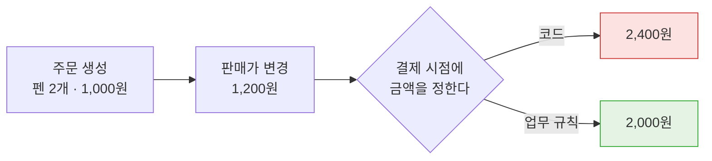
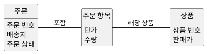
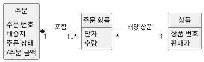
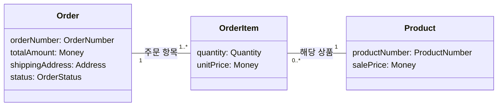

--------------------
Session 명: 04. 도메인 모델 — 정적 관점
--------------------

## 목차

01. 세션 목표
02. 같은 가격이 두 값을 뜻했다
03. 도메인 모델은 업무의 뜻이다
04. 이름이 갈리면 모델이 갈린다
05. 개념과 속성이 모델의 시작이다
06. 선 모양이 업무 규칙이다
07. 무엇이 같은 주문인가?
08. 언제나 참인 조건을 적는다
09. 상세화가 규칙을 명시한다
10. 초안은 사람이 읽어야 한다
11. AI에게 맡기기 전의 4가지 질문
12. 조건은 다이어그램에 없다
13. 모델이 코드와 검사로 간다
14. 잘못된 관행
15. 실습 4 — 정적 모델
16. 요약

## 01. 세션 목표

업무의 뜻을 **개념·속성·관계·조건**으로 정의하고, LLM이 생성한 모델에서 틀린 곳을 찾아낼 수 있다.

- 같은 뜻에 **같은 이름**을 쓰고 상품의 판매가와 주문 항목의 단가를 구별한다.
- 요구사항의 문장에서 **개념과 속성**을 찾아 정의한다.
- **선 모양과 다중성**을 읽어 그 관계가 업무와 맞는지 판단한다.
- **언제나 참이어야 하는 조건**을 적고 그것을 테스트로 잰다.
- LLM 초안이 **근거 없이 단정한 것**을 질문으로 되돌린다.
- 모델 요소가 **타입·필드·검사**로 이어지는 자리를 확인한다.

**강사 노트**

- 입력은 "세션 03. 요구사항"에서 확정한 요구사항 정의서다. 기능은 "주문한다" 하나다.
- 다이어그램을 그리는 절차는 가르치지 않는다. 읽고 틀린 곳을 찾는 것이 목적이다.
- 동적 관점은 "세션 05. 도메인 모델 — 동적 관점"이 맡는다. 상태와 전이를 미리 설명하지 않는다.

---

## 02. 같은 가격이 두 값을 뜻했다

같은 "가격"이라는 말이 **2가지 다른 값**을 뜻해서 코드가 조용히 틀렸다. 코드는 결제 시점의 판매가를 읽어 2,400원을 청구했고, 업무 담당자는 주문이 생길 때 확정한 단가로 2,000원을 뜻했다. 확인에 사용할 주문은 **펜 2개, 판매가 각 1,000원, 배송지 서울**이고 주문 금액은 2,000원이다.

**도식 — Mermaid — 주문 금액이 갈린 자리**



- 속성명 하나가 **2가지 뜻**을 가지면 테스트도 둘 가운데 하나만 확인한다.
- 틀린 것은 계산식이 아니라 **어느 시점의 값**을 읽는가다.

**강사 노트**

- "세션 01. 사람의 일과 AI의 일"에서 업무 담당자 리뷰가 찾아낸 문제 3가지 가운데 첫째다.
- 주문의 값은 과정 설계의 공통 전제다. 여기서 세운 값을 세션 끝까지 그대로 쓴다.

---

## 03. 도메인 모델은 업무의 뜻이다

## 정적과 동적은 한 모델이다

**도메인 모델**은 업무에서 무엇이 존재하고, 사건이 일어나면 무엇이 어떻게 변하는지를 설명하는 분석 모델이다. 주문·주문 항목·상품의 관계와 단가·수량의 조건이 **정적 관점**이고, 승인과 거절이 같은 주문의 상태를 바꾸는 일이 **동적 관점**이다. 두 관점이 하나의 모델을 이루며 서로를 검증한다.

**인용문**

도메인 모델은 영역의 **개념 클래스나 실제 상황의 객체**를 시각적으로 표현한 것이다, "A domain model is a visual representation of conceptual classes or real-situation objects in a domain", [Larman 2004]

- 이 정의가 설명하는 것은 **정적 개념 구조**다. 사건·상태·전이까지 담는 도메인 모델 전체와 인용의 범위를 구별한다.
- **개념 모델**은 구현과 분리해 개념 수준에서 표현한 모델이고, 클래스 다이어그램이 그것을 그리는 표기다.
- 개념과 관계의 뜻을 명시한다는 관심은 **온톨로지**와 겹친다. 그 이름만으로 별도 파일·도구·추론 체계를 더하지 않는다.
- 온톨로지는 **개념화의 명시적 명세**다, "An ontology is an explicit specification of a conceptualization.", [Gruber 1993]

**강사 노트**

- 인용은 `tools/verify-quote.js`로 원문 확인했다. Larman의 정의는 정적 개념도의 것이며 저장소 공통 용례와 구별했다.
- Gruber 원문 확인. 온톨로지 언어·지식 그래프·추론 엔진의 사용법은 범위 밖이다.
- "세션 04. 도메인 모델 — 정적 관점"과 "세션 05. 도메인 모델 — 동적 관점"은 하나의 주문 도메인 모델을 두 관점에서 발전시킨다. 학습 순서를 고정된 개발 단계로 설명하지 않는다.

---

## 분석은 설계를 정하지 않는다

같은 **주문 금액**을 두고 요구는 어떤 결과를 원하는지, 분석은 그 결과가 업무에서 무슨 뜻인지, 설계는 누가 그 규칙을 지키는지에 답한다. 도메인 모델은 그 가운데 **분석의 답**이다.

**인용문**

분석은 해결책보다 **문제와 요구사항의 조사**를 강조한다, "Analysis emphasizes an investigation of the problem and requirements, rather than a solution.", [Larman 2004]

**표 — 주문 금액에 관한 서로 다른 결정**
| 관점 | 답하는 질문 | 주문 금액의 결정 |
|---|---|---|
| **요구** | 어떤 결과를 원하는가? | 가격 변경 뒤에도 2,000원 |
| **분석** | 그 결과는 무엇을 뜻하는가? | 판매가와 단가를 가른다 |
| **설계** | 누가 그 규칙을 지키는가? | 주문이 항목의 금액을 합산 |
| **구현** | 어떻게 실행하는가? | `Money`와 반복문으로 계산 |

- 무엇을 저장하는지에 답하는 것은 **데이터 모델**이고, 같은 관계를 데이터 관점에서 그린 것이 **개체 관계 다이어그램**(ERD)이다.
- 도메인 모델은 **데이터 모델이 아니다**, "A domain model is not a data model", [Larman 2004]
- 누가 무엇을 하는지에 답하는 것은 **설계 클래스**다. 테이블·키와 책임의 배치는 설계가 정한다.

**강사 노트**

- Larman 2004의 분석 정의와 "도메인 모델은 데이터 모델이 아니다" 두 대목을 원문 확인했다. 표의 4관점은 `guides/sw-engineering-principles.md`의 「결정과 검증」을 주문 사례에 적용했다.
- [Chen 1976] 원문에서 개체와 관계로 현실을 보는 관점을 확인했다. 서지는 별첨에 있다.
- 분석과 설계를 표기 종류로 구별하지 않는다. 같은 클래스 표기로 둘 다 그린다.

---

## 04. 이름이 갈리면 모델이 갈린다

모델은 다이어그램이 아니라 **이름과 뜻**에서 시작한다. 업무 담당자와 개발자가 같은 뜻으로 쓰는 말을 **보편 언어**(ubiquitous language)라 하고, 그 말과 뜻을 적어 둔 것이 용어집이다.

**인용문**

언어의 변경은 곧 **모델의 변경**임을 인식하라, "Recognize that a change in the language is a change to the model.", [Evans 2015]

**표 — "주문한다"의 용어집**
| 용어 | 영문명 | 업무 의미 |
|---|---|---|
| **주문** | `Order` | 배송지 지정으로 생긴 거래 기록 |
| **주문 항목** | `OrderItem` | 주문에 담긴 상품·단가·수량 |
| **상품** | `Product` | 상품 시스템이 관리하는 주문 대상 |
| **판매가** | `salePrice` | 상품의 지금 값 |
| **단가** | `unitPrice` | 주문이 생길 때 확정한 값 |
| **주문 금액** | `totalAmount` | 단가 × 수량의 합 |

- 주문이 생길 때의 판매가 1,000원을 단가로 확정하므로, 판매가가 1,200원이 되어도 그 주문의 금액은 **2,000원**이다.
- 상품 번호와 수량만 남기면 **주문 당시의 금액을 재현할 수 없다**.

**강사 노트**

- Eric Evans, Domain-Driven Design Reference, 2015의 Ubiquitous Language 원문 확인. 적용 범위는 주문 업무로 한정한다.
- 영문명의 원천은 과정 설계의 「영한 용어집과 명명 규칙」이다. 표는 이번 판단에 필요한 대표 항목이다.
- "세션 03. 요구사항"의 실습 답은 주문 금액이라는 이름을 쓴다. 같은 `totalAmount`이며 별개 속성으로 만들지 않는다.
- 수강생이 실습에서 다른 이름을 골라도 된다. 자기 용어집에 먼저 더하게 한다.

---

## 05. 개념과 속성이 모델의 시작이다

## 개념은 요구 문장에서 찾는다

개념은 요구사항의 문장이 **구별하라고 말하는 대상**이다. 배송지를 정하면 주문이 생기고 상품마다 단가와 수량이 붙으므로, "주문한다"의 문장은 주문·주문 항목·상품 **3가지**를 구별하게 한다.

**인용문**

현재 반복의 요구로 범위를 한정해 **개념 클래스를 찾고**, 클래스로 그린 뒤 연관과 속성을 더한다, "Bounded by the current iteration requirements under design: 1. Find the conceptual classes … 2. Draw them as classes in a UML class diagram. 3. Add associations and attributes.", [Larman 2004]

**표 — 요구에서 찾은 개념**
| 요구의 단서 | 판단 | 모델에 남길 것 |
|---|---|---|
| **배송지 지정 뒤 주문 생성** | 승인 전에도 주문이 있다 | 주문 |
| **상품별 가격과 수량** | 주문마다 다른 거래 조건 | 주문 항목 |
| **상품 시스템의 현재 판매가** | 거래 대상과 지금 값 | 상품 |
| **본인의 주문만 조회** | 주체를 가리킬 개념이 없다 | 질문으로 남긴다 |
| **승인 결과·배송 요청** | 사건과 외부 반응이다 | 동적 관점에서 다룬다 |

- **고객·결제·배송**은 필요한 정보와 관계를 확인한 뒤 구체화한다. 흔한 쇼핑몰 기능이라는 이유로 개념을 더하지 않는다.

**강사 노트**

- Larman 2004의 도메인 모델 작성 지침을 원문 확인했다. 순서는 처음 만드는 안내이지 닫아 두는 절차가 아니다.
- 외부 시스템의 연동 방식과 업무 개념의 의미는 별개다. 상품 시스템 내부를 설계하지 않아도 상품을 분석할 수 있다.
- 본인 주문 확인 요구를 없애거나 해결했다고 선언하지 않는다. 회원·비회원과 본인 확인은 "세션 03. 요구사항"에서 넘어온 미정이다.
- 승인 결과와 배송 요청은 "세션 05. 도메인 모델 — 동적 관점"이 사건과 전이로 다룬다.

---

## 속성은 알아야 할 값만 둔다

개념은 업무가 **알고 있어야 하는 것**만 속성으로 가진다. 주문은 주문 번호·배송지·주문 상태를, 주문 항목은 단가와 수량을, 상품은 판매가를 가진다. 판매가가 상품의 속성인 이유는 **판매가와 단가가 서로 다른 시점의 값**이기 때문이다.

**인용문**

속성은 객체의 **논리적 데이터 값**이다, "An attribute is a logical data value of an object.", [Larman 2004]

**도식 — PlantUML — 주문 도메인 모델 초안**



- 화면에 보일 문자열, 저장 구조의 키, 외부 시스템의 응답 코드는 **속성으로 두지 않는다**.

**강사 노트**

- Larman 2004의 속성 정의를 원문 확인했다. 개념 클래스는 Java 클래스 선언을 뜻하지 않는다.
- 초안은 **구조의 합의**다. 선은 두 개념이 관계있다는 것만 말하고, 마름모와 다중성은 「06. 선 모양이 업무 규칙이다」에서 더한다.
- 배송지는 값이므로 속성으로 둔다. 선으로 다시 잇지 않는다(「10. 초안은 사람이 읽어야 한다」의 「문법은 맞고 뜻이 틀린다」).

---

## 금액과 수량은 값 타입이다

금액과 수량은 **값 자체로 구별되는 것**이므로 `long` 하나로 두지 않고 타입으로 정의한다. 가정은 **금액 0 이상의 원 단위 정수, 수량 1 이상의 정수**이고, 그 규칙을 `Money` 안에서 한 번 정의하면 음수 금액은 만들어지지 않는다.

```java
public record Money(long won) {
    public static final Money ZERO = new Money(0);
    public Money {
        if (won < 0) throw new IllegalArgumentException("금액은 0 이상");
    }
// ... 금액을 더하는 plus 생략
    public Money times(Quantity quantity) {
        return new Money(Math.multiplyExact(won, quantity.value()));
    }
}
```

- `long` 하나로 두면 **사용하는 쪽마다 `if`**를 쓰고 단위는 변수 이름으로만 안다. 타입으로 두면 만들 때 한 번 막는다.
- **값 타입에는 식별자가 없다**. `times`가 `Quantity`를 받으므로 금액과 수량을 뒤바꿔 넘길 수 없다.

**강사 노트**

- 원본은 `code/s04/static-model/src/order/Money.java`다. `package` 선언만 빼고 그대로다. `Quantity`는 같은 폴더의 `Quantity.java`이며 1 이상을 거절한다.
- 금액 0 이상·수량 1 이상은 교육용 가정이며 과정 설계에 기록했다. 실제 통화·세금·환불의 음수 금액을 금지하는 모델로 설명하지 않는다.
- `Money`를 쓸지는 설계의 결정이다. 여기서는 **값으로 다룰 것**이라는 판단까지 한다.

---

## 06. 선 모양이 업무 규칙이다

## 연관의 유형은 4가지다

클래스 사이의 선은 **4가지**다. 연관은 두 개념이 서로를 아는 관계, 합성과 집약은 전체와 부분의 관계, 일반화는 종류의 관계이고 **선 모양이 그대로 업무 규칙**을 뜻한다. 선 모양을 고르기 전에 수명과 대체 가능성을 먼저 확인한다.

**도식 — SVG — 연관의 4가지 유형**

```svg
<svg xmlns="http://www.w3.org/2000/svg" viewBox="0 0 960 382" width="960" height="382" font-family="sans-serif" aria-label="연관·합성·집약·일반화의 선 모양과 읽는 법. 주문한다 모델에 있는 것은 연관과 합성이고 집약과 일반화는 없다.">
  <g>
    <rect x="4" y="6" width="952" height="86" rx="8" fill="#e8eff8" stroke="#2b5fa8" stroke-width="2"/>
    <line x1="34" y1="49" x2="160" y2="49" stroke="#1b3f70" stroke-width="2"/>
    <text x="190" y="58" font-size="23" font-weight="bold" fill="#1b3f70">연관</text>
    <line x1="300" y1="18" x2="300" y2="80" stroke="#9db8d8"/>
    <text x="326" y="40" font-size="19" fill="#1b3f70">두 개념이 서로를 안다. 방향이 없다</text>
    <text x="326" y="74" font-size="19" fill="#8e2a1e">주문 항목과 상품 — 이 모델에 있다</text>
  </g>
  <g>
    <rect x="4" y="100" width="952" height="86" rx="8" fill="#e8eff8" stroke="#2b5fa8" stroke-width="2"/>
    <polygon points="34,143 58,132 82,143 58,154" fill="#1b3f70"/>
    <line x1="82" y1="143" x2="160" y2="143" stroke="#1b3f70" stroke-width="2"/>
    <text x="190" y="152" font-size="23" font-weight="bold" fill="#1b3f70">합성</text>
    <line x1="300" y1="112" x2="300" y2="174" stroke="#9db8d8"/>
    <text x="326" y="134" font-size="19" fill="#1b3f70">전체가 사라지면 부분도 사라진다</text>
    <text x="326" y="168" font-size="19" fill="#8e2a1e">주문과 주문 항목 — 이 모델에 있다</text>
  </g>
  <g>
    <rect x="4" y="194" width="952" height="86" rx="8" fill="#f8fafc" stroke="#64748b" stroke-width="1.5"/>
    <polygon points="34,237 58,226 82,237 58,248" fill="#ffffff" stroke="#475569" stroke-width="2"/>
    <line x1="82" y1="237" x2="160" y2="237" stroke="#475569" stroke-width="2"/>
    <text x="190" y="246" font-size="23" font-weight="bold" fill="#1e293b">집약</text>
    <line x1="300" y1="206" x2="300" y2="268" stroke="#cbd5e1"/>
    <text x="326" y="228" font-size="19" fill="#334155">전체와 부분이지만 수명은 따로다</text>
    <text x="326" y="262" font-size="19" fill="#64748b">이 모델에는 없다</text>
  </g>
  <g>
    <rect x="4" y="288" width="952" height="86" rx="8" fill="#f8fafc" stroke="#64748b" stroke-width="1.5"/>
    <line x1="34" y1="331" x2="136" y2="331" stroke="#475569" stroke-width="2"/>
    <polygon points="160,331 136,318 136,344" fill="#ffffff" stroke="#475569" stroke-width="2"/>
    <text x="190" y="340" font-size="23" font-weight="bold" fill="#1e293b">일반화</text>
    <line x1="300" y1="300" x2="300" y2="362" stroke="#cbd5e1"/>
    <text x="326" y="322" font-size="19" fill="#334155">아래 개념이 위 개념을 대체한다</text>
    <text x="326" y="356" font-size="19" fill="#64748b">이 모델에는 없다</text>
  </g>
</svg>
```

- 종류를 나누고 싶을 뿐이면 **속성 하나**로 둔다. 회원 주문과 비회원 주문은 요구에 근거가 없어 미정으로 남긴다.

**강사 노트**

- 4가지를 모두 보이는 이유는 LLM 초안이 집약과 일반화를 근거 없이 쓰기 때문이다. 없는 유형은 그리지 않고 가르는 기준만 남긴다.
- 일반화는 위 개념이 쓰이는 **모든 자리에 아래 개념을 넣을 수 있을 때만** 성립한다. "객체지향 분석과 설계 실무"의 LSP와 같은 기준이다.
- 그리는 절차는 "객체지향 분석과 설계 실무"가 맡는다. 여기서는 읽고 판정한다.

---

## 선 하나에 3가지가 적힌다

주문–주문 항목을 `1..*`로 정의하면 항목 없는 주문을 만들 수 없고, `0..*`로 두면 빈 주문이 생겨 **주문 금액 합계 규칙이 무너진다**. 다중성이 틀려도 **컴파일은 되므로** 사람이 읽어야 찾아낸다.

**인용문**

다중성은 클래스 A의 인스턴스 몇 개가 클래스 B의 인스턴스 하나와 **연관될 수 있는지**를 정의한다, "Multiplicity defines how many instances of a class A can be associated with one instance of a class B", [Larman 2004]

**도식 — SVG — 주문과 주문 항목의 연관**

```svg
<svg xmlns="http://www.w3.org/2000/svg" viewBox="0 0 960 160" width="960" height="160" font-family="sans-serif" aria-label="주문과 주문 항목을 잇는 선에 채운 마름모, 연관명 포함, 다중성 1과 1..*가 적혀 있다.">
  <rect x="70" y="42" width="230" height="68" rx="6" fill="#eef2f7" stroke="#475569" stroke-width="1.5"/>
  <text x="185" y="84" font-size="23" text-anchor="middle" fill="#1e293b">주문</text>
  <rect x="640" y="42" width="250" height="68" rx="6" fill="#eef2f7" stroke="#475569" stroke-width="1.5"/>
  <text x="765" y="84" font-size="23" text-anchor="middle" fill="#1e293b">주문 항목</text>
  <polygon points="300,76 326,64 352,76 326,88" fill="#475569"/>
  <line x1="352" y1="76" x2="640" y2="76" stroke="#475569" stroke-width="2"/>
  <text x="496" y="56" font-size="19" text-anchor="middle" fill="#1e293b">포함</text>
  <text x="362" y="106" font-size="19" fill="#8e2a1e">1</text>
  <text x="586" y="106" font-size="19" fill="#8e2a1e">1..*</text>
</svg>
```

**표 — 선 하나에 적힌 3가지**
| 적힌 것 | 무엇을 뜻하는가? |
|---|---|
| **채운 마름모** | 주문이 사라지면 주문 항목도 사라진다 |
| **선 위의 연관명** | 주문이 주문 항목을 포함한다 |
| **양 끝의 `1`과 `1..*`** | 항목 없는 주문은 만들지 않는다 |

**강사 노트**

- 도메인 모델의 연관은 방향이 없는 양방향이다. 어느 쪽에서 탐색할지는 설계가 정한다. 다중성 하나가 바뀌면 생성자와 테스트가 함께 바뀐다.
- Larman 2004의 다중성 정의를 원문 확인했다. 역할 이름(role name)은 상대가 맡는 이름이며 연관명과 구별해 읽게 한다.
- 초안의 다중성은 구체적인 주문(펜 2개)에 대입해 확인했다. 다이어그램이 아니라 예로 확인한다.
- 연관에 화살표를 그리지 않는다. 탐색 방향은 "세션 07. 설계 — 책임과 협력"의 결정이다.
- 같은 상품을 항목 하나로 합칠지는 별도 정책이며 수량 상한도 정하지 않는다.

---

## 수명이 같으면 합성이다

합성과 집약을 가르는 기준은 **수명**이다. 주문을 지우면 그 주문 항목도 함께 사라지지만 상품은 주문과 무관하게 남으므로, 주문과 주문 항목은 **합성**이고 주문 항목과 상품은 **연관**이다.

**인용문**

**전체가 부분의 생성과 삭제를 책임진다**, "the composite is responsible for the creation and deletion of its parts", [Larman 2004]

**도식 — SVG — 주문을 지울 때 일어나는 일**

```svg
<svg xmlns="http://www.w3.org/2000/svg" viewBox="0 0 960 340" width="960" height="340" font-family="sans-serif" aria-label="주문을 지우면 주문 항목도 함께 사라지지만 상품은 남는다. 앞쪽은 합성이고 뒤쪽은 연관이다.">
  <g>
    <rect x="14" y="14" width="460" height="312" rx="10" fill="#e8eff8" stroke="#2b5fa8" stroke-width="2"/>
    <text x="244" y="52" font-size="23" font-weight="bold" text-anchor="middle" fill="#1b3f70">합성 — 주문과 주문 항목</text>
    <rect x="44" y="78" width="200" height="58" rx="6" fill="#fff" stroke="#475569"/>
    <text x="144" y="115" font-size="19" text-anchor="middle" fill="#1e293b">주문 1001</text>
    <rect x="44" y="148" width="200" height="58" rx="6" fill="#fff" stroke="#475569"/>
    <text x="144" y="185" font-size="19" text-anchor="middle" fill="#1e293b">주문 항목 펜 2개</text>
    <text x="256" y="150" font-size="23" fill="#8e2a1e">→</text>
    <rect x="290" y="78" width="170" height="128" rx="6" fill="#fdecec" stroke="#c0392b" stroke-dasharray="5 4"/>
    <text x="375" y="149" font-size="19" text-anchor="middle" fill="#8e2a1e">둘 다 사라진다</text>
    <text x="44" y="256" font-size="19" fill="#1b3f70">주문 밖에 혼자 있지 않는다</text>
    <text x="44" y="292" font-size="19" fill="#64748b">채운 마름모로 그린다</text>
  </g>
  <g>
    <rect x="486" y="14" width="460" height="312" rx="10" fill="#f8fafc" stroke="#64748b" stroke-width="1.5"/>
    <text x="716" y="52" font-size="23" font-weight="bold" text-anchor="middle" fill="#1e293b">연관 — 주문 항목과 상품</text>
    <rect x="516" y="78" width="200" height="58" rx="6" fill="#fff" stroke="#475569"/>
    <text x="616" y="115" font-size="19" text-anchor="middle" fill="#1e293b">주문 1001</text>
    <rect x="516" y="148" width="200" height="58" rx="6" fill="#fff" stroke="#475569"/>
    <text x="616" y="185" font-size="19" text-anchor="middle" fill="#1e293b">상품 펜</text>
    <text x="728" y="185" font-size="23" fill="#245128">→</text>
    <rect x="762" y="148" width="170" height="58" rx="6" fill="#e8f1e8" stroke="#2f6b35"/>
    <text x="847" y="185" font-size="19" text-anchor="middle" fill="#245128">상품은 남는다</text>
    <text x="516" y="256" font-size="19" fill="#334155">주문보다 오래 남는다</text>
    <text x="516" y="292" font-size="19" fill="#64748b">마름모 없이 그린다</text>
  </g>
</svg>
```

- 수명을 묻지 않고 부분처럼 보인다는 이유로 합성을 적으면 **지우는 규칙이 업무와 어긋난다**.
- 지우는 규칙은 저장 구조의 결정이 아니라 **업무의 결정**이다.

**강사 노트**

- Larman 2004의 합성 설명을 원문 확인했다. 원문은 부분이 한 전체에만 속한다는 조건도 함께 적는다.
- 주문 번호 1001은 식별자를 보이려는 예시 값이다. 관통 사례에 사례 번호를 붙이는 것이 아니다.
- 집약은 이 모델에 없다. 없는 것을 적지 않고 구별하는 기준만 남긴다.

---

## 07. 무엇이 같은 주문인가?

펜 2개를 두 번 주문하면 두 주문의 모든 값이 같다. 그래도 서로 **다른 주문**이고 둘을 구별하는 것은 **주문 번호**다. 2,000원과 2,000원은 값이 같으면 같은 금액이므로, 무엇으로 같음을 보는지가 개념마다 다르다.

**도식 — SVG — 같은 값, 다른 주문**

```svg
<svg xmlns="http://www.w3.org/2000/svg" viewBox="0 0 960 340" width="960" height="340" font-family="sans-serif" aria-label="모든 값이 같은 두 주문은 주문 번호가 다르므로 다른 주문이고, 2000원과 2000원은 같은 금액이다.">
  <g>
    <rect x="14" y="14" width="586" height="312" rx="10" fill="#e8eff8" stroke="#2b5fa8" stroke-width="2"/>
    <text x="307" y="52" font-size="23" font-weight="bold" text-anchor="middle" fill="#1b3f70">식별자로 본다 — 주문</text>
    <rect x="44" y="76" width="256" height="152" rx="6" fill="#fff" stroke="#475569"/>
    <text x="64" y="110" font-size="19" fill="#8e2a1e">주문 번호 1001</text>
    <text x="64" y="144" font-size="19" fill="#334155">펜 2개 · 2,000원</text>
    <text x="64" y="178" font-size="19" fill="#334155">배송지 서울</text>
    <text x="64" y="212" font-size="19" fill="#64748b">10시에 주문</text>
    <rect x="320" y="76" width="256" height="152" rx="6" fill="#fff" stroke="#475569"/>
    <text x="340" y="110" font-size="19" fill="#8e2a1e">주문 번호 1002</text>
    <text x="340" y="144" font-size="19" fill="#334155">펜 2개 · 2,000원</text>
    <text x="340" y="178" font-size="19" fill="#334155">배송지 서울</text>
    <text x="340" y="212" font-size="19" fill="#64748b">11시에 주문</text>
    <text x="44" y="264" font-size="19" fill="#1b3f70">값이 같아도 번호가 다르면 다른 주문이다</text>
    <text x="44" y="300" font-size="19" fill="#64748b">속성이 바뀌어도 같은 주문이다</text>
  </g>
  <g>
    <rect x="612" y="14" width="334" height="312" rx="10" fill="#f8fafc" stroke="#64748b" stroke-width="1.5"/>
    <text x="779" y="52" font-size="23" font-weight="bold" text-anchor="middle" fill="#1e293b">값으로 본다 — 금액</text>
    <rect x="642" y="86" width="136" height="64" rx="6" fill="#fff" stroke="#475569"/>
    <text x="710" y="126" font-size="19" text-anchor="middle" fill="#1e293b">2,000원</text>
    <rect x="794" y="86" width="136" height="64" rx="6" fill="#fff" stroke="#475569"/>
    <text x="862" y="126" font-size="19" text-anchor="middle" fill="#1e293b">2,000원</text>
    <text x="779" y="196" font-size="23" text-anchor="middle" fill="#245128">같은 금액이다</text>
    <text x="642" y="264" font-size="19" fill="#334155">금액·수량은 값으로 본다</text>
    <text x="642" y="300" font-size="19" fill="#64748b">값이 바뀌면 다른 값이다</text>
  </g>
</svg>
```

- 식별자는 **업무가 쓰는 번호**다. 저장 구조의 키를 모델에 올리지 않는다.
- 식별자의 **형식과 발급 방법**은 정하지 않고 미정으로 남긴다.

**강사 노트**

- 주문 번호는 공통 전제의 식별자다. 세션 사이에서 속성명을 바꾸지 않는다.
- 1001·1002와 주문 시각은 같음을 가르려고 둔 예시 값이다. 주문 시각을 속성으로 더하지 않는다.

---

## 08. 언제나 참인 조건을 적는다

## 조건은 테스트의 기대값이 된다

주문 금액은 **언제나** 항목의 단가 × 수량의 합이다. 이렇게 언제나 참이어야 하는 조건을 **불변 조건**이라 하고, 모델에 적은 그 문장이 그대로 테스트의 기대값이 된다. 단가 1,000원인 펜 2개면 주문 금액은 2,000원이고, 판매가가 1,200원이 되어도 그 주문의 값은 그대로다.

**도식 — SVG — 판매가가 바뀐 뒤의 주문**

```svg
<svg xmlns="http://www.w3.org/2000/svg" viewBox="0 0 960 215" width="960" height="215" font-family="sans-serif" aria-label="서울로 받는 결제대기 주문이 펜 2개인 주문 항목 하나를 포함하고, 항목이 현재 판매가 1200원인 펜 상품을 가리킨다. 확정 단가는 1000원이고 주문 금액은 2000원이다.">
  <g fill="#ffffff" stroke="#475569" stroke-width="1.4">
    <rect x="10" y="24" width="280" height="176"/>
    <rect x="340" y="24" width="280" height="176"/>
    <rect x="670" y="24" width="280" height="176"/>
    <path d="M290 112H340M620 112H670" fill="none"/>
    <path d="M10 62H290M340 62H620M670 62H950"/>
  </g>
  <g font-size="23" text-anchor="middle" font-weight="bold" text-decoration="underline" fill="#1b3f70">
    <text x="150" y="52">:주문</text>
    <text x="480" y="52">:주문 항목</text>
    <text x="810" y="52">펜:상품</text>
  </g>
  <g font-size="19" fill="#1e293b">
    <text x="26" y="98">배송지 = 서울</text>
    <text x="26" y="132">상태 = 결제대기</text>
    <text x="26" y="166">/주문 금액 = 2,000원</text>
    <text x="356" y="98">단가 = 1,000원</text>
    <text x="356" y="132">수량 = 2개</text>
    <text x="686" y="98">판매가 = 1,200원</text>
    <text x="686" y="132">상품 번호 = PEN</text>
  </g>
</svg>
```

- **그 시점에만 참인 조건**과 가른다. 단가는 주문이 생길 때 판매가와 같고, 그 뒤에도 같아야 한다는 조건이 아니다.
- **결제대기**는 지금의 상태일 뿐 불변 조건이 아니다. 상태의 전체 범위와 전이는 "세션 05. 도메인 모델 — 동적 관점"이 정한다.
- **값의 조건**은 수량 1 이상, 금액 0 이상이고 값 하나를 만들 때 확인한다.

**강사 노트**

- 단가 1,000원과 현재 판매가 1,200원이 다른 것은 오류가 아니다. 생성 시점에 올바르게 확정했는지와 그 뒤 값을 보존했는지가 판정 대상이다.
- 상품 번호 `PEN`은 펜을 가리키는 예제 값이며 형식 규칙이 아니다.
- 수업에서는 주문 금액을 먼저 예측하게 한 뒤 「13. 모델이 코드와 검사로 간다」의 실행 결과와 대조한다.

---

## 파생 속성은 저장하지 않는다

다른 값에서 계산되는 값을 **파생 속성**이라 하고, 계산식만 정의하고 저장하지 않는다. 주문 금액을 단가·수량과 나란히 저장하면 **둘이 어긋나는 순간**이 온다.

```java
    public Money totalAmount() {
        Money total = Money.ZERO;
        for (OrderItem item : items) {
            total = total.plus(item.unitPrice().times(item.quantity()));
        }
        return total;
    }
```

**표 — 저장할 값과 계산할 값**
| 값 | 어디서 오는가? | 두는 방식 |
|---|---|---|
| **단가와 수량** | 주문이 생길 때 확정한다 | 저장한다 |
| **주문 금액** | 단가 × 수량의 합이다 | 계산식으로 둔다 |

- 모델에서 `/주문 금액`으로 적은 값은 코드에서 **메서드**가 되고, 틀렸을 때 확인할 곳이 한 군데다. 성능 때문에 저장하기로 하는 것은 설계의 결정이다.

**강사 노트**

- 원본은 `code/s04/static-model/src/order/Order.java`의 `totalAmount`다. 필드 선언과 조회 메서드는 전체 원본에 있다.
- 이 계산에는 상품의 현재 판매가를 읽는 의존이 없다.
- 저장하는 설계도 가능하지만 항목 합계와 저장한 값의 일치 조건을 지켜야 한다.
- 이 메서드는 모든 항목을 순회한다. 대표 주문 한 건으로는 합계 구현을 확인할 수 없다.

---

## 09. 상세화가 규칙을 명시한다

초안의 3개념·2관계에 **규칙**을 더하면 상세화한 모델이 된다. 주문–주문 항목에 채운 마름모와 `1..*`를 적어 항목 없는 주문을 금지하고, 주문 금액을 `/주문 금액`으로 적어 계산식임을 밝힌다. 초안은 구조의 합의이고 상세화는 **규칙의 명시**다.

**도식 — PlantUML — 주문 도메인 모델**



- 주문 항목을 빼면 상품별 **수량과 확정 단가**가 갈 곳을 잃고, 단가를 빼면 가격 변경 전의 금액을 설명할 수 없다.
- 본인 확인의 **식별 의미**와 결제 이력 구조는 확인할 대상으로 남긴다.

**강사 노트**

- 초안과 같은 3개념·2관계를 유지하고 앞에서 판단한 속성·마름모·다중성·파생 속성을 결합했다. 관계와 속성을 어디서 얻었는지 설명할 수 있어야 한다.
- 요구사항 전체가 분석 완료됐다고 주장하지 않는다. 행동과 외부 요청의 순서는 "세션 05. 도메인 모델 — 동적 관점"에서 확인한다.
- 도식의 주문·주문 항목·상품과 단가·수량·판매가·주문 금액은 「13. 모델이 코드와 검사로 간다」에서 타입·필드·테스트로 이어진다.

---

## 10. 초안은 사람이 읽어야 한다

## 준 것은 요구사항 정의서뿐이다

준 것은 **요청 두 줄과 실습 3의 요구사항 정의서**뿐이다. 모델의 개념·관계·조건은 주지 않았고, 용어의 영문 이름만 과정의 명명 규칙에 맞추도록 먼저 주었다.

**기록 그대로**

```text
실습 3의 요구사항 정의서를 읽고 "주문한다"의 정적 모델 초안을 제안해라.
용어집·개념과 관계·속성·불변 조건을 담고, 클래스 다이어그램과 같은 내용을
읽을 수 있는 목록을 함께 보여라. 근거 없는 개념·정책은 확정하지 말고
질문해라. 설계·구현·상태 전이는 만들지 마라.
용어의 영문 이름은 Order, OrderItem, Product, Money, Quantity, Address,
OrderNumber, ProductNumber, OrderStatus, unitPrice, salePrice,
totalAmount, shippingAddress를 사용해라. 요구사항에서 이미 정한 이름은
유지해라.

[실습 3의 실제 최종 MD]
# “주문한다” 요구사항 정의서
⟨거버닝 문단과 목적과 범위, 사용자 이야기 생략⟩

## 핵심 기능과 업무 규칙

- 배송지를 지정하면 주문 생성 시점의 판매가로 주문 금액을 확정하고
  `결제대기` 주문을 생성한다.
- 주문자와 수령인은 같은 사람으로 본다.
- 주문 금액은 각 주문 항목의 주문 생성 시점 판매가에 수량을 곱하여 합한 금액이다.
- 주문 생성 뒤 판매가가 변경되어도 주문 금액과 카드 승인 요청 금액은 바뀌지 않는다.
- `결제대기` 주문의 상품·수량·배송지는 변경할 수 없다. 변경하려면 새 주문을 생성한다.
⟨1줄 생략 — 결제 수단은 카드만 허용한다⟩
- 카드 승인이 거절되면 같은 주문을 `결제대기`로 유지하며 다른 카드로 재결제할 수 있다.
⟨4줄 생략 — 승인 완료, 배송 요청, 재고 판단, 결제 응답 미확정이 이어진다⟩
- 본인 주문에 대해서만 조회 또는 변경 요청의 권한을 인정한다. 권한이 있더라도
  실제 변경 가능 여부에는 주문 상태와 업무 규칙을 적용한다.
⟨이하 생략 — 다른 고객의 요청 거절과 기본 용어집, 공통 흐름, 대표 수용 예,
미정 사항이 이어진다. 전문은 원본 파일에 있다⟩
```

**강사 노트**

- 원본은 `code/s04/exercise-conversation/order/prompt-01.txt`다. 문장은 입력 그대로이며 슬라이드 폭에 맞춰 줄만 바꿨다.
- 첨부한 것은 실습 3의 최종 MD 전문이다. 슬라이드에는 단가·금액·본인 확인의 근거가 되는 업무 규칙만 두고 뺀 줄은 그 자리에 ⟨ ⟩로 표시했다. 전문은 같은 폴더의 `input-s03.md`에 바이트 그대로 있다.
- 본인 주문의 권한 규칙이 다음 장 7절의 질문 2(회원 주문만 허용하는가)의 근거다. 주문 주체를 나타낼 개념이 요구에 없다는 것을 여기서 먼저 보게 한다.
- 영문 이름을 먼저 준 것은 용어집을 명명 규칙에 맞추려는 입력이다. 개념·관계·속성·조건은 요구사항 정의서만 보고 제안하게 했다.

---

## 초안은 요청한 7개 절로 왔다

**기록 그대로**

**문서 형식 — 10pt**

이 모델은 요구사항에 명시된 개념과 제약만 표현한다. 결제·배송·재고 시스템의 내부 모델, 처리 절차, 상태 전이 및 구현 방식은 포함하지 않는다.

### 1. 용어집

⟨한글 용어·영문 이름·정의의 표 15행 생략 — 주문·주문 항목·상품·금액·수량·배송지·번호·상태를 정의하고, 상품의 현재 `salePrice`와 주문에 확정한 `unitPrice`를 가른 정의를 더했다⟩

### 2. 개념과 속성

⟨`Order`·`OrderItem`·`Product`의 속성 생략 — 값 개념만 보인다⟩

- `Money`: 금액 값
- `Quantity`: 수량 값
- `Address`: 배송지 값
- `OrderNumber`: 주문 식별 값
- `ProductNumber`: 상품 식별 값
- `OrderStatus`: `PENDING_PAYMENT` 또는 `PAID`

### 3. 관계

- 하나의 `Order`는 하나 이상의 `OrderItem`으로 구성된다.
- 각 `OrderItem`은 정확히 하나의 `Product`를 참조한다.
- 하나의 `Order`에는 정확히 하나의 `shippingAddress`가 확정된다.
- 하나의 `Order`에는 정확히 하나의 `OrderNumber`, `totalAmount`, `OrderStatus`가 존재한다.
- `OrderItem.unitPrice`는 연결된 `Product.salePrice`의 주문 생성 시점 값이다.

⟨2줄 생략 — 상품 하나를 여러 주문 항목이 참조하는 것과, 생성 뒤 두 값이 독립인 것을 적는다⟩

### 4. 클래스 다이어그램

⟨Mermaid 코드 생략 — 클래스 9개와 연관 11줄이며 `Order "1" *-- "1..*" OrderItem : items`로 적었다⟩

### 5. 다이어그램과 같은 내용을 읽을 수 있는 목록

⟨13줄 생략 — 다이어그램의 속성과 다중성을 같은 순서의 문장으로 다시 적는다⟩

### 6. 불변 조건

⟨12개 생략 — 합계 등식, 생성 시점의 가격 확정, 결제대기 주문의 변경 금지가 들어 있다⟩

### 7. 확인이 필요한 질문

1. `OrderItem`의 확정 가격 속성명을 `unitPrice`로 사용할 것인가, 요구사항 표현을 그대로 살려 `salePrice`로 사용할 것인가? 이 초안은 상품의 현재 가격을 `Product.salePrice`, 주문 시 확정된 단가를 `OrderItem.unitPrice`로 구분했다.
2. 회원 주문만 허용하는가? 비회원도 허용한다면 주문 주체와 본인 확인 정보를 어떤 개념으로 표현해야 하는가?

⟨3·4 생략 — 통화 포함 여부와 반올림 규칙을 묻는다⟩

5. `Quantity`는 양의 정수만 허용하는가? 상품별 구매 단위나 최대 수량이 있는가?

⟨6~11 생략 — 항목 합치기, 주소 항목, 주문자와 수령인, 번호의 유일성, 결제 결과 개념을 묻는다⟩

12. 승인 뒤 재고 부족이나 배송 요청 실패가 `OrderStatus`의 추가 값을 요구하는가? 현재 정책이 없으므로 `PENDING_PAYMENT`와 `PAID` 외 상태는 추가하지 않았다.

**강사 노트**

- 원본은 `code/s04/exercise-conversation/order/codex-response-01.md`다. 앞 장의 프롬프트를 실행해 받은 응답이며, 절 제목·절 번호·질문 번호·문장·강조를 고치지 않았다. 각 절에서 덜어낸 분량만 ⟨ ⟩ 줄로 표시했다.
- 프롬프트가 요구한 용어집·개념과 속성·관계·클래스 다이어그램·읽을 수 있는 목록·불변 조건이 그대로 1~6절로 왔고, 근거가 없는 것은 7절의 질문 12개가 됐다. 요청하지 않은 설계·구현·상태 전이는 없다.
- 배송지·번호·주문 금액을 관계로 서술한 줄과 상태 값을 둘로 열거한 줄을 먼저 찾게 한다.

---

## 문법은 맞고 뜻이 틀린다

LLM이 생성한 초안은 **표기를 거의 틀리지 않는다**. 틀리는 것은 업무의 뜻이고, 표기의 정확성과 뜻의 정확성 사이의 거리를 **시맨틱 갭**(semantic gap)이라 한다.

**인용문**

LLM은 구문이 맞는 UML을 만들 수 있지만 **의미의 품질**에서 어려움을 겪고, 특히 다이어그램의 **규모가 커지면** 자연어와 잘 맞지 않는다, "Although LLMs can generate syntactically correct UML code, they are struggling with semantic quality and tend to align poorly with natural languages, especially when the diagram scale is large.", [Gao 외 2025]

**표 — 초안이 쓴 말과 사람이 내린 판단**
| 초안이 쓴 말 | 무엇이 문제인가? | 사람이 결정한 것 |
|---|---|---|
| **속성명을 unitPrice로 쓸 것인가?** | 질문 — 요구 표현과 대조 | 현재 값과 확정 값을 가른다 |
| **Quantity는 양의 정수만 허용하는가?** | 질문 — 입력에 근거 없음 | 1 이상 정수·0 이상 원 단위 |
| **회원 주문만 허용하는가?** | 질문 — 요구에 근거 없음 | 미정으로 남긴다 |
| **PENDING_PAYMENT 또는 PAID** | 단정 — 확인한 값을 전부로 닫음 | 확인한 값만 적는다 |
| **shippingAddress가 확정된다** | 단정 — 값을 관계로 중복 표현 | 배송지는 속성으로만 둔다 |

- 초안이 쓴 5가지 모두 **문법은 맞다**. 초안이 **질문으로 남긴 것**은 결함이 아니라 사람이 결정할 자리를 드러낸 결과다.

**강사 노트**

- 첫 열은 앞 장에 올린 `codex-response-01.md`의 문장을 줄여 인용했고, 셋째 열은 `prompt-02.txt`·`prompt-03.txt`로 실제 답한 결정이다. 초안이 회원 타입을 실제로 만들었다고 설명하지 않는다.
- 인용 근거: [Gao 외 2025] 원문 확인. 규모가 커질수록 뜻의 품질이 떨어진다는 진단이다.
- 앞 실습의 최종 답에는 결제대기·결제완료가 확인돼 있다. 공통 전제의 4상태와 그 시점의 확인 범위를 혼동하지 않는다.

---

## 11. AI에게 맡기기 전의 4가지 질문

초안을 생성하는 비용이 거의 들지 않으면 사람에게 남는 일은 **읽고 판단하는 일**이다. 무엇이 쉬워졌고, 무엇이 달라지며, 무엇이 깨지고, 무엇을 갖춰야 하는지를 맡기기 전에 확인한다.

**도식 — SVG — 모델을 AI에게 맡기기 전의 4가지 질문**

```svg
<svg xmlns="http://www.w3.org/2000/svg" viewBox="0 0 960 382" width="960" height="382" font-family="sans-serif" aria-label="모델을 맡기기 전에 쉬워진 일, 달라지는 것, 깨지는 것, 갖춰야 할 것을 확인한다.">
  <g>
    <rect x="4" y="6" width="952" height="86" rx="8" fill="#eef2f7" stroke="#64748b" stroke-width="1.5"/>
    <text x="30" y="58" font-size="23" font-weight="bold" fill="#1e293b">쉬워진 일</text>
    <line x1="250" y1="18" x2="250" y2="80" stroke="#94a3b8"/>
    <text x="276" y="40" font-size="19" fill="#334155">요구사항을 읽고 클래스 다이어그램을 몇 초에 생성한다</text>
    <text x="276" y="74" font-size="19" fill="#334155">조건과 미정도 확인할 질문과 함께 적어 준다</text>
  </g>
  <g>
    <rect x="4" y="100" width="952" height="86" rx="8" fill="#eef2f7" stroke="#64748b" stroke-width="1.5"/>
    <text x="30" y="152" font-size="23" font-weight="bold" fill="#1e293b">달라지는 것</text>
    <line x1="250" y1="112" x2="250" y2="174" stroke="#94a3b8"/>
    <text x="276" y="134" font-size="19" fill="#334155">표기와 문법은 거의 틀리지 않는다</text>
    <text x="276" y="168" font-size="19" fill="#334155">고치기보다 다시 받는 것이 빠르다</text>
  </g>
  <g>
    <rect x="4" y="194" width="952" height="86" rx="8" fill="#fdecec" stroke="#c0392b" stroke-width="1.5"/>
    <text x="30" y="246" font-size="23" font-weight="bold" fill="#8e2a1e">깨지는 것</text>
    <line x1="250" y1="206" x2="250" y2="268" stroke="#d98b80"/>
    <text x="276" y="228" font-size="19" fill="#3b1f1a">근거 없는 단정, 틀린 다중성, 빠진 조건</text>
    <text x="276" y="262" font-size="19" fill="#3b1f1a">읽지 않으면 다음 세션의 입력이 된다</text>
  </g>
  <g>
    <rect x="4" y="288" width="952" height="86" rx="8" fill="#e8f1e8" stroke="#2f6b35" stroke-width="1.5"/>
    <text x="30" y="340" font-size="23" font-weight="bold" fill="#245128">갖춰야 할 것</text>
    <line x1="250" y1="300" x2="250" y2="362" stroke="#8ab08e"/>
    <text x="276" y="322" font-size="19" fill="#1f2e20">조건까지 적은 문서를 사람이 읽고 판단한다</text>
    <text x="276" y="356" font-size="19" fill="#1f2e20">조건은 테스트로 만들어 다시 확인한다</text>
  </g>
</svg>
```

- 바뀌지 않는 것은 **업무의 개념**이고, 바뀌는 것은 초안을 누가 생성하는가다.

**강사 노트**

- 이 4가지는 과정 전체의 반복 틀이다. "세션 03. 요구사항"의 「12. AI에게 맡기기 전의 4가지 질문」와 같은 자리에서 같은 4가지를 묻는다.
- 사람과 AI의 역할은 검토 책임의 구분이다. 사람이 다이어그램을 직접 그려야 한다는 뜻이 아니다.

---

## 12. 조건은 다이어그램에 없다

클래스 다이어그램이 담는 것은 개념·속성·관계·다중성까지다. 단가가 "주문이 생길 때 확정한 값"이라는 **뜻**도, 주문 금액이 언제나 단가 × 수량의 합이라는 **조건**도, 회원 구분을 미정으로 남긴 **이유**도 적을 자리가 없다. 그래서 정적 모델은 **문서 하나**로 쓰고 다이어그램은 그 문서의 한 절이 된다.

**도식 — SVG — 정적 모델 문서의 4개 절**

```svg
<svg xmlns="http://www.w3.org/2000/svg" viewBox="0 0 960 380" width="960" height="380" font-family="sans-serif" aria-label="주문한다 정적모델 문서 하나가 용어와 속성, 도식과 관계, 조건과 대표 예, 정하지 않은 것의 4개 절로 이루어진다.">
  <rect x="4" y="6" width="952" height="44" rx="8" fill="#e2e8f0" stroke="#475569" stroke-width="1.5"/>
  <text x="30" y="37" font-size="23" font-weight="bold" fill="#1e293b">주문한다-정적모델.md — 문서 하나</text>
  <g>
    <rect x="4" y="58" width="952" height="72" rx="8" fill="#f8fafc" stroke="#64748b" stroke-width="1.5"/>
    <text x="30" y="104" font-size="23" font-weight="bold" fill="#1e293b">1. 용어와 속성</text>
    <line x1="270" y1="68" x2="270" y2="120" stroke="#cbd5e1"/>
    <text x="296" y="86" font-size="19" fill="#334155">판매가·단가·주문 금액의 뜻을 정의한다</text>
    <text x="296" y="116" font-size="19" fill="#8e2a1e">용어집에 없는 속성명이 있는가?</text>
  </g>
  <g>
    <rect x="4" y="138" width="952" height="72" rx="8" fill="#e8eff8" stroke="#2b5fa8" stroke-width="2"/>
    <text x="30" y="184" font-size="23" font-weight="bold" fill="#1b3f70">2. 도식과 관계</text>
    <line x1="270" y1="148" x2="270" y2="200" stroke="#9db8d8"/>
    <text x="296" y="166" font-size="19" fill="#1b3f70">개념·속성·관계·다중성을 여기까지 그린다</text>
    <text x="296" y="196" font-size="19" fill="#8e2a1e">다중성과 수명이 업무와 맞는가?</text>
  </g>
  <g>
    <rect x="4" y="218" width="952" height="72" rx="8" fill="#f8fafc" stroke="#64748b" stroke-width="1.5"/>
    <text x="30" y="264" font-size="23" font-weight="bold" fill="#1e293b">3. 조건과 대표 예</text>
    <line x1="270" y1="228" x2="270" y2="280" stroke="#cbd5e1"/>
    <text x="296" y="246" font-size="19" fill="#334155">단가 1,000원인 펜 2개면 2,000원이다</text>
    <text x="296" y="276" font-size="19" fill="#8e2a1e">언제나 참인가, 예로 확인했는가?</text>
  </g>
  <g>
    <rect x="4" y="298" width="952" height="72" rx="8" fill="#f8fafc" stroke="#64748b" stroke-width="1.5"/>
    <text x="30" y="344" font-size="23" font-weight="bold" fill="#1e293b">4. 정하지 않은 것</text>
    <line x1="270" y1="308" x2="270" y2="360" stroke="#cbd5e1"/>
    <text x="296" y="326" font-size="19" fill="#334155">회원 구분·번호 형식·수량 상한을 남긴다</text>
    <text x="296" y="356" font-size="19" fill="#8e2a1e">근거 없이 확정한 것이 있는가?</text>
  </g>
</svg>
```

- 같은 것을 두 번 적지 않는다. 글로 적는 것은 **다이어그램에 적을 자리가 없는 것**이다.
- 이름과 뜻은 **용어집**에, 이번 기능의 조건과 미정은 **이 문서**에 있다. 용어집은 세션을 가로질러 자라고 문서는 기능마다 하나다.

**강사 노트**

- 초안을 고친 뒤에는 다이어그램과 글을 다시 대조하게 한다. 문장만 고치면 도식에 이전 이름이 남는다.
- 별첨의 「“주문한다” 정적 업무 모델」이 이 문서다. 4개 절이 그대로 보인다.
- 다이어그램을 따로 떼어 별도 산출물로 관리하지 않는다. 실습 4의 결과물이 이 문서이고 실습 5의 투입물이 된다.

---

## 13. 모델이 코드와 검사로 간다

## 개념은 타입이 된다

모델의 요소마다 코드와 검사에 **대응하는 자리**가 있다. 개념은 타입이 되고, 다중성 `1..*`는 빈 목록을 거절하는 생성자가 되며, 파생 속성은 `totalAmount()` 메서드가 된다. 용어집의 이름이 **필드명과 메서드명**을 정한다.

**표 — 모델 요소가 가는 자리**
| 모델의 요소 | 코드 | 검사 |
|---|---|---|
| **개념** | 타입 `Order` | 컴파일 |
| **속성** | 필드 `unitPrice` | 속성명 대조 |
| **값 타입** | 값 객체 `Money` | 만들 때 거절 |
| **다중성 `1..*`** | 생성자가 빈 목록을 거절 | 빈 주문 거절 |
| **파생 속성** | 메서드 `totalAmount()` | 금액 계산 |
| **합성** | 주문이 가진 항목 목록 | 목록 변경 방지 |

- `OrderItem.confirm`은 **주문이 생길 때** 상품의 판매가를 단가로 옮긴다. 장바구니에 담을 때 불러 오래된 값을 쓰면 시점의 요구를 채우지 못한다.
- 모델을 정의하지 않고 코드를 맡기면 LLM이 **모델을 추측으로 채운다**.

**강사 노트**

- 검사를 명령 하나로 모으는 일은 "세션 10. 검사 파이프라인"에서 다룬다.
- 전체 원본은 `code/s04/static-model/src/`다. 저장소 루트에서 `node courses/ai-native/sessions/code/s04/static-model/run.mjs`로 컴파일·실행하며 JDK 17 이상을 쓴다.
- 참조 방향·컬렉션·`record`·계산 위치는 이 예제의 설계 선택이다. 분석 도식만으로 결정되지 않는다.
- 속성명 대조는 사람이 눈으로 하지 않아도 된다. 검사로 만들 수 있다는 것만 짚는다.

---

## 가격 변경을 실행해 확인한다

**2,000원이라는 숫자만** 맞아도 충분하지 않다. 판매가를 1,200원으로 바꾼 뒤 기존 항목의 확정 단가 1,000원과 기존 주문 금액 2,000원을 함께 확인해야 **무엇을 어긴 구현인지** 가를 수 있다.

**표 — 규칙대로의 결과와 잘못 만든 구현의 결과**
| 관찰 | 규칙대로의 결과 | 잘못 만든 구현의 결과 |
|---|---|---|
| **생성 당시 단가** | 1,000원 | 1,200원 — 틀린 확정 값 |
| **수량 2개의 주문 금액** | 2,000원 | 1,000원 — 수량 누락 |
| **가격 변경 뒤 주문 금액** | 2,000원 | 2,400원 — 현재 판매가 사용 |

```java
        OrderItem item = OrderItem.confirm(pen, new Quantity(2));
// ... 주문 생성과 상품 번호·배송지·생성 상태 확인 생략
        pen.changeSalePrice(new Money(1200));
        equal(new Money(1200), pen.salePrice(), "상품의 현재 판매가 변경");
        equal(new Money(1000), item.unitPrice(), "기존 항목의 확정 단가 유지");
        equal(new Money(2000), order.totalAmount(), "가격 변경 후 기존 주문 총액 유지");
```

- 구현이 낸 숫자를 기대값으로 복사하지 않는다. **업무 규칙에서 기대값을 먼저** 계산한다.

**강사 노트**

- 원본은 `code/s04/static-model/src/test/StaticModelTest.java`의 앞부분 발췌다. `equal`은 기대값 불일치 때 `AssertionError`를 던진다. 항목 없는 주문은 같은 파일의 `rejects`가 거절을 확인한다.
- 펜 2개인 주문이 통과해도 결제 요청 금액과 배송 요청 순서는 확인하지 않았다. 그 기대값은 해당 행동의 검사로 이어진다.
- 실행하면 검사 18개가 통과한다. 그 가운데 한 묶음이 계산 입력의 항목 수 1~20개를 확인하며, 중복 상품의 병합 정책을 검사하는 것이 아니다.
- `Product.changeSalePrice`는 테스트가 가격 변경 상황을 만드는 로컬 도구다. 상품 관리 기능을 "주문한다"에 더하지 않는다.
- 결제·배송·전이·영속과 외부 조회의 동시성은 확인하지 않았다. 승인 뒤 배송 요청 실패는 미정이다.

---

## 14. 잘못된 관행

잘못된 관행은 모두 같다 — **다이어그램은 늘어나는데 결정은 비어 있다**. 5가지 모두 모델의 양을 늘릴 뿐 무엇이 언제나 참이어야 하는가에 답하지 않는다.

**표 — 자주 보는 잘못**
| 관행 | 그래서 생기는 일 |
|---|---|
| **용어집 없이 코드에서 속성명을 만든다** | 같은 것이 **2가지 이름**으로 불린다 |
| **속성에 화면 문자열·저장 키를 넣는다** | 업무가 바뀌지 않았는데 모델이 바뀐다 |
| **다중성을 전부 `0..*`로 둔다** | 빈 주문이 허용되고 합계 규칙이 무너진다 |
| **종류마다 타입을 만든다** | 요구에 없는 개념이 쌓인다 |
| **초안을 읽지 않고 받는다** | **문법만 맞는 모델**이 다음 세션의 입력이 된다 |

- 모델은 **적게 적고 정확히** 적는다. 다이어그램의 크기가 품질이 아니다.
- 표기가 맞아도 업무의 뜻은 틀릴 수 있다. 같은 주문에 **값을 넣어** 확인한다.

**강사 노트**

- 마지막 줄은 과정 전체의 실패 방식이다. 세션마다 같은 모양으로 돌아온다.
- 데이터 모델 자체가 낮은 수준의 산출물이라고 설명하지 않는다. 도메인 개념의 분석과 저장 구조의 목적이 다르다는 뜻이다.

---

## 15. 실습 4 — 정적 모델

②~④에 **질문의 답과 수정 요청**을 적어 도메인 모델의 정적 구조를 완성한다.

**투입물**
  + 실습 3의 **요구사항 정의서**(`주문한다-요구사항-정의서.md`)

**프롬프트 — 요청사항 포함**
  + ① "실습 3의 요구사항 정의서를 읽고 “주문한다”의 **정적 모델 초안**을 제안해라. 용어집·개념과 관계·속성·불변 조건을 담고, **클래스 다이어그램과 같은 내용**을 읽을 수 있는 목록을 함께 보여라. 근거 없는 개념·정책은 확정하지 말고 질문해라. 설계·구현·상태 전이는 만들지 마라." — 용어의 영문 이름은 실습 3의 용어집을 따른다
  + ② "[앞선 질문에 대한 답]과 [추가 질문·수정 요청]을 적는다. **근거 없는 개념·속성**을 걸러내고 상품의 지금 판매가와 확정한 단가를 구별해라."
  + ③ "[앞선 질문에 대한 답]과 [추가 질문·수정 요청]을 적는다. **관계의 다중성·값의 범위·불변 조건**을 구체적인 주문에 대입해 확인하고 생성 시점과 변경 뒤의 조건을 구별해라."
  + ④ "[앞선 질문에 대한 답]과 [추가 질문·수정 요청]을 적는다. **다이어그램과 글의 개념·속성·관계·조건**을 대조하고 필요한 미정만 이유와 함께 남겨라."
  + ⑤ "합의한 **정적 모델을 간결한 Markdown 파일**로 생성해라. 용어·관계·속성·조건·클래스 도식 원본과 대표 예를 보존하고 새 정책·설계는 추가하지 마라."

**점검 항목**
  1. **근거** — 요구에 없는 개념·속성을 확정했는가?
  2. **뜻** — 판매가와 단가의 시점이 구별되는가?
  3. **관계** — 다이어그램과 글의 대상·다중성이 같은가?
  4. **조건** — 합계·값의 범위·변경 전후를 예로 확인했는가?
  5. **경계** — 구현 결정과 미정 정책을 섞지 않았는가?

**결과물**
  + `주문한다-정적모델.md` — 도메인 모델의 정적 관점을 담아 저장소의 `docs`에 두고 커밋한다. **실습 5의 투입물**이며 요구사항 정의서와 함께 첨부한다

**강사 노트**

- 실제 실행 입력은 `code/s04/exercise-conversation/order/input-s03.md`다. 실습 3의 최종 응답을 바이트 그대로 복사했고, 전체 입력·실제 응답·이벤트·메타데이터는 같은 폴더에 보존한다.
- ①과 ⑤는 「10. 초안은 사람이 읽어야 한다」에서 보인 실행과 별첨의 답을 만든 **실제 프롬프트 그대로**다. ②~④는 받은 응답의 질문에 답하는 자리이므로 수강생이 자기 답을 채운다.
- ①~⑤는 고정된 대화 횟수가 아니다. 실제 후속 요청은 받은 응답의 질문에 답하고 발견한 문제를 적는다.
- 수강생은 자신의 업무 결정을 이어 쓴다. 강사의 원 단위·금액 0 이상·수량 1 이상 결정을 그대로 답할 필요는 없다.
- 대화창에서 다이어그램을 그려 보게 한다. 코드만 보이는 환경의 확인은 시각 검토가 아니다. 최종 MD에는 도식 원본을 보존한다.
- ※ 현행화 기준: 단가의 정의와 수량·금액·항목 수의 합의는 실습 3의 요구사항 정의서·용어집에 **반영**한다. 상태·결제 이력·회원 정책의 미정은 확정하지 않고 **기록만** 남긴다. 지난 실습 응답 원본은 고치지 않는다.

---

## 16. 요약

### 같은 것을 같은 이름으로

- 같은 뜻에 같은 이름을 쓴다 — **용어집이 코드의 속성명을 정한다**.
- **판매가와 단가**는 현재 값과 확정 값이므로 구별한다.
- 관계의 **선 모양과 다중성**이 업무 규칙이고, 틀려도 컴파일로는 찾지 못한다.
- **불변 조건**은 모델에 적은 문장과 테스트가 재는 값이 같은 하나다.
- LLM 초안은 문법이 맞고 뜻이 틀린다. 그래서 **조건과 미정까지 적은 문서**로 판단한다.

### 다음 세션

- "세션 05. 도메인 모델 — 동적 관점"은 **사건이 상태를 바꾸는 조건과 허용·금지된 순서**를 정한다.

**강사 노트**

- 모델에서 보완된 것 — 용어집에 단가를 더하고, 주문과 주문 항목의 다중성을 `1..*`와 합성으로 바로잡았으며, 회원 구분은 미정으로 남겼다. 실제 실습의 새 합의는 요구사항 정의서에도 되돌린다.
- 이 정적 코드가 통과해도 승인 전 배송 요청이나 거절 뒤 재결제의 행동은 검증되지 않았다. 그 빈틈이 다음 세션의 입력이다.

---

## 별첨. 실습 답

## “주문한다” 정적 업무 모델

**실제 LLM 응답**

**문서 형식 — 10pt**

이 정적 모델은 주문·주문 항목·상품의 관계와, 주문 생성 시점의 판매가를 단가로 확정하여 각 항목의 확정 단가에 수량을 곱한 금액의 합계로 주문 금액을 유지하는 조건을 명시한다.

### 1. 용어와 속성

- 주문 `Order`
  - `orderNumber: OrderNumber`: 주문 식별 값
  - `totalAmount: Money`: 주문 항목별 확정 단가와 수량으로 계산한 주문 금액
  - `shippingAddress: Address`: 주문 생성 시 확정된 배송지
  - `status: OrderStatus`: 주문의 현재 상태

- 주문 항목 `OrderItem`
  - `quantity: Quantity`: 주문한 상품의 수량
  - `unitPrice: Money`: 주문 생성 시점의 `salePrice`로 확정된 단가

- 상품 `Product`
  - `productNumber: ProductNumber`: 상품 식별 값
  - `salePrice: Money`: 상품의 현재 판매가

- `Money`: 원 단위의 0 이상 정수
- `Quantity`: 1 이상의 정수
- `Address`: 주문에 확정된 배송지 값
- `OrderNumber`: 주문 식별 값
- `ProductNumber`: 상품 식별 값
- `OrderStatus`: 주문의 현재 상태 값. 현재 확인된 값은 `PENDING_PAYMENT`와 `PAID`이며 가능한 상태 전체가 확정된 것은 아니다.

### 2. 클래스 도식과 관계

관계선은 업무상 관계와 개수만 나타내며 연관 방향이나 저장 방식을 정하지 않는다.



1. 하나의 `Order`에는 `OrderItem`이 1개 이상 있다.
2. 하나의 `OrderItem`은 정확히 하나의 `Order`에 속한다.
3. 하나의 `OrderItem`은 정확히 하나의 `Product`에 해당한다.
4. 하나의 `Product`는 0개 이상의 `OrderItem`과 관계를 맺을 수 있다.

### 3. 조건과 대표 예

- `salePrice`, `unitPrice`, `totalAmount`는 원 단위의 0 이상 정수다.
- `quantity`는 1 이상의 정수다.
- 하나의 `Order`에는 `OrderItem`이 1개 이상 있고 `shippingAddress`가 존재한다.
- 유효한 주문에서는 다음 합계 등식이 항상 성립한다.

  ```text
  Order.totalAmount
  = Σ(OrderItem.unitPrice × OrderItem.quantity)
  ```

- `unitPrice`는 장바구니에 담은 시점이 아니라 `Order` 생성 시점의 해당 `Product.salePrice`로 확정된다.
- 생성 이후 현재 `salePrice`가 변경되어도 기존 `unitPrice`와 `totalAmount`는 변하지 않는다.
- `PENDING_PAYMENT`인 기존 주문에서는 주문 항목의 구성, 각 항목의 `quantity`와 `unitPrice`, `shippingAddress`가 변경되지 않는다.

대표 주문과 판매가 변경 전후는 다음과 같다.

| 값 | 주문 생성 직후 | 판매가 변경 후 |
|---|---:|---:|
| 상품 | 펜 | 펜 |
| `OrderItem` 수 | 1 | 1 |
| `Product.salePrice` | 1,000원 | 1,200원 |
| `OrderItem.unitPrice` | 1,000원 | 1,000원 |
| `OrderItem.quantity` | 2 | 2 |
| `Order.totalAmount` | 2,000원 | 2,000원 |
| `Order.shippingAddress` | 서울 | 서울 |

생성 시점에는 `unitPrice = salePrice = 1,000원`이고, `totalAmount = 1,000원 × 2 = 2,000원`이다. 이후 현재 판매가가 1,200원으로 바뀌어도 기존 주문은 확정 단가 1,000원과 총액 2,000원을 유지한다.

### 4. 정하지 않은 항목과 기존 업무 미정

본인 주문에 대해서만 조회 또는 변경 요청의 권한을 인정하며 다른 고객의 주문 요청은 거절한다. 주문자와 수령인은 같은 사람으로 본다. 다만 회원·비회원 여부와 주문 주체, 본인 확인, 주문자 및 수령인을 나타낼 구체 타입이나 식별 정보는 정하지 않는다.

- 정적 모델에서 다음 사항은 정하지 않는다.
  - `OrderNumber`와 `ProductNumber`의 형식 및 생성 규칙
  - `Address`의 세부 항목
  - `Quantity`의 구체적인 상한
  - 동일 상품 주문 항목의 병합 여부와 중복 허용 여부
  - 결제 이력과 승인 결과의 보존 구조
  - 현재 확인된 값 이외의 `OrderStatus`

- 기존 업무 미정은 다음과 같다.
  - 결제대기 기한과 만료 정책
  - 결제 응답을 확정할 수 없을 때의 처리와 재결제 허용 여부
  - 재고 판단 시점과 승인 전 재고 부족 처리
  - 카드 승인 뒤 재고 부족 처리
  - 배송 요청 실패 처리와 재요청 기준
  - 주문 결과의 별도 통지 여부와 담당 시스템

이 미정 사항으로부터 허용 또는 금지 정책, 새로운 개념이나 상태를 도출하지 않는다.

**강사 노트**

- 실제 최종 응답의 전문이다. 원본은 `code/s04/exercise-conversation/order/주문한다-정적모델.md`이며 문장·도식·표·원래 강조를 편집하지 않았다. 제목 단계와 목록 들여쓰기만 Session Source 형식으로 변환했다.
- 사용자 배치 요청으로 Mermaid에 `direction LR` 한 줄만 추가해 클래스를 가로로 배치했다. 도식은 위, 설명은 아래에 둔다.
- **실제로 실행한 프롬프트** — 아래가 이 별첨을 만든 입력 그대로다. 본문 실습의 ①~⑤는 수강생용 문구이고, 실제 실행은 앞 응답을 읽고 답한 내용이 붙어 길다. 원본은 `code/s04/exercise-conversation/order/prompt-NN.txt`다.
  1. 실제 프롬프트 1
    실습 3의 요구사항 정의서를 읽고 "주문한다"의 정적 모델 초안을 제안해라. 용어집·개념과 관계·속성·불변 조건을 담고, 클래스 다이어그램과 같은 내용을 읽을 수 있는 목록을 함께 보여라. 근거 없는 개념·정책은 확정하지 말고 질문해라. 설계·구현·상태 전이는 만들지 마라.
    용어의 영문 이름은 Order, OrderItem, Product, Money, Quantity, Address, OrderNumber, ProductNumber, OrderStatus, unitPrice, salePrice, totalAmount, shippingAddress를 사용해라. 요구사항에서 이미 정한 이름은 유지해라.

    [실습 3의 실제 최종 MD]
    # “주문한다” 요구사항 정의서

    고객이 장바구니의 상품과 수량을 바탕으로 배송지를 지정하고, 카드 승인을 받아 주문을 성립시킨 뒤 그 결과를 확인할 때까지의 요구사항과 수용 기준을 정의한다.

    ## 목적과 범위

    - 상품 조회와 장바구니 구성은 전제다.
    - 상세 범위는 공통 흐름 3~5단계인 배송지 지정, 결제, 주문 결과 확인이다.
    - 상품·결제·배송 시스템은 외부 시스템으로 연계하며 내부 기능은 재구현하지 않는다.

    ## 사용자 이야기

    고객으로서 장바구니의 상품과 수량을 기준으로 배송지를 지정하고 카드 승인을 받아 주문을 성립시킨 뒤 그 결과를 확인하고 싶다.

    ## 핵심 기능과 업무 규칙

    - 배송지를 지정하면 주문 생성 시점의 판매가로 주문 금액을 확정하고 `결제대기` 주문을 생성한다.
    - 주문자와 수령인은 같은 사람으로 본다.
    - 주문 금액은 각 주문 항목의 주문 생성 시점 판매가에 수량을 곱하여 합한 금액이다.
    - 주문 생성 뒤 판매가가 변경되어도 주문 금액과 카드 승인 요청 금액은 바뀌지 않는다.
    - `결제대기` 주문의 상품·수량·배송지는 변경할 수 없다. 변경하려면 새 주문을 생성한다.
    - 결제 수단은 카드만 허용한다.
    - 카드 승인이 거절되면 같은 주문을 `결제대기`로 유지하며 다른 카드로 재결제할 수 있다.
    - 카드 승인이 완료되면 같은 주문이 성립하고 상태가 `결제완료`가 된다.
    - 배송 요청은 카드 승인 완료 뒤 해당 주문의 확정된 배송지로 보낸다.
    - 주문 쪽에서 재고를 별도로 확보하지 않고 상품 시스템의 판단을 따른다.
    - 결제 응답을 확정할 수 없으면 승인 또는 거절로 간주하지 않는다.
    - 본인 주문에 대해서만 조회 또는 변경 요청의 권한을 인정한다. 권한이 있더라도 실제 변경 가능 여부에는 주문 상태와 업무 규칙을 적용한다.
    - 다른 고객의 주문에 대한 조회·변경 요청은 거절한다.

    ## 기본 용어집

    - **주문(Order):** 배송지가 지정되어 생성된 거래 기록
    - **주문 항목(OrderItem):** 주문에 포함된 상품, 수량 및 주문 생성 시점의 판매가
    - **판매가(salePrice):** 상품 시스템이 제공하는 상품 가격
    - **주문 금액(totalAmount):** 각 주문 항목의 주문 생성 시점 판매가에 수량을 곱하여 합한 금액
    - **주문 생성:** 배송지 지정에 따라 주문이 기록되고 `결제대기`가 되는 것
    - **결제대기(PENDING_PAYMENT):** 주문은 생성됐지만 카드 승인이 완료되지 않은 상태
    - **주문 성립:** 카드 승인이 완료되어 같은 주문이 `결제완료`가 되는 것
    - **결제완료(PAID):** 카드 승인이 완료되어 주문이 성립한 상태
    - **주문 결과 확인:** 카드 승인 응답에 따른 주문 상태와 결과를 확인하는 것

    ## 공통 흐름

    1. **상품 조회 — 전제:** 고객이 상품을 조회한다.
    ⟨이하 생략 — 앞 실습의 최종 MD 전문이 이어진다. 전문은 원본 파일에 있다⟩
  2. 실제 프롬프트 2
    [앞선 질문에 대한 답]
    - 상품의 현재 판매가는 salePrice, 주문 생성 시 확정한 단가는 unitPrice로 합의한다. 요구사항 정의서의 "주문 생성 시점 판매가"가 단가의 뜻이다.
    - 이 실습의 금액은 원 단위 정수이고 0 이상이다. 수량은 1 이상의 정수이고 생성되는 주문에는 항목이 1개 이상 있어야 한다. 구체적인 상한은 정하지 않는다.
    - Address는 배송지 값으로 두고 세부 항목·식별자 형식·중복 상품 항목 병합 규칙은 이번에 정하지 않는다. 본인 주문 확인은 필요한 요구로 유지하되 회원/비회원 여부나 Customer·Member 같은 구체 타입을 확정하지 않는다.
    - 결제 이력의 보존 구조와 결제 응답 미확정·승인 뒤 재고 부족·배송 요청 실패 정책은 원래 미정으로 유지한다. 상태 전이는 뒤 실습의 대상이며 현재 상태 목록이 시스템의 가능한 상태 전부라고 단정하지 마라.
    [추가 질문·수정 요청]
    근거 없는 개념·속성을 걸러내고 분석 모델에 서비스·저장소·외래 키·컬렉션 같은 구현 결정을 넣지 마라. 도식의 화살표가 참조 방향을 확정하지 않도록 주문·주문 항목·상품의 관계를 중심으로 정리해라. 값 개념은 속성 타입으로 쓰되 모든 타입을 선으로 잇는 중복은 줄여라. 초안에서 수정한 판단과 그 근거를 설명해라.
  3. 실제 프롬프트 3
    [앞선 질문에 대한 답]
    - 단가 확정은 항목을 장바구니에 넣을 때가 아니라 주문을 생성할 때다. 생성 후의 현재 판매가와 계속 같아야 한다는 뜻이 아니다.
    - 펜 2개, 생성 시 판매가 1,000원, 총액 2,000원, 배송지 서울을 대표 예로 쓴다. 판매가가 나중에 1,200원이 되어도 기존 단가 1,000원·총액 2,000원이다.
    - 회원/비회원과 결제 이력 구조, 식별자 형식, 주소 세부항목, 중복 항목 병합, 수량 상한은 이번 정적 모델에서 정하지 않는다. 원래 업무 미정은 유지한다.
    [추가 질문·수정 요청]
    관계의 개수·값의 범위·불변 조건을 이 주문에 대입해 확인해라. 항상 성립하는 합계 등식, 생성 때의 조건, 변경 전후를 비교할 조건을 구별해라. 상태 전이·연동 절차를 끼워 넣지 마라. Money·Quantity·Address 같은 값은 속성 타입과 목록으로 충분하다. 클래스 도식에는 주문·항목·상품 세 개념과 관계만 담고 <<value>> 같은 분류를 쓰지 마라. 질문과 판단은 간결하게 설명해라.
  4. 실제 프롬프트 4
    [앞선 질문에 대한 답]
    대표 주문의 값과 생성 시점·변경 전후 조건 구별에 동의한다. 추가 업무 정책은 정하지 않는다.
    [추가 질문·수정 요청]
    도식과 목록의 이름·관계·조건을 대조해라. "중복 항목 병합을 정하지 않았으므로 여러 개 존재하는 것을 금지하지 않는다"는 표현은 허용 정책을 정한 것으로 읽힌다. 단순히 병합·중복 항목 허용 여부가 미정이라고 적고 임의의 허용·금지를 도출하지 마라. 본인 확인 요구도 누락하지 말되 구체 타입을 발명하지 마라. 최종 문서는 간결한 업무 모델로 남길 것이다. 다음 네 부분으로 정리할 구성을 제시해라: 1 용어와 속성, 2 세 개념의 클래스 도식과 관계 목록, 3 값·계산·생성 시점·변경 전후 조건과 대표 예, 4 이번에 정하지 않은 항목과 기존 업무 미정. 반복되는 속성 설명과 수정 이력은 빼고 확인에 필요한 의미를 보존해라. 새 코드·설계·상태 전이는 만들지 마라.
  5. 실제 프롬프트 5
    합의한 정적 모델을 간결한 Markdown 파일로 생성해라. 용어·관계·속성·조건·클래스 도식 원본과 대표 예를 보존하고 새 정책·설계는 추가하지 마라.
    앞 최종 문서의 본문·네 부분 구성은 적합하다. 다만 첫 문장 "확정 단가와 수량의 합계"는 단가와 수량을 더한 것으로 읽힌다. "각 항목의 확정 단가에 수량을 곱한 금액의 합계"로 명확히 고쳐라. 첫 문장은 주제인 정적 모델이 주문·항목·상품의 관계와 가격 확정 조건을 명시한다는 내용으로 적고, 첫 문장 외에는 앞서 합의한 본문을 유지해라. 생성 안내 없이 완성된 Markdown 본문 전체를 출력해라.