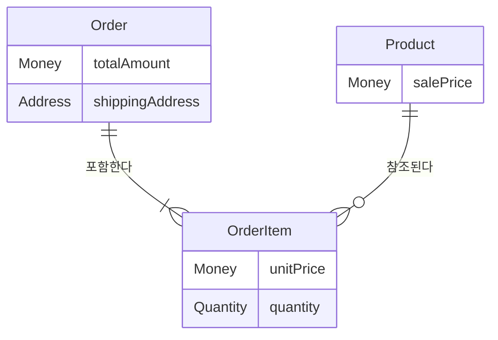
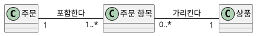
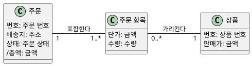
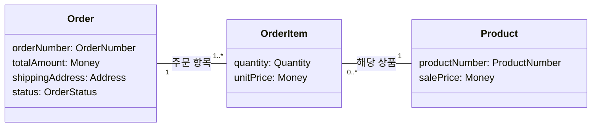

--------------------
Session 명: 04. 정적 모델
--------------------

## 목차

01. 세션 목표
02. 도메인 모델이 명시하는 것
03. 분석·설계·구현
04. 용어집
05. 판매가와 단가
06. 도메인 모델 만들기
07. 속성과 불변 조건
08. 주문 도메인 모델의 검증
09. 모델을 만들 때 사람과 AI
10. 코드와 검사로 이어지는 자리
11. 잘못된 관행
12. 실습 — 정적 모델
13. 요약

## 01. 세션 목표

**용어·관계·불변 조건**으로 업무 의미를 명시하고, 코드와 검사에서 그 의미가 유지되는지 확인할 수 있다.

- **도메인 모델의 목적과 범위**를 설명하고 분석·설계·구현을 구분한다.
- 같은 이름에 같은 뜻을 부여하고 **현재 값과 확정 값**을 구분한다.
- 요구사항에서 **개념·관계·속성**을 찾아 하나의 도메인 모델로 구성한다.
- **불변 조건**을 적고, 조건이 적용되는 시점과 범위를 구분한다.
- AI 초안의 **근거 없는 개념·속성**을 질문으로 되돌린다.
- 모델 요소가 **타입·필드·값 객체·테스트**에 이어지는 자리를 확인한다.

**강사 노트**

- 입력은 "세션 03. 요구와 수용 기준"에서 확정한 요구사항 정의서다. 기능은 "주문한다" 하나다.
- 시간과 장 수를 먼저 정하지 않고 승인한 구성안의 판단·사례·검사를 충실히 다룬다.
- 표기법을 쓰는 절차는 가르치지 않는다. 도식과 목록의 의미를 읽고 업무 예로 판정하는 것이 목적이다.

---

## 02. 도메인 모델이 명시하는 것

## 도메인 모델

**도메인 모델**은 업무에서 무엇이 존재하고, 사건이 일어나면 무엇이 어떻게 변하는지를 설명하는 분석 모델이다.

- **도메인**은 이해하고 해결하려는 업무 영역이다. 주문 업무의 상품·거래·가격 규칙을 이해해야 같은 요청을 같은 뜻으로 구현할 수 있다.
- **정적 관점**은 업무 개념·관계·속성·불변 조건을 밝힌다. 주문·주문 항목·상품의 관계와 단가·수량·총액의 조건이 여기에 해당한다.
- **동적 관점**은 업무 사건·상태·전이·상호작용을 밝힌다. 승인·거절이 같은 주문의 상태와 후속 행동에 어떤 의미인지 설명한다.
- 두 관점은 **하나의 도메인 모델**을 이루고 서로를 검증한다. 정적 구조만 그려 놓고 업무의 변화까지 설명했다고 보지 않는다.
- **설계**는 이 업무 의미를 실현할 아키텍처·객체 책임·협력·인터페이스와 기술적 결정을 더한다. 업무 규칙을 몰래 바꾸지 않는다.

**강사 노트**

- 이 정의의 범위는 사용자가 합의한 저장소 공통 용례다. guides/sw-engineering-principles.md의 「도메인 모델·설계 모델과 정적·동적 관점」을 따른다. Larman의 정적 개념도 정의를 포괄적 정의로 확대 인용하지 않는다.
- "세션 04. 정적 모델"과 "세션 05. 동적 모델"은 하나의 주문 도메인 모델을 두 관점에서 발전시킨다. 학습 순서를 고정된 개발 단계로 설명하지 않는다.
- 입력은 "세션 03. 요구와 수용 기준"의 요구사항 정의서다. 화면 구성이나 저장 구조만으로 업무 의미를 대신하지 않는다.

---

## 도메인 모델의 관점과 표현

**도메인 모델의 정적 구조**는 업무 개념을 표현한 개념 모델로 설명하고, 클래스 다이어그램으로 그릴 수 있다.

**인용문**
도메인 모델은 영역의 **개념 클래스나 실제 상황의 객체**를 시각적으로 표현한 것이다, "A domain model is a visual representation of conceptual classes or real-situation objects in a domain", [Larman 2004]

- 이 정의는 **정적 개념 구조**를 설명한다. 업무의 사건·상태·전이까지 포괄하는 도메인 모델 전체와 인용의 범위를 구별한다.

**표 — 도메인 모델과 관련 용어의 관계**
| 용어 | 무엇을 가리키는가? |
|---|---|
| **도메인 모델** | 업무 의미를 설명하는 전체 모델 |
| **정적·동적 관점** | 같은 모델의 구조와 행위를 보는 관점 |
| **개념 모델** | 구현과 분리한 개념 수준의 표현 |
| **클래스 다이어그램** | 분석·설계의 정적 구조를 그리는 표기 |


**강사 노트**

- Craig Larman, Applying UML and Patterns, 3rd ed., Prentice Hall, 2004. 인용은 tools/verify-quote.js로 확인했다. 정적 개념도의 정의이며 이 저장소의 포괄적 용례와 구별했다.
- 개념 클래스는 Java 클래스 선언을 뜻하지 않는다. 「03. 분석·설계·구현」에서 업무 의미와 실현 방법을 대조한다.
- 용어 네 개를 독립된 산출물·필수 단계로 나누지 않는다. 한 모델을 여러 그림과 파일로 표현할 수 있다.

---

## ERD와 클래스 다이어그램

**개체 관계 다이어그램(ERD)**은 업무에서 관리할 개체·속성·관계를 데이터의 관점에서 표현한다.

- **같은 업무 관계**를 읽는다. 주문은 항목 1개 이상을 포함하고, 항목은 상품 하나를 가리킨다.
- **개념 수준 ERD**는 업무 의미를 밝힌다. 물리 수준의 테이블·키·자료형은 설계에서 결정한다.

**도식 — Mermaid — 주문의 개념 수준 ERD**


- **읽는 법** — 두 막대는 하나, 갈퀴는 여럿, 작은 원은 0도 가능함을 뜻한다.
- **클래스 다이어그램과의 관계** — 개념·속성·관계는 겹치지만, ERD는 데이터 구조를 중심으로 읽는다. 두 그림 모두 단독으로 사건·전이 전체를 설명하지 못한다.

**강사 노트**

- Peter Pin-Shan Chen, The Entity-Relationship Model — Toward a Unified View of Data, 1976 원문에서 개체와 관계로 현실을 보는 관점을 확인했다. https://www.csc.lsu.edu/~chen/pdf/erd-5-pages.pdf
- 이 그림은 같은 도메인 모델의 정적 구조를 데이터 관점에서 표현한 비교 예다. 별도 필수 단계·산출물로 늘리지 않는다. 속성의 Money·Quantity 등은 업무 값의 이름이며 SQL 자료형이 아니다. 주문 항목의 식별 키·외래 키·테이블 분할은 정하지 않는다.
- IBM의 ERD 설명에서 개념·논리·물리 수준의 용례를 확인했다. https://www.ibm.com/think/topics/entity-relationship-diagram. ERD라는 표기만으로 분석·설계 수준을 판정하지 않는다.

---

## 도메인 모델과 온톨로지

**인용문**
온톨로지는 **개념화의 명시적 명세**다, "An ontology is an explicit specification of a conceptualization.", [Gruber 1993]

- **개념과 관계의 의미를 명시한다**는 관심사는 도메인 모델과 겹친다. "가격"의 뜻을 구별하는 것도 그 의미를 분명히 하는 일이다.
- 주문 모델은 **현재 구현할 업무 범위**의 개념과 규칙을 밝힌다. 모든 상품·거래 지식을 완성할 때까지 기다리지 않는다.
- 온톨로지라는 이름만으로 **별도 파일·도구·추론 체계**를 추가하지 않는다. 필요한 표현과 검증은 문제의 복잡성이 정한다.
- **도메인 모델의 용어·그림·조건 목록**이 이미 같은 의미를 밝히면 그것을 함께 고친다. 같은 뜻을 다른 문서에 다시 쓰면 변경할 원천만 늘어난다.
- "세션 03. 요구와 수용 기준"의 요구사항 정의서를 바탕으로 업무 의미를 분석하고, **도메인 모델의 정적 관점**을 남긴다.

**강사 노트**

- Thomas R. Gruber, A Translation Approach to Portable Ontology Specifications, Knowledge Acquisition, 1993. https://tomgruber.org/writing/ontolingua-kaj-1993.pdf 원문 확인.
- 정의 인용 이후의 적용은 course-design.md의 「원전 적용 결정」을 따른다. 온톨로지의 모든 용례와 도메인 모델이 동일하다고 단정하지 않는다.
- 온톨로지 언어·지식 그래프·추론 엔진의 사용법은 이 과정의 범위에 추가하지 않는다.

---

## 03. 분석·설계·구현

**인용문**
분석은 해결책보다 **문제와 요구사항의 조사**를 강조한다, "Analysis emphasizes an investigation of the problem and requirements, rather than a solution.", [Larman 2004]

**표 — 주문 금액에 관한 서로 다른 결정**
| 관점 | 질문 | 결정의 예 |
|---|---|---|
| **요구** | 어떤 결과를 원하는가? | 가격 변경 뒤에도 2,000원 |
| **분석** | 그 결과는 무엇을 뜻하는가? | 판매가와 단가의 구별 |
| **설계** | 누가 그 규칙을 지키는가? | 주문이 항목의 금액을 합산 |
| **구현** | 어떻게 실행하는가? | Money와 반복문으로 계산 |

- 분석의 **주문 항목**은 업무 개념이다. `List<OrderItem>`이나 외래 키는 그 관계를 실현하는 방법이다.
- **설계 모델도 정적 구조와 동적 협력**을 갖는다. 업무 개념의 박스 하나가 소프트웨어 클래스 하나로 자동 변환되지는 않는다.
- 코드를 보며 의미를 확인하고 모순이 나오면 **분석으로 되돌린다**. 책임 배치의 대안은 "세션 07. 설계 — 책임과 협력"에서 판단한다.

**강사 노트**

- Larman 2004 원문 확인. 표의 네 관점은 sw-engineering-principles.md의 「결정과 검증」을 주문 사례에 적용했다.
- 뒤의 Java는 한 가지 설계 예다. 본문에 보여 주는 책임 배치를 분석 모델의 필수 변환 규칙으로 설명하지 않는다.

---

## 04. 용어집

## 이름과 뜻을 함께 고정하기

**인용문**
언어의 변경은 곧 **모델의 변경**임을 인식하라, "Recognize that a change in the language is a change to the model.", [Evans 2015]

- **보편 언어**(Ubiquitous Language)는 업무 담당자와 개발자가 모델에 기반해 함께 쓰는 말이다. 코드의 이름도 그 말과 이어져야 한다.
- 이름만 맞추면 충분하지 않다. **단가**가 주문 생성 시점에 확정한 값이라는 뜻까지 같아야 한다.
- **같은 뜻**의 `itemPrice`, `orderedPrice`, `unitPrice`를 작업마다 새로 만들면 AI와 사람 모두 대응을 추측해야 한다.
- 의미가 다르면 이름을 나눈다. 상품의 **현재 판매가**와 주문 항목의 **확정 단가**를 `price` 하나로 부르면 가격 변경 규칙이 흐려진다.
- 용어집을 고치면 **도식·코드·검사**에서 그 이름을 쓰는 자리도 함께 고친다. 지난 대화를 기억할 것이라고 가정하지 않는다.

**강사 노트**

- Eric Evans, Domain-Driven Design Reference, Domain Language, 2015. Ubiquitous Language의 원문 확인. https://www.domainlanguage.com/wp-content/uploads/2016/05/DDD_Reference_2015-03.pdf
- 인용은 언어와 모델 변경의 관계다. 보편 언어의 적용 범위는 이 과정의 주문 업무로 한정한다.
- 본문 영문 이름은 과정 설계의 「영한 용어집과 명명 규칙」을 원천으로 한다.

---

## 주문의 용어집

**용어집**에는 이름뿐 아니라 업무에서 구별할 수 있는 뜻을 적는다.

**표 — 주문의 주요 용어**
| 용어 | 코드 이름 | 업무 의미 |
|---|---|---|
| **주문** | Order | 배송지 지정으로 생긴 거래 기록 |
| **주문 항목** | OrderItem | 주문에 담긴 상품·단가·수량 |
| **상품** | Product | 상품 시스템이 관리하는 주문 대상 |
| **판매가** | salePrice | 상품의 현재 가격 |
| **단가** | unitPrice | 주문 생성 시 확정한 항목 가격 |
| **주문 총액** | totalAmount | 항목별 단가×수량의 합 |

- 요구사항의 **주문 금액**과 코드의 `totalAmount`는 같은 합계를 뜻한다. 서로 다른 계산을 만들지 않는다.
- **주문 생성**과 **주문 성립**도 구분한다. 배송지를 정하면 결제대기 주문이 생기고, 카드 승인 뒤 같은 주문이 성립한다.
- 주문은 **결제대기에도 이미 존재**한다. "승인되면 주문을 새로 만든다"로 읽으면 같은 주문의 재결제라는 요구와 충돌한다.

**강사 노트**

- 용어의 원천은 course-design.md다. 표는 이번 판단에 필요한 대표 항목이고 식별자 전체 목록을 새로 만들지 않는다.
- "세션 03. 요구와 수용 기준"의 강사 실습 답은 주문 금액이라는 이름을 쓴다. 강의 용어집의 주문 총액과 같은 totalAmount이며 별개 속성으로 만들지 않는다.

---

## 05. 판매가와 단가

## 현재 값과 확정 값

**판매가**는 상품의 현재 값이고, **단가**는 주문 시점에 확정한 값이다.

**표 — 같은 상품의 서로 다른 가격**
| 시점 | 상품 판매가 | 기존 항목 단가 | 기존 주문 총액 |
|---|---|---|---|
| **주문 생성** | 1,000원 | 1,000원 | 2,000원 |
| **판매가 변경** | 1,200원 | 1,000원 | 2,000원 |

- 펜 **2개**의 주문이 생길 때 판매가 1,000원을 항목의 단가로 확정한다. 배송지는 **서울**이다.
- 상품 시스템이 판매가를 바꿔도 **이미 확정한 거래 조건**은 그대로다. 상품을 식별하는 관계와 현재 가격에 의존하는 계산은 다르다.
- 이후에 새로 생기는 주문은 **그 주문 생성 시점의 판매가**를 사용한다. 상품 가격을 영구히 1,000원으로 고정한다는 뜻이 아니다.
- 이 구별을 지우면 결제 직전의 판매가로 2,400원을 계산하기 쉽다. 계산식이 맞아도 **어느 시점의 값인지** 틀릴 수 있다.

**강사 노트**

- 판매가·단가·시점·수치 모두 course-design.md 공통 전제다. 최종 단가 확정 시점은 주문 생성이며 장바구니에 담는 시점이 아니다.
- 행은 동일한 기존 주문을 시간에 따라 관찰한 값이다. 새로운 주문에 2,000원을 보장하는 표가 아니다.

---

## 단가를 남겨야 하는 이유

**상품을 가리키는 정보**만으로는 주문 당시의 가격을 재현할 수 없다.

- 항목이 상품 번호와 수량만 갖고 **현재 판매가를 조회해 계산**하면, 같은 주문의 총액이 상품 변경에 따라 달라진다.
- 항목에 **확정 단가**를 남기면 상품의 현재 값이 바뀌어도 거래의 계산 근거가 남는다.
- 단가는 상품 정보의 불필요한 복사라기보다 **다른 시점·다른 의미의 값**이다. 이름을 나눈 이유가 저장할 이유와 이어진다.
- 같은 숫자를 여기저기 옮기는 것과 **필요한 업무 사실을 보존**하는 것을 구분한다. 원천이 다른 지식을 DRY라는 이유로 합치지 않는다.
- 판매가를 읽고 주문을 생성하는 동안 가격이 바뀌는 경우의 **일관성 보장 방법**은 연동·설계에서 확인할 사항이다.

**강사 노트**

- 학습자에게 "상품 번호만 저장하면 과거 단가를 어디서 얻는가?"를 묻는다. 이력 조회나 가격 잠금 같은 대안을 확인 없이 추가하지 않는다.
- 앞 항목은 값의 의미를 구분했고 이 항목은 그 의미를 보존할 정보가 왜 필요한지 설명한다.
- 외부 상품 조회와 주문 생성의 원자성은 뒤 Java 예제가 보장하지 않는다. 단가 확정이라는 요구가 곧 분산 처리 방식의 확정을 뜻하지 않는다.

---

## 06. 도메인 모델 만들기

## 도메인 모델을 만드는 순서

**인용문**
현재 반복의 요구로 범위를 한정해 **개념 클래스를 찾고**, 클래스로 그린 뒤 연관과 속성을 더한다, "Bounded by the current iteration requirements under design: 1. Find the conceptual classes … 2. Draw them as classes in a UML class diagram. 3. Add associations and attributes.", [Larman 2004]

- 입력은 "세션 03. 요구와 수용 기준"의 **배송지 지정·주문 생성·결제·결과 확인** 요구다. 먼저 업무 문장을 읽고 구별해야 할 대상을 찾는다.

- 개념을 찾은 뒤 **업무 관계와 속성**을 더한다. 주문 항목을 찾는 것과 그 단가를 확정하는 것은 서로 다른 판단이다.
- **구체적인 예로 되돌아가며** 모델을 고친다. 가격 변경을 대입해 뜻이 달라지는 값을 발견하면 용어와 속성을 함께 보완한다.
- 초안은 **업무 의미를 논의할 가설**이다. 이름이나 박스를 그렸다는 이유로 미정 정책까지 확정하지 않는다.

**강사 노트**

- Larman 2004의 작성 지침을 원문 확인했다. 순서는 모델을 처음 만드는 안내이지 한 번 끝낸 결정을 닫아 두는 고정 절차가 아니다.
- 입력은 "세션 03. 요구와 수용 기준"이다. 단가라는 용어를 요구 문장과 가격 변경 예로 되돌아가 찾는 과정을 설명한다.

---

## 요구사항에서 개념 찾기

**개념 후보**는 요구사항이 말하는 업무를 설명하는 데 필요한 대상인지 판단해 선택한다.

**표 — 요구사항에서 찾은 개념 후보**
| 요구의 단서 | 판단 | 모델에 반영할 것 |
|---|---|---|
| **배송지 지정 뒤 주문 생성** | 승인 전에도 주문 존재 | 주문 |
| **상품별 가격과 수량** | 주문마다 다른 거래 조건 | 주문 항목 |
| **상품 시스템의 현재 판매가** | 거래 대상과 현재 가격 | 상품 |
| **금액·수량·배송지** | 대상의 값을 설명 | 속성과 값의 종류 |
| **본인의 주문만 조회** | 주문 주체와의 연결 필요 | 식별 의미 추가 확인 |
| **승인 결과·배송 요청** | 사건과 외부 반응 | 동적 모델에서 검토 |

- **명사나 액터를 모두 클래스**로 만들지 않는다. 고객·결제·배송은 필요한 정보·관계를 확인한 뒤 구체화한다.
- **외부 시스템**의 연동 방식과 **업무 개념**의 의미는 별개다. 상품 시스템 내부를 설계하지 않아도 상품을 분석할 수 있다.

**강사 노트**

- Larman 2004의 도메인 모델 작성 지침을 원문 확인했다. 현재 반복의 범위 안에서 개념·관계·속성을 찾는 순서를 설명한다. 세부 UML 표기법은 추가하지 않는다.
- 본인 주문 확인 요구를 없애거나 해결했다고 선언하지 않는다. 강사 실습의 회원·비회원 및 본인 확인은 기존 미정이며, 주문 주체의 구체적인 식별 모델을 질문으로 남긴다.
- 결제·배송을 업무 개념으로 사용할 수 없다는 뜻이 아니다. 현재 확인된 요구가 사건·외부 요청만 정한 부분을 이력 클래스·다중성으로 추측하지 않는다는 판단이다.

---

## 주문 도메인 모델의 초안

**주문 항목**은 어떤 상품을 얼마에 몇 개 주문했는지 나타낸다.

- **주문 하나**에는 하나 이상의 항목이 있고, 항목 하나는 그 주문에 속한다.
- 각 항목은 **상품 하나**를 가리킨다. 상품은 주문되지 않았을 수도 있고 여러 주문의 항목에서 가리킬 수도 있다.
- **수량과 단가**는 상품 전체의 성질이 아니라 그 주문 항목의 조건이다. 같은 상품이어도 주문 시점에 따라 단가가 다를 수 있다.
- 상품은 **외부 상품 시스템**이 관리한다. 분석 모델에 상품이 있다고 상품 관리 기능을 주문 시스템 안에 구현하지 않는다.

**도식 — PlantUML — 주문 도메인 모델 초안**


- 박스는 **개념**, 선은 **관계**, 선 끝의 수는 상대편 하나에 연결되는 **개수**다. 아직 속성과 계산 조건을 더하기 전의 초안이다.

**강사 노트**

- 항목이 1개 이상이라는 범위는 course-design.md에 남긴 강의 예제 가정이다. 도식의 개수와 예제 생성 검사를 함께 확인한다.
- 관계의 탐색 방향·Java 필드·DB 외래 키를 정하지 않았다. 구현은 상품 번호로 대상을 가리킬 수도 있다.
- 이 모델의 Order·OrderItem·Product와 단가·수량은 「10. 코드와 검사로 이어지는 자리」의 타입·필드·계산에 이어진다.

---

## 관계를 문장으로 확인하기

**관계의 양쪽 개수**를 업무 문장으로 읽으면 잘못 연결한 대상을 찾을 수 있다.

**표 — 도식과 같은 관계를 읽는 목록**
| 관계 | 한쪽에서 읽기 | 반대쪽에서 읽기 |
|---|---|---|
| **주문과 항목** | 주문은 항목 1개 이상을 포함 | 항목은 주문 1개에 속함 |
| **항목과 상품** | 항목은 상품 1개를 가리킴 | 상품은 항목 0개 이상에 연결 |

- **주문과 상품 사이**에 수량을 두면 한 주문이 여러 상품을 담았을 때 어느 상품의 수량인지 모호해진다. 주문 항목이 그 관계의 조건을 담는다.
- 상품이 아직 주문되지 않아도 **상품은 존재**할 수 있다. 따라서 상품 하나에 주문 항목이 반드시 하나 있다고 쓰면 의미가 달라진다.
- 선이 그려졌다는 이유로 코드에서 **양쪽 참조 필드**를 모두 만들지 않는다. 업무의 관계와 참조를 따라가는 방법은 구별한다.
- 같은 상품을 항목 하나로 합칠지는 **별도 정책**이다. 현재 관계의 개수만 보고 병합 규칙을 만들어 내지 않는다.

**강사 노트**

- 표는 원전 표가 아니라 직전 도메인 모델의 관계를 문장으로 읽은 목록이다. 도식과 표가 같은 관계를 말하는지 교차 확인한다.
- 병합 여부는 계산 입력의 여러 항목을 처리할 수 있는가와 다르다. 뒤 합계 검사는 병합 정책의 수용 검사가 아니다.

---

## 07. 속성과 불변 조건

## 값의 뜻과 허용 범위

**속성**은 값의 이름뿐 아니라 어느 개념의 어떤 값인지를 정한다.

**표 — 속성과 값의 종류**
| 개념 | 속성 | 값의 종류·뜻 |
|---|---|---|
| **주문** | 주문 번호 | OrderNumber, 주문 식별 |
| **주문** | 배송지 | Address, 확정한 목적지 |
| **주문** | 주문 상태 | OrderStatus, 현재 상황 |
| **주문 항목** | 단가 | Money, 확정한 항목 가격 |
| **주문 항목** | 수량 | Quantity, 주문한 개수 |
| **상품** | 판매가 | Money, 현재 상품 가격 |

- 강의 예제의 **교육용 가정**은 금액 0원 이상·원 단위 정수, 수량 1 이상의 정수, 주문 항목 1개 이상이다.
- `Money`와 `Quantity`는 숫자로 표현해도 **뜻과 허용 범위가 다르다**. 타입을 나누면 바꿔 넣는 실수를 줄이고 각 값의 검사를 모을 수 있다.
- 주문 번호의 발급 방식, 주소의 세부 형식, 수량 상한은 이 가정으로 정해지지 않는다. 필요한 때 **업무 질문**으로 확인한다.

**강사 노트**

- 값 객체라는 구현 방법은 「값 객체로 범위를 지키기」에서 보인다. 이 도식의 속성 타입만으로 Java record가 필수인 것은 아니다.
- 숫자 범위는 실제 쇼핑몰의 보편 규칙으로 제시하지 않는다. 강의 예제에 추가한 가정을 course-design.md에 기록했다.
- 주문 상태의 전이와 사건은 "세션 05. 동적 모델"에서 다룬다. 도메인 모델의 상태 속성만으로 가능한 행동을 모두 확정하지 않는다.

---

## 불변 조건과 시점의 조건

**불변 조건**은 유효한 모델이 지켜야 할 조건이며, 어느 시점과 범위에 적용되는지 함께 적는다.

- **항상 성립할 계산 관계**는 `주문 총액 = Σ(항목 단가 × 수량)`이다. 현재 판매가로 바꾸어 계산하면 이 관계의 뜻을 어긴다.
- **생성 시점의 조건**은 `단가 = 주문 생성 시점의 판매가`다. 생성한 뒤에도 현재 판매가와 같아야 한다는 조건이 아니다.
- **생성 전후를 비교할 조건**은 판매가가 바뀌어도 기존 항목의 단가와 총액이 유지된다는 것이다. 변경 전후의 값을 함께 검사한다.
- **값의 조건**은 수량 1 이상, 금액 0 이상이다. 값 하나를 만들 때 확인할 수 있다.
- 승인 뒤 배송 요청이라는 **행동의 순서**는 총액 계산과 다른 규칙이다. 사건·전이·호출 순서의 검사로 이어진다.

**강사 노트**

- 모델이 유효한 관찰 지점과 연산 전후를 구분해 설명한다. 업무의 모든 시간적 제약을 현재 값 하나의 등식으로 바꾸지 않는다.
- 단가가 현재 판매가와 다르다는 것은 오류가 아니다. 생성 시점에 올바르게 확정했는지와 이후 값을 보존했는지가 판정 대상이다.
- 승인 뒤 배송 요청 실패는 여전히 미정이다. 실패 뒤 상태나 보상 동작을 불변 조건에 추가하지 않는다.

---

## 조건을 어긴 예 찾기

**반례**는 계산식과 시점의 의미를 각각 어기는지 확인한다.

**표 — 같은 주문의 정상 값과 반례**
| 관찰 | 정상 값 | 반례와 원인 |
|---|---|---|
| **생성 당시 단가** | 1,000원 | 1,200원: 잘못된 확정 값 |
| **수량 2개의 총액** | 2,000원 | 1,000원: 수량 누락 |
| **가격 변경 뒤 총액** | 2,000원 | 2,400원: 현재 판매가 사용 |
| **항목 없는 주문** | 생성 거절 | 총액 0원만 반환: 개수 위반 |

- **2,000원이라는 숫자만** 맞아도 충분하지 않다. 단가·수량을 확인하고, 판매가를 바꾼 뒤 다시 계산해야 원인을 구별할 수 있다.
- 대표 주문 한 건으로는 **모든 항목의 합**을 확인할 수 없다. 계산 검사에서는 항목 수를 바꿔 일부만 합하는 구현을 드러낸다.
- 구현이 낸 숫자를 그대로 기대값으로 복사하지 않는다. **업무 규칙에서 기대값을 먼저** 계산한다.

**강사 노트**

- 빈 주문의 거절은 명시한 교육용 가정에 근거한다. 0원 상품이 허용되는 것과 주문 항목이 없는 것은 다르다.
- 이후 코드 테스트는 18개의 검사 묶음을 실행하며 그중 한 묶음이 계산 입력의 항목 수 1~20개를 확인한다. 이것을 주문 정책의 대표 사례 20개라고 설명하지 않는다.

---

## 08. 주문 도메인 모델의 검증

## 주문 도메인 모델의 상세화

**도메인 모델**은 개념·관계에 속성과 조건을 더해, 요구사항에서 사용하는 업무의 뜻을 명시한다.

**도식 — PlantUML — 주문 도메인 모델**


- **단가**는 주문 생성 시점의 판매가이며, **총액**은 모든 항목의 단가×수량의 합이다. `/총액`은 다른 값에서 계산하는 값이다.
- **관계·속성·조건**을 함께 읽는다. 주문 항목을 빼면 상품별 수량·확정 단가가 갈 곳을 잃고, 단가를 빼면 가격 변경 전의 금액을 설명할 수 없다.
- 이 모델은 **주문 내용과 금액**의 의미를 구체화했다. 본인 확인의 식별 의미와 결제 이력 구조는 확인할 대상으로 남긴다.

**강사 노트**

- 초안과 같은 세 개념·두 관계를 유지하고 앞에서 판단한 속성·조건을 결합했다. 관계나 속성을 어디서 얻었는지 설명할 수 있어야 한다.
- 요구사항 전체가 분석 완료됐다고 주장하지 않는다. 본인 확인은 요구에 있고 구체 식별 모델은 미정이다. 행동과 외부 요청의 순서는 "세션 05. 동적 모델"에서 확인한다.
- 도식의 주문·항목·상품, 단가·수량·판매가·총액은 「10. 코드와 검사로 이어지는 자리」에서 타입·필드·테스트로 이어진다. 표기법 상세 대신 모델의 의미를 판단한다.

---

## 구체적인 주문과 대조하기

**구체적인 주문 하나**를 대입하면 관계와 계산의 모순을 찾을 수 있다.

- **서울**로 받는 주문에는 **펜 2개**인 항목이 하나 있고, 확정 단가는 **1,000원**, 총액은 **2,000원**이다.
- 아래 연결선은 그 주문과 항목과 상품의 **연결 관계**다. 호출 순서나 저장 순서를 나타내지 않는다.

**도식 — SVG — 주문 인스턴스**
```svg:uml
<svg xmlns="http://www.w3.org/2000/svg" width="810" height="185" viewBox="0 0 810 185" aria-label="서울로 받는 결제대기 주문이 펜 2개인 주문 항목 하나를 포함하고, 항목이 현재 판매가 1200원인 펜 상품을 가리킨다. 확정 단가는 1000원이고 주문 총액은 2000원이다.">
<g fill="white" stroke="#333" stroke-width="1.4"><rect x="10" y="20" width="230" height="150"/><rect x="290" y="20" width="230" height="150"/><rect x="570" y="20" width="230" height="150"/><path d="M240 94H290M520 94H570" fill="none"/><path d="M10 55H240M290 55H520M570 55H800"/></g>
<g font-family="Malgun Gothic, sans-serif" font-size="17" fill="#222"><g text-anchor="middle" font-weight="bold" text-decoration="underline"><text x="125" y="44">:주문</text><text x="405" y="44">:주문 항목</text><text x="685" y="44">펜:상품</text></g><text x="24" y="84">배송지 = 서울</text><text x="24" y="117">주문 상태 = 결제대기</text><text x="24" y="150">/주문 총액 = 2,000원</text><text x="304" y="84">단가 = 1,000원</text><text x="304" y="117">수량 = 2개</text><text x="584" y="84">판매가 = 1,200원</text><text x="584" y="117">상품 번호 = PEN</text></g></svg>
```

- **판매가 변경 뒤**의 값이다. 단가 1,000원과 현재 판매가 1,200원이 달라도, 그 주문의 규칙은 충족한다.
- 상품 번호 `PEN`은 **펜을 식별하는 예제 값**이다. 실제 상품 번호의 형식 규칙을 정한 것은 아니다.

**강사 노트**

- SVG는 같은 크기의 박스를 사용하며 이름 아래 줄은 인스턴스를 표시한다. UML 표기법 상세는 설명하지 않는다.
- 주문·항목·상품은 뒤 코드의 Order·OrderItem·Product로, 단가·수량은 unitPrice·quantity로 이어진다. 코드의 상품 번호 PEN과 같다.
- 이 인스턴스 도식은 가격 변경 이후를 의도적으로 보여 준다. 수업에서는 먼저 총액을 예측하게 한 뒤 코드 출력을 확인한다.

---

## 09. 모델을 만들 때 사람과 AI

## 초안을 판단할 근거

**AI가 제안한 개념과 속성**은 요구와 업무 예에서 근거를 찾아 채택한다.

**인용문**

LLM은 구문이 맞는 UML을 만들 수 있지만 **의미의 품질**에서 어려움을 겪고, 특히 다이어그램의 **규모가 커지면** 자연어와 잘 맞지 않는다, "Although LLMs can generate syntactically correct UML code, they are struggling with semantic quality and tend to align poorly with natural languages, especially when the diagram scale is large.", [Gao 외 2025]

- **입력**은 "세션 03. 요구와 수용 기준"의 요구사항 정의서다. 용어집·관계·속성·조건과 도식을 함께 요청한다.
- **사람**은 판매가와 단가의 의미, 관계의 개수, 값의 허용 범위를 업무 담당자와 확인한다.
- **AI**는 같은 대상을 다르게 부른 곳과 계산·관계의 모순을 찾아 초안과 질문을 만든다.
- `Member`, 할인율, 재고 예약 같은 제안이 나오면 **어느 요구를 설명하는지** 확인한다. 흔한 쇼핑몰 기능이라는 이유만으로 채택하지 않는다.
- 근거가 없으면 **삭제하거나 질문**으로 남긴다. 필요한 의미가 빠졌다면 먼저 요구를 확인하고 용어집·모델을 함께 고친다.

**강사 노트**

- 인용 근거: [Gao 외 2025] 원문 확인. 구문이 맞는다는 것이 업무 의미가 맞는다는 뜻은 아니므로, 판정의 근거는 도식의 문법이 아니라 용어·관계·조건의 목록이다.
- Member·할인율·재고 예약은 검토할 가상의 제안이며 실제 실행한 초안이 생성했다고 주장하지 않는다.
- 실제 강사 예시는 code/s04/exercise-conversation/order/의 입력·응답을 쓴다. 받은 응답마다 검토하고 후속 질문을 작성한다.
- 사람과 AI의 역할은 검토 책임의 구분이다. 사람이 도식을 직접 그려야 한다는 의미가 아니다.

---

## 실제 초안에서 고친 판단

**초안의 질문과 단정**을 구별하면 사람이 결정할 자리가 드러난다.

**표 — 실제 초안에 준 피드백**
| 초안의 표현 | 판단 | 보완 방향 |
|---|---|---|
| **확정 가격 이름을 질문** | 의미 확인 필요 | unitPrice로 합의 |
| **수량·금액 범위를 질문** | 입력에 근거 없음 | 예제의 허용 범위 합의 |
| **회원·비회원 여부를 질문** | 기존 미정 | Member를 확정하지 않음 |
| **상태를 두 값으로 제한** | 현재 정보의 과도한 일반화 | 확인한 값과 전체 범위를 구별 |
| **값 타입마다 관계선을 추가** | 속성과 관계의 중복 표현 | 값 타입은 속성에 표시 |

- 질문을 남긴 것은 **검토할 빈틈을 드러낸 결과**다. 반대로 현재 아는 상태를 가능한 상태 전부로 닫으면 뒤 분석의 여지를 숨긴다.
- 도메인 모델의 **정적 관점에는 현재 상태라는 속성**을 둔다. 상태의 전체 범위·사건·전이는 "세션 05. 동적 모델"에서 확인한다.
- 답변을 고친 뒤에는 **도식과 목록**을 다시 대조한다. 문장만 고치고 도식의 이전 이름을 남기면 같은 혼동이 반복된다.

**강사 노트**

- 실제 codex-response-01.md의 상태 범위 조건과 질문, prompt-02.txt의 피드백에 근거한다. 초안이 쿠폰이나 회원 클래스를 실제로 만들었다고 설명하지 않는다.
- 앞 실습의 최종 답에는 결제대기·결제완료가 확인돼 있다. 강의 공통 전제의 전체 네 상태와 실습 시점의 확인 범위를 혼동하지 않는다.
- 도식 단순화는 업무 관계를 지우는 일이 아니라 속성 타입과 선으로 중복 표현한 정보를 정리한 것이다.

---

## 10. 코드와 검사로 이어지는 자리

## 모델 요소와 코드의 대응

**모델의 의미**는 코드의 이름과 타입에 드러나고, 불변 조건은 실행하는 검사로 확인한다.

**표 — 업무 의미를 보존하는 한 가지 구현**
| 모델 요소 | Java 예 | 확인할 의미 |
|---|---|---|
| **주문·항목·상품** | Order·OrderItem·Product | 개념과 이름의 대응 |
| **단가·판매가** | unitPrice·salePrice | 확정 값과 현재 값 구별 |
| **금액·수량** | Money·Quantity | 값의 뜻과 범위 |
| **주문과 항목의 관계** | List<OrderItem> | 항목 1개 이상 |
| **항목과 상품의 관계** | ProductNumber | 어떤 상품인지 식별 |
| **파생 주문 총액** | totalAmount() | 단가×수량의 합 |

- **참조 방향·컬렉션·record·계산 위치**는 이 예제의 설계 선택이다. 분석 도식만으로 자동 결정되지 않는다.
- 상품은 외부 정보의 **로컬 예제 표현**이다. 상품 시스템의 내부 기능이나 실제 연동을 구현한 것이 아니다.

**강사 노트**

- 전체 원본은 code/s04/static-model/src/다. 저장소 루트에서 node courses/ai-native/sessions/code/s04/static-model/run.mjs로 컴파일·실행한다. JDK 17 이상을 쓴다.
- 기존 code/s04/order와 architecture는 전면 보완 전 자료다. 이 원고의 발췌 원본은 static-model로 명시해 구별한다.
- 다음 코드들은 업무 의미가 어떻게 드러나는지 보여 주는 연결 예시다. 책임 배치의 대안과 협력은 "세션 07. 설계 — 책임과 협력"에서 다룬다.

---

## 값 객체로 범위를 지키기

**값 객체**(Value Object)는 식별자보다 값으로 비교하는 객체이며, 값의 뜻과 유효한 범위를 타입으로 나타낼 수 있다.

```java
public record Quantity(int value) {
    public Quantity {
        if (value < 1) throw new IllegalArgumentException("수량은 1 이상");
    }
}

// ... 파일 구분을 위해 package 선언 생략
public record Money(long won) {
    public static final Money ZERO = new Money(0);
    public Money {
        if (won < 0) throw new IllegalArgumentException("금액은 0 이상");
    }
    public Money plus(Money other) {
        return new Money(Math.addExact(won, other.won));
    }
    public Money times(Quantity quantity) {
        return new Money(Math.multiplyExact(won, quantity.value()));
    }
}
```

- `Money.times`는 **Quantity**를 받는다. 같은 숫자 표현이라도 금액과 수량을 뒤바꿔 넘길 수 없다.
- `record`는 필드 교체를 막고 값 비교를 제공한다. 원 단위 정수와 **long의 범위 초과 검출**은 예제의 표현 방식이다.
- **0원은 허용**하고 0개는 거절한다. 두 값의 범위를 같은 검사로 합치지 않는다.

**강사 노트**

- 원본은 static-model/src/order/Money.java·Quantity.java다. public record 둘은 각 파일에 둔다. 슬라이드는 두 파일의 발췌다.
- 값 객체는 식별자로 구별하기보다 값으로 비교하는 구현 개념이다. Java record 하나로 불변성이 항상 완성되는 것은 아니며 여기서는 primitive 필드만 사용한다.
- 금액 0 이상·수량 1 이상은 교육용 가정이다. 실제 통화·세금·반올림·환불의 음수 금액을 일반적으로 금지하는 모델로 설명하지 않는다.

---

## 확정 단가를 항목에 남기기

**항목 생성 때 판매가를 단가로 옮겨 두면** 상품의 이후 가격 변경과 분리할 수 있다.

```java
public record OrderItem(ProductNumber productNumber,
                        Money unitPrice, Quantity quantity) {
    public OrderItem {
        Objects.requireNonNull(productNumber);
        Objects.requireNonNull(unitPrice);
        Objects.requireNonNull(quantity);
    }
    public static OrderItem confirm(Product product, Quantity quantity) {
        return new OrderItem(product.number(), product.salePrice(), quantity);
    }
}
```

- `productNumber`는 **어떤 상품인지**, `unitPrice`는 **얼마에 주문했는지**를 나타낸다. 상품 번호를 보존해도 단가가 자동 보존되지는 않는다.
- `Money`는 불변 값이다. 상품의 판매가 필드를 새 `Money`로 바꿔도 **기존 항목이 가진 값**은 그대로다.
- 상품을 읽는 `confirm`은 **주문 생성 때 호출하는 예시**다. 장바구니에 담을 때 호출해 두고 오래된 값을 쓰면 시점의 요구를 충족하지 못한다.
- 직접 생성자도 열려 있으므로 **모든 호출 경로의 올바른 확정 시점**까지 타입 하나가 보장하지는 않는다.

**강사 노트**

- 원본은 static-model/src/order/OrderItem.java다. Objects import는 슬라이드에서 생략했다.
- confirm이라는 이름은 영한 용어집의 「확정한다」와 같다. 생성 책임을 이 타입에 둔 것은 한 가지 설계 선택이다.
- 프로세스가 외부 상품 가격을 읽는 시점의 일관성은 별도 연동·설계 문제다. 스냅샷만으로 분산 동시성을 해결했다고 설명하지 않는다.

---

## 관계를 보존하고 총액 계산하기

**확정된 항목을 보존하고 그 단가를 합산하면** 현재 판매가를 다시 읽지 않고 총액을 계산할 수 있다.

```java
    public Order(OrderNumber number, List<OrderItem> items, Address shippingAddress) {
        if (items.isEmpty()) throw new IllegalArgumentException("주문 항목은 1개 이상");
        this.number = Objects.requireNonNull(number);
        this.items = List.copyOf(items);
        this.shippingAddress = Objects.requireNonNull(shippingAddress);
    }

    // ... 조회 메서드 생략
    public Money totalAmount() {
        Money total = Money.ZERO;
        for (OrderItem item : items) {
            total = total.plus(item.unitPrice().times(item.quantity()));
        }
        return total;
    }
```

- `List.copyOf`는 호출자의 목록과 **주문이 보존한 목록**을 분리한다. 항목도 불변 값으로 두어 바깥에서 단가·수량을 교체하지 못하게 한다.
- `totalAmount()`는 **모든 항목**을 순회하고 `unitPrice`를 사용한다. 상품의 현재 `salePrice`를 읽는 의존이 없다.
- 총액을 **계산**하면 항목 합계와 별도 저장 총액이 어긋나는 자리를 줄인다. 저장하는 설계도 가능하지만 일치 조건을 지켜야 한다.

**강사 노트**

- 원본은 static-model/src/order/Order.java의 생성자와 totalAmount다. 필드 선언·조회 메서드·초기 상태는 전체 원본에 있다.
- 목록 복사는 얕은 복사지만 OrderItem·Money·Quantity·ProductNumber가 불변이라 이 예제의 항목 값이 외부에서 바뀌지 않는다.
- 상태 필드는 PENDING_PAYMENT로 초기화한 읽기 전용 예다. 결제·배송 상태를 바꾸는 메서드는 이 정적 예제에 넣지 않았다.

---

## 가격 변경을 실행해 확인하기

**가격 변경 전후를 비교하는 테스트**는 확정 단가와 현재 판매가를 혼동한 구현을 드러낸다.

```java
        Product pen = new Product(new ProductNumber("PEN"), new Money(1000));
        OrderItem item = OrderItem.confirm(pen, new Quantity(2));
        var inputItems = new ArrayList<>(List.of(item));
        Order order = new Order(new OrderNumber("ORDER"), inputItems, new Address("서울"));
        equal(new Money(2000), order.totalAmount(), "단가×수량의 합");
        equal(new ProductNumber("PEN"), item.productNumber(), "상품 식별자 유지");
        equal(new Address("서울"), order.shippingAddress(), "배송지 유지");
        equal(OrderStatus.PENDING_PAYMENT, order.status(), "생성 상태");

        pen.changeSalePrice(new Money(1200));
        equal(new Money(1200), pen.salePrice(), "상품의 현재 판매가 변경");
        equal(new Money(1000), item.unitPrice(), "기존 항목의 확정 단가 유지");
        equal(new Money(2000), order.totalAmount(), "가격 변경 후 기존 주문 총액 유지");
        equal(new Money(1200), OrderItem.confirm(pen, new Quantity(2)).unitPrice(),
              "이후 확정하는 항목은 현재 판매가 사용");
```

- 먼저 기존 주문 총액이 **2,000원**인지 예측한다. 판매가를 바꾼 뒤에는 상품 **1,200원**, 기존 항목 **1,000원**을 각각 확인한다.
- 마지막 검사는 **새로 확정하는 항목**의 단가다. 기존 값의 보존과 새로운 값의 반영을 함께 확인한다.
- 펜 2개인 주문이 통과해도 **결제 요청 금액·배송 요청 순서**는 아직 확인하지 않았다. 그 기대값은 해당 행동의 검사로 연결한다.

**강사 노트**

- 원본은 static-model/src/test/StaticModelTest.java다. 상품 번호·배송지·초기 상태 확인을 포함한 앞부분의 발췌다. equal은 기대값 불일치 때 AssertionError를 던진다.
- Product.changeSalePrice는 테스트가 외부 상품의 가격 변경 상황을 만드는 로컬 도구다. 상품 관리 기능을 주문 시스템의 과제에 추가하지 않는다.
- 주문 번호 ORDER는 코드용 식별 값이며 본문 관통 사례를 별도 사례 번호로 부르는 것이 아니다.

---

## 경계와 검사 범위

**계산·값·관계의 검사**를 나누면 어느 의미를 어겼는지 더 가까이에서 알 수 있다.

**표 — 실행하는 검사와 남은 범위**
| 검사 대상 | 실행하는 확인 |
|---|---|
| **계산** | 단가×수량, 전 항목 합산 |
| **확정 값** | 가격 변경 뒤 단가·총액 유지 |
| **관계** | 빈 주문 거절, 목록 변경 방지 |
| **값** | 수량 0·음수 거절, 금액 0 허용 |
| **표현 범위** | long 덧셈·곱셈 범위 초과 검출 |

- **18개 검사 묶음**을 통과했다. 합산은 **계산 입력 1~20개**로 확인했으며, 중복 상품의 병합 정책을 검사한 것은 아니다.
- **결제·배송·전이·영속·외부 조회의 동시성**은 확인하지 않았다. 승인 뒤 배송 요청 실패는 미정이다.
- 실패하면 **기대값·모델·구현**을 대조한다. 통과시키려고 단가의 뜻을 현재 판매가로 바꾸지 않는다.

**강사 노트**

- 실행: node courses/ai-native/sessions/code/s04/static-model/run.mjs. 외부 서비스와 라이브러리를 호출하지 않고 JDK로 임시 폴더에 컴파일한다.
- 18개는 이 강의 예제의 실행 결과이지 테스트의 충분성을 보장하는 숫자가 아니다. 본문에서는 대표 업무 예와 별개인 계산 입력 범위를 함께 밝힌다.
- 상태 전이·호출 순서는 "세션 05. 동적 모델"에서, 책임의 배치는 "세션 07. 설계 — 책임과 협력"에서 이어진다.

---

## 11. 잘못된 관행

**이름만 맞추고 값의 의미와 관계를 확인하지 않으면** 같은 오류가 코드에 남는다.

**표 — 정적 모델의 잘못된 관행**
| 관행 | 놓친 의미 | 바꿀 판단 |
|---|---|---|
| **가격을 price 하나로 표현** | 현재 값과 확정 값 | 판매가·단가를 구별 |
| **명사마다 클래스를 추가** | 현재 업무의 범위 | 요구·예에서 근거 확인 |
| **항목 없이 상품만 연결** | 주문별 수량·단가 | 주문 항목으로 조건 표현 |
| **DB 구조를 그대로 모델로 사용** | 업무의 개념과 관계 | 먼저 업무 문장으로 읽기 |
| **다이어그램만 검토** | 값·관계의 실제 모순 | 구체 예와 실행 검사 |

- 표기가 맞아도 **업무 의미**는 틀릴 수 있다. 선의 개수를 맞춘 뒤 같은 주문에 값을 넣어 확인한다.
- 모델을 세밀하게 그리는 데서 멈추지 않는다. **다음 구현과 검사의 판단이 달라지는 정보**를 남긴다.
- 상태 전이·서비스·저장소를 한 도식에 모으면 질문이 섞인다. **개념의 의미와 실현 방법**을 구별해 검토한다.

**강사 노트**

- 데이터 모델 자체를 낮은 수준의 산출물이라고 설명하지 않는다. 도메인 개념의 분석과 저장 구조의 목적이 다르다는 뜻이다.
- 업무 복잡성이 낮으면 가벼운 용어와 예로 충분할 수 있다. 지금 모델을 쓰는 이유는 가격·관계의 의미가 구현과 검사에 실제 영향을 주기 때문이다.

---

## 12. 실습 — 정적 모델

**실습 3의 요구사항 정의서**로 도메인 모델의 정적 구조를 만들고, ②~④에 **질문의 답과 수정 요청**을 적어 완성한다.

**프롬프트 — 요청사항 포함**
  + ① "실습 3의 요구사항 정의서로 **도메인 모델의 정적 구조**를 제안해라. 용어·개념·관계·속성·조건을 담고 클래스 다이어그램과 같은 뜻의 목록을 보여 주고 없는 정책은 질문해라. 설계·구현·상태 전이는 만들지 마라."
  + ② "[앞선 질문에 대한 답]과 [추가 질문·수정 요청]을 적는다. **근거 없는 개념·속성**을 걸러내고 현재 판매가와 확정 단가를 구별해라."
  + ③ "[앞선 질문에 대한 답]과 [추가 질문·수정 요청]을 적는다. **관계의 개수·값의 범위·불변 조건**을 구체적인 주문에 대입해 확인하고 생성 시점과 변경 뒤의 조건을 구별해라."
  + ④ "[앞선 질문에 대한 답]과 [추가 질문·수정 요청]을 적는다. **도식과 목록의 이름·관계·조건**을 대조하고 필요한 미정만 이유와 함께 남겨라."
  + ⑤ "합의한 **도메인 모델의 정적 관점을 Markdown 파일**로 생성해라. 용어·관계·속성·조건·클래스 다이어그램 원본과 대표 예를 보존하고 새 정책·설계는 추가하지 마라."

**점검 항목**
  1. **근거** — 요구에 없는 개념·속성을 확정했는가?
  2. **의미** — 판매가와 단가의 시점이 구별되는가?
  3. **관계** — 도식과 목록의 대상·개수가 같은가?
  4. **조건** — 합계·값의 범위·변경 전후를 예로 확인했는가?
  5. **경계** — 구현 결정과 미정 정책을 섞지 않았는가?

**결과물**
  + **도메인 모델의 정적 관점을 담은 최종 MD**를 저장소의 `docs`에 두고 커밋한다. 실습 5에 요구사항 정의서와 함께 명시적으로 첨부한다.

**강사 노트**

- 별첨의 실제 응답이 부르는 정적 업무 모델은 본문의 도메인 모델 가운데 정적 구조를 표현한 결과다. 별도 모델이나 단계로 소개하지 않으며 원본 응답은 용어를 맞추려고 편집하지 않는다.
- 실제 실행 입력은 code/s04/exercise-conversation/order/input-s03.md다. 실습 3의 최종 응답을 바이트 그대로 복사했다. 전체 입력·실제 응답·이벤트·메타데이터는 같은 폴더에 보존한다.
- 학습자용 문구와 달리 실제 후속 요청은 받은 응답의 질문에 대한 답과 발견한 문제를 구체적으로 포함한다. ①~⑤는 고정 대화 횟수가 아니다.
- 수강생은 자신의 업무 결정을 이어 쓴다. 강사의 원 단위·금액 0 이상·수량 1 이상 결정을 그대로 답할 필요는 없다.
- 대화창에서 도식을 그려 보게 한다. 코드만 표시되면 그림을 볼 수 있는 환경에서 확인하며 코드 표시를 시각 검토로 간주하지 않는다. 최종 MD에는 도식 원본을 보존한다.
- ※ 현행화 기준: 단가의 정의와 수량·금액·항목 수의 합의는 실습 3의 요구사항 정의서·용어집에 반영한다. 상태·결제 이력·회원 정책의 미정은 확정하지 않고 후속 입력에도 보존한다. 지난 실습 응답 원본은 고치지 않고 되돌릴 사항만 기록한다.

---

## 13. 요약

### 같은 것을 같은 이름으로

- **용어집**은 업무의 뜻을 고정하고 코드의 이름으로 이어진다.
- **판매가와 단가**는 현재 값과 확정 값이므로 구별한다.
- **도메인 모델**은 정적 구조와 동적 행위를 함께 설명한다.
- **불변 조건**은 값·계산·변경 전후의 검사로 확인한다.
- **정적 구조의 관계와 조건**을 구체적인 주문과 대조해 검증한다.

### 다음 세션

- "세션 05. 동적 모델"은 **사건이 상태를 바꾸는 조건과 허용·금지된 순서**를 정한다.

**강사 노트**

- 모델에서 보완된 내용은 판매가와 구별한 단가, 관계의 개수, 총액·값의 조건이다. 실제 실습의 새로운 합의는 요구사항 정의서에도 되돌린다.
- 이 정적 코드가 통과해도 승인 전 배송 요청이나 거절 뒤 재결제의 행동은 검증되지 않았다. 그 빈틈이 다음 세션의 입력이다.

---

## 별첨. 실습 답

## “주문한다” 정적 업무 모델

**실제 LLM 응답**

**문서 형식 — 10pt**

이 정적 모델은 주문·주문 항목·상품의 관계와, 주문 생성 시점의 판매가를 단가로 확정하여 각 항목의 확정 단가에 수량을 곱한 금액의 합계로 주문 금액을 유지하는 조건을 명시한다.

### 1. 용어와 속성

- 주문 `Order`
  - `orderNumber: OrderNumber`: 주문 식별 값
  - `totalAmount: Money`: 주문 항목별 확정 단가와 수량으로 계산한 주문 금액
  - `shippingAddress: Address`: 주문 생성 시 확정된 배송지
  - `status: OrderStatus`: 주문의 현재 상태

- 주문 항목 `OrderItem`
  - `quantity: Quantity`: 주문한 상품의 수량
  - `unitPrice: Money`: 주문 생성 시점의 `salePrice`로 확정된 단가

- 상품 `Product`
  - `productNumber: ProductNumber`: 상품 식별 값
  - `salePrice: Money`: 상품의 현재 판매가

- `Money`: 원 단위의 0 이상 정수
- `Quantity`: 1 이상의 정수
- `Address`: 주문에 확정된 배송지 값
- `OrderNumber`: 주문 식별 값
- `ProductNumber`: 상품 식별 값
- `OrderStatus`: 주문의 현재 상태 값. 현재 확인된 값은 `PENDING_PAYMENT`와 `PAID`이며 가능한 상태 전체가 확정된 것은 아니다.

### 2. 클래스 도식과 관계

관계선은 업무상 관계와 개수만 나타내며 연관 방향이나 저장 방식을 정하지 않는다.



1. 하나의 `Order`에는 `OrderItem`이 1개 이상 있다.
2. 하나의 `OrderItem`은 정확히 하나의 `Order`에 속한다.
3. 하나의 `OrderItem`은 정확히 하나의 `Product`에 해당한다.
4. 하나의 `Product`는 0개 이상의 `OrderItem`과 관계를 맺을 수 있다.

### 3. 조건과 대표 예

- `salePrice`, `unitPrice`, `totalAmount`는 원 단위의 0 이상 정수다.
- `quantity`는 1 이상의 정수다.
- 하나의 `Order`에는 `OrderItem`이 1개 이상 있고 `shippingAddress`가 존재한다.
- 유효한 주문에서는 다음 합계 등식이 항상 성립한다.

  ```text
  Order.totalAmount
  = Σ(OrderItem.unitPrice × OrderItem.quantity)
  ```

- `unitPrice`는 장바구니에 담은 시점이 아니라 `Order` 생성 시점의 해당 `Product.salePrice`로 확정된다.
- 생성 이후 현재 `salePrice`가 변경되어도 기존 `unitPrice`와 `totalAmount`는 변하지 않는다.
- `PENDING_PAYMENT`인 기존 주문에서는 주문 항목의 구성, 각 항목의 `quantity`와 `unitPrice`, `shippingAddress`가 변경되지 않는다.

대표 주문과 판매가 변경 전후는 다음과 같다.

| 값 | 주문 생성 직후 | 판매가 변경 후 |
|---|---:|---:|
| 상품 | 펜 | 펜 |
| `OrderItem` 수 | 1 | 1 |
| `Product.salePrice` | 1,000원 | 1,200원 |
| `OrderItem.unitPrice` | 1,000원 | 1,000원 |
| `OrderItem.quantity` | 2 | 2 |
| `Order.totalAmount` | 2,000원 | 2,000원 |
| `Order.shippingAddress` | 서울 | 서울 |

생성 시점에는 `unitPrice = salePrice = 1,000원`이고, `totalAmount = 1,000원 × 2 = 2,000원`이다. 이후 현재 판매가가 1,200원으로 바뀌어도 기존 주문은 확정 단가 1,000원과 총액 2,000원을 유지한다.

### 4. 정하지 않은 항목과 기존 업무 미정

본인 주문에 대해서만 조회 또는 변경 요청의 권한을 인정하며 다른 고객의 주문 요청은 거절한다. 주문자와 수령인은 같은 사람으로 본다. 다만 회원·비회원 여부와 주문 주체, 본인 확인, 주문자 및 수령인을 나타낼 구체 타입이나 식별 정보는 정하지 않는다.

정적 모델에서 다음 사항은 정하지 않는다.

- `OrderNumber`와 `ProductNumber`의 형식 및 생성 규칙
- `Address`의 세부 항목
- `Quantity`의 구체적인 상한
- 동일 상품 주문 항목의 병합 여부와 중복 허용 여부
- 결제 이력과 승인 결과의 보존 구조
- 현재 확인된 값 이외의 `OrderStatus`

기존 업무 미정은 다음과 같다.

- 결제대기 기한과 만료 정책
- 결제 응답을 확정할 수 없을 때의 처리와 재결제 허용 여부
- 재고 판단 시점과 승인 전 재고 부족 처리
- 카드 승인 뒤 재고 부족 처리
- 배송 요청 실패 처리와 재요청 기준
- 주문 결과의 별도 통지 여부와 담당 시스템

이 미정 사항으로부터 허용 또는 금지 정책, 새로운 개념이나 상태를 도출하지 않는다.

**강사 노트**

- 실제 최종 응답의 전문이다. 원본은 `code/s04/exercise-conversation/order/주문한다-정적모델.md`이며 문장·도식·표·원래 강조를 편집하지 않았다. 제목 단계와 목록 들여쓰기만 Session Source 형식으로 변환했다.
- 사용자 배치 요청으로 Mermaid에 `direction LR` 한 줄만 추가해 클래스를 가로로 배치했다. 도식은 위, 설명은 아래에 둔다.
