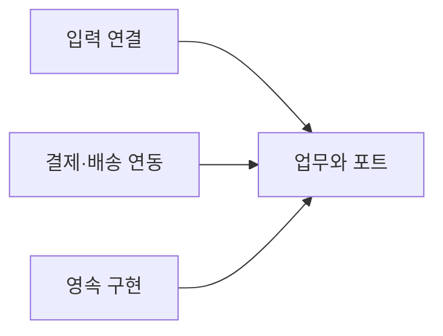
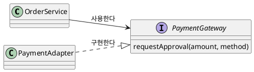
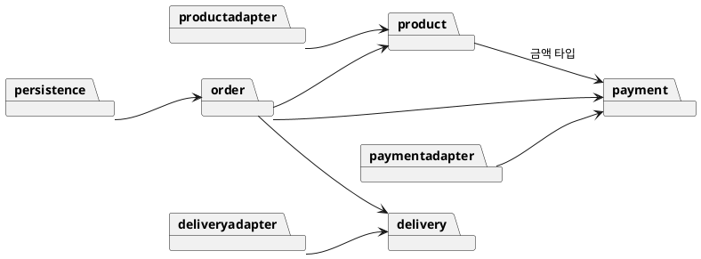
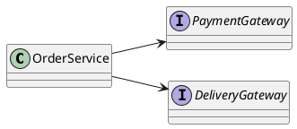
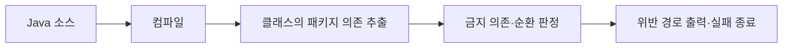
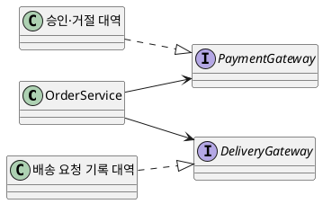
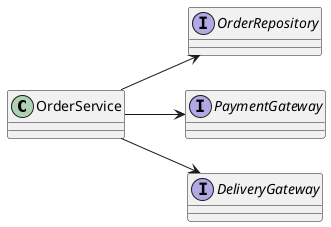
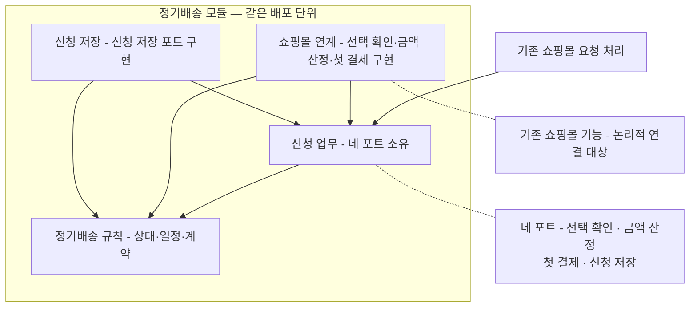

--------------------
Session 명: 04. 아키텍처
--------------------

## 목차

01. 세션 목표
02. 아키텍처 스타일
03. 설계 원칙
04. 업무 패키지와 외부 시스템
05. 의존 규칙
06. 외부 연동 규격
07. 검증하기 쉬운 구조
08. 잘못된 관행
09. 실습 — 아키텍처
10. 요약

## 01. 세션 목표

**아키텍처의 경계**는 글로 적고 검사로 지킨다. 사람은 업무의 의미를 지킬 구조를 정하고, AI는 대안 검토와 위반 검사를 돕는다.

- **아키텍처 스타일**의 관심사를 구분하고 사례에 맞는 구성을 고른다.
- **응집도·결합도·단일 책임·의존성 역전**으로 경계의 이유를 설명한다.
- **업무·연동·영속**을 나누고 허용하는 의존 방향을 적는다.
- **외부 연동 규격**에서 구현에 필요한 정보와 미정 사항을 구분한다.
- **인터페이스와 테스트 대역**으로 업무 규칙을 확인하고 의존 위반을 검사한다.

**강사 노트**

- "세션 03. 도메인 모델"의 용어·개념·상태·업무 규칙이 입력이다. 단가 보존과 결제 거절의 의미를 바꾸지 않는다.
- 아키텍처의 상세 설계 기법을 모두 익히는 것이 아니라 다음 구현이 경계를 추측하지 않을 수준을 목표로 한다.

---

## 02. 아키텍처 스타일

## 스타일마다 정하는 것이 다르다

**아키텍처 스타일**은 책임을 나누고 연결하는 방식이다. 내부 의존을 정하는 방식과 배포 단위를 정하는 방식은 함께 선택할 수 있다.

**표 — 스타일의 관심사와 선택 비용**

| 스타일 | 주로 정하는 것 | 기대와 주의점 |
|---|---|---|
| **계층형** | 표현·업무·데이터 접근의 계층과 의존 | 책임을 구분하기 쉽지만 업무가 기술 계층에 묶일 수 있다 |
| **포트와 어댑터** | 업무 입출력과 외부 기술 연결의 경계 | 업무를 독립적으로 검사하되 연결 인터페이스가 필요하다 |
| **모듈러 모놀리스** | 모듈 경계를 가진 하나의 배포 단위 | 배포는 단순하지만 모듈 간 의존을 지켜야 한다 |
| **마이크로서비스** | 독립적으로 배포하는 서비스의 경계 | 배포 자율성을 얻지만 통신·운영의 부담이 늘어난다 |

- **포트와 어댑터**를 쓰는 시스템도 하나의 배포 단위일 수 있다. 네 스타일 중 하나만 고르는 문제가 아니다.
- **선택의 근거**는 변경과 검증의 필요다. AI가 코드를 빨리 만든다는 이유만으로 서비스 수를 늘리지 않는다.

**강사 노트**

- Lewis·Fowler, Microservices(2014)는 독립 프로세스·독립 배포를 설명한다. Fowler, MonolithFirst(2015)는 처음부터 마이크로서비스로 시작하는 위험을 논한다. 원문을 verify-quote.js --check로 확인한 범위에서 설명한다.
- 계층형 자체가 의존성 역전과 양립할 수 없는 것은 아니다. 단순한 상위→하위 구현 의존을 무조건 채택할 때의 위험을 비교한다.

---

## 주문 시스템의 선택

**주문 시스템은 포트와 어댑터 스타일을 쓴다.** 업무 규칙을 외부 상품·결제·배송 시스템과 영속 기술에서 분리해 구현하고 검사한다.

**도식 — Mermaid — 업무와 외부 기술 연결의 분리**



- **포트**는 업무가 필요로 하는 입출력 인터페이스다. 결제 승인 요청의 이름과 필요한 정보는 업무의 말로 정한다.
- **어댑터**는 포트와 외부 기술을 연결하는 구현이다. 외부 API의 필드 이름과 인증 방식은 이쪽에 둔다.
- **현재 범위**에서는 업무 패키지를 별도의 서비스로 배포하지 않는다. 독립 배포가 필요한지는 별도 근거가 생겼을 때 판단한다.

**강사 노트**

- 화살표는 호출 시간순이 아니라 소스 코드의 의존 방향이다. 아래 패키지 도식과 인터페이스 선언으로 구체화한다.
- 새 시스템의 첫 기능을 만드는 작은 팀이라는 과정 전제로 한 배포 단위의 예를 택했다. 모듈 격리의 모든 수단을 구현한 예는 아니다.

---

## 03. 설계 원칙

## 응집도와 결합도

**응집도**는 한 요소의 책임이 얼마나 관련되고 집중되어 있는지, **결합도**는 다른 요소를 얼마나 알고 의존하는지를 뜻한다.

**표 — 주문 결제 책임의 배치 비교**

| 배치 | 책임의 관련성 | 변경의 영향 |
|---|---|---|
| **한 클래스에 모두 둔다** | 금액·결제 인증·SQL·배송 변환이 섞인다 | 결제 API 변경이 주문 계산 코드까지 건드린다 |
| **업무와 연결을 나눈다** | 업무 흐름과 외부 프로토콜이 각각 모인다 | 외부 필드 변경을 해당 어댑터 안에서 다룰 수 있다 |

- **응집도를 높인다**는 것은 관련된 일을 모은다는 뜻이다. 메서드 수가 적으면 무조건 좋은 것은 아니다.
- **결합도를 낮춘다**는 것은 필요한 연결까지 없앤다는 뜻이 아니다. 주문은 결제 결과를 알아야 하지만 외부 SDK의 형식까지 알 필요는 없다.
- **분리의 비용**도 본다. 함께 바뀌는 작은 계산을 근거 없이 여러 인터페이스로 나누면 탐색과 수정이 더 어려워진다.

**강사 노트**

- Larman, Applying UML and Patterns, 3rd ed., Low Coupling·High Cohesion의 정의를 원문 확인했다. 두 개념은 대안을 평가하는 기준이지 클래스 수를 정하는 공식이 아니다.

---

## 단일 책임과 변경 이유

**단일 책임 원칙**은 같은 이유로 바뀌는 것을 모으고, 다른 이유로 바뀌는 것을 분리하는 판단 기준이다.

**인용문**

**같은 이유로 바뀌는 것은 모으고**, 다른 이유로 바뀌는 것은 분리한다, "Gather together the things that change for the same reasons. Separate those things that change for different reasons.", [Martin 2014]

**표 — 변경 이유로 경계 판단하기**

| 변경 | 바뀌는 의미 | 책임을 둘 곳 |
|---|---|---|
| **주문 금액 정책** | 주문 시점의 단가와 계산 규칙 | 주문 업무 |
| **결제 인증 방식** | 외부 결제 시스템을 호출하는 방법 | 결제 연동 |
| **저장 기술** | 주문을 저장하고 읽는 방법 | 영속 구현 |

- **책임 하나**는 메서드 하나라는 뜻이 아니다. 같은 업무 결정을 지키는 여러 메서드는 한 책임에 속할 수 있다.
- **경계를 바꿀 때**는 변경 이유를 설명한다. “파일이 길다”만으로 나누면 실제로 함께 바뀌는 코드가 흩어질 수 있다.

**주석**

SRP — Single Responsibility Principle

**강사 노트**

- 인용 근거: Robert C. Martin, The Single Responsibility Principle, 2014-05-08. verify-quote.js로 두 문장을 원문 확인했다.
- 금액 정책을 기술 정책으로 취급하지 않는다. 무엇이 옳은 금액인지는 사람이 정하고, 그 결정을 지킬 책임 배치는 설계에서 정한다.

---

## 의존성 역전

**의존성 역전**은 업무가 구체 구현 대신 추상을 알도록 의존을 바꾸는 원칙이다. 외부 연결 구현이 업무에서 정한 인터페이스를 구현한다.

**인용문**

**추상에 의존**하고 구체 구현에는 의존하지 않는다, "Depend upon Abstractions. Do not depend upon concretions.", [Martin 2000]

**도식 — PlantUML — 결제 포트와 구현의 의존 방향**



- **호출 방향**과 의존 방향은 다르다. 실행 중 주문이 결제 연동을 호출해도 주문 코드가 연동 클래스를 import할 필요는 없다.
- **인터페이스의 위치**도 결정한다. 이 사례의 결제 포트는 업무 패키지인 `payment`에 두고 연동 구현은 `paymentadapter`에 둔다.

**주석**

DIP — Dependency Inversion Principle

**강사 노트**

- 인용 근거: Martin, Design Principles and Design Patterns(2000), The Dependency Inversion Principle. 원문 확인 완료.
- 코드의 OrderService 필드 타입이 PaymentGateway이며 PaymentAdapter는 implements로 연결된다. 구체 구현을 선택해 주입하는 조립 코드는 업무 밖에 둔다.

---

## 04. 업무 패키지와 외부 시스템

## 패키지의 경계와 의존 방향

**업무 패키지**는 도메인 개념과 업무에 필요한 인터페이스를 담는다. 외부 기술을 다루는 패키지는 그 인터페이스에 의존한다.

**도식 — PlantUML — 주문 시스템의 패키지 의존**



- **주문**은 결제·배송·상품의 업무 인터페이스를 안다. 연동 클래스나 SQL을 직접 사용하지 않는다.
- **영속 구현**은 주문 저장소 인터페이스를 구현한다. 주문은 저장소의 사용법을 알고 저장 기술은 모른다.
- **도식의 화살표**는 코드의 의존이다. 외부 시스템에 요청하는 실행 흐름은 이 선의 방향만으로 설명하지 않는다.

**강사 노트**

- 코드 예제의 결제 기능은 order→payment·delivery와 persistence→order를 실행한다. 상품 포트는 선언만 두며 조회 기능과 실제 외부 연동은 구현하지 않는다.
- productadapter는 구현할 책임의 위치를 보인 것이다. 새로 네트워크 서비스를 만들었다는 뜻이 아니다.

---

## 경계를 인터페이스로 표현하기

**업무 인터페이스**는 업무가 외부에 기대하는 요청을 표현한다. 외부 API의 경로나 응답 JSON을 그대로 업무에 들여오지 않는다.

**도식 — PlantUML — 업무가 사용하는 결제·배송 포트**



```java
package payment;
public interface PaymentGateway {
    boolean requestApproval(Money amount, PaymentMethod method);
}
```

```java
package delivery;
public interface DeliveryGateway {
    void requestDelivery(String orderNumber, Address shippingAddress);
}
```

**강사 노트**

- 전체 원본은 code/s04/architecture/src/에 있다. boolean은 승인·거절만 다루는 교육용 단순화다. 통신 오류를 거절로 바꾸지 않는다.
- 배송 요청의 void는 비동기를 뜻하지 않는다. 이 과정은 동기·비동기 전달 방식을 결정하지 않았다.
- 주문 번호의 String 표현은 발췌 예의 단순화이며 업무 용어는 바뀌지 않는다. 인증과 실제 결제 수단 전달 방식은 외부 규격 확인이 필요하다.

---

## 05. 의존 규칙

## 허용과 금지를 글로 적기

**의존 규칙**은 어떤 패키지가 무엇을 알아도 되는지 정한다. 이름만 나누고 규칙을 적지 않으면 같은 구조를 서로 다르게 해석할 수 있다.

**인용문**

패키지 사이의 의존은 **순환**을 이루어서는 안 된다, "The dependencies betwen packages must not form cycles.", [Martin 2000]

**표 — 주문 시스템의 의존 규칙**

| 규칙 | 허용 예 | 위반 예 |
|---|---|---|
| **업무의 연동 의존 금지** | order → payment | order → paymentadapter |
| **업무의 영속 의존 금지** | persistence → order | order → persistence |
| **패키지 순환 금지** | order → payment | order → payment → order |

- **업무의 범위**는 `order`·`payment`·`delivery`·`product`다. 실습의 `subscription`에도 같은 원칙을 적용한다.
- **조립 코드**는 구현체를 골라 업무 객체에 넣어 준다. 업무 밖의 조립·테스트 코드가 구현을 아는 것과 업무의 의존 위반은 구분한다.

**강사 노트**

- 인용 근거: Martin(2000), The Acyclic Dependencies Principle. betwen은 원문의 표기이며 원문 확인을 마쳤다.
- 순환 금지는 이 사례의 패키지 규칙이다. 모든 종류의 연결과 실행 호출의 재진입까지 금지한다는 뜻이 아니다.

---

## 규칙 위반을 검사하기

**의존 검사**는 코드의 연결이 합의한 규칙을 지키는지 판정한다. 규칙을 문서에 적는 것과 검사에 구현하는 것을 함께 한다.

**도식 — Mermaid — 의존 규칙 검사 흐름**



**표 — 검사를 확인하는 예**

| 입력 | 판정 | 확인할 증거 |
|---|---|---|
| **인터페이스에만 의존** | 통과 | 금지된 의존과 순환이 없다 |
| **연동 클래스를 import** | 실패 | order → paymentadapter |
| **영속 클래스를 완전한 이름으로 사용** | 실패 | order → persistence |
| **업무 패키지 간 순환** | 실패 | order → payment → order |

- **문자열 검색의 한계**를 피한다. import가 없어도 완전한 클래스 이름으로 의존할 수 있어 컴파일 결과를 확인한다.
- **검사 범위**는 정적 클래스 의존이다. 리플렉션·실행 중 플러그인 로딩·업무 의미의 정확성은 이 검사로 판정하지 않는다.

**강사 노트**

- code/s04/architecture/check-architecture.mjs가 JDK jdeps로 의존을 추출하고 금지 방향과 순환을 판정한다. run.mjs는 정상 예와 위반 fixture를 컴파일해 확인한다.
- 도식의 각 단계는 run.mjs의 javac 호출, inspect의 jdeps 호출, 그래프 순회, CLI의 실패 종료 코드에 이어진다.
- 실패 이유를 에이전트가 읽을 수 있게 실제 패키지 경로를 출력한다. 에이전트 재시도 흐름 자체는 "세션 09. 검증 하네스"에서 다룬다.

---

## 06. 외부 연동 규격

**외부 연동 규격**은 외부 시스템에 무엇을 어떻게 보내고 어떤 결과를 받는지 정한 문서다. 업무 포트는 그 규격과 업무의 의미 사이에 경계를 둔다.

**표 — 업무의 요청과 외부 규격에서 확인할 것**

| 업무 요청 | 업무에서 정한 의미 | 외부 문서에서 확인할 것 |
|---|---|---|
| **상품 조회** | 현재 판매가를 얻는다 | 상품 식별·금액 단위·가격 기준 시점 |
| **결제 승인 요청** | 확정된 주문 금액의 승인·거절을 받는다 | 인증·결제 수단·응답 코드·통신 오류 |
| **배송 요청** | 승인된 주문의 배송지로 배송을 요청한다 | 필수 항목·요청 식별·접수 결과·통보 규격 |

- **필요한 부분**을 읽는다. 작업에 해당하는 버전·요청·응답·오류를 찾고, 확인한 문서의 위치와 버전을 남긴다.
- **누락은 질문**이다. 결제 통신 오류가 거절인지, 배송 접수 실패 뒤 어떻게 처리할지는 임의로 정하지 않는다.
- **교육용 규격**과 실제 제공 문서를 구분한다. 아래 실습 답은 업무 수준의 합의이며 실제 API 명세를 대신하지 않는다.

**강사 노트**

- 과정에는 실제 외부 제공자의 API 문서가 주어지지 않았다. URL·HTTP 상태 코드·인증 토큰·재시도 횟수를 만들어 넣지 않는다.
- 문서를 찾아 제공하는 맥락 구성의 상세는 "세션 06. 맥락 구성"이 맡는다. 여기서는 설계가 확인해야 할 연동 정보를 정한다.

---

## 07. 검증하기 쉬운 구조

## 실제 외부 시스템 없이 업무 규칙 확인하기

**업무와 외부 연결이 분리**되면 테스트가 승인·거절을 통제하고 배송 요청을 관찰할 수 있다. 업무 규칙을 확인할 때 실제 결제나 데이터베이스가 필요하지 않다.

**인용문**

실제 실행 장치와 데이터베이스에서 **분리해 개발하고 테스트**한다, "to be developed and tested in isolation from its eventual run-time devices and databases.", [Cockburn 2005]

**도식 — PlantUML — 테스트에서 연결하는 결제·배송 대역**



- **테스트 대역**은 실제 의존 대상을 대신하는 코드다. 결제 결과를 정하고 배송 요청의 금액·시점·횟수 등을 필요한 범위에서 관찰한다.
- **분리된 검사**는 빠른 피드백을 주지만 실제 연동 성공을 증명하지는 않는다. 외부 규격과 연결 구현의 검사는 별도로 필요하다.

**강사 노트**

- Cockburn, Hexagonal architecture(2005), Intent의 문장 일부를 원문 확인했다. 테스트 분리가 아키텍처의 목적에 포함된다는 근거로 사용한다.
- 실행 예는 결제 금액과 배송지·상태 변경 순서·횟수를 검사한다. lambda로 만든 결제·배송 대역을 교육용 어댑터에 연결한다.

---

## 포트에 의존하는 주문 서비스

**주문 서비스**는 결제·배송 인터페이스를 통해 업무 흐름을 조정한다. 외부 API의 호출 형식은 이 코드의 책임이 아니다.

**도식 — PlantUML — 결제 흐름에 필요한 의존**



```java
    public void pay(String orderNumber, PaymentMethod method) {
        Order order = repository.findBy(orderNumber);
        if (payment.requestApproval(order.totalAmount(), method)) {
            order.onPaid();
            delivery.requestDelivery(orderNumber, order.shippingAddress());
        }
        repository.save(orderNumber, order);
    }
```

- **실행 범위**는 결제대기 주문의 승인·거절이다. 통신 오류·중복 승인·배송 요청 실패의 보상과 재시도는 구현하지 않았다.

**강사 노트**

- 원본: code/s04/architecture/src/order/OrderService.java. 생성자에서 저장소와 두 포트를 주입한다.
- 이 예는 앞에서 확정한 금액을 입력받는다. Order의 totalAmount 필드는 이번 결제 경계 예를 위한 단순화이며 단가 계산 원천을 변경한 것이 아니다.
- code/s04/architecture/src/paymentadapter와 deliveryadapter는 주입한 연결 함수에 위임하는 교육용 구현이다. 실제 제공자의 프로토콜 변환을 구현한 것으로 소개하지 않는다.

---

## 동작과 구조를 각각 검사하기

**검사마다 답하는 질문이 다르다.** 동작 테스트는 옳은 결과를, 의존 검사는 합의한 구조를 확인한다.

**표 — 실행 예의 검사와 증거**

| 검사 | 대표 입력·변경 | 기대 결과 |
|---|---|---|
| **거절** | 펜 주문 2,000원 결제 거절 | 결제대기 유지, 배송 요청 0회 |
| **재결제 승인** | 같은 주문에 다른 카드로 승인 | 결제완료 뒤 서울 배송 요청 1회 |
| **구조** | 업무가 인터페이스만 참조 | 금지 의존·순환 없음 |
| **검사의 검증** | 금지 의존·순환이 있는 fixture | 위반 경로 출력, 실패 종료 |

- **동작만 통과**해도 외부 SDK를 업무에서 직접 사용했을 수 있다. 구조만 통과해도 거절된 주문에 배송을 요청할 수 있다.
- **센서를 만들기 쉬운 코드**는 관찰할 연결점과 명확한 책임을 가진다. 검사 결과는 사람이거나 AI이거나 다음 수정자가 원인을 찾을 수 있어야 한다.

**강사 노트**

- 실행 명령: node courses/ai-native/sessions/code/s04/architecture/run.mjs. JDK 17 이상과 Node.js를 사용하며 외부 서비스나 라이브러리를 호출하지 않는다.
- 검사의 배치와 전체 하네스 운영은 "세션 09. 검증 하네스"에서 다룬다. 여기서는 검사를 가능하게 하는 구조와 실제 판정을 보인다.

---

## 08. 잘못된 관행

**패키지를 나누는 것**만으로 업무와 외부 기술이 분리되지는 않는다. 실제 의존과 변경의 이유를 함께 확인한다.

**표 — 경계를 흐리는 관행과 보완 방향**

| 잘못된 관행 | 생기는 문제 | 보완 방향 |
|---|---|---|
| **업무에서 외부 SDK 사용** | 외부 형식이 업무 규칙에 퍼진다 | 업무 포트와 연동 구현을 나눈다 |
| **구현 클래스로 주입** | 생성자를 써도 구현 의존이 남는다 | 필드·매개변수도 인터페이스로 둔다 |
| **업무와 영속이 서로 구현 참조** | 양방향 의존으로 순환이 생긴다 | 인터페이스와 책임 위치를 다시 정한다 |
| **이름마다 서비스 분리** | 배포·통신 비용만 늘 수 있다 | 독립 배포의 실제 필요부터 확인한다 |
| **동작 테스트로 구조도 통과 선언** | 경계 위반을 놓친다 | 동작과 의존을 각각 검사한다 |

**강사 노트**

- persistence→order의 인터페이스 구현 의존은 허용한다. 업무 쪽이 persistence를 다시 알게 되는 경우와 구분한다.
- “AI가 제안했으니 표준 구조다”를 근거로 삼지 않는다. 요구·변경·검증에서 이 경계가 필요한 이유를 설명하게 한다.

---

## 09. 실습 — 아키텍처

**①로 시작해 답·질문·수정 요청을 주고받는다.** ②~④는 보완 예시다. ⑤로 MD를 만들고 필요하면 보완·재생성한다.

**프롬프트 — 요청사항 포함**
  + ① “첨부한 실습 2의 요구사항 정의서와 실습 3의 도메인 모델을 바탕으로 **기존 쇼핑몰에 정기배송 최초 신청 기능을 추가할 구조**를 제안해라. 필요한 책임과 기존 기능과의 경계를 간단히 설명하고, 구조를 정하기 위해 내가 결정해야 할 사항은 질문해라. 신청 이후 운영과 구현 코드는 제외해라.”
  + ② “아래 답과 수정 요청을 반영해라. **아키텍처 선택과 패키지의 책임·의존 방향**을 정하고 **패키지 다이어그램**을 대화창에 보여줘라. 화살표가 호출 순서인지 코드 의존인지 명확히 하고 불필요한 분리는 피하라.”
  + ③ “아래 답과 수정 요청을 반영해라. 기존 쇼핑몰·결제·저장 기능과 연결할 때 필요한 **요청·결과와 책임**을 정리해라. 제공자의 실제 API 정보는 만들지 말고, 업무에 필요한 **계약**과 구현 전에 확인할 **규격**을 구분해라.”
  + ④ “아래 답과 수정 요청을 반영해라. 요구사항의 대표 수용 기준과 도메인 모델로 **책임·의존 규칙·연계 계약의 일관성**을 검토해라. 실제 외부 시스템 없이 업무 결과를 확인할 수 있는지도 설명해라. 바뀐 다이어그램은 다시 보여줘라.”
  + ⑤ “지금까지 합의한 아키텍처를 다음 실습에 사용할 **Markdown 파일**로 생성해라. 수강생이 함께 읽고 실습 5의 투입물로 쓸 **핵심만** 담고 **슬라이드 다섯 장 안**에 들어가게 줄여라. 아키텍처 선택과 이유, 패키지와 책임, **허용·금지 의존 규칙**, 세 연계 계약의 목적과 담당 경계, 실제 외부 시스템 없이 확인하는 **검증 방향**을 포함해라. 패키지 다이어그램은 대화창에서 본 최종본을 Mermaid 원본 그대로 하나만 넣어라. 앞 산출물의 업무 규칙·날짜·금액 조건은 반복하지 말고 참조해라. 남은 미결 사항은 제목과 한 줄 이유로 모아라.”

**점검 항목**
  1. **경계** — 기존 쇼핑몰 기능을 다시 만들지 않고 연계 대상으로만 두었는가?
  2. **의존** — 업무가 저장·연계 구현을 직접 알지 않으며, 화살표의 뜻이 코드 의존으로 분명한가?
  3. **계약** — 연계마다 요청·결과와 담당 경계가 업무 용어로 설명되는가?
  4. **추측** — 제공되지 않은 API 주소·인증·기존 내부 구조를 지어내지 않았는가?
  5. **검증** — 실제 외부 호출 없이 대표 수용 기준을 확인할 방법이 있는가?
  6. **범위** — 신청 이후 운영·구현 코드·성능 보장을 더하지 않았는가?

**결과물**
  + **아키텍처 선택과 이유·패키지 다이어그램 원본·의존 규칙·연계 계약을 담은 최종 MD 파일**. 마지막 합의를 확인하고 실습 5에 첨부한다.

**강사 노트**

- 수강생이 만든 실습 2의 요구사항 정의서와 실습 3의 도메인 모델을 첫 프롬프트에 붙인다. 실제 강사 예시 입력은 code/s04/exercise-conversation/input-s02.md와 input-s03.md다.
- ②~④는 기본 문구만 입력하지 않는다. [앞선 질문에 대한 답]과 [추가 질문·수정 요청]을 함께 작성한다.
- 실제 입력·응답은 code/s04/exercise-conversation/에 보존한다. ①~③은 Codex로 먼저 실행했고, 같은 프롬프트를 Claude Code로 다시 실행해 ①~⑤를 한 대화로 완성했다. 채택본은 claude-response-*다.
- 실습 3에서 정한 신청 상태와 전이를 그대로 쓴다. 첫 결제 처리 권한을 새 업무 상태로 만들지 않게 ④에서 되돌린다.
- 앞 실습에서 발견해 되돌린 것 — 요청 이름(결제 승인·배송 요청)을 용어집과 맞추고, 결제 거절과 통신 오류를 구분해 "확정할 수 없는 응답을 실패로 바꾸지 않는다"를 요구사항의 결제 결과 조건에 더했다. 독립 서비스 분리안은 채택하지 않았고, 실제 API 문서가 없다는 사실은 미결로 남겼다.

---

## 10. 요약

### 경계는 글로 적고 검사로 지킨다

- **스타일**은 책임·의존·배포의 서로 다른 질문에 답한다.
- **업무 포트**와 연동·영속 구현을 나눠 업무의 의미를 지킨다.
- **의존 규칙과 검사**로 금지된 연결과 순환을 확인한다.
- **동작 테스트와 구조 검사**는 서로 다른 증거를 낸다.
- **모델 보완**은 외부와 주고받는 요청 이름을 용어집과 맞추는 일이다.

### 다음 세션

- "세션 05. 작업 명세와 수용 기준" — 구현할 범위와 받아들일 결과를 작업 하나의 명세로 정한다.

**강사 노트**

- 클래스 수나 인터페이스 수가 품질이 아니다. 경계가 업무 의미와 검증에 어떤 도움을 주는지 설명하게 한다.

---

## 별첨. 실습 답

---

## 정기배송 최초 신청 아키텍처

**문서 형식**

업무 규칙과 날짜·금액 조건, 상태 전이는 실습 2의 요구사항 정의서와 실습 3의 도메인 모델을 따른다. 이 문서는 **그 규칙을 어느 패키지가 맡고 패키지끼리 어떻게 의존하는지**만 정한다.

**선택** — 정기배송 모듈을 기존 쇼핑몰과 **같은 배포 단위**에 두고, **포트로 의존 방향을 뒤집는다**.

- **이유** — 범위가 최초 신청 하나라 별도 서비스나 새 인프라를 둘 근거가 없다. 업무 흐름과 규칙이 결제·저장·기존 쇼핑몰의 구현 방식에 묶이지 않는다. 포트를 대역으로 바꾸면 실제 외부 시스템 없이 업무 결과를 확인할 수 있다.

**표 — 패키지와 책임**

| 패키지 | 책임 | 두지 않는 것 |
|---|---|---|
| **신청 업무** | 최초 신청 흐름을 조정하고 네 포트를 소유한다. 본인 신청만 다룬다 | 저장·연계 구현, 기존 정책의 계산 |
| **정기배송 규칙** | 신청·배송회차·첫 결제·계약. 일정 계산, 첫 배송일 하한, 상태 전이 허용 | 다른 패키지에 대한 의존 |
| **쇼핑몰 연계** | 선택 확인·금액 산정·첫 결제 포트의 구현. 응답을 업무 결과로 바꾼다 | 상태 전이, 계약 성립 판단 |
| **신청 저장** | 신청 저장 포트의 구현. 조건부 전이의 원자성과 성공의 한 단위 반영 | 전이를 허용할지 판단하는 일 |

**강사 노트**

- 실습 4의 ⑤로 받은 최종 MD의 1절이다. 전문은 code/s04/exercise-conversation/정기배송-최초신청-아키텍처.md다.
- 수강생의 답은 패키지 이름과 개수가 다를 수 있다. 업무가 구현을 모르는지와 포트의 소유자가 누구인지를 본다.

---

## 패키지 다이어그램

화살표는 **코드 의존**이다 — A의 코드가 B의 타입이나 인터페이스를 참조하며 호출 순서가 아니다. **점선**은 신청 업무가 소유한 포트의 이름과, 단일 API인지 정하지 않은 기존 쇼핑몰을 가리킨다.

- **실행 호출과 코드 의존은 반대다** — 실행 중에는 신청 업무가 포트로 연계와 저장을 호출하지만, 코드에서는 연계와 저장이 신청 업무의 포트를 구현한다.

**도식 — Mermaid — 정기배송 모듈의 패키지 의존**



**강사 노트**

- 최종 MD의 2절 원본 그대로다. 노드 라벨만 슬라이드 폭에 맞게 줄였다.
- 수강생에게 묻는다: 화살표를 호출 순서로 읽으면 어느 규칙이 깨지는가?

---

## 의존 규칙

**문서 형식**

도식에 있는 의존만 허용한다. 어기면 업무 결과가 맞아도 **구조 검토를 통과하지 못한다**.

- **허용** — 도식에 있는 의존만
  - 기존 요청 진입부 → 신청 업무
  - 신청 업무 → 정기배송 규칙
  - **쇼핑몰 연계·신청 저장** → 신청 업무의 포트, 정기배송 규칙, 각자 필요한 기존 기능
  - **기존 구성 코드** → 세 패키지(구현 객체를 만들어 연결할 때만)
- **금지**
  - 정기배송 규칙에서 다른 패키지로 향하는 의존
  - **신청 업무**에서 쇼핑몰 연계·신청 저장·기존 쇼핑몰 구현으로 향하는 의존
  - 쇼핑몰 연계와 신청 저장 사이의 의존
  - **기존 쇼핑몰**에서 정기배송 내부로 향하는 의존(진입부와 구성 코드는 예외)
  - 모든 순환

**강사 노트**

- 최종 MD의 3절이다. 금지 목록의 둘째 줄이 포트를 둔 이유를 가장 잘 보여 준다.

---

## 연계 계약

**문서 형식**

세 계약은 업무 목적으로 나눈 **논리적 묶음**이다. 기존 쇼핑몰이 각각을 단일 API로 제공한다고 가정하지 않는다.

- **쇼핑몰 확인**(선택 확인·금액 산정 포트)
  - 선택 대상의 **유효성·소유 관계**와 배송 달력 허용 여부를 판정하고, 기존 정책으로 **회차별 최종 금액**을 산정한다.
  - **판정과 산정**은 기존 쇼핑몰이, **3일 하한과 진행 여부**는 정기배송 규칙과 신청 업무가 정한다. 금액은 고지할 때 한 번만 부른다.
- **첫 결제**(첫 결제 포트)
  - 첫 회차 결제를 요청하고, 결과 확인은 **새 청구 없이** 기존 요청만 확인한다.
  - 쇼핑몰 연계가 응답을 **성공 확정·실패 확정·결과 확인 불가**로 바꾼다. 확정할 수 없는 응답을 실패로 바꾸지 않는다.
- **신청 저장**(신청 저장 포트) — 두 **조건부 전이**를 제공하며 새 업무 상태를 만들지 않는다.
  - **결제 시작** — `신청준비`일 때만 `첫결제결과확인중`으로 전이하고, 동시에 들어온 요청 중 성공한 하나만 결제를 요청한다.
  - **결과 반영** — `첫결제결과확인중`·`결과확인필요`일 때만 반영하고, 성공이면 결제 결과·계약 1건·`신청완료`를 **한 단위**로 기록한다.
  - **반복 전달은 안내만** — 상태가 바뀌는 것은 결과 확인 반영을 거칠 때뿐이며 상태 머신에 정의된 전이다.

**연결 전에 확인할 규격** — 업무상 부적합과 기술 오류의 구분 · 중복 승인을 막는 수단과 새 청구 없는 조회 · 조건부 전이의 원자성. 셋이 입증되기 전에는 연동을 완료로 보지 않는다.

**강사 노트**

- 최종 MD의 4절을 줄였다. 계약별 요청·결과의 전체 항목은 전문에 있다.
- 조건부 전이는 "조회한 뒤 결제한다"로는 동시 재전송의 중복 청구를 막지 못한다는 ④의 지적에서 나왔다.

---

## 검증 방향과 미결

**문서 형식**

실제 외부 시스템 없이 **네 포트만 대역으로 바꿔** 업무 결과를 확인한다. 구조와 성능은 따로 본다.

**표 — 세 방향의 검증**

| 방향 | 방법 | 입증하는 것 | 입증하지 못하는 것 |
|---|---|---|---|
| **업무 결과** | 네 포트만 대역 | 상태·계약 수·결제 요청 횟수 | 저장과 결제의 실제 동작 |
| **구조** | 정적 의존 검사 | 허용·금지 의존과 순환 | 업무 결과 |
| **성능** | 연계 환경에서 실측 | 품질 요구사항 충족 여부 | 대역으로는 못 본다 |

- **대표 예** — 결제 대역이 결과 확인 불가를 돌려주면 신청은 `결과확인필요`가 되고 계약은 생기지 않는다. 같은 신청을 다시 보내도 결제 요청은 1회 그대로다.

**미결** — 결과 확인을 시작하는 주체와 시점 · 첫 회차와 일반 주문의 연결 · 신청 식별자 전달과 DB 제약 · `신청준비`의 유효기간 · 결제 제공자의 멱등·조회·오류 규격 · 의존 검사 도구 · 성능 실측

**강사 노트**

- 최종 MD의 5·6절이다. 미결은 제목과 한 줄 이유만 남기고 줄였다.
- 미결을 남긴 것이 감점이 아니라는 점을 짚는다. 확인할 사람과 영향이 적혀 있으면 다음 작업을 시작할 수 있다.
