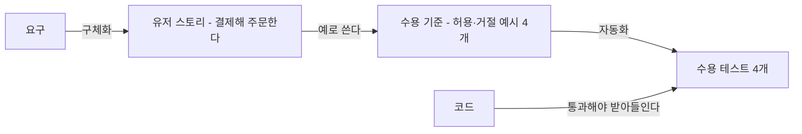
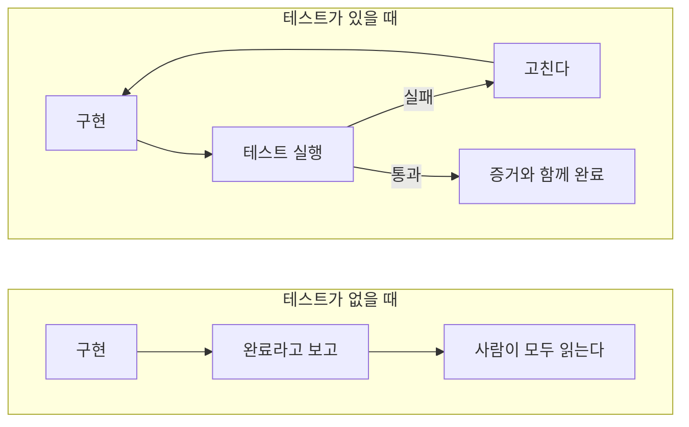
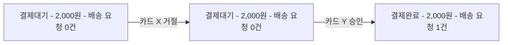
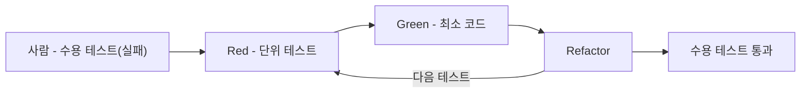
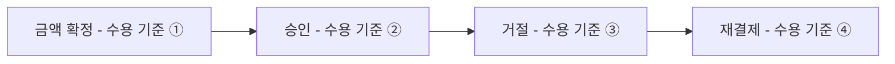

--------------------
Session 명: 04. 수용 기준과 검증 가능한 작업 단위
--------------------

## 목차

01. 세션 목표
02. 수용 기준
03. 허용·거절 예시
04. 예시에서 테스트로
05. 작업 단위
06. 완료의 정의와 증거
07. 시연 — 테스트는 누가 쓰는가?
08. 잘못된 관행
09. 실습 — 수용 기준
10. 요약

## 01. 세션 목표

작업 명세서를 **수용 기준과 테스트**로 바꾸고, 한 번에 검증할 수 있는 **작업 단위**로 나눈다.

- **수용 기준**이 요구에서 코드까지의 뼈대에서 하는 역할과 사람의 일을 설명한다.
- 작업 명세서의 예를 **허용·거절 예시**로 쓰고, 거절 뒤에 바뀌지 않아야 할 것을 밝힌다.
- 허용·거절 예시를 실행되는 **수용 테스트**로 바꾸고, 테스트를 먼저 주고 에이전트에게 구현을 맡긴다.
- 작업을 수용 기준으로 끝나는 **작업 단위**로 나누고, 기능 목록으로 하나씩 진행한다.
- **완료의 정의**를 정하고, 에이전트의 보고가 아니라 증거로 완료를 판단한다.

**강사 노트**

- "세션 03. 요구의 구체화와 명세"는 "무엇을 만들게 할까?"를 다뤘다. 이 세션은 "무엇으로 받아들일까?"를 다룬다.
- 수용 기준은 "세션 09. 검증 하네스·결과 점검·피드백"의 센서, "세션 11. 평가 세트와 운영 점검 — 보안·비용·모델 변경"의 평가 세트가 된다.

---

## 02. 수용 기준

## 수용 기준이란?

**수용 기준**은 결과를 받아들일 조건을 구체적인 예로 적은 것이다. 요구에서 코드까지 가는 길에서 **유저 스토리와 코드를 잇는 자리**에 있다.

**도식 — Mermaid — 수용 기준의 자리**



- **스토리의 행위가 곧 수용 기준이다** — "세션 03. 요구의 구체화와 명세"의 Given-When-Then이 수용 기준이다.
- **수용 기준이 없으면 명세가 아니다** — 받아들일 조건을 적지 않으면 LLM이 그 조건까지 스스로 정한다.
- **수용 기준이 곧 테스트다** — 사람이 읽는 예가 그대로 실행되는 테스트가 된다.

**강사 노트**

- 뼈대는 `course-design.md`의 「요구에서 코드까지의 경로」다. 수용 기준은 뼈대에서 빠지지 않는 부분이다.
- North(2006)의 "스토리의 행위는 곧 수용 기준이다"는 "세션 03. 요구의 구체화와 명세"의 「Given-When-Then」에서 인용했다.

---

## 수용 기준은 사람이 정한다

사용자의 요구를 **테스트의 기대값**으로 옮기는 일은 사람이 한다. LLM은 초안을 쓰고 빠진 경우를 질문할 수 있지만, 기대값 자체를 정하지는 않는다.

**인용문**

사람은 일의 우선순위를 정하고 **사용자 피드백을 수용 기준으로 옮기고** 결과를 확인한다, "We prioritize work, translate user feedback into acceptance criteria, and validate outcomes.", [Lopopolo 2026]

**표 — 수용 기준에서 사람의 일과 LLM의 일**

| 일 | 사람 | LLM |
|---|---|---|
| **기대값** | 업무 담당자와 정한다(2,000원) | 바꾸지 않는다 |
| **예 고르기** | 규칙마다 대표 예를 고른다 | 예의 초안을 쓴다 |
| **빠진 경우** | 질문에 답하거나 미정으로 남긴다 | 빠진 경우를 질문으로 드러낸다 |
| **테스트 코드** | 기대값이 규칙과 같은지 확인한다 | 예를 테스트 코드로 옮긴다 |

**강사 노트**

- 인용 근거: Ryan Lopopolo, "Harness engineering: leveraging Codex in an agent-first world", OpenAI, 2026 영문 원문 확인. 앞 문장은 "사람은 늘 루프 안에 있지만 예전과 다른 추상 수준에서 일한다"이다("세션 01. AI 협업의 특성과 사람의 판단 책임"의 「개발자의 일과 LLM의 일」).
- 업무 담당자가 테스트 코드를 읽지 않아도 된다. 업무 담당자는 수용 기준 표를 확인하고, 개발자가 테스트가 그 표와 같은지 확인한다.

---

## 검증할 수 없으면 맡길 수 없다

테스트가 있으면 에이전트가 **스스로 확인하고 고칠 수 있다**. 테스트가 없으면 에이전트가 말하는 완료는 확인되지 않은 **주장**일 뿐이다.

**인용문**

튼튼한 테스트가 있으면 에이전트는 날아다니고 테스트가 없으면 시험해 보지도 않고 **된다고 주장**할 수 있다, "If your project has a robust, comprehensive and stable test suite agentic coding tools can fly with it. Without tests? Your agent might claim something works without having actually tested it at all", [Willison 2025b]

**도식 — Mermaid — 테스트가 있을 때와 없을 때**



**강사 노트**

- 첫 시도의 테스트 3개("세션 01. AI 협업의 특성과 사람의 판단 책임")는 모두 통과했지만, 업무 규칙이 아니라 자기 코드를 확인했다. 테스트가 있다는 것만으로는 부족하다.
- 인용 근거: Simon Willison, "Vibe engineering", 2025 원문 확인. 원문은 바이브 엔지니어링을 받치는 실천으로 자동화된 테스트를 꼽는다.
- 테스트가 있어도 기대값이 틀리면 고리는 틀린 방향으로 돈다. 그래서 기대값은 사람이 정한다(앞 장).

---

## 03. 허용·거절 예시

## 예에서 수용 기준으로

**허용 예시**는 사건이 받아들여져 상태가 바뀌는 예이고, **거절 예시**는 사건이 거절되어 **무엇이 바뀌지 않아야 하는가**를 보이는 예다. 작업 명세서의 예에 칸을 더해 수용 기준으로 만든다.

**표 — 작업 명세서의 예에서 수용 기준으로**

| 수용 기준의 칸 | 묻는 것 | 작업 명세서에서 |
|---|---|---|
| **Given** | 어떤 상황에서 시작하는가? | 주문 예(펜 2개, 2,000원, 결제대기) |
| **When** | 어떤 사건이 일어나는가? | 결제한다, 판매가가 바뀐다 |
| **Then** | 무엇이 바뀌는가? | 업무 규칙의 예(결제완료, 배송 요청 1건) |
| **그대로인 것** | 무엇이 바뀌지 않아야 하는가? | 거절 뒤의 상태·금액·배송 요청 |
| **업무 규칙** | 어떤 규칙의 예인가? | 주문 금액·배송 요청·결제 거절 |

- **바뀌지 않아야 할 것이 거절 예시의 핵심이다** — 작업 명세서의 예만으로는 잘 드러나지 않는다.

**강사 노트**

- 작업 명세서의 「업무 규칙과 예」는 규칙을 설명하는 예다. 수용 기준은 그 예를 받아들임의 조건으로 다시 쓴 것이다.
- 허용·거절은 사건의 결과다. 결제 거절은 업무상 정상적인 결과이므로 오류가 아니라 거절 예시로 다룬다.

---

## 주문한다의 수용 기준

업무 규칙 세 가지에서 **대표 예**를 고르면 "주문한다"의 수용 기준은 넷이 된다. 넷 모두 같은 주문(펜 2개, 판매가 1,000원, 주문 금액 2,000원, 배송지 서울, 결제대기)에서 시작한다.

**표 — "주문한다"의 수용 기준**

| 수용 기준 | Given·When | Then | 그대로인 것 | 업무 규칙 |
|---|---|---|---|---|
| **① 가격 변경** | 1,200원이 된 뒤 결제 | 2,000원 승인 요청 | 주문 금액 | 주문 금액 |
| **② 승인** | 카드 X 승인 | 결제완료, 배송 1건 | — | 배송 요청 |
| **③ 거절** | 카드 X 거절 | — | 결제대기, 배송 0건 | 결제 거절 |
| **④ 재결제** | 거절 뒤 카드 Y 승인 | 결제완료, 배송 1건 | — | 결제 거절 |

- **허용 예시는 ①②④, 거절 예시는 ③** — ④는 거절 뒤에도 다시 결제할 수 있음을 보인다.
- **결제 거절은 예가 둘이다** — 거절(③)과 재결제(④). 배송 요청 규칙은 ②(1건)와 ③(0건)이 함께 보인다.

**강사 노트**

- 값은 공통 전제의 교육용 값이다(`course-design.md`의 「공통 용어와 전제」). 번호는 업무 규칙의 순서(주문 금액 → 배송 요청 → 결제 거절)다.
- 미정(승인 뒤 배송 요청 실패)은 수용 기준을 만들지 않는다. 답이 없는 기대값을 지어내지 않는다.

---

## 거절 뒤 상태 유지

거절 예시의 Then에는 **바뀌지 않아야 할 것**을 적는다. 첫 시도의 코드는 거절된 주문을 취소됨으로 바꿔 다시 결제할 수 없게 만들었다.

**도식 — Mermaid — 거절 뒤 재결제**



- **거절 전과 후가 같다** — 상태·금액·배송 요청이 모두 그대로다. 그래서 다른 카드로 다시 결제할 수 있다.
- **바뀌지 않은 것까지 확인한다** — 상태가 결제대기인지만 보면 금액이 달라지거나 배송 요청이 나간 것을 놓친다.

**강사 노트**

- 이 도식은 한 주문이 시간에 따라 거치는 값이다. 주문 상태 기계는 "세션 05. 도메인·설계 지식과 맥락 구성"에서 맥락으로 만든다.
- 첫 시도의 거절 처리는 "세션 01. AI 협업의 특성과 사람의 판단 책임"의 「첫 시도의 결제 코드」에 있다.

---

## 수용 기준의 점검

수용 기준은 **많을수록 좋은 것이 아니다**. 업무 규칙마다 대표 예를 하나씩 두고, 사람이 리뷰할 수 있는 양으로 유지한다.

**표 — 수용 기준의 점검 항목**

| 점검 | 묻는 것 | "주문한다" |
|---|---|---|
| **대표 예** | 업무 규칙마다 예가 있는가? | 규칙 3가지 모두 |
| **거절 예** | 거절과 그대로인 것을 보이는가? | ③ |
| **구체적인 값** | 금액·건수가 숫자인가? | 2,000원, 1건, 0건 |
| **출처** | 업무 담당자가 정한 규칙인가? | 회의 메모 |
| **알맞은 개수** | 같은 규칙의 예가 불어나지 않았는가? | 4개 |

- **불어나는 수용 기준** — 작은 버그 하나가 수용 기준 16개로 불어난 예가 있다("세션 03. 요구의 구체화와 명세").

**강사 노트**

- 수용 기준 16개의 예는 [Böckeler 2025]가 Kiro로 작은 버그를 고칠 때 본 것이다.
- 경계값(0원, 수량 0개 등)은 업무 규칙이 그 경계를 말할 때만 수용 기준에 넣는다. 나머지는 단위 테스트의 일이다.

---

## 04. 예시에서 테스트로

## BDD의 자동화

BDD의 셋째 실천인 **자동화**는 예를 실행되는 테스트로 만든다. Given·When·Then의 각 줄이 테스트의 **준비·실행·확인**이 된다.

**인용문**

문서로 쓴 예마다 그 행위를 구현하되 **자동화된 테스트로 시작해** 코드 개발을 이끈다, "implement the behaviour described by each documented example, starting with an automated test to guide the development of the code", [Cucumber]

```gherkin
Scenario: 결제 직전에 판매가가 올라도 주문 금액은 그대로다
  Given 고객이 펜 2개를 판매가 1,000원에 주문해 주문 금액이 2,000원이다
  And   펜의 판매가가 1,200원으로 바뀌었다
  When  고객이 카드로 결제한다
  Then  결제 시스템에 2,000원의 승인을 요청한다
```

```java
    @Test @DisplayName("판매가가 1,200원으로 바뀌어도 2,000원의 승인을 요청한다")
    void salePriceChanged() {
        // Given — 펜 2개 주문(위의 준비), 판매가가 1,200원으로 바뀌었다
        pen.changeSalePrice(new Money(1_200));
        // When — 카드로 결제한다
        service.pay(order.number(), new PaymentMethod("카드 X"));
        // Then — 2,000원의 승인을 요청한다
        assertEquals(List.of(new Money(2_000)), payment.requestedAmounts);
    }
```

**강사 노트**

- 인용 근거: Cucumber 공식 문서 "Behaviour-Driven Development" 원문 확인. 같은 문서는 Discovery·Formulation·Automation의 세 실천을 설명한다("세션 03. 요구의 구체화와 명세"의 「BDD란?」).
- 첫 Given(펜 2개 주문)은 테스트 클래스의 공통 준비에 있다(다음 장). 주석의 Given·When·Then은 원본 테스트에도 있다. Gherkin을 Cucumber 도구로 직접 실행할 수도 있지만, 이 과정은 JUnit 테스트로 옮긴다.

---

## 주문한다의 수용 테스트

수용 테스트는 **업무 규칙대로 된 결과만** 확인한다. 결제·배송 시스템은 **테스트 대역**으로 바꾸고, 호출 순서 같은 구현 방식은 확인하지 않는다.

```java
class PayAcceptanceTest {
    // 주문 — 펜 2개, 판매가 1,000원, 주문 금액 2,000원, 배송지 서울. 외부 시스템은 테스트 대역이다.
    final Product pen = new Product(new ProductNumber("P-PEN"), new Money(1_000));
    final Order order = new Order(new OrderNumber("O-1"),
            List.of(OrderItem.confirm(pen, new Quantity(2))), new Address("서울"));
    final FakePayment payment = new FakePayment();
    final FakeDelivery delivery = new FakeDelivery();
    final OrderService service = new OrderService(new FakeOrders(order), payment, delivery);

    // ... 승인·가격 변경 테스트 생략

    @Test @DisplayName("거절되면 결제대기로 남고 배송을 요청하지 않는다")
    void rejected() {
        payment.reject("카드 X");

        service.pay(order.number(), new PaymentMethod("카드 X"));

        assertEquals(OrderStatus.PENDING_PAYMENT, order.status());
        assertEquals(new Money(2_000), order.totalAmount());
        assertEquals(0, delivery.requests);
    }

    @Test @DisplayName("거절 뒤 다른 카드로 승인되면 결제완료다")
    void paidWithAnotherCard() {
        payment.reject("카드 X");

        service.pay(order.number(), new PaymentMethod("카드 X"));
        service.pay(order.number(), new PaymentMethod("카드 Y"));

        assertEquals(OrderStatus.PAID, order.status());
        assertEquals(1, delivery.requests);
    }

    // ... 테스트 대역 생략
}
```

**강사 노트**

- 전체 코드는 `code/s04/order/`다. `./run-tests.sh`로 JUnit 5 테스트 4개를 실행하며 모두 통과한다. JUnit은 `code/s04/lib/`에 둔다(git 제외, 받는 주소는 스크립트에 있다).
- 테스트 이름(`@DisplayName`)은 수용 기준을 한글로 쓴다. 업무 담당자가 테스트 결과 목록을 읽고 수용 기준 표와 맞춰 볼 수 있다.
- 거절 테스트는 그대로인 것 3가지(상태·금액·배송 요청)를 모두 확인한다.

---

## 테스트 먼저와 에이전트

사람이 **수용 테스트**(바깥 고리)를 먼저 주면, 에이전트는 **Red → Green → Refactor**로 단위 테스트와 구현(안쪽 고리)을 만든다. 기대값은 바깥 고리에 고정된다.

**인용문**

항상 **TDD 주기**를 따른다 — 빨강 → 초록 → 리팩터링이다, "Always follow the TDD cycle: Red → Green → Refactor", [Beck 2025]

  - **가장 단순한 실패하는 테스트를 먼저** 쓴다, "Write the simplest failing test first", [Beck 2025]

**도식 — Mermaid — 수용 테스트와 TDD의 두 고리**



**표 — 수용 테스트와 단위 테스트**

| | 수용 테스트 | 단위 테스트 |
|---|---|---|
| **누가 쓰나** | 사람(LLM이 초안) | 에이전트 |
| **무엇을 확인하나** | 업무 규칙의 결과 | 구현의 작은 동작 |
| **바꿀 수 있나** | 에이전트는 바꾸지 않는다 | 에이전트가 고치고 지운다 |

**강사 노트**

- 인용 근거: Kent Beck, "Augmented Coding: Beyond the Vibes", 2025 원문 확인. Beck이 에이전트에게 준 시스템 지시의 「핵심 개발 원칙」에 있는 문장이다. 같은 글은 `plan.md`의 다음 테스트를 하나씩 구현하게 한다.
- 도식의 Red·Green·Refactor는 에이전트가, 수용 테스트는 사람이 쓴다. 수용 테스트도 처음에는 모두 실패한다. 실패를 보고 시작해야 테스트가 실제로 무언가를 확인한다는 것을 안다.

---

## 05. 작업 단위

## 작게 끝까지

**작업 단위**는 한 번에 검증할 수 있는 크기이며, 그 단위의 **수용 기준이 통과하면 끝난 것으로 본다**. "주문한다" 전체를 한 번에 맡기면 에이전트는 한꺼번에 너무 많은 것을 바꾸려 한다.

**인용문**

에이전트에게 **한 번에 기능 하나만** 맡겼고 이 점진적 방식이 한꺼번에 너무 많이 하려는 경향을 막는 데 결정적이었다, "…asked to work on only one feature at a time. This incremental approach turned out to be critical to addressing the agent’s tendency to do too much at once", [Anthropic 2025d]

**표 — 한 번에 크게와 작게 끝까지**

| | 한 번에 크게 | 작게 끝까지 |
|---|---|---|
| **맡기는 것** | "주문한다" 전체 | 수용 기준 하나로 끝나는 단위 |
| **끝의 판단** | 에이전트의 보고 | 그 단위의 수용 테스트 통과 |
| **실패하면** | 어디서 틀렸는지 찾기 어렵다 | 방금 한 단위만 본다 |
| **리뷰** | 큰 diff를 한 번에 | 작은 diff를 단위마다 |

**강사 노트**

- 인용 근거: Anthropic, "Effective harnesses for long-running agents", 2025 원문 확인. 원문은 웹 앱 전체를 한 번에 만들려다(one-shot) 맥락이 바닥나는 실패를 먼저 적는다.
- "작게 끝까지"는 `guides/sw-engineering-principles.md`의 기본 원칙이다. 작게 나누되 각 단위는 테스트까지 끝낸다.

---

## 주문한다의 작업 단위

유저 스토리는 업무 규칙으로 나누었지만, 스토리 안의 작업 단위는 **수용 기준**으로 자른다. 그래야 단위마다 끝을 확인할 테스트가 생긴다.

**도식 — Mermaid — "주문한다"의 작업 단위**



- **화살표는 진행 순서다** — 상자의 둘째 줄은 그 단위를 끝내는 수용 기준이다(「주문한다의 수용 기준」의 번호).
- **배송 요청은 단위가 아니다** — 배송 요청 규칙은 ②(1건)와 ③(0건) 안에서 확인된다. 따로 떼면 끝을 확인할 테스트가 없다.

**강사 노트**

- 업무 규칙(3가지)과 작업 단위(4가지)의 수가 다르다. 결제 거절 규칙은 ③과 ④ 두 단위로, 배송 요청 규칙은 ②와 ③ 안의 확인으로 들어간다.
- 순서는 고정이 아니다. 금액 확정을 먼저 두는 이유는 다른 단위가 모두 주문 금액을 쓰기 때문이다.

---

## 기능 목록과 점진적 진행

작업 단위를 **기능 목록**으로 저장소에 남기고 모두 "실패"로 시작한다. 에이전트는 하나씩 통과로 바꾸고, 다음 작업은 목록에서 이어 간다.

**인용문**

기능을 모두 처음에는 **실패로 표시해** 뒤의 에이전트가 완성된 모습을 분명히 알게 했다, "These features were all initially marked as “failing” so that later coding agents would have a clear outline of what full functionality looked like", [Anthropic 2025d]

```json
[
  { "unit": "금액 확정", "description": "주문이 생길 때의 판매가로 주문 금액을 정한다",
    "acceptance": "판매가가 1,200원으로 바뀌어도 2,000원의 승인을 요청한다", "passes": false },
  { "unit": "승인", "description": "승인되면 결제완료가 되고 배송을 요청한다",
    "acceptance": "승인되면 결제완료이고 배송을 1건 요청한다", "passes": false },
  { "unit": "거절", "description": "거절되면 결제대기로 남고 배송을 요청하지 않는다",
    "acceptance": "거절되면 결제대기로 남고 배송을 요청하지 않는다", "passes": false },
  { "unit": "재결제", "description": "거절된 주문을 다른 결제 수단으로 다시 결제한다",
    "acceptance": "거절 뒤 다른 카드로 승인되면 결제완료다", "passes": false }
]
```

- **acceptance는 테스트 이름이다** — `passes`는 그 테스트가 통과할 때만 바꾼다.

**강사 노트**

- 인용 근거: Anthropic, "Effective harnesses for long-running agents", 2025 원문 확인. 원문은 JSON 목록에 기능 200여 개를 두고, 에이전트가 `passes` 값만 바꾸게 했다.
- 파일은 `code/s04/order/features.json`이다. 기능 목록은 작업 상태를 저장소에 남기는 방법이며 "세션 10. 실패 대응·재시도·복구"의 작업 상태와 이어진다.

---

## 06. 완료의 정의와 증거

## 완료는 주장이다

에이전트는 **제대로 시험하지 않고도 완료라고 보고**하곤 한다. 완료는 미리 정해 둔 **완료의 정의**와 그것을 보이는 증거로 판단한다.

**인용문**

제대로 시험하지 않고 **기능을 완료로 표시하는** 경향이 있었다, "Claude’s tendency to mark a feature as complete without proper testing", [Anthropic 2025d]

**표 — "주문한다"의 완료의 정의**

| 완료의 조건 | 증거 |
|---|---|
| **수용 테스트가 모두 통과한다** | 테스트 실행 출력(4개 통과) |
| **기존 테스트가 깨지지 않는다** | 전체 테스트 실행 출력 |
| **테스트를 끄거나 지우지 않았다** | 테스트 파일의 diff |
| **기대값을 바꾸지 않았다** | 수용 테스트 파일의 diff |
| **미정을 정하지 않았다** | 미정 관련 코드와 보고 |

**강사 노트**

- 인용 근거: Anthropic, "Effective harnesses for long-running agents", 2025 원문 확인. 원문은 에이전트가 단위 테스트를 돌리고도 기능이 처음부터 끝까지 동작하지 않는 것을 알아채지 못했다고 적는다.
- 완료의 정의는 작업 단위를 맡기기 전에 정한다. 이 정의를 실행 전·후에 강제하는 방법은 "세션 08. 실행 제약과 가드레일의 역할"과 "세션 09. 검증 하네스·결과 점검·피드백"에서 다룬다.

---

## 증거를 본다

완료는 에이전트의 보고가 아니라 **테스트 출력과 diff**로 확인한다. 수용 테스트를 준 시연의 기록을 보면 수용 기준 넷이 통과했고 바뀐 파일은 구현 하나뿐이다.

**인용문**

지니가 속이는 징후 — 예를 들어 **테스트를 끄거나 지우는 것**, "Any indication that the genie was cheating, for example by disabling or deleting tests", [Beck 2025]

```text
$ ./run-tests.sh
  판매가가 1,200원으로 바뀌어도 2,000원의 승인을 요청한다 ✔
  거절되면 결제대기로 남고 배송을 요청하지 않는다 ✔
  승인되면 결제완료이고 배송을 1건 요청한다 ✔
  거절 뒤 다른 카드로 승인되면 결제완료다 ✔
  [ 4 tests successful ]  [ 0 tests failed ]
$ git diff --stat
 order/OrderService.java | 8 +++++++-
```

**강사 노트**

- 인용 근거: Kent Beck, "Augmented Coding: Beyond the Vibes", 2025 원문 확인. Beck이 에이전트를 지켜보다 개입하는 신호로 꼽은 셋 중 하나다(나머지는 반복과 요청하지 않은 기능).
- 출력은 `code/s04/demo-results/B/`(수용 테스트를 준 실행)의 기록에서 테스트 이름과 요약 줄만 남겼다(트리 기호 생략). 테스트 출력에는 수용 기준의 이름이 그대로 보이고, diff에는 수용 테스트 파일이 없다.

---

## 07. 시연 — 테스트는 누가 쓰는가?

## 시연 설정

같은 작업 명세서를 **두 가지 방식**으로 맡겨 실제로 실행했다. 한 번은 "테스트도 짜줘"라고 해서 **기준까지 맡겼고**, 한 번은 사람이 쓴 수용 테스트를 주고 **구현만 맡겼다**.

**표 — 시연 설정**

| | 테스트도 맡김 | 수용 테스트를 줌 |
|---|---|---|
| **출발점** | 주문 도메인 코드, 빈 결제 메서드, 작업 명세서 | 같은 출발점 + 수용 테스트 4개(모두 실패) |
| **지시** | "작업 명세서대로 구현하고 테스트도 짜줘" | "작업 명세서대로 구현해. 테스트는 바꾸지 마" |
| **확인** | 에이전트 테스트 + 사람의 수용 테스트를 따로 실행 | 사람의 수용 테스트 |
| **도구** | 파일 읽기·쓰기, 테스트 실행 | 같음 |

**강사 노트**

- 2026-10-08에 Claude Code 2.1.293(비대화형, 모델 claude-opus-5-5)으로 실행했다. 허용한 명령은 테스트 실행 스크립트 하나다. 프롬프트와 결과 전문은 `code/s04/demo-results`에 있다(폴더 A가 테스트도 맡긴 실행, B가 수용 테스트를 준 실행).
- 작업 명세서는 "세션 03. 요구의 구체화와 명세"의 「주문한다의 작업 명세서」 그대로다. 업무 규칙마다 예가 있다.

---

## 시연 결과

두 결과 모두 사람이 쓴 수용 테스트 넷을 **통과했다**. 달랐던 것은 **기대값을 누가 정했는가**와 사람이 확인해야 할 양이다.

**표 — 시연 기록**

| | 테스트도 맡김 | 수용 테스트를 줌 |
|---|---|---|
| **시간·비용** | 61초, $0.36 | 49초, $0.28 |
| **만든 것** | 구현 10줄, 테스트 5개(130줄) | 구현 6줄 |
| **사람의 수용 테스트 4개** | 4개 통과 | 4개 통과 |
| **명세에 없는 것** | 규칙 1개(이중 결제 방지), 배송지 값("서울시 중구 1") | 없음 |
| **미정** | 정하지 않고 보고 | 정하지 않고 보고 |
| **사람이 확인할 것** | 테스트 130줄의 기대값 | diff(구현 파일 하나)와 구현 6줄 |

**강사 노트**

- 테스트도 맡긴 쪽이 통과한 이유는 작업 명세서에 업무 규칙마다 예가 있었기 때문이다. 요청 한 줄만 준 "세션 01. AI 협업의 특성과 사람의 판단 책임"의 첫 시도와 비교한다.
- 같은 시연을 다시 하면 결과는 달라질 수 있다(비결정성).

---

## 사람의 검토

테스트까지 맡긴 쪽에서는 에이전트가 명세에 없는 규칙을 스스로 정해 **테스트에 적어 넣었다**. 테스트가 된 규칙은 사람이 정한 요구처럼 보인다.

```java
    @Test
    @DisplayName("이미 결제완료된 주문은 승인을 다시 요청하지 않는다")
    void paidOrderIsNotChargedAgain() {
        paymentGateway.approve(CARD_X);
        service.pay(ORDER_NUMBER, CARD_X);

        assertThrows(IllegalStateException.class, () -> service.pay(ORDER_NUMBER, CARD_X));
        assertEquals(1, paymentGateway.requestedAmounts.size());
        assertEquals(1, deliveryGateway.requests.size());
    }
```

- **좋은 판단일 수 있다** — 이중 결제를 막는 규칙이다. 에이전트도 "명세서에 없지만 제가 판단해서 넣었습니다"라고 보고했다.
- **그래도 업무 담당자가 정할 일이다** — 예외를 던질지, 결과를 그대로 돌려줄지는 업무 규칙이다. 사람이 정해 작업 명세서에 반영하거나 테스트를 지운다.
- **기대값의 주인이 사람이면** — 수용 테스트를 준 쪽은 이 규칙을 넣지 않았다. 빠진 규칙은 사람이 질문으로 찾아 수용 기준에 더한다.

**강사 노트**

- 에이전트가 만든 테스트 전문은 `code/s04/demo-results/A/OrderServiceTest.java`다. 테스트 대역의 배송지 값도 명세의 값(서울)이 아니다.
- 수강생에게 "이 테스트를 남길까, 지울까?"를 묻고, 누가 답해야 하는지로 이끈다.

---

## 08. 잘못된 관행

수용 기준을 잘못 다루면 에이전트의 **추측이 기준으로 굳거나**, 완료가 확인되지 않은 **주장**에 그친다.

**표 — 수용 기준의 잘못된 관행**

| 관행 | 일어나는 일 | 바로잡기 |
|---|---|---|
| **"테스트도 짜줘"** | 추측이 기대값으로 굳는다 | 수용 테스트를 먼저 준다 |
| **허용 예만 쓴다** | 거절 뒤 바뀐 것을 놓친다 | 거절 예시와 그대로인 것 |
| **한 번에 크게 맡긴다** | 끝을 확인할 수 없다 | 수용 기준으로 끝나는 단위 |
| **완료 보고를 믿는다** | 시험하지 않은 완료 | 테스트 출력과 diff |
| **기대값을 고쳐 통과시킨다** | 테스트가 코드를 따른다 | 기대값은 사람만 바꾼다 |
| **구현을 확인하는 테스트** | 리팩터링에 깨진다 | 결과만 확인한다 |

**강사 노트**

- "기대값을 고쳐 통과시킨다"는 첫 시도의 테스트가 자기 코드를 확인한 것과 같은 문제다.
- 구현을 확인하는 테스트(호출 순서·내부 메서드)는 리팩터링마다 깨지면서 업무 규칙은 확인하지 않는다.
- 수용 테스트를 바꾸지 못하게 강제하는 방법(파일 쓰기 금지, 테스트 비활성화 탐지)은 "세션 08. 실행 제약과 가드레일의 역할"에서 다룬다.

---

## 09. 실습 — 수용 기준

실습 3의 작업 명세서를 LLM에 제공하여 **정기배송 신청과 회차 생성 구현**의 **수용 기준**과 **작업 단위**를 만들고, 점검 항목으로 피드백하여 완성하십시오.

- **투입물**
  + 실습 3의 **작업 명세서**, **정기배송 모델 패키지**
- **프롬프트**
  + "작업 명세서의 업무 규칙마다 **허용·거절 예시**를 Given-When-Then으로 써줘. 거절 예시에는 **바뀌지 않아야 할 것**도 써줘. 그리고 수용 기준 하나 이상으로 끝나는 **작업 단위**로 나눠줘. 명세에 없는 규칙은 만들지 말고 질문으로 남겨줘."
- **점검 항목**
  1. **대표 예** — 업무 규칙(회차·회차 금액·결제 거절)마다 예가 있는가?
  2. **거절 예** — 거절 뒤 그대로인 것(결제 대기, 회차 0개)을 밝혔는가?
  3. **구체적인 값** — 날짜·금액·회차 수가 숫자인가? 직접 계산해 맞는가?
  4. **명세에 없는 규칙** — LLM이 새 규칙을 기대값으로 만들지 않았는가?
  5. **작업 단위** — 단위마다 끝을 확인하는 수용 기준이 있는가?
  6. **알맞은 개수** — 같은 규칙의 예가 불어나지 않았는가?
- **결과물** — 수용 기준과 작업 단위. 실습 5의 입력이 됩니다.

**강사 노트**

- 정기배송 모델 패키지는 `code/s01/subscription/docs/`에 있다.
- LLM이 경계값 예(기간 1개월·12개월, 주기 1일·28일)를 많이 쓰면 점검 6으로 줄이게 한다. 업무 규칙이 그 경계를 말하는 것만 남긴다.

---

## 10. 요약

**수용 기준이 곧 테스트**이며, 검증할 수 없는 작업은 에이전트에게 맡길 수 없다.

### 수용 기준과 작업 단위의 핵심

- **수용 기준** — 스토리와 코드를 잇는다. 기대값은 사람이 정한다
- **허용·거절 예시** — 업무 규칙마다 대표 예. 거절 예시는 바뀌지 않아야 할 것을 보인다
- **수용 테스트** — 예를 테스트로 먼저 주고, 에이전트는 TDD로 구현한다
- **작업 단위** — 수용 기준으로 끝나는 크기로 나누고, 기능 목록으로 하나씩 진행한다
- **완료** — 보고가 아니라 테스트 출력과 diff로 본다
- **시연** — 둘 다 통과했지만, "테스트도 짜줘"는 명세에 없는 규칙을 테스트로 굳혔다

### 다음 세션

- "**05. 도메인·설계 지식과 맥락 구성**" — 과제의 판단을 바꾸는 도메인·설계 지식을 골라 맥락으로 구성한다.

**강사 노트**

- 지금까지 위임할 과제의 "무엇"(작업 명세서)과 "무엇으로 받아들일까"(수용 기준)를 정했다. 다음 세션은 에이전트가 알아야 할 지식, 곧 맥락을 다룬다.

---

## 별첨. 실습 답

---

## 수용 기준 (안)

**같은 신청**(휴지 1묶음 10,000원, 첫 배송일 11월 3일, 2주 주기, 기간 3개월, 일시불 70,000원)에서 시작한다.

1. **가격 변경**(회차 금액)
  - **Given** — 신청 뒤 휴지 가격이 12,000원이 됐다
  - **Then** — 70,000원의 승인 요청, 회차 금액 10,000원
2. **승인**(회차)
  - **When** — 결제가 승인된다
  - **Then** — 확정, 예정 회차 7개(11/3, 11/17, 12/1, 12/15, 12/29, 1/12, 1/26), 70,000원의 승인 요청
3. **거절**(결제 거절)
  - **When** — 결제가 거절된다
  - **그대로인 것** — 결제 대기, 회차 0개, 회차 금액 10,000원
4. **재결제**(결제 거절)
  - **Given** — 첫 결제 수단이 거절됐다
  - **When** — 다른 결제 수단으로 결제해 승인된다
  - **Then** — 확정, 예정 회차 7개
5. **만료일**(회차)
  - **Then** — 마지막 회차는 1/26이다. 2/9는 만료일(2/2) 뒤라 만들지 않는다

**강사 노트**

- 5는 회차 규칙의 "만료일까지"를 보이는 예다. 업무 규칙이 말하는 경계라서 수용 기준에 넣는다.
- 공휴일(미정)의 수용 기준은 만들지 않는다.

---

## 작업 단위 (안)

작업 단위는 **수용 기준으로 끝난다**. 회차 금액을 먼저 두는 것은 결제 금액이 모두 그 값을 쓰기 때문이다.

- **회차 금액 확정** — 수용 기준 1(가격 변경)
- **승인과 회차 생성** — 수용 기준 2(승인)와 5(만료일)
- **거절** — 수용 기준 3(거절)
- **재결제** — 수용 기준 4(재결제)
- **기능 목록** — 4개 단위를 `passes: false`로 저장소에 둔다
- **완료의 정의** — 수용 테스트 5개 통과, 테스트 파일의 변경 없음, 공휴일은 정하지 않음

**강사 노트**

- 회차 날짜 계산을 따로 단위로 떼어도 된다. 그때도 수용 기준 5처럼 끝을 확인할 수용 기준을 붙인다.

---

## 보완 (안)

새로 발견한 것은 **후속 작업에 영향을 미치는 경우에만** 이전 산출물에 반영한다.

- **작업 명세서**(실습 3)
  - **수용 기준** — 「업무 규칙과 예」를 수용 기준 5개로 바꿔 붙인다. 테스트 이름과 같게 쓴다.
- **정기배송 모델 패키지**
  - **바꾸지 않는다** — 수용 기준은 작업용이다. 회차 규칙은 이미 요구사항 정의서에 있다.
- **※ 현행화 기준**
  - **반영** — 작업 명세서의 수용 기준과 기능 목록. 실습 5의 입력이 된다.
  - **기록만** — 미정 질문(공휴일).

**강사 노트**

- 수용 기준이 오래 남는 것은 테스트 코드로서다. 문서의 수용 기준을 따로 유지하지 않는다.
