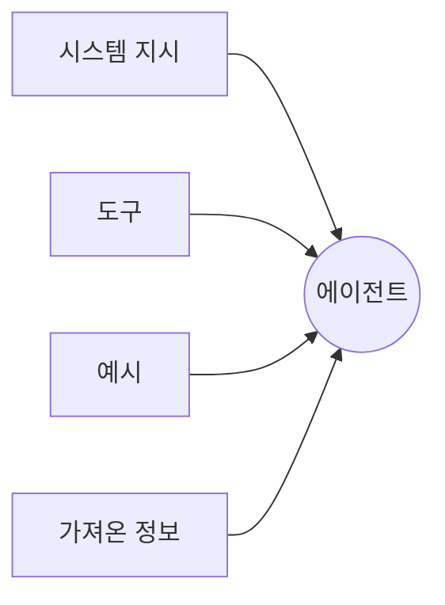
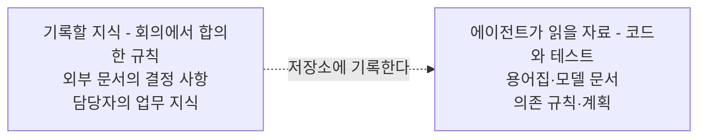
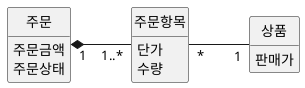
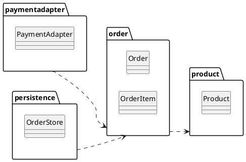

--------------------
Session 명: 05. 작업 명세와 수용 기준
--------------------

## 목차

01. 세션 목표
02. 맥락 엔지니어링
03. 주의 예산과 맥락 부패
04. 맥락의 구성
05. 저장소가 기록의 원천
06. 맥락 파일
07. 도메인 지식
08. 설계 지식
09. 맥락의 적정량
10. 긴 작업의 맥락
11. 잘못된 관행
12. 실습 — 맥락 패키지
13. 요약

---

## 01. 세션 목표

에이전트에게는 **구현과 검증에 필요한 규칙과 자료를 선별해서** 제공해야 한다.

- **맥락 엔지니어링**이 프롬프트 엔지니어링과 다른 점과, 맥락을 고르는 일이 반복되는 이유를 설명한다.
- **주의 예산**과 **맥락 부패**를 바탕으로, 자료를 많이 제공해도 필요한 정보를 놓칠 수 있는 이유를 설명한다.
- 맥락을 **시스템 지시·도구·예시·가져온 정보**로 나누고, 시스템 지시를 알맞은 **추상화 수준**으로 쓴다.
- 업무 규칙과 설계 결정을 **저장소**에 기록하고, 맥락 파일에서 필요한 문서를 안내한다.
- 도메인 지식(용어집·정적·동적 모델)과 설계 지식(**경계·의존 규칙**)에서 과제의 판단을 바꾸는 것만 고른다.
- **도메인·기술 복잡성**에 따라 필요한 자료를 고르고, 작성·검토 비용과 활용도를 고려해 우선순위를 정한다.

**강사 노트**

- 지금까지 위임할 과제의 "무엇"(작업 명세서)과 "무엇으로 받아들일까"(수용 기준)를 정했다. 여기서는 에이전트가 알아야 할 지식을 정한다.
- 기준 원전은 [Anthropic 2025c]이며, 저장소와 지도는 [Lopopolo 2026]의 경험을 쓴다.
- 용어집·도메인 모델·상태 기계·온톨로지의 뜻은 "세션 01. AI 협업의 특성과 사람의 판단 책임"의 「04. 업무 규칙의 명시」에서 이미 정의했다. 여기서는 그중 **무엇을 골라 주는가**를 다룬다.

---

## 02. 맥락 엔지니어링

## 맥락 엔지니어링이란?

**인용문**

맥락 엔지니어링은 LLM이 추론할 때 사용할 **정보를 선별하고 적절한 상태로 유지하는 전략**을 뜻한다, "Context engineering refers to the set of strategies for curating and maintaining the optimal set of tokens (information) during LLM inference", [Anthropic 2025c]

- **정보 선별** — 사람이 작업에 필요한 규칙과 자료를 고르고, 에이전트가 맥락 창에서 읽을 수 있게 한다.
- **정보 갱신** — 작업이 진행되면 낡거나 불필요해진 정보를 덜어내고, 새로 필요한 정보를 제공한다.
- **선별 기준** — 자료의 양보다, **작업을 올바르게 수행하는 데 필요한 정보가 있는지**를 본다.

**인용문**

좋은 맥락 엔지니어링은 원하는 결과가 나올 가능성을 높이는 **핵심 정보를 가능한 적은 분량으로 구성**하는 것이다, "good context engineering means finding the smallest possible set of high-signal tokens that maximize the likelihood of some desired outcome", [Anthropic 2025c]

**강사 노트**

- 인용 근거: Anthropic, "Effective context engineering for AI agents"(2025) 원문 확인. 두 인용은 같은 글의 정의와 지침이다.
- 두 번째 인용은 "세션 01. AI 협업의 특성과 사람의 판단 책임"의 「03. AI가 바꾼 것과 바꾸지 못한 것」의 「맥락의 한계」에서 이미 보였다. 여기서는 **고르는 기준**으로 다시 쓴다.

---

## 프롬프트 엔지니어링과의 차이

프롬프트 엔지니어링이 **지시의 표현**을 다룬다면, 맥락 엔지니어링은 그 지시와 함께 모델이 읽을 **정보 전체의 구성과 갱신**을 다룬다.

**인용문**

맥락 구성은 **반복적인 작업**이며, 모델에 무엇을 전달할지 결정할 때마다 정보를 선별한다, "iterative and the curation phase happens each time we decide what to pass to the model.", [Anthropic 2025c]

**표 — 프롬프트 엔지니어링과 맥락 엔지니어링**

| 구분 | 프롬프트 엔지니어링 | 맥락 엔지니어링 |
|---|---|---|
| **대상** | 지시 문장 | 맥락 창에 들어갈 정보 전체 |
| **초점** | 의도를 어떻게 전달할까? | 지금 어떤 정보가 필요할까? |
| **사람의 일** | 문구를 다듬는다 | 줄 것과 주지 않을 것을 고른다 |
| **실패의 모습** | 의도를 잘못 알아듣는다 | 알아야 할 것을 모른 채 추측한다 |

- **함께 필요한 작업** — 지시를 명확히 써도 업무 규칙이 빠져 있으면 에이전트가 추측할 수 있다. 작업이 진행될 때마다 필요한 자료도 다시 골라야 한다.

**강사 노트**

- 인용 근거: 같은 글에서 프롬프트 엔지니어링과 비교한 문장을 확인했다.
- 첫 시도의 실패("세션 01. AI 협업의 특성과 사람의 판단 책임")는 지시가 짧아서가 아니라 업무 규칙이 맥락에 없어서였다. 질문으로 되짚는다.

---

## 03. 주의 예산과 맥락 부패

## 주의 예산

모델이 입력을 받아들일 수 있는 양과, 그 안의 정보를 **정확히 활용할 수 있는 정도**는 다르다.

**인용문**

LLM도 사람처럼 어느 지점에서 **집중을 잃거나 혼란을 겪는다**, "LLMs, like humans, lose focus or experience confusion at a certain point", [Anthropic 2025c]

  - LLM은 많은 맥락을 해석할 때 끌어 쓰는 **주의 예산**을 가진다, "LLMs have an \"attention budget\" that they draw on when parsing large volumes of context", [Anthropic 2025c]

- **맥락 창의 한계** — 입력 한도 안에 들어가는 자료라도, 모델이 중요한 내용을 놓칠 수 있다.
- **선별이 필요한 이유** — 불필요한 정보가 늘면 필요한 정보에 집중하기 어려워진다. 자료를 추가할 때는 작업에 필요한 이유를 확인한다.

**강사 노트**

- 인용 근거: 같은 글의 "A note on context: why minimal high-signal tokens" 논의에서 두 문장을 확인했다.
- 둘째 인용은 들여쓴 bullet 인용이다(`session-authoring-guide.md`의 「5. 인용과 출처」).

---

## 맥락 부패

**맥락 부패(context rot)**는 맥락이 길어질수록 그 안의 정보를 정확히 떠올리는 능력이 떨어지는 현상이다.

**인용문**

맥락 창의 토큰이 늘수록 모델이 그 맥락에서 **정보를 정확히 떠올리는 능력이 떨어진다**, "as the number of tokens in the context window increases, the model's ability to accurately recall information from that context decreases", [Anthropic 2025c]

문서의 내용이 **최신 상태인지**도 확인해야 한다. 규칙이 바뀌었는데 맥락 파일을 갱신하지 않으면 에이전트는 오래된 규칙을 따를 수 있다.

**인용문**

큰 지시 파일은 곧 **낡은 규칙의 무덤**이 된다 — 에이전트는 무엇이 아직 참인지 알 수 없고 사람은 유지를 멈춘다, "It rots instantly. A monolithic manual turns into a graveyard of stale rules. Agents can't tell what's still true, humans stop maintaining it", [Lopopolo 2026]

- **맥락 부패에 대한 대응** — 현재 작업에 필요한 정보를 선별해, 맥락 창에 불필요한 자료가 쌓이지 않게 한다.
- **문서 노후화에 대한 대응** — 문서를 주제별로 나누고 변경된 규칙을 갱신한다. 문서 검사로 누락이나 불일치를 확인한다.

**강사 노트**

- 인용 근거: 맥락 부패는 [Anthropic 2025c]가 쓴 용어이며, 그 글이 needle-in-a-haystack 연구를 근거로 든다. 파일의 노후화는 [Lopopolo 2026]의 "one big AGENTS.md" 실패 경험이다.
- 갱신을 기계로 확인하는 방법(문서 린터·검사 작업)은 "세션 09. 검증 하네스·결과 점검·피드백"에서 센서로 다룬다.

---

## 04. 맥락의 구성

## 맥락의 네 갈래

맥락에는 **시스템 지시·도구·예시·가져온 정보**가 포함된다. 각 요소의 역할에 맞게 필요한 정보를 고른다.

**도식 — Mermaid — 맥락의 네 갈래**

- **시스템 지시** — 목표와 지킬 규칙이다. 반복해서 쓰이므로 간결하게 유지한다.
- **도구** — 호출할 기능의 이름·설명·인자를 알려 준다.
- **예시** — 허용·거절 사례로 규칙과 기대 결과를 구체적으로 보여 준다.
- **가져온 정보** — 작업 중 필요한 시점에 찾아 읽은 문서와 코드 등이다.

**강사 노트**

- 네 갈래는 [Anthropic 2025c]가 맥락의 구성 요소로 든 것(시스템 지시·도구·예시·가져오는 정보)을 사례에 맞춰 정리한 것이다.
- 도구는 다음 세션의 주제이므로 이름만 짚고 넘어간다.

---

## 시스템 지시의 추상화 수준

시스템 지시에는 **지켜야 할 규칙을 구체적으로** 쓰되, 불필요한 구현 세부까지 정하지 않는다.

**인용문**

시스템 지시는 **아주 명확하고 단순한 언어**로 알맞은 추상화 수준에서 생각을 제시해야 한다, "System prompts should be extremely clear and use simple, direct language that presents ideas at the right altitude", [Anthropic 2025c]

  - 기대하는 행동을 온전히 드러내는 **최소의 정보**를 목표로 한다, "you should be striving for the minimal set of information that fully outlines your expected behavior", [Anthropic 2025c]

**표 — 주문 금액을 세 수준으로 쓴 지시**

| 수준 | 지시 예시 | 에이전트에게 주는 정보 |
|---|---|---|
| **너무 낮음** | 단가 필드에 판매가를 넣고 저장한다 | 필드 조작과 저장 방법 |
| **알맞음** | 주문 금액은 주문이 생길 때의 판매가로 정한다 | 금액을 정하는 업무 규칙 |
| **너무 높음** | 금액을 올바르게 계산한다 | 계산 기준이 없는 목표 |

- **추상화 수준의 기준** — 에이전트가 무엇을 지켜야 하는지 알 수 있고, 구체적인 구현 방법은 선택할 수 있어야 한다.

**강사 노트**

- 인용 근거: 같은 글의 시스템 프롬프트 논의에서 두 문장을 확인했다. 원문은 이 높이를 "right altitude"로 부른다.
- 표의 세 문장은 같은 업무 규칙을 높이만 바꿔 쓴 것이다. 수강생에게 가운데 줄만 남기는 이유를 묻는다.

---

## 필요할 때 가져오기

모든 문서를 처음부터 입력하지 않는다. **문서의 위치와 읽어야 할 이유**를 알려 주고, 에이전트가 필요한 시점에 찾아 읽게 한다.

**인용문**

에이전트는 **파일 경로·저장된 질의·웹 링크 등 간단한 참조 정보**를 유지하고, 실행 중에 이를 이용해 필요한 데이터를 맥락으로 불러온다, "maintain lightweight identifiers (file paths, stored queries, web links, etc.) and use these references to dynamically load data into context at runtime", [Anthropic 2025c]

- **먼저 읽을 자료** — 현재 과제 전반에 필요한 용어집과 상태 기계다. 구현을 시작하기 전에 규칙을 확인하게 한다.
- **필요할 때 읽을 자료** — 연동 매뉴얼이나 과거 설계 기록처럼 특정 작업에서만 쓰는 자료다.
- **찾아 읽을 수 있는 조건** — 에이전트가 해당 자료에 접근할 수 있어야 한다. 문서 이름과 설명으로 언제 읽을지 판단할 수 있어야 한다.

**강사 노트**

- 인용 근거: 같은 글의 "just in time" 전략 설명에서 확인했다.
- "주문한다"에서 결제 연동 매뉴얼은 가리키기만 한다. 통째로 준 결과는 「11. 잘못된 관행」에서 본다.

---

## 05. 저장소가 기록의 원천

에이전트가 문서를 찾아 읽게 하려면 **합의한 내용을 접근 가능한 곳에 기록**해야 한다. 업무 규칙과 설계 결정을 저장소에 두면 코드와 함께 관리할 수 있다.

**인용문**

에이전트의 관점에서 실행 중 맥락으로 **접근할 수 없는 것은 존재하지 않는다**, "From the agent's point of view, anything it can't access in-context while running effectively doesn't exist. Knowledge that lives in Google Docs, chat threads, or people's heads are not accessible to the system.", [Lopopolo 2026]

**도식 — Mermaid — 에이전트가 볼 수 있는 것**

- **기록할 내용** — 업무 담당자와 정한 규칙, 설계 결정, 아직 답하지 못한 질문을 남긴다.
- **기록 방법** — 문서·코드·테스트로 작성하고 버전을 관리한다. 에이전트가 필요한 자료를 찾을 수 있도록 맥락 파일에서 안내한다.
- **팀의 활용** — 새로 참여한 개발자도 같은 자료를 읽고 결정의 근거를 확인할 수 있다.

**강사 노트**

- 인용 근거: Ryan Lopopolo, "Harness engineering: leveraging Codex in an agent-first world", OpenAI, 2026 영문 원문 확인. 원문은 저장소의 지식 기반을 기록의 원천(system of record)으로 삼았다고 쓴다.
- 주문 사례에서는 업무 담당자와 30분 회의로 정한 업무 규칙("세션 03. 요구의 구체화와 명세")이 저장소로 옮겨야 할 첫 지식이다.

---

## 06. 맥락 파일

## 하나의 큰 파일이 실패하는 이유

모든 지침을 한 파일에 모으면, 에이전트가 **현재 작업에 필요한 규칙을 찾기 어려워진다**.

**인용문**

지침이 너무 많으면 **지침이 아니게 된다** — 모든 것이 중요하면 중요한 것이 없고 에이전트는 의도대로 찾아가는 대신 가까운 패턴을 흉내 낸다, "Too much guidance becomes non-guidance. When everything is \"important,\" nothing is. Agents end up pattern-matching locally instead of navigating intentionally.", [Lopopolo 2026]

- **입력 공간을 차지한다** — 관련 없는 지침까지 함께 읽으면, 작업에 필요한 코드와 문서를 제공할 공간이 줄어든다.
- **갱신하기 어렵다** — 서로 다른 주제의 규칙이 섞여 있으면, 어떤 내용을 고치고 검사해야 하는지 파악하기 어렵다.

**강사 노트**

- 인용 근거: [Lopopolo 2026]은 "one big AGENTS.md"의 실패를 네 가지로 든다 — 맥락을 밀어냄, 지침이 아니게 됨, 낡아 감, 검증이 어려움.
- 낡아 가는 문제는 「03. 주의 예산과 맥락 부패」에서 이미 보았다. 여기서는 나머지 세 가지를 짚는다.

---

## 지도와 점진적 공개

맥락 파일에는 **작업의 개요와 문서 안내**를 둔다. 상세한 규칙은 해당 문서에서 읽게 하면, 모든 내용을 한 번에 제공하지 않아도 된다.

**인용문**

에이전트에게 **1,000쪽 지시서가 아니라 지도**를 준다, "give Codex a map, not a 1,000-page instruction manual", [Lopopolo 2026]

  - 맥락 파일을 백과사전이 아니라 **목차**로 다룬다, "instead of treating AGENTS.md as the encyclopedia, we treat it as the table of contents", [Lopopolo 2026]

에이전트가 문서 안내를 따라 필요한 정보를 차례로 읽는 방식이 **점진적 공개(progressive disclosure)**다.

**인용문**

점진적 공개는 에이전트가 **탐색으로 필요한 맥락을 차츰 발견**하게 한다, "progressive disclosure—in other words, allows agents to incrementally discover relevant context through exploration.", [Anthropic 2025c]

**강사 노트**

- 인용 근거: 지도와 목차는 [Lopopolo 2026], 점진적 공개의 정의는 [Anthropic 2025c]에서 확인했다. [Lopopolo 2026]도 같은 이름을 쓴다.
- [Thoughtworks 2026]은 progressive context disclosure를 Trial로 둔다. 자리 잡아 가는 기법이라는 신호다.

---

## 주문한다의 맥락 파일

주문 시스템의 맥락 파일은 **먼저 읽을 문서와 필요할 때 읽을 문서를 구분**한다. 업무 규칙은 문서에 두고, 맥락 파일에는 각 문서를 읽어야 하는 이유를 적는다.

**문서 형식**

**AGENTS.md** — 주문 시스템

1. 무엇을 만드는가
  - **"주문한다"** — 배송지를 정하면 주문이 생기고, 결제가 승인되면 배송을 요청한다.
2. 먼저 읽을 것
  - `docs/glossary.md` — **용어집**. 판매가와 단가를 반드시 구분한다.
  - `docs/order-state.md` — **주문 상태 기계**. 없는 전이를 만들지 않는다.
  - `docs/dependency.md` — **의존 규칙**. 업무 패키지는 연동·저장을 import하지 않는다.
3. 작업의 규칙
  - **완료** — 수용 테스트가 통과해야 완료다. 테스트를 끄거나 지우지 않는다.
  - **멈출 조건** — 기대값·의존 규칙을 바꿔야 하면 묻는다.
4. 필요할 때 볼 것
  - `docs/external/payment-api.md` — **결제 연동 규격**. 결제 승인 요청을 구현할 때 읽는다.

**강사 노트**

- 공개 형식 [AGENTS.md]를 쓰면 도구가 바뀌어도 같은 파일을 읽는다. vendor 독립성은 "세션 11. 평가 세트와 운영 점검 — 보안·비용·모델 변경"에서 다룬다.
- [Lopopolo 2026]의 맥락 파일은 약 100줄이다. 주문 사례는 과제가 하나여서 더 짧다.
- 파일 경로와 약 30줄의 분량은 주문 사례의 예시다. 도구가 요구하는 고정 구조나 줄 수가 아니다.
- 네 번째 묶음이 「04. 맥락의 구성」의 「필요할 때 가져오기」를 실제로 적용한 자리다.

---

## 07. 도메인 지식

## 분석 모델이 명시하는 것

분석 모델은 **업무의 개념·관계·상태·규칙**을 설명한다. 이를 맥락으로 제공하면 에이전트가 업무의 의미를 확인하면서 구현할 수 있다.

**표 — 분석 모델과 그 바깥**

| 구분 | 담는 것 | "주문한다"의 예 |
|---|---|---|
| **분석 모델** | 개념·관계·상태·업무 규칙 | 주문 금액은 주문 시점의 판매가 |
| **설계** | 경계·책임·협력 | 연동 패키지가 결제를 부른다 |
| **구현** | 저장·통신·형식 | 금액 열의 자료형과 질의 |

- **업무와 구현의 구분** — 업무 규칙과 기술 선택을 구분해 적어야, 에이전트가 규칙을 지키면서 구현 방법을 선택할 수 있다.
- **분석의 관점** — 정보공학은 자료 흐름과 정보 구조를 함께 살피고, 객체지향 분석은 업무 개념의 관계와 상태 변화를 함께 살핀다.

**강사 노트**

- 본질적·우연적 복잡성은 "세션 01. AI 협업의 특성과 사람의 판단 책임"의 「03. AI가 바꾼 것과 바꾸지 못한 것」의 「본질적 복잡성과 우연적 복잡성」에서 [Brooks 1986]으로 정의했다.
- 정보공학의 자료 흐름도와 ERD는 한 방법 안의 두 관점이며 따로 쓰는 기법이 아니다. 분석 기법 자체는 "객체지향 분석과 설계 실무" 과정이 다룬다.
- 분석 모델을 형식 언어로 적은 것이 온톨로지다. 수단의 비교는 "세션 01. AI 협업의 특성과 사람의 판단 책임"의 「04. 업무 규칙의 명시」에 있다.

---

## 정적 모델과 동적 모델

정적 모델은 **업무 개념의 구조**를, 동적 모델은 **사건에 따른 상태 변화**를 설명한다. 작업에 필요한 구조와 동작을 함께 알려 주어야 추측을 줄일 수 있다.

**도식 — PlantUML — 주문의 정적 모델**

- **정적 모델** — 주문 항목의 **단가**와 상품의 **판매가**를 구분한다. 주문 금액을 계산할 때 어떤 값을 쓸지 판단하는 근거다.
- **동적 모델** — 결제가 거절되면 주문이 **결제대기에 머문다**는 규칙을 보여 준다.
- **함께 제공하는 이유** — 구조만으로는 결제 거절 뒤의 상태를 알 수 없고, 상태 변화만으로는 금액의 근거를 알 수 없다.

**강사 노트**

- 정적 모델의 이름은 분석 모델이므로 한글이다. 설계 이름으로 바꾸는 자리는 아래 「OOAD·DDD와의 관계」에서 짚는다.
- 상태 기계를 다시 그리지 않고 "세션 01. AI 협업의 특성과 사람의 판단 책임"의 「04. 업무 규칙의 명시」의 「모델로 보이는 업무 규칙」을 가리킨다. 같은 지식을 두 곳에 두지 않는다.
- 다중성 `1..*`는 주문 항목이 없는 주문을 **금지**한다. 에이전트가 빈 주문을 만들지 않는 근거다.

---

## OOAD·DDD와의 관계

OOAD의 분석 모델은 **업무의 의미와 구조**를 설명한다. DDD의 보편 언어는 그 의미를 대화와 코드에서 일관되게 표현하도록 한다.

**표 — 업무 용어와 코드 이름의 대응**

| 자료 | 쓰는 이름 | 예 |
|---|---|---|
| **작업 명세서·분석 모델** | 한글 업무 용어 | 단가, 주문 금액 |
| **용어집** | 한글과 영문의 대응 | 단가 — `unitPrice` |
| **설계 모델·코드** | 영문 설계 이름 | `OrderItem.unitPrice` |

- **용어의 일관성** — 한글 업무 용어와 영문 코드 이름을 용어집에서 연결한다. 표현 언어가 달라도 같은 업무 개념을 뜻해야 한다.
- **에이전트의 활용** — 용어집을 읽고 정해진 코드 이름을 사용하게 한다. 예를 들어 단가는 `unitPrice`로 표현하고 판매가와 구분한다.

**강사 노트**

- 보편 언어 인용([Evans 2015])은 "세션 01. AI 협업의 특성과 사람의 판단 책임"의 「04. 업무 규칙의 명시」에 있다. 여기서는 맥락으로 쓰는 쪽만 다룬다.
- 영한 대응과 명명 규칙의 원천은 `course-design.md`의 「영한 용어집과 명명 규칙」이다.
- 유스케이스·도메인 모델을 **만드는 법**은 "객체지향 분석과 설계 실무" 과정이 맡는다.

---

## 08. 설계 지식

업무의 의미와 함께 **패키지의 경계와 의존 규칙**도 알려 주어야 한다. 기존 코드만 참고하면 잘못된 구조까지 따를 수 있다.

**인용문**

에이전트는 **엄격한 경계와 예측 가능한 구조**에서 가장 잘 일한다, "Agents are most effective in environments with strict boundaries and predictable structure", [Lopopolo 2026]

**도식 — PlantUML — 주문 시스템의 패키지 의존**

- **의존의 방향** — 주문 패키지는 연동·영속 패키지에 의존하지 않아, 외부 통신과 저장 방식에서 분리된다.
- **순환 금지** — 패키지의 의존 순환을 막아 변경의 영향을 파악하기 쉽게 한다.
- **구조의 검증** — 의존 규칙을 문서로 안내하고, 코드가 지키는지 자동 검사로 확인한다.

**강사 노트**

- 인용 근거: [Lopopolo 2026]은 도메인마다 고정된 계층과 허용된 의존만 두고 custom linter와 구조 테스트로 강제했다.
- 의존 규칙의 원천은 `course-design.md`의 공통 전제다. 패키지 다이어그램은 클래스 이름만 보인다.
- 경계를 정하는 판단 자체는 "객체지향 분석과 설계 실무" 과정의 구조 설계가 다룬다.

---

## 09. 맥락의 적정량

## 복잡성의 두 축

필요한 자료는 **업무 규칙의 복잡성**과 **구현 기술의 복잡성**을 따로 살펴 고른다. 모든 과제에 같은 문서 묶음을 제공할 필요는 없다.

**표 — 두 축으로 고른 중간 산출물**

| | 기술 복잡성 낮음 | 기술 복잡성 높음 |
|---|---|---|
| **도메인 복잡성 낮음** | 스토리와 예 | + 경계·의존 규칙 |
| **도메인 복잡성 높음** | + 용어집·분석 모델 | 모두 |

- **"주문한다"에 필요한 자료** — 업무 규칙과 상태를 설명하는 용어집·분석 모델, 외부 연동 구조를 설명하는 의존 규칙을 함께 제공한다.
- **추가할지 판단하는 기준** — 그 자료가 구현이나 검증의 어떤 판단에 필요한지 설명할 수 있어야 한다. 관련 없는 자료는 제외한다.

**강사 노트**

- 두 축과 넣는 기준은 `course-design.md`의 「요구에서 코드까지의 경로」이며, "세션 03. 요구의 구체화와 명세"의 「명세의 알맞은 수준과 경로」에서 명세의 높이로 다뤘다.
- LLM이 문서를 싸게 만들어도 **검토 비용과 주의 예산**은 그대로다. 그래서 싸다는 이유로 더하지 않는다.

---

## 맥락의 우선순위

필요한 자료 가운데 **자주 쓰고 구현에 미치는 영향이 큰 자료**부터 읽게 한다. 작성·검토에 드는 노력과 입력 분량도 함께 고려한다.

**표 — "주문한다"에서 고른 순서**

| 순위 | 자료 | 준비·입력 부담 | 활용 목적 |
|---|---|---|---|
| **1순위** | 용어집 | 낮음 | 판매가와 단가를 구분한다 |
| **2순위** | 상태 기계 | 낮음 | 결제 거절 뒤의 상태를 확인한다 |
| **3순위** | 정적 모델 | 중간 | 단가를 가진 개념을 확인한다 |
| **4순위** | 의존 규칙 | 중간 | 연동 코드의 의존 방향을 확인한다 |
| **5순위** | 연동 규격 | 높음 | 연동 구현에 필요한 부분을 읽는다 |

- **처음에 읽을 자료** — 용어집과 모델처럼 과제 전반에서 반복해 쓰는 자료다.
- **필요할 때 읽을 자료** — 연동 규격처럼 분량이 크고 특정 작업에서 쓰는 자료는 위치를 안내한다.
- **과제에 따른 조정** — 연동 구조가 핵심인 과제에서는 의존 규칙부터 확인할 수 있다.

**강사 노트**

- 비용은 쓰는 노력과 창을 차지하는 양을, 효과는 결과가 달라지는 정도를 뜻한다. 표의 판정은 주문 사례의 판단이며 일반 순위가 아니다.
- 5순위를 통째로 준 결과가 「11. 잘못된 관행」의 사례다.

---

## 10. 긴 작업의 맥락

작업이 길어져 대화와 실행 기록이 쌓이면, **계속 필요한 정보는 남기고 지난 기록은 정리**해야 한다.

**인용문**

맥락의 제약을 직접 다루는 방법은 **압축·구조화한 노트·여러 에이전트 구조**다, "compaction, structured note-taking, and multi-agent architectures", [Anthropic 2025c]

**표 — 세 가지 방법**

| 방법 | 하는 일 | "주문한다"에서 |
|---|---|---|
| **압축** | 지난 대화를 요약해 입력 분량을 줄인다 | 끝난 작업 단위의 기록을 요약한다 |
| **구조화한 노트** | 진행을 저장소 파일에 적는다 | 기능 목록의 상태를 갱신한다 |
| **하위 에이전트** | 좁은 과제를 따로 맡긴다 | 연동 규격 조사만 떼어 맡긴다 |

- **진행 기록** — 완료한 일과 남은 일을 저장소에 기록하면, 새 실행에서도 진행 상황을 확인하고 이어서 작업할 수 있다.
- **요약에서 빠뜨리지 않을 정보** — 기대값과 미정 질문은 원문을 파일로 보관한다. 대화 요약에서 중요한 조건이 빠질 수 있기 때문이다.

**강사 노트**

- 인용 근거: [Anthropic 2025c]의 장기 과제 논의에서 세 방법의 이름을 확인했다.
- 기능 목록과 진행 기록은 "세션 04. 수용 기준과 검증 가능한 작업 단위"의 「기능 목록과 점진적 진행」에서 [Anthropic 2025d]로 다뤘다. 실패 뒤 이어받기는 "세션 10. 실패 대응·재시도·복구"가 맡는다.

---

## 11. 잘못된 관행

## 맥락 쏟아붓기

관련 자료를 많이 제공해도 **필요한 규격을 올바르게 고른다는 보장은 없다**. 주문 사례에서는 결제 연동 매뉴얼 200쪽을 통째로 주자 에이전트가 옛 API를 사용했다.

- **실패 원인** — 현행 규격과 폐기된 규격이 섞여 있었고, 사용할 버전을 분명하게 안내하지 않았다.
- **보완 방법** — 사용할 승인 요청 규격과 버전을 지정한다. 필요한 부분을 제공하거나 해당 문서를 찾아 읽게 한다.
- **지시 작성의 유사한 문제** — 가능한 예외 상황을 모두 나열하면, 에이전트가 따라야 할 핵심 규칙을 파악하기 어려워진다.

**인용문**

팀은 가능한 모든 규칙을 명시하려고 **예외 상황의 긴 목록**을 프롬프트에 넣는 일이 많다, "teams will often stuff a laundry list of edge cases into a prompt in an attempt to articulate every possible rule", [Anthropic 2025c]

- **대표 사례의 활용** — 핵심 규칙과 함께 기대하는 행동을 보여 주는 예시를 제공한다. 수용 기준의 허용·거절 예시를 활용할 수 있다.

**강사 노트**

- 인용 근거: [Anthropic 2025c]는 긴 규칙 목록 대신 다양한 정규 예시(canonical examples)를 권한다.
- 200쪽 매뉴얼 장면은 `course-design.md`의 강의 시나리오이며, "세션 01. AI 협업의 특성과 사람의 판단 책임"의 「03. AI가 바꾼 것과 바꾸지 못한 것」의 「맥락의 한계」가 이 세션을 가리킨다.
- 발췌의 위험도 말한다 — 사람이 잘못 발췌하면 그 오류가 그대로 간다. 그래서 규격은 가리키는 쪽이 낫다.

---

## 지시 비대

문제가 생길 때마다 지시를 추가하고 정리하지 않으면 **중요한 규칙을 찾고 유지하기 어려워진다**.

**표 — 비대해지는 모습과 처방**

| 모습 | 왜 생기나 | 처방 |
|---|---|---|
| 실수할 때마다 금지문 추가 | 지시로만 재발을 막으려 함 | 자동 검사로 확인할 규칙을 고른다 |
| 상세 설명이 지시에 쌓임 | 관련 내용을 모두 담으려 함 | 별도 문서로 옮기고 위치를 안내한다 |
| 끝난 과제의 지시가 남음 | 정리할 담당자와 시점이 없음 | 더 이상 쓰지 않는 지시를 제거한다 |

- **자동 검사와의 분담** — 기계로 판정할 수 있는 규칙은 검사로 확인한다. 오류 메시지에는 어긴 규칙과 수정 방법을 알려 준다.
- **정기적인 정리** — 지시를 갱신할 담당자와 시점을 정하고, 중복되거나 오래된 내용을 고친다.

**강사 노트**

- [Thoughtworks 2026]은 agent instruction bloat를 Caution으로 둔다. 널리 생기는 문제라는 신호다.
- 규칙을 검사로 옮기는 방법은 "세션 08. 실행 제약과 가드레일의 역할"과 "세션 09. 검증 하네스·결과 점검·피드백"에서 다룬다.

---

## 12. 실습 — 맥락 패키지

작업 명세서·수용 기준·정기배송 모델 패키지를 LLM에 제공하여 **맥락 파일과 제공·제외할 자료 목록**을 작성하고, 점검 항목에 따라 수정하십시오.

- **투입물**
  + 실습 3의 **작업 명세서**, 실습 4의 **수용 기준**, **정기배송 모델 패키지**
- **프롬프트**
  + "'신청한다' 과제의 맥락 파일(AGENTS.md)을 **30줄 안쪽**으로 써줘. 작업 개요와 완료·멈출 조건을 간단히 적고, 상세 규칙은 해당 문서를 안내해줘. 자료는 **먼저 읽을 것·필요할 때 읽을 것·제외할 것**으로 나누고 이유를 적어줘."
- **점검 항목**
  1. **문서 안내** — 상세 규칙을 반복하지 않고 어느 문서를 왜 읽을지 안내하는가?
  2. **필요성** — 각 자료가 "신청한다"의 구현과 검증에 필요한 이유를 설명했는가?
  3. **빠진 전제** — 용어집(가격·회차 금액)과 두 상태 기계를 가리키는가?
  4. **주지 않을 것** — 배송지 변경·해지처럼 이번 과제 밖의 것을 뺐는가?
  5. **접근 방법** — 큰 문서의 위치와 읽어야 할 시점을 안내했는가?
  6. **멈출 조건** — 기대값·의존 규칙을 바꿔야 할 때 묻게 했는가?
- **결과물** — 맥락 파일과 제공·제외할 자료 목록(먼저 읽을 것·필요할 때 읽을 것·제외할 것). 실습 6의 입력이 됩니다.

**강사 노트**

- 정기배송 모델 패키지는 `code/s01/subscription/docs/`에 있다.
- LLM은 맥락 파일에 코딩 규칙(들여쓰기·커밋 메시지)을 채우려 한다. 점검 1·2로 지우게 한다.
- 점검 6의 멈출 조건은 다음 세션의 위임 계약으로 이어진다. 여기서는 한 줄만 둔다.

---

## 13. 요약

맥락에는 **구현과 검증에 필요한 규칙과 자료**를 선별해 담는다.

### 맥락 구성의 핵심

- **정보 선별·갱신** — 필요한 자료를 고르고 갱신해, 중요한 정보가 묻히지 않게 한다
- **맥락의 구성** — 목표·규칙·도구·예시를 명확히 하고, 큰 문서는 필요할 때 읽게 한다
- **저장소와 맥락 파일** — 업무 규칙과 설계 결정을 기록하고, 읽을 문서를 안내한다
- **도메인·설계 지식** — 용어집·모델·의존 규칙으로 업무 의미와 구현 구조를 알려 준다
- **범위와 순서** — 복잡성·활용도와 작성·입력 비용을 고려해 자료를 고른다

### 다음 세션

- "**06. 작업 위임과 도구·권한·상태의 경계**" — 맥락을 받은 에이전트가 무엇을 쓰고 어디까지 바꿀 수 있는지 정한다.

**강사 노트**

- 맥락 파일의 멈출 조건 한 줄이 다음 세션의 위임 계약으로 자란다. 실습 5의 결과물을 그대로 입력으로 쓴다.

---

## 별첨. 실습 답

---

## 맥락 파일 (안)

정기배송의 맥락 파일에는 **"신청한다"의 작업 개요와 문서 안내**를 적는다. 상세한 업무 규칙은 해당 문서에서 확인하게 한다.

**문서 형식**

**AGENTS.md** — 정기배송 시스템

1. 무엇을 만드는가
  - **"신청한다"** — 상품·수량·주기·첫 배송일·기간·배송지를 정해 신청하고 결제하면, 정기배송이 확정되고 회차가 예정으로 생긴다.
2. 먼저 읽을 것
  - `docs/glossary.md` — **용어집**. 가격과 회차 금액을 반드시 구분한다.
  - `docs/subscription-state.md` — **정기배송 상태 기계**. 거절은 결제 대기를 유지한다.
  - `docs/delivery-round-state.md` — **회차 상태 기계**. 회차는 예정으로 생긴다.
  - `docs/requirements.md` — **요구사항 정의서**. "신청한다"의 범위와 제외.
  - `docs/dependency.md` — **의존 규칙**. `subscription`은 연동·저장을 import하지 않는다.
3. 작업의 규칙
  - **완료** — 수용 기준의 테스트가 통과해야 완료다. 테스트를 끄지 않는다.
  - **정해진 값** — 회차 수·회차 금액·만료일은 요구사항 정의서의 값을 쓴다.
  - **멈출 조건** — 기대값·의존 규칙을 바꿔야 하면 묻는다.
4. 필요할 때 볼 것
  - `docs/external/payment-api.md` — **결제 승인 규격**. 결제 승인 요청을 구현할 때 읽는다.

**강사 노트**

- 상세 규칙을 중복해 쓰지 않고 해당 문서를 안내했다. 작업 개요와 완료·멈출 조건은 맥락 파일에도 간단히 남긴다.
- 먼저 읽을 문서가 각각 어떤 판단에 필요한지 설명하게 한다. 30줄은 실습의 분량 기준이며 도구의 제한이 아니다.

---

## 줄 것과 주지 않을 것 (안)

"신청한다"의 구현과 검증에 필요한 자료를 고르고, **먼저 읽을 자료와 작업 중에 읽을 자료**를 구분한다.

- **먼저 읽는다**
  - **용어집** — 가격과 회차 금액의 뜻을 구분한다
  - **정기배송 상태 기계** — 결제 거절이 결제 대기를 유지한다는 전이
  - **회차 상태 기계** — 회차가 예정으로 생긴다는 초기 상태
  - **요구사항 정의서** — 회차 7개·70,000원·만료일 2월 2일의 근거
  - **의존 규칙** — 업무 코드와 연동·영속 코드의 의존 방향을 확인한다
- **필요할 때 읽는다**
  - **결제 승인 규격** — 분량이 크고 연동 구현에 쓰므로 위치를 안내한다
- **제외한다**
  - **배송지 변경·해지·만료** — 이번 과제 밖이다. 실습 10의 입력이 된다
  - **월별 청구·반품** — 개발하지 않는 범위다
  - **자동 검사로 확인하는 코딩 규칙의 상세** — 지시에 반복하지 않고 검사 결과로 확인한다
- **※ 판단 기준**
  - **먼저 읽기** — 현재 과제 전반에 필요한 자료인가?
  - **필요할 때 읽기** — 특정 작업에서만 쓰거나 분량이 큰 자료인가?

**강사 노트**

- 배송지 변경을 지금 주면 에이전트가 회차에 변경 이력을 미리 넣는다. 범위 밖 맥락이 설계를 바꾼 예다.
- 값(회차 7개·70,000원)은 "세션 03. 요구의 구체화와 명세"의 실습 답에서 정한 교육용 값이다.

---

## 보완 (안)

새로 발견한 것은 **후속 작업에 영향을 미치는 경우에만** 이전 산출물에 반영한다.

- **정기배송 모델 패키지**
  - **문서를 나눈다** — 정기배송과 회차의 상태 기계를 두 파일로 나눈다. 필요한 상태 기계를 따로 찾아 읽게 한다.
  - **용어집에 더한다** — 회차 금액을 "신청 때의 가격 × 수량"으로 적는다. 가격과 섞여 쓰이고 있었다.
- **작업 명세서**(실습 3)
  - **참조에 위치를 명시한다** — 「참조」에 문서의 저장소 경로를 적어 에이전트가 찾아 읽을 수 있게 한다.
- **※ 현행화 기준**
  - **반영** — 용어집의 회차 금액과 상태 기계의 분리. 실습 6의 입력이 된다.
  - **기록만** — 작업 명세서의 참조에 경로를 적은 변경.

**강사 노트**

- 상태 기계를 나눈 것은 맥락 파일을 쓰다가 드러난 발견이다. 문서의 크기가 아니라 **가리킬 단위**가 기준이다.
- 용어집의 보완은 "세션 01. AI 협업의 특성과 사람의 판단 책임"의 「04. 업무 규칙의 명시」가 보인 판매가·단가 구분과 같은 판단이다. 실습에서 같은 일이 반복되는 것을 짚는다.
