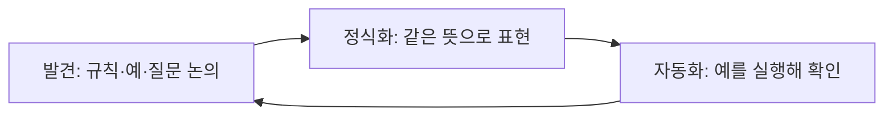
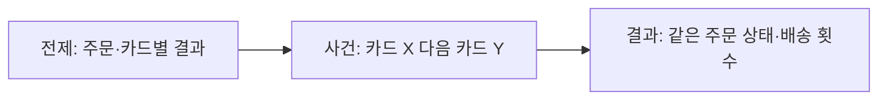

--------------------
Session 명: 05. 작업 명세와 수용 기준
--------------------

## 목차

01. 세션 목표
02. 작업 명세서
03. 수용 기준
04. BDD — 예로 명세하기
05. 예시에서 테스트로
06. 작업 단위
07. 기능 목록과 점진적 진행
08. 완료의 정의와 증거
09. 시연 — 테스트는 누가 쓰는가?
10. 잘못된 관행
11. 실습 — 작업 명세와 수용 기준
12. 요약

## 01. 세션 목표

**수용 기준**은 테스트의 기대값이 된다. 검증할 수 없는 작업은 맡길 수 없으므로, 구현할 범위와 받아들일 결과를 먼저 합의한다.

- 사용자 이야기에 **업무 규칙·범위·제외·미정**을 붙여 작업 명세서로 만든다.
- **허용·거절 예시**로 수용 기준의 해석 차이와 빈칸을 찾는다.
- **Given–When–Then**의 전제·사건·기대 결과를 실행 테스트로 연결한다.
- 작업을 **한 번에 검증할 단위**로 나누고 기능 목록에 진행을 남긴다.
- **완료의 증거**와 AI가 쓴 테스트의 기대값을 검토한다.

**강사 노트**

- 입력은 "세션 02. 요구와 사용자 이야기"의 요구사항 정의서, "세션 03. 도메인 모델"의 업무 의미, "세션 04. 아키텍처"의 의존 규칙이다.
- 도메인 규칙과 기대값을 정하는 책임은 사람에게 있다. 테스트 코드의 작성은 AI가 도울 수 있다.

---

## 02. 작업 명세서

## 스토리 하나의 명세

**작업 명세서**는 스토리 하나에서 구현할 요구사항을 확인 가능한 수준으로 적은 문서다. 시스템 전체의 요구사항 정의서와 모델을 참조한다.

**표 — 작업 명세서에 적을 것과 참조할 것**

| 구분 | 담을 내용 | 주문 사례 |
|---|---|---|
| **스토리** | 누가 어떤 결과를 왜 원하는가? | 고객이 상품을 배송받기 위해 주문한다 |
| **규칙과 예** | 옳은 결과와 구체적 기대값 | 확정 단가로 2,000원 승인 요청 |
| **범위·제외** | 이번 작업에 포함하거나 뺄 행동 | 결제·배송 요청 포함, 환불 제외 |
| **미정** | 확인 전에는 구현하지 않을 결정 | 승인 뒤 배송 요청 실패의 처리 |
| **참조** | 원천을 유지하는 다른 산출물 | 용어집·상태 기계·의존 규칙 |

- **작업용 문서**는 해당 작업의 구현과 검토에 쓴다. 오래 유지할 업무 규칙은 요구사항 정의서에서 관리한다.
- **중복을 줄인다.** 모델과 아키텍처 전체를 붙여 넣지 않고 작업에 필요한 부분과 그 원천을 가리킨다.

**강사 노트**

- "세션 02. 요구와 사용자 이야기"에서 구분한 두 명세의 수명과 범위를 그대로 쓴다. 새로운 개발 단계나 새로운 전체 명세서를 만드는 것이 아니다.
- 구현 계획과 클래스 배치를 요구사항에 섞지 않는다. 작업 명세는 무엇을 충족해야 하는지 정한다.

---

## 주문한다의 작업 명세서

**문서 형식**

고객은 장바구니의 상품을 결제해 **주문하고 배송받고 싶다**. 이번 작업은 배송지 지정부터 결제 결과와 배송 요청까지다.

- **업무 규칙과 예**

  - **금액** — 주문이 생길 때의 판매가를 항목 단가로 확정한다. 펜 2개 × 1,000원 = 2,000원.
  - **가격 변경** — 결제 직전 판매가가 1,200원이 되어도 기존 주문은 2,000원으로 결제한다.
  - **승인** — 결제완료로 바꾼 뒤 서울로 배송을 1회 요청한다.
  - **거절** — 결제대기를 유지하고 배송을 요청하지 않는다. 다른 카드로 다시 결제할 수 있다.

- **범위**

  - **포함** — 배송지 지정 때 주문 생성·금액 확정, 결제 승인 요청, 결과 반영, 승인 후 배송 요청.
  - **제외** — 상품 탐색·장바구니, 취소·환불, 할인·배송비, 재고, 배송 이후 처리.

- **미정**

  - **배송 요청 실패** — 승인된 결제와 주문을 어떻게 처리할지 업무 담당자에게 확인한다. 이번 구현은 이 정책을 정하지 않는다.

- **참조**

  - **요구사항 정의서** — 금액·배송 요청·결제 거절의 업무 규칙.
  - **도메인 모델** — 단가·주문 총액의 의미, 결제대기 자기 전이.
  - **아키텍처** — 업무는 연동·영속 구현에 의존하지 않는다.

**강사 노트**

- 이 문서 형식은 강의의 대표 작업 명세서다. 본문에 구현 클래스나 외부 API 주소를 넣지 않는다.
- 미정의 처리 정책을 테스트 기대값으로 만들지 않는다. 실제 출시 범위를 확정할 때까지 남겨 둘 수 있는 문제인지도 별도로 판단해야 한다.

---

## 03. 수용 기준

## 결과를 받아들일 조건

**수용 기준**은 스토리가 충족되었다고 판단할 조건이다. “결제가 잘 된다” 대신 관찰할 금액·상태·외부 요청을 적는다.

**인용문**

사람은 일의 우선순위를 정하고, 사용자 피드백을 **수용 기준**으로 옮기며 결과를 확인한다, "We prioritize work, translate user feedback into acceptance criteria, and validate outcomes.", [Lopopolo 2026]

**표 — 모호한 기준을 관찰 가능한 기준으로**

| 모호한 표현 | 확인할 결과 |
|---|---|
| **금액이 정확하다** | 판매가가 바뀌어도 2,000원의 승인을 요청한다 |
| **거절을 처리한다** | 결제대기를 유지하고 배송 요청은 0회다 |
| **재시도가 가능하다** | 다른 카드로 같은 주문을 결제하면 결제완료가 된다 |

- **허용과 금지**를 함께 확인한다. 거절 뒤 결제대기라는 상태만 확인하면 잘못 나간 배송 요청을 놓칠 수 있다.
- **기대값의 근거**는 업무 담당자가 확인한 규칙이다. 코드가 낸 결과를 그대로 기대값으로 복사하지 않는다.

**강사 노트**

- Lopopolo, Harness engineering: leveraging Codex in an agent-first world(2026). 저장된 영문 원문으로 확인했다. 이 인용은 인간의 역할에 관한 해당 팀의 설명이지 모든 조직의 실측 결과가 아니다.
- 영어 원문 앞 쉼표와 한글 문장 안 쉼표는 구분한다. 한글은 모두 18pt로 검토한다.

---

## 네 가지 대표 예

**대표 예**는 규칙의 다른 결과를 드러내도록 고른다. 승인뿐 아니라 가격 변경·거절·재결제가 빠지면 첫 시도의 오류를 잡을 수 없다.

**표 — 주문의 수용 예 네 가지**

| 예 | 전제·사건 | 기대 결과 |
|---|---|---|
| **승인** | 펜 2개 주문을 카드로 승인 | 2,000원 요청, 결제완료 뒤 서울 배송 1회 |
| **가격 변경** | 주문 후 판매가 1,200원, 결제 | 단가 1,000원, 승인 요청 2,000원 |
| **거절** | 카드 X가 거절됨 | 결제대기·총액 2,000원 유지, 배송 0회 |
| **재결제** | 카드 X 거절 뒤 카드 Y 승인 | 같은 주문이 결제완료, 배송 1회 |

- **같은 전제**를 유지한다. 주문은 배송지 서울을 지정할 때 생기고, 그때 펜 2개의 단가가 확정된다.
- **추가 예**는 목적이 있을 때 넣는다. 아직 정하지 않은 중복 승인이나 배송 요청 실패를 임의의 기대값으로 채우지 않는다.

**강사 노트**

- 수용 예 네 가지와 구현 작업 네 가지는 개수가 같아도 같은 목록은 아니다. 가격 변경은 금액 확정 작업을 검증하는 예다.
- 모든 입력 조합을 이 네 예로 검증했다는 뜻이 아니다. 현재 확인한 업무 규칙의 대표 경로다.

---

## 04. BDD — 예로 명세하기

## 업무와 개발이 예를 함께 논의한다

**행위 주도 개발(BDD)**은 업무 담당자와 개발자가 구체적인 예로 기대 행동을 함께 이해하는 협업 방식이다. 테스트 문법을 쓰는 것만으로 완성되지 않는다.

**인용문**

BDD는 **업무 담당자와 기술 담당자 사이의 간극**을 줄이는 소프트웨어 팀의 협업 방식이다, "BDD is a way for software teams to work that closes the gap between business people and technical people", [Cucumber]

**도식 — Mermaid — 합의에서 실행 가능한 예로**



- **발견**에서는 가격이 어느 시점의 금액인지 묻는다. **정식화**에서는 판매가와 단가를 나눠 예를 적는다.
- **자동화**는 합의한 뜻을 확인한다. 실행하다 규칙의 빈칸을 발견하면 논의로 돌아가며, 통과하도록 기대값부터 바꾸지 않는다.

**주석**

BDD — Behaviour-Driven Development

**강사 노트**

- Cucumber 공식 BDD 문서의 정의와 Discovery·Formulation·Automation 설명을 확인했다. 그림은 그 세 활동을 이 사례에 적용한 것이다.
- 도식의 정식화는 다음 GWT 예, 자동화는 AcceptanceExamples의 실행 테스트로 연결한다. 구체 도구 선택은 BDD의 정의가 아니다.

---

## 규칙·예·질문을 구분하기

**예시 매핑**은 스토리에 관련된 규칙·예·질문을 함께 정리해 범위를 확인하는 방법이다. 예로 설명되지 않는 규칙은 더 묻고, 답하지 못한 것은 질문으로 남긴다.

**인용문**

규칙을 설명하는 **예**는 초록색 카드에 적는다, "Examples to illustrate these rules are written on a green card", [Cucumber: Example Mapping]

**표 — 주문 스토리의 규칙·예·질문**

| 구분 | 내용 | 다음 행동 |
|---|---|---|
| **규칙** | 단가는 주문 생성 시점의 판매가다 | 공통 용어와 모델을 확인한다 |
| **예** | 판매가 1,200원이 되어도 2,000원 결제 | 수용 테스트의 기대값으로 쓴다 |
| **질문** | 승인 뒤 배송 요청이 실패하면 어떻게 하나? | 업무 담당자에게 처리 정책을 묻는다 |

- **형식의 목적**은 뜻을 맞추는 것이다. 카드의 색을 도구로 재현하는 것보다 규칙과 예가 연결되는지가 중요하다.
- **미정과 제외**는 다르다. 환불은 이번 기능에서 제외했고, 승인 뒤 배송 요청 실패는 정책 자체가 미정이다.

**강사 노트**

- Cucumber, Example Mapping 원문 확인. 원문의 스토리·규칙·예·질문 구분을 사용한다. 카드 색은 원문을 설명한 것이며 실습에서 색 카드 제작은 요구하지 않는다.
- 질문을 남겼다는 사실만으로 구현 위험이 해결되지는 않는다. 해당 기능을 출시할 수 있는지는 별도 판단한다.

---

## Given–When–Then

**Given–When–Then**은 전제·사건·기대 결과를 구분해 예를 쓰는 형식이다. 구현의 내부 순서 대신 업무가 관찰할 결과를 명확히 한다.

```gherkin
Scenario: 거절된 주문을 다른 카드로 결제한다
  Given 펜 2개, 단가 1000원, 배송지 서울의 결제대기 주문
    And 카드 X는 거절되고 카드 Y는 승인된다
  When 카드 X로 결제한 뒤 카드 Y로 다시 결제한다
  Then 같은 주문은 결제완료다
    And 배송 요청은 모두 합해 1회다
```

- **전제**는 결과를 재현할 상황이다. 카드마다 다른 결제 결과를 테스트 대역으로 준비한다.
- **사건**은 고객의 행동이다. **기대 결과**는 상태와 외부 요청으로 확인하며 호출 횟수도 업무 규칙에서 정한다.
- **문형의 한계**도 있다. 세 칸을 채웠어도 미정 정책을 지어냈다면 좋은 명세가 아니다.

**강사 노트**

- Gherkin 블록은 학습자가 읽는 예이며 Cucumber 실행 환경을 설치했다는 뜻은 아니다. 다음 Java 테스트가 같은 예를 실행한다.
- 복잡한 클릭 순서나 DB 필드 갱신을 그대로 적지 않는다. 필요한 표현 수준은 업무의 수용 판단이 정한다.

---

## 05. 예시에서 테스트로

## 전제·사건·결과를 실행하기

**수용 테스트**는 합의한 수용 기준을 실제 실행으로 확인한다. 준비·행동·검증이 각각 예의 전제·사건·기대 결과에 대응한다.

**도식 — Mermaid — 재결제 예와 실행 코드의 연결**



```java
    static void paidWithAnotherCard() {
        Fixture f = new Fixture();
        f.payment.rejectedCards = Set.of("카드 X");
        f.service.pay(new PaymentMethod("카드 X"));
        equal(OrderStatus.PENDING_PAYMENT, f.order.status, "재결제 전 상태");
        equal(0, f.delivery.requests, "거절 뒤 배송 금지");
        f.service.pay(new PaymentMethod("카드 Y"));
        equal(OrderStatus.PAID, f.order.status, "같은 주문 재결제 상태");
        equal(List.of("카드 X", "카드 Y"), f.payment.requestedCards, "다른 카드 사용");
        equal(1, f.delivery.requests, "재결제 승인 뒤 배송 횟수");
        System.out.println("PASS 재결제");
    }
```

**강사 노트**

- 원본: code/s05/AcceptanceExamples.java. main이 네 예를 각각 새로운 Fixture로 실행한다. 테스트 전용 equal은 불일치 시 AssertionError를 던지므로 -ea 옵션이 필요 없다.
- 도식의 전제는 Fixture·rejectedCards, 사건은 pay 두 호출, 결과는 equal 검사에 대응한다. 코드 실행 전에 결과를 예측하게 한다.
- 실제 외부 결제·배송과 저장소는 생략했다. 결제 결과와 배송 요청을 테스트 대역으로 통제한다.

---

## 잘못된 결과도 잡는 기대값

**검증 지점**은 서로 다른 오류를 드러내야 한다. 상태만 확인하지 않고 주문 금액·승인 요청 금액·배송 여부를 필요한 경로에서 확인한다.

**표 — 네 테스트가 확인하는 것**

| 테스트 | 핵심 관찰 | 잡으려는 오류 |
|---|---|---|
| **승인** | 승인 요청 2,000원·결제완료 뒤 서울 배송 1회 | 잘못된 금액·배송지·호출 순서 |
| **가격 변경** | 확정 단가 1,000원·요청 2,000원 | 현재 판매가로 과거 주문을 계산 |
| **거절** | 결제대기·총액 유지·배송 0회 | 거절을 취소로 처리하거나 잘못 배송 |
| **재결제** | 같은 주문·다른 카드·배송 총 1회 | 재시도 불가·주문 재생성·중복 배송 |

- **검사의 독립성**은 기대값의 근거에서 시작한다. 구현과 테스트를 같은 AI가 써도 기대값이 합의한 예와 같은지 별도로 검토한다.
- **검증 범위**는 네 대표 예다. 실제 API·동시성·중복 승인·미정인 실패 복구까지 통과했다고 해석하지 않는다.

**강사 노트**

- 각 테스트를 컴파일하고 실행했다. 실제 배송 요청이 호출될 때 FakeDelivery가 결제완료 상태인지도 확인한다.
- 주문 재생성 여부는 동일 Order 참조의 상태를 검사하는 이 예의 범위에서 확인한다. 운영 저장소의 식별 보존까지 검증한 것은 아니다.

---

## 06. 작업 단위

**작업 단위**는 끝낸 뒤 수용 테스트로 결과를 확인할 수 있는 구현 범위다. 파일·계층만 나누기보다 고객의 행동과 규칙을 끝까지 연결한다.

**표 — 주문 기능을 검증 가능한 네 단위로**

| 작업 | 구현할 결과 | 완료를 확인할 예 |
|---|---|---|
| **금액 확정** | 주문 항목에 단가를 보존하고 총액 계산 | 판매가 변경 후에도 2,000원 |
| **승인** | 승인 요청·결제완료·배송 요청 연결 | 승인 뒤 서울 배송 1회 |
| **거절** | 상태·금액 유지, 배송 요청 금지 | 거절 뒤 결제대기·배송 0회 |
| **재결제** | 같은 주문을 다른 카드로 결제 | 거절 뒤 카드 Y로 승인 |

- **의존 관계**가 있다. 금액 확정을 바탕으로 승인을 구현하고, 거절 경로를 확인한 뒤 재결제를 검증한다.
- **작게 끝까지**는 테스트까지 잇는다는 뜻이다. “엔티티 작성 완료”만으로 고객 행동의 구현이 끝났다고 보지 않는다.
- **공통 코드 변경** 뒤에는 앞 단위의 테스트도 실행한다. 새 작업의 통과가 이전 작업의 유지를 증명하지는 않는다.

**강사 노트**

- 네 단위는 교육용 주문 사례의 분할이지 모든 프로젝트의 표준 단위가 아니다. 승인·거절은 같은 결제 흐름의 경로이며 코드를 네 벌 만드는 것이 아니다.
- 실습은 고지·확정과 결제 결과·미확정 안내·반복 전달 응답을 적정 크기로 나누게 한다. 결과가 같다면 분할의 개수 자체를 채점하지 않는다.

---

## 07. 기능 목록과 점진적 진행

**기능 목록**은 구현할 결과와 검증 상태를 남긴다. 시작할 작업은 테스트 가능한 크기로 고르고, 끝난 작업은 실행 증거로 확인한다.

**인용문**

한 번에 **기능 하나씩 작업**한다, "work on only one feature at a time", [Anthropic 2025d]

```json
{
  "unit": "재결제",
  "acceptance": "다른 카드로 같은 주문 재결제",
  "evidence": "AcceptanceExamples.paidWithAnotherCard",
  "passes": true
}
```

- **통과 표식**은 보고 문장이 아니다. 실행한 테스트와 그 결과를 확인한 뒤 바꾼다.
- **점진적 진행**은 목록의 한 항목을 구현·검증한 다음 다음 항목으로 가는 방식이다. 공통 코드를 바꾸면 앞 항목도 다시 검사한다.
- **남은 일**은 분명히 남긴다. 미정인 배송 요청 실패를 구현 완료 항목에 섞지 않는다.

**강사 노트**

- Anthropic, Effective harnesses for long-running agents(2025)의 해당 팀 실행 방식에 관한 문장 일부를 원문 확인했다. 병렬 개발을 보편적으로 금지하는 규칙으로 확대하지 않는다.
- 실제 features.json은 code/s05/run.mjs가 javac·java 실행 및 네 PASS 결과 확인 후 작성한다. 예의 evidence는 실행 원본의 메서드다.
- 수강생에게 JSON 파일 자체를 실습 결과물로 추가 요구하지 않는다. 기능 목록은 진행을 남기는 예다.

---

## 08. 완료의 정의와 증거

**완료의 정의**는 작업을 끝났다고 판단할 공통 조건이다. 수용 기준이 기능의 결과를 정한다면, 완료의 정의는 그 결과를 확인한 증거와 변경의 품질도 묻는다.

**인용문**

견고하고 충분하며 안정적인 **테스트 묶음**은 에이전트 작업의 기반이 된다, "If your project has a robust, comprehensive and stable test suite agentic coding tools can fly with it.", [Willison 2025b]

**표 — 완료 보고에 필요한 증거**

| 확인 | 증거 | 부족한 보고 |
|---|---|---|
| **기능 충족** | 수용 예 네 가지의 실제 실행 결과 | “잘 동작함” |
| **기존 기능 유지** | 앞 작업 테스트의 실행 결과 | 새 테스트 하나만 통과 |
| **경계 유지** | 의존 규칙 검사와 변경 파일 검토 | 인터페이스를 썼다는 설명만 있음 |
| **범위 준수** | 제외·미정과 실제 변경의 대조 | 요청하지 않은 환불 정책 추가 |

- **검사하지 않은 것**도 적는다. 테스트 대역의 통과와 실제 외부 연동 검증을 같은 완료 증거로 제시하지 않는다.
- **사람의 확인**은 남는다. 자동 검사로 판정할 수 없는 업무 해석과 미정 사항은 담당자에게 확인한다.

**강사 노트**

- Simon Willison, Vibe engineering(2025-10-07). 자동 테스트를 논한 해당 문장을 원문 확인했다. 한글은 직역이 아닌 요약이다.
- 이 실행 예에서 의존 검사를 새로 수행했다는 뜻은 아니다. "세션 04. 아키텍처"에서 보여 준 구조 검사도 실제 변경 범위에 맞게 완료 증거로 요구한다는 설명이다.

---

## 09. 시연 — 테스트는 누가 쓰는가?

## 같은 명세, 서로 다른 테스트 작성 방식

**테스트 작성의 위임**과 기대값의 확인은 다른 일이다. 실제 실행 기록 두 건을 비교해 무엇을 사람이 검토해야 하는지 살펴본다.

**표 — 저장된 실제 실행 두 건의 조건과 관찰**

| 항목 | 구현과 테스트 작성 요청 | 사람의 수용 테스트 제공 |
|---|---|---|
| **같은 입력** | 작업 명세서와 빈 결제 메서드 | 같은 명세서와 출발 코드 |
| **테스트 요청** | 테스트도 작성하라 | 제공한 수용 테스트는 바꾸지 마라 |
| **관찰** | 만든 테스트 5개·수용 테스트 4개 통과 | 수용 테스트 4개 통과 |
| **추가 판단** | 명세 밖 중복 결제 방지 규칙 추가 | 해당 규칙을 추가하지 않음 |

- **검토 결과** — 테스트까지 맡긴 쪽은 명세에 없는 중복 결제 방지 예외도 추가했다. 통과 여부와 별개로 새 기대값의 업무 근거를 확인해야 한다.
- **같이 확인할 것**은 두 실행 모두 미정인 배송 요청 실패 정책을 정하지 않았다는 점이다. 테스트를 누가 썼는지만으로 결과를 예측할 수 없다.

**강사 노트**

- 실행 환경: 2026-10-08, Claude Code 2.1.293(비대화형), 모델 `claude-opus-5-5`. 각 조건을 한 번씩 실행했으므로 도구·모델의 일반적인 우열을 판단하는 자료가 아니다. 날짜와 버전은 기록을 재현·추적하기 위한 정보다.
- 실제 원본: code/s04/demo-results/README.md, A와 B의 prompt.txt·result.json·diff·실행 로그. 현재 세션 번호와 다른 경로지만 기록 원본을 보존해 참조한다.
- 이 세션을 작성하며 새 LLM 실행을 한 것으로 소개하지 않는다. 화면에서는 저장된 프롬프트·diff·실행 로그를 열어 보여 준다.
- 두 실행은 과거 한 번의 기록이다. 비용·시간 차이의 일반화나 통계적 비교는 하지 않는다.

---

## 통과한 테스트의 기대값 검토하기

**테스트가 통과**해도 합의하지 않은 정책이 섞였을 수 있다. 새 기대값은 요구사항에 근거가 있는지 확인한다.

**표 — 구현과 테스트를 함께 맡긴 결과의 검토**

| 발견 | 문제의 성격 | 확인할 판단 |
|---|---|---|
| **중복 결제 방지 예외** | 명세에 없던 업무 결정을 추가 | 요구로 확인한 뒤 채택하거나 제외 |
| **배송지의 새 값** | 서울 대신 “서울시 중구 1” 사용 | 기준 사례와 테스트 데이터의 일치 |
| **기존 수용 테스트 통과** | 확인한 네 규칙은 충족 | 미정 정책과 추가 규칙까지 승인한 것은 아님 |

- **AI가 쓴 테스트**도 유용하다. 경계 사례와 누락 후보를 제안하게 하되, 기대값은 확정 규칙과 질문으로 구분한다.
- **사람이 쓴 테스트**도 틀릴 수 있다. 누가 작성했는지보다 업무 규칙과 실제 실행의 증거를 대조한다.
- **제약은 명확히** 준다. 확인한 기대값을 유지하고, 새 규칙이 필요하면 구현과 함께 확정하지 말고 질문하게 한다.

**강사 노트**

- 구현과 테스트를 함께 맡긴 결과의 중복 결제 방지·새 주소는 저장된 실제 테스트와 diff에서 확인할 항목이다. 좋은 정책처럼 보여도 현재 합의와는 다른 판단이다.
- 모델과 테스트를 함께 보완하되 잘못된 구현에 맞춰 기대값을 낮추지 않는다.

---

## 10. 잘못된 관행

**테스트 통과**는 합의한 기대값과 적절한 검증 범위가 있을 때 의미가 있다. 통과 수만으로 업무의 정확성을 판단하지 않는다.

**표 — 수용 기준을 약하게 만드는 관행**

| 잘못된 관행 | 놓치는 것 | 보완 방향 |
|---|---|---|
| **구현 결과를 기대값으로 복사** | 구현과 테스트의 같은 오류 | 업무 규칙의 대표 예에서 기대값 도출 |
| **승인만 검사** | 거절 뒤 배송·재결제 오류 | 허용과 금지 행동을 함께 확인 |
| **테스트 통과를 위해 기준 완화** | 합의한 업무 결과 | 실패의 원인을 규칙·모델·코드에서 찾기 |
| **미정을 예외 코드로 확정** | 사람이 정해야 할 정책 | 담당자 확인 전에는 질문으로 유지 |
| **일을 파일별로만 나눔** | 고객 행동의 끝까지 검증 | 관찰 가능한 결과가 있는 작업으로 분할 |

**강사 노트**

- 기대값 변경 자체가 금지인 것은 아니다. 업무 결정이 바뀌었다는 근거와 모델 보완이 선행되어야 한다.
- 가격 보존 테스트의 2,000원을 2,400원으로 고쳐 통과시키는 예를 들고, 어느 결정으로 돌아가야 하는지 묻는다.

---

## 11. 실습 — 작업 명세와 수용 기준

**①로 시작해 답·질문·수정 요청을 주고받는다.** ②~④는 보완 예시다. ⑤로 MD를 만들고 필요하면 보완·재생성한다.

**프롬프트 — 요청사항 포함**
  + ① “첨부한 실습 2의 요구사항 정의서·실습 3의 도메인 모델·실습 4의 아키텍처를 바탕으로 **정기배송 최초 신청을 구현할 작업 명세서 초안**을 작성해라. 이번 작업에 포함할 범위, 제외할 것, 확인 전에는 구현하지 않을 미정을 구분하고, 명세를 확정하기 위해 내가 결정해야 할 사항은 질문해라. 구현 코드와 테스트 코드는 쓰지 마라.”
  + ② “아래 답과 수정 요청을 반영해 **작업 명세서를 확정**해라. 스토리, 이번 작업이 지킬 업무 규칙과 그 **대표 값**, 범위·제외, 미정과 확인할 담당, 참조할 앞 산출물을 적어라. 앞 산출물의 규칙을 옮겨 적지 말고 이번 작업에 필요한 것만 짚어라.”
  + ③ “아래 답과 수정 요청을 반영해라. 확정한 범위의 수용 기준을 **Given–When–Then 예**로 써라. 허용되는 결과와 **금지되는 결과**를 함께 확인하고, 관찰할 상태·계약 수·결제 요청 횟수·안내 결과를 기대값으로 적어라. 근거가 없는 기대값은 지어내지 말고 질문으로 남겨라.”
  + ④ “아래 답과 수정 요청을 반영해라. 구현을 **한 번에 검증할 작업 단위**로 나누고 단위마다 완료를 확인할 예를 짝지어라. 작업 명세·수용 예·작업 단위가 **도메인 모델의 상태와 전이**, **아키텍처의 포트와 의존 규칙**과 어긋나지 않는지 검토하고 어긋난 곳은 어떻게 고치는지 적어라.”
  + ⑤ “지금까지 합의한 작업 명세와 수용 기준을 다음 실습에 사용할 **Markdown 파일**로 생성해라. 수강생이 함께 읽고 실습 6의 투입물로 쓸 **핵심만** 담고 **슬라이드 다섯 장 안**에 들어가게 줄여라. 스토리와 대표 값, 이번 작업이 지킬 업무 규칙, 범위·제외, **수용 예**, 작업 단위와 완료를 확인할 예·의존 순서, 남은 미정을 포함해라. 수용 예는 대화창에서 합의한 Given–When–Then을 그대로 넣어라. 앞 산출물의 업무 규칙·날짜 계산·상태 전이는 반복하지 말고 참조해라. 남은 미정은 제목과 한 줄 이유에 확인 담당을 붙여 모아라.”

**점검 항목**
  1. **범위** — 신청할 때 결제하는 **첫 회차**까지가 이번 작업이고 이후 회차의 실제 결제는 제외되었는가?
  2. **금액** — 신청 때 확정한 회차 금액을 쓰고, 회차 수를 곱한 금액을 한 번에 청구하지 않는가?
  3. **결과** — 성공 확정·실패 확정·**결과 확인 불가**가 서로 다른 상태와 안내로 갈라지는가?
  4. **금지** — 예마다 **계약 수와 결제 요청 횟수**를 숫자로 확인해 잘못 생긴 계약과 청구를 잡는가?
  5. **상태** — 앞 산출물이 정한 상태와 전이만 쓰고 새 상태나 새 전이를 만들지 않았는가?
  6. **미정** — 중복 승인 방지·결과 확인의 시작처럼 확인해야 할 결정을 기대값으로 지어내지 않았는가?

**결과물**
  + **작업 명세서·수용 예·작업 단위를 담은 최종 MD 파일**. 마지막 합의를 확인하고 실습 6에 첨부한다.

**강사 노트**

- 수강생이 만든 실습 2·3·4의 최종 MD를 첫 프롬프트에 붙인다. 강사 예시 입력은 code/s05/exercise-conversation/input-s02.md·input-s03.md·input-s04.md다.
- ②~④는 기본 문구만 입력하지 않는다. [앞선 질문에 대한 답]과 [추가 질문·수정 요청]을 함께 작성한다.
- 실제 입력·응답은 code/s05/exercise-conversation/에 보존한다. ①~③은 Codex로, ④~⑤는 Claude Code로 실행했다. ⑤는 내용을 그대로 두고 문체와 표 모양만 고쳐 두 번 요청했고 첫 회차는 finalization-rounds/01/에 있다.
- 첫 초안은 패키지마다 작업을 하나씩 둔 일곱 단위였다. ④에서 고객이 관찰할 결과로 다시 가르면 넷이 된다 — 분할의 기준을 묻는 자리다.
- ④가 수용 예의 세 곳을 되돌렸다. 두 번째 시도가 없는 예에서 “추가 결제 0회”를 관찰할 수 없고, 결제 요청과 결과 확인을 한 횟수로 세면 새 청구가 없었는지 판정할 수 없고, 전제에 넣은 누적값은 관찰값이 아니다.
- 앞 산출물에 되돌릴 것 — **반영**: 신청일은 신청 절차를 시작한 날이고 첫 배송일 하한은 고지를 산출할 때 한 번 판정한다(요구사항 정의서), 결제 요청 식별 정보는 업무가 정한 값이고 제공자 형식으로 바꾸는 일은 연계가 맡는다(아키텍처의 첫 결제 계약).
- 앞 산출물에 되돌릴 것 — **기록만**: 결과 확인 불가를 결과확인필요에서 다시 반영하면 상태 기계에 없는 자기 전이가 된다. 전이를 더하지 않고 작업 명세의 단위 3에 경계를 적었다. 실패 확정 뒤 재결제 경로가 없다는 사실도 도메인 모델에 이미 있어 명세의 제외로만 남겼다.
- 수강생의 답은 예의 개수와 단위의 이름이 다를 수 있다. 금지되는 결과를 숫자로 확인하는지와 미정을 지어내지 않았는지를 본다.

---

## 12. 요약

### 수용 기준을 기대값으로, 실행 결과를 증거로 삼는다

- **작업 명세**는 스토리 하나의 규칙·범위·제외·미정을 적고 모델을 참조한다.
- **구체적인 예**로 해석을 맞추고, 합의한 기대값을 테스트로 실행한다.
- **작업 단위**는 한 번에 검증할 결과를 가지며 진행은 증거로 남긴다.
- **모델 보완**은 예를 만들다 드러난 규칙의 빈칸을 원천에 반영하는 일이다.

### 다음 세션

- "세션 06. 맥락 구성" — 작업에 필요한 명세·모델·규칙을 에이전트가 찾아 읽을 수 있게 구성한다.

**강사 노트**

- 사람은 기대값의 근거를 확인하고 AI는 예·코드·검사를 작성할 수 있다. 산출물 수보다 다음 작업자가 추측하지 않아도 되는지로 판단한다.

---

## 별첨. 실습 답

---

## 작업 명세서

**문서 형식 — 10pt**

**실제 LLM 응답**

업무 규칙·날짜 계산·상태 전이는 앞 산출물을 따른다. 이 문서에는 이번 작업에 필요한 결정만 적는다.

### 1. 스토리와 대표 값

기존 회원으로서 반복 주문의 수고를 줄이고 싶다. 그래서 상품과 배송 조건을 고르고, 고지를 확인한 뒤 정기배송을 최초 신청한다. 첫 회차 결제 성공이 확인되어야 계약이 성립한다.

- 상품·수량: 휴지 1묶음 1개
- 신청일: 2027-10-28
- 첫 배송일: 2027-11-03
- 계약기간·배송 주기: 3개월·2주
- 계약 종료일: 2028-02-03(제외)
- 예정 회차: 7개
- 회차 결제금액: 10,000원
- 신청 시 결제: 첫 회차 10,000원만

### 2. 이번 작업이 지킬 업무 규칙

- **날짜:** 신청일은 신청 절차를 시작한 날이다. 첫 배송일 하한은 Asia/Seoul 기준 달력 날짜로 고지를 산출할 때 판정하고, 그 결과를 확정 때까지 유지한다.
- **고지와 확정:** 두 단계로 나눈다. 확정할 때는 선택 대상의 유효성·소유 관계만 다시 확인한다. 금액은 고지한 값을 쓰며 다시 산정하지 않는다.
- **결제:** 신청할 때는 첫 회차만 결제한다. 7회분 일시불은 없다. 이후 회차의 결제 예정일은 고지만 하고 결제하지 않는다.
- **결과:** 성공이 확인되면 고지한 일정·금액으로 계약 1건이 성립한다. 실패가 확정되면 계약을 만들지 않는다. 결과를 확인할 수 없거나 저장 전에 중단되면 결과 확인 필요로 안내한다.
- **동일 신청:** 신청 업무가 신청 식별자를 만들어 신청 저장 포트로 저장한다. 결제 시작 전이에 성공한 요청 하나만 결제를 부른다.
- **접근:** 회원은 본인의 배송지·결제수단·신청만 쓴다. 표시 형식은 기존 쇼핑몰 형식을 따른다.

### 3. 범위와 제외

- **범위** — 신청 시작과 선택 검증 · 일정·금액 산정과 고지 정보 산출 · 확정 시 재확인과 첫 회차 결제 · 성공·실패·결과 확인 필요 처리와 저장 · 동일 신청 반복 전달에 대한 응답 · 결과 반영 업무 진입점의 자리
- **제외** — 이후 회차의 실제 결제, 주문 생성·배송 운영, 첫 회차와 일반 주문의 연결 · 계약 변경·해지·자동 갱신, 배송 불가일 조정 · 실패가 확정된 같은 신청의 재결제 경로(재신청은 별개의 신규 신청으로 시작) · 결과 확인을 시작하는 콜백·폴링·재시도와 복구 운영 · 진입부 요청 형태, 새 보존·마스킹 정책, 별도 서비스·인프라

**강사 노트**

- code/s05/exercise-conversation/정기배송-최초신청-작업명세.md의 1·2·3절이다. 문장은 수정하지 않았고, 범위·제외의 목록만 가운뎃점으로 이어 한 항목씩 붙였다.
- 원문 머리의 참조 세 줄은 이 장에서 생략했다 — 실습 2의 업무 규칙과 고지 항목, 실습 3의 상태 머신, 실습 4의 네 포트와 두 조건부 전이를 가리킨다.
- 대표 값 한 벌이 뒤의 수용 예·작업 단위를 모두 관통한다. 값이 흩어지면 예끼리 어긋난다는 점을 짚는다.
- 신청일 2027-10-28은 이 실습이 더한 교육용 값이다. 첫 배송일 하한을 판정할 기준이 필요해 ②에서 정했다.

---

## 고지와 선택 확인의 수용 예

**고지 단계**에서는 일정과 금액을 확정해 보이되 계약과 결제는 아직 0이다. 부적합한 선택은 금액 산정까지 가지 않는다.

- 각 예는 독립된 신청 절차에서 시작한다. 횟수는 그 예 안에서 **포트 대역**으로 센 누적값이다. 첫 결제 포트 대역은 결제 요청과 결과 확인을 따로 센다.

```gherkin
Scenario: 예 1. 대표 조건 고지
  Given 신청일 2027-10-28에 시작한 신청이 신청준비다
    And 휴지 1묶음 1개, 첫 배송일 2027-11-03, 계약기간 3개월, 배송 주기 2주를 선택했다
    And 선택 대상이 모두 유효하고 본인 소유이며 기존 정책 금액은 10,000원이다
  When 회원이 고지 정보를 요청한다
  Then 계약 종료일 2028-02-03(제외)과 예정 회차 7개가 고지된다
    And 회차 결제금액 10,000원, 신청 시 결제할 금액은 첫 회차 10,000원으로 고지된다
    And 상태는 신청준비이고 계약 0건, 결제 요청 0회, 금액 산정 1회다
    But 7회분 합계 청구나 고지 단계의 결제·계약이 있어서는 안 된다
```

```gherkin
Scenario: 예 2. 본인 소유가 아닌 배송지
  Given 대표 값으로 시작한 신청이 신청준비다
    And 선택한 등록 배송지가 다른 회원 소유다
  When 회원이 고지 정보를 요청한다
  Then 선택 내용 확인 요청을 안내하고 상태는 신청준비로 유지된다
    And 계약 0건, 결제 요청 0회, 금액 산정 0회다
    But 고지 정보 산출이나 결제가 진행되어서는 안 된다
```

**강사 노트**

- 최종 MD 4절의 머리글과 예 1·2다. 예의 제목은 `### 예 N.` 소제목에서 블록의 Scenario 줄로 옮겼고 Given–When–Then의 문장은 원문 그대로다.
- 원문이 예마다 붙인 "잡는 오류" 줄은 슬라이드에서 뺐다. 예 1은 "종료일 포함, 회차 누락·추가, 일시불 고지, 고지 단계의 조기 결제", 예 2는 "부적합한 선택으로 금액을 산정하거나 결제를 시작하는 것"이다.
- 예 2 뒤의 "첫 배송일이 신청일에 3일을 더한 날보다 이른 경우도 결과가 같다"도 전문에 있다.
- 금액 산정 0회가 예 2의 핵심이다. 부적합을 안내하면서 금액은 이미 계산해 버리는 구현이 흔하다.

---

## 결제 결과의 수용 예

**같은 전제에서 결과만 갈린다.** 성공이 확인되면 계약 1건이 생기고, 실패가 확정되면 0건이며 두 경우 모두 결제 요청은 1회다.

```gherkin
Scenario: 예 3. 첫 결제 성공 확정
  Given 대표 값으로 고지를 받고 확인한 신청이 신청준비다
    And 확정 시 선택 대상이 유효하고 본인 소유다
    And 첫 결제 결과는 성공 확정이다
  When 회원이 신청을 확정한다
  Then 신청 완료와 계약 성립을 안내하고 상태는 신청완료다
    And 계약 1건에 종료일 2028-02-03, 예정 회차 7개, 회차 결제금액 10,000원이 확정된다
    And 결제 요청 1회, 청구 금액 10,000원, 금액 산정 1회(고지 단계)다
    But 확정 시 재산정, 계약 2건 이상, 7회분 청구가 있어서는 안 된다
```

```gherkin
Scenario: 예 4. 첫 결제 실패 확정
  Given 대표 값으로 고지를 받고 확인한 신청이 신청준비다
    And 확정 시 선택 대상이 유효하고 본인 소유다
    And 첫 결제 결과는 실패 확정이다
  When 회원이 신청을 확정한다
  Then 신청 미완료를 안내하고 상태는 신청미완료다
    And 계약 0건, 결제 요청 1회, 금액 산정 1회(고지 단계)다
    But 신청 완료나 결과 확인 필요로 안내해서는 안 된다
```

**강사 노트**

- 최종 MD 4절의 예 3·4다. 제목만 Scenario 줄로 옮겼고 문장은 원문 그대로다.
- 원문의 "잡는 오류" 줄 — 예 3은 "확정 시 재산정, 고지와 다른 계약 내용, 중복 계약, 일시불 청구", 예 4는 "실패한 신청의 계약 생성, 실패 결과의 오분류"다.
- 금액 산정 1회(고지 단계)가 두 예에 모두 있다. 확정할 때 금액을 다시 부르면 고지한 값과 청구한 값이 갈라진다.
- 예 4에 재결제 시도가 없는 이유를 묻는다. 신청미완료에서 나가는 전이가 없어 같은 신청의 재결제 경로 자체가 없다.

---

## 미확정과 반복 전달의 수용 예

**확정할 수 없는 결과는 실패가 아니다.** 반복 전달도 상태를 바꾸지 않으며, 두 예 모두 청구가 늘지 않는지를 숫자로 확인한다.

```gherkin
Scenario: 예 5. 결제 결과 확인 불가
  Given 대표 값으로 고지를 받고 확인한 신청이 신청준비다
    And 확정 시 선택 대상이 유효하고 본인 소유다
    And 첫 결제 결과를 확인할 수 없다
  When 회원이 신청을 확정한다
  Then 결과 확인 필요를 안내하고 상태는 결과확인필요다
    And 계약 0건, 결제 요청 1회(결과 확인과 따로 셈), 금액 산정 1회(고지 단계)다
    But 신청완료나 신청미완료로 처리하거나 새 결제를 요청해서는 안 된다
```

```gherkin
Scenario: 예 6. 동일 신청의 반복 전달
  Given 같은 예 안에서 대표 값으로 고지와 확정을 거쳐 첫 결제 성공이 확정되었다
    And 상태는 신청완료다
  When 같은 신청 식별자의 확정 요청이 다시 전달된다
  Then 저장된 신청 완료와 계약 결과를 안내하고 상태는 신청완료로 유지된다
    And 반복 전달 동안 늘어난 것이 없어 계약·결제 요청·금액 산정의 누적이 각각 1이다
    And 예정 회차는 7개로 유지된다
    But 추가 청구, 추가 계약, 회차 추가, 재산정이 있어서는 안 된다
```

**강사 노트**

- 최종 MD 4절의 예 5·6이다. 제목만 Scenario 줄로 옮겼고 문장은 원문 그대로다.
- 원문의 "잡는 오류" 줄 — 예 5는 "미확정 결과를 성공·실패로 단정하는 것, 확인을 핑계로 다시 청구하는 것", 예 6은 "반복 전달로 인한 중복 청구·중복 계약·회차 중복"이다.
- 예 5의 "결제 요청 1회(결과 확인과 따로 셈)"는 ④의 지적으로 고친 자리다. 두 동작을 한 횟수로 세면 새 청구 없이 확인했는지 판정할 수 없다.
- 예 6의 전제도 ④에서 고쳤다. 누적값을 대역에 미리 넣으면 관찰한 값이 아니다.

---

## 작업 단위와 남은 미정

**문서 형식 — 10pt**

**실제 LLM 응답**

### 단위 1. 신청 전 고지

- **구현할 결과:** 유효한 선택이면 일정·금액·첫 회차 결제 조건을 고지한다. 부적합하면 확인 요청만 안내한다. 신청 식별자는 신청 업무가 만든다.
- **완료 확인 예:** 예 1, 예 2 · **쓰는 포트:** 선택 확인, 금액 산정, 신청 저장

### 단위 2. 확정과 결과 확정

- **구현할 결과:** 확정하면 유효성·소유 관계만 다시 확인하고 첫 회차만 결제한다. 성공이면 완료와 계약, 실패면 미완료다. 결제 요청 식별 정보는 업무가 정한 값이다. 제공자 형식으로 바꾸는 일은 쇼핑몰 연계가 맡는다.
- **완료 확인 예:** 예 3, 예 4 · **쓰는 포트:** 선택 확인, 첫 결제, 신청 저장(결제 시작·결과 반영)

### 단위 3. 결과 미확정 안내

- **구현할 결과:** 결과를 확인할 수 없으면 결과 확인 필요로 안내한다. 결과 확인 불가는 `첫결제결과확인중`에서만 반영한다. `결과확인필요`에서는 성공·실패만 반영한다. 결과 반영 진입점은 자리까지만 둔다.
- **완료 확인 예:** 예 5 · **쓰는 포트:** 첫 결제, 신청 저장(결제 시작·결과 반영)

### 단위 4. 반복 전달 응답

- **구현할 결과:** 같은 신청이 다시 오면 저장된 결과만 안내한다. 결제 시작 전이가 거부되므로 결제와 금액 산정은 부르지 않는다.
- **완료 확인 예:** 예 6 · **쓰는 포트:** 신청 저장(조회·결제 시작 거부)

### 의존 순서와 별도 검사

- **의존 순서:** 1 → 2 → 3·4 순서이며 3과 4는 서로 의존하지 않는다. 일정 계산, 상태 전이, 신청 저장 포트, 결제 응답 변환처럼 여러 단위가 함께 쓰는 코드를 바꾸면 앞 단위의 예까지 다시 실행한다.
- **구조:** 네 단위를 모두 마친 뒤 정적 의존 검사로 실습 4의 허용·금지 의존과 순환이 없는지 확인한다.
- **성능:** 실습 2의 품질 요구사항은 연계 환경에서 실측한 결과로만 판정한다. 대역 검증으로 충족을 선언하지 않는다.

### 남은 미정

- 결제 제공자의 멱등·조회·오류 규격 — 확인되기 전에는 실제 결제 연동을 완료로 볼 수 없다(연동)
- 영속성 기반의 조건부 전이·원자적 반영·고유 제약 — 동시 경쟁과 원자성은 대역으로 입증할 수 없다(저장)
- 신청 식별자 전달 방식과 DB 제약 구현 — 업무 계약만 정했다(업무·저장)
- 기존 기준 신청일의 취득 — 대표 신청일은 대역이 주는 값이다(연동)
- 결과 확인의 시작 주체·저장 전 중단 시 복구·신청준비 유효기간 — 실습 4의 미결 사항으로 유지한다(업무)

**강사 노트**

- 최종 MD 5·6·7절이다. 단위의 항목 세 줄을 두 줄로 붙이고, 미정 표의 세 열을 한 줄씩 옮겼다. 문장은 바꾸지 않았다.
- 네 단위가 패키지가 아니라 고객이 관찰할 결과로 갈린다. 초안의 일곱 단위(패키지마다 하나)와 비교해 보인다.
- 미정을 남긴 것이 감점이 아니다. 확인할 담당과 그때까지 하지 않을 일이 적혀 있으면 다음 작업을 시작할 수 있다.
