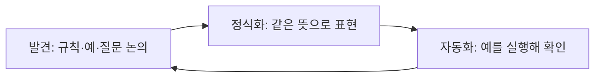
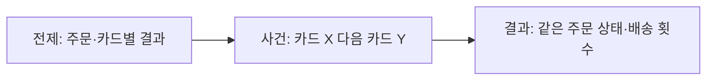

--------------------
Session 명: 05. 작업 명세와 수용 기준
--------------------

## 목차

01. 세션 목표
02. 작업 명세서
03. 수용 기준
04. BDD — 예로 명세하기
05. 예시에서 테스트로
06. 작업 단위
07. 기능 목록과 점진적 진행
08. 완료의 정의와 증거
09. 시연 — 테스트는 누가 쓰는가?
10. 잘못된 관행
11. 실습 — 작업 명세와 수용 기준
12. 요약

## 01. 세션 목표

**수용 기준**은 테스트의 기대값이 된다. 검증할 수 없는 작업은 맡길 수 없으므로, 구현할 범위와 받아들일 결과를 먼저 합의한다.

- 유저 스토리에 **업무 규칙·범위·제외·미정**을 붙여 작업 명세서로 만든다.
- **허용·거절 예시**로 수용 기준의 해석 차이와 빈칸을 찾는다.
- **Given–When–Then**의 전제·사건·기대 결과를 실행 테스트로 연결한다.
- 작업을 **한 번에 검증할 단위**로 나누고 기능 목록에 진행을 남긴다.
- **완료의 증거**와 AI가 쓴 테스트의 기대값을 검토한다.

**강사 노트**

- 입력은 "세션 02. 요구와 유저 스토리"의 요구사항 정의서, "세션 03. 도메인 모델"의 업무 의미, "세션 04. 아키텍처"의 의존 규칙이다.
- 도메인 규칙과 기대값을 정하는 책임은 사람에게 있다. 테스트 코드의 작성은 AI가 도울 수 있다.

---

## 02. 작업 명세서

## 스토리 하나의 명세

**작업 명세서**는 스토리 하나에서 구현할 요구사항을 확인 가능한 수준으로 적은 문서다. 시스템 전체의 요구사항 정의서와 모델을 참조한다.

**표 — 작업 명세서에 적을 것과 참조할 것**

| 구분 | 담을 내용 | 주문 사례 |
|---|---|---|
| **스토리** | 누가 어떤 결과를 왜 원하는가? | 고객이 상품을 배송받기 위해 주문한다 |
| **규칙과 예** | 옳은 결과와 구체적 기대값 | 확정 단가로 2,000원 승인 요청 |
| **범위·제외** | 이번 작업에 포함하거나 뺄 행동 | 결제·배송 요청 포함, 환불 제외 |
| **미정** | 확인 전에는 구현하지 않을 결정 | 승인 뒤 배송 요청 실패의 처리 |
| **참조** | 원천을 유지하는 다른 산출물 | 용어집·상태 기계·의존 규칙 |

- **작업용 문서**는 해당 작업의 구현과 검토에 쓴다. 오래 유지할 업무 규칙은 요구사항 정의서에서 관리한다.
- **중복을 줄인다.** 모델과 아키텍처 전체를 붙여 넣지 않고 작업에 필요한 부분과 그 원천을 가리킨다.

**강사 노트**

- "세션 02. 요구와 유저 스토리"에서 구분한 두 명세의 수명과 범위를 그대로 쓴다. 새로운 개발 단계나 새로운 전체 명세서를 만드는 것이 아니다.
- 구현 계획과 클래스 배치를 요구사항에 섞지 않는다. 작업 명세는 무엇을 충족해야 하는지 정한다.

---

## 주문한다의 작업 명세서

**문서 형식**

고객은 장바구니의 상품을 결제해 **주문하고 배송받고 싶다**. 이번 작업은 배송지 지정부터 결제 결과와 배송 요청까지다.

**업무 규칙과 예**

- **금액** — 주문이 생길 때의 판매가를 항목 단가로 확정한다. 펜 2개 × 1,000원 = 2,000원.
- **가격 변경** — 결제 직전 판매가가 1,200원이 되어도 기존 주문은 2,000원으로 결제한다.
- **승인** — 결제완료로 바꾼 뒤 서울로 배송을 1회 요청한다.
- **거절** — 결제대기를 유지하고 배송을 요청하지 않는다. 다른 카드로 다시 결제할 수 있다.

**범위**

- **포함** — 배송지 지정 때 주문 생성·금액 확정, 결제 승인 요청, 결과 반영, 승인 후 배송 요청.
- **제외** — 상품 탐색·장바구니, 취소·환불, 할인·배송비, 재고, 배송 이후 처리.

**미정**

- **배송 요청 실패** — 승인된 결제와 주문을 어떻게 처리할지 업무 담당자에게 확인한다. 이번 구현은 이 정책을 정하지 않는다.

**참조**

- **요구사항 정의서** — 금액·배송 요청·결제 거절의 업무 규칙.
- **도메인 모델** — 단가·주문 총액의 의미, 결제대기 자기 전이.
- **아키텍처** — 업무는 연동·영속 구현에 의존하지 않는다.

**강사 노트**

- 이 문서 형식은 강의의 대표 작업 명세서다. 본문에 구현 클래스나 외부 API 주소를 넣지 않는다.
- 미정의 처리 정책을 테스트 기대값으로 만들지 않는다. 실제 출시 범위를 확정할 때까지 남겨 둘 수 있는 문제인지도 별도로 판단해야 한다.

---

## 03. 수용 기준

## 결과를 받아들일 조건

**수용 기준**은 스토리가 충족되었다고 판단할 조건이다. “결제가 잘 된다” 대신 관찰할 금액·상태·외부 요청을 적는다.

**인용문**

사람은 일의 우선순위를 정하고, 사용자 피드백을 **수용 기준**으로 옮기며 결과를 확인한다, "We prioritize work, translate user feedback into acceptance criteria, and validate outcomes.", [Lopopolo 2026]

**표 — 모호한 기준을 관찰 가능한 기준으로**

| 모호한 표현 | 확인할 결과 |
|---|---|
| **금액이 정확하다** | 판매가가 바뀌어도 2,000원의 승인을 요청한다 |
| **거절을 처리한다** | 결제대기를 유지하고 배송 요청은 0회다 |
| **재시도가 가능하다** | 다른 카드로 같은 주문을 결제하면 결제완료가 된다 |

- **허용과 금지**를 함께 확인한다. 거절 뒤 결제대기라는 상태만 확인하면 잘못 나간 배송 요청을 놓칠 수 있다.
- **기대값의 근거**는 업무 담당자가 확인한 규칙이다. 코드가 낸 결과를 그대로 기대값으로 복사하지 않는다.

**강사 노트**

- Lopopolo, Harness engineering: leveraging Codex in an agent-first world(2026). 저장된 영문 원문으로 확인했다. 이 인용은 인간의 역할에 관한 해당 팀의 설명이지 모든 조직의 실측 결과가 아니다.
- 영어 원문 앞 쉼표와 한글 문장 안 쉼표는 구분한다. 한글은 모두 18pt로 검토한다.

---

## 네 가지 대표 예

**대표 예**는 규칙의 다른 결과를 드러내도록 고른다. 승인뿐 아니라 가격 변경·거절·재결제가 빠지면 첫 시도의 오류를 잡을 수 없다.

**표 — 주문의 수용 예 네 가지**

| 예 | 전제·사건 | 기대 결과 |
|---|---|---|
| **승인** | 펜 2개 주문을 카드로 승인 | 2,000원 요청, 결제완료 뒤 서울 배송 1회 |
| **가격 변경** | 주문 후 판매가 1,200원, 결제 | 단가 1,000원, 승인 요청 2,000원 |
| **거절** | 카드 X가 거절됨 | 결제대기·총액 2,000원 유지, 배송 0회 |
| **재결제** | 카드 X 거절 뒤 카드 Y 승인 | 같은 주문이 결제완료, 배송 1회 |

- **같은 전제**를 유지한다. 주문은 배송지 서울을 지정할 때 생기고, 그때 펜 2개의 단가가 확정된다.
- **추가 예**는 목적이 있을 때 넣는다. 아직 정하지 않은 중복 승인이나 배송 요청 실패를 임의의 기대값으로 채우지 않는다.

**강사 노트**

- 수용 예 네 가지와 구현 작업 네 가지는 개수가 같아도 같은 목록은 아니다. 가격 변경은 금액 확정 작업을 검증하는 예다.
- 모든 입력 조합을 이 네 예로 검증했다는 뜻이 아니다. 현재 확인한 업무 규칙의 대표 경로다.

---

## 04. BDD — 예로 명세하기

## 업무와 개발이 예를 함께 논의한다

**행위 주도 개발(BDD)**은 업무 담당자와 개발자가 구체적인 예로 기대 행동을 함께 이해하는 협업 방식이다. 테스트 문법을 쓰는 것만으로 완성되지 않는다.

**인용문**

BDD는 **업무 담당자와 기술 담당자 사이의 간극**을 줄이는 소프트웨어 팀의 협업 방식이다, "BDD is a way for software teams to work that closes the gap between business people and technical people", [Cucumber]

**도식 — Mermaid — 합의에서 실행 가능한 예로**



- **발견**에서는 가격이 어느 시점의 금액인지 묻는다. **정식화**에서는 판매가와 단가를 나눠 예를 적는다.
- **자동화**는 합의한 뜻을 확인한다. 실행하다 규칙의 빈칸을 발견하면 논의로 돌아가며, 통과하도록 기대값부터 바꾸지 않는다.

**주석**

BDD — Behaviour-Driven Development

**강사 노트**

- Cucumber 공식 BDD 문서의 정의와 Discovery·Formulation·Automation 설명을 확인했다. 그림은 그 세 활동을 이 사례에 적용한 것이다.
- 도식의 정식화는 다음 GWT 예, 자동화는 AcceptanceExamples의 실행 테스트로 연결한다. 구체 도구 선택은 BDD의 정의가 아니다.

---

## 규칙·예·질문을 구분하기

**예시 매핑**은 스토리에 관련된 규칙·예·질문을 함께 정리해 범위를 확인하는 방법이다. 예로 설명되지 않는 규칙은 더 묻고, 답하지 못한 것은 질문으로 남긴다.

**인용문**

규칙을 설명하는 **예**는 초록색 카드에 적는다, "Examples to illustrate these rules are written on a green card", [Cucumber: Example Mapping]

**표 — 주문 스토리의 규칙·예·질문**

| 구분 | 내용 | 다음 행동 |
|---|---|---|
| **규칙** | 단가는 주문 생성 시점의 판매가다 | 공통 용어와 모델을 확인한다 |
| **예** | 판매가 1,200원이 되어도 2,000원 결제 | 수용 테스트의 기대값으로 쓴다 |
| **질문** | 승인 뒤 배송 요청이 실패하면 어떻게 하나? | 업무 담당자에게 처리 정책을 묻는다 |

- **형식의 목적**은 뜻을 맞추는 것이다. 카드의 색을 도구로 재현하는 것보다 규칙과 예가 연결되는지가 중요하다.
- **미정과 제외**는 다르다. 환불은 이번 기능에서 제외했고, 승인 뒤 배송 요청 실패는 정책 자체가 미정이다.

**강사 노트**

- Cucumber, Example Mapping 원문 확인. 원문의 스토리·규칙·예·질문 구분을 사용한다. 카드 색은 원문을 설명한 것이며 실습에서 색 카드 제작은 요구하지 않는다.
- 질문을 남겼다는 사실만으로 구현 위험이 해결되지는 않는다. 해당 기능을 출시할 수 있는지는 별도 판단한다.

---

## Given–When–Then

**Given–When–Then**은 전제·사건·기대 결과를 구분해 예를 쓰는 형식이다. 구현의 내부 순서 대신 업무가 관찰할 결과를 명확히 한다.

```gherkin
Scenario: 거절된 주문을 다른 카드로 결제한다
  Given 펜 2개, 단가 1000원, 배송지 서울의 결제대기 주문
    And 카드 X는 거절되고 카드 Y는 승인된다
  When 카드 X로 결제한 뒤 카드 Y로 다시 결제한다
  Then 같은 주문은 결제완료다
    And 배송 요청은 모두 합해 1회다
```

- **전제**는 결과를 재현할 상황이다. 카드마다 다른 결제 결과를 테스트 대역으로 준비한다.
- **사건**은 고객의 행동이다. **기대 결과**는 상태와 외부 요청으로 확인하며 호출 횟수도 업무 규칙에서 정한다.
- **문형의 한계**도 있다. 세 칸을 채웠어도 미정 정책을 지어냈다면 좋은 명세가 아니다.

**강사 노트**

- Gherkin 블록은 학습자가 읽는 예이며 Cucumber 실행 환경을 설치했다는 뜻은 아니다. 다음 Java 테스트가 같은 예를 실행한다.
- 복잡한 클릭 순서나 DB 필드 갱신을 그대로 적지 않는다. 필요한 표현 수준은 업무의 수용 판단이 정한다.

---

## 05. 예시에서 테스트로

## 전제·사건·결과를 실행하기

**수용 테스트**는 합의한 수용 기준을 실제 실행으로 확인한다. 준비·행동·검증이 각각 예의 전제·사건·기대 결과에 대응한다.

**도식 — Mermaid — 재결제 예와 실행 코드의 연결**



```java
    static void paidWithAnotherCard() {
        Fixture f = new Fixture();
        f.payment.rejectedCards = Set.of("카드 X");
        f.service.pay(new PaymentMethod("카드 X"));
        equal(OrderStatus.PENDING_PAYMENT, f.order.status, "재결제 전 상태");
        equal(0, f.delivery.requests, "거절 뒤 배송 금지");
        f.service.pay(new PaymentMethod("카드 Y"));
        equal(OrderStatus.PAID, f.order.status, "같은 주문 재결제 상태");
        equal(List.of("카드 X", "카드 Y"), f.payment.requestedCards, "다른 카드 사용");
        equal(1, f.delivery.requests, "재결제 승인 뒤 배송 횟수");
        System.out.println("PASS 재결제");
    }
```

**강사 노트**

- 원본: code/s05/AcceptanceExamples.java. main이 네 예를 각각 새로운 Fixture로 실행한다. 테스트 전용 equal은 불일치 시 AssertionError를 던지므로 -ea 옵션이 필요 없다.
- 도식의 전제는 Fixture·rejectedCards, 사건은 pay 두 호출, 결과는 equal 검사에 대응한다. 코드 실행 전에 결과를 예측하게 한다.
- 실제 외부 결제·배송과 저장소는 생략했다. 결제 결과와 배송 요청을 테스트 대역으로 통제한다.

---

## 잘못된 결과도 잡는 기대값

**검증 지점**은 서로 다른 오류를 드러내야 한다. 상태만 확인하지 않고 주문 금액·승인 요청 금액·배송 여부를 필요한 경로에서 확인한다.

**표 — 네 테스트가 확인하는 것**

| 테스트 | 핵심 관찰 | 잡으려는 오류 |
|---|---|---|
| **승인** | 승인 요청 2,000원·결제완료 뒤 서울 배송 1회 | 잘못된 금액·배송지·호출 순서 |
| **가격 변경** | 확정 단가 1,000원·요청 2,000원 | 현재 판매가로 과거 주문을 계산 |
| **거절** | 결제대기·총액 유지·배송 0회 | 거절을 취소로 처리하거나 잘못 배송 |
| **재결제** | 같은 주문·다른 카드·배송 총 1회 | 재시도 불가·주문 재생성·중복 배송 |

- **검사의 독립성**은 기대값의 근거에서 시작한다. 구현과 테스트를 같은 AI가 써도 기대값이 합의한 예와 같은지 별도로 검토한다.
- **검증 범위**는 네 대표 예다. 실제 API·동시성·중복 승인·미정인 실패 복구까지 통과했다고 해석하지 않는다.

**강사 노트**

- 각 테스트를 컴파일하고 실행했다. 실제 배송 요청이 호출될 때 FakeDelivery가 결제완료 상태인지도 확인한다.
- 주문 재생성 여부는 동일 Order 참조의 상태를 검사하는 이 예의 범위에서 확인한다. 운영 저장소의 식별 보존까지 검증한 것은 아니다.

---

## 06. 작업 단위

**작업 단위**는 끝낸 뒤 수용 테스트로 결과를 확인할 수 있는 구현 범위다. 파일·계층만 나누기보다 고객의 행동과 규칙을 끝까지 연결한다.

**표 — 주문 기능을 검증 가능한 네 단위로**

| 작업 | 구현할 결과 | 완료를 확인할 예 |
|---|---|---|
| **금액 확정** | 주문 항목에 단가를 보존하고 총액 계산 | 판매가 변경 후에도 2,000원 |
| **승인** | 승인 요청·결제완료·배송 요청 연결 | 승인 뒤 서울 배송 1회 |
| **거절** | 상태·금액 유지, 배송 요청 금지 | 거절 뒤 결제대기·배송 0회 |
| **재결제** | 같은 주문을 다른 카드로 결제 | 거절 뒤 카드 Y로 승인 |

- **의존 관계**가 있다. 금액 확정을 바탕으로 승인을 구현하고, 거절 경로를 확인한 뒤 재결제를 검증한다.
- **작게 끝까지**는 테스트까지 잇는다는 뜻이다. “엔티티 작성 완료”만으로 고객 행동의 구현이 끝났다고 보지 않는다.
- **공통 코드 변경** 뒤에는 앞 단위의 테스트도 실행한다. 새 작업의 통과가 이전 작업의 유지를 증명하지는 않는다.

**강사 노트**

- 네 단위는 교육용 주문 사례의 분할이지 모든 프로젝트의 표준 단위가 아니다. 승인·거절은 같은 결제 흐름의 경로이며 코드를 네 벌 만드는 것이 아니다.
- 실습은 신청·금액 및 예정일 계산·승인과 회차 생성·거절과 재결제를 적정 크기로 나누게 한다. 결과가 같다면 분할의 개수 자체를 채점하지 않는다.

---

## 07. 기능 목록과 점진적 진행

**기능 목록**은 구현할 결과와 검증 상태를 남긴다. 시작할 작업은 테스트 가능한 크기로 고르고, 끝난 작업은 실행 증거로 확인한다.

**인용문**

한 번에 **기능 하나씩 작업**한다, "work on only one feature at a time", [Anthropic 2025d]

```json
{
  "unit": "재결제",
  "acceptance": "다른 카드로 같은 주문 재결제",
  "evidence": "AcceptanceExamples.paidWithAnotherCard",
  "passes": true
}
```

- **통과 표식**은 보고 문장이 아니다. 실행한 테스트와 그 결과를 확인한 뒤 바꾼다.
- **점진적 진행**은 목록의 한 항목을 구현·검증한 다음 다음 항목으로 가는 방식이다. 공통 코드를 바꾸면 앞 항목도 다시 검사한다.
- **남은 일**은 분명히 남긴다. 미정인 배송 요청 실패를 구현 완료 항목에 섞지 않는다.

**강사 노트**

- Anthropic, Effective harnesses for long-running agents(2025)의 해당 팀 실행 방식에 관한 문장 일부를 원문 확인했다. 병렬 개발을 보편적으로 금지하는 규칙으로 확대하지 않는다.
- 실제 features.json은 code/s05/run.mjs가 javac·java 실행 및 네 PASS 결과 확인 후 작성한다. 예의 evidence는 실행 원본의 메서드다.
- 수강생에게 JSON 파일 자체를 실습 결과물로 추가 요구하지 않는다. 기능 목록은 진행을 남기는 예다.

---

## 08. 완료의 정의와 증거

**완료의 정의**는 작업을 끝났다고 판단할 공통 조건이다. 수용 기준이 기능의 결과를 정한다면, 완료의 정의는 그 결과를 확인한 증거와 변경의 품질도 묻는다.

**인용문**

견고하고 충분하며 안정적인 **테스트 묶음**은 에이전트 작업의 기반이 된다, "If your project has a robust, comprehensive and stable test suite agentic coding tools can fly with it.", [Willison 2025b]

**표 — 완료 보고에 필요한 증거**

| 확인 | 증거 | 부족한 보고 |
|---|---|---|
| **기능 충족** | 수용 예 네 가지의 실제 실행 결과 | “잘 동작함” |
| **기존 기능 유지** | 앞 작업 테스트의 실행 결과 | 새 테스트 하나만 통과 |
| **경계 유지** | 의존 규칙 검사와 변경 파일 검토 | 인터페이스를 썼다는 설명만 있음 |
| **범위 준수** | 제외·미정과 실제 변경의 대조 | 요청하지 않은 환불 정책 추가 |

- **검사하지 않은 것**도 적는다. 테스트 대역의 통과와 실제 외부 연동 검증을 같은 완료 증거로 제시하지 않는다.
- **사람의 확인**은 남는다. 자동 검사로 판정할 수 없는 업무 해석과 미정 사항은 담당자에게 확인한다.

**강사 노트**

- Simon Willison, Vibe engineering(2025-10-07). 자동 테스트를 논한 해당 문장을 원문 확인했다. 한글은 직역이 아닌 요약이다.
- 이 실행 예에서 의존 검사를 새로 수행했다는 뜻은 아니다. "세션 04. 아키텍처"에서 보여 준 구조 검사도 실제 변경 범위에 맞게 완료 증거로 요구한다는 설명이다.

---

## 09. 시연 — 테스트는 누가 쓰는가?

## 같은 명세, 서로 다른 테스트 작성 방식

**테스트 작성의 위임**과 기대값의 확인은 다른 일이다. 실제 실행 기록 두 건을 비교해 무엇을 사람이 검토해야 하는지 살펴본다.

**표 — 저장된 실제 실행 두 건의 조건과 관찰**

| 항목 | A: 구현과 테스트 작성 요청 | B: 사람의 수용 테스트 제공 |
|---|---|---|
| **같은 입력** | 작업 명세서와 빈 결제 메서드 | 같은 명세서와 출발 코드 |
| **테스트 요청** | 테스트도 작성하라 | 제공한 수용 테스트는 바꾸지 마라 |
| **관찰** | 만든 테스트 5개·수용 테스트 4개 통과 | 수용 테스트 4개 통과 |
| **추가 판단** | 명세 밖 중복 결제 방지 규칙 추가 | 해당 규칙을 추가하지 않음 |

- **기록 조건**은 2026-10-08, Claude Code 2.1.293과 `claude-opus-5-5`다. 각 조건을 한 번씩 실행한 기록이며 일반적인 우열을 증명하지 않는다.
- **같이 확인할 것**은 두 실행 모두 미정인 배송 요청 실패 정책을 정하지 않았다는 점이다. 테스트를 누가 썼는지만으로 결과를 예측할 수 없다.

**강사 노트**

- 실제 원본: code/s04/demo-results/README.md, A와 B의 prompt.txt·result.json·diff·실행 로그. 현재 세션 번호와 다른 경로지만 기록 원본을 보존해 참조한다.
- 이 세션을 작성하며 새 LLM 실행을 한 것으로 소개하지 않는다. 화면에서는 저장된 프롬프트·diff·실행 로그를 열어 보여 준다.
- 두 실행은 과거 한 번의 기록이다. 비용·시간 차이의 일반화나 통계적 비교는 하지 않는다.

---

## 통과한 테스트의 기대값 검토하기

**테스트가 통과**해도 합의하지 않은 정책이 섞였을 수 있다. 새 기대값은 요구사항에 근거가 있는지 확인한다.

**표 — A 실행에서 사람이 검토할 내용**

| 발견 | 문제의 성격 | 확인할 판단 |
|---|---|---|
| **중복 결제 방지 예외** | 명세에 없던 업무 결정을 추가 | 요구로 확인한 뒤 채택하거나 제외 |
| **배송지의 새 값** | 서울 대신 “서울시 중구 1” 사용 | 기준 사례와 테스트 데이터의 일치 |
| **기존 수용 테스트 통과** | 확인한 네 규칙은 충족 | 미정 정책과 추가 규칙까지 승인한 것은 아님 |

- **AI가 쓴 테스트**도 유용하다. 경계 사례와 누락 후보를 제안하게 하되, 기대값은 확정 규칙과 질문으로 구분한다.
- **사람이 쓴 테스트**도 틀릴 수 있다. 누가 작성했는지보다 업무 규칙과 실제 실행의 증거를 대조한다.
- **제약은 명확히** 준다. 확인한 기대값을 유지하고, 새 규칙이 필요하면 구현과 함께 확정하지 말고 질문하게 한다.

**강사 노트**

- A 결과의 중복 결제 방지·새 주소는 저장된 실제 테스트와 diff에서 확인할 항목이다. 좋은 정책처럼 보여도 현재 합의와는 다른 판단이다.
- 모델과 테스트를 함께 보완하되 잘못된 구현에 맞춰 기대값을 낮추지 않는다.

---

## 10. 잘못된 관행

**테스트 통과**는 합의한 기대값과 적절한 검증 범위가 있을 때 의미가 있다. 통과 수만으로 업무의 정확성을 판단하지 않는다.

**표 — 수용 기준을 약하게 만드는 관행**

| 잘못된 관행 | 놓치는 것 | 보완 방향 |
|---|---|---|
| **구현 결과를 기대값으로 복사** | 구현과 테스트의 같은 오류 | 업무 규칙의 대표 예에서 기대값 도출 |
| **승인만 검사** | 거절 뒤 배송·재결제 오류 | 허용과 금지 행동을 함께 확인 |
| **테스트 통과를 위해 기준 완화** | 합의한 업무 결과 | 실패의 원인을 규칙·모델·코드에서 찾기 |
| **미정을 예외 코드로 확정** | 사람이 정해야 할 정책 | 담당자 확인 전에는 질문으로 유지 |
| **일을 파일별로만 나눔** | 고객 행동의 끝까지 검증 | 관찰 가능한 결과가 있는 작업으로 분할 |

**강사 노트**

- 기대값 변경 자체가 금지인 것은 아니다. 업무 결정이 바뀌었다는 근거와 모델 보완이 선행되어야 한다.
- 가격 보존 테스트의 2,000원을 2,400원으로 고쳐 통과시키는 예를 들고, 어느 결정으로 돌아가야 하는지 묻는다.

---

## 11. 실습 — 작업 명세와 수용 기준

정기배송의 앞 산출물을 LLM에 주고 **작업 명세·허용과 거절 예·작업 단위**를 만든 뒤, 기대값의 근거와 범위를 검토한다.

**투입물**
+ 실습 2의 **요구사항 정의서**, 실습 3의 **도메인 모델**, 실습 4의 **의존 규칙·연동 규격**

**프롬프트**
+ “정기배송 신청의 작업 명세서를 작성하고 허용·거절 예를 Given–When–Then으로 표현하라. 검증 가능한 작업으로 나누고, 기대값의 근거가 없으면 질문으로 남겨라.”

**점검 항목**
1. **범위** — 신청·일시불 결제·회차 생성과 제외할 기능이 구분되는가?
2. **금액** — 회차 금액 10,000원과 총 70,000원의 근거가 같은가?
3. **상태** — 승인 뒤 확정·7회 생성, 거절 뒤 결제 대기·0회를 확인하는가?
4. **재결제** — 같은 신청에서 다른 카드로 다시 결제하는 예가 있는가?
5. **미정** — 통신 오류·배송 요청 실패·환불을 추측으로 정하지 않았는가?
6. **작업** — 각 단위가 수용 예와 실행 가능한 완료 기준으로 끝나는가?

**결과물**
+ **작업 명세서·허용과 거절 예·작업 단위**. 실습 6의 맥락 패키지 입력이다.

**강사 노트**

- 기존 정기배송 정의서와 상태·단가를 이어 쓴다. 다음 기간의 가격 정책이나 월별 청구를 새로 만들지 않는다.
- 결과물에 새 기능 목록 파일·추적표·별도 테스트 설계 문서를 추가 요구하지 않는다. 실제 테스트 코드는 후속 실행과 검증에서 연결할 수 있다.

---

## 12. 요약

### 수용 기준을 기대값으로, 실행 결과를 증거로 삼는다

- **작업 명세**는 스토리 하나의 규칙·범위·제외·미정을 적고 모델을 참조한다.
- **구체적인 예**로 해석을 맞추고, 합의한 기대값을 테스트로 실행한다.
- **작업 단위**는 한 번에 검증할 결과를 가지며 진행은 증거로 남긴다.
- **모델 보완**은 예를 만들다 드러난 규칙의 빈칸을 원천에 반영하는 일이다.

### 다음 세션

- "세션 06. 맥락 구성" — 작업에 필요한 명세·모델·규칙을 에이전트가 찾아 읽을 수 있게 구성한다.

**강사 노트**

- 사람은 기대값의 근거를 확인하고 AI는 예·코드·검사를 작성할 수 있다. 산출물 수보다 다음 작업자가 추측하지 않아도 되는지로 판단한다.

---

## 별첨. 실습 답

## 작업 명세서 (안)

**문서 형식**

고객은 생필품을 정해진 주기로 받기 위해 **정기배송을 신청하고 일시불로 결제하고 싶다**. 이번 작업은 대역 환경에서 신청·금액 계산·결제·회차 생성을 구현한다.

**입력과 업무 규칙**

- **신청 조건** — 휴지 1묶음, 신청 시 판매가 10,000원, 첫 배송 11/3, 주기 14일, 기간 3개월.
- **금액** — 단가를 신청 때 확정한다. 회차 금액 10,000원을 해당 약정 동안 유지한다.
- **예정일** — 만료 2/2 안의 11/3·11/17·12/1·12/15·12/29·1/12·1/26, 총 7회다.
- **결제 금액** — 예정일 수로 계산한 70,000원을 일시불로 요청한다.
- **승인** — 확정으로 바꾸고 예정 회차 7개를 생성한다.
- **거절·재결제** — 결제 대기·회차 0개를 유지하고 다른 카드로 같은 신청을 다시 결제한다.

**범위와 제외**

- **포함** — 신청, 단가 확정, 예정일·금액 계산, 승인·거절, 재결제, 회차 생성.
- **제외** — 실제 외부 API 연결, 월별 청구, 배송지 변경, 해지·환불, 다음 약정 가격 정책.
- **미정** — 통신 오류·중복 결제 결과·배송 접수 실패의 업무 처리. 담당자는 업무·연동 담당자이며 실제 연동 구현 전에 확정한다.

**참조·완료 조건**

- **참조** — 실습 2 정의서, 실습 3의 용어·상태·회차 관계, 실습 4의 포트와 의존 규칙.
- **완료** — 아래 수용 예 4개와 각 작업의 검사가 통과하고, 업무가 연동·영속 구현을 의존하지 않는다.

**강사 노트**

- 점검 항목 1·2·3·5를 반영한 제출용 작업 명세서다. 미정 처리를 코드에서 추측하지 않도록 이번 구현의 경계를 대역 환경으로 명시했다.
- “어떤 내용을 적어야 하는가”가 아니라 실제 업무 값·범위·담당·완료 조건을 설명한다.

---

## 금액 보존과 승인 예 (안)

**신청 시 단가 보존과 승인 후 회차 생성**을 다음 두 시나리오로 수용한다. 금액 계산을 위한 예정일 산정은 회차 생성과 구분한다.

```gherkin
Scenario: 신청 후 판매가가 바뀌어도 확정 금액으로 결제한다
  Given 휴지 1묶음을 단가 10000원, 14일 주기, 11월 3일부터 3개월 신청했다
    And 만료일은 2월 2일이며 기간 내 예정일은 7개다
    And 신청 후 상품의 판매가가 변경되었다
  When 신청을 일시불로 결제한다
  Then 승인 요청 금액은 70000원이다
    And 해당 약정의 회차 금액은 10000원이다
```

```gherkin
Scenario: 승인되면 정기배송을 확정하고 예정 회차를 만든다
  Given 휴지 1묶음, 단가 10000원, 14일 주기, 첫 배송 11/3, 만료 2/2의 신청
    And 결제 대기이며 회차는 0개다
  When 70000원 결제가 승인된다
  Then 정기배송은 확정이다
    And 예정 회차는 11/3, 11/17, 12/1, 12/15, 12/29, 1/12, 1/26의 7개다
    And 각 회차 금액은 10000원이며 2월 9일 회차는 없다
```

**강사 노트**

- 점검 항목 2·3의 완성 Given–When–Then 답안이다. 요약 표나 문형 설명으로 대체하지 않는다.
- 각 시나리오는 독립적인 전제에서 시작한다. 앞 시나리오의 실행 결과에 의존하지 않는다.
- 표기상의 반복을 줄이되 재현에 필요한 단가·기간·주기·예정일·금액을 생략하지 않았다.

---

## 거절과 재결제 예 (안)

거절 뒤 **같은 신청을 유지**하고, 다른 카드의 승인으로 확정한다. 거절만으로 회차를 만들거나 신청을 종료하지 않는다.

```gherkin
Scenario: 결제가 거절되면 신청을 유지하고 회차를 만들지 않는다
  Given 휴지 1묶음, 회차 10000원, 7회, 일시불 70000원의 결제 대기 신청
    And 카드 X는 거절된다
  When 카드 X로 결제한다
  Then 같은 신청은 결제 대기이며 회차는 0개다
```

```gherkin
Scenario: 다른 카드로 같은 신청을 재결제한다
  Given 휴지 1묶음, 회차 10000원, 7회, 일시불 70000원의 신청
    And 카드 X 결제가 거절되었다
    And 같은 신청은 결제 대기이며 회차는 0개다
    And 카드 Y는 승인된다
  When 카드 Y로 같은 신청을 결제한다
  Then 요청 금액은 70000원이고 같은 신청은 확정이다
    And 해당 기간의 예정 회차는 모두 합해 7개이며 회차 금액은 10000원이다
```

**강사 노트**

- 점검 항목 3·4·5를 충족하는 거절·재결제의 구체적 답이다. 통신 오류나 중복 승인이라는 다른 상황을 이 결과로 정의하지 않는다.
- 강사는 거절 시 0개와 승인 뒤 총 7개를 대비해 설명한다. 수강생에게 같은 점검 질문을 다시 제시하지 않는다.

---

## 작업 단위 (안)

**문서 형식**

신청 기능을 다음 네 단위로 구현한다. **각 단위의 관찰 결과가 완료 조건**이며 공통 코드 변경 뒤에는 앞 단위의 수용 예도 유지한다.

**1. 신청과 단가 확정**

- **구현 결과** — 결제 대기 신청이 생기고 휴지 1묶음의 단가가 10,000원으로 고정된다.
- **완료 조건** — 상품 판매가 변경 뒤에도 같은 신청의 회차 금액은 10,000원이다.

**2. 예정일과 금액 계산**

- **구현 결과** — 첫 배송일부터 만료일까지 예정일을 계산한다. 아직 회차 객체는 만들지 않는다.
- **완료 조건** — 11/3부터 14일 간격의 지정된 7개 예정일, 일시불 70,000원, 회차 객체 0개다.

**3. 승인과 회차 생성**

- **구현 결과** — 결제 대기 신청의 승인을 반영한다.
- **완료 조건** — 확정, 지정 예정일의 회차 7개, 각 회차 금액 10,000원. 만료일 뒤 회차는 없다.

**4. 거절과 재결제**

- **구현 결과** — 거절 뒤 같은 신청에 다른 카드를 사용할 수 있다.
- **완료 조건** — 카드 X 거절 뒤 결제 대기·0개, 카드 Y 승인 뒤 같은 신청이 확정·총 7개다.

**강사 노트**

- 점검 항목 6의 완성 작업 분할이다. 수강생에게 나누는 방법을 설명한 목록이 아니라 실제 구현할 단위와 관찰 결과다.
- 실습 6에는 이 명세서·수용 예·작업 단위를 그대로 입력한다.

---

## 보완 (안)

작업의 수용 예를 확정하면서 **예정일 계산과 회차 생성의 시점**을 정의서·모델에 명시했다.

- **요구사항 정의서에 반영한 문장**
  - **계산** — “결제 전 예정일 7개로 70,000원을 산정하지만 회차는 생성하지 않는다.”
  - **재결제** — “거절 뒤 같은 신청은 회차 0개이며 다른 카드 승인 후 총 7개가 된다.”
- **도메인 모델·아키텍처의 확정 결과**
  - **상태·관계** — 결제 대기 자기 전이, 승인 후 확정과 회차 생성, 회차 다중성 0..*를 유지했다.
  - **경계** — 실제 외부 호출 대신 포트를 대역으로 연결한다. 통신 오류를 결제 거절에 포함하지 않는다.
- **※ 현행화 기준**
  - **반영** — 확정 문장·수용 예·검증 가능한 작업 단위를 다음 맥락 패키지에 포함했다.
  - **기록만** — 미정 장애 처리는 담당·확인 시점과 함께 보류했고 자동 환불 같은 추측은 제외했다.

**강사 노트**

- 이번 실습에서 이미 반영한 결과와 보류한 결정을 보여 주는 답안이다. 보완 방법이나 점검 예제의 설명으로 대체하지 않는다.
