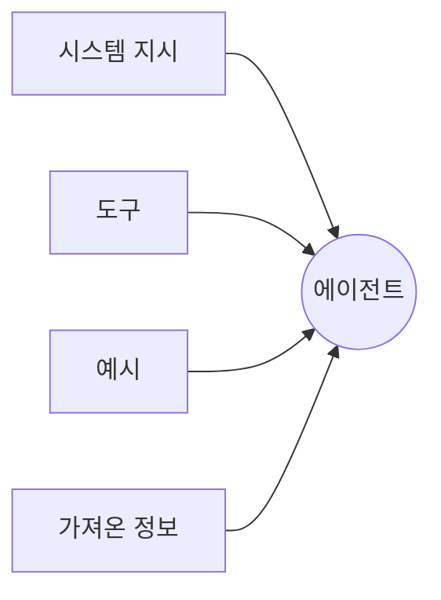
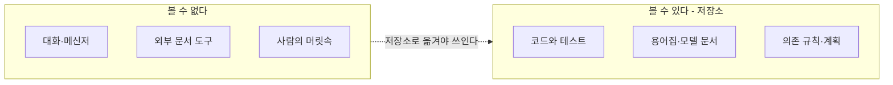
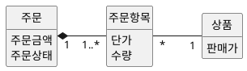
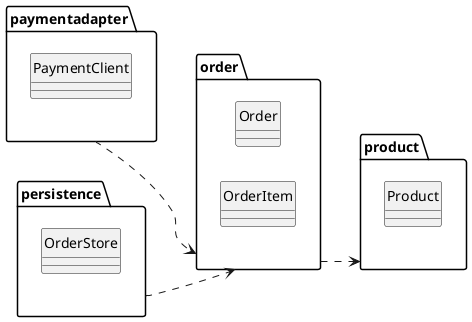

--------------------
Session 명: 05. 도메인·설계 지식과 맥락 구성
--------------------

## 목차

01. 세션 목표
02. 맥락 엔지니어링
03. 주의 예산과 맥락 부패
04. 맥락의 구성
05. 저장소가 기록의 원천
06. 맥락 파일
07. 도메인 지식
08. 설계 지식
09. 맥락의 적정량
10. 긴 작업의 맥락
11. 잘못된 관행
12. 실습 — 맥락 패키지
13. 요약

---

## 01. 세션 목표

좋은 맥락은 많은 맥락이 아니라 **판단을 바꾸는 최소의 고신호 정보**다.

- **맥락 엔지니어링**이 프롬프트 엔지니어링과 다른 점과, 맥락을 고르는 일이 반복되는 이유를 설명한다.
- **주의 예산**과 **맥락 부패**로 맥락을 늘리는 것이 공짜가 아님을 설명한다.
- 맥락을 **시스템 지시·도구·예시·가져온 정보**로 나누고, 시스템 지시를 알맞은 **추상화 수준**으로 쓴다.
- 에이전트가 볼 수 없는 지식은 없는 것이므로, **저장소**를 기록의 원천으로 삼고 맥락 파일을 **지도**로 쓴다.
- 도메인 지식(용어집·정적·동적 모델)과 설계 지식(**경계·의존 규칙**)에서 과제의 판단을 바꾸는 것만 고른다.
- **복잡성의 두 축**과 비용 대비 효과로 맥락의 적정량과 순서를 정한다.

**강사 노트**

- 지금까지 위임할 과제의 "무엇"(작업 명세서)과 "무엇으로 받아들일까"(수용 기준)를 정했다. 여기서는 에이전트가 알아야 할 지식을 정한다.
- 기준 원전은 [Anthropic 2025c]이며, 저장소와 지도는 [Lopopolo 2026]의 경험을 쓴다.
- 용어집·도메인 모델·상태 기계·온톨로지의 뜻은 "세션 01. AI 협업의 특성과 사람의 판단 책임"의 「04. 업무 규칙의 명시」에서 이미 정의했다. 여기서는 그중 **무엇을 골라 주는가**를 다룬다.

---

## 02. 맥락 엔지니어링

## 맥락 엔지니어링이란?

**인용문**

맥락 엔지니어링은 추론하는 동안 **최적의 토큰을 골라 유지하는 전략**의 집합이다, "Context engineering refers to the set of strategies for curating and maintaining the optimal set of tokens (information) during LLM inference", [Anthropic 2025c]

- **고르는 일** — 에이전트가 가진 창에 들어갈 정보를 **사람이 선별**한다.
- **유지하는 일** — 과제가 진행되는 동안 **낡은 정보를 덜어내고** 필요한 것을 넣는다.
- **목표** — 원하는 결과가 나올 가능성을 가장 높이는 **최소의 고신호 토큰**이다.

**인용문**

좋은 맥락 엔지니어링은 바라는 결과가 나올 가능성을 극대화하는 **가장 작은 고신호 토큰 집합**을 찾는 것이다, "good context engineering means finding the smallest possible set of high-signal tokens that maximize the likelihood of some desired outcome", [Anthropic 2025c]

**강사 노트**

- 인용 근거: Anthropic, "Effective context engineering for AI agents"(2025) 원문 확인. 두 인용은 같은 글의 정의와 지침이다.
- 두 번째 인용은 "세션 01. AI 협업의 특성과 사람의 판단 책임"의 「03. AI가 바꾼 것과 바꾸지 못한 것」의 「맥락의 한계」에서 이미 보였다. 여기서는 **고르는 기준**으로 다시 쓴다.

---

## 프롬프트 엔지니어링과의 차이

프롬프트 엔지니어링은 **한 번의 지시를 잘 쓰는 일**이고, 맥락 엔지니어링은 **매 차례 무엇을 넣을지 고르는 일**이다.

**인용문**

맥락을 고르는 일은 **반복되며**, 모델에 무엇을 넘길지 결정할 때마다 선별 단계가 일어난다, "iterative and the curation phase happens each time we decide what to pass to the model.", [Anthropic 2025c]

**표 — 프롬프트 엔지니어링과 맥락 엔지니어링**

| 구분 | 프롬프트 엔지니어링 | 맥락 엔지니어링 |
|---|---|---|
| **대상** | 지시 문장 | 창에 들어갈 정보 전체 |
| **시점** | 작업을 시킬 때 한 번 | 차례마다 반복 |
| **사람의 일** | 문구를 다듬는다 | 줄 것과 주지 않을 것을 고른다 |
| **실패의 모습** | 의도를 잘못 알아듣는다 | 알아야 할 것을 모른 채 추측한다 |

- **대체가 아니다** — 프롬프트를 잘 써도 **판단에 필요한 지식이 없으면** 에이전트는 빈칸을 추측으로 채운다.

**강사 노트**

- 인용 근거: 같은 글에서 프롬프트 엔지니어링과 비교한 문장을 확인했다.
- 첫 시도의 실패("세션 01. AI 협업의 특성과 사람의 판단 책임")는 지시가 짧아서가 아니라 업무 규칙이 맥락에 없어서였다. 질문으로 되짚는다.

---

## 03. 주의 예산과 맥락 부패

## 주의 예산

맥락을 넣는 데는 **값이 따른다**. 토큰이 늘면 모델이 쓸 수 있는 주의가 줄어든다.

**인용문**

LLM도 사람처럼 어느 지점에서 **집중을 잃거나 혼란을 겪는다**, "LLMs, like humans, lose focus or experience confusion at a certain point", [Anthropic 2025c]

  - LLM은 많은 맥락을 해석할 때 끌어 쓰는 **주의 예산**을 가진다, "LLMs have an \"attention budget\" that they draw on when parsing large volumes of context", [Anthropic 2025c]

- **창이 크다는 것과 다르다** — 토큰 한도가 남아 있어도 **주의는 먼저 바닥난다**.
- **넣을 때마다 쓴다** — 새 토큰은 모두 예산을 깎으므로, 넣는 근거가 있어야 한다.

**강사 노트**

- 인용 근거: 같은 글의 "A note on context: why minimal high-signal tokens" 논의에서 두 문장을 확인했다.
- 둘째 인용은 들여쓴 bullet 인용이다(`session-authoring-guide.md`의 「5. 인용과 출처」).

---

## 맥락 부패

**맥락 부패(context rot)**는 맥락이 길어질수록 그 안의 정보를 정확히 떠올리는 능력이 떨어지는 현상이다.

**인용문**

맥락 창의 토큰이 늘수록 모델이 그 맥락에서 **정보를 정확히 떠올리는 능력이 떨어진다**, "as the number of tokens in the context window increases, the model's ability to accurately recall information from that context decreases", [Anthropic 2025c]

맥락 파일도 **낡아 간다**. 하나의 큰 지시 파일은 유지하는 사람이 사라지면서 틀린 규칙의 저장소가 된다.

**인용문**

큰 지시 파일은 곧 **낡은 규칙의 무덤**이 되고, 에이전트는 무엇이 아직 참인지 알 수 없고 사람은 유지를 멈춘다, "It rots instantly. A monolithic manual turns into a graveyard of stale rules. Agents can't tell what's still true, humans stop maintaining it", [Lopopolo 2026]

- **두 가지 부패** — 한 번의 실행에서 **주의가 흩어지는 것**과, 시간이 지나며 **내용이 틀려지는 것**이다.
- **같은 처방** — 작게 나누고, 바뀐 곳만 고치고, 기계로 갱신을 확인한다.

**강사 노트**

- 인용 근거: 맥락 부패는 [Anthropic 2025c]가 쓴 용어이며, 그 글이 needle-in-a-haystack 연구를 근거로 든다. 파일의 노후화는 [Lopopolo 2026]의 "one big AGENTS.md" 실패 경험이다.
- 갱신을 기계로 확인하는 방법(문서 린터·검사 작업)은 "세션 09. 검증 하네스·결과 점검·피드백"에서 센서로 다룬다.

---

## 04. 맥락의 구성

## 맥락의 네 갈래

맥락은 한 덩어리가 아니다. **네 갈래**로 나누어 각각 무엇을 담을지 정한다.

**도식 — Mermaid — 맥락의 네 갈래**

- **시스템 지시** — 목표와 지킬 규칙. 늘 창에 올라가 **가장 비싸다**.
- **도구** — 쓸 수 있는 일의 목록. 다음 세션에서 정한다.
- **예시** — 기대하는 결과의 **대표 사례**. 규칙을 길게 쓰는 대신 보인다.
- **가져온 정보** — 그때 읽는 저장소의 파일. **미리 올리지 않는다**.

**강사 노트**

- 네 갈래는 [Anthropic 2025c]가 맥락의 구성 요소로 든 것(시스템 지시·도구·예시·가져오는 정보)을 사례에 맞춰 정리한 것이다.
- 도구는 다음 세션의 주제이므로 이름만 짚고 넘어간다.

---

## 시스템 지시의 추상화 수준

시스템 지시는 **알맞은 추상화 수준**에서 쓴다. 너무 낮으면 규칙을 늘어놓게 되고, 너무 높으면 판단할 근거가 없다.

**인용문**

시스템 지시는 **아주 명확하고 단순한 언어**로 알맞은 추상화 수준에서 생각을 제시해야 한다, "System prompts should be extremely clear and use simple, direct language that presents ideas at the right altitude", [Anthropic 2025c]

  - 기대하는 행동을 온전히 드러내는 **최소의 정보**를 목표로 한다, "you should be striving for the minimal set of information that fully outlines your expected behavior", [Anthropic 2025c]

**표 — 주문 금액을 세 수준으로 쓴 지시**

| 수준 | 쓴 모습 | 문제와 자리 |
|---|---|---|
| **너무 낮음** | 단가 필드에 판매가를 넣고 저장한다 | 구현을 지시해 판단을 막는다 |
| **알맞음** | 주문 금액은 주문이 생길 때의 판매가로 정한다 | 시스템 지시 |
| **너무 높음** | 금액을 올바르게 계산한다 | 무엇이 올바른지 추측한다 |

- **고르는 기준** — 사람이 **규칙으로 말할 수 있는** 높이다.

**강사 노트**

- 인용 근거: 같은 글의 시스템 프롬프트 논의에서 두 문장을 확인했다. 원문은 이 높이를 "right altitude"로 부른다.
- 표의 세 문장은 같은 업무 규칙을 높이만 바꿔 쓴 것이다. 수강생에게 가운데 줄만 남기는 이유를 묻는다.

---

## 필요할 때 가져오기

모든 지식을 미리 올리지 않고, **가벼운 가리킴**만 주고 에이전트가 그때 읽게 한다.

**인용문**

"그때그때" 방식의 에이전트는 **파일 경로·질의·링크 같은 가벼운 식별자**를 들고, 실행 중에 그것으로 데이터를 불러온다, "maintain lightweight identifiers (file paths, stored queries, web links, etc.) and use these references to dynamically load data into context at runtime", [Anthropic 2025c]

- **미리 올리는 것** — 모든 과제가 쓰는 것만 둔다. 용어집, 상태 기계처럼 **판단의 전제**가 되는 것이다.
- **가리키는 것** — 과제에 따라 필요한 것을 둔다. 연동 매뉴얼, 과거 설계 기록처럼 **양이 큰 것**이다.
- **가리킴이 작동할 조건** — 경로가 **저장소 안에** 있고, 이름이 내용을 알려 주어야 한다.

**강사 노트**

- 인용 근거: 같은 글의 "just in time" 전략 설명에서 확인했다.
- "주문한다"에서 결제 연동 매뉴얼은 가리키기만 한다. 통째로 준 결과는 「11. 잘못된 관행」에서 본다.

---

## 05. 저장소가 기록의 원천

에이전트가 **실행 중에 볼 수 없는 지식은 없는 것**이다. 회의에서 합의한 규칙도 저장소에 없으면 반영되지 않는다.

**인용문**

에이전트의 관점에서 실행 중 맥락으로 **접근할 수 없는 것은 존재하지 않는다**, "From the agent's point of view, anything it can't access in-context while running effectively doesn't exist. Knowledge that lives in Google Docs, chat threads, or people's heads are not accessible to the system.", [Lopopolo 2026]

**도식 — Mermaid — 에이전트가 볼 수 있는 것**

- **옮길 것** — 업무 담당자와 정한 규칙, 설계 결정, 미정으로 남긴 질문이다.
- **옮기는 방법** — 버전이 관리되는 **마크다운·코드·테스트**로 둔다. 형식보다 **찾을 수 있음**이 중요하다.
- **덤으로 얻는 것** — 사람이 새로 들어와도 같은 곳을 읽는다.

**강사 노트**

- 인용 근거: Ryan Lopopolo, "Harness engineering: leveraging Codex in an agent-first world", OpenAI, 2026 영문 원문 확인. 원문은 저장소의 지식 기반을 기록의 원천(system of record)으로 삼았다고 쓴다.
- 주문 사례에서는 업무 담당자와 30분 회의로 정한 업무 규칙("세션 03. 요구의 구체화와 명세")이 저장소로 옮겨야 할 첫 지식이다.

---

## 06. 맥락 파일

## 하나의 큰 파일이 실패하는 이유

맥락 파일 하나에 모든 지침을 담으면 **지침이 아니게 된다**.

**인용문**

지침이 너무 많으면 **지침이 아니게 된다** — 모든 것이 중요하면 중요한 것이 없고, 에이전트는 의도대로 찾아가는 대신 가까운 패턴을 흉내 낸다, "Too much guidance becomes non-guidance. When everything is \"important,\" nothing is. Agents end up pattern-matching locally instead of navigating intentionally.", [Lopopolo 2026]

- **과제를 밀어낸다** — 큰 지시 파일이 창을 차지해 **코드와 문서가 들어갈 자리**를 없앤다.
- **검증할 수 없다** — 한 덩어리는 최신인지 기계로 확인하기 어렵다.

**강사 노트**

- 인용 근거: [Lopopolo 2026]은 "one big AGENTS.md"의 실패를 네 가지로 든다 — 맥락을 밀어냄, 지침이 아니게 됨, 낡아 감, 검증이 어려움.
- 낡아 가는 문제는 「03. 주의 예산과 맥락 부패」에서 이미 보았다. 여기서는 나머지 세 가지를 짚는다.

---

## 지도와 점진적 공개

맥락 파일은 **백과사전이 아니라 지도**다. 작은 진입점을 주고 어디를 볼지 알려 준다.

**인용문**

에이전트에게 **1,000쪽 지시서가 아니라 지도**를 준다, "give Codex a map, not a 1,000-page instruction manual", [Lopopolo 2026]

  - 맥락 파일을 백과사전이 아니라 **목차**로 다룬다, "instead of treating AGENTS.md as the encyclopedia, we treat it as the table of contents", [Lopopolo 2026]

이렇게 하면 **점진적 공개(progressive disclosure)**가 가능하다. 에이전트는 작고 안정된 입구에서 시작해 다음에 볼 곳을 배운다.

**인용문**

점진적 공개는 에이전트가 **탐색으로 필요한 맥락을 차츰 발견**하게 한다, "progressive disclosure—in other words, allows agents to incrementally discover relevant context through exploration.", [Anthropic 2025c]

**강사 노트**

- 인용 근거: 지도와 목차는 [Lopopolo 2026], 점진적 공개의 정의는 [Anthropic 2025c]에서 확인했다. [Lopopolo 2026]도 같은 이름을 쓴다.
- [Thoughtworks 2026]은 progressive context disclosure를 Trial로 둔다. 자리 잡아 가는 기법이라는 신호다.

---

## 주문한다의 맥락 파일

주문 저장소의 맥락 파일은 **약 30줄의 지도**다. 각 줄이 **어느 파일을 왜 보는지**를 말하고, 규칙 자체는 `docs/`가 가진다.

**문서 형식**

**AGENTS.md** — 주문 시스템

1. 무엇을 만드는가
  - **"주문한다"** — 배송지를 정하면 주문이 생기고, 결제가 승인되면 배송을 요청한다.
2. 먼저 읽을 것
  - `docs/glossary.md` — **용어집**. 판매가와 단가를 반드시 구분한다.
  - `docs/order-state.md` — **주문 상태 기계**. 없는 전이를 만들지 않는다.
  - `docs/dependency.md` — **의존 규칙**. 업무 패키지는 연동·저장을 import하지 않는다.
3. 작업의 규칙
  - **완료** — 수용 테스트가 통과해야 완료다. 테스트를 끄거나 지우지 않는다.
  - **멈출 조건** — 기대값·의존 규칙을 바꿔야 하면 묻는다.
4. 필요할 때 볼 것
  - `docs/external/payment-api.md` — **결제 연동 규격**. 요청할 때만 읽는다.

**강사 노트**

- 공개 형식 [AGENTS.md]를 쓰면 도구가 바뀌어도 같은 파일을 읽는다. vendor 독립성은 "세션 11. 평가 세트와 운영 점검 — 보안·비용·모델 변경"에서 다룬다.
- [Lopopolo 2026]의 맥락 파일은 약 100줄이다. 주문 사례는 과제가 하나여서 더 짧다.
- 네 번째 묶음이 「04. 맥락의 구성」의 「필요할 때 가져오기」를 실제로 적용한 자리다.

---

## 07. 도메인 지식

## 분석 모델이 명시하는 것

도메인 지식의 맥락은 **분석 모델**이다. 분석 모델은 업무의 **본질적 복잡성**을 적고, 구현 수단은 적지 않는다.

**표 — 분석 모델과 그 바깥**

| 구분 | 담는 것 | "주문한다"의 예 |
|---|---|---|
| **분석 모델** | 개념·관계·상태·업무 규칙 | 주문 금액은 주문 시점의 판매가 |
| **설계** | 경계·책임·협력 | 연동 패키지가 결제를 부른다 |
| **구현** | 저장·통신·형식 | 금액 열의 자료형과 질의 |

- **왜 나누는가** — 구현을 섞어 적으면 에이전트가 **규칙과 수단을 구분하지 못한다**.
- **역사적 뿌리** — 정보공학은 자료 흐름과 정보 구조를 **함께** 적어 업무를 분석했고, 객체지향 분석은 같은 업무를 **책임과 상태**로 적는다.

**강사 노트**

- 본질적·우연적 복잡성은 "세션 01. AI 협업의 특성과 사람의 판단 책임"의 「03. AI가 바꾼 것과 바꾸지 못한 것」의 「본질적 복잡성과 우연적 복잡성」에서 [Brooks 1986]으로 정의했다.
- 정보공학의 자료 흐름도와 ERD는 한 방법 안의 두 관점이며 따로 쓰는 기법이 아니다. 분석 기법 자체는 "객체지향 분석과 설계 실무" 과정이 다룬다.
- 분석 모델을 형식 언어로 적은 것이 온톨로지다. 수단의 비교는 "세션 01. AI 협업의 특성과 사람의 판단 책임"의 「04. 업무 규칙의 명시」에 있다.

---

## 정적 모델과 동적 모델

분석 모델은 **정적 모델과 동적 모델**이 짝을 이룬다. 하나만 주면 에이전트가 나머지를 추측한다.

**도식 — PlantUML — 주문의 정적 모델**

- **정적 모델** — 단가가 **주문 항목에 있다**. 상품의 판매가와 다른 자리다.
- **동적 모델** — 결제 거절이 **결제대기에 머무는 전이**다.
- **둘이 함께** 있어야 "거절되면 취소됨"이라는 추측이 생기지 않는다.

**강사 노트**

- 정적 모델의 이름은 분석 모델이므로 한글이다. 설계 이름으로 바꾸는 자리는 아래 「OOAD·DDD와의 관계」에서 짚는다.
- 상태 기계를 다시 그리지 않고 "세션 01. AI 협업의 특성과 사람의 판단 책임"의 「04. 업무 규칙의 명시」의 「모델로 보이는 업무 규칙」을 가리킨다. 같은 지식을 두 곳에 두지 않는다.
- 다중성 `1..*`는 주문 항목이 없는 주문을 **금지**한다. 에이전트가 빈 주문을 만들지 않는 근거다.

---

## OOAD·DDD와의 관계

분석은 **한글**, 설계와 코드는 **용어집의 영문명**이다. 둘을 잇는 것이 용어집이다.

**표 — 용어집이 잇는 세 자리**

| 자리 | 쓰는 이름 | 예 |
|---|---|---|
| **작업 명세서·분석 모델** | 한글 업무 용어 | 단가, 주문 금액 |
| **용어집** | 한글과 영문의 대응 | 단가 — `unitPrice` |
| **설계 모델·코드** | 영문 설계 이름 | `OrderItem.unitPrice` |

- **DDD의 보편 언어** — 대화와 코드가 **같은 언어**를 쓴다는 원칙이다. 용어집이 그 언어의 뼈대다.
- **에이전트에게 주는 효과** — 용어집이 있으면 한글 명세를 영문 코드로 옮길 때 **이름을 지어내지 않는다**.

**강사 노트**

- 보편 언어 인용([Evans 2015])은 "세션 01. AI 협업의 특성과 사람의 판단 책임"의 「04. 업무 규칙의 명시」에 있다. 여기서는 맥락으로 쓰는 쪽만 다룬다.
- 영한 대응과 명명 규칙의 원천은 `course-design.md`의 「영한 용어집과 명명 규칙」이다.
- 유스케이스·도메인 모델을 **만드는 법**은 "객체지향 분석과 설계 실무" 과정이 맡는다.

---

## 08. 설계 지식

설계 지식의 맥락은 **경계와 의존 규칙**이다. 에이전트는 **있는 패턴을 흉내 내므로**, 구조를 먼저 적는다.

**인용문**

에이전트는 **엄격한 경계와 예측 가능한 구조**에서 가장 잘 일한다, "Agents are most effective in environments with strict boundaries and predictable structure", [Lopopolo 2026]

**도식 — PlantUML — 주문 시스템의 패키지 의존**

- **의존의 방향** — `order`는 연동·저장 패키지를 **import하지 않는다**.
- **순환 금지** — **순환이 없어야** 변경의 파급을 예측할 수 있다.
- **규칙으로 적는 이유** — 말로 한 구조는 지켜지지 않는다. 규칙은 **센서**가 된다.

**강사 노트**

- 인용 근거: [Lopopolo 2026]은 도메인마다 고정된 계층과 허용된 의존만 두고 custom linter와 구조 테스트로 강제했다.
- 의존 규칙의 원천은 `course-design.md`의 공통 전제다. 패키지 다이어그램은 클래스 이름만 보인다.
- 경계를 정하는 판단 자체는 "객체지향 분석과 설계 실무" 과정의 구조 설계가 다룬다.

---

## 09. 맥락의 적정량

## 복잡성의 두 축

무엇을 더 적을지는 **도메인 복잡성과 기술 복잡성**이 정한다. 사다리처럼 차례로 더하지 않는다.

**표 — 두 축으로 고른 중간 산출물**

| | 기술 복잡성 낮음 | 기술 복잡성 높음 |
|---|---|---|
| **도메인 복잡성 낮음** | 스토리와 예 | + 경계·의존 규칙 |
| **도메인 복잡성 높음** | + 용어집·분석 모델 | 모두 |

- **"주문한다"의 자리** — 업무 규칙 3가지와 외부 연동이 있어 **둘 다 중간**이다. 용어집·분석 모델과 의존 규칙을 함께 둔다.
- **넣는 기준** — 그 문서가 **에이전트의 결과나 사람의 확인을 바꾸는가**다. 바꾸지 않으면 넣지 않는다.

**강사 노트**

- 두 축과 넣는 기준은 `course-design.md`의 「요구에서 코드까지의 경로」이며, "세션 03. 요구의 구체화와 명세"의 「명세의 알맞은 수준과 경로」에서 명세의 높이로 다뤘다.
- LLM이 문서를 싸게 만들어도 **검토 비용과 주의 예산**은 그대로다. 그래서 싸다는 이유로 더하지 않는다.

---

## 맥락의 우선순위

여유가 부족하면 **비용 대비 효과가 큰 것부터** 둔다. 순서는 과제의 복잡성이 정한다.

**표 — "주문한다"에서 고른 순서**

| 순위 | 맥락 | 비용 | 판단을 바꾸는가? |
|---|---|---|---|
| **1순위** | 용어집 | 낮음 | 판매가와 단가를 가른다 |
| **2순위** | 상태 기계 | 낮음 | 거절 뒤의 상태를 가른다 |
| **3순위** | 정적 모델 | 중간 | 단가가 놓일 자리를 가른다 |
| **4순위** | 의존 규칙 | 중간 | 연동을 부르는 자리를 가른다 |
| **5순위** | 연동 규격 | 높음 | 가리키기만 한다 |

- **먼저 둘 것** — 적고 자주 쓰이는 것이다. 용어집 한 장이 **금액 추측을 없앴다**.
- **뒤에 둘 것** — 크고 드물게 쓰이는 것이다. 연동 규격은 **경로로만** 준다.
- **순위는 고정이 아니다** — 기술 복잡성이 큰 과제는 의존 규칙이 먼저 온다.

**강사 노트**

- 비용은 쓰는 노력과 창을 차지하는 양을, 효과는 결과가 달라지는 정도를 뜻한다. 표의 판정은 주문 사례의 판단이며 일반 순위가 아니다.
- 5순위를 통째로 준 결과가 「11. 잘못된 관행」의 사례다.

---

## 10. 긴 작업의 맥락

한 번의 창에 들어가지 않는 과제는 **맥락을 줄이거나 넘기는 방법**으로 잇는다.

**인용문**

맥락의 제약을 직접 다루는 방법은 **압축·구조화한 노트·하위 에이전트**다, "compaction, structured note-taking, and multi-agent architectures", [Anthropic 2025c]

**표 — 세 가지 방법**

| 방법 | 하는 일 | "주문한다"에서 |
|---|---|---|
| **압축** | 지난 대화를 요약해 창을 비운다 | 끝난 작업 단위의 기록을 줄인다 |
| **구조화한 노트** | 진행을 저장소 파일에 적는다 | 기능 목록의 상태를 갱신한다 |
| **하위 에이전트** | 좁은 과제를 따로 맡긴다 | 연동 규격 조사만 떼어 맡긴다 |

- **노트가 저장소에 있어야** 다음 실행이 이어 받는다. 대화에만 있으면 사라진다.
- **압축의 대가** — 요약은 정보를 잃는다. **기대값과 미정 질문**은 요약하지 않고 파일로 둔다.

**강사 노트**

- 인용 근거: [Anthropic 2025c]의 장기 과제 논의에서 세 방법의 이름을 확인했다.
- 기능 목록과 진행 기록은 "세션 04. 수용 기준과 검증 가능한 작업 단위"의 「기능 목록과 점진적 진행」에서 [Anthropic 2025d]로 다뤘다. 실패 뒤 이어받기는 "세션 10. 실패 대응·재시도·복구"가 맡는다.

---

## 11. 잘못된 관행

## 맥락 쏟아붓기

많이 주는 것이 안전하지 않다. 결제 연동 매뉴얼 **200쪽을 통째로** 주자 에이전트가 **옛 API**를 썼다.

- **왜 틀렸나** — 매뉴얼에는 현행과 폐기된 규격이 함께 있었고, 에이전트는 **가까운 패턴**을 골랐다.
- **무엇을 했어야 하나** — 이번 과제가 쓰는 **승인 요청 규격만** 발췌하거나 경로로 가리킨다.
- **같은 모습** — 모든 가장자리 경우를 지시에 적는 것이다.

**인용문**

팀은 모든 규칙을 적으려고 **가장자리 경우의 긴 목록**을 프롬프트에 밀어 넣는 일이 많다, "teams will often stuff a laundry list of edge cases into a prompt in an attempt to articulate every possible rule", [Anthropic 2025c]

- **대신 할 것** — 기대하는 행동을 보이는 **대표 예 몇 개**를 둔다. 수용 기준의 허용·거절 예시가 그것이다.

**강사 노트**

- 인용 근거: [Anthropic 2025c]는 긴 규칙 목록 대신 다양한 정규 예시(canonical examples)를 권한다.
- 200쪽 매뉴얼 장면은 `course-design.md`의 강의 시나리오이며, "세션 01. AI 협업의 특성과 사람의 판단 책임"의 「03. AI가 바꾼 것과 바꾸지 못한 것」의 「맥락의 한계」가 이 세션을 가리킨다.
- 발췌의 위험도 말한다 — 사람이 잘못 발췌하면 그 오류가 그대로 간다. 그래서 규격은 가리키는 쪽이 낫다.

---

## 지시 비대

맥락 파일은 **늘어나기만 한다**. 규칙을 더할 때마다 지침의 힘이 약해진다.

**표 — 비대해지는 모습과 처방**

| 모습 | 왜 생기나 | 처방 |
|---|---|---|
| 한 번의 실수마다 규칙 한 줄 | 재발을 막으려고 | 기계 검사로 옮긴다 |
| 설명이 길어진 지시 | 불안해서 | 문서로 옮기고 가리킨다 |
| 지난 과제의 규칙이 남음 | 지우는 사람이 없어서 | 끝난 과제의 줄을 지운다 |

- **옮길 곳이 있다** — 지킬 규칙은 지시보다 **센서**가 잘 지킨다. 검사의 오류 메시지가 고칠 방법을 알려 준다.
- **지우는 일을 일정에 둔다** — 더하는 일만 하면 부패는 반드시 온다.

**강사 노트**

- [Thoughtworks 2026]은 agent instruction bloat를 Caution으로 둔다. 널리 생기는 문제라는 신호다.
- 규칙을 검사로 옮기는 방법은 "세션 08. 실행 제약과 가드레일의 역할"과 "세션 09. 검증 하네스·결과 점검·피드백"에서 다룬다.

---

## 12. 실습 — 맥락 패키지

실습 4의 수용 기준과 정기배송 모델 패키지를 LLM에 제공하여 **정기배송 저장소의 맥락 파일**과 **줄 것·주지 않을 것**을 만들고, 점검 항목으로 피드백하여 완성하십시오.

- **투입물**
  + 실습 3의 **작업 명세서**, 실습 4의 **수용 기준**, **정기배송 모델 패키지**
- **프롬프트**
  + "저장소의 맥락 파일(AGENTS.md)을 **30줄 안쪽의 지도**로 써줘. 규칙은 담지 말고 어느 문서를 왜 읽는지만 적어줘. 그리고 신청한다 과제에 **줄 것과 주지 않을 것**을 나누고, 주지 않는 이유를 적어줘."
- **점검 항목**
  1. **지도인가?** — 규칙을 담지 않고 읽을 문서를 가리키는가?
  2. **판단을 바꾸는가?** — 주는 것마다 "신청한다"의 결과를 바꾸는 이유가 있는가?
  3. **빠진 전제** — 용어집(가격·회차 금액)과 두 상태 기계를 가리키는가?
  4. **주지 않을 것** — 배송지 변경·해지처럼 이번 과제 밖의 것을 뺐는가?
  5. **가리킴** — 큰 문서(연동 규격)를 통째로 담지 않고 경로로 두었는가?
  6. **멈출 조건** — 기대값·의존 규칙을 바꿔야 할 때 묻게 했는가?
- **결과물** — 맥락 파일과 줄 것·주지 않을 것. 실습 6의 입력이 됩니다.

**강사 노트**

- 정기배송 모델 패키지는 `code/s01/subscription/docs/`에 있다.
- LLM은 맥락 파일에 코딩 규칙(들여쓰기·커밋 메시지)을 채우려 한다. 점검 1·2로 지우게 한다.
- 점검 6의 멈출 조건은 다음 세션의 위임 계약으로 이어진다. 여기서는 한 줄만 둔다.

---

## 13. 요약

좋은 맥락은 많은 맥락이 아니라 **판단을 바꾸는 최소의 고신호 정보**다.

### 맥락 구성의 핵심

- **맥락 엔지니어링** — 차례마다 무엇을 넣을지 고르고 유지하는 일. 프롬프트 다듬기와 다르다
- **값이 있다** — 주의 예산을 깎고 맥락 부패를 부르므로, 넣는 근거가 있어야 한다
- **네 갈래** — 시스템 지시는 알맞은 추상화 수준으로, 큰 지식은 필요할 때 가져오게 한다
- **저장소** — 에이전트가 볼 수 없는 지식은 없는 것이다. 맥락 파일은 백과사전이 아니라 지도다
- **도메인·설계 지식** — 용어집, 정적·동적 모델, 경계와 의존 규칙에서 판단을 바꾸는 것만 고른다
- **적정량** — 복잡성의 두 축으로 범위를, 비용 대비 효과로 순서를 정한다

### 다음 세션

- "**06. 작업 위임과 도구·권한·상태의 경계**" — 맥락을 받은 에이전트가 무엇을 쓰고 어디까지 바꿀 수 있는지 정한다.

**강사 노트**

- 맥락 파일의 멈출 조건 한 줄이 다음 세션의 위임 계약으로 자란다. 실습 5의 결과물을 그대로 입력으로 쓴다.

---

## 별첨. 실습 답

---

## 맥락 파일 (안)

정기배송 저장소의 맥락 파일은 **"신청한다" 과제가 읽을 문서를 가리키는 지도**이며, 규칙은 `docs/`가 가진다.

**문서 형식**

**AGENTS.md** — 정기배송 시스템

1. 무엇을 만드는가
  - **"신청한다"** — 상품·수량·주기·첫 배송일·기간·배송지를 정해 신청하고 결제하면, 정기배송이 확정되고 회차가 예정으로 생긴다.
2. 먼저 읽을 것
  - `docs/glossary.md` — **용어집**. 가격과 회차 금액을 반드시 구분한다.
  - `docs/subscription-state.md` — **정기배송 상태 기계**. 거절은 결제 대기를 유지한다.
  - `docs/delivery-round-state.md` — **회차 상태 기계**. 회차는 예정으로 생긴다.
  - `docs/requirements.md` — **요구사항 정의서**. "신청한다"의 범위와 제외.
  - `docs/dependency.md` — **의존 규칙**. `subscription`은 연동·저장을 import하지 않는다.
3. 작업의 규칙
  - **완료** — 수용 기준의 테스트가 통과해야 완료다. 테스트를 끄지 않는다.
  - **정해진 값** — 회차 수·회차 금액·만료일은 요구사항 정의서의 값을 쓴다.
  - **멈출 조건** — 기대값·의존 규칙을 바꿔야 하면 묻는다.
4. 필요할 때 볼 것
  - `docs/external/payment-api.md` — **결제 승인 규격**. 요청할 때만 읽는다.

**강사 노트**

- 30줄 안쪽을 지키려고 규칙을 지웠다. 지운 규칙은 `docs/`의 문서에 있다.
- 2의 다섯 줄이 "신청한다"의 판단을 바꾸는 전제다. 더 줄이면 추측이 생긴다.

---

## 줄 것과 주지 않을 것 (안)

맥락은 **"신청한다"의 결과를 바꾸는 것만** 준다. 나머지는 가리키거나 뺀다.

- **준다 — 미리 올린다**
  - **용어집** — 가격과 회차 금액을 가른다. 10,000원을 추측하지 않는다
  - **정기배송 상태 기계** — 결제 거절이 결제 대기를 유지한다는 전이
  - **회차 상태 기계** — 회차가 예정으로 생긴다는 초기 상태
  - **요구사항 정의서** — 회차 7개·70,000원·만료일 2월 2일의 근거
  - **의존 규칙** — 연동을 부르는 자리를 가른다
- **준다 — 가리킨다**
  - **결제 승인 규격** — 양이 크고 승인 요청에만 쓴다. 경로로 둔다
- **주지 않는다**
  - **배송지 변경·해지·만료** — 이번 과제 밖이다. 실습 10의 입력이 된다
  - **월별 청구·반품** — 개발하지 않는 범위다
  - **코딩 규칙** — 결과를 바꾸지 않는다. 검사로 강제한다
- **※ 판단 기준**
  - **미리 올림** — 모든 작업 단위가 쓰는 전제인가?
  - **가리킴** — 크고 드물게 쓰는가?

**강사 노트**

- 배송지 변경을 지금 주면 에이전트가 회차에 변경 이력을 미리 넣는다. 범위 밖 맥락이 설계를 바꾼 예다.
- 값(회차 7개·70,000원)은 "세션 03. 요구의 구체화와 명세"의 실습 답에서 정한 교육용 값이다.

---

## 보완 (안)

새로 발견한 것은 **후속 작업에 영향을 미치는 경우에만** 이전 산출물에 반영한다.

- **정기배송 모델 패키지**
  - **문서를 나눈다** — 상태 기계를 정기배송과 회차의 두 파일로 나눈다. 맥락 파일이 따로 가리킬 수 있다.
  - **용어집에 더한다** — 회차 금액을 "신청 때의 가격 × 수량"으로 적는다. 가격과 섞여 쓰이고 있었다.
- **작업 명세서**(실습 3)
  - **참조를 경로로** — 「참조」의 문서 이름을 저장소 경로로 바꾼다. 에이전트가 찾을 수 있어야 한다.
- **※ 현행화 기준**
  - **반영** — 용어집의 회차 금액과 상태 기계의 분리. 실습 6의 입력이 된다.
  - **기록만** — 문서 이름의 경로화.

**강사 노트**

- 상태 기계를 나눈 것은 맥락 파일을 쓰다가 드러난 발견이다. 문서의 크기가 아니라 **가리킬 단위**가 기준이다.
- 용어집의 보완은 "세션 01. AI 협업의 특성과 사람의 판단 책임"의 「04. 업무 규칙의 명시」가 보인 판매가·단가 구분과 같은 판단이다. 실습에서 같은 일이 반복되는 것을 짚는다.
