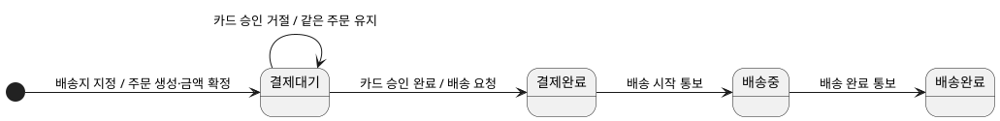
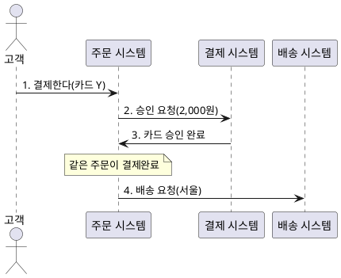
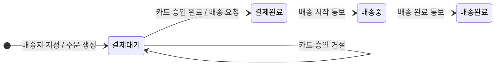
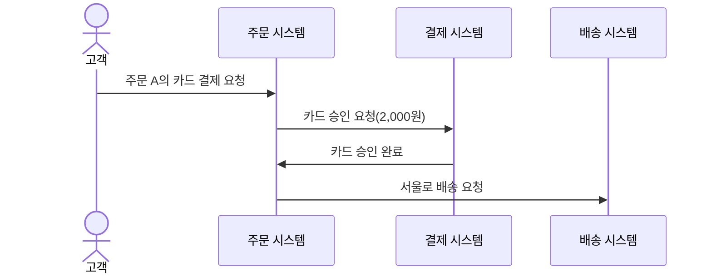

--------------------
Session 명: 05. 동적 모델
--------------------

## 목차

01. 세션 목표
02. 도메인 모델의 동적 관점
03. 사건과 상태·전이
04. 금지와 미정
05. 업무 규칙과 대표 예
06. 업무 상호작용
07. 업무 활동과 데이터 흐름
08. 상태 변경과 외부 요청
09. 코드와 검사로 연결하기
10. AI 초안 검토와 잘못된 관행
11. 실습 — 동적 모델
12. 요약

## 01. 세션 목표

- **도메인 모델의 동적 관점**으로 사건·상태·전이·업무 상호작용을 설명한다.
- **다섯 도식**이 답하는 질문을 구별하고 필요한 표현을 고른다.
- **상태 기계와 시퀀스**를 읽고 규칙의 누락·모순을 찾는다.
- **허용·금지·미정**을 구별하고 업무 규칙을 대표 예로 확인한다.
- **전이와 순서**를 코드·검사의 기대값으로 연결한다.
- **AI의 초안**을 근거로 검토하고 고친 이유를 남긴다.

**강사 노트**

- 과정의 목적은 UML 작도 숙련이 아니라 업무 결정을 명시하고 AI 결과를 판정하는 것이다. 상세 표기법을 열거하지 않고 그림을 읽는 데 필요한 요소만 설명한다.
- 정상 승인·거절과 거절 뒤 재결제를 상세화한다. 배송 진행은 주문 생애주기의 맥락으로 보며, 주문한다의 요구 범위나 실습 구현 범위를 확대하지 않는다.

---

## 02. 도메인 모델의 동적 관점

## 같은 모델의 구조와 행위

**도메인 모델의 동적 관점**은 업무 사건에 따라 어떤 상태와 관계가 어떻게 변하는지 설명한다.

- **정적 관점**은 주문·항목·상품의 관계와 확정 단가·총액의 조건을 밝힌다.
- **동적 관점**은 승인·거절에 따른 상태와 배송 요청의 순서를 밝힌다.
- **서로 검증한다.** 거절 뒤에도 같은 주문을 다시 결제하려면 주문의 식별과 확정 값이 보존되어야 한다.
- **분석과 설계를 구별한다.** 업무 사건과 참여자의 상호작용을 정한 뒤, 소프트웨어의 책임·호출·연동 방식을 설계한다.

**표 — 같은 주문에서 확인하는 두 관점**
| 정적 관점의 조건 | 동적 관점에서 확인할 순간 |
|---|---|
| 확정 단가 × 수량의 합이 총액이다 | 결제 요청·거절·재결제 뒤에도 2,000원인가? |
| 주문은 확정 배송지를 가진다 | 승인 뒤 서울로 배송을 요청하는가? |
| 주문에는 현재 상태가 있다 | 어떤 사건이 상태를 바꾸거나 유지하는가? |

**강사 노트**

- "세션 04. 정적 모델"의 「02. 도메인 모델이 명시하는 것」에서 합의한 용례를 이어 받는다. 동적 모델을 새로운 독립 도메인 모델이나 설계의 동의어로 설명하지 않는다.

---

## 질문에 따라 도식을 고르기

**다이어그램은 모델을 표현하는 방법**이며, 그림마다 확인할 질문이 다르다.

**표 — 동적 관점을 읽는 다섯 도식**
| 도식 | 확인할 질문 | 주문 사례의 초점 |
|---|---|---|
| **상태 기계** | 현재 상태에서 사건에 어떻게 반응하는가? | 승인·거절·배송 통보에 따른 전이 |
| **시퀀스** | 참여자 사이의 사건은 어떤 순서인가? | 승인 뒤 배송 요청 |
| **커뮤니케이션** | 누가 연결되어 어떤 메시지를 주고받는가? | 고객·주문·결제·배송의 연결 |
| **액티비티** | 활동은 어떤 조건으로 분기하고 이어지는가? | 승인·거절 뒤의 활동 |
| **DFD** | 어떤 데이터가 어디서 어디로 이동·변환되는가? | 결제 요청·결과·주문 정보 |

- **상태 기계·시퀀스**를 주요 도식으로 검증하고, 나머지는 다른 질문이 생겼을 때 보완한다.
- **DFD는 UML 표기가 아니다.** 데이터 흐름을 읽는 비교 대상으로 함께 소개한다.
- **모든 그림이 필수는 아니다.** 같은 판단을 반복하면 하나의 원천으로 관리한다.

**강사 노트**

- 커뮤니케이션은 시퀀스와 같은 상호작용을 연결 중심으로 표현한다. 액티비티와 DFD가 언제나 같은 정보를 담는다고 설명하지 않는다. DFD의 데이터 화살표만으로 제어 순서·가드를 확정할 수 없다.
- 클래스·ERD는 정적 구조의 표현이며, 상태·상호작용·활동·데이터 흐름은 그 구조를 서로 다른 질문으로 확인한다.

---

## 03. 사건과 상태·전이

## 업무에서 의미 있는 사건

**인용문**
도메인의 활동에 관한 정보를 **일련의 개별 이벤트**로 모델링한다, "Model information about activity in the domain as a series of discrete events.", [Evans 2015]

- **사건**은 업무에서 의미 있는 일이다. "카드 승인이 거절되었다"는 주문의 다음 행동을 바꾼다.
- **요청과 결과를 구별한다.** "결제한다"는 승인 요청을 시작하지만, 요청했다는 사실만으로 결제완료가 되지 않는다.
- **사건 이름과 데이터**를 함께 본다. 같은 주문의 어떤 승인 결과인지 알아야 전이를 적용할 수 있다.
- **전달 방식은 설계한다.** 업무 사건을 명시했다고 메시지 브로커·비동기 통신을 도입한 것은 아니다.

**표 — 주문에서 구별할 요청과 결과**
| 요청·활동 | 관찰할 사건·결과 |
|---|---|
| 고객이 결제한다 | 카드 승인이 완료되었다 / 거절되었다 |
| 주문 시스템이 배송을 요청한다 | 배송이 시작되었다 / 완료되었다 |

**강사 노트**

- Eric Evans, Domain-Driven Design Reference, 2015 원문을 tools/verify-quote.js로 확인했다. 도메인 이벤트 패턴의 전체 구현을 가르치는 인용이 아니라 활동을 사건으로 명시하는 관점에 적용한다.
- 도메인 사건이 곧 영속 이벤트·메시지·이벤트 소싱이라는 대응을 만들지 않는다.

---

## 상태와 전이

**인용문**
상태는 **어느 시점에 객체가 놓인 조건**, 곧 사건 사이의 조건이다, "A state is the condition of an object at a moment in time—the time between events.", [Larman 2004]

- **상태는 사건에 대한 반응을 구별한다.** 결제대기는 승인 결과를 받아 주문을 성립시킬 수 있고, 배송완료는 같은 방식으로 다시 결제하지 않는다.
- **전이는 현재 상태·사건·조건·다음 상태와 반응**을 연결한다. 상태 값의 목록만으로는 허용되는 순서를 알 수 없다.

**인용문**
전이는 사건이 발생하면 객체가 **이전 상태에서 다음 상태로 이동함**을 나타내는 두 상태 사이의 관계다, "A transition is a relationship between two states that indicates that when an event occurs, the object moves from the prior state to the subsequent state.", [Larman 2004]

- **상태를 늘리는 기준**은 사건에 대한 반응의 차이다. 화면 탭·처리 플래그·메서드마다 상태를 만들지 않는다.

**강사 노트**

- Craig Larman, Applying UML and Patterns, 3rd ed., 2004. 두 인용 모두 원문 확인했다. 상태를 객체의 모든 필드 조합과 동일시하지 않고 업무가 구별하는 조건으로 추상화한다.

---

## 상태 기계 다이어그램

**상태 기계 다이어그램**은 주문이 사건에 반응하며 허용된 상태를 거치는 방법을 표현한다.

**도식 — PlantUML — 주문 상태 기계**


- **읽는 법** — 상자는 상태, 화살표는 전이다. `사건 [가드] / 반응`에서 가드는 전이에 필요한 조건이며, 이 그림은 별도 가드를 생략했다.
- **배송 요청 뒤에도 결제완료**다. 배송 시작 통보를 받아야 배송중으로 바뀐다.
- **생애주기 맥락**으로 배송 진행을 함께 보였다. "주문한다"의 상세 요구 범위는 주문 결과 확인까지다.

**강사 노트**

- Pending 자기 전이는 거절 사건의 처리가 끝난 뒤에도 결제대기라는 업무 의미다. UML의 진입·진출 동작 차이와 같은 상세 표기법은 범위 밖이다.
- 배송완료에서 종료점으로 잇지 않는다. 이 도식 범위에서 후속 전이를 다루지 않는 것과 주문 객체의 생명 종료는 다르다.
- 같은 주문에 대한 확정 결과임을 전제로 한다. 중복·역순 통보·재시도의 운영 정책은 미정이며, 그림에 선이 없다는 사실만으로 처리 정책을 확정하지 않는다.

---

## 전이를 목록으로 확인하기

**전이 목록**은 그림의 화살표가 어떤 업무 판단을 뜻하는지 읽고 검토하는 근거다.

**표 — 주문의 대표 전이**
| 현재 상태 | 사건 | 다음 상태 | 업무 반응 |
|---|---|---|---|
| 생성 전 | 배송지 지정 | 결제대기 | 항목 단가·총액·배송지를 확정한다 |
| 결제대기 | 카드 승인 완료 | 결제완료 | 확정 배송지로 배송을 요청한다 |
| 결제대기 | 카드 승인 거절 | 결제대기 | 같은 주문을 유지하고 배송을 요청하지 않는다 |
| 결제완료 | 배송 시작 통보 | 배송중 | 주문의 배송 진행 상태를 바꾼다 |
| 배송중 | 배송 완료 통보 | 배송완료 | 주문의 배송 진행 상태를 바꾼다 |

- **그림과 목록의 상태·사건 이름**을 맞춘다. 하나에서만 새 상태가 생기면 근거를 확인한다.
- **가드와 불변 조건**을 구별한다. 전이의 허용 조건과, 전후에 계속 지켜야 하는 금액 조건은 역할이 다르다.
- **정상 전이의 선**은 미정 정책을 닫지 않는다. 확정할 수 없는 결제 응답은 승인·거절로 분류하지 않는다.

**강사 노트**

- 생성 전은 주문의 정식 상태 값이 아니다. 상태 값과 생성 전 맥락을 구별한다. 배송 시작·완료는 생애주기 참고 범위다.

---

## 거절과 재결제

**카드 승인 거절은 같은 주문을 결제대기로 유지**하며 다른 카드로 다시 결제할 수 있게 한다.

**표 — 같은 주문이 거치는 사건과 상태**
| 순서 | 사건 | 전이 | 전이 뒤 상태 | 배송 요청 |
|---|---|---|---|---|
| 1 | 배송지 지정 | 생성 전 → 결제대기 | 결제대기 | 0회 |
| 2 | 카드 X 승인 거절 | 결제대기 → 결제대기 | 결제대기 | 0회 |
| 3 | 카드 Y 승인 완료 | 결제대기 → 결제완료 | 결제완료 | 1회 |

- **자기 전이는 되돌림이 아니다.** 거절 사건을 처리한 뒤에도 같은 상태라는 뜻이며, 2와 3 사이에 새 상태가 생기지 않는다.
- **재결제는 새 전이가 아니다.** 결제대기 → 결제완료 전이가 다른 카드로 한 번 더 성립한다. 전이 목록에 줄을 더하지 않는다.
- **보존할 값**은 주문 식별·상품·수량·단가·배송지·총액이다. 세 줄 모두 펜 2개·단가 1,000원·총액 2,000원·서울이며, 재결제 때문에 새 주문이나 새 가격을 만들지 않는다.

**강사 노트**

- 한 주문을 사건 순서대로 따라가며 상태만 본다. 고객·주문·결제·배송 시스템 사이에 사건이 어떤 순서로 전달되는지는 「06. 업무 상호작용」에서 시퀀스로 본다. 여기서 참여자를 그리면 아직 설명하지 않은 표기를 먼저 읽히게 된다.
- 승인·거절은 별도 업무 사건이며 구현의 반환값·콜백·메시지 중 무엇인지 정하지 않는다. 과정 공통 전제의 전달 방식 미정을 따른다.

---

## 04. 금지와 미정

**금지는 허용하지 않기로 한 결정**이고, 미정은 아직 업무 판단을 받지 못한 질문이다.

**표 — 서로 다르게 다뤄야 하는 경계**
| 구분 | 주문 사례 | 모델과 검사에서 할 일 |
|---|---|---|
| **허용** | 거절 뒤 다른 카드로 재결제 | 같은 주문·금액으로 승인되는 예를 확인한다 |
| **금지** | 승인 전 배송 요청 | 요청이 발생하지 않음을 검사한다 |
| **미정** | 승인 뒤 배송 요청 실패 | 질문과 영향만 남기고 복구 기대값을 만들지 않는다 |
| **범위 밖** | 취소·환불 | 상태·전이·구현을 추가하지 않는다 |

- **배송 요청은 전이가 아닌 반응**이다. "승인 전 배송 요청 금지"는 상태 기계의 선만으로 충분히 확인되지 않아 시퀀스·요청 기록도 본다.
- **미정 응답을 거절로 처리하면 정책이 생긴다.** 승인 여부를 모르는 상황에서 재결제를 허용할지 업무 확인이 필요하다.
- **그리지 않은 선**을 모두 금지로 해석하지 않는다. 도식의 범위와 확인 상태를 함께 읽는다.

**강사 노트**

- 강의에서 승인 뒤 배송 요청 실패는 "세션 11. 종합 실행"까지 미정으로 유지한다. 실패 뒤 PAID 유지·자동 취소·재시도 횟수 같은 기대값을 이번에 쓰지 않는다.

---

## 05. 업무 규칙과 대표 예

## 전후의 상태와 값을 함께 확인하기

**대표 예는 사건 전후의 상태와 부수 효과, 보존할 값**을 함께 보여 업무 규칙을 검증한다.

**표 — 같은 주문의 네 가지 대표 예**
| 전제·사건 | 이후 상태 | 승인 요청 금액 | 서울 배송 요청 |
|---|---|---|---|
| 결제대기에서 카드 Y 승인 | 결제완료 | 2,000원 | 1회 |
| 판매가 1,200원으로 변경 뒤 카드 Y 승인 | 결제완료 | 2,000원 | 1회 |
| 카드 X 거절 | 결제대기 | 2,000원 | 0회 |
| 카드 X 거절 뒤 카드 Y 승인 | 결제완료 | 매번 2,000원 | 전체 과정 1회 |

- **공통 값**은 펜 2개·확정 단가 1,000원·총액 2,000원·배송지 서울이다.
- **세 업무 규칙**은 금액 확정, 승인 뒤 배송, 거절 뒤 재결제다. 요구·정적 관점·동적 관점을 같은 예로 대조한다.
- **배송 요청 1회**는 이 정상 실행 예의 관찰값이다. 통신 장애에서의 중복 방지 보장을 뜻하지 않는다.

**강사 노트**

- 네 예는 요구사항 정의서의 수용 예를 같은 값으로 이어 받았다. 마지막 행의 1회는 거절과 승인 전체 실행의 합계다.

---

## 대표 예로 모순 찾기

**상태만 맞아도 업무가 틀릴 수 있으므로** 요청의 순서와 횟수, 값의 보존까지 확인한다.

- **결제완료지만 배송 요청이 먼저 발생했다.** 최종 상태 검사만으로는 승인 전 배송을 잡지 못한다.
- **거절 뒤 결제대기지만 주문을 새로 만들었다.** 상태 값은 같아도 같은 주문의 재결제라는 의미를 잃었다.
- **거절 뒤 현재 판매가로 다시 계산했다.** 2,400원 승인은 정적 관점의 확정 단가와 충돌한다.
- **배송 요청을 보낸 즉시 배송중으로 바꿨다.** 요청과 배송 시작 통보를 혼동했다.
- **그림에 없는 실패를 임의로 취소 처리했다.** 미정 정책을 구현이 대신 결정했다.

**강사 노트**

- 검토자는 정상 상태 값만 묻지 않고 "무슨 사건이 먼저 있었는가", "요청하지 않아야 할 때 정말 없었는가", "같은 대상인가"를 확인한다. 순서·금지·보존은 서로 다른 검사다.

---

## 06. 업무 상호작용

## 시퀀스 다이어그램

**인용문**
시스템 시퀀스 다이어그램은 특정 유스케이스 시나리오의 **외부 사건과 그 순서, 시스템 간 사건**을 보여준다, "A system sequence diagram is a picture that shows, for one particular scenario of a use case, the events that external actors generate, their order, and inter-system events.", [Larman 2004]

**도식 — PlantUML — 정상 승인 시퀀스**


- **주문 시스템의 내부는 감춘다.** 서비스·저장소·트랜잭션을 넣지 않고 업무 경계를 오가는 사건을 확인한다.
- **상태 기계와 대조한다.** 3번 사건이 결제완료 전이를 만들고, 4번은 그 뒤의 반응이다.

**강사 노트**

- Larman 인용은 시스템 수준 분석 표현의 범위다. 기술 반환 화살표를 가르치지 않으며 승인 사건을 업무 사건으로 명시했다. 동기·비동기는 과정 공통 전제에 따라 미정으로 둔다.

---

## 커뮤니케이션 다이어그램

**커뮤니케이션 다이어그램**은 시퀀스와 같은 메시지를 참여자의 연결과 번호로 표현한다.

**도식 — SVG — 정상 승인 상호작용의 두 표현**
```svg:uml
<svg xmlns="http://www.w3.org/2000/svg" width="900" height="300" viewBox="0 0 900 300"><defs><marker id="arrow" markerWidth="7" markerHeight="7" refX="6" refY="3" orient="auto"><path d="M0,0 L6,3 L0,6" fill="none" stroke="#222"/></marker></defs><g font-family="Malgun Gothic, Apple SD Gothic Neo, sans-serif" font-size="14" fill="#111" stroke="none"><text x="230" y="22" text-anchor="middle" font-size="20">시퀀스 다이어그램</text><text x="685" y="22" text-anchor="middle" font-size="20">커뮤니케이션 다이어그램</text><rect x="5" y="42" width="90" height="30" fill="white" stroke="#222"/><text x="50.0" y="62.0" text-anchor="middle" font-size="14">고객</text><line x1="50" y1="72" x2="50" y2="282" stroke="#222" stroke-width="1.2" stroke-dasharray="4 4"/><rect x="125" y="42" width="90" height="30" fill="white" stroke="#222"/><text x="170.0" y="62.0" text-anchor="middle" font-size="14">주문 시스템</text><line x1="170" y1="72" x2="170" y2="282" stroke="#222" stroke-width="1.2" stroke-dasharray="4 4"/><rect x="245" y="42" width="90" height="30" fill="white" stroke="#222"/><text x="290.0" y="62.0" text-anchor="middle" font-size="14">결제 시스템</text><line x1="290" y1="72" x2="290" y2="282" stroke="#222" stroke-width="1.2" stroke-dasharray="4 4"/><rect x="365" y="42" width="90" height="30" fill="white" stroke="#222"/><text x="410.0" y="62.0" text-anchor="middle" font-size="14">배송 시스템</text><line x1="410" y1="72" x2="410" y2="282" stroke="#222" stroke-width="1.2" stroke-dasharray="4 4"/><line x1="50" y1="104" x2="170" y2="104" stroke="#222" stroke-width="1.2" marker-end="url(#arrow)"/><text x="110.0" y="96" text-anchor="middle" font-size="14">1. 결제한다</text><line x1="170" y1="152" x2="290" y2="152" stroke="#222" stroke-width="1.2" marker-end="url(#arrow)"/><text x="230.0" y="144" text-anchor="middle" font-size="14">2. 승인 요청</text><line x1="290" y1="200" x2="170" y2="200" stroke="#222" stroke-width="1.2" marker-end="url(#arrow)"/><text x="230.0" y="192" text-anchor="middle" font-size="14">3. 승인 완료</text><line x1="170" y1="248" x2="410" y2="248" stroke="#222" stroke-width="1.2" marker-end="url(#arrow)"/><text x="290.0" y="240" text-anchor="middle" font-size="14">4. 배송 요청</text><rect x="475" y="155" width="80" height="34" fill="white" stroke="#222"/><text x="515.0" y="177.0" text-anchor="middle" font-size="14">고객</text><rect x="610" y="155" width="100" height="34" fill="white" stroke="#222"/><text x="660.0" y="177.0" text-anchor="middle" font-size="14">주문 시스템</text><rect x="775" y="62" width="110" height="34" fill="white" stroke="#222"/><text x="830.0" y="84.0" text-anchor="middle" font-size="14">결제 시스템</text><rect x="775" y="238" width="110" height="34" fill="white" stroke="#222"/><text x="830.0" y="260.0" text-anchor="middle" font-size="14">배송 시스템</text><line x1="555" y1="172" x2="610" y2="172" stroke="#222" stroke-width="1.2" marker-end="url(#arrow)"/><text x="582" y="144" text-anchor="middle" font-size="14">1. 결제한다</text><line x1="690" y1="155" x2="790" y2="96" stroke="#222" stroke-width="1.2" marker-end="url(#arrow)"/><text x="720" y="100" text-anchor="middle" font-size="14">2. 승인 요청</text><line x1="820" y1="96" x2="710" y2="171" stroke="#222" stroke-width="1.2" marker-end="url(#arrow)"/><text x="808" y="144" text-anchor="middle" font-size="14">3. 승인 완료</text><line x1="710" y1="184" x2="790" y2="238" stroke="#222" stroke-width="1.2" marker-end="url(#arrow)"/><text x="780" y="210" text-anchor="middle" font-size="14">4. 배송 요청</text></g></svg>
```

- **같은 메시지·같은 번호**다. 시퀀스는 세로 위치로 순서를, 커뮤니케이션은 번호로 순서를 읽는다.
- **업무 연결을 읽는다.** 주문 시스템은 결제·배송 시스템과 상호작용하며, 결제 시스템이 배송 시스템에 직접 요청하지 않는다.
- **설계에서도 쓸 수 있다.** 소프트웨어 객체를 참여자로 정하면 설계 모델의 협력이 된다.

**강사 노트**

- Larman 2004의 커뮤니케이션 다이어그램 설명을 원문 확인했다. 그래프 형태로 상호작용을 표현한다는 범위에 적용한다.
- 도식 왼쪽·오른쪽은 같은 정상 승인 장면이다. 번호는 사건 선후를 읽는 번호이며 메서드 중첩 호출 번호를 정하지 않는다. 분석의 시스템 경계를 비교하는 예다.

---

## 07. 업무 활동과 데이터 흐름

## 액티비티 다이어그램

**액티비티 다이어그램**은 업무 활동이 조건에 따라 분기하고 이어지는 흐름을 표현한다.

**도식 — SVG — 결제 결과에 따른 업무 활동**
```svg:uml
<svg xmlns="http://www.w3.org/2000/svg" width="1000" height="250" viewBox="0 0 1000 250"><defs><marker id="a" markerWidth="7" markerHeight="7" refX="6" refY="3" orient="auto"><path d="M0,0 L6,3 L0,6" fill="none" stroke="#222"/></marker></defs><g fill="#111" font-family="Malgun Gothic, Apple SD Gothic Neo, sans-serif" font-size="16"><circle cx="15" cy="125" r="7"/><rect x="42" y="105" width="155" height="40" rx="10" fill="white" stroke="#222"/><text x="119.5" y="130.0" text-anchor="middle" font-size="16">카드 승인 요청</text><rect x="220" y="105" width="120" height="40" rx="10" fill="white" stroke="#222"/><text x="280.0" y="130.0" text-anchor="middle" font-size="16">결과 수신</text><line x1="22" y1="125" x2="42" y2="125" stroke="#222" marker-end="url(#a)"/><line x1="197" y1="125" x2="220" y2="125" stroke="#222" marker-end="url(#a)"/><line x1="340" y1="125" x2="375" y2="125" stroke="#222" marker-end="url(#a)"/><path d="M375,125 L400,100 L425,125 L400,150 Z" fill="white" stroke="#222"/><path d="M400,100 L400,45 L465,45" fill="none" stroke="#222" marker-end="url(#a)"/><text x="428" y="34" text-anchor="middle" font-size="16">승인</text><path d="M400,150 L400,205 L465,205" fill="none" stroke="#222" marker-end="url(#a)"/><text x="428" y="194" text-anchor="middle" font-size="16">거절</text><rect x="465" y="25" width="155" height="40" rx="10" fill="white" stroke="#222"/><text x="542.5" y="50.0" text-anchor="middle" font-size="16">결제완료로 변경</text><rect x="650" y="25" width="130" height="40" rx="10" fill="white" stroke="#222"/><text x="715.0" y="50.0" text-anchor="middle" font-size="16">배송 요청</text><line x1="620" y1="45" x2="650" y2="45" stroke="#222" marker-end="url(#a)"/><rect x="465" y="185" width="155" height="40" rx="10" fill="white" stroke="#222"/><text x="542.5" y="210.0" text-anchor="middle" font-size="16">결제대기 유지</text><rect x="650" y="185" width="130" height="40" rx="10" fill="white" stroke="#222"/><text x="715.0" y="210.0" text-anchor="middle" font-size="16">배송 요청 없음</text><line x1="620" y1="205" x2="650" y2="205" stroke="#222" marker-end="url(#a)"/><path d="M780,45 L820,45 L820,105" fill="none" stroke="#222" marker-end="url(#a)"/><path d="M780,205 L820,205 L820,145" fill="none" stroke="#222" marker-end="url(#a)"/><path d="M800,125 L820,105 L840,125 L820,145 Z" fill="white" stroke="#222"/><line x1="840" y1="125" x2="860" y2="125" stroke="#222" marker-end="url(#a)"/><rect x="860" y="105" width="110" height="40" rx="10" fill="white" stroke="#222"/><text x="915.0" y="130.0" text-anchor="middle" font-size="16">결과 확인</text><line x1="970" y1="125" x2="985" y2="125" stroke="#222" marker-end="url(#a)"/><circle cx="992" cy="125" r="7" fill="white" stroke="#222"/><circle cx="992" cy="125" r="4"/></g></svg>
```

- **읽는 법** — 둥근 상자는 활동, 마름모와 조건은 분기다. 이 그림은 승인·거절이 확정된 정상 응답만 다룬다.
- **상태와 활동을 구별한다.** 결제완료는 주문이 놓인 조건이고, 배송 요청은 수행하는 활동이다.
- **병렬성은 근거가 있어야 한다.** 승인 요청과 배송 요청을 병렬로 두면 승인 뒤 배송이라는 규칙을 깨뜨린다.

**강사 노트**

- Larman 2004: A UML activity diagram shows sequential and parallel activities in a process. 원문 확인. 병렬 실행을 지원하는 표기가 있다고 업무에 병렬성이 있다는 뜻은 아니다.
- 응답 미확정의 처리 정책을 임의로 분기에 추가하지 않았다. stop은 이 대표 실행의 끝이며 주문 생명주기의 종료가 아니다.

---

## 데이터 흐름도(DFD)

**데이터 흐름도(DFD)**는 처리·저장소·외부 개체 사이에 어떤 데이터가 오가는지 표현한다.

**도식 — SVG — 결제 처리의 논리적 DFD**
```svg
<svg xmlns="http://www.w3.org/2000/svg" width="900" height="300" viewBox="0 0 900 300"><defs><marker id="arrow" markerWidth="7" markerHeight="7" refX="6" refY="3" orient="auto"><path d="M0,0 L6,3 L0,6" fill="none" stroke="#222"/></marker></defs><g font-family="Malgun Gothic, Apple SD Gothic Neo, sans-serif" font-size="14" fill="#111" stroke="none"><rect x="5" y="110" width="100" height="50" fill="white" stroke="#222"/><text x="55.0" y="140.0" text-anchor="middle" font-size="14">고객</text><rect x="730" y="30" width="150" height="50" fill="white" stroke="#222"/><text x="805.0" y="60.0" text-anchor="middle" font-size="14">결제 시스템</text><rect x="730" y="220" width="150" height="50" fill="white" stroke="#222"/><text x="805.0" y="250.0" text-anchor="middle" font-size="14">배송 시스템</text><circle cx="420" cy="140" r="55" fill="white" stroke="#222"/><text x="420" y="135" text-anchor="middle" font-size="14">1</text><text x="420" y="157" text-anchor="middle" font-size="14">결제 처리</text><line x1="300" y1="250" x2="550" y2="250" stroke="#222" stroke-width="1.2"/><line x1="300" y1="284" x2="550" y2="284" stroke="#222" stroke-width="1.2"/><text x="425" y="273" text-anchor="middle" font-size="14">D1 주문 정보</text><line x1="105" y1="120" x2="365" y2="120" stroke="#222" stroke-width="1.2" marker-end="url(#arrow)"/><text x="232" y="108" text-anchor="middle" font-size="14">주문 식별·카드</text><line x1="365" y1="155" x2="105" y2="155" stroke="#222" stroke-width="1.2" marker-end="url(#arrow)"/><text x="232" y="180" text-anchor="middle" font-size="14">주문 결과</text><line x1="469" y1="114" x2="730" y2="55" stroke="#222" stroke-width="1.2" marker-end="url(#arrow)"/><text x="591" y="63" text-anchor="middle" font-size="14">승인 요청 정보</text><line x1="730" y1="78" x2="475" y2="143" stroke="#222" stroke-width="1.2" marker-end="url(#arrow)"/><text x="610" y="130" text-anchor="middle" font-size="14">결제 결과</text><line x1="469" y1="170" x2="730" y2="242" stroke="#222" stroke-width="1.2" marker-end="url(#arrow)"/><text x="608" y="190" text-anchor="middle" font-size="14">배송 요청 정보</text><line x1="390" y1="250" x2="390" y2="190" stroke="#222" stroke-width="1.2" marker-end="url(#arrow)"/><text x="280" y="220" text-anchor="middle" font-size="14">확정 금액·배송지</text><line x1="450" y1="190" x2="450" y2="250" stroke="#222" stroke-width="1.2" marker-end="url(#arrow)"/><text x="552" y="240" text-anchor="middle" font-size="14">결제완료 상태</text></g></svg>
```

- **읽는 법** — 사각형은 외부 개체, 원은 처리, 평행선은 논리적 저장소다. 화살표 이름은 이동하는 데이터다.
- **주문 정보는 논리적 저장소**다. DB 제품·테이블·저장 시점의 기술 설계를 정하지 않는다.
- **순서와 허용 조건은 별도로 확인한다.** 배송 요청 정보가 나간다는 사실만으로 승인 뒤인지 판정할 수 없다.

**강사 노트**

- 이 DFD는 정상 승인 경로에 필요한 대표 데이터의 논리적 흐름이다. 결제 요청에는 주문 식별·확정 금액·카드가, 배송 요청에는 주문 식별·확정 배송지가 들어간다. 배송 결과 통보와 주문 생성은 이 그림의 범위 밖이다.
- Larman 2004의 DFD와 액티비티 데이터 흐름 비교를 원문 확인했다. UML이 DFD 표기를 포함한다는 뜻으로 설명하지 않는다. DFD의 주요 요소는 IBM의 설명도 대조했다. https://www.ibm.com/think/topics/data-flow-diagram

---

## 액티비티와 DFD를 구별해 읽기

**활동의 선후와 데이터의 이동은 다른 질문**이며, 한쪽 그림으로 다른 쪽의 판단을 대신하지 않는다.

**표 — 같은 결제 장면을 서로 다르게 읽기**
| 구별할 점 | 액티비티 | DFD |
|---|---|---|
| 중심 | 수행할 활동과 제어 흐름 | 데이터의 입력·처리·출력·저장 |
| 승인·거절 | 분기 조건과 다음 활동을 읽는다 | 결제 결과라는 데이터가 흐른다 |
| 주문 금액 | 승인 요청 활동에서 쓴다 | 주문 정보에서 읽어 요청 데이터로 보낸다 |
| 승인 뒤 배송 | 활동의 선후로 확인한다 | 데이터 선만으로 확인하지 못한다 |

- **같은 누락도 다른 그림에서 드러난다.** DFD에 금액의 원천이 없으면 추측할 값을 찾고, 시퀀스에 승인 결과가 없으면 배송 근거를 찾는다.
- **액티비티에도 데이터 흐름을 표현할 수 있다.** 목적이 겹칠 때 두 도식을 모두 유지할 필요는 없다.
- **모델을 늘리는 기준**은 새로운 판단을 얻는가다. 실습의 필수 도식은 상태 기계와 시퀀스다.

**강사 노트**

- Larman 2004의 활동 다이어그램이 전통 DFD의 데이터 흐름 모델링 목적에도 사용될 수 있다는 설명을 확인했다. 활동 다이어그램과 DFD가 문법·의미 전체에서 동일하다고 일반화하지 않는다.

---

## 08. 상태 변경과 외부 요청

**상태 변경과 외부 요청은 각각 확인할 결과**이며, 하나가 맞아도 다른 하나가 맞는다고 보장할 수 없다.

**표 — 승인·거절에서 확인할 결과**
| 사건 | 주문 내부의 변화 | 외부에 보낼 요청 |
|---|---|---|
| 카드 승인 완료 | 결제대기에서 결제완료 | 서울로 배송 요청 |
| 카드 승인 거절 | 같은 주문이 결제대기 유지 | 배송 요청 없음 |
| 배송 시작 통보 | 결제완료에서 배송중 | 이번 범위에서 새 요청 없음 |

- **관찰할 시점**을 정한다. 배송을 요청하는 순간에는 승인 결과를 이미 받았고 주문은 결제완료여야 한다.
- **실패의 틈이 남는다.** 결제완료로 바뀐 뒤 배송 요청이 실패할 때의 정책은 이 정상 흐름이 정해 주지 않는다.
- **기술적 실현은 설계에서 추가한다.** 연동 방식·트랜잭션·재시도는 업무 정책과 기술 대안을 함께 검토한다.

**강사 노트**

- "세션 06. 아키텍처"는 경계·의존·연동 규격을, "세션 07. 설계 — 책임과 협력"은 책임 배치와 소프트웨어 협력을 다룬다. 이번 코드의 한 가지 순서 구현을 보편 설계로 확정하지 않는다.

---

## 09. 코드와 검사로 연결하기

## 상태 변경을 코드로 표현하기

**상태 변경 메서드**는 허용된 현재 상태를 확인한 뒤 다음 상태를 만든다.

```java
    public void onPaid() {
        requireState(OrderStatus.PENDING_PAYMENT);
        status = OrderStatus.PAID;
    }
    public void onPaymentRejected() {
        requireState(OrderStatus.PENDING_PAYMENT);
        // 거절 뒤에도 같은 주문의 확정 값을 유지한다.
    }
    public void onDeliveryStarted() {
        requireState(OrderStatus.PAID);
        status = OrderStatus.IN_DELIVERY;
    }
    public void onDelivered() {
        requireState(OrderStatus.IN_DELIVERY);
        status = OrderStatus.DELIVERED;
    }
```

- **거절도 처리할 사건**이다. 상태 값이 변하지 않아도 금지된 배송이 없고 같은 주문이 유지되는지 확인한다.
- **상태 값은 공통 용어집**을 따른다. 상태 이름을 코드에서 임의로 바꾸지 않는다.

**강사 노트**

- 원본은 code/s05/dynamic-model/src/order/Order.java다. 값 타입·확정 단가·총액 계산은 세션 04의 예를 이어 받았다. 이 메서드 배치가 유일한 설계라는 뜻은 아니다.

---

## 승인 뒤 배송을 실행하기

**실행 예는 승인 결과를 받은 뒤 상태를 바꾸고 배송을 요청**하여 업무 순서를 확인한다.

```java
    public static void pay(Order order, PaymentMethod method,
                           PaymentGateway payment, DeliveryGateway delivery) {
        if (order.status() != OrderStatus.PENDING_PAYMENT) {
            throw new IllegalStateException("결제대기 주문만 결제 가능");
        }
        PaymentDecision decision = payment.requestApproval(order.number(), order.totalAmount(), method);
        if (decision == PaymentDecision.APPROVED) {
            order.onPaid();
            order.requireDeliveryAllowed();
            delivery.requestDelivery(order.number(), order.shippingAddress());
        } else {
            order.onPaymentRejected();
        }
    }
```

- **같은 주문·확정 금액·확정 배송지**를 사용한다. 현재 판매가를 다시 조회하지 않는다.
- **동기 정상 응답만 재현한 교육용 예**다. 응답 미확정·통신 실패·동시 실행의 운영 정책은 구현하지 않았다.

**강사 노트**

- 원본은 code/s05/dynamic-model/src/demo/PaymentExample.java다. PaymentDecision은 APPROVED·REJECTED만 가진 교육용 결과다. 미정 응답을 else로 거절 처리하는 실제 연동 계약으로 사용하지 않는다.
- 인터페이스 이름은 공통 전제를 따르되 매개변수·반환 형태는 이 독립 실행 예의 가정이다. 최종 인터페이스 설계는 후속 설계에서 판단한다.

---

## 요청하는 순간을 검사하기

**순서 검사는 최종 상태뿐 아니라 요청 당시의 상태와 실행 기록**을 확인한다.

```java
        PaymentGateway payment = (number, amount, method) -> {
            check(amount.equals(new Money(2000)), "승인 요청 금액은 확정 금액 2000원");
            events.add("승인 결과");
            return PaymentDecision.APPROVED;
        };
        DeliveryGateway delivery = (number, address) -> {
            check(approved.status() == OrderStatus.PAID, "배송 요청 시점에는 결제완료");
            check(address.equals(new Address("서울")), "확정 배송지 사용");
            events.add("배송 요청");
        };
        PaymentExample.pay(approved, new PaymentMethod("Y"), payment, delivery);
        check(events.equals(List.of("승인 결과", "배송 요청")), "승인 뒤 배송 요청 1회");
```

- **배송이 먼저 발생하면 실패**한다. 나중에 상태만 결제완료로 고쳐도 실행 기록의 순서는 바뀌지 않는다.
- **대역은 관찰을 통제**한다. 실제 카드 승인·배송 접수를 호출하지 않고 요청 값과 순서를 확인한다.

**강사 노트**

- 원본은 code/s05/dynamic-model/src/test/DynamicModelTest.java다. events는 이 테스트의 관찰 기록이며 운영 이벤트 저장소가 아니다.

---

## 거절 뒤 재결제를 검사하기

**재결제 검사는 같은 주문이 유지되고 배송 요청이 승인 뒤 한 번만 발생**하는지 확인한다.

```java
        PaymentExample.pay(retried, new PaymentMethod("X"), retryPayment, countDelivery);
        check(retried.status() == OrderStatus.PENDING_PAYMENT && deliveries[0] == 0, "거절이면 결제대기·배송 0회");
        check(retried.totalAmount().equals(new Money(2000)), "거절 뒤 금액 유지");
        System.out.println("PASS 거절 뒤 같은 주문과 확정 값 유지·배송 없음");
        PaymentExample.pay(retried, new PaymentMethod("Y"), retryPayment, countDelivery);
        check(retried.status() == OrderStatus.PAID && deliveries[0] == 1, "다른 카드 승인 뒤 배송 총 1회");
        check(cards.equals(List.of("X", "Y")), "거절 뒤 다른 카드");
```

- **관찰할 기대값**은 카드 X·Y의 순서, 같은 주문 식별, 매번 2,000원, 거절 뒤 배송 0회·승인 뒤 총 1회다.
- **거절 때 주문을 새로 만들거나 가격을 바꾸면 실패**하도록 대역이 식별과 요청 금액도 확인한다.

**강사 노트**

- 원본은 code/s05/dynamic-model/src/test/DynamicModelTest.java다. 발췌 밖의 retryPayment가 주문 식별과 금액을 확인한다.

---

## 검사가 보장하는 범위

**통과한 검사는 작성한 대표 전이와 순서만 보장**하며, 아직 정하지 않은 정책까지 검증하지 않는다.

**표 — 실행한 검사와 남은 판단**
| 실행한 검사 | 확인한 의미 |
|---|---|
| 승인 뒤 상태·요청 순서·금액·배송지 | 결제완료 후 확정 값으로 배송 요청 |
| 거절 뒤 보존·배송 없음 | 같은 주문이 결제대기 유지 |
| 다른 카드 재결제 | 같은 금액으로 승인 뒤 총 1회 요청 |
| 승인 전 배송·배송 시작 금지 | 허용되지 않은 순서 차단 |
| 배송 생애주기 | 배송 시작·완료의 대표 전이 |
| 판매가 변경·승인 뒤 총액 | 정적 조건이 전이 뒤에도 유지 |

- **미검증**은 응답 미확정·중복·역순·동시 통보·승인 뒤 배송 요청 실패다. 복구 정책과 기대값을 합의한 뒤 검사한다.
- **되돌릴 곳**을 구별한다. 틀린 사건·규칙은 분석으로, 책임·연동·동시성 문제는 설계로 돌아간다.

**강사 노트**

- 저장소 루트에서 node courses/ai-native/sessions/code/s05/dynamic-model/run.mjs로 JDK 17 컴파일과 여섯 검사 묶음을 실행한다. 실행 증거는 checks/s05-production-check.md에 기록한다.
- 예제의 미등록 사건 거절은 구현 범위를 닫기 위한 동작이다. 실제 중복 통보·운영 복구 정책의 확정으로 설명하지 않는다.

---

## 10. AI 초안 검토와 잘못된 관행

## 초안에 근거를 묻기

**AI 초안은 업무 근거와 대조할 가설**이며, 빈칸을 채운 문장이 합의된 정책은 아니다.

- **사건의 근거**를 묻는다. 요구에서 확인한 사건인가, 도구가 상상한 편의 기능인가?
- **상태의 이유**를 묻는다. 같은 사건에 다르게 반응하는 업무 조건인가, 구현 중간 단계인가?
- **순서의 근거**를 묻는다. 승인 결과를 받기 전 배송하거나 결제 시스템이 배송을 직접 지시하지 않는가?
- **미정의 보존**을 묻는다. 승인 뒤 배송 요청 실패를 취소·재시도로 조용히 확정하지 않았는가?
- **정적 관점과의 일치**를 묻는다. 거절 뒤 주문 식별·확정 단가·배송지가 보존되는가?

**강사 노트**

- 실제 초안이 요구 범위에 따라 결제대기·결제완료만 그린 것은 누락 오류가 아니다. 배송 생애주기를 추가할 때는 추가 범위와 근거를 사람이 명시한다. 결과물의 장수나 상태 수로 품질을 판단하지 않는다.
- 구문이 맞는 도식의 의미가 어긋날 수 있다는 근거는 "세션 04. 정적 모델"의 「09. 모델을 만들 때 사람과 AI」의 「초안을 판단할 근거」에 있다. 상태와 전이가 늘어 도식이 커질 때 특히 그러므로, 판정은 도식이 아니라 전이와 금지된 순서의 목록으로 한다.

---

## 잘못된 관행

**도식의 모양보다 업무 의미의 일치**를 검토해야 그럴듯한 그림이 틀린 구현으로 이어지는 것을 막는다.

**표 — 잘못된 초안과 수정 기준**
| 잘못된 관행 | 고칠 판단 |
|---|---|
| 거절을 취소 상태로 보낸다 | 같은 주문의 결제대기 자기 전이로 보존한다 |
| 배송 요청을 배송중 상태로 본다 | 배송 시작 통보와 요청을 구별한다 |
| DFD 화살표를 실행 순서로 읽는다 | 데이터 흐름과 제어·상호작용 순서를 구별한다 |
| 커뮤니케이션의 번호가 시퀀스와 다르다 | 같은 장면의 같은 메시지로 맞춘다 |
| 모든 플래그 조합을 상태로 만든다 | 사건에 대한 반응이 달라지는 조건을 고른다 |
| 실패 정책을 코드의 예외 처리로 정한다 | 미정 질문을 업무 담당자에게 되돌린다 |

- **그림만 고치지 않는다.** 전이 목록·대표 예·코드·검사에서 같은 판단을 사용한다.
- **설계로 넘어가도 업무 의미를 유지**한다. 기술 객체와 연동 방법이 추가되어도 승인 뒤 배송이라는 규칙은 바뀌지 않는다.

**강사 노트**

- 표의 잘못된 예는 업무 규칙을 대조하는 교육용 반례이며 실제 AI 응답이라고 제시하지 않는다. 실제 응답의 검토와 구별한다.

---

## 11. 실습 — 동적 모델

앞선 요구와 정적 관점을 LLM에 제공하고, **동적 관점의 초안**을 검토·보완해 최종 MD로 남긴다.

**투입물**
  + 실습 3의 **요구사항 정의서**와 실습 4의 **도메인 모델 정적 관점**을 명시적으로 첨부한다.

**프롬프트**
  + ① "같은 도메인 모델의 **사건·상태·전이·업무 상호작용**을 제안해라. 상태 기계·분석 시퀀스와 읽을 수 있는 목록을 보여라. 근거 없는 정책은 질문하고 설계·구현은 추가하지 마라."
  + ②~④ 앞선 질문에 대한 답과 추가 수정 요청을 함께 입력한다. "승인·거절·재결제와 **금지·미정**을 구별하고 같은 주문·확정 금액이 유지되는지 대표 예로 확인해라."
  + ⑤ "합의한 **동적 관점을 Markdown 파일**로 생성해라. 상태 기계·시퀀스 원본, 전이·금지 목록, 규칙의 대표 예와 미정을 보존하고 새 정책은 추가하지 마라."

**점검 항목**
  1. **근거** — 요구와 범위에 없는 사건·상태를 확정했는가?
  2. **전이** — 거절 뒤 같은 주문이 재결제할 수 있는가?
  3. **순서** — 승인 전 배송 요청을 금지했는가?
  4. **일치** — 도식·목록·예의 상태와 값이 같은가?
  5. **미정** — 배송 실패 등 미정 정책을 임의로 구현했는가?

**결과물**
  + **도메인 모델의 동적 관점을 담은 최종 MD**를 저장소의 `docs`에 두고 커밋한다. 실습 6에 요구·정적 관점과 함께 첨부한다.

**강사 노트**

- 실제 입력·응답·최종 파일은 code/s05/exercise-conversation/order에 보존한다. 대화 횟수는 실제 응답의 질문과 검토에 따라 정하며 ①~⑤는 진행 단계다.
- 배송 생애주기는 추가 입력으로 PAID→IN_DELIVERY→DELIVERED를 명시하고, 실습 3의 상세 요구 범위 밖인 맥락임을 보존한다. 수강생의 실습은 본인이 정한 범위를 따른다.
- 실제 CLI는 Mermaid 원본을 반환한다. 코드 표시를 도식 시각 검토로 보지 않고 Production의 실제 출력에서 별도로 확인한다.
- ※ 현행화 기준: 새로 합의한 사건·상태·전이·이름은 다음 실습의 입력인 도메인 모델에 반영한다. 실습 3의 상세 요구 범위를 자동 확대하지 않는다. 본인 확인·기한·재고·결제 응답 미확정·배송 요청 실패·별도 통지의 미정은 유지한다. 지난 실습의 응답 원본은 고치지 않고 진화와 되돌릴 판단을 기록한다.

---

## 12. 요약

### 사건·전이·순서의 근거를 남긴다

- **동적 관점**은 같은 도메인 모델의 정적 조건과 서로 검증한다.
- **상태 기계·시퀀스**로 상태별 허용과 사건의 순서를 확인한다.
- **커뮤니케이션·액티비티·DFD**는 연결·활동·데이터의 질문에 답한다.
- **거절 뒤 자기 전이와 승인 뒤 배송**을 명시하고 대표 예로 검사한다.
- **금지·미정·범위 밖**을 구별해 AI가 정책을 대신 정하지 않게 한다.

### 다음 세션

- "세션 06. 아키텍처"는 **업무 의미를 지킬 소프트웨어 경계·의존·연동 규격**을 정한다.

**강사 노트**

- 모델에서 보완된 내용은 결제대기의 거절 자기 전이, 승인 뒤 배송 요청, 배송 생애주기의 맥락, 금지된 순서와 대표 검사다. 승인 뒤 배송 요청 실패의 정책은 미정으로 유지한다.

---

## 별첨. 실습 답

## “주문한다” 동적 업무 모델

**실제 LLM 응답**

**문서 형식 — 10pt**

이 모델은 실습 3의 요구 범위에서 같은 주문이 사건에 따라 어떻게 바뀌는지 보여 준다. 범위는 주문 생성, 카드 승인·거절, 같은 주문의 재결제, 승인 뒤의 배송 요청이다.

- `배송중`과 `배송완료`는 같은 주문의 생애주기를 이해하기 위한 **참고 상태**다. 이 두 상태를 넣었다고 실습 3의 요구 범위가 넓어지지는 않는다.
- 취소는 범위 밖이다.
- 대표 예는 모두 같은 주문 A를 쓴다. 주문 A는 펜 2개, 확정 단가 1,000원, 총액 2,000원, 배송지 서울이다. "주문 A"는 예를 들기 위해 붙인 이름이며, 주문 번호 형식은 정하지 않는다.

### 상태 기계

**도식 — Mermaid — 주문 생애주기 상태 기계**


- `결제대기`와 `결제완료`는 실습 3의 요구 범위이고, `배송중`과 `배송완료`는 생애주기 참고 범위다.
- 배송 요청은 카드 승인 완료 사건에 대한 반응이다. 배송 요청 자체는 상태 전이가 아니다.
- 결제 응답을 확정할 수 없는 경우는 전이로 그리지 않는다. 승인이나 거절로 간주하지 않는다는 규칙만 정해졌고, 그 뒤의 처리는 정하지 않았다.

### 전이 목록

**표 — 전이 목록**
| 현재 상태 | 사건 | 다음 상태 | 범위 |
|---|---|---|---|
| 초기 진입(이전 상태 없음) | 배송지 지정 | 결제대기 | 실습 3 |
| 결제대기 | 카드 승인 완료 | 결제완료 | 실습 3 |
| 결제대기 | 카드 승인 거절 | 결제대기 | 실습 3 |
| 결제완료 | 배송 시작 통보 | 배송중 | 생애주기 참고 |
| 배송중 | 배송 완료 통보 | 배송완료 | 생애주기 참고 |

상태 코드: 결제대기 `PENDING_PAYMENT`, 결제완료 `PAID`, 배송중 `IN_DELIVERY`, 배송완료 `DELIVERED`

사건별 반응은 다음과 같다.

- **배송지 지정:** 주문 A 생성. 펜 2개·단가 1,000원·총액 2,000원·서울 확정
- **카드 승인 완료:** 서울로 배송 요청 1회 발생
- **카드 승인 거절:** 배송 요청 없음. 같은 주문 A 유지
- **배송 시작 통보, 배송 완료 통보:** 정한 반응 없음

- 거절 뒤의 재결제가 승인되는 경우에 새로운 전이가 생기지는 않는다. 같은 주문 A에 둘째 행(카드 승인 완료)이 적용된다.
- "배송 요청 1회"는 배송 요청이라는 업무 사건이 한 번 일어난다는 뜻이다. 그 사건을 어디에 어떻게 남기는지, 운영상 중복을 막거나 다시 시도하는 기준은 정하지 않는다.

### 정상 승인 시퀀스

**도식 — Mermaid — 카드 승인 완료와 배송 요청**


1. 고객이 `결제대기`인 주문 A의 카드 결제를 요청한다.
2. 주문 시스템이 확정 총액 2,000원으로 카드 승인을 요청한다.
3. 카드 승인 완료가 주문 시스템에 전달된다.
4. 이 사건에 대한 반응으로 주문 A가 `결제완료`가 되고, 서울로 배송 요청이 한 번 일어난다.

도식에는 참여자 사이에 오가는 업무 사건만 그렸다.

- 화살표는 사건이 일어나는 순서만 나타낸다. 실선이라고 동기 호출을 뜻하지는 않으며, 동기·비동기 전달 방식은 정하지 않는다.
- 상태 변화는 상태 기계와 전이 목록에서 다룬다.
- 고객은 이후 주문 A의 결제완료 결과를 확인한다. 확인 경로, 별도 통지 여부, 통지 주체는 정하지 않았으므로 도식에 넣지 않았다.
- 배송 시작·완료 통보는 생애주기 참고 범위이므로 이 장면에 넣지 않았다.

### 규칙의 대표 예

네 예 모두 주문 A의 식별, 펜 2개, 확정 단가 1,000원, 총액 2,000원, 배송지 서울이 바뀌지 않는다. 예마다 「유지되는 값」 줄에서 확인할 수 있다.

#### 1. 승인

- **전제:** 주문 A, `결제대기`
- **사건:** 카드 Y에 2,000원 승인 요청 → 승인 완료
- **결과:** `결제완료`, 서울로 배송 요청 1회
- **유지되는 값:** 주문 A · 펜 2개 · 확정 단가 1,000원 · 총액 2,000원 · 서울

#### 2. 판매가 변경 뒤 승인

- **전제:** 주문 A, `결제대기`, 현재 판매가 개당 1,200원
- **사건:** 카드 Y에 2,000원 승인 요청 → 승인 완료
- **결과:** 승인 요청 금액 2,000원, `결제완료`, 배송 요청 1회
- **유지되는 값:** 주문 A · 펜 2개 · 확정 단가 1,000원(현재 판매가와 무관) · 총액 2,000원 · 서울

#### 3. 거절

- **전제:** 주문 A, `결제대기`
- **사건:** 카드 X에 2,000원 승인 요청 → 거절
- **결과:** `결제대기` 자기 전이, 배송 요청 0회, 다른 카드로 재결제 가능
- **유지되는 값:** 주문 A · 펜 2개 · 확정 단가 1,000원 · 총액 2,000원 · 서울

#### 4. 거절 뒤 재결제

- **전제:** 카드 X가 거절된 주문 A, `결제대기`, 배송 요청 0회
- **사건:** 같은 주문 A를 카드 Y에 2,000원으로 다시 승인 요청 → 승인 완료
- **결과:** 새 주문 없음, 주문 A가 `결제완료`, 카드 X 거절부터 카드 Y 승인까지 배송 요청 총 1회
- **유지되는 값:** 주문 A · 펜 2개 · 확정 단가 1,000원 · 총액 2,000원 · 서울

### 금지·참고 조건·미정·범위 밖

#### 확정된 요구에 근거한 금지

- 카드 승인 완료 없이 `결제대기`에서 `결제완료`로 전이할 수 없다.
- 카드 승인이 거절되면 `결제완료`로 전이할 수 없다.
- 결제 응답을 확정할 수 없으면 승인 완료로도, 거절로도 간주할 수 없다.
- 카드 승인이 완료되기 전에는 배송을 요청할 수 없다. 거절되면 배송을 요청하지 않는다.
- `결제대기` 주문의 상품, 수량, 배송지는 바꿀 수 없다. 주문 생성 뒤 판매가가 바뀌어도 확정 단가, 총액, 승인 요청 금액은 바뀌지 않는다.
- 거절 뒤의 재결제를 새 주문으로 대신할 수 없다.

#### 생애주기 참고 범위의 전이 조건

아래는 이번 모델에서 합의한 참고 조건이며, 실습 3의 요구나 수용 기준이 아니다.

- 배송 요청만으로는 `배송중`이 되지 않는다. `결제완료`에서 `배송중`으로 가려면 배송 시작 통보가 있어야 한다.
- `배송중`에서 `배송완료`로 가려면 배송 완료 통보가 있어야 한다.
- 통보가 오지 않거나 늦는 경우처럼 배송 진행 중의 다른 경우는 다루지 않는다.

#### 결정하지 않고 남겨 두는 정책

- 결제대기 기한과 만료 처리
- 결제 응답을 확정할 수 없을 때의 후속 처리와 재결제 허용 여부
- 재고 판단 시점과 승인 전·후 재고 부족 시 처리
- 회원·비회원 여부와 본인 확인 방법
- 본인 주문 조건이 카드 결제 요청에도 적용되는지 여부
- 배송 요청이 실패할 때의 처리, 운영상 중복 방지와 재시도 기준
- 주문 결과를 별도로 통지할지 여부와 담당 주체

금지는 이미 정해진 규칙에 어긋나는 변화다. 미정은 허용할지 금지할지 판단할 정책이 아직 없는 사안이다. 따라서 미정 사안을 새로운 상태나 전이로 메우지 않는다.

#### 범위 밖

- 취소, 그리고 주문 성립 이후의 환불·반품·교환

**강사 노트**

- 실제 최종 응답의 전문이다. 원본은 `code/s05/exercise-conversation/order/주문한다-동적모델.md`이며 문장·도식·목록·원래 강조를 편집하지 않았다. 제목 단계와 도식 제목 표식을 Session Source 형식으로 바꾸고, 사용자 배치 요청으로 Mermaid에 `direction LR` 한 줄만 더해 상태를 가로로 놓았다.
- 표와 도식에는 제목 표식만 더했고 행·값·문장과 도식 원본은 편집하지 않았다. 「규칙의 대표 예」는 네 예의 전제·사건·결과와 유지되는 값을 예마다 한 줄씩 읽는다.
- 첫 ⑤의 다섯 열 표는 칸마다 문장이 들어가 행을 훑어 읽을 수 없었다 — 그 응답은 finalization-rounds/01에 보존했다.
- 정상 승인 시퀀스의 마지막 세 줄은 ④에서 사람이 지적해 고친 자리다 — 통지 주체를 확정한 결과 화살표와 주문 시스템의 자기 전이 화살표를 지운 근거가 응답 안에 남아 있다.
- 미정 목록의 다섯째 줄은 ④에서 도구가 되물은 질문을 사람이 미정으로 확정한 결과다.
