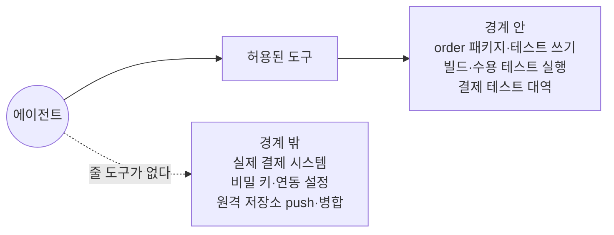
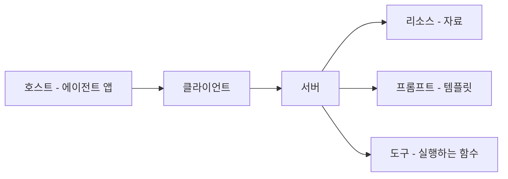
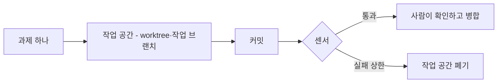

--------------------
Session 명: 06. 작업 위임과 도구·권한·상태의 경계
--------------------

## 목차

01. 세션 목표
02. 위임의 경계
03. 도구
04. 도구 연결의 표준
05. 최소 권한
06. 상태와 되돌림
07. 위임 계약
08. 잘못된 관행
09. 실습 — 위임 계약
10. 요약

---

## 01. 세션 목표

자율성은 **권한과 되돌림 수단이 정한 경계** 안에서만 허용한다.

- 위임의 경계를 **도구·권한·상태·멈출 조건**의 네 축으로 나누어 정한다.
- 도구가 **에이전트가 쓰는 인터페이스**임을 알고, 도구 설계의 다섯 기준으로 과제의 도구를 고른다.
- **MCP**가 표준화하는 것과 기본값으로 쓸 때의 대가를 설명한다.
- **최소 권한**을 읽기·쓰기·실행·외부 호출로 나누고, 에이전트의 신원을 사람과 분리한다.
- 변경마다 **작업 공간**을 두고, 상태마다 **되돌리는 수단**을 정한다.
- 여섯 항목의 **위임 계약**을 한 장으로 쓰고, 종료 조건과 멈출 조건을 구분한다.

**강사 노트**

- 앞 세션까지 맡길 과제의 "무엇"(작업 명세서·수용 기준)과 "무엇을 알려 주는가"(맥락 패키지)를 정했다. 여기서는 **어디까지 맡기는가**를 정한다.
- 근거는 [Anthropic 2024]의 ACI, [Anthropic 2025b]의 도구 설계, [MCP 2025]의 안전 원칙, [Lopopolo 2026]의 작업 공간이다.
- 권한을 실행 전에 강제하는 방법은 "세션 08. 실행 제약과 가드레일의 역할"이 맡는다. 여기서 정한 권한을 거기서 다시 정하지 않는다.

---

## 02. 위임의 경계

맥락을 받은 에이전트에게 남은 질문은 **무엇을 쓰고 어디까지 바꿀 수 있는가**다.

**도식 — Mermaid — "주문한다"의 위임 경계**

- **도구** — 무엇으로 일하는가. 주지 않은 도구는 **호출할 방법이 없다**.
- **권한** — 어디까지 닿는가. 읽기·쓰기·실행·외부 호출을 따로 정한다.
- **상태와 멈출 조건** — 되돌릴 수 없는 변경은 맡기지 않고, 사람이 정할 결정에 닿으면 **멈추고 묻는다**.
- **경계 밖의 셋** — 되돌릴 수 없는 일, 권한 밖의 자원, **사람이 질 책임**이다.

**강사 노트**

- 네 축은 위임 계약의 항목이 된다. 「07. 위임 계약」에서 입력·종료 조건을 더해 한 장으로 묶는다.
- 세 가지 금지가 각각 어느 이유인지 묻는다 — 실제 결제는 되돌릴 수 없음, 비밀 키는 권한 밖, 병합은 사람의 책임이다.
- 흐름 안에 미리 두는 사람의 확인 지점은 "세션 07. 워크플로·에이전트와 사람의 개입"이 다룬다. 멈출 조건은 경계에 닿았을 때의 중단이다.

---

## 03. 도구

## 에이전트-컴퓨터 인터페이스

에이전트가 할 수 있는 일은 **주어진 도구가 정한다**. 사람이 쓰는 화면을 다듬는 만큼 에이전트가 쓰는 인터페이스(ACI)를 다듬는다.

**주석**

ACI — Agent-Computer Interface · HCI — Human-Computer Interface

**인용문**

도구의 정의와 규격에는 **전체 프롬프트만큼의** 프롬프트 엔지니어링이 필요하다, "Tool definitions and specifications should be given just as much prompt engineering attention as your overall prompts.", [Anthropic 2024]

  - 도구를 **포카요케**한다 — 틀리기 어렵게 인자를 바꾼다, "Poka-yoke your tools. Change the arguments so that it is harder to make mistakes.", [Anthropic 2024]

**표 — 도구를 다듬는 네 가지 질문**

| 질문 | 확인하는 것 |
|---|---|
| **모델의 입장에서 분명한가?** | 설명과 인자만으로 쓸 수 있어야 한다 |
| **이름과 설명이 뜻을 말하는가?** | 인자 이름을 바꾸면 덜 헷갈린다 |
| **실제로 어떻게 쓰는가?** | 여러 입력으로 돌려 보고 실수를 본다 |
| **틀리기 어렵게 만들었는가?** | 잘못된 호출이 아예 불가능하다 |

- **포카요케(poka-yoke)** — 잘못된 조작이 **구조적으로 불가능하게** 만드는 방식이다. 경로를 받는 대신 허용된 대상만 고르게 하는 것이 그 예다.

**강사 노트**

- 인용 근거: Anthropic, "Building effective agents"(2024)의 도구 관련 부록 원문 확인. ACI라는 이름과 HCI와의 대응도 같은 글이다.
- 포카요케는 제조에서 온 말이며, 원문이 그대로 쓴다. 음차로 적고 뜻을 본문에서 한 줄로 밝힌다.
- 수강생에게 묻는다 — 첫 시도의 에이전트에게 "실제 결제 호출" 도구가 있었다면 무엇이 달라졌겠는가?

---

## 도구 설계의 다섯 기준

**인용문**

도구는 **결정적인 시스템과 비결정적인 에이전트 사이의 계약**을 담은 새로운 종류의 소프트웨어다, "Tools are a new kind of software which reflects a contract between deterministic systems and non-deterministic agents.", [Anthropic 2025b]

**표 — 다섯 기준과 "주문한다"의 적용**

| 기준 | 뜻 | "주문한다"에서 |
|---|---|---|
| **알맞은 도구 고르기** | 여러 호출을 하나로 묶는다 | 승인 요청 한 번으로 결과까지 받는다 |
| **이름 공간** | 공통 접두어로 경계를 가른다 | `order_`와 `payment_`로 나눈다 |
| **의미 있는 반환** | 고신호 정보만 돌려준다 | 실패한 테스트와 메시지만 |
| **토큰 효율** | 돌려주는 양도 줄인다 | 빌드 로그는 요약과 상한 |
| **도구 설명** | 설명을 프롬프트처럼 다듬는다 | 금지한 대상을 설명에 적는다 |

- **반환도 맥락이다** — 도구가 돌려준 것은 그대로 창에 올라가 **주의 예산을 깎는다**.
  - 도구는 **고신호 정보만** 에이전트에게 돌려주어야 한다, "tool implementations should take care to return only high signal information back to agents", [Anthropic 2025b]
- **설명이 결과를 바꾼다** — 도구를 고치지 않고 **설명만 다듬어도** 호출의 정확도가 달라진다.

**강사 노트**

- 인용 근거: Anthropic, "Writing effective tools for AI agents—using AI agents"(2025) 원문에서 확인했다. 다섯 기준의 이름은 원문의 소제목이다.
- 같은 글은 설명을 조금 다듬은 것만으로 결과가 크게 좋아졌다고 적는다("Even small refinements to tool descriptions can yield dramatic improvements"). 토큰 효율도 같은 글의 기준이다.
- 사람이 쓰는 API와 다른 점을 짚는다 — 호출하는 쪽이 매번 같게 행동하지 않는다.

---

## 주문한다의 도구

"주문한다"에 주는 도구는 **다섯 개**다. 할 수 있는 일의 목록이 그대로 경계가 된다.

**표 — "주문한다"의 도구**

| 도구 | 하는 일 | 돌려주는 것 |
|---|---|---|
| **파일 읽기** | 저장소의 문서·코드를 읽는다 | 파일 내용 |
| **파일 쓰기** | `order` 패키지와 테스트를 고친다 | 바꾼 파일의 목록 |
| **빌드·테스트 실행** | 컴파일하고 수용 테스트를 돌린다 | 실패한 테스트와 메시지 |
| **결제 테스트 대역** | 승인·거절을 흉내 낸다 | 승인 또는 거절 |
| **브랜치 커밋** | 작업 브랜치에 커밋한다 | 커밋 식별자 |

- **없는 도구가 경계다** — 실제 결제 시스템을 부르는 도구가 없으므로 그 호출은 **시도조차 되지 않는다**.
- **대역을 주는 이유** — 거절 경로를 재현할 수 있어야 수용 기준 4개를 **끝까지** 확인한다.
- **더 주지 않는 이유** — 도구가 늘면 고를 때 헷갈리고, 반환이 창을 차지한다.

**강사 노트**

- 수용 기준 4개는 "세션 04. 수용 기준과 검증 가능한 작업 단위"의 「03. 허용·거절 예시」에서 정한 것이다.
- 대역(test double)은 외부 시스템을 대신하는 구현이다. 대역의 응답 형식은 연동 규격을 따라야 하므로 규격 문서를 가리켜 둔다.
- 사람이 하는 일로 남긴 것 — 원격 저장소 push와 병합이다. 되돌림의 책임이 사람에게 있다.

---

## 04. 도구 연결의 표준

도구를 에이전트에 잇는 방법을 표준화한 것이 **MCP**다 — **호스트·클라이언트·서버**로 나누고 서버가 리소스·프롬프트·도구를 준다.

**주석**

MCP — Model Context Protocol

**도식 — Mermaid — MCP의 구성**

- **표준이 주는 것** — 한 번 만든 도구를 **모델이 바뀌어도** 그대로 쓴다.
- **동의가 전제다** — 도구 호출은 **임의의 코드 실행**이고, 프로토콜은 권한을 **강제하지 않는다**.
  - 도구는 **임의 코드 실행**이므로 알맞은 주의로 다뤄야 한다, "Tools represent arbitrary code execution and must be treated with appropriate caution", [MCP 2025]

**강사 노트**

- 인용 근거: Model Context Protocol Specification(2025-06-18)의 개요와 "Security and Trust & Safety" 원문 확인. 같은 절은 호스트가 도구를 부르기 전에 사용자의 명시적 동의를 받아야 한다고 적고, 명세 스스로 프로토콜 수준에서 이 원칙을 강제할 수 없다고 밝힌다.
- 도구 설명의 주석(annotation)은 신뢰할 수 없는 서버에서 오면 신뢰하지 않는다는 조항도 같은 절에 있다. 프롬프트 주입과의 관계는 "세션 08. 실행 제약과 가드레일의 역할"에서 다룬다.
- 주문 사례는 MCP 서버를 따로 세우지 않고 저장소의 명령과 대역을 도구로 쓴다. 그 판단의 근거는 「08. 잘못된 관행」의 「기본값이 된 MCP」다.

---

## 05. 최소 권한

## 네 가지 권한

권한은 **읽기·쓰기·실행·외부 호출**을 따로 정한다. "모두 허용"과 "아무것도 못 함" 사이를 네 가지로 가른다.

**표 — "주문한다"의 권한**

| 권한 | 허용 | 금지 |
|---|---|---|
| **읽기** | 저장소의 코드·문서·테스트 | 비밀 키, 결제 연동 설정 |
| **쓰기** | `order` 패키지와 테스트 코드 | 수용 테스트의 기대값, 의존 규칙 |
| **실행** | 빌드와 수용 테스트 | 외부 네트워크 호출 |
| **외부 호출** | 결제 테스트 대역 | 실제 결제 시스템 |

**인용문**

경계는 **중앙에서 강제하고** 그 안에서는 **자율을 허용한다**, "enforce boundaries centrally, allow autonomy locally", [Lopopolo 2026]

- **쓰기가 가장 좁다** — 범위를 패키지로 적으면 경계를 넘는 변경이 **diff에서 바로 드러난다**.
- **기대값을 금지하는 이유** — 수용 기준은 사람이 정한 것이어서, 에이전트가 고치면 **센서가 사라진다**.

**강사 노트**

- 인용 근거: [Lopopolo 2026]은 도메인마다 고정된 계층과 허용된 의존만 두고, 그 안의 구현 방식은 에이전트에게 맡겼다.
- 읽기까지 좁히는 이유를 묻는다 — 비밀 키는 한 번 읽히면 맥락과 로그에 남는다.
- 네 가지 구분은 사례에 맞춘 정리다. 도구마다 권한을 따로 적는 구현(허용 목록·샌드박스)은 "세션 08. 실행 제약과 가드레일의 역할"이 다룬다.

---

## 에이전트의 신원

에이전트가 **사람의 자격으로** 움직이면 권한도 사람만큼 커진다. 신원을 따로 두고 범위와 수명을 좁힌다.

**표 — 신원의 세 가지 결정**

| 결정 | 좁히는 방법 | "주문한다"에서 |
|---|---|---|
| **누구로 움직이나?** | 과제 전용 계정 | 빌드·테스트 권한만 가진 계정 |
| **어디까지 닿나?** | 저장소 하나와 작업 브랜치 | 주문 저장소의 작업 브랜치 |
| **얼마나 오래 쓰나?** | 실행마다 발급하고 폐기 | 과제가 끝나면 자격을 폐기 |

- **왜 분리하는가** — 자격이 새면 에이전트가 **의도한 범위 밖에서** 움직인다. [OWASP 2025]은 이것을 신원·권한 남용(ASI03)으로, 도구를 통한 범위 밖 행동을 도구 오용(ASI02)으로 든다.
- **연동 자격은 주지 않는다** — 실제 결제 자격이 필요해 보이면 **대역으로 바꾼다**.

**강사 노트**

- 근거: OWASP Gen AI Security Project, "OWASP Top 10 for Agentic Applications for 2026"의 위험 목록에서 ASI02·ASI03의 항목 이름을 확인했다. 전체 문서는 "세션 08. 실행 제약과 가드레일의 역할"에서 위험 목록으로 다룬다.
- 위험 목록의 ASI 번호는 인용이 아니라 항목의 식별자다. 세부 설명을 옮기지 않는다.
- 실행마다 자격을 발급하는 방식은 사람의 계정을 빌려 쓰는 관행과 대비해 보인다.

---

## 06. 상태와 되돌림

## 변경마다 작업 공간

에이전트가 바꾸는 것은 **한 작업 공간 안에** 둔다. 변경 하나에 작업 공간 하나다.

**인용문**

앱을 **git worktree마다 띄울 수 있게** 만들어 변경마다 한 벌을 띄우고 조작하게 했다, "we made the app bootable per git worktree, so Codex could launch and drive one instance per change", [Lopopolo 2026]

  - **완전히 분리된 사본**에서 일하고 과제가 끝나면 그 사본은 지워진다, "Codex works on a fully isolated version of that app—including its logs and metrics, which get torn down once that task is complete", [Lopopolo 2026]

**도식 — Mermaid — 작업 공간의 수명**

- **분리의 이득** — 작업 공간이 따로이므로 **다른 과제를 깨뜨리지 않는다**.
- **버리는 것이 기본** — 작업 공간은 과제와 함께 사라진다. 남는 것은 **커밋과 진행 기록**이다.
- **프레임(frame)이 아니라 사본** — 브랜치만 바꾸는 것과 달리 **실행 환경까지** 한 벌로 묶는다.

**강사 노트**

- 인용 근거: [Lopopolo 2026] 영문 원문 확인. 관측 도구까지 worktree마다 띄우고 과제가 끝나면 함께 버린다.
- worktree는 같은 저장소의 여러 작업 디렉터리를 두는 git 기능이다. 이름을 그대로 쓴다.
- 수강생 환경에서는 브랜치와 컨테이너만으로도 같은 효과를 얻는다. 핵심은 분리와 폐기다.

---

## 진행 기록과 되돌림

되돌릴 수 있으면 맡길 수 있다. 바뀌는 것마다 **되돌리는 수단**을 미리 정한다.

**표 — 바뀌는 것과 되돌리는 수단**

| 바뀌는 것 | 어디에 남나 | 되돌리는 수단 |
|---|---|---|
| **코드·테스트** | 작업 브랜치의 커밋 | 커밋 되돌리기, 브랜치 폐기 |
| **진행 기록** | 저장소의 기능 목록 | 이전 상태로 되돌려 다시 시작 |
| **문서** | `docs/`의 용어집·모델 | 사람이 확정한 판본으로 복구 |
| **외부 시스템** | 대역의 호출 기록 | 없음 — 그래서 실제 호출을 막는다 |

**인용문**

계획을 **일급 산출물**로 다룬다, "Plans are treated as first-class artifacts", [Lopopolo 2026]

- **기록은 저장소에 둔다** — 대화에만 있는 진행은 **다음 실행이 이어 받지 못한다**.
- **되돌릴 수 없는 일** — 실제 결제, 배포, 데이터 이관은 수단이 없으므로 **권한에서 뺀다**.

**강사 노트**

- 인용 근거: [Lopopolo 2026]은 복잡한 작업의 실행 계획을 진행·결정 기록과 함께 저장소에 커밋했다.
- 기능 목록은 "세션 04. 수용 기준과 검증 가능한 작업 단위"의 「05. 작업 단위」의 「기능 목록과 점진적 진행」에서 만든 것이다.
- 실패 뒤 어디로 되돌릴지의 판단은 "세션 10. 실패 대응·재시도·복구"가 맡는다. 여기서는 수단을 갖추는 것까지다.

---

## 07. 위임 계약

## 위임 계약이란?

위임 계약은 과제 하나를 맡기며 정한 **여섯 항목**이다. 사람과 에이전트가 같은 한 장을 본다.

**표 — 위임 계약의 여섯 항목**

| 항목 | 답하는 질문 | 어디서 오나 |
|---|---|---|
| **입력** | 무엇을 보고 일하나? | 작업 명세서, 수용 기준, 맥락 패키지 |
| **도구** | 무엇으로 일하나? | 과제에 주는 도구 목록 |
| **권한** | 어디까지 닿나? | 읽기·쓰기·실행·외부 호출 |
| **상태** | 무엇을 바꾸고 어떻게 되돌리나? | 작업 공간, 진행 기록 |
| **종료 조건** | 무엇이 끝인가? | 완료의 정의 |
| **멈출 조건** | 언제 사람에게 묻나? | 사람이 정할 결정, 실패 상한 |

**인용문**

과제가 끝나면 멈추지만 통제를 유지하려고 **반복 상한 같은 중단 조건**을 함께 두는 일이 흔하다, "it's also common to include stopping conditions (such as a maximum number of iterations) to maintain control", [Anthropic 2024]

- **종료와 멈춤은 다르다** — 종료 조건은 "**끝났다**"의 기준이고, 멈출 조건은 "**내가 정할 수 없다**"의 기준이다.

**강사 노트**

- 계약이 한 장을 넘으면 읽히지 않는다. 읽히지 않는 계약은 맥락이 아니라는 점을 짚는다.

- 인용 근거: [Anthropic 2024]의 에이전트 설명에서 중단 조건 문장을 확인했다.
- 종료 조건은 "세션 04. 수용 기준과 검증 가능한 작업 단위"의 「06. 완료의 정의와 증거」에서 정한 완료의 정의를 가리킨다. 계약에 다시 적지 않는다.
- 입력은 "세션 03. 요구의 구체화와 명세"·"세션 04. 수용 기준과 검증 가능한 작업 단위"·"세션 05. 도메인·설계 지식과 맥락 구성"의 산출물이다. 계약이 그 네 축 위에 얹히는 마지막 장이다.

---

## 주문한다의 위임 계약

**문서 형식**

"주문한다"의 위임 계약은 쓰기를 `order`와 테스트로 묶고, **되돌릴 수 없는 호출을 모두 뺀** 한 장이다.

**위임 계약** — "주문한다"

1. 입력
  - **작업 명세서**와 수용 기준 4개, 맥락 파일 `AGENTS.md`와 `docs/`
2. 도구
  - **파일 읽기·쓰기**, 빌드·수용 테스트 실행, 결제 테스트 대역, 브랜치 커밋
3. 권한
  - **읽기** — 저장소의 코드·문서. 비밀 키와 연동 설정은 제외한다
  - **쓰기** — `order` 패키지와 테스트 코드. 기대값과 의존 규칙은 제외한다
  - **실행** — 빌드와 수용 테스트. 외부 네트워크 호출은 금지한다
  - **외부 호출** — 결제 테스트 대역만. 실제 결제 시스템은 금지한다
4. 상태
  - **작업 공간** — 과제마다 worktree와 작업 브랜치. push와 병합은 사람이 한다
  - **진행 기록** — 기능 목록의 작업 단위 상태로 남긴다
5. 종료 조건
  - **완료의 정의**를 만족한다 — 수용 테스트 4개 통과, 기대값·테스트 변경 없음
6. 멈출 조건
  - **기대값이나 의존 규칙**을 바꿔야 할 때
  - **같은 테스트가 3회 연속** 실패할 때
  - **명세에 없는 업무 규칙**을 정해야 할 때

**강사 노트**

- 계약은 저장소에 두고 맥락 파일이 가리킨다. 사람과 에이전트가 같은 문장을 읽어야 경계가 하나다.
- 3회라는 상한은 교육용 가정이다. 상한의 근거는 비용과 실패의 성격이며, 값 자체가 규칙은 아니다.
- 세 번째 멈출 조건이 가장 중요하다. 첫 시도의 실패가 바로 이 지점에서 추측으로 채워졌다.

---

## 08. 잘못된 관행

## 모든 권한 허용

편의를 위해 **전부 허용**하면 경계가 사라진다. 승인 창이 번거롭다는 것이 가장 흔한 계기다.

**표 — 전부 허용의 모습과 처방**

| 모습 | 왜 생기나 | 처방 |
|---|---|---|
| **확인 없이 모두 실행** | 승인 창이 번거롭다 | 되돌릴 수 없는 일만 승인으로 남긴다 |
| **사람의 자격을 그대로 씀** | 계정을 따로 만들기 번거롭다 | 과제 전용 신원과 짧은 수명 |
| **저장소 전체에 쓰기 허용** | 어디를 고칠지 모른다 | 과제의 쓰기 범위를 패키지로 적는다 |
| **실제 외부 시스템에 연결** | 대역을 만들기 번거롭다 | 대역을 먼저 만든다 |

**인용문**

**샌드박스에서 충분히 시험하고** 알맞은 **가드레일**을 함께 두기를 권한다, "We recommend extensive testing in sandboxed environments, along with the appropriate guardrails.", [Anthropic 2024]

- **번거로움이 경계를 지운다** — 경계를 지우는 대신 **도구를 고쳐** 번거로움을 없앤다.
- **좁히는 순서** — 되돌릴 수 없는 것부터 뺀다. 그다음이 쓰기 범위, 그다음이 읽기다.

**강사 노트**

- 인용 근거: [Anthropic 2024]의 에이전트 논의에서 확인했다. 비용과 오류 누적은 "세션 02. 작업 특성에 따른 AI 활용 방식"의 「04. 작업 특성에 따른 선택」의 「자율성의 대가」에서 이미 다뤘다.
- 전부 허용 모드는 시연이나 격리된 환경에서 쓰는 선택이다. 저장소와 자격이 실제 환경에 이어져 있으면 쓰지 않는다.
- 네 가지 모습 모두 "번거로움"이 원인이다. 번거로움을 도구의 문제로 되돌리는 것이 이 topic의 메시지다.

---

## 기본값이 된 MCP

모든 연결을 MCP로 만들려 하면 **얻는 것보다 잃는 것**이 커진다.

**인용문**

MCP를 **기본값으로 쓰는 것을 경계한다**, "We caution against using MCP by default", [Thoughtworks 2026]

  - 에이전트와 API 사이의 **모든 프로토콜 층은 충실도를 잃고** 복잡한 API에서는 그 손실이 누적된다, "every protocol layer between an agent and an API loses fidelity, and for complex APIs those losses compound", [Thoughtworks 2026]

**표 — MCP가 맞는 때와 간단한 도구로 충분한 때**

| MCP가 값을 하는 때 | 간단한 도구로 충분한 때 |
|---|---|
| 구조화된 **도구 계약**이 필요하다 | 한 저장소 안에서만 쓴다 |
| **인증 경계**를 따로 둔다 | 자격이 이미 실행 환경에 있다 |
| 여러 사용자의 접근을 **통제**한다 | 쓰는 사람이 우리 팀뿐이다 |

- **먼저 물을 것** — 이 연결에 **프로토콜 수준의 상호 운용**이 정말 필요한가?
- **대안** — 도움말이 분명하고 **JSON으로 답하는 명령 한 줄**이면 에이전트에게 충분한 경우가 많다.

**강사 노트**

- 인용 근거: Thoughtworks Technology Radar Vol. 34에서 MCP by default가 Caution(Hold)에 있고, 두 문장을 원문에서 확인했다. 원문은 Simon Willison의 "CLI 하나로 대개 된다"는 말도 함께 인용한다.
- "abstraction tax"라는 이름이 원문에 있다. 추상 층마다 값을 치른다는 뜻으로 소개한다.
- 주문 사례가 MCP 서버를 두지 않은 이유가 오른쪽 열 세 가지다. 공개 형식을 쓰는 이득은 맥락 파일에서 이미 얻고 있다.

---

## 09. 실습 — 위임 계약

실습 5의 맥락 패키지와 실습 4의 수용 기준을 LLM에 제공하여 **"신청한다"의 위임 계약**을 만들고, 점검 항목으로 피드백하여 완성하십시오.

- **투입물**
  + 실습 3의 **작업 명세서**, 실습 4의 **수용 기준과 작업 단위**, 실습 5의 **맥락 패키지**
- **프롬프트**
  + "신청한다 과제의 **위임 계약**을 한 장으로 써줘. 입력·도구·권한·상태·종료 조건·멈출 조건의 여섯 항목으로 적고, 권한은 **읽기·쓰기·실행·외부 호출**로 나눠 금지한 것까지 적어줘."
- **점검 항목**
  1. **도구** — "신청한다"에 필요한 도구만 있고, 주지 않은 도구가 경계가 되는가?
  2. **쓰기 범위** — 쓰기를 `subscription` 패키지와 테스트로 묶었는가?
  3. **되돌릴 수 없는 일** — 실제 결제·배송 호출과 원격 저장소 반영을 뺐는가?
  4. **종료 조건** — 완료의 정의(수용 테스트 5개)로 끝을 정했는가?
  5. **멈출 조건** — 사람이 정할 결정(공휴일 규칙)과 실패 상한이 있는가?
  6. **신원** — 사람의 자격을 빌리지 않고 전용 신원과 수명을 정했는가?
- **결과물** — "신청한다"의 위임 계약. 실습 7의 입력이 됩니다.

**강사 노트**

- 정기배송 모델 패키지와 맥락 파일은 `code/s01/subscription/docs/`에 있다.
- LLM은 권한을 "저장소 쓰기 허용" 한 줄로 뭉개고, 금지 항목을 비워 둔다. 점검 2·3으로 좁히게 한다.
- 점검 5의 공휴일은 실습 4에서 미정으로 남긴 질문이다. 미정이 멈출 조건으로 이어지는 것을 짚는다.

---

## 10. 요약

자율성은 **권한과 되돌림 수단이 정한 경계** 안에서만 허용한다.

### 위임 경계의 핵심

- **네 축** — 도구·권한·상태·멈출 조건. 맥락을 준 뒤 남는 질문은 어디까지 맡기는가다
- **도구** — 할 수 있는 일의 목록이 경계다. 도구의 정의와 설명은 프롬프트만큼 다듬는다
- **MCP** — 도구 연결의 공개 표준이지만 기본값은 아니다. 도구 호출은 임의 코드 실행이다
- **최소 권한** — 읽기·쓰기·실행·외부 호출을 따로 정하고, 에이전트의 신원을 사람과 나눈다
- **상태** — 변경마다 작업 공간을 두고 되돌릴 수 없는 일은 뺀다
- **위임 계약** — 입력·도구·권한·상태·종료·멈출 조건을 한 장에 적는다

### 다음 세션

- "**07. 워크플로·에이전트와 사람의 개입**" — 경계를 정한 과제를 어떤 흐름으로 실행하고, 어디에 사람의 확인 지점을 둘지 정한다.

**강사 노트**

- 계약의 권한을 실행 전에 강제하는 방법은 "세션 08. 실행 제약과 가드레일의 역할"이 맡는다. 요약에서 미리 말하지 않는다.
- 실습 6의 위임 계약이 실습 7의 실행 흐름의 입력이 된다.

---

## 별첨. 실습 답

---

## 위임 계약 (안)

**문서 형식**

"신청한다"의 위임 계약은 쓰기를 `subscription`과 테스트로 묶고, **결제·배송의 실제 호출과 원격 반영을 뺀** 한 장이다.

**위임 계약** — "신청한다"

1. 입력
  - **작업 명세서**와 수용 기준 5개, 맥락 파일 `AGENTS.md`와 `docs/`
2. 도구
  - **파일 읽기·쓰기**, 빌드·수용 테스트 실행, 결제 테스트 대역, 브랜치 커밋
3. 권한
  - **읽기** — 저장소의 코드와 `docs/`. 비밀 키와 연동 설정은 제외한다
  - **쓰기** — `subscription` 패키지와 테스트 코드. 기대값과 의존 규칙은 제외한다
  - **실행** — 빌드와 수용 테스트. 외부 네트워크 호출은 금지한다
  - **외부 호출** — 결제 테스트 대역만. 실제 결제·배송 시스템은 금지한다
4. 상태
  - **작업 공간** — 과제마다 작업 브랜치. push와 병합은 사람이 한다
  - **진행 기록** — 작업 단위 4개의 상태를 기능 목록에 남긴다
5. 종료 조건
  - **완료의 정의**를 만족한다 — 수용 테스트 5개 통과, 테스트 파일 변경 없음
6. 멈출 조건
  - **회차 금액·회차 수·만료일**의 기대값을 바꿔야 할 때
  - **공휴일 규칙**처럼 미정인 업무 규칙을 정해야 할 때
  - **같은 테스트가 3회 연속** 실패할 때

**강사 노트**

- 도구는 강의 사례와 같다. 과제가 같은 모양(신규 개발, 외부 결제 하나)이기 때문이다.
- 배송 시스템을 금지에 더한 것이 강의 사례와 다른 점이다. "신청한다"는 회차만 예정으로 만들고 배송 요청은 하지 않는다.
- 멈출 조건의 첫 줄은 수용 기준의 값(10,000원·7개·2월 2일)을 지키는 장치다.

---

## 보완 (안)

새로 발견한 것은 **후속 작업에 영향을 미치는 경우에만** 이전 산출물에 반영한다.

- **맥락 패키지**(실습 5)
  - **멈출 조건을 옮긴다** — 맥락 파일의 멈출 조건 한 줄을 지우고 위임 계약을 가리킨다. 경계는 한 곳에 있어야 한다.
  - **대역을 적는다** — `docs/external/payment-api.md`는 대역의 응답 형식을 맞추는 데 쓴다는 것을 한 줄로 밝힌다.
- **수용 기준**(실습 4)
  - **미정을 멈출 조건으로** — 공휴일 미정이 멈출 조건이 된다. 수용 기준에는 그대로 두지 않는다.
- **※ 현행화 기준**
  - **반영** — 맥락 파일의 멈출 조건 제거와 계약 가리킴. 실습 7의 입력이 된다.
  - **기록만** — 연동 규격의 용도 한 줄.

**강사 노트**

- 같은 규칙이 맥락 파일과 계약에 두 번 있으면 둘이 어긋난다. 실습에서 중복을 찾아 한 곳으로 모으는 연습을 시킨다.
- 미정을 없애지 않고 멈출 조건으로 옮기는 것이 이 보완의 핵심이다. 사람이 정할 결정은 사람에게 남긴다.
