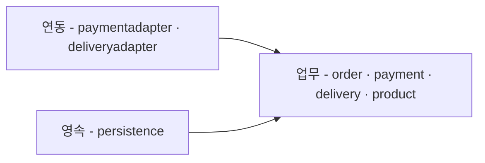
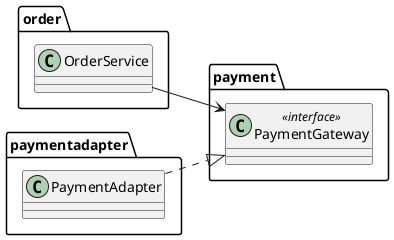
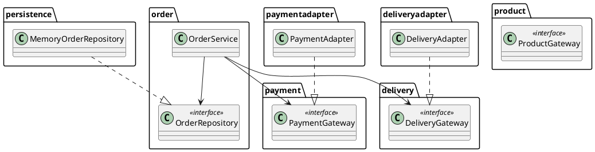
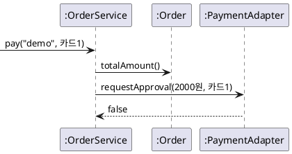

--------------------
Session 명: 06. 아키텍처
--------------------

## 목차

01. 세션 목표
02. 아키텍처가 정하는 것
03. 설계 원칙
04. 업무 패키지와 외부 시스템
05. 의존 규칙
06. 검증하기 쉬운 구조
07. 사람과 AI의 몫
08. 잘못된 관행
09. 실습 — 아키텍처
10. 요약

---

## 01. 세션 목표

경계는 **글로 적고 검사로 지킨다**.

- 아키텍처가 정하는 것이 기능이 아니라 **무엇이 무엇을 알아야 하는가**임을 설명한다.
- 계층형·**포트와 어댑터**·모듈러 모놀리스·마이크로서비스를 비교하고 이 사례에 맞는 것을 고른다.
- **응집도와 결합도·단일 책임·의존성 역전**으로 경계를 가르는 근거를 댄다.
- 업무 패키지가 외부 시스템을 **포트로만** 알게 배치하고 외부 연동 규격을 맥락으로 적는다.
- 허용과 금지를 **의존 규칙**으로 적고, 규칙 위반을 **검사**가 판정하게 한다.
- 포트 덕분에 **대역**으로 업무 규칙만 확인할 수 있음을 코드로 확인한다.

**강사 노트**

- 입력은 실습 3의 요구사항 정의서와 실습 4·5의 도메인 모델이다. 이 세션은 그 개념들이 **어느 경계에 사는지**를 정한다.
- 객체의 책임과 협력은 "세션 07. 설계 — 책임과 협력"이, 의존 규칙을 판정하는 **검사의 구현**은 "세션 09. 검사 파이프라인"이 맡는다. 같은 원칙(단일 책임·의존성 역전)을 여기서는 경계의 근거로만 쓴다.

---

## 02. 아키텍처가 정하는 것

아키텍처가 정하는 것은 기능이 아니라 **무엇이 무엇을 알아야 하는가**다. 같은 기능도 누가 무엇을 아느냐에 따라 바뀔 때 드는 비용이 달라진다.

**도식 — Mermaid — 주문 시스템의 의존 방향**



- **업무가 포트를 소유한다** — 결제 포트는 `payment`에, 배송 포트는 `delivery`에, 저장 포트는 `order`에 있다. 연동과 영속은 그 포트를 구현한다.
- **연동과 영속이 업무에 의존한다** — 화살표가 전부 업무 쪽을 향한다. 외부 제공자가 바뀌어도 업무는 그대로다.

**강사 노트**

- 도식의 화살표는 **의존**이다(쓰는 쪽 → 쓰이는 쪽). 호출의 순서가 아니다.
- 이 배치가 이 세션의 결론이다. 왜 이렇게 두는지를 「03. 설계 원칙」이, 어떻게 지키는지를 「05. 의존 규칙」·「06. 검증하기 쉬운 구조」가 답한다.

---

## 스타일 넷의 비교

스타일마다 **무엇을 나누고 무엇을 금지하는지**가 다르다. 고르는 기준은 유행이 아니라 지금의 배포·조직·변경이다.

**표 — 아키텍처 스타일의 비교**

| 스타일 | 무엇을 나누는가? | 배포 단위 | 의존 규칙 | 고르는 조건 |
|---|---|---|---|---|
| **계층형** | 기술 역할(표현·응용·도메인) | 하나 | 위에서 아래로만 | 역할이 팀 경계와 같을 때 |
| **포트와 어댑터** | 업무와 외부 기술 | 하나 | 업무는 외부를 포트로만 | 외부가 여럿, 떼어 검증할 때 |
| **모듈러 모놀리스** | 업무 모듈 | 하나 | 모듈 간 공개 인터페이스로만 | 경계만 나누고 배포는 하나일 때 |
| **마이크로서비스** | 업무 모듈 | 여럿 | 원격 호출, 각자 저장소 | 독립 배포·확장이 필요할 때 |

**인용문**

마이크로서비스는 애플리케이션 하나를 **각자의 프로세스에서 도는 작은 서비스들**로 만들고 가벼운 수단으로 통신하게 하는 접근이다, "an approach to developing a single application as a suite of small services, each running in its own process and communicating with lightweight mechanisms", [Lewis·Fowler 2014]

**인용문**

애플리케이션이 충분히 커질 것이 확실하더라도 **새 프로젝트를 마이크로서비스로 시작하지는 말아야** 한다, "you shouldn't start a new project with microservices, even if you're sure your application will be big enough to make it worthwhile.", [Fowler 2015c]

**강사 노트**

- 인용 근거: James Lewis·Martin Fowler, [Microservices](https://martinfowler.com/articles/microservices.html), 2014 원문 확인(원문은 이어서 HTTP 자원 API를 흔한 통신 수단으로 든다). Martin Fowler, [MonolithFirst](https://martinfowler.com/bliki/MonolithFirst.html), 2015 원문 확인 — 원문은 동료들의 주장으로 소개하며 같은 글에서 마이크로서비스가 유용한 아키텍처라는 점도 함께 적는다.
- 계층형과 포트와 어댑터는 배타적이지 않다. 포트와 어댑터 안에서 업무 모듈을 다시 계층으로 나눌 수 있다.
- 표의 "의존 규칙" 열이 이 세션의 산출물과 같은 종류다 — 스타일을 고르는 것은 **금지 목록을 고르는 것**이다.

---

## 이 과정이 쓰는 것

고른 스타일은 **포트와 어댑터를 적용한 모듈러 모놀리스**다. 배포는 하나로 두고 업무 경계는 패키지로 나누며, 외부와의 접점은 전부 포트로 둔다.

**인용문**

애플리케이션이 사용자·프로그램·자동화된 테스트·배치 스크립트 **어느 쪽에서든 똑같이 구동**되고, 최종 런타임 장치·데이터베이스와 **떨어져 개발·테스트**되게 한다, "Allow an application to equally be driven by users, programs, automated test or batch scripts, and to be developed and tested in isolation from its eventual run-time devices and databases.", [Cockburn 2005]

- **배포 단위** — 하나. 독립 배포가 필요하다는 요구가 없다.
- **업무 경계** — `order`·`payment`·`delivery`·`product` 네 패키지. 모듈러 모놀리스의 "모듈"이 이 넷이다.
- **외부와의 접점** — 포트 넷(`OrderRepository`·`PaymentGateway`·`DeliveryGateway`·`ProductGateway`). 업무가 소유하고 연동·영속이 구현한다.
- **두지 않는 것** — 들어오는 쪽의 입력 포트. 호출자가 어떻게 들어오는지는 이 과제의 범위 밖이다.
- **고른 이유** — 외부 넷을 붙이면서 그 넷 없이 업무 규칙을 확인해야 한다. 포트가 그 둘을 한 번에 준다.

**강사 노트**

- 인용 근거: Alistair Cockburn, [Hexagonal architecture](https://alistair.cockburn.us/hexagonal-architecture/), 2005의 Intent 원문 확인.
- 인용이 말하는 것이 **왜 포트인가**다 — 외부 장치·데이터베이스 없이도 같은 애플리케이션을 구동해 검증할 수 있다.
- Cockburn의 "테스트에서도 똑같이 구동된다"가 「06. 검증하기 쉬운 구조」에서 대역으로 실현된다.
- 나누지 않은 이유도 함께 짚는다 — 서비스를 나누면 원격 호출·분산 일관성·저장소 분리가 따라오고, 지금 그 비용을 낼 근거가 없다.

---

## 03. 설계 원칙

경계를 정할 때 묻는 것은 네 가지다 — 무엇을 **모을지**, 무엇을 **끊을지**, 어디서 **가를지**, 의존을 어느 **쪽으로** 향하게 할지.

- **응집도** — 한 경계 안의 책임이 한 가지 일을 향하는가. 주문 금액 계산과 상태 전이는 둘 다 주문의 일이다.
- **결합도** — 다른 경계를 얼마나 아는가. `order`는 결제 포트의 이름과 업무 값만 알고 제공자의 전문은 모른다.
- **단일 책임** — 바뀌는 이유가 다르면 가른다. 업무 규칙은 업무가, 제공자의 전문은 제공자가 바꾸라고 한다.
- **의존성 역전** — 업무가 외부를 직접 부르면 외부가 업무를 정한다. 추상을 업무 쪽에 두고 방향을 뒤집는다.

**강사 노트**

- 응집도와 결합도는 **별개의 척도**다. 한 경계 안을 보는 것과 경계 밖을 보는 것이라 함께 쓰이지만 같은 원칙이 아니다.
- 네 원칙은 "세션 07. 설계 — 책임과 협력"에서 **객체의 책임**을 판단할 때 다시 나온다. 여기서는 패키지 경계의 근거로만 쓴다.
- 원칙을 많이 적용한 설계가 좋은 설계가 아니다. 지금 바뀌는 이유가 보이는 곳에만 경계를 둔다.

---

## 응집도

응집도는 **한 경계 안**을 보는 척도다. 그 안의 책임들이 한 가지 일을 향할수록 높다.

**인용문**

응집도는 한 요소의 책임들이 **얼마나 강하게 관련되고 집중되어 있는가**의 척도다, "cohesion (or more specifically, functional cohesion) is a measure of how strongly related and focused the responsibilities of an element are.", [Larman 2004]

**표 — 주문 사례의 응집도 판단**

| 무엇 | 어디에 두는가? | 근거 |
|---|---|---|
| **주문 금액의 계산** | `order` 안 | 주문 항목과 확정 단가를 아는 곳이 주문이다 |
| **결제대기 → 결제완료 전이** | `order` 안 | 금액을 아는 곳과 상태를 바꾸는 곳이 같다 |
| **결제 승인의 업무 의미** | `payment` 안 | 승인·거절·확정 불가가 결제의 사건이다 |
| **결제 제공자의 요청 전문** | `paymentadapter` 안 | 업무가 아니라 제공자가 정하는 것이다 |
| **주문을 찾고 저장하는 일** | 포트는 `order`, 구현은 `persistence` | 쓰는 쪽이 약속을 소유한다 |

- 응집도가 낮은 신호는 **한 패키지가 두 가지 이유로 열리는 것**이다. 업무 규칙을 고칠 때와 제공자 전문을 고칠 때 같은 패키지를 연다면 가를 자리가 있다.

**강사 노트**

- 인용 근거: Craig Larman, *Applying UML and Patterns*, 3rd ed.(2004)의 응집도 정의 원문 확인. 같은 곳은 결합도를 한 요소가 다른 요소를 아는 정도로 함께 설명한다.
- 넷째 행이 핵심이다. 제공자의 필드 이름이 업무 코드에 보이면 응집도가 낮은 것이 아니라 **제공자의 문서가 설계를 정한 것**이다.

---

## 결합도

결합도는 **경계 밖**을 보는 척도다. 같은 "안다"에도 정도가 있고, 정도에 따라 변경이 번지는 범위가 달라진다.

**표 — 무엇을 아는가에 따른 결합의 정도**

| 아는 것 | 주문 사례 | 바뀌면 |
|---|---|---|
| **이름과 업무 값만** | `order` → `PaymentGateway`의 메서드와 금액·결제 수단 | 제공자가 바뀌어도 `order`는 그대로 |
| **자료 구조** | 포트의 입출력이 제공자 응답 객체일 때 | 응답 필드가 바뀌면 업무도 바뀐다 |
| **구현** | 업무가 연동 클래스를 직접 생성할 때 | 연동을 바꾸려면 업무를 고쳐야 한다 |
| **상태 공유** | 두 패키지가 같은 전역 값을 읽고 쓸 때 | 어느 쪽이 바꿨는지 추적할 수 없다 |

- 이 사례는 **첫 줄만** 쓴다. 포트의 입출력을 업무의 값으로 적는 것이 결합을 이름까지로 묶는 방법이다.
- 결합을 없앨 수는 없다. 쓰는 쪽은 무엇이든 알아야 한다. 정하는 것은 **무엇을 알게 할지**다.

**강사 노트**

- 응집도와 결합도는 **별개의 척도**다. 응집도가 높아도 결합이 셀 수 있고, 결합이 약해도 한 패키지 안이 뒤섞일 수 있다.
- 표의 둘째 줄이 가장 흔한 실수다 — 포트는 두었는데 그 포트의 입출력이 제공자의 응답 객체여서, 포트가 있어도 전문이 업무 안으로 들어온다.
- 넷째 줄은 패키지 의존 검사로 잡히지 않는다. 「05. 의존 규칙」의 「허용과 금지」에서 검사가 보는 것과 못 보는 것을 가른다.

---

## 단일 책임

같은 이유로 바뀌는 것은 모으고, 다른 이유로 바뀌는 것은 나눈다. **누가 변경을 요구하는가**로 가른다.

**인용문**

같은 이유로 바뀌는 것은 **모으고**, 다른 이유로 바뀌는 것은 **분리한다**, "Gather together the things that change for the same reasons. Separate those things that change for different reasons.", [Martin 2014]

- **업무가 요구하는 변경** — 승인 뒤에 배송을 요청한다는 순서. `payment`·`order`가 바뀐다.
- **제공자가 요구하는 변경** — 승인 요청의 필드가 하나 늘었다. `paymentadapter`만 바뀐다.

**강사 노트**

- 인용 근거: Robert C. Martin, [The Single Responsibility Principle](https://blog.cleancoder.com/uncle-bob/2014/05/08/SingleReponsibilityPrinciple.html), The Clean Code Blog, 2014 원문 확인.
- "책임이 하나"를 "메서드가 하나"로 읽지 않게 한다. 기준은 크기가 아니라 **변경을 요구하는 쪽**이다.
- 두 변경을 실제로 넣어 보면 어느 패키지가 열리는지로 경계를 확인할 수 있다. 그 확인은 "세션 09. 검사 파이프라인"의 검사가 대신한다.

---

## 의존성 역전

업무가 외부를 직접 부르면 외부가 업무를 정한다. **추상을 업무 쪽에 두고** 외부가 그것을 구현하게 뒤집는다.

**인용문**

**추상에 의존하라**. 구체에 의존하지 마라, "Depend upon Abstractions. Do not depend upon concretions.", [Martin 2000]

**도식 — PlantUML — 결제 포트의 의존 방향**



```java
package payment;
public interface PaymentGateway {
    boolean requestApproval(Money amount, PaymentMethod method);
}
```

- **뒤집힌 것** — 화살표가 연동 → 업무다. 인터페이스가 `payment`에 있으므로 업무는 `paymentadapter`를 모른다.

**강사 노트**

- 인용 근거: Robert C. Martin, [Design Principles and Design Patterns](https://staff.cs.utu.fi/~jounsmed/doos_06/material/DesignPrinciplesAndPatterns.pdf), 2000의 DIP 원문 확인.
- 코드는 `code/s06/architecture/src/payment/PaymentGateway.java`의 전문이다. 인터페이스가 업무의 말(금액·결제 수단)로만 쓰여 있다는 점을 짚는다.
- 포트를 업무 패키지에 두는 것과 별도 `port` 패키지에 두는 것은 다른 선택이다. 이 과정은 쓰는 쪽이 소유하는 쪽을 쓴다.

---

## 04. 업무 패키지와 외부 시스템

업무 패키지는 외부 시스템을 **포트로만** 안다. 외부의 전문·오류 코드·재시도는 연동 안에 머문다.

- **업무 넷** — `order`(주문·항목·상태와 금액 규칙), `payment`(승인·거절·확정 불가), `delivery`(배송 요청), `product`(상품과 판매가)
- **연동 둘** — `paymentadapter`, `deliveryadapter`. 제공자의 전문을 업무의 말로 바꾼다
- **영속 하나** — `persistence`. 주문을 저장하고 되살린다
- **호출자(프런트엔드)** — 화면과 API 수신은 **이 과제의 범위 밖**이다. 들어오는 쪽에 입력 포트를 두지 않고, 바깥에서 오는 것은 주문 번호·결제 수단 같은 업무의 값이라고만 본다

**강사 노트**

- 패키지 이름은 실습 4의 용어집에서 왔다. 새 업무 이름을 여기서 만들지 않는다.
- 프런트엔드를 범위 밖으로 둔 이유 — 실습 3이 화면 표현과 인증 방식을 미정으로 남겼다. 들어오는 쪽을 설계하려면 그 미정을 먼저 정해야 한다. 나가는 쪽(포트 넷)만으로 이 세션의 판단은 끝난다.
- 상품 포트는 선언만 두고 구현은 만들지 않았다. 상품 조회 연동은 이 과제의 범위 밖이다(실습 3의 제외).

---

## 패키지 배치

네 업무 패키지가 **포트 넷**을 소유하고, 연동과 영속이 그것을 구현한다.

**도식 — PlantUML — 주문 시스템의 패키지**



```java
    public void pay(String orderNumber, PaymentMethod method) {
        Order order = repository.findBy(orderNumber);
        if (payment.requestApproval(order.totalAmount(), method)) {
            order.onPaid();
            delivery.requestDelivery(orderNumber, order.shippingAddress());
        }
        repository.save(orderNumber, order);
    }
```

- `OrderService`가 보는 것은 **포트 셋**뿐이다. `import`에 `paymentadapter`·`persistence`가 없다.

**강사 노트**

- 코드는 `code/s06/architecture/src/order/OrderService.java`의 발췌다. 승인 뒤에 상태를 바꾸고 그다음 배송을 요청하는 순서는 "세션 05. 동적 모델"의 전이와 같다.
- `ProductGateway`는 `product`에 선언만 있고 쓰는 곳이 없다. 선언을 먼저 둔 이유는 외부 넷 중 셋만 이번 과제에 필요하기 때문이다.
- `persistence`의 메모리 저장소는 교육용이다. 실제 저장 기술은 이 과제의 범위 밖이다.

---

## 외부 연동 규격

포트에 적는 것은 **업무의 이름과 값**이다. 제공자의 필드 이름·참조 값·오류 코드는 연동 안에 둔다.

**표 — 외부 연동 규격**

| 외부 시스템 | 보내는 것 | 받는 것 | 정하지 않는 것 |
|---|---|---|---|
| **결제** | 주문 금액 2,000원, 결제 수단 | 승인 / 거절 / 확정 불가 | 확정 불가 뒤의 재결제 |
| **배송** | 주문 번호, 배송지 서울 | 없음(요청까지) | 요청 실패와 재시도 |
| **상품** | 상품 번호 | 판매가 | 재고 판단 시점 |

- **셋째 열이 업무의 말이다.** 제공자가 돌려주는 상태 코드·참조 값·재시도 횟수는 여기에 적지 않는다. 연동이 그것을 승인·거절·확정 불가로 바꾼다.
- **받는 것이 "없음"인 요청**은 "요청했다"까지만 보장한다. 배송이 실제로 시작됐는지는 통보로 따로 온다.
- **넷째 열은 비워 두는 것이 결정이다.** 실습 3이 미정으로 남긴 것을 규격을 적으면서 메우지 않는다.

**강사 노트**

- 포트 선언은 「03. 설계 원칙」의 「의존성 역전」에서 `PaymentGateway`로 보였다. 배송 포트도 같은 모양이며 반환이 없다.
- "확정 불가"는 주문 상태가 아니라 **결제 응답을 확정할 수 없다**는 업무 결과다. 상태를 늘리지 않고 결과로만 둔다.
- 제공자의 전문이 연동 밖으로 나오면 「08. 잘못된 관행」의 첫 사례가 된다.

---

## 05. 의존 규칙

경계는 **글로 적어야 규칙이 된다**. 그러려면 의존이 어떤 모양으로 생기는지부터 알아야 한다.

**인용문**

패키지 사이의 의존은 **순환을 이루어서는 안 된다**, "The dependencies betwen packages must not form cycles.", [Martin 2000]

**표 — 의존이 생기는 경우와 검사가 보는 것**

| 의존이 생기는 경우 | 코드에서 | 검사가 보는가? |
|---|---|---|
| **import 선언** | `import paymentadapter.PaymentAdapter;` | 본다 |
| **완전한 이름** | `new paymentadapter.PaymentAdapter(…)` | 본다 |
| **구현·상속** | `implements paymentadapter.X` | 본다 |
| **필드·매개변수의 타입** | `void f(PaymentAdapter a)` | 본다 |
| **설정 파일의 클래스 이름** | 문자열로 적은 클래스 이름 | 못 본다 |
| **리플렉션·동적 로딩** | `Class.forName("paymentadapter.…")` | 못 본다 |

- 앞 넷은 컴파일된 클래스에 남으므로 기계가 판정한다. **뒤 둘은 문자열**이라 남지 않는다.
- 검사가 못 보는 둘도 **규칙으로는 적는다**. 적어야 리뷰가 볼 수 있고, 어겼을 때 근거가 된다.

**강사 노트**

- 인용 근거: Robert C. Martin, [Design Principles and Design Patterns](https://staff.cs.utu.fi/~jounsmed/doos_06/material/DesignPrinciplesAndPatterns.pdf), 2000의 ADP 원문 확인. 원문의 `betwen`은 오타이며 그대로 옮겼다.
- 순환이 생기면 두 패키지를 따로 바꿀 수도, 따로 검증할 수도 없다. 사실상 한 덩어리다.
- 표의 마지막 두 줄이 「06. 검증하기 쉬운 구조」의 「규칙 위반을 검사하기」에서 말하는 검사의 한계다. 프레임워크 설정으로 연동을 주입하는 코드가 여기에 해당한다.

---

## 허용과 금지

**허용 목록은 의존할 수 있는 방향을 정하고**, 검사는 그 밖의 업무 간 의존·업무에서 구현으로의 의존·순환을 각각 금지한다.

**표 — 주문 시스템의 의존 규칙**

| 구분 | 규칙 |
|---|---|
| **허용** | `order` → `payment`·`delivery`·`product` |
| **허용** | `paymentadapter` → `payment`, `deliveryadapter` → `delivery`, `persistence` → `order` |
| **금지** | 업무(`order`·`payment`·`delivery`·`product`) → 연동·`persistence` |
| **금지** | 허용 목록 밖의 업무 간 의존 |
| **금지** | 패키지 사이의 직·간접 순환 |

- **업무 간 허용 목록**은 `order`가 결제·배송·상품의 말을 사용한다는 설계 결정이다. 검사도 이 목록과 실제 의존을 대조한다.
- `payment` → `delivery`는 **순환이 없어도 금지**다. 순환 검사만으로 허용 목록을 지킬 수 없다.
- 연동·영속 → 업무는 **포트를 구현하는 방향**이다. 반대 방향과 순환은 별도로 검사한다.

**강사 노트**

- 종전 설명인 "허용 목록은 검사하지 않는다"는 잘못이다. 허용 밖의 업무 간 의존도 기계가 판정할 수 있다.
- 예시 코드에서 상품 포트가 payment.Money를 사용하던 의존도 새 검사로 드러났다. 상품 판매가는 원 단위 정수로 반환하게 하여 결제 자료형 의존을 없앴다.
- 이 표가 실습 6의 결과물이고 "세션 09. 검사 파이프라인"의 검사 항목이 된다.

---

## 06. 검증하기 쉬운 구조

---

## 대역으로 업무 규칙 확인하기

포트가 있으면 외부를 부르지 않고 **업무 규칙만** 확인할 수 있다. 거절이면 상태가 그대로이고 배송 요청이 0회다.

**도식 — PlantUML — 대역을 끼운 확인**



```java
        // ... 거절을 돌려주는 가짜 결제 포트 주입 생략
        rejected.pay("demo", new PaymentMethod("카드1"));
        check(order.status() == OrderStatus.PENDING_PAYMENT, "거절 상태");
        check(deliveries.get() == 0, "승인 전 배송 금지");
```

- 확인하는 것은 **요청한 금액**과 **거절 뒤의 상태·배송 횟수**다. 셋 다 업무의 약속이다.

**강사 노트**

- **대역**(test double)은 실제 의존 대상을 대신해 입력과 관찰을 통제하는 코드다. 포트가 없으면 결제 제공자가 응답해야 이 확인을 할 수 있다.
- Cockburn의 "자동화된 테스트에서도 똑같이 구동된다"가 여기서 실현된다(「02. 아키텍처가 정하는 것」의 「이 과정이 쓰는 것」). 확인하는 것은 **업무 규칙**이지 제공자와의 통신이 아니다.
- 코드는 `code/s06/architecture/src/test/ArchitectureExample.java`의 발췌다. 실행: `node courses/ai-native/sessions/code/s06/architecture/run.mjs`.
- 결과를 먼저 예측하게 한다 — 거절인데 배송이 1회면 무엇이 틀린 것인가? "세션 05. 동적 모델"의 금지된 순서다.
- 대역이 **보장하지 않는 것** — 제공자의 실제 응답 형식, 통신 실패, 중복 승인. 이 예제는 정하지 않는다.

---

## 규칙 위반을 검사하기

의존 규칙은 **기계가 판정한다**. 컴파일된 클래스의 패키지 간선을 읽어 금지 의존과 순환을 찾는다.

**인용문**

에이전트는 **구조 테스트를 쓰고** 관찰한 패턴에서 **규칙 초안을 만드는** 일을 도울 수 있다, "Agents can help write structural tests, generate draft rules from observed patterns", [Böckeler 2026a]

```text
PASS 정상 구조: 업무 간 허용 목록 준수, 역방향·순환 없음
PASS 위반 탐지(직접 import): order -> paymentadapter: 업무에서 연동·영속 의존 금지
PASS 위반 탐지(완전한 이름의 의존): order -> persistence: 업무에서 연동·영속 의존 금지
PASS 위반 탐지(허용 밖): payment -> delivery
PASS 위반 탐지(패키지 순환): order -> payment -> order
```

- 검사는 **금지 의존·허용 목록 위반·순환**을 잡는다. 직접 `import`와 완전한 이름의 의존을 모두 확인한다.
- 규칙을 어긴 코드를 일부러 넣어 **검사가 실패하는지**까지 확인한다. 통과만 보면 검사가 도는지 알 수 없다.

**강사 노트**

- 인용 근거: Birgitta Böckeler, [Harness engineering for coding agent users](https://martinfowler.com/articles/exploring-gen-ai/harness-engineering.html), martinfowler.com, 2026 원문 확인. 같은 문장은 이어서 맞춤 린터를 만드는 일도 든다.
- 출력은 `code/s06/architecture/run.mjs`의 실제 실행 결과 발췌다. 정상 구조·허용 밖·순환 메시지는 뜻을 유지해 축약했고, 하위 패키지 위반 출력은 생략했다. 검사 자체는 `check-architecture.mjs`가 `jdeps`로 패키지 간선을 읽는다.
- 검사 범위는 **정적 클래스 의존**이다. 리플렉션과 동적 로딩은 잡지 못한다. 이 한계를 밝히고 넘어간다.
- 검사를 파이프라인에 어떻게 거는지는 "세션 09. 검사 파이프라인"에서 다룬다.

---

## 07. 사람과 AI의 몫

이 세션의 산출물은 **의존 규칙과 외부 연동 규격**이다. 경계는 사람이 정하고, AI는 대안을 비교하고 규칙 위반을 검사한다.

**표 — 아키텍처에서의 역할**

| 일 | 사람 | AI |
|---|---|---|
| **스타일 고르기** | 배포·조직·변경 중 무엇이 근거인지 정한다 | 후보를 장단점과 함께 늘어놓는다 |
| **경계 긋기** | 무엇이 무엇을 알아야 하는지 정한다 | 패키지 구성 초안을 낸다 |
| **포트의 소유** | 어느 업무가 약속을 갖는지 정한다 | 선언을 쓴다 |
| **금지 적기** | 무엇을 금지할지 정한다 | 판정 가능한 문장으로 다듬는다 |
| **위반 찾기** | 무엇을 검사할지 정한다 | 검사를 쓰고 돌린다 |

- **AI가 내놓은 경계에는 근거를 묻는다** — 왜 이 패키지인가, 무엇이 바뀌면 열리는가.
- 실제로 되돌려야 했던 것 셋 — 묻지 않은 **입력 포트**를 만든 것, 포트를 **한 모듈에 몬** 것, 패키지를 **기술 역할 이름**으로 나눈 것.

**강사 노트**

- 표의 왼쪽 열이 전부 "정한다"다. AI가 대안을 제안해도 **채택의 책임**은 사람에게 있다.
- 되돌린 셋은 별첨의 실제 실행에서 나온 것이다(「09. 실습 — 아키텍처」의 강사 노트).
- 검사 코드는 AI에게 맡기기 좋은 일이다 — 판정 기준이 이미 글로 적혀 있기 때문이다.

---

## 08. 잘못된 관행

---

## 기술로 나눈 경계

`controller`·`service`·`repository`로 나누면 **업무 규칙이 세 곳으로 흩어진다**. 주문 하나를 고치는 데 세 패키지가 열린다.

**표 — 같은 변경을 넣을 때 열리는 곳**

| 변경 요청 | 기술로 나눈 경계 | 업무로 나눈 경계 |
|---|---|---|
| 승인 뒤에 배송을 요청한다 | `controller`·`service`·`repository` 셋 | `order` 하나 |
| 결제 제공자를 바꾼다 | `service`와 `repository` | `paymentadapter` 하나 |
| 주문 금액 규칙을 고친다 | `service`와 `controller`의 검증 | `order` 하나 |

- **증상** — 기능 하나를 더할 때마다 세 패키지를 같은 모양으로 고친다.
- **원인** — 나눈 기준이 변경 이유가 아니라 **기술 역할**이다. 한 업무 규칙이 세 역할에 걸친다.
- **고치는 방향** — 업무로 먼저 나누고, 그 안에서 필요하면 역할로 나눈다.

**강사 노트**

- 계층형 자체가 잘못이 아니다. 문제는 계층을 **최상위 경계**로 삼아 업무 경계를 지운 것이다.
- 표의 둘째 줄을 짚는다 — 기술로 나누면 제공자를 바꾸는 일조차 업무 코드를 연다.
- 이 관행은 "세션 07. 설계 — 책임과 협력"의 빈약한 모델과 짝을 이룬다 — 경계가 기술이면 책임도 기술을 따라간다.

---

## 글만 있는 규칙

문서에만 있는 의존 규칙은 지켜지지 않는다. **검사가 없으면 규칙이 아니라 희망**이다.

**표 — 판정할 수 없는 말과 판정할 수 있는 말**

| 문서에 쓴 말 | 왜 판정 못 하는가? | 판정할 수 있게 고치면 |
|---|---|---|
| 도메인은 깨끗하게 유지한다 | "깨끗"의 기준이 없다 | `order`·`payment`·`delivery`·`product`는 연동·영속을 import하지 않는다 |
| 계층을 지킨다 | 어느 방향이 위반인지 모른다 | 연동·영속에서 업무로만 의존한다 |
| 결합을 낮게 유지한다 | 낮다의 경계가 없다 | 패키지 의존에 순환이 없다 |

- **증상** — 아키텍처 문서는 있는데 코드의 `import`가 그것과 다르다.
- **원인** — 규칙이 판정할 수 없는 말로 쓰여 있다.
- **고치는 방향** — 금지를 패키지 이름으로 적고, **어긴 코드를 넣어 검사가 실패하는지**까지 확인한다.

**강사 노트**

- 에이전트에게 맡기면 이 문제가 더 빨리 드러난다. 에이전트가 문서를 읽었어도 **검사 증거**가 있어야 위반을 자동으로 되돌릴 수 있다.
- 규칙을 적는 자리와 검사를 거는 자리가 다르다 — 적는 것은 이 세션, 거는 것은 "세션 09. 검사 파이프라인"이다.

---

## 09. 실습 — 아키텍처

앞선 요구와 모델을 LLM에 제공하고, **아키텍처 결정**을 검토·보완해 최종 MD로 남긴다. 스타일은 강의에서 정한 것을 쓰고, 판단은 **경계·포트·의존 규칙**에만 쓴다.

**투입물**
  + 실습 3의 **요구사항 정의서**, 실습 4의 **정적 관점**, 실습 5의 **동적 관점**을 명시적으로 첨부한다.

**프롬프트**
  + ① "포트와 어댑터를 쓴다는 전제로 **업무 패키지와 포트**를 제안해라. 실습 4의 도메인 모델을 바탕으로 대표 개념을 소유 패키지 안에 배치하고 기술 역할 이름으로 나누지 마라. Order·OrderItem은 order에, Product는 product에 두고 앞 모델의 연관을 보존해라. 포트 이름은 PaymentGateway·DeliveryGateway·ProductGateway·OrderRepository를 유지해라. 업무 패키지가 자기 포트를 소유하게 하고 입력 포트는 두지 마라. Mermaid로 업무 경계와 포트 구현을 구별해 보여라. 업무 연관과 패키지 의존은 선과 범례로 구분하고 구체 객체의 호출 책임은 정하지 마라. 같은 내용을 패키지별 한 줄 목록으로도 보여라."
  + ② "**의존 규칙**을 허용과 금지로 적고, 금지는 검사가 판정할 수 있게 패키지 이름으로 써라. 허용 밖의 업무 간 의존과 순환을 별개로 검사하게 해라. 검사가 판정하지 못하는 것은 따로 묶어라."
  + ③ "**결제 포트**의 연동 규격을 보내는 것·받는 것·정하지 않는 것으로 적어라. 제공자의 전문은 연동 안에 둬라. 배송·상품 포트는 같은 방법이므로 적지 마라."
  + ④ "합의한 **아키텍처 결정을 Markdown 파일**로 생성해라. 패키지 다이어그램 원본, 의존 규칙, 결제 포트의 연동 규격을 보존하고 새 정책은 추가하지 마라."

**점검 항목**
  1. **경계의 근거** — 도메인 개념이 패키지 안에 있고 상품과의 연관이 보존되는가? 변경 이유로 나눴는가?
  2. **포트의 소유** — 인터페이스를 업무 패키지가 갖는가? 한 모듈에 몰지 않았는가?
  3. **외부 형식** — 제공자의 필드·참조 값·코드가 업무 밖에 머무는가?
  4. **의존** — 업무 연관과 코드 의존이 구분되는가? 허용 밖의 의존과 순환을 각각 금지했는가?
  5. **미정** — 배송 요청 실패 등 앞 실습의 미정을 임의로 확정했는가?

**결과물**
  + **패키지 다이어그램**(경계와 포트), **의존 규칙**(허용·금지·책임의 약속), **결제 포트의 연동 규격** 셋을 담은 최종 MD를 저장소의 `docs`에 두고 커밋한다. 배송·상품 포트의 규격은 같은 방법이므로 만들지 않는다. 실습 7에 요구·정적·동적 관점과 함께 첨부한다.

**강사 노트**

- **산출물을 셋으로 좁힌 이유** — 15~30분 안에 수강생이 프롬프트를 쓰고 답을 읽고 고칠 분량이어야 한다. 스타일 비교는 강의가 했고, 연동 규격은 세 시스템이 같은 방법이라 결제 하나로 익힌다. 경계·포트·의존 규칙이 이 세션의 핵심이다.
- 별첨은 **실제 LLM 최종 응답 전체**다. 입력·응답·근거는 `code/s06/exercise-conversation/order`에 있다. ①~⑤ 다섯 단계 뒤 최종화 보완 아홉 회를 포함해 성공한 실제 실행은 총 14회다. 수강생의 필수 횟수가 아니며 실습 소요 시간은 아직 계측하지 않았다.
- 첫 요청과 최종 파일 요청을 제외한 중간 프롬프트는 매 응답의 수정사항과 추가 의견을 반영하는 피드백이다. 프롬프트 안에 진행 설명을 섞지 않는다.
- 실제 초안에서 입력 포트·포트 집중·기술 역할별 경계를 되돌렸다. 최종화에서는 도메인 개념과 패키지 경계, 상품 연관을 복원하고 업무 연관과 설계 의존을 구별했다.
- 허용 밖의 업무 간 의존은 순환이 없어도 위반이다. 금지는 업무→구현·허용 목록 위반·순환 셋으로 보완했다.
- 연동 규격에 제공자의 필드·참조 값·코드 체계가 들어 있던 것은 점검 항목 3이 잡는다. 승인·거절·확정 불가 셋만 업무의 결과로 남으면 된다.
- 검사 스크립트는 이 실습의 결과물이 아니다. 규칙을 글로 적는 것까지가 실습 6이고, 검사를 거는 것은 실습 9다.
- ※ 현행화 기준: 경계를 정하며 새로 드러난 이름은 다음 실습의 입력인 용어집에 반영한다. 실습 3의 범위를 자동 확대하지 않으며 미정은 유지한다.

---

## 10. 요약

아키텍처는 **무엇이 무엇을 알아야 하는가**를 정하고, 그 결정을 글과 검사로 남긴다.

### 아키텍처의 핵심

- **정하는 것** — 기능이 아니라 의존의 방향
- **고른 스타일** — 하나의 배포 단위 안의 포트와 어댑터. 나누는 비용은 아직 낼 이유가 없다
- **근거** — 응집도와 결합도, 단일 책임, 의존성 역전
- **배치** — 업무가 포트를 소유하고 연동·영속이 구현한다
- **규칙** — 금지를 패키지 이름으로 적는다. 적지 않은 경계는 사라진다
- **검증** — 대역으로 업무 규칙을, 구조 검사로 규칙 위반을 확인한다

### 다음 세션

- "**07. 설계 — 책임과 협력**" — 분석 모델에서 구현할 객체의 책임과 협력을 정하고, 한 번에 검증할 수 있는 작업 단위로 나눈다.

**강사 노트**

- 이 세션이 남긴 의존 규칙은 "세션 09. 검사 파이프라인"의 검사 항목이 되고, 패키지 경계는 "세션 07. 설계 — 책임과 협력"에서 객체의 책임이 놓일 범위가 된다.

---

## 별첨. 실습 답

---

## “주문한다” 아키텍처 결정

**실제 LLM 응답**

**문서 형식 — 10pt**

**포트와 어댑터 구조를 적용한 모듈러 모놀리스**를 선택한다.

- **배포:** 독립 배포 요구가 없으므로 하나의 배포 단위로 둔다.
- **조직:** 업무별 독립 팀이나 별도 출시 주기가 제시되지 않았으므로 마이크로서비스로 분리하지 않는다.
- **변경:** 주문 규칙과 외부 시스템의 변경 이유가 다르므로 업무 패키지가 출력 포트를 소유하고 연동·영속 패키지가 구현한다.

**강사 노트**

- 최종 응답의 스타일과 근거 전문이다. 다음 별첨들과 합하면 원본 문서 전체이며 제목 단계만 변환했다.
- 원본: `code/s06/exercise-conversation/order/주문한다-아키텍처결정.md`. 문장·도식·강조는 편집하지 않았다.

---

## 패키지 다이어그램 — 업무 경계

**실제 LLM 응답**

**문서 형식 — 10pt**

이 그림은 도메인 모델을 입력으로 삼아 업무 개념과 출력 포트가 어느 패키지 경계에 속하는지 보여 준다.

```svg:uml
<svg xmlns="http://www.w3.org/2000/svg" width="960" height="375" viewBox="0 0 960 375">
<defs><marker id="dependency" markerWidth="9" markerHeight="9" refX="8" refY="4.5" orient="auto"><path d="M1,1 L8,4.5 L1,8" fill="none" stroke="#222" stroke-width="1.3"/></marker></defs>
<rect width="960" height="375" fill="white"/>
<path d="M10,27 V5 H125 V27 H410 V182 H10 Z" fill="#fafafa" stroke="#555" stroke-width="1.5"/>
<text x="20" y="21" font-family="Arial" font-size="14" font-weight="bold">order</text>
<path d="M550,27 V5 H665 V27 H950 V182 H550 Z" fill="#fafafa" stroke="#555" stroke-width="1.5"/>
<text x="560" y="21" font-family="Arial" font-size="14" font-weight="bold">payment</text>
<path d="M10,269 V247 H125 V269 H410 V364 H10 Z" fill="#fafafa" stroke="#555" stroke-width="1.5"/>
<text x="20" y="263" font-family="Arial" font-size="14" font-weight="bold">product</text>
<path d="M550,269 V247 H665 V269 H950 V364 H550 Z" fill="#fafafa" stroke="#555" stroke-width="1.5"/>
<text x="560" y="263" font-family="Arial" font-size="14" font-weight="bold">delivery</text>
<rect x="25" y="42" width="175" height="44" fill="#eee" stroke="#777"/>
<text x="112.5" y="69" text-anchor="middle" font-family="Arial" font-size="14" font-weight="bold">Order</text>
<rect x="220" y="42" width="175" height="44" fill="#eee" stroke="#777"/>
<text x="307.5" y="69" text-anchor="middle" font-family="Arial" font-size="14" font-weight="bold">OrderItem</text>
<rect x="25" y="114" width="175" height="44" fill="#eee" stroke="#777"/>
<text x="112.5" y="141" text-anchor="middle" font-family="Arial" font-size="14" font-weight="bold">OrderStatus</text>
<rect x="220" y="114" width="175" height="44" fill="#eee" stroke="#777"/>
<text x="307.5" y="131" text-anchor="middle" font-family="Arial" font-size="14">«port»</text>
<text x="307.5" y="149" text-anchor="middle" font-family="Arial" font-size="14" font-weight="bold">OrderRepository</text>
<rect x="565" y="42" width="175" height="44" fill="#eee" stroke="#777"/>
<text x="652.5" y="69" text-anchor="middle" font-family="Arial" font-size="14" font-weight="bold">CardApprovalRequest</text>
<rect x="760" y="42" width="175" height="44" fill="#eee" stroke="#777"/>
<text x="847.5" y="69" text-anchor="middle" font-family="Arial" font-size="14" font-weight="bold">CardApprovalResult</text>
<rect x="565" y="114" width="175" height="44" fill="#eee" stroke="#777"/>
<text x="652.5" y="131" text-anchor="middle" font-family="Arial" font-size="14">«port»</text>
<text x="652.5" y="149" text-anchor="middle" font-family="Arial" font-size="14" font-weight="bold">PaymentGateway</text>
<rect x="25" y="293" width="175" height="44" fill="#eee" stroke="#777"/>
<text x="112.5" y="320" text-anchor="middle" font-family="Arial" font-size="14" font-weight="bold">Product</text>
<rect x="220" y="293" width="175" height="44" fill="#eee" stroke="#777"/>
<text x="307.5" y="310" text-anchor="middle" font-family="Arial" font-size="14">«port»</text>
<text x="307.5" y="328" text-anchor="middle" font-family="Arial" font-size="14" font-weight="bold">ProductGateway</text>
<rect x="565" y="293" width="175" height="44" fill="#eee" stroke="#777"/>
<text x="652.5" y="320" text-anchor="middle" font-family="Arial" font-size="14" font-weight="bold">DeliveryRequest</text>
<rect x="760" y="293" width="175" height="44" fill="#eee" stroke="#777"/>
<text x="847.5" y="310" text-anchor="middle" font-family="Arial" font-size="14">«port»</text>
<text x="847.5" y="328" text-anchor="middle" font-family="Arial" font-size="14" font-weight="bold">DeliveryGateway</text>
<path d="M200,64 H220 M307.5,86 V101 H210 V315 H200" fill="none" stroke="#222" stroke-width="1.6"/>
<path d="M410,100 H550" fill="none" stroke="#222" stroke-width="1.6" stroke-dasharray="7 5" marker-end="url(#dependency)"/>
<path d="M70,182 V247" fill="none" stroke="#222" stroke-width="1.6" stroke-dasharray="7 5" marker-end="url(#dependency)"/>
<path d="M410,165 H475 V270 H550" fill="none" stroke="#222" stroke-width="1.6" stroke-dasharray="7 5" marker-end="url(#dependency)"/>
</svg>
```

- 범례:

  - 화살촉 없는 실선은 실습 4에서 확인한 `Order`—`OrderItem`, `OrderItem`—`Product`의 **업무 연관**이다. Java 객체 참조, 탐색 방향 및 저장 방식은 정하지 않는다.
  - 패키지 사이의 점선 화살표는 `order`에서 `payment`, `delivery`, `product`로 향하는 **설계상 코드 의존**이다.
  - 특정 `Order` 객체에서 외부 포트로 향하는 호출 관계는 나타내지 않는다. 포트를 호출할 구체 객체와 그 책임은 다음 설계 활동에서 정한다.
  - 그림에 배치한 클래스와 포트는 패키지 경계를 보여 주기 위한 대표 요소이며 도메인 모델 전체를 대체하지 않는다.

**강사 노트**

- 실제 응답의 업무 경계 전문이다. 사용자 검토에 따라 같은 요소·관계를 SVG로 재배치하고 범례를 상위·하위 목록으로 보완한 응답을 받았다. SVG 원본은 저자가 제공했으며 AI가 배치까지 새로 고안한 것으로 소개하지 않는다. 실선은 업무 연관, 점선 화살표는 패키지 의존이다.
- 원본: `code/s06/exercise-conversation/order/주문한다-아키텍처결정.md`. 문장·도식·강조는 편집하지 않았다.

---

## 패키지 다이어그램 — 포트의 구현

**실제 LLM 응답**

**문서 형식 — 10pt**

이 그림은 업무 패키지가 소유한 포트를 어느 연동·영속 클래스가 구현하는지 보여 준다.

```svg:uml
<svg xmlns="http://www.w3.org/2000/svg" width="960" height="430" viewBox="0 0 960 430">
<defs><marker id="dependency" markerWidth="9" markerHeight="9" refX="8" refY="4.5" orient="auto"><path d="M1,1 L8,4.5 L1,8" fill="none" stroke="#222" stroke-width="1.3"/></marker></defs>
<rect width="960" height="430" fill="white"/>
<path d="M10,27 V5 H125 V27 H300 V130 H10 Z" fill="#fafafa" stroke="#555" stroke-width="1.5"/>
<text x="20" y="21" font-family="Arial" font-size="14" font-weight="bold">payment</text>
<rect x="25" y="47" width="260" height="44" fill="#eee" stroke="#777"/>
<text x="155" y="64" text-anchor="middle" font-family="Arial" font-size="14">«port»</text>
<text x="155" y="82" text-anchor="middle" font-family="Arial" font-size="14" font-weight="bold">PaymentGateway</text>
<path d="M360,27 V5 H475 V27 H650 V130 H360 Z" fill="#fafafa" stroke="#555" stroke-width="1.5"/>
<text x="370" y="21" font-family="Arial" font-size="14" font-weight="bold">paymentadapter</text>
<rect x="375" y="47" width="260" height="44" fill="#eee" stroke="#777"/>
<text x="505" y="74" text-anchor="middle" font-family="Arial" font-size="14" font-weight="bold">PaymentAdapter</text>
<rect x="710" y="47" width="240" height="44" fill="#eee" stroke="#777"/>
<text x="830" y="64" text-anchor="middle" font-family="Arial" font-size="14">«system»</text>
<text x="830" y="82" text-anchor="middle" font-family="Arial" font-size="14" font-weight="bold">외부 결제 제공자</text>
<path d="M360,69 H300" fill="none" stroke="#222" stroke-width="1.6" stroke-dasharray="7 5" marker-end="url(#dependency)"/>
<text x="330" y="63" text-anchor="middle" font-family="Arial" font-size="12">구현</text>
<path d="M650,69 H710" fill="none" stroke="#222" stroke-width="1.6" marker-end="url(#dependency)"/>
<text x="680" y="63" text-anchor="middle" font-family="Arial" font-size="12">통신</text>
<path d="M10,172 V150 H125 V172 H300 V275 H10 Z" fill="#fafafa" stroke="#555" stroke-width="1.5"/>
<text x="20" y="166" font-family="Arial" font-size="14" font-weight="bold">delivery</text>
<rect x="25" y="192" width="260" height="44" fill="#eee" stroke="#777"/>
<text x="155" y="209" text-anchor="middle" font-family="Arial" font-size="14">«port»</text>
<text x="155" y="227" text-anchor="middle" font-family="Arial" font-size="14" font-weight="bold">DeliveryGateway</text>
<path d="M360,172 V150 H475 V172 H650 V275 H360 Z" fill="#fafafa" stroke="#555" stroke-width="1.5"/>
<text x="370" y="166" font-family="Arial" font-size="14" font-weight="bold">deliveryadapter</text>
<rect x="375" y="192" width="260" height="44" fill="#eee" stroke="#777"/>
<text x="505" y="219" text-anchor="middle" font-family="Arial" font-size="14" font-weight="bold">DeliveryAdapter</text>
<rect x="710" y="192" width="240" height="44" fill="#eee" stroke="#777"/>
<text x="830" y="209" text-anchor="middle" font-family="Arial" font-size="14">«system»</text>
<text x="830" y="227" text-anchor="middle" font-family="Arial" font-size="14" font-weight="bold">외부 배송 제공자</text>
<path d="M360,214 H300" fill="none" stroke="#222" stroke-width="1.6" stroke-dasharray="7 5" marker-end="url(#dependency)"/>
<text x="330" y="208" text-anchor="middle" font-family="Arial" font-size="12">구현</text>
<path d="M650,214 H710" fill="none" stroke="#222" stroke-width="1.6" marker-end="url(#dependency)"/>
<text x="680" y="208" text-anchor="middle" font-family="Arial" font-size="12">통신</text>
<path d="M10,317 V295 H125 V317 H300 V420 H10 Z" fill="#fafafa" stroke="#555" stroke-width="1.5"/>
<text x="20" y="311" font-family="Arial" font-size="14" font-weight="bold">order</text>
<rect x="25" y="337" width="260" height="44" fill="#eee" stroke="#777"/>
<text x="155" y="354" text-anchor="middle" font-family="Arial" font-size="14">«port»</text>
<text x="155" y="372" text-anchor="middle" font-family="Arial" font-size="14" font-weight="bold">OrderRepository</text>
<path d="M360,317 V295 H475 V317 H650 V420 H360 Z" fill="#fafafa" stroke="#555" stroke-width="1.5"/>
<text x="370" y="311" font-family="Arial" font-size="14" font-weight="bold">persistence</text>
<rect x="375" y="337" width="260" height="44" fill="#eee" stroke="#777"/>
<text x="505" y="364" text-anchor="middle" font-family="Arial" font-size="14" font-weight="bold">OrderPersistenceAdapter</text>
<rect x="710" y="337" width="240" height="44" fill="#eee" stroke="#777"/>
<text x="830" y="354" text-anchor="middle" font-family="Arial" font-size="14">«store»</text>
<text x="830" y="372" text-anchor="middle" font-family="Arial" font-size="14" font-weight="bold">주문 저장소</text>
<path d="M360,359 H300" fill="none" stroke="#222" stroke-width="1.6" stroke-dasharray="7 5" marker-end="url(#dependency)"/>
<text x="330" y="353" text-anchor="middle" font-family="Arial" font-size="12">구현</text>
<path d="M650,359 H710" fill="none" stroke="#222" stroke-width="1.6" marker-end="url(#dependency)"/>
<text x="680" y="353" text-anchor="middle" font-family="Arial" font-size="12">통신</text>
</svg>
```

- 범례:

  - 연동·영속 패키지에서 업무 포트로 향하는 점선 화살표는 포트 구현을 뜻한다. 외부 결제·배송 제공자는 시스템으로, 주문 저장소는 저장소로 구분한다.
  - `product.ProductGateway`의 소유 경계는 첫 그림에 나타냈다. 외부 상품 시스템 연동 구현은 이번 범위 밖이므로 둘째 그림에는 넣지 않는다.

**강사 노트**

- 실제 응답의 포트 구현 전문이다. 앞 그림과 표기를 맞추라는 사용자 검토에 따라 같은 요소·관계를 같은 방식의 SVG로 재배치한 응답을 받았다. SVG 원본은 저자가 제공했으며 AI가 배치까지 새로 고안한 것으로 소개하지 않는다.
- 업무 패키지에서 연동·영속으로 가는 화살표가 하나도 없는 것이 의존 규칙의 금지와 같은 말이다. 외부 제공자와 저장소는 패키지가 아니므로 패키지 바깥에 둔다.
- 원본: `code/s06/exercise-conversation/order/주문한다-아키텍처결정.md`. 문장·도식·강조는 편집하지 않았다.

---

## 패키지별 배치

**실제 LLM 응답**

**문서 형식 — 10pt**

- `order`: `Order`, `OrderItem`, `OrderStatus`를 소유하고 `OrderRepository`를 선언하며 `payment`, `delivery`, `product`에 의존한다.
- `payment`: `CardApprovalRequest`, `CardApprovalResult`와 `PaymentGateway`를 소유한다.
- `delivery`: `DeliveryRequest`와 `DeliveryGateway`를 소유한다. 배송 실패가 `PAID`에 미치는 영향, 재시도 기준과 담당 주체, 중복 처리 방식 및 응답 시간 초과 처리는 정하지 않는다.
- `product`: `Product`와 `ProductGateway`를 소유한다. 동일 상품 항목의 병합 여부와 재고 관련 규격은 정하지 않으며 외부 상품 시스템 연동 구현은 이번 범위에서 만들지 않는다.
- `paymentadapter`: `PaymentAdapter`가 `PaymentGateway`를 구현하고 외부 결제 제공자의 전문을 업무 의미로 변환한다.
- `deliveryadapter`: `DeliveryAdapter`가 `DeliveryGateway`를 구현하고 업무의 배송 요청을 외부 배송 제공자의 전문으로 변환한다.
- `persistence`: `OrderPersistenceAdapter`가 `OrderRepository`를 구현하고 주문 저장소와 통신한다.

호출자가 들어오는 쪽과 입력 포트 및 유스케이스 인터페이스의 배치는 이번 범위 밖이다.

**강사 노트**

- 실제 응답의 패키지별 목록 전문이다. 앞 두 그림의 배치를 글로 대조한다.
- 원본: `code/s06/exercise-conversation/order/주문한다-아키텍처결정.md`. 문장·도식·강조는 편집하지 않았다.

---

## 의존 규칙

**실제 LLM 응답**

**문서 형식 — 10pt**

### 허용

- `order` → `payment`, `delivery`, `product`
- `paymentadapter` → `payment`, 외부 결제 라이브러리
- `deliveryadapter` → `delivery`, 외부 배송 라이브러리
- `persistence` → `order`, 데이터베이스 및 영속 기술 라이브러리

### 검사 가능한 금지

- 업무 패키지 `order`, `payment`, `delivery`, `product`에서 연동·영속 패키지 `paymentadapter`, `deliveryadapter`, `persistence`로 향하는 의존을 금지한다.
- 업무 패키지 사이에서는 허용 목록에 없는 의존을 금지한다. 따라서 순환 여부와 관계없이 `payment → delivery` 같은 의존은 금지한다.
- 위 일곱 패키지 사이의 직·간접 의존 순환을 금지한다.

### 검사로 판정하지 못하는 책임의 약속

- `paymentadapter`는 제공자 전문을 승인·거절·확정 불가로 변환하며, 제공자의 필드·참조 값·코드를 업무 패키지에 노출하지 않고 주문 상태를 변경하지 않는다.
- `deliveryadapter`는 업무의 배송 요청만 전달하며, 제공자의 필드·참조 값·코드를 노출하거나 독자적으로 배송 요청을 만들지 않는다.
- `persistence`는 주문을 저장·조회할 뿐 주문 상태 전이나 주문 금액을 결정하지 않는다.
- `product`와 이후 구현은 미정인 재고 판단 시점과 부족 처리 정책을 추가하지 않는다.
- 어느 패키지도 미정인 만료, 결제 응답 미확정 후속 처리, 배송 실패·재시도 정책을 임의로 구현하지 않는다.

**강사 노트**

- 실제 응답의 의존 규칙 전문이다. 순환 없는 허용 목록 위반도 별도 검사한다.
- 원본: `code/s06/exercise-conversation/order/주문한다-아키텍처결정.md`. 문장·도식·강조는 편집하지 않았다.

---

## 결제 포트 연동 규격

**실제 LLM 응답**

**문서 형식 — 10pt**

`PaymentGateway`에는 업무의 말만 둔다. 전송 방식과 결제 제공자의 전문·필드·참조 값·코드는 확정하지 않으며 `paymentadapter`가 변환한다.

- **업무가 보냄:** `CardApprovalRequest(orderNumber, amount, cardApprovalData)`
- **업무가 받음:** `CardApprovalResult(APPROVED | DECLINED | UNCONFIRMED)`

### 필수 규칙

- `amount`는 원 단위의 0 이상 정수이며 저장된 주문 총액과 같아야 한다.
- 승인 시 현재 상품 판매가를 다시 조회하지 않는다.
- `APPROVED`만 주문을 `PAID`로 전이시킨다.
- `DECLINED`는 주문을 `PENDING_PAYMENT`로 유지한다.
- `UNCONFIRMED`는 승인 또는 거절로 해석하지 않는다.
- `APPROVED`, `DECLINED`, `UNCONFIRMED`는 `payment`가 사용하는 결제 업무 결과이며 주문 상태가 아니다.
- `UNCONFIRMED`는 결제 응답을 확정할 수 없다는 업무 결과다.

### 정하지 않는 것

- 카드 원문 정보를 주문 도메인에 저장할지 정하지 않는다.
- 외부 참조 값의 보존 여부를 정하지 않는다.
- 중복 요청의 식별과 처리 계약을 정하지 않는다.
- `UNCONFIRMED` 이후의 처리와 재결제 허용 여부를 정하지 않는다.
- 결제 시스템이 확정 불가 결과의 조회 기능을 제공하는지 정하지 않는다.
- 결제 연동의 독립 배포·팀 소유·별도 출시 필요 여부를 정하지 않는다.

**강사 노트**

- 실제 응답의 결제 포트 규격 전문이다. 확정 불가 이후 처리는 미정이며 새 주문 상태로 만들지 않는다.
- 원본: `code/s06/exercise-conversation/order/주문한다-아키텍처결정.md`. 문장·도식·강조는 편집하지 않았다.

---
