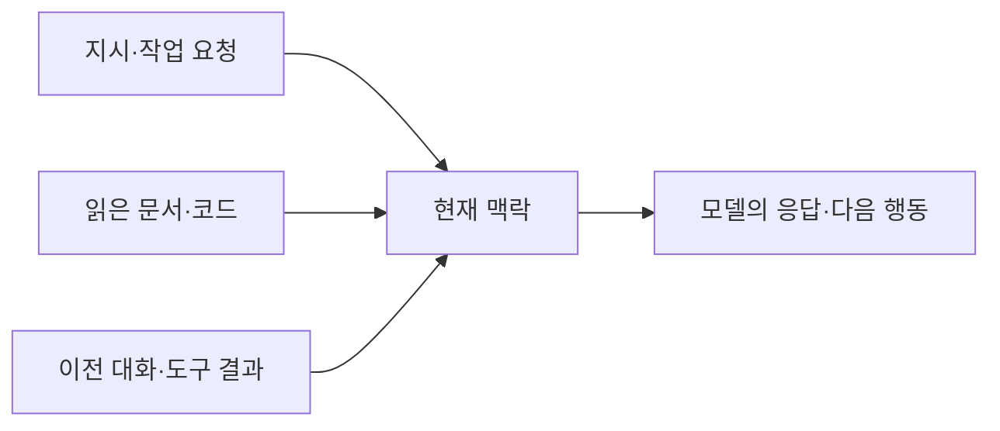

--------------------
Session 명: 06. 아키텍처
--------------------

## 목차

01. 세션 목표
02. 맥락 엔지니어링
03. 맥락의 한계
04. 작업에 필요한 지식
05. 기존 자료 찾아 읽기
06. 근거와 미정
07. 긴 작업의 맥락
08. 잘못된 관행
09. 실습 — 필요한 맥락 선별
10. 요약

---

## 01. 세션 목표

작업의 맥락은 **현재 판단에 필요한 지식을 골라 읽고 사용하는 것**으로 구성한다.

- **맥락 엔지니어링**이 무엇을 선택하고 관리하는 일인지 설명한다.
- 맥락의 **한계**를 알고 필요한 정보와 불필요한 정보를 구분한다.
- 앞서 만든 **요구·모델·아키텍처·수용 예**에서 현재 작업의 근거를 고른다.
- 필요한 자료를 **찾아 읽고**, 없는 결정은 **질문**으로 남긴다.
- 긴 작업에서도 **기존 원천과 현재 진행 상태**를 확인해 이어 간다.

**강사 노트**

- 교재 작성 기준: 2026-10. 기준 원전은 [Anthropic 2025c], 저장소 지식의 접근성에 관한 보완 자료는 [Lopopolo 2026]이다.
- "세션 02. 요구와 사용자 이야기"·"세션 03. 도메인 모델"·"세션 04. 아키텍처"·"세션 05. 작업 명세와 수용 기준"의 기존 산출물을 사용한다.
- 학습 목표는 지식의 선별·접근·사용이다. 특정 파일·폴더·형식을 만드는 것을 세션 목표나 완료 기준으로 두지 않는다.

---

## 02. 맥락 엔지니어링

## 모델이 그 순간 읽는 입력

**맥락**은 모델이 응답을 만들 때 읽는 입력 전체다. 작업 요청뿐 아니라 지시, 읽은 문서·코드, 이전 대화와 도구 결과도 포함한다.

- **요청**에 업무 규칙을 적지 않았어도 모델이 해당 문서를 읽으면 그 규칙이 맥락에 들어온다.
- 자료가 저장소에 **존재하는 것**과 모델이 현재 작업에서 **읽은 것**은 다르다.
- 업무 담당자와 합의한 규칙도 **읽히지 않으면** 생성 결과에 반영되지 않을 수 있다.

**도식 — Mermaid — 맥락의 구성**

**강사 노트**

- 화살표는 입력과 출력의 관계다. 개발 활동의 순서가 아니다.
- 근거: [Anthropic 2025c]의 맥락 정의와 system instructions·tools·external data·message history 설명.
- 모델의 사전학습 지식과 작업별 합의를 구분한다. 모델이 주어진 것 외에는 아무것도 모른다고 설명하지 않는다.

---

## 선택하고 계속 다듬기

**맥락 엔지니어링**은 한정된 맥락 창에 어떤 정보를 넣을지 선택하고, 작업이 진행되며 그 구성을 계속 다듬는 일이다.

- **사람**은 맡길 작업과 지켜야 할 결정을 명확히 한다. **AI**는 관련 자료를 찾아 읽고 부족하거나 충돌하는 것을 질문한다.
- "주문한다"의 가격 변경 시 청구 금액을 확인하려면 **판매가·단가·금액 규칙과 수용 예**가 필요하다.
- 외부 API의 호출 형식만 읽어서는 **주문할 때 정한 금액을 유지한다**는 업무 규칙을 알 수 없다.
- 작업이 바뀌면 **필요한 정보도 다시 고른다**. 앞 작업의 전체 대화를 그대로 이어 붙이는 것으로 대신하지 않는다.

**강사 노트**

- 정의 근거: [Anthropic 2025c]. 원문의 context engineering 정의를 verify-quote.js로 확인했다.
- 새 문서 작성 단계가 아니라 이미 합의한 요구·모델·명세와 현재 코드를 사용하는 활동이다.
- 새로운 파일 형식·역할 분류·필수 항목을 도출하지 않는다. 사람이 무엇을 정하고 AI가 무엇을 읽는지로 설명한다.

---

## 03. 맥락의 한계

**인용문**

맥락은 **한계 효용이 줄어드는 유한한 자원**으로 다뤄야 한다, "Context, therefore, must be treated as a finite resource with diminishing marginal returns.", [Anthropic 2025c]

- **맥락 창**은 한 번에 읽을 수 있는 입력의 한도다. 한도 안에 들어가도 필요한 규칙을 정확히 사용하는지는 따로 확인한다.
- **주의 예산**은 입력을 처리하는 모델의 주의가 한정돼 있다는 설명이다. **맥락 부패**는 맥락이 길어지며 정보를 정확히 찾아 쓰는 능력이 낮아지는 현상이다.
- **중복된 규칙·폐기한 초안·전체 대화**를 모두 넣으면 지금 적용할 내용을 찾기 어려워진다.
- 필요한 규칙은 **빠뜨리지 않고**, 관련 없는 자료는 **필요할 때** 읽는다. 입력을 짧게 만드는 것만으로 충분하지 않다.

**강사 노트**

- 근거: [Anthropic 2025c]의 attention budget·context rot 설명. 모델·과제에 따른 차이를 전제하며 보편적인 성능 하락률로 설명하지 않는다.
- 원전의 개념을 과제에 적용한다. 토큰 수·줄 수·문서 개수의 새 상한을 만들지 않는다.

---

## 04. 작업에 필요한 지식

정보의 필요성은 **현재 작업의 판단과 결과를 바꾸는지**로 확인한다. 필요한 규칙을 빼면 구현자가 그 결정을 추측해야 한다.

**표 — 주문의 판단에 필요한 지식**

| 지금 확인할 것 | 읽을 지식 | 기존 원천 |
|---|---|---|
| **가격 변경 뒤 청구 금액** | 판매가·단가·금액 규칙 | 요구·모델·수용 예 |
| **거절 뒤 다시 결제** | 결제대기와 허용 전이 | 상태 모델·수용 예 |
| **배송 요청 시점** | 승인 후에만 요청 | 업무 규칙·수용 예 |
| **연동 구현의 책임** | 책임·허용 의존 | 아키텍처·현재 코드 |

- 펜 2개의 단가가 **1,000원**으로 정해졌으면 판매가가 1,200원으로 바뀌어도 청구는 **2,000원**이다.
- 이 금액을 판단하는 데 다른 기능의 화면 지침과 전체 회의록까지 필요하지는 않다. **현재 질문에 답하는 부분**을 고른다.

**강사 노트**

- 원천의 역할은 앞 세션에서 배운 것을 사용한다. 표를 새로운 산출물이나 제출 양식으로 만들게 하지 않는다.
- 구체 값은 course-design.md 공통 전제와 같다. 판단별로 다른 사례를 새로 만들지 않는다.
- 필요한 정보가 누락된 상태에서 무조건 짧게 주는 것도 잘못이다. 판단이 달라지는 근거를 보존한다.

---

## 05. 기존 자료 찾아 읽기

## 필요한 지식에 접근하기

**인용문**

Codex에게 **천 쪽짜리 지침서가 아니라 지도**를 주라, "give Codex a map, not a 1,000-page instruction manual.", [Lopopolo 2026]

- **저장소 구조·파일 이름·문서의 참조**는 관련 지식을 찾을 수 있게 한다. 파일이 흩어졌거나 이름이 역할을 설명하지 못하면 탐색이 어려워진다.
- 필요한 자료를 찾을 수 있으면 **기존 원천에서 읽는다**. 같은 지식을 종합 문서로 다시 쓸 필요는 없다.
- **이름·위치·참조가 잘못됐으면** 해당 부분을 고친다. 특정 형식의 새 안내 파일을 만드는 것이 목적은 아니다.
- 원전의 **지도**는 작은 시작점에서 상세 자료를 찾아가는 비유다. 별도로 작성할 문서의 이름이나 표준 양식으로 해석하지 않는다.

**강사 노트**

- 근거: Ryan Lopopolo, Harness engineering: leveraging Codex in an agent-first world(2026). 저장소 지식을 접근할 수 있게 구성한 개발팀의 사용 보고다. 구체 도구·파일 관례를 보편 규칙으로 확대하지 않는다.
- 인용은 references/inputs/lopopolo-2026-harness-engineering.txt에서 확인했다.
- 관통 사례의 기존 요구·모델·아키텍처·코드를 유지한다. 교재 저장소 소개나 특정 안내 파일 작성법을 별도 학습 주제로 추가하지 않는다.

---

## 필요한 때 관련 부분 읽기

**인용문**

에이전트가 탐색하며 **관련 맥락을 점진적으로 발견**하게 한다, "allows agents to incrementally discover relevant context through exploration", [Anthropic 2025c]

- **점진적 공개**는 현재 작업에 필요한 상세를 찾아 읽게 하는 방식이다. 모든 자료를 처음부터 입력할 필요는 없다.
- 금액을 확인할 때 **판매가·단가와 금액 규칙**을 읽고, 해당 규칙의 **수용 예**와 현재 코드를 확인한다.
- 결제 거절을 다루게 되면 **주문 상태와 허용 전이**도 읽는다. 구현한 뒤에 규칙을 찾으면 추측으로 작성한 부분을 다시 고쳐야 한다.
- **관련 부분을 찾았다는 것**과 **그 근거대로 판단했다는 것**을 구분한다. 읽은 규칙이 답과 코드에 반영되는지도 확인한다.

**강사 노트**

- 근거: [Anthropic 2025c]의 Just in time context·progressive disclosure. 확인한 문장 일부를 인용했다.
- 강의 원천은 "세션 03. 도메인 모델"의 「가격을 판매가와 단가로 나누기」·「06. 상태와 전이」, "세션 05. 작업 명세와 수용 기준"의 「03. 수용 기준」이다.
- 검색 시스템이나 새로운 탐색 절차를 구현하는 수업으로 확장하지 않는다.

---

## 06. 근거와 미정

AI가 낸 답은 **읽은 문서의 근거**와 함께 확인한다. 자료에 없는 결정을 그럴듯한 답으로 채우지 않게 한다.

- **금액**: 판매가가 1,200원으로 바뀌어도 청구는 2,000원이다. 주문 시점의 단가와 금액 규칙이 근거다.
- **결제 거절**: 주문은 결제대기에 남고 다시 결제할 수 있다. 상태 모델과 수용 예를 함께 확인한다.
- **승인 뒤 배송 요청 실패**: 처리 정책은 아직 정하지 않았다. 문서가 답하지 못하면 확인할 질문으로 남긴다.
- **외부 규격**: 실제 제공자의 문서가 없으면 URL·인증·응답 코드를 만들어 넣지 않는다.

**강사 노트**

- 기존 합의와 미정의 구분을 확인하는 예다. 한 번의 답으로 모델의 성능이나 맥락 구성의 효과를 입증하지 않는다.
- 정답만 맞는 것으로 끝내지 않고 기존 원천을 실제 읽었는지 확인한다. 별도의 판단표·추적표 제출은 요구하지 않는다.
- 실제 API 정보는 "세션 04. 아키텍처"의 「06. 외부 연동 규격」에서 확인 대상으로 정했다.

---

## 07. 긴 작업의 맥락

긴 작업에서 대화가 줄거나 새로 시작되면 **기존 원천과 현재 진행 상태**를 확인해 이어 간다.

- **압축**은 긴 대화의 핵심을 요약해 새 맥락으로 이어 가는 방식이다. 요약에서 규칙·예외·미정이 빠질 수 있다.
- **요구와 모델**은 기존 원천에서 읽고, **한 일과 남은 일**은 이미 사용하는 작업 목록·커밋·검사 결과에서 확인한다.
- 이전에 통과했다는 요약만으로 **현재 코드의 통과**를 선언하지 않는다. 필요한 검사를 다시 실행한다.
- 이어받을 정보가 부족하면 **기존 기록을 필요한 만큼 보완**한다. 대화 전체나 같은 규칙의 복사본을 늘리지 않는다.

**강사 노트**

- 근거: [Anthropic 2025c]의 Compaction·Structured note-taking. 개념과 외부 기록의 역할만 설명하며 새 기록 양식을 요구하지 않는다.
- 재시도·복구 정책은 "세션 10. 실패와 모델 보완"의 범위다.

---

## 08. 잘못된 관행

맥락을 보완할 때는 **필요한 지식의 누락과 사용의 오류**를 고친다. 문서나 입력량이 늘었다는 사실만으로 개선됐다고 보지 않는다.

**표 — 맥락 구성의 잘못된 관행**

| 관행 | 생기는 문제 | 수정 |
|---|---|---|
| **요청만 주고 규칙 생략** | 모르는 결정을 추측 | 합의한 원천 읽기 |
| **모든 자료를 통째로 입력** | 관련 내용을 놓침 | 필요한 부분 선별 |
| **같은 지식을 다시 문서화** | 원천과 값이 어긋남 | 기존 원천 참조 |
| **AI 요약으로 원천 대체** | 예외·미정 누락 | 원천과 대조 |
| **그럴듯한 답만 확인** | 근거 없는 결과 수용 | 읽은 근거 확인 |

- **자료를 못 찾으면 접근을**, **규칙이 충돌하면 원천을**, **답이 틀리면 사용한 근거를** 확인한다.

**강사 노트**

- KISS·DRY·YAGNI는 guides/sw-engineering-principles.md의 의미로 적용한다.
- 특정 파일 사용이나 새 문서의 생성 자체를 성공·실패 기준으로 삼지 않는다. 실제로 어떤 판단이 가능해졌는지로 평가한다.

---

## 09. 실습 — 필요한 맥락 선별

정기배송의 **동일 신청 반복 전달 응답**을 맡기기 전에, 기존 산출물에서 필요한 근거를 찾아 읽고 판단을 확인한다.

**투입물**
  + 실습 2의 **요구사항 정의서**, 실습 3의 **도메인 모델**, 실습 4의 **아키텍처**, 실습 5의 **작업 명세와 수용 예**.

**프롬프트**
  + ① “실습 5의 **반복 전달 응답 작업 단위**를 구현하려 한다. 첨부한 기존 산출물에서 이 작업에 필요한 규칙·상태·연계 계약·수용 예를 찾아 읽어라. 어떤 부분이 필요한지와 이유를 설명하고, 없는 결정은 질문으로 남겨라. 문서 전체를 요약하거나 새 규칙·구현 코드를 작성하지 마라.”
  + ② “아래 답과 수정 요청을 반영해라. **신청완료인 같은 신청의 확정 요청이 다시 오면** 무엇을 하고 무엇을 하지 않아야 하는지 설명해라. 기존 수용 예의 상태·계약 수·결제 요청 횟수로 확인하고, 읽은 근거를 밝혀라. 부족한 자료만 추가로 읽고 추측으로 빈칸을 채우지 마라.”

**점검 항목**
  1. **선별** — 반복 전달 응답에 필요한 부분을 읽고 관련 없는 운영 자료를 덧붙이지 않았는가?
  2. **일관성** — 상태·연계 계약·수용 예가 같은 결과를 가리키는가?
  3. **근거** — 답의 각 판단이 앞서 합의한 원천에 기반하는가?
  4. **미정** — 실제 결제·저장의 보장 수준을 자료 없이 확정하지 않았는가?

**결과물**
  + **이 작업에 필요한 기존 자료의 범위와 확인한 판단**. 같은 원천을 다음 실습에서도 사용한다. 새 파일 제출은 요구하지 않는다.

**강사 노트**

- 수강생이 작성한 실습 2~5의 최종 MD를 사용한다. 파일을 새 형식으로 옮기거나 합치지 않는다.
- 두 프롬프트는 예이며 실제 응답을 읽고 [앞선 질문에 대한 답]·[추가 질문·수정 요청]을 붙여 필요한 만큼 보완한다.
- 대화 도구에서는 첨부한 파일, 코딩 에이전트에서는 실제 저장소의 자료를 읽게 한다. 무엇을 실제 읽었는지와 답이 그 근거에 맞는지를 평가한다.
- 별첨은 기존 산출물에서 근거를 선별한 저자 작성 예다. 새로운 맥락 문서 양식이나 별도 에이전트 실행 기록이 아니다.
- 앞 산출물에 되돌릴 것: 발견한 오류가 있으면 해당 원천에서 확인한다. 이번 예에서는 새 업무 규칙·상태·계약을 추가하지 않는다.
- 실제 저장의 조건부 전이·원자성은 실습 5에서 미정으로 남겼다. 포트 계약과 대역의 수용 예를 읽었다고 영속 보장을 검증한 것으로 취급하지 않는다.

---

## 10. 요약

### 현재 작업에 필요한 지식을 읽고 사용한다

- **맥락**은 모델이 그 순간 읽는 입력이며 한정된 자원이다.
- **현재 판단에 필요한 정보**를 기존 요구·모델·명세·코드에서 고른다.
- **필요한 때 관련 부분**을 찾아 읽고 답이 그 근거를 따르는지 확인한다.
- **부족한 자료와 미정**은 질문으로 남기고 오류는 해당 원천에서 고친다.

### 다음 세션

- "세션 07. 권한과 가드레일" — 사용할 도구와 권한을 정하고 경계를 실행 전에 강제한다.

**강사 노트**

- 산출물의 개수나 특정 파일의 사용으로 맥락 구성의 품질을 평가하지 않는다.
- 다음 실습도 기존 자료와 이번에 확인한 범위를 이어 사용한다. 새로운 문서 묶음을 만들지 않는다.

---

## 별첨. 실습 답

## 반복 전달 응답에 필요한 근거

신청완료인 같은 신청이 다시 전달되면 **저장된 결과를 안내**한다. 새로운 결제나 계약을 만드는 작업이 아니다.

- **작업 범위**는 작업 명세서의 「단위 4. 반복 전달 응답」이다. 저장된 결과만 안내하고 결제와 금액 산정을 부르지 않는다.
- **업무 규칙**은 도메인 모델의 동일 신청 규칙이다. 반복 전달은 추가 청구·계약·회차나 상태 변화를 일으키지 않는다.
- **연계 계약**은 아키텍처의 「세 연계 계약」이다. 신청 저장에서 조회하고 결제 시작 전이가 거부되면 결제 포트를 부르지 않는다.
- **수용 예**는 작업 명세서의 「예 6. 동일 신청의 반복 전달」이다. 신청완료를 유지하고 계약·결제 요청·금액 산정의 누적은 각각 1이다.
- **남은 미정**은 실제 저장의 조건부 전이·원자적 반영이다. 업무 계약과 대역의 예로 실제 동시성 보장을 입증하지 않는다.

**강사 노트**

- 원천: code/s05/exercise-conversation/input-s03.md의 「1.2 업무 규칙」, input-s04.md의 「4. 세 연계 계약」, 정기배송-최초신청-작업명세.md의 「단위 4. 반복 전달 응답」·「예 6. 동일 신청의 반복 전달」·「7. 남은 미정」.
- 실습 2의 중복 금지 요구는 도메인 모델과 작업 명세에서 상세화돼 있다. 날짜·금액의 산정 전체와 다른 기능의 운영 정책은 이 작업의 판단에 필요하지 않아 읽을 범위를 넓히지 않았다.
- 위 내용은 읽을 원천과 그에 따른 판단을 보이는 설명용 요약이다. 새 문서의 제출 형식으로 지정하지 않는다. 구현하거나 실제 동시 요청으로 검증한 결과로 표시하지 않는다.
