--------------------
Session 명: 07. 워크플로·에이전트와 사람의 개입
--------------------

## 목차

01. 세션 목표
02. 실행 구조
03. 워크플로 패턴
04. 에이전트 루프
05. 단일과 여러 에이전트
06. 사람의 개입
07. 주문한다의 실행 흐름
08. 잘못된 관행
09. 실습 — 실행 흐름
10. 요약

---

## 01. 세션 목표

사람의 개입은 모든 단계가 아니라 **되돌리기 어렵고 판단이 필요한 지점**에 둔다.

- 다섯 **워크플로 패턴**을 구분하고, 네 질문으로 과제에 맞는 패턴을 고른다.
- **에이전트 루프**가 환경이 돌려준 결과로 돈다는 것을 알고, 반복 실행의 조건과 대가를 설명한다.
- 여러 에이전트를 **관리자형·분산형**으로 나누고, 계획자·생성자·평가자의 분리가 무엇을 얻는지 설명한다.
- 여러 에이전트의 비용(**토큰·오류의 누적·조정**)으로 하나로 갈 조건을 판단한다.
- **확인 지점**과 멈출 조건을 구분하고, 사람에게 올리는 계기 3가지를 든다.
- **되돌리기와 판단**의 두 질문으로 사전 승인·사후 리뷰·개입 없음을 가른다.
- "주문한다"의 실행 흐름을 **활동 다이어그램**으로 그리고 확인 지점을 배치한다.

**강사 노트**

- "세션 02. 작업 특성에 따른 AI 활용 방식"에서 작업마다 방식을 골랐고, "세션 06. 작업 위임과 도구·권한·상태의 경계"에서 어디까지 맡길지 정했다. 여기서는 **어떤 흐름으로 실행하고 어디서 사람이 판단하는가**를 정한다.
- 기준 원전은 [Anthropic 2024]이고, 여러 에이전트는 [OpenAI 2025]·[Anthropic 2025a]·[Anthropic 2026b], 사람의 개입은 [Blount 외 2026]·[Lopopolo 2026]으로 받친다.
- 센서의 구성과 사람의 리뷰가 볼 것은 "세션 09. 검증 하네스·결과 점검·피드백", 실행 전에 강제하는 제약은 "세션 08. 실행 제약과 가드레일의 역할", 상한에서 멈춘 뒤의 진단은 "세션 10. 실패 대응·재시도·복구"가 맡는다.

---

## 02. 실행 구조

위임 계약까지 정하면 남는 질문은 **어떤 순서로 실행하고 어디서 사람이 보는가**다.

**도식 — Mermaid — 실행 구조의 자리**

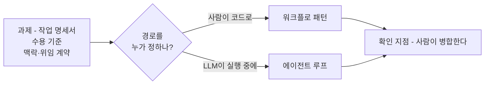

- **정하는 것은 셋** — 단계와 경로, 반복과 끝, 사람이 판단할 자리.
- **경로를 누가 정하나** — 워크플로는 사람이 코드로 적고, 에이전트는 실행 중에 LLM이 정한다.
- **사람의 자리는 끝이 아니다** — 결과를 끝에서 한 번 보는 것과, 흐름 안에 판단할 자리를 두는 것은 다르다.

**강사 노트**

- 입력은 "세션 02. 작업 특성에 따른 AI 활용 방식"의 「05. 주문 기능 개발에서 LLM 활용」에서 고른 방식이다. 방식의 선택을 여기서 다시 하지 않는다.
- 종료 조건과 멈출 조건은 "세션 06. 작업 위임과 도구·권한·상태의 경계"의 「07. 위임 계약」에서 정했다. 이 세션은 그 조건이 흐름의 어디에서 작동하는지 보인다.
- 수강생에게 묻는다 — 첫 시도에서 사람이 판단한 자리는 어디였는가? 끝에서 데모를 본 것 하나뿐이었다.

---

## 03. 워크플로 패턴

## 프롬프트 체이닝

**인용문**

"프롬프트 체이닝은 과제를 **단계의 연속**으로 나누고, 각 LLM 호출이 앞 호출의 출력을 처리한다", "Prompt chaining decomposes a task into a sequence of steps, where each LLM call processes the output of the previous one.", [Anthropic 2024]

**도식 — Mermaid — 프롬프트 체이닝**

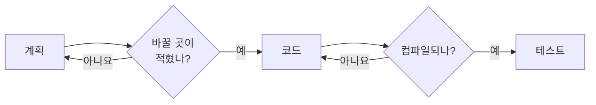

- **게이트** — 단계 사이에서 결과를 검사해, 통과하지 못하면 다음으로 보내지 않는다.
- **이미 해 본 패턴** — "세션 02. 작업 특성에 따른 AI 활용 방식"의 「06. 시연 — 주문 금액 구현을 3가지 방식으로」의 「워크플로」에서 실행한 세 단계(계획 → 코드 → 테스트)가 프롬프트 체이닝이다. 단계마다 도구를 좁혀 둔 것이 게이트 역할을 했다.
- **값과 대가** — 중간 결과를 사람이 볼 수 있다. 대신 단계마다 맥락을 새로 읽어 토큰이 늘어난다.

**강사 노트**

- 인용 근거: Anthropic, "Building effective agents"(2024) 원문 확인. 원문은 게이트를 그림의 "gate"로 표시한다.
- 시연의 토큰 기록(워크플로 402,181 입력 토큰, 에이전트 339,270)이 "단계마다 새로 읽는" 대가의 실측이다.
- 게이트는 프로그램의 검사다. 다음 단계의 LLM에게 "확인해 줘"라고 부탁하는 것은 게이트가 아니다.

---

## 라우팅

**인용문**

"라우팅은 입력을 **분류해** 전문화된 후속 작업으로 보낸다", "Routing classifies an input and directs it to a specialized followup task.", [Anthropic 2024]

**도식 — Mermaid — 라우팅**

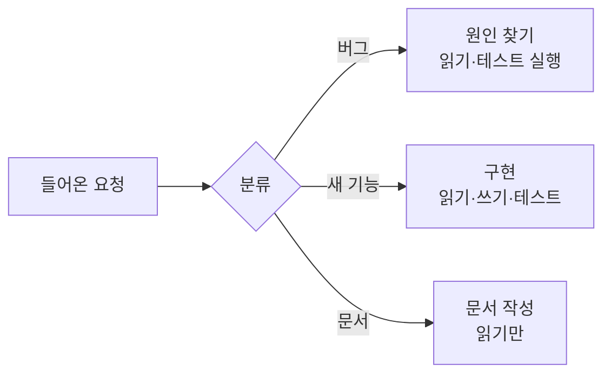

- **얻는 것** — 경로마다 프롬프트와 **도구·권한을 좁힌다**. 한 프롬프트에 모든 경우를 담지 않는다.
- **위험은 분류** — 분류가 틀리면 뒤의 단계는 전부 틀린 경로에서 일한다.
- **분류는 싸게** — 작은 모델이나 규칙으로 분류하고, 애매하면 기본 경로로 보낸다.

**강사 노트**

- 인용 근거: [Anthropic 2024] 원문 확인. 원문은 분류를 LLM이나 전통적인 분류 모델·알고리즘으로 할 수 있다고 적는다.
- 라우팅은 들어오는 요청의 **종류가 여럿**일 때 값을 한다. "주문한다"는 과제가 하나여서 쓰지 않는다(「주문한다의 패턴」).

---

## 병렬화

**인용문**

"LLM이 한 과제를 **동시에** 수행하고 그 출력을 프로그램으로 모을 수 있다", "LLMs can sometimes work simultaneously on a task and have their outputs aggregated programmatically.", [Anthropic 2024]

  - "분할 — 과제를 독립된 하위 과제로 나누어 병렬로 실행한다", "Sectioning: Breaking a task into independent subtasks run in parallel.", [Anthropic 2024]
  - "투표 — 같은 과제를 여러 번 실행해 다양한 출력을 얻는다", "Voting: Running the same task multiple times to get diverse outputs.", [Anthropic 2024]

- **쪼갠 일은 독립이어야 한다** — 같은 파일을 고치는 하위 과제는 병렬이 아니라 **순서**다.
  - 연동 코드와 테스트 대역은 **서로 다른 파일**을 만들어 나눌 수 있지만, 작업 단위 4개는 **같은 클래스**를 고친다.
- **투표는 비결정성을 역으로 쓴다** — 같은 과제를 여러 번 돌려 **결과가 갈리는 지점**이 명세의 빈칸이다.
- **합치는 쪽은 프로그램** — 모으는 규칙(합집합·다수결·하나라도 실패면 실패)을 사람이 코드로 정한다.

**도식 — Mermaid — 분할과 투표**

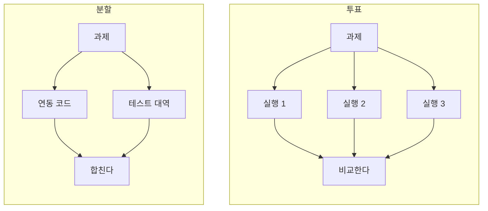

**강사 노트**

- 인용 근거: [Anthropic 2024] 원문 확인. 두 변형의 이름(Sectioning·Voting)과 정의가 원문의 것이다.
- 투표는 비용이 실행 횟수만큼 늘어난다. 결과가 갈릴 때 사람이 보는 것이 목적이면 두세 번으로 충분하다.
- 수강생에게 묻는다 — "주문한다"의 작업 단위 4개를 병렬로 돌리면 무엇이 충돌하는가? 같은 클래스의 같은 메서드다.

---

## 오케스트레이터-워커

**인용문**

"오케스트레이터-워커에서는 중앙의 LLM이 과제를 **동적으로 쪼개** 워커 LLM에 맡기고 결과를 합친다", "In the orchestrator-workers workflow, a central LLM dynamically breaks down tasks, delegates them to worker LLMs, and synthesizes their results.", [Anthropic 2024]

**도식 — Mermaid — 오케스트레이터-워커**

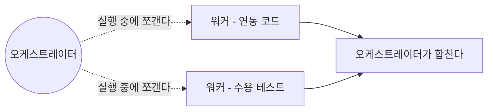

- **병렬화와의 차이** — 쪼개는 쪽이 사람이 아니라 **LLM**이고, 하위 과제의 수와 종류가 실행할 때 정해진다.
- **맞는 일** — 고칠 파일을 미리 알 수 없는 변경처럼, 하위 과제를 예측할 수 없는 과제다.
- **합성이 약한 고리** — 워커가 잘못 가정한 것이 합쳐진 결과에 섞여 들어온다.

**강사 노트**

- 인용 근거: [Anthropic 2024] 원문 확인. 원문은 하위 과제가 미리 정해지지 않는다는 점을 병렬화와의 차이로 든다.
- 워커마다 맥락 창이 따로이므로 토큰이 가장 빨리 늘어나는 구성이다. 비용은 「05. 단일과 여러 에이전트」의 「여러 에이전트의 비용」에서 숫자로 본다.

---

## 평가자-최적화기

**인용문**

"평가자-최적화기에서는 한 LLM 호출이 응답을 만들고 다른 호출이 **평가와 피드백**을 주며 루프를 돈다", "In the evaluator-optimizer workflow, one LLM call generates a response while another provides evaluation and feedback in a loop.", [Anthropic 2024]

**도식 — Mermaid — 평가자-최적화기**

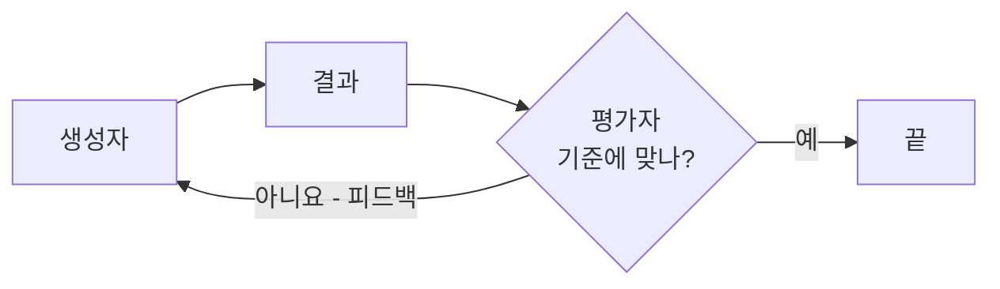

- **도는 조건** — 평가 기준을 **글로 적을 수 있고**, 피드백이 다음 결과를 실제로 낫게 만들 때다.
- **분리의 이유** — 만든 쪽이 스스로 채점하면 "됐다"로 기울기 쉽다.
- **계산으로 판정되면 센서다** — 수용 테스트처럼 기계가 판정할 수 있으면 평가자를 LLM으로 두지 않는다("세션 09. 검증 하네스·결과 점검·피드백").

**강사 노트**

- 인용 근거: [Anthropic 2024] 원문 확인. 원문은 사람이 피드백을 줄 때 결과가 분명히 나아지는 일에 이 패턴이 맞다고 적는다.
- LLM이 판정하는 추론적 센서와 이 패턴은 같은 구조다. 차이는 루프를 누가 돌리는가다 — 이 세션은 흐름의 구성으로, "세션 09. 검증 하네스·결과 점검·피드백"은 증거의 종류로 다룬다.

---

## 패턴을 고르는 기준

패턴은 네 질문으로 고른다. **"아니오"가 나오면 그 패턴은 접는다.**

**표 — 패턴을 고르는 네 질문**

| 질문 | "예"이면 | "아니오"이면 |
|---|---|---|
| **경로를 미리 적을 수 있나?** | 프롬프트 체이닝 | 에이전트 루프 |
| **요청의 종류가 여럿인가?** | 라우팅 | 경로 하나 |
| **쪼갠 일이 서로 독립인가?** | 병렬화 | 순서대로 한다 |
| **평가 기준을 글로 적을 수 있나?** | 평가자-최적화기 | 계산적 센서나 사람의 리뷰 |

- **가장 단순한 것부터** — 호출 한 번으로 되는 일에는 패턴을 쓰지 않는다. 구조는 필요할 때만 더한다.
- **겹쳐 쓸 수 있다** — 체이닝의 한 단계 안이 에이전트 루프일 수 있다. 패턴은 배타적인 분류가 아니다.
- **쪼갤 방법을 실행 중에만 아는 경우** — 그때가 오케스트레이터-워커의 자리다.

**강사 노트**

- 네 질문은 원전의 분류가 아니라 과정의 정리다. 질문의 근거는 각 패턴의 정의 인용에 있다.
- "세션 02. 작업 특성에 따른 AI 활용 방식"의 「04. 작업 특성에 따른 선택」의 「선택의 순서」와 순서가 같다 — 단순한 쪽에서 시작해 필요할 때만 올린다.

---

## 주문한다의 패턴

"주문한다"는 **두 패턴**만 쓴다. 나머지를 버린 이유가 패턴 선택의 설명이다.

**표 — "주문한다"의 패턴 선택**

| 패턴 | 쓰는가? | 이유 |
|---|---|---|
| **프롬프트 체이닝** | 예 — 결제·배송 연동 코드 | 연동 규격이 정확해 세 단계를 적을 수 있다 |
| **에이전트 루프** | 예 — 작업 단위 4개의 구현 | 고칠 곳을 미리 적을 수 없다 |
| **라우팅** | 아니요 | 과제의 종류가 하나다 |
| **병렬화** | 아니요 | 작업 단위가 같은 클래스를 순서대로 고친다 |
| **오케스트레이터-워커** | 아니요 | 과제가 작고 맥락이 하나다 |
| **평가자-최적화기** | 아니요 | 수용 테스트가 계산으로 판정한다 |

- **연동 코드의 세 단계** — 규격을 읽고 호출 목록을 적는다 → 테스트 대역을 만든다 → 연동 구현을 만든다. 게이트는 컴파일과 대역 테스트다.
- **구현은 루프로** — 작업 단위 4개(금액 확정·승인·거절·재결제)는 수용 테스트가 끝을 판정하므로 루프를 맡길 수 있다.

**강사 노트**

- 작업 단위 4개는 "세션 04. 수용 기준과 검증 가능한 작업 단위"의 「05. 작업 단위」의 「주문한다의 작업 단위」에서 정한 것이다.
- 연동 코드를 워크플로로 고른 판단은 "세션 02. 작업 특성에 따른 AI 활용 방식"의 「05. 주문 기능 개발에서 LLM 활용」에 있다. 여기서는 그 방식을 패턴 이름과 단계로 구체화했다.
- 연동 규격이 부실하면 판단이 달라진다 — 비정형 문서를 읽는 일은 에이전트가 낫고, 그때는 사람의 리뷰를 더한다.

---

## 04. 에이전트 루프

## 루프의 구조

에이전트는 다음 수를 추측이 아니라 **환경이 돌려준 결과**로 정한다.

**인용문**

실행 중에는 에이전트가 단계마다 환경에서 **ground truth를 얻는 것이 결정적이다**, "crucial for the agents to gain \"ground truth\" from the environment at each step", [Anthropic 2024]

**도식 — Mermaid — 에이전트 루프**

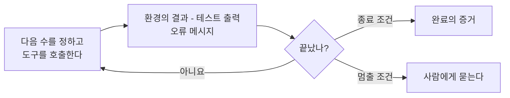

- **루프를 돌리는 힘** — 과제로 시작한 루프에서 실패한 테스트의 메시지가 다음 수정의 입력이다. 센서가 없으면 자기 짐작으로 돈다.
- **두 가지 끝** — 종료 조건은 완료의 정의이고, 멈출 조건은 사람이 정할 결정이다.
- **루프 안에는 사람이 없다** — 판단할 자리를 흐름에 미리 두어야 한다(「06. 사람의 개입」).

**강사 노트**

- 인용 근거: [Anthropic 2024] 원문 확인. 원문은 도구 호출 결과나 코드 실행을 ground truth의 예로 든다.
- 종료 조건과 멈출 조건은 "세션 06. 작업 위임과 도구·권한·상태의 경계"의 「07. 위임 계약」에서 정한 것이다. 본문은 그 둘이 루프의 어디에서 끝을 내는지만 말한다.
- ground truth는 "환경이 알려 주는 사실"이다. 억지로 번역하지 않고 음차로 쓰며, 뜻은 본문이 밝힌다.
- "주문한다"의 루프에서 환경의 결과는 수용 테스트 4개의 출력과 의존 규칙 검사다. 센서의 구성은 "세션 09. 검증 하네스·결과 점검·피드백"이 맡는다.

---

## 반복 실행

같은 프롬프트를 **새 맥락으로 되풀이해** 명세에 수렴시키는 방식도 있다.

**인용문**

"고정된 프롬프트를 **무한 루프**로 에이전트에 먹인다", "a fixed prompt is fed to an agent in an infinite loop", [Thoughtworks 2026]

  - 매 반복 **새 맥락 창**을 쓰면 쌓인 맥락이 만드는 품질 저하를 피하지만 **토큰 비용이 크다**, "Using a fresh context window on each iteration avoids the quality degradation that comes from accumulated context, though at significant token cost.", [Thoughtworks 2026]

**표 — 반복 실행의 조건과 대가**

| 되는 조건 | 치르는 대가 |
|---|---|
| **명세와 수용 기준**이 글로 있다 | 매 반복 맥락을 새로 읽는 토큰 |
| **남은 일**이 저장소에 기록된다 | 엉뚱한 변경도 함께 되풀이된다 |
| **센서**가 완료를 판정한다 | 수렴했는지는 사람이 본다 |

- **아직 시험 단계** — Technology Radar는 Ralph loop를 **Assess**에 두었다. 격리된 환경에서 비용을 보며 시험할 단계다.
- **"주문한다"에는 쓰지 않는다** — 작업 단위 4개가 짧고 센서가 바로 판정하므로, 대가를 치를 이유가 없다.

**강사 노트**

- 인용 근거: Thoughtworks Technology Radar Vol. 34(2026-04)의 Ralph loop 항목 원문 확인. Wiggum loop라는 이름도 같은 항목에 있다.
- 맥락 부패는 "세션 05. 도메인·설계 지식과 맥락 구성"의 「03. 주의 예산과 맥락 부패」의 「맥락 부패」에서 다뤘다. 반복 실행은 그 문제를 맥락을 버리는 쪽으로 푼다.
- 저장소에 남는 기록(기능 목록·진행)이 전제다. 기록이 없으면 매 반복이 처음부터 시작한다.

---

## 05. 단일과 여러 에이전트

## 관리자형과 분산형

여러 에이전트를 잇는 방법은 둘이다 — 관리자가 **도구로 부르는가**, 동료에게 **실행을 넘기는가**. 그래프로 보면 에이전트가 노드이고, 둘을 잇는 선(간선, edge)이 그 관계다.

**인용문**

여러 에이전트는 그래프로 볼 수 있고, 관리자형의 간선은 **도구 호출**, 분산형의 간선은 **핸드오프**다, "Multi-agent systems can be modeled as graphs, with agents represented as nodes. In the manager pattern, edges represent tool calls whereas in the decentralized pattern, edges represent handoffs that transfer execution between agents.", [OpenAI 2025]

**도식 — Mermaid — 관리자형과 분산형**

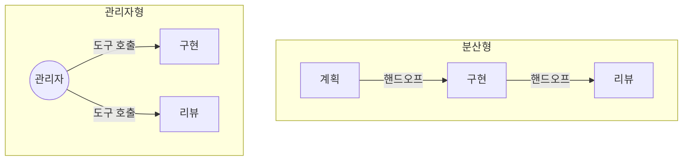

- **관리자형** — 통제와 맥락이 한 곳이다. 사람이 볼 자리도 관리자 하나다.
- **분산형** — 넘긴 뒤에는 돌아오지 않는다. 넘길 때 무엇을 함께 주는지가 품질을 정한다.

**강사 노트**

- 인용 근거: OpenAI, "A practical guide to building agents"(2025) 원문 확인(받은 PDF). 그래프·간선의 비유와 두 패턴의 이름이 원문의 것이다. 같은 글은 관리자형을 "중앙의 관리자 에이전트가 도구 호출로 여러 전문 에이전트를 조율한다"로 적는다.
- 어느 쪽이든 에이전트마다 맥락 창이 따로이고 사람이 볼 증거도 여러 곳에서 나온다. 그 대가는 「여러 에이전트의 비용」에서 숫자로 본다.
- 원문은 하나의 에이전트로 시작해 필요할 때 쪼개기를 권한다. 과정의 판단도 같다 — 단일이 기본이다.
- 코딩 도구의 하위 에이전트(subagent)는 관리자형에 해당한다. 맥락을 나누는 수단으로서는 "세션 05. 도메인·설계 지식과 맥락 구성"의 「10. 긴 작업의 맥락」에서 다뤘다.

---

## 계획자·생성자·평가자

역할을 나눌 때 가장 센 레버는 **일하는 쪽과 판단하는 쪽의 분리**다.

**인용문**

일하는 에이전트와 **판단하는 에이전트를 나누는 것**이 강한 레버다, "Separating the agent doing the work from the agent judging it proves to be a strong lever to address this issue.", [Anthropic 2026b]

  - "계획자가 없으면 생성자는 **범위를 작게 잡았다** — 요청만 받고 자기 일을 명세하지 않은 채 만들기 시작한다", "Without the planner, the generator under-scoped: given the raw prompt, it would start building without first speccing its work", [Anthropic 2026b]

**도식 — Mermaid — 세 역할과 넘기는 산출물**

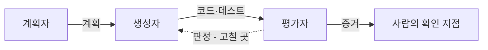

- **평가자를 떼는 이유** — 자기 일을 자기가 채점하면 **완료로 기울기 쉽다**. "완료"는 주장이다.
- **계획자를 떼는 이유** — 명세 없이 바로 만들면 범위가 작아진다. 계획이 범위를 지킨다.
- **사람에게 남는 것** — 계획과 판정이 글로 남으므로, 사람은 그 두 장을 보고 판단한다.

**강사 노트**

- 인용 근거: Anthropic, "Harness design for long-running application development"(2026) 원문 확인. 세 역할의 이름(Planner·Generator·Evaluator)이 원문의 것이다.
- "완료는 주장이다"는 "세션 04. 수용 기준과 검증 가능한 작업 단위"의 「06. 완료의 정의와 증거」의 「완료는 주장이다」에서 세운 판단이다.
- 역할을 나누는 것과 에이전트를 여러 개 띄우는 것은 다르다. 한 에이전트가 단계마다 역할을 바꿔도 분리의 효과는 얻는다.

---

## 여러 에이전트의 비용

여러 에이전트는 비싸다. 비용은 **토큰·오류의 누적·조정** 셋이다.

**인용문**

에이전트는 대화의 약 **4배**, 여러 에이전트는 대화의 약 **15배**의 토큰을 쓴다, "agents typically use about 4× more tokens than chat interactions, and multi-agent systems use about 15× more tokens than chats.", [Anthropic 2025a]

  - 모든 에이전트가 **같은 맥락을 공유**해야 하거나 의존이 많은 영역은 아직 맞지 않으며, **코딩 과제는 진짜로 병렬화되는 일이 적다**, "most coding tasks involve fewer truly parallelizable tasks than research", [Anthropic 2025a]

**표 — 세 가지 비용과 "주문한다"의 판단**

| 비용 | 무엇이 커지나 | "주문한다"에서 |
|---|---|---|
| **토큰** | 에이전트마다 맥락을 따로 읽는다 | 과제 하나의 맥락이 하나다 |
| **오류의 누적** | 워커의 잘못된 가정이 합성에 섞인다 | 금액 규칙은 한 곳에서 정한다 |
| **조정** | 같은 파일을 고치면 합쳐야 한다 | 작업 단위가 `order` 한 패키지를 고친다 |

- **관측값의 범위** — 15배는 Anthropic이 **자사 리서치 에이전트**에서 관측한 값이다. 비교 기준은 사람이 한 번 대화하는 경우이며, 일반 법칙이 아니다.

**강사 노트**

- 인용 근거: Anthropic, "How we built our multi-agent research system"(2025) 원문 확인. 원문은 경제성을 위해 과제의 가치가 충분히 커야 한다고 적는다.
- 수치를 그대로 외우게 하지 않는다. 짚을 것은 "에이전트를 늘리면 토큰이 선형보다 빠르게 는다"는 방향이다.
- 여러 에이전트가 값을 하는 코딩 과제의 예 — 서로 다른 저장소나 독립된 모듈을 동시에 고치는 일이다. "주문한다"는 그 조건이 아니다.

---

## 06. 사람의 개입

## 확인 지점

확인 지점은 **흐름 안에 미리 둔 사람의 판단 자리**다.

**주석**

HITL — Human-in-the-Loop

**인용문**

"위험이 큰 과제에서는 **사람의 개입**(HITL)이 결정적이다 — 에이전트가 중요한 행동을 하기 전에 **흐름 안에 의도된 멈춤**을 두어 사람의 승인을 받는다", "For high-stakes tasks, the Human-in-the-Loop (HITL) pattern is critical, creating a deliberate pause in the workflow to get approval from a person before an agent takes a significant action.", [Blount 외 2026]

  - "에이전트는 **확인 지점에서**, 또는 막혔을 때 사람의 피드백을 위해 멈출 수 있다", "Agents can then pause for human feedback at checkpoints or when encountering blockers.", [Anthropic 2024]

**표 — 확인 지점과 멈출 조건**

| 구분 | 확인 지점 | 멈출 조건 |
|---|---|---|
| **누가 두나** | 흐름을 설계할 때 사람이 | 위임 계약을 쓸 때 사람이 |
| **언제 작동하나** | 그 단계에 닿으면 늘 | 경계에 닿았을 때만 |
| **무엇을 보나** | 그 단계의 증거 | 멈춘 이유와 미정 질문 |
| **어디에 적나** | 실행 흐름 | 위임 계약 |

- **증거 없는 승인은 확인이 아니다** — 확인 지점마다 사람이 **무엇을 보고 판단하는지**를 함께 정한다.

**강사 노트**

- 인용 근거: Blount 외, "Introduction to Agents"(Google, 2026) 원문 확인(받은 PDF). HITL의 정의와 "흐름 안의 의도된 멈춤"이 원문의 표현이다. [Anthropic 2024]의 확인 지점 문장도 원문 확인.
- 멈출 조건은 "세션 06. 작업 위임과 도구·권한·상태의 경계"의 「07. 위임 계약」의 항목이다. 여기서 다시 정하지 않고 구분만 분명히 한다.
- 확인 지점에서 사람이 보는 증거는 "세션 09. 검증 하네스·결과 점검·피드백"의 센서가 낸다. 사람의 리뷰가 볼 것은 그 세션이 다룬다.

---

## 개입의 계기

**인용문**

"**판단이 필요할 때만** 사람에게 올린다", "Escalate to a human only when judgment is required", [Lopopolo 2026]

  - "실패 한도 초과 — 에이전트의 재시도나 행동에 **상한을 둔다**", "Exceeding failure thresholds: Set limits on agent retries or actions.", [OpenAI 2025]
  - "민감하거나 **되돌릴 수 없거나** 위험이 큰 행동은 사람의 감독을 거치게 한다", "High-risk actions: Actions that are sensitive, irreversible, or have high stakes should trigger human oversight", [OpenAI 2025]

**표 — 사람에게 올리는 계기 3가지**

| 계기 | 올리는 것 | 사람이 볼 증거 |
|---|---|---|
| **실패 한도 초과** | 멈춘 작업 단위 | 마지막 실패의 테스트 출력과 고친 내역 |
| **되돌릴 수 없는 행동** | 행동 전의 요청 | 무엇이 바뀌는지와 되돌릴 수단 |
| **사람이 정할 결정** | 미정 질문 | 명세의 빈칸과 관련된 업무 규칙 |

- **세 계기 밖은 에이전트가 끝낸다** — 계기를 적을 수 없는 자리는 확인 지점이 아니라 **습관적인 승인**이다.
- **올릴 때 함께 올리는 것** — 질문만 올리면 사람이 다시 조사한다. 증거를 함께 올려야 판단이 짧아진다.

**강사 노트**

- 인용 근거: [Lopopolo 2026] 영문 원문 확인 — 에이전트가 끝까지 할 수 있는 일의 목록 끝에 이 문장이 있다. 두 계기는 [OpenAI 2025]의 human intervention 항목(받은 PDF)이다.
- 같은 글의 팀은 사람의 PR 리뷰를 필수로 두지 않는다. 그 전제는 센서와 리뷰 에이전트가 촘촘하다는 것이다 — 증거 없이 개입을 줄이는 것과 다르다.
- "주문한다"의 세 계기 — 같은 테스트 3회 연속 실패, 원격 저장소 반영, 명세에 없는 업무 규칙이다.

---

## 위험에 따른 배치

어디에 둘지는 **두 질문**으로 가른다 — 되돌리기 어려운가, 사람이 정할 판단인가.

**표 — "주문한다"의 단계별 개입**

| 단계 | 되돌리기 | 판단 | 개입 |
|---|---|---|---|
| **계획** | 쉽다 — 글이다 | 필요 — 명세의 해석 | 사전 확인 |
| **작업 단위 구현** | 쉽다 — 작업 브랜치 | 없음 — 센서가 판정 | 없음 |
| **센서 실패 수정** | 쉽다 — 커밋 되돌림 | 없음 — 상한 안에서 | 없음 |
| **결제 관련 변경** | 쉽다 — 코드 | 필요 — 외부 시스템 계약 | 사후 리뷰 |
| **병합과 원격 반영** | 어렵다 — 남이 받는다 | 필요 — 책임 | 사람이 실행 |

**인용문**

에이전트의 산출이 사람의 주의를 크게 넘는 시스템에서는 **고치는 것이 싸고 기다리는 것이 비싸다**, "In a system where agent throughput far exceeds human attention, corrections are cheap, and waiting is expensive.", [Lopopolo 2026]

- **사전 승인은 되돌릴 수 없는 일에만** — 그 밖에는 일을 멈춰 세우는 값이 얻는 것보다 크다.
- **기다림도 비용이다** — 사람의 확인을 기다리는 동안 에이전트는 멈춰 있다. 되돌릴 수 있는 일은 사후에 본다.

**강사 노트**

- 인용 근거: [Lopopolo 2026] 영문 원문 확인. 같은 문장 뒤에 신뢰가 낮은 환경에서는 무책임한 선택이라는 단서가 붙는다 — 센서가 촘촘할 때의 판단임을 짚는다.
- 표의 다섯 단계는 「07. 주문한다의 실행 흐름」의 활동 다이어그램과 같은 순서다.
- 위험을 식별하는 어휘와 실행 전에 막는 수단은 "세션 08. 실행 제약과 가드레일의 역할"이 맡는다. 여기서는 사람의 자리만 정한다.

---

## 07. 주문한다의 실행 흐름

## 활동 다이어그램

"주문한다"의 흐름에는 사람의 자리가 **셋**이다 — 계획, 결제 관련 변경, 병합.

- **계획을 먼저 본다** — 작업 단위의 순서와 범위가 명세와 맞는지 확인한다. 글이라서 고치는 값이 가장 싸다.
- **루프는 센서가 돌린다** — 센서는 컴파일·수용 테스트 4개·의존 규칙이고, 실패 메시지가 다음 수정의 입력이다. 같은 실패 3회에서 멈추고 사람에게 묻는다.
- **결제 관련 변경만 따로 본다** — 승인 요청 금액과 배송 요청 시점은 외부 시스템과의 계약이라서 사후 리뷰를 둔다.

**페이지 분할**

**도식 — PlantUML — 활동 다이어그램**

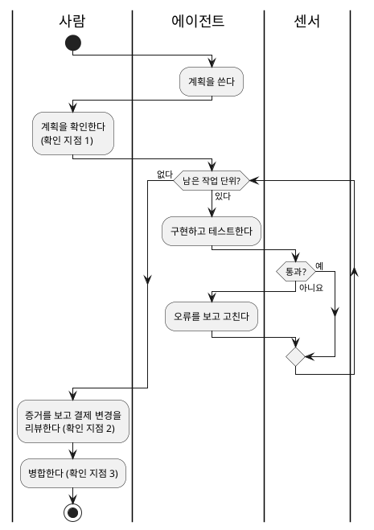

**강사 노트**

- 레인은 사람·에이전트·센서다. 센서를 레인으로 따로 둔 것은 판정의 주체가 사람이 아님을 보이려는 것이다.
- 상한 3회는 교육용 가정이며 "세션 06. 작업 위임과 도구·권한·상태의 경계"의 「07. 위임 계약」의 값과 같다. 멈춘 뒤의 진단은 "세션 10. 실패 대응·재시도·복구"가 맡는다.
- 흐름은 저장소에 글로 둔다. 사람과 에이전트가 같은 흐름을 보지 않으면 확인 지점이 지켜지지 않는다.

---

## 확인 지점을 두지 않은 곳

**센서가 판정하는 것에는 승인을 더하지 않는다.** 두지 않은 자리에도 근거가 있다.

**표 — 둔 곳과 두지 않은 곳**

| 자리 | 개입 | 근거 |
|---|---|---|
| **계획** | 사전 확인 | 명세의 해석은 사람의 판단이다 |
| **결제 관련 변경** | 사후 리뷰 | 외부 계약이라 테스트가 다 덮지 못한다 |
| **병합과 원격 반영** | 사람이 실행 | 되돌리기 어렵고 책임이 사람에게 있다 |
| **작업 단위마다** | 두지 않음 | 수용 테스트가 끝을 판정한다 |
| **센서 실패의 수정** | 두지 않음 | 상한 안의 수정은 루프의 일이다 |
| **커밋마다** | 두지 않음 | 작업 브랜치라서 되돌리기 쉽다 |

- **줄인 승인의 자리** — 셋을 뺀 덕분에 남은 세 자리를 사람이 **증거를 읽고** 판단한다.
- **두지 않은 자리의 조건** — 센서가 있고, 되돌릴 수 있고, 사람이 정할 결정이 아니라는 셋이 모두 맞을 때다.

**강사 노트**

- 두지 않은 자리에 문제가 생기면 승인을 더하는 대신 센서를 더한다. 그 판단은 "세션 09. 검증 하네스·결과 점검·피드백"에서 다룬다.
- 수강생에게 묻는다 — 작업 단위마다 승인을 두면 무엇이 좋아지는가? 얻는 것은 느낌이고, 치르는 것은 네 번의 기다림이다.

---

## 08. 잘못된 관행

## 모든 단계의 형식적 승인

승인이 많아지면 사람은 **읽지 않고 누른다**. 승인의 수와 감독의 질은 반대로 간다.

**인용문**

"사용자는 권한 요청의 **약 93%를 승인했다**", "Our telemetry showed users approved roughly 93% of permission prompts.", [Anthropic 2026c]

  - "승인을 많이 볼수록 **하나하나에 주의를 덜 쓰고**, 시간이 지나면 감독이 훨씬 느슨해진다", "The more approvals a user sees, the less attention they pay to each, becoming over time much less diligent in their supervision.", [Anthropic 2026c]

**표 — 형식적 승인의 모습과 처방**

| 모습 | 왜 생기나 | 처방 |
|---|---|---|
| **단계마다 승인 창** | 통제하고 있다는 느낌 | 되돌릴 수 없는 일만 남긴다 |
| **읽지 않고 누른다** | 승인이 너무 많다 | 수를 줄여 하나를 제대로 읽는다 |
| **증거 없이 승인한다** | 볼 것이 정해지지 않았다 | 확인 지점마다 볼 증거를 정한다 |
| **리뷰가 쌓여 멈춘다** | 사람이 병목이다 | 판정은 센서로 옮긴다 |

**인용문**

"코드 산출량이 늘자 병목은 **사람의 QA 능력**이 되었다", "As code throughput increased, our bottleneck became human QA capacity.", [Lopopolo 2026]

**강사 노트**

- 인용 근거: Anthropic, "How we contain Claude across products"(2026) 원문 확인. 같은 글은 이 문제를 승인 피로(approval fatigue)로 부르고, 환경 수준의 제약으로 승인 수를 줄였다고 적는다. [Lopopolo 2026]의 병목 문장도 원문 확인.
- 93%는 코딩 도구의 권한 요청에서 관측한 값이다. 수치보다 방향이 중요하다 — 승인을 늘리면 감독이 아니라 서명이 된다.
- 승인을 줄이고 환경으로 막는 방법은 "세션 08. 실행 제약과 가드레일의 역할"의 샌드박스에서 다룬다.

---

## 코딩 에이전트 떼

에이전트를 **많이 띄우는 것**은 흐름을 설계한 것이 아니다.

**인용문**

"코딩 에이전트 **팀**이 작고 의도적으로 고른 집단이라면, **떼**는 수십에서 수백의 에이전트를 한 문제에 투입하고 구성과 규모를 AI가 정한다", "Where a team of coding agents is a small, deliberate group, a coding agent swarm applies dozens to hundreds of agents to a problem, with AI determining composition and size dynamically.", [Thoughtworks 2026]

  - 코딩 에이전트 떼는 **여전히 비싸고 성숙과는 멀어** 도입에 주의를 권한다, "They remain costly and are still far from mature, which is why we advise caution when adopting this technique.", [Thoughtworks 2026]

**표 — 팀과 떼**

| 구분 | 코딩 에이전트 팀 | 코딩 에이전트 떼 |
|---|---|---|
| **규모** | 역할이 다른 몇 개 | 수십에서 수백 |
| **구성** | 사람이 정한다 | AI가 실행 중에 정한다 |
| **전제** | 역할마다 다른 맥락과 도구 | 상세한 명세와 포괄적인 테스트 |
| **치르는 것** | 토큰과 조정 | 비용, 병렬 작업의 충돌 합치기 |
| **Radar의 링** | Assess | Caution |

- **먼저 물을 것** — 에이전트를 늘리기 전에 **명세와 센서가 그만큼 촘촘한가**를 본다. 아니면 늘린 수만큼 고칠 일이 늘어난다.

**강사 노트**

- 인용 근거: Thoughtworks Technology Radar Vol. 34(2026-04)의 coding agent swarms 항목 원문 확인. team of coding agents(Assess)는 별도 항목이다.
- 원문이 든 실험은 C 컴파일러 생성과 일주일 동안의 브라우저 제작이다. 두 과제 모두 상세 명세와 측정 가능한 테스트가 있었다.
- 떼와 팀의 구분은 "세션 02. 작업 특성에 따른 AI 활용 방식"의 「09. 자율성을 높이는 조건」과 같은 논리다 — 증거가 있을 때만 올린다.

---

## 09. 실습 — 실행 흐름

실습 6의 위임 계약과 실습 4의 작업 단위·수용 기준을 LLM에 제공하여 **"신청한다"의 실행 흐름**을 활동 다이어그램으로 만들고, 점검 항목으로 피드백하여 완성하십시오.

- **투입물**
  + 실습 4의 **작업 단위 4개와 수용 기준 5개**, 실습 6의 **위임 계약**
- **프롬프트**
  + ① "신청한다 과제의 **실행 흐름**을 활동 다이어그램(PlantUML)으로 그려줘. 레인은 **사람·에이전트·센서**로 나눠줘."
  + ② "확인 지점마다 **왜 거기인지**를 되돌리기 쉬움과 판단의 필요로 적어줘."
- **점검 항목**
  1. **패턴** — 결제 연동처럼 순서를 적을 수 있는 일까지 에이전트 루프에 넣지 않았는가?
  2. **루프의 끝** — 수용 테스트 5개 통과를 끝으로 두고, 실패 상한을 적었는가?
  3. **확인 지점의 위치** — 되돌릴 수 없는 일과 사람이 판단할 일(회차 7개와 만료일)에 두었는가?
  4. **형식적 승인** — 센서가 판정하는 단계에 사람의 승인을 덧붙이지 않았는가?
  5. **센서 실패의 경로** — 사람에게 올리기 전에 에이전트가 스스로 고치는 경로와 상한이 있는가?
  6. **멈출 조건과의 구분** — 공휴일처럼 사람이 정할 결정을 확인 지점이 아니라 멈출 조건에 두었는가?
- **결과물** — "신청한다"의 실행 흐름과 확인 지점. 실습 8의 입력이 됩니다.

**강사 노트**

- 정기배송의 작업 단위와 수용 기준은 `code/s01/subscription/docs/`의 모델 패키지와 실습 4의 답을 이어 쓴다.
- LLM은 단계마다 "사람 승인"을 넣고, 센서 레인을 빼고 사람이 테스트를 확인하게 그린다. 점검 4·5로 되돌린다.
- 평가는 그림의 모양보다 **확인 지점의 근거**를 본다. 다른 자리에 두어도 되돌리기와 판단으로 설명되면 맞는 답이다.

---

## 10. 요약

사람의 개입은 모든 단계가 아니라 **되돌리기 어렵고 판단이 필요한 지점**에 둔다.

### 실행 구조와 개입의 핵심

- **실행 구조** — 단계와 경로, 반복과 끝, 사람이 판단할 자리를 정한다
- **워크플로 패턴** — 다섯을 네 질문으로 고르고 단순한 것부터 쓴다
- **에이전트 루프** — 환경이 돌려준 결과로 다음 수를 정한다. 센서가 없으면 짐작으로 돈다
- **여러 에이전트** — 토큰·오류의 누적·조정을 치른다. 일하는 쪽과 판단하는 쪽만 나눈다
- **확인 지점** — 흐름 안의 판단 자리다. "주문한다"는 계획·결제 관련 변경·병합 셋이다
- **형식적 승인** — 많으면 읽지 않고 누른다. 판정은 센서가 한다

### 다음 세션

- "**08. 실행 제약과 가드레일의 역할**" — 사람의 자리를 정한 흐름에서도 어긋나는 실행을, 실행 전에 강제되는 제약으로 막는다.

**강사 노트**

- 실습 7의 실행 흐름이 실습 8의 가드레일 배치의 입력이 된다.
- 이 세션까지가 "위임의 실행"이다. 다음 두 세션은 예방(가드레일)과 탐지(센서)로 나뉜다.

---

## 별첨. 실습 답

---

## 실행 흐름 (안)

"신청한다"의 흐름은 **확인 지점 셋**(계획, 회차 계산 결과, 병합)을 가지며, 공휴일 규칙은 확인 지점이 아니라 멈출 조건으로 사람에게 올라간다.

**도식 — PlantUML — 활동 다이어그램**

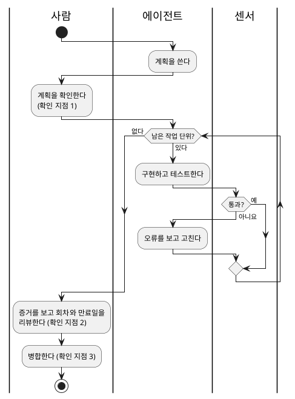

- **확인 지점 1 — 계획** — 작업 단위의 순서(회차 금액을 먼저)와 범위가 수용 기준 5개와 맞는지 본다.
- **확인 지점 2 — 회차 계산** — 예정 회차 7개와 만료일 2월 2일은 업무 규칙의 경계라서, 테스트 통과와 함께 값을 눈으로 본다.
- **확인 지점 3 — 병합** — 원격 반영은 되돌리기 어렵고 책임이 사람에게 있다.
- **두지 않은 자리** — 작업 단위마다의 승인, 센서 실패의 수정, 커밋마다의 확인. 센서가 판정하고 되돌릴 수 있다.

**강사 노트**

- 패턴은 강의 사례와 같다 — 결제 연동은 프롬프트 체이닝, 작업 단위 4개의 구현은 에이전트 루프다.
- 멈춤의 계기를 공휴일로 둔 것이 강의 사례와 다른 점이다. 실습 4에서 미정으로 남긴 질문이 여기서 흐름의 분기가 된다.
- 회차 계산을 사후 리뷰로 둔 이유를 묻는다 — 테스트가 값을 덮지만, 날짜 규칙은 업무 담당자만 최종 확인할 수 있다.

---

## 보완 (안)

새로 발견한 것은 **후속 작업에 영향을 미치는 경우에만** 이전 산출물에 반영한다.

- **위임 계약**(실습 6)
  - **역할을 나눈다** — 확인 지점은 실행 흐름이 갖고, 계약에는 멈출 조건만 남긴다. 같은 규칙을 두 곳에 적지 않는다.
  - **상한을 맞춘다** — 계약의 "같은 테스트 3회 연속 실패"가 흐름의 센서 루프 상한과 같은 값이어야 한다.
- **맥락 패키지**(실습 5)
  - **계획을 저장소에 남긴다** — 계획 파일의 자리를 맥락 파일에 한 줄로 적는다. 확인 지점 1의 증거가 된다.
- **수용 기준**(실습 4)
  - **바꾸지 않는다** — 수용 기준 5(만료일)가 확인 지점 2에서 사람이 볼 증거다.
- **※ 현행화 기준**
  - **반영** — 계약의 역할 정리와 계획 파일의 자리. 실습 8의 입력이 된다.
  - **기록만** — 수용 기준 5가 확인 지점의 증거라는 용도.

**강사 노트**

- 흐름과 계약을 나누는 것이 이 보완의 핵심이다. 흐름은 "언제 보는가", 계약은 "어디까지 맡기는가"를 적는다.
- 계획 파일을 맥락에 넣는 것은 "세션 06. 작업 위임과 도구·권한·상태의 경계"의 「06. 상태와 되돌림」의 「진행 기록과 되돌림」에서 이미 정한 방향이다.
