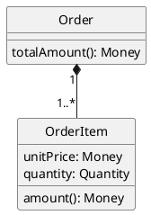
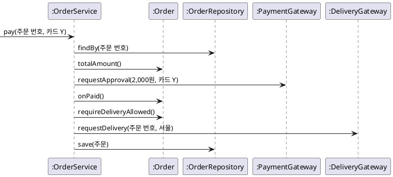
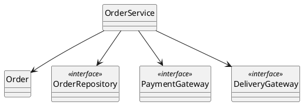
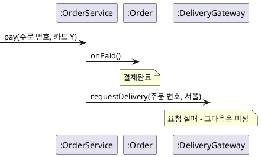
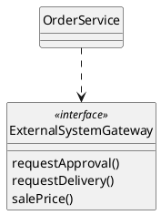
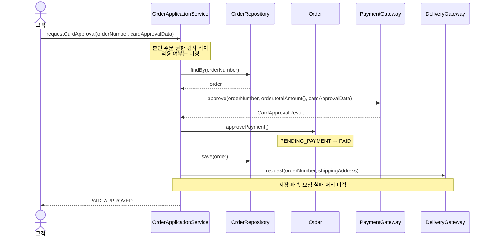

--------------------
Session 명: 07. 설계 — 책임과 협력
--------------------

## 목차

01. 세션 목표
02. 분석과 설계의 거리
03. 책임 주도 설계
04. 협력과 인터페이스
05. 계약에 의한 설계
06. 상태 변경과 실패 처리의 자리
07. SOLID로 판단하기
08. AI가 낸 설계 대안 검토
09. 계약이 검사가 된다
10. 작업 단위
11. 잘못된 관행
12. 실습 — 설계와 작업 단위
13. 요약

---

## 01. 세션 목표

분석 모델을 그대로 옮기는 것은 설계가 아니다. **책임과 협력은 사람이 정하고** AI가 대안을 낸다.

- 객체의 **책임·역할·협력·계약**으로 설계할 것을 정한다.
- **정보 전문가**와 **컨트롤러**로 업무 규칙을 지킬 자리와 사건을 받는 자리를 고른다.
- 협력의 조건을 **사전조건과 사후조건**으로 적는다.
- **SOLID 다섯 원칙**으로 AI가 낸 두 대안을 가른다.
- 계약을 **단위 테스트**로 옮기고, 계약을 어긴 대역이 만드는 **거짓 녹색**을 가려낸다.
- 과제를 **한 번에 검증할 작업 단위 넷**으로 나누고 단위마다 완료의 정의를 둔다.

**강사 노트**

- 입력은 "세션 03. 요구와 수용 기준"의 수용 기준, "세션 04. 정적 모델"의 개념·불변 조건, "세션 05. 동적 모델"의 상태·전이, "세션 06. 아키텍처"의 의존 규칙과 외부 연동 규격이다.
- 출력은 "세션 08. 위임"의 위임 단위가 된다. 작업 단위 넷의 이름은 과정 공통 전제와 같다.
- 책임 주도 설계·GRASP·계약에 의한 설계·SOLID는 **판단의 근거로만** 쓴다. CRC 카드, GRASP 아홉 패턴 전체, 변이 국소화 패턴은 "객체지향 분석과 설계 실무"의 몫이다.

---

## 02. 분석과 설계의 거리

**인용문**

설계는 요구사항을 충족하는 **개념적 해결책**을 강조하며, 그 **구현**을 강조하지 않는다, "Design emphasizes a conceptual solution (in software and hardware) that fulfills the requirements, rather than its implementation.", [Larman 2004]

  - 명세는 소프트웨어의 기능을 자연어로 표현해 AI 코딩 에이전트에게 안내가 되는 **행위 중심**의 구조화된 산출물이다, "A spec is a structured, behavior-oriented artifact - or a set of related artifacts - written in natural language that expresses software functionality and serves as guidance to AI coding agents", [Böckeler 2025]

**표 — 분석과 설계가 각각 정하는 것**

| 분석이 정한 것 | 설계가 더 정하는 것 | 주문한다에서 |
|---|---|---|
| **개념과 속성** | 그 값을 아는 객체와 계산할 책임 | 주문 금액을 `Order`가 계산한다 |
| **상태와 전이** | 상태를 바꾸는 메서드와 그 전의 검사 | `onPaid()`가 결제대기를 확인하고 바꾼다 |
| **사건과 순서** | 사건을 처음 받는 객체와 호출 순서 | `OrderService`가 결제한다를 받아 조정한다 |
| **미정으로 남긴 정책** | 그 정책이 들어갈 자리 | 확정 불가 뒤의 처리는 자리만 남긴다 |

- 분석 모델에 **없던 것이 설계에서 생긴다** — 사건을 받는 객체, 주문을 찾아오는 자리, 외부를 부르는 순서.
- 설계는 **새 업무 규칙을 만들지 않는다.** 명세가 행위를 적고, 설계는 그 행위를 지킬 **구조**를 정한다.

**강사 노트**

- 인용 근거: Craig Larman, *Applying UML and Patterns*, 3rd ed.(2004)의 설계 정의 원문 확인. "세션 04. 정적 모델"의 「03. 분석·설계·구현」이 같은 곳의 분석 정의를 인용한다.
- 인용 근거: Birgitta Böckeler, [Understanding Spec-Driven-Development](https://martinfowler.com/articles/exploring-gen-ai/sdd-3-tools.html), martinfowler.com, 2025의 명세 정의 원문 확인. 저자가 세 도구를 비교하며 내린 정의다.
- 미정을 자리로만 남기는 것은 「06. 상태 변경과 실패 처리의 자리」에서 코드로 보인다.
- AI에게 주는 명세가 설계를 대신하지 않는다는 점을 짚는다. 행위를 적은 문서로는 누가 그 행위를 맡는지 정해지지 않는다.

---

## 03. 책임 주도 설계

**인용문**

책임은 작업을 **수행하거나** 정보를 **알 의무**다, "a responsibility = an obligation to perform a task or know information", [Wirfs-Brock 2006]

  - 책임 주도 설계에서는 소프트웨어 객체가 **책임을 가진 것**으로 보며, 책임은 그 객체가 **하는 일의 추상**이다, "In RDD, we think of software objects as having responsibilities … an abstraction of what they do.", [Larman 2004]

- **역할** — 관련된 책임의 묶음이다. 주문은 금액과 상태를 지키는 역할, 주문 서비스는 사건을 받아 조정하는 역할을 맡는다.
- **협력** — 객체들이 그 의무를 이행하며 주고받는 상호작용이다(「04. 협력과 인터페이스」).
- **계약** — 그 협력이 성립할 조건이다. 부르는 쪽이 맞출 것과 받는 쪽이 보장할 것을 적는다(「05. 계약에 의한 설계」).
- 책임을 먼저 정하면 **클래스가 뒤따라 나온다.** 클래스를 먼저 그리고 할 일을 채우면 값만 든 클래스와 모든 일을 하는 클래스가 남는다.

**주석**

RDD — Responsibility-Driven Design

**강사 노트**

- 인용 근거: Rebecca Wirfs-Brock, [A Brief Tour of Responsibility-Driven Design](https://www.wirfs-brock.com/PDFs/A_Brief-Tour-of-RDD.pdf)(2006)의 "Responsibility-Driven Design Constructs" 쪽 원문 확인. 같은 쪽이 역할·협력·계약도 정의한다. 책 *Object Design*(Wirfs-Brock·McKean, 2003)의 본문은 확인하지 못해 강연 자료를 출처로 쓴다.
- 인용 근거: Larman 2004의 책임 주도 설계 설명 원문 확인. 같은 곳은 UML의 책임 정의를 함께 인용한다.
- 네 구성의 이름만 쓴다. 카드로 책임을 뽑아 옮겨 보는 절차는 "객체지향 분석과 설계 실무"가 다룬다.

---

## GRASP — 책임 할당의 판단

**인용문**

GRASP는 **일반적인 책임 할당** 소프트웨어 패턴을 뜻한다, "GRASP stands for General Responsibility Assignment Software Patterns.", [Larman 2004]

**표 — 이 세션이 쓰는 네 판단**

| 판단 | 묻는 것 | 주문한다의 답 |
|---|---|---|
| **정보 전문가** | 그 일에 필요한 정보를 누가 가졌는가? | 항목과 확정 단가를 아는 `Order`가 계산한다 |
| **컨트롤러** | 사건을 처음 받아 조정할 객체는 무엇인가? | 결제한다를 `OrderService`가 받는다 |
| **높은 응집도** | 한 객체의 책임이 한 가지 일을 향하는가? | `Order`는 자기 금액과 상태만 지킨다 |
| **낮은 결합도** | 그 책임을 맡으면 무엇을 알아야 하는가? | `Order`는 결제·배송 포트를 모른다 |

- 뒤의 둘은 "세션 06. 아키텍처"의 「03. 설계 원칙」에서 **패키지 경계**의 근거였다. 같은 척도를 **객체의 책임**에 쓴다.
- 패턴은 답을 주지 않고 **물을 것을 준다.** 네 질문에 서로 다른 답이 나오는 자리가 설계의 결정이다.

**주석**

GRASP — General Responsibility Assignment Software Patterns

**강사 노트**

- 인용 근거: Larman 2004의 GRASP 이름 설명 원문 확인. 같은 곳은 이 이름이 책임 할당의 기본 원리를 붙잡는다는 뜻으로 골랐다고 밝힌다.
- 원전의 패턴은 아홉 가지다. 이 사례의 판단에 쓰는 넷만 보이며 나머지는 "객체지향 분석과 설계 실무"의 몫이다.
- 네 질문의 답이 갈리는 예를 던진다 — 금액을 아는 곳과 저장을 아는 곳이 다르면 어느 쪽이 계산하는가?

---

## 정보 전문가

**인용문**

그 책임을 이행하는 데 **필요한 정보를 가진** 클래스에 책임을 할당한다, "Assign a responsibility to the class that has the information needed to fulfill it.", [Larman 2004]

**도식 — PlantUML — 금액을 아는 객체**



```java
    // 사후조건: 단가는 확정한 그 시점의 판매가이며 이후 판매가 변경에 따라 바뀌지 않는다.
    public static OrderItem confirm(ProductNumber productNumber, long salePrice, Quantity quantity) {
        return new OrderItem(productNumber, new Money(salePrice), quantity);
    }
// ... 주문이 항목의 금액을 합하는 부분 생략
    // 사후조건: 확정 단가 × 수량의 합이며, 현재 판매가를 다시 조회하지 않는다.
    public Money totalAmount() {
        Money total = Money.ZERO;
        for (OrderItem item : items) {
            total = total.plus(item.amount());
        }
        return total;
    }
```

- 주문 금액은 **항목의 확정 단가와 수량**에서 나온다. 그것을 아는 곳이 주문이므로 계산도 주문의 책임이다.
- 아는 곳 밖에서 계산하면 **값을 넘겨 주는 코드**가 생긴다. 항목을 꺼내 서비스가 더하면 주문은 자기 금액을 모르는 객체가 된다.
- 주문을 **찾아 저장하는 일**은 주문이 아는 것으로 할 수 없다. 그 정보를 가진 저장소의 책임이다.

**강사 노트**

- 인용 근거: Larman 2004의 정보 전문가 패턴 해결책 원문 확인. 같은 곳은 이 판단이 객체에 책임을 주는 가장 기본적인 물음이라고 설명한다.
- 코드 원본은 `code/s07/design/src/order/OrderItem.java`와 `src/order/Order.java`다. 실행: `node courses/ai-native/sessions/code/s07/design/run.mjs`.
- 확정 단가는 "세션 04. 정적 모델"에서 정한 불변 조건을 코드로 옮긴 것이다. 판매가를 다시 조회하지 않는다는 점을 짚는다.
- 이 코드가 **보장하지 않는 것** — 동일 상품 항목의 병합, 수량 상한, 금액의 통화. 공통 전제가 정하지 않았다.

---

## 컨트롤러

**인용문**

UI 계층 너머의 **어느 객체가** 시스템 오퍼레이션을 처음 받아 **조정하는가**?, "What first object beyond the UI layer receives and coordinates (\"controls\") a system operation?", [Larman 2004]

**표 — 사건을 받는 객체의 두 선택**

| 선택 | 무엇을 대표하는가? | 주문한다에서 |
|---|---|---|
| **전체 시스템을 대표하는 객체** | 시스템 하나에 창구 하나 | 주문·배송·통지의 사건이 한 객체로 몰린다 |
| **유스케이스를 대표하는 객체** | 사건이 속한 흐름 하나 | 주문한다의 사건을 `OrderService`가 받는다 |

- 고른 것은 **흐름 하나를 맡는 객체**다. 그 흐름의 순서만 그 객체 안에 모이므로, 다른 기능이 늘어도 이 객체는 커지지 않는다.
- 컨트롤러는 **일을 하지 않고 맡긴다.** 금액과 상태는 주문에 맡기고 외부 요청은 포트에 맡긴다.
- 맡기지 않고 직접 하면 그 객체가 **업무 규칙의 창고**가 된다(「11. 잘못된 관행」의 「데이터만 든 모델」).

**강사 노트**

- 인용 근거: Larman 2004의 컨트롤러 패턴 문제 정의 원문 확인. 원전의 선택은 넷(전체 시스템, 장치, 하위 시스템, 유스케이스·세션 컨트롤러)이며 이 사례에 해당하는 둘만 보인다.
- `OrderService`는 "세션 06. 아키텍처"에서 `order` 패키지의 클래스로 이미 나왔다. 그 책임의 근거를 여기서 댄다.
- UI 계층은 이 과정의 범위 밖이다. 사건이 어디서 들어오든 **그 사건을 받는 객체를 정한다**는 판단만 쓴다.

---

## 주문한다의 책임 배치

업무 규칙 셋은 **주문이 지키고**, 주문을 찾아 맡기고 저장하는 일은 **주문 서비스가** 한다.

**표 — 책임과 그 자리의 근거**

| 책임 | 두는 곳 | 근거가 된 판단 |
|---|---|---|
| **주문 금액 계산** | `Order` | 정보 전문가 — 항목과 확정 단가를 안다 |
| **단가 확정** | `OrderItem` | 정보 전문가 — 자기 단가와 수량을 안다 |
| **상태 전이와 금지** | `Order` | 높은 응집도 — 금액과 상태를 한 곳에서 지킨다 |
| **결제한다를 받아 순서 조정** | `OrderService` | 컨트롤러 — 사건이 속한 흐름 하나를 맡는다 |
| **주문 조회·저장** | `OrderRepository`의 구현 | 정보 전문가 — 주문이 어디 있는지는 저장소가 안다 |
| **승인·배송 요청** | `PaymentGateway`·`DeliveryGateway`의 구현 | 낮은 결합도 — 업무는 포트의 이름만 안다 |

- 같은 사건에서 **바뀌는 것과 보내는 것이 갈린다.** 주문이 상태를 바꾸고 포트가 밖으로 보낸다.
- 업무 규칙 셋(주문 금액·배송 요청·결제 거절)은 **모두 주문 안에서** 지켜진다. 규칙을 고칠 때 열리는 파일이 하나다.

**강사 노트**

- 업무 규칙 셋은 과정 공통 전제가 정한 것이다. 설계가 규칙을 더하거나 고치지 않는다.
- 배송 요청은 주문의 책임이 아니다. 주문은 **요청해도 되는 상태인지**만 보장하고, 보내는 일은 포트가 한다.
- 이 배치가 유일한 정답이 아니다. 「07. SOLID로 판단하기」의 「두 대안 가르기」에서 다른 안과 견준다.

---

## 04. 협력과 인터페이스

**인용문**

책임은 혼자 수행하거나 다른 메서드·객체와 **협력하는 메서드**로 구현된다, "Responsibilities are implemented by means of methods that either act alone or collaborate with other methods and objects.", [Larman 2004]

- **협력**은 한 책임을 이행하려고 객체들이 주고받는 호출이다. 혼자 끝나는 책임에는 협력이 없다.
- 협력을 적으면 **인터페이스가 정해진다.** 오가는 호출이 그 객체가 제공할 오퍼레이션이다.
- 상대는 **포트의 이름**으로 적는다. 그 구현이 연동인지 대역인지는 협력의 내용이 아니다.

**강사 노트**

- 인용 근거: Larman 2004의 협력 설명 원문 확인. 같은 곳은 하나의 책임이 여러 메서드로 나뉠 수 있다고 덧붙인다.
- 협력을 먼저 적고 인터페이스를 뒤에 정하는 순서를 짚는다. 인터페이스를 먼저 정하면 쓰지 않는 오퍼레이션이 생긴다.
- 분석의 상호작용과 설계의 협력이 어떻게 다른지는 「분석 시퀀스와 무엇이 다른가?」가 답한다.

---

## 설계 시퀀스

설계 시퀀스에는 분석 시퀀스가 감춘 **주문 서비스·주문·저장소·포트**가 참여자로 보인다.

**도식 — PlantUML — 결제한다 설계 시퀀스**



- 주문 서비스는 **순서만 쥔다.** 금액을 묻고, 승인을 요청하고, 결과를 주문에 알리고, 배송을 요청하고, 바뀐 주문을 저장소에 넘긴다.
- 승인 결과를 받은 뒤 **주문이 상태를 바꾸고** 그다음에 배송을 요청한다. 이 순서가 업무 규칙 「배송 요청」이다.
- `requireDeliveryAllowed()`는 **보내기 직전에 다시 묻는** 호출이어서, 두 코드가 떨어져 있어도 순서가 지켜진다.

**강사 노트**

- 생명선은 설계 객체이며 용어집의 영문명을 쓴다. 분석 시퀀스의 관행대로 응답 화살표를 그리지 않았으며, 반환값이 없다는 뜻은 아니다.
- 원본은 `code/s07/design/src/order/OrderService.java`다. 이 한 가지 순서를 보편 설계로 확정하지 않는다.

---

## 분석 시퀀스와 무엇이 다른가?

같은 장면인데 **참여자가 다르다.** 분석은 시스템 경계를 오가는 사건을 보이고, 설계는 경계 안의 호출을 보인다.

**표 — 두 시퀀스가 보이는 것**

| 구분 | 참여자 | 보이는 것 | 숨는 것 |
|---|---|---|---|
| **분석 시퀀스** | 고객, 주문 시스템, 결제·배송 시스템 | 시스템 사이의 업무 사건 | 시스템 안의 객체와 호출 순서 |
| **설계 시퀀스** | `OrderService`, `Order`, 포트의 구현 | 객체 사이의 호출과 그 순서 | 제공자의 전문과 통신 방식 |

- "세션 05. 동적 모델"의 「06. 업무 상호작용」의 「시퀀스 다이어그램」은 **주문 시스템 안을 감췄다.** 그 감춘 안을 정하는 것이 설계다.
- 둘은 **같은 네 사건**을 설명한다. 설계가 사건을 늘렸다면 분석으로 되돌려 확인한다.
- 참여자의 이름도 바뀐다 — 분석은 한글 업무 이름, 설계는 **용어집의 영문명**이다.

**강사 노트**

- 두 도식을 나란히 띄워 참여자만 비교하게 한다. 사건의 수가 같은지 세어 보는 것이 되돌림 확인이다.
- 설계 시퀀스에 저장소 호출이 새로 보인다. 저장은 분석이 다루지 않은 기술 책임이며 업무 사건이 아니다.
- 표기법의 상세(프레임, 생성, 비동기 화살촉)는 "객체지향 분석과 설계 실무"가 가르친다.

---

## 인터페이스와 설계 클래스

포트의 반환은 **업무가 받는 결과**를 담아야 한다. 승인·거절·확정 불가 셋을 참·거짓 하나로 담을 수 없다.

**도식 — PlantUML — 주문 서비스의 협력 상대**



```java
public interface PaymentGateway {
    // 사전조건: amount는 그 주문의 확정 총액이다.
    // 사후조건: 승인·거절·확정 불가 중 하나를 돌려주며 주문 상태를 바꾸지 않는다.
    PaymentDecision requestApproval(Money amount, PaymentMethod method);
}
// ... 결제 결과 값 선언 생략
public enum PaymentDecision { APPROVED, REJECTED, UNCONFIRMED }
// ... 주문 저장소 선언 생략
public interface OrderRepository {
    Order findBy(OrderNumber number);
    void save(Order order);
}
```

- 포트는 **쓰는 쪽의 말**로 적는다. 금액·결제 수단·결제 결과는 업무의 값이고, 제공자의 필드 이름은 연동 안에 머문다.
- 저장소의 `save`가 **주문 번호를 다시 받지 않는 것**도 정보 전문가의 결과다. 주문이 자기 번호를 안다.

**강사 노트**

- 코드 원본은 `code/s07/design/src/payment/`와 `src/order/OrderRepository.java`다.
- "세션 06. 아키텍처"의 예제는 저장소를 `findBy(주문 번호)`·`save(주문 번호, 주문)`로 선언했다. 정보 전문가를 근거로 매개변수를 줄인 것이 이 세션의 **진화**다.
- 확정 불가는 **주문 상태가 아니다.** 결제 응답을 확정할 수 없다는 업무 결과이며 상태를 늘리지 않는다. 반환을 셋으로 둔 근거는 "세션 06. 아키텍처"의 「04. 업무 패키지와 외부 시스템」의 「외부 연동 규격」이다.

---

## 05. 계약에 의한 설계

**인용문**

각 당사자는 계약에서 **이익**을 기대하고 그것을 얻기 위해 **의무**를 질 준비가 되어 있다, "Each party expects some benefits from the contract and is prepared to incur some obligations to obtain them.", [Meyer 1992]

- 협력은 부탁이 아니다. 부르는 쪽이 **조건을 맞추고** 받는 쪽이 **결과를 보장한다.**
- **부르는 쪽의 이익**은 받는 쪽의 보장이다. 주문 서비스는 `onPaid()`를 부르며 상태가 결제완료가 된다는 것을 믿는다.
- **받는 쪽의 이익**은 부르는 쪽의 의무다. 주문은 결제대기일 때만 불린다고 믿으므로 그 밖의 경우를 다루지 않는다.
- 검사는 **한 곳**에만 둔다. 양쪽이 같은 조건을 다 검사하면 규칙이 두 곳에 생기고, 고칠 때 한 곳만 바뀐다.

**주석**

DBC — Design by Contract

**강사 노트**

- 인용 근거: Bertrand Meyer, ["Applying Design by Contract"](https://se.inf.ethz.ch/~meyer/publications/computer/contract.pdf), *IEEE Computer* 25(10), 1992의 계약 개념 설명 원문 확인. 3단 스캔본이라 지면을 직접 읽어 문장을 확인했다.
- 계약은 **문서가 아니라 판단**이다. 어긴 호출이 누구의 잘못인지 정해지면 고칠 자리도 정해진다.
- 계약을 코드에 적는 수단(단정문, 주석, 검사 메서드)은 언어와 도구가 정한다. 이 세션은 검사 메서드와 테스트로 보인다.

---

## 사전조건·사후조건·불변 조건

**인용문**

**사전조건과 사후조건**은 개별 루틴에 적용되고 **클래스 불변 조건**은 그 클래스의 모든 루틴을 제약한다, "Some assertions, called preconditions and postconditions, apply to individual routines. Others, the class invariants, constrain all the routines of a given class", [Meyer 1992]

  - 사후조건은 도메인 모델에 있는 객체들의 **상태 변화**를 적는다, "The postconditions describe changes in the state of objects in the domain model.", [Larman 2004]

- **사전조건**은 호출이 올바르려면 만족해야 할 조건이고, **사후조건**은 호출이 끝난 뒤 참이 될 것이다.
- **불변 조건은 이미 있다.** "세션 04. 정적 모델"의 「07. 속성과 불변 조건」이 정한 조건 — 항목 1개 이상, 총액은 확정 단가 × 수량의 합 — 이 그 객체의 모든 호출을 제약한다.
- 주문의 현재 상태는 **주문만 확실히 안다.** 그래서 상태 전이의 사전조건은 주문이 검사한다.
- 사전조건은 **거절 테스트**가 되고 사후조건은 **기대값**이 된다(「09. 계약이 검사가 된다」).

**강사 노트**

- 인용 근거: Meyer 1992의 단정문 설명 원문 확인. 같은 쪽은 사전조건을 모든 호출이 올바르려면 만족해야 할 요구, 사후조건을 호출이 그 대가로 보장하는 성질로 설명한다.
- 인용 근거: Larman 2004의 사후조건 정의 원문 확인. 원전은 시스템 오퍼레이션의 계약을 설명하는 범위에서 이 문장을 쓴다.
- 불변 조건을 세 번째 칸으로 더하는 것이 이 자리의 요점이다. 새 조건을 만들지 않고 정적 모델이 정한 것을 가리킨다.

---

## 주문한다의 오퍼레이션 계약

계약을 적어 보면 **미정이 어디에 있는지** 드러난다.

**표 — 오퍼레이션 계약**

| 오퍼레이션 | 사전조건 | 사후조건 |
|---|---|---|
| `OrderService.pay` | 그 번호의 주문이 있고 결제대기다 | 승인이면 결제완료와 배송 요청 1회 |
| | | 거절이면 결제대기 유지와 배송 요청 0회 |
| `Order.totalAmount` | 없음 | 확정 단가 × 수량의 합이다 |
| `Order.onPaid` | 결제대기다 | 결제완료가 된다 |
| `Order.onPaymentRejected` | 결제대기다 | 결제대기를 유지하고 확정 값을 바꾸지 않는다 |
| `PaymentGateway.requestApproval` | 금액이 그 주문의 확정 총액이다 | 승인·거절·확정 불가 하나를 돌려준다 |
| `DeliveryGateway.requestDelivery` | 그 주문이 결제완료다 | 배송을 요청했다 |

- `pay`의 사후조건에 **확정 불가가 없다.** 그 뒤의 처리가 미정이므로 보장할 것이 없고, 계약은 자리만 비워 둔다.
- 사후조건은 **보장할 수 있는 만큼만** 적는다. 배송을 요청했다는 것은 배송이 시작됐다는 뜻이 아니다 — 시작은 통보로 따로 온다.

**강사 노트**

- 계약은 코드 주석과 테스트 양쪽에 있다. 원본은 `code/s07/design/src/`의 각 선언과 `src/test/ContractTest.java`다.
- 수용 기준과 계약은 **범위가 다르다.** 수용 기준은 고객이 받아들일 결과이고, 계약은 객체 사이의 약속이다.
- 사전조건이 "없음"인 오퍼레이션도 적는다. 비어 있다는 것이 아무 상태에서나 불러도 된다는 결정이다.

---

## 06. 상태 변경과 실패 처리의 자리

상태는 **주문이 바꾸고** 저장은 **주문 서비스가** 하며, 정하지 않은 실패는 설계가 **자리만 남긴다.**

**도식 — PlantUML — 승인 뒤 배송 요청이 실패한 흐름**



```java
// ... 승인이면 결제완료와 배송 요청, 거절이면 결제대기 유지 — 생략
        } else {
            throw new IllegalStateException("확정 불가 뒤의 처리는 미정이다: " + number.value());
        }
```

- **상태를 바꾸는 코드는 주문 안에만** 있다. 서비스는 `onPaid()`를 부를 뿐 상태 값을 대입하지 않는다.
- **미정은 추측으로 채우지 않는다.** 멈춘 자리가 사람에게 물을 자리다.

**강사 노트**

- 원본은 `code/s07/design/src/order/OrderService.java`다. 재시도·보상·트랜잭션은 구현하지 않았다.
- 승인 뒤 배송 요청이 실패하면 주문은 이미 결제완료다. 설계는 그 틈이 있다는 것까지 밝히고 정책은 업무 담당자에게 남긴다.
- 멈추는 것과 삼키는 것의 차이를 짚는다. 예외를 던지면 호출한 사람이 알고, `catch`로 삼키면 아무도 모른다.
- 이 자리는 "세션 08. 위임"에서 에이전트가 **미정에 닿으면 멈춰 묻는** 종료 조건과 같다. 정책은 "세션 11. 종합 실행"에서 실제로 드러나 거두어진다.

---

## 07. SOLID로 판단하기

책임을 어디에 둘지는 GRASP가 묻고, 그 배치가 **바뀜에 견디는지는 SOLID가** 묻는다.

**인용문**

모듈은 **확장에는 열려** 있고 **변경에는 닫혀** 있어야 한다, "A module should be open for extension but closed for modification.", [Martin 2000]

**표 — 다섯 원칙이 묻는 것**

| 원칙 | 묻는 것 | 주문한다에서 쓰는 자리 |
|---|---|---|
| **단일 책임** | 바뀌는 이유가 하나인가? | 업무 규칙과 호출 순서를 주문·주문 서비스로 가른다 |
| **개방 폐쇄** | 더할 때 고치지 않아도 되는가? | 결제 수단이 늘어도 주문과 주문 서비스는 그대로다 |
| **리스코프 치환** | 바꿔 끼운 것이 계약을 지키는가? | 테스트 대역이 포트의 사전·사후조건을 지킨다 |
| **인터페이스 분리** | 쓰는 쪽이 필요 없는 것을 아는가? | 결제·배송·상품을 포트 셋으로 가른다 |
| **의존성 역전** | 업무가 추상에 의존하는가? | 포트를 업무 패키지가 소유한다 |

- 원칙을 **많이 적용한 설계가 좋은 설계가 아니다.** 지금 바뀌는 이유가 보이는 곳에만 쓴다.
- 다섯 중 셋은 **인터페이스에 관한 물음**이다. 그래서 포트를 어떻게 가르고 무엇으로 대체하는지가 설계의 중심이 된다.

**주석**

SOLID — Single Responsibility · Open-Closed · Liskov Substitution · Interface Segregation · Dependency Inversion

**강사 노트**

- 인용 근거: Robert C. Martin, [Design Principles and Design Patterns](https://staff.cs.utu.fi/~jounsmed/doos_06/material/DesignPrinciplesAndPatterns.pdf), 2000의 개방 폐쇄 원칙 원문 확인. 같은 절은 추상이 그 열쇠라고 밝힌다.
- SOLID라는 약어는 원전에 없다. 다섯 원칙을 묶어 부르는 **통용 약어**여서 이름만 쓰고 출처를 달지 않는다.
- 단일 책임의 인용은 [Martin 2014], 의존성 역전의 인용은 [Martin 2000]으로 "세션 06. 아키텍처"의 「03. 설계 원칙」에 있다. 같은 문장을 두 번 두지 않는다.

---

## 인터페이스를 가르기

**인용문**

클라이언트마다의 **인터페이스 여럿**이 **범용 인터페이스 하나**보다 낫다, "Many client specific interfaces are better than one general purpose interface", [Martin 2000]

**도식 — PlantUML — 묶은 인터페이스 하나**



```java
// 쓰지 않기로 한 안 — 외부 연동 셋을 인터페이스 하나로 묶었다.
public interface ExternalSystemGateway {
    PaymentDecision requestApproval(Money amount, PaymentMethod method);
    void requestDelivery(String orderNumber, Address shippingAddress);
    long salePrice(ProductNumber number);
}
```

- 주문 서비스가 **결제만 쓰는 자리에서도 배송과 상품을 안다.** 배송 요청의 매개변수가 바뀌면 결제만 쓰는 코드까지 다시 컴파일된다.
- 가르는 기준은 **쓰는 쪽**이다. 셋으로 가르면 각 포트를 그 업무 패키지가 소유해 의존 규칙과도 맞는다.

**강사 노트**

- 인용 근거: Martin 2000의 인터페이스 분리 원칙 원문 확인. 같은 절은 쓰는 쪽이 갈리면 인터페이스도 갈린다고 설명한다.
- 코드 원본은 `code/s07/design/src/alternative/ExternalSystemGateway.java`다. **쓰지 않기로 한 안**이며 컴파일만 확인했다.
- 고른 포트 셋의 선언은 「04. 협력과 인터페이스」의 「인터페이스와 설계 클래스」에 있다. 같은 세 기능이 어떻게 갈리는지 비교하게 한다.
- 테스트도 함께 커진다는 점을 덧붙인다. 승인만 확인하려는 대역이 쓰지 않는 메서드 둘을 구현해야 한다.

---

## 대체 가능성과 계약

**인용문**

하위 클래스는 상위 클래스를 **대체할 수 있어야** 한다, "Subclasses should be substitutable for their base classes.", [Martin 2000]

- 실제로 **대체가 일어나는 자리**는 상속이 아니라 포트의 구현을 바꿔 끼우는 곳이다. 검사에서는 연동 대신 **테스트 대역**이 들어간다.
- 대역이 **사전조건을 느슨하게** 보면 잘못된 구현이 통과한다. 요청 금액을 확인하지 않는 대역은 2,400원짜리 요청도 승인한다.
- 대역이 **사후조건을 덜 보장하면** 반대로 멀쩡한 구현이 실패한다. 둘 다 대역이 계약을 어긴 것이다.
- 에이전트는 **코드와 함께 테스트와 대역을 만든다.** 그래서 대역이 계약을 지키는지가 녹색을 믿을 조건이다.
- 아래 출력은 같은 구현을 두 대역에 넣은 것이다. 결제 직전에 펜 값이 1,200원이 되었고, **현재 판매가를 다시 조회하는 구현**이 2,400원으로 승인을 요청했다.

```text
PASS(거짓) 느슨한 대역: 요청 금액을 보지 않고 승인 — 2,400원으로 요청한 구현이 통과했다
PASS 계약 대역: 사전조건 위반 — 요청 2,400원 ≠ 주문 총액 2,000원
```

**강사 노트**

- 인용 근거: Martin 2000의 리스코프 치환 원칙 원문 확인. 같은 절은 이 원칙이 Liskov의 연구와 Meyer의 계약에 의한 설계에서 나왔다고 밝힌다. 원전의 범위는 상속이며, 포트의 구현을 바꿔 끼우는 자리에 적용한 것은 이 과정의 적용이다.
- 출력은 `node courses/ai-native/sessions/code/s07/design/run.mjs`의 실제 실행 결과다. 원본은 `src/test/FalseGreenExample.java`와 `src/alternative/RepricingOrderService.java`다.
- 결과를 먼저 예측하게 한다 — 테스트가 녹색인데 업무 규칙이 깨졌다면 무엇을 의심하는가?
- 녹색이 보장하지 않는 것은 "세션 09. 검사 파이프라인"에서 다시 다룬다.

---

## 두 대안 가르기

가르는 것은 취향이 아니라 **바뀌는 이유**다.

```java
// 쓰지 않기로 한 안 — 주문이 결제·배송 포트를 들고 직접 부른다.
// ... 클래스 선언과 필드·생성자 생략
    public void pay(String orderNumber, PaymentMethod method) {
        if (payment.requestApproval(totalAmount, method) == PaymentDecision.APPROVED) {
            status = OrderStatus.PAID;
// ... 주문이 배송을 직접 요청하는 부분 생략
```

**표 — 책임 배치의 두 대안**

| 묻는 것 | 주문이 포트를 들고 부르는 안 | 주문 서비스가 조정하는 안 |
|---|---|---|
| **바뀌는 이유** | 업무 규칙과 호출 순서가 한 곳에서 바뀐다 | 규칙은 주문, 순서는 주문 서비스에서 바뀐다 |
| **아는 것** | 주문이 결제·배송 포트를 안다 | 주문은 포트를 모른다 |
| **단위 테스트** | 금액 하나를 확인하려도 대역 둘이 필요하다 | 주문만 두고 확인한다 |

- 고른 것은 **주문 서비스가 조정하는 안**이다. 업무 규칙이 바뀔 때와 호출 순서가 바뀔 때 열리는 파일이 다르다.
- 앞의 안도 **돌아간다.** 가르는 것은 동작이 아니라 다음 변경에서 드는 비용이다.

**강사 노트**

- 코드 원본은 `code/s07/design/src/alternative/PortHoldingOrder.java`다. **쓰지 않기로 한 안**이며 컴파일만 확인했다.
- AI는 두 안을 다 낸다. 사람이 하는 일은 고르는 것이고, 고른 근거를 적어 두는 것이 다음 변경의 자산이다.
- 주문이 포트를 들면 주문을 만들 때마다 포트를 넘겨야 하고, 저장소에서 꺼낸 주문에도 포트를 끼워야 한다. 그래서 **주문이 자기를 저장할 수 없다** — 저장은 주문 서비스가 저장소에 맡긴다.
- "세션 05. 동적 모델"의 「09. 코드와 검사로 연결하기」의 「승인 뒤 배송을 실행하기」는 포트를 매개변수로 받는 실행 예였다. 그 자리를 이 세션이 정했음을 짚는다.

---

## 08. AI가 낸 설계 대안 검토

## 분석 모델과의 불일치

돌아온 설계에서 먼저 보는 것은 **분석 모델에 없던 것**이다.

**표 — 불일치 다섯과 되돌릴 곳**

| 불일치 | 돌아온 설계에서 | 되돌릴 곳 |
|---|---|---|
| **근거 없는 개념** | 주문 이력·할인 정책 클래스가 더해졌다 | 지운다. 용어집에 없는 개념을 만들지 않는다 |
| **미정을 채운 추측** | 확정 불가를 거절로 처리했다 | 자리만 남긴다. 업무 담당자에게 묻는다 |
| **경계를 넘은 의존** | 주문이 연동 클래스를 직접 만든다 | 포트로 되돌린다 |
| **용어집과 다른 이름** | `OrderManager`·`payOrder` | 용어집의 이름으로 고친다 |
| **규칙의 빈칸** | 배송 요청 실패에 `catch`가 생겼다 | 업무 규칙으로 되돌린다 |

- 먼저 보는 것은 코드의 모양이 아니라 **모델과의 거리**다. 잘 쓰인 코드도 없던 개념을 담으면 틀린 설계다.
- 다섯 중 둘은 **기계가 판정한다** — 경계를 넘은 의존과 용어집에 없는 이름.
- **규칙의 빈칸**은 설계가 찾아낸 요구다. 지우고 끝내지 않고 업무 규칙으로 되돌린다.

**강사 노트**

- 다섯은 **교육용 가정**이며 한 응답의 기록이 아니다. 실습 7에서 수강생이 자기 목록을 만든다.
- 되돌릴 곳의 둘째 줄이 가장 어렵다. 그럴듯한 처리가 들어와 있어 읽으면 맞는 것처럼 보인다.
- 용어집과 다른 이름은 `course-design.md`의 영한 용어집으로 대조한다. Production이 세션 사이의 `enum` 값을 함께 대조한다.

---

## 사람과 AI의 몫

설계의 산출물은 **책임·협력·인터페이스와 오퍼레이션 계약**, 그리고 **작업 단위**다.

**표 — 산출물마다의 몫**

| 산출물 | 사람이 하는 일 | AI가 하는 일 |
|---|---|---|
| **책임 배치** | 업무 규칙을 지킬 자리를 정한다 | 대안을 내고 근거를 적는다 |
| **협력과 인터페이스** | 사건을 받는 객체와 포트의 모양을 정한다 | 설계 시퀀스와 선언 초안을 만든다 |
| **오퍼레이션 계약** | 사전·사후조건을 확정한다 | 빠진 조건을 질문으로 낸다 |
| **작업 단위** | 쪼개는 기준과 완료 조건을 정한다 | 단위마다의 테스트를 만든다 |

- AI가 잘하는 것은 **대안과 초안**이고 사람이 하는 것은 **가르는 일**이다.
- 가르는 근거는 이 세션의 네 이름이다 — **책임 주도 설계**, **GRASP**, **계약**, **SOLID**.
- 미정은 **AI가 메우지 않게** 한다. 비워 두면 그럴듯한 추측이 들어온다.

**강사 노트**

- 세 칸(산출물·사람·AI)은 과정의 공통 형식이다(`course-design.md`의 「5. Session 구조」).
- 사람이 가르는 근거를 적어 두면 다음 작업의 맥락이 된다. "세션 08. 위임"이 이 결정을 읽힐 범위에 넣는다.
- AI에게 "좋은 설계를 해 달라"고 맡기지 않게 한다. 묻는 것은 **대안과 그 근거**다.

---

## 09. 계약이 검사가 된다

사후조건은 **단위 테스트의 기대값**이 되고 사전조건은 **거절 테스트**가 된다.

```java
    // 계약을 지키는 대역 — 사전조건(요청 금액이 그 주문의 확정 총액)을 검사한다.
    private static PaymentGateway contractedPayment(Order order, PaymentDecision decision) {
        return (amount, method) -> {
            check(amount.won() == order.totalAmount().won(), "요청 금액 = 주문 총액");
            return decision;
        };
    }
    // 계약을 지키는 대역 — 사전조건(요청 시점에 결제완료)을 검사한다.
    private static DeliveryGateway countingDelivery(Order order, AtomicInteger deliveries) {
        return (orderNumber, address) -> {
            check(order.status() == OrderStatus.PAID, "배송 요청 시점의 상태");
            check(address.value().equals("서울"), "확정 배송지");
            deliveries.incrementAndGet();
        };
    }
```

- 대역은 **값을 돌려주기만 하지 않는다.** 부르는 쪽이 사전조건을 지켰는지 그 자리에서 검사한다.
- 배송 대역은 **요청하는 순간의 상태**를 본다. 최종 상태만 보면 승인 전에 보낸 요청을 잡지 못한다.
- **수용 테스트와 단위 테스트가 재는 것이 다르다.** 수용 테스트는 "세션 03. 요구와 수용 기준"이 정한 기대값을, 단위 테스트는 이 세션이 둔 책임의 자리를 잰다.

**페이지 분할**

사전조건을 어긴 호출은 **거절되는지로** 확인한다. 상태를 바꾸는 호출마다 거절 테스트가 하나씩 생긴다.

```java
    // 사전조건 — 어긴 호출은 거절된다.
    private static void preconditions() {
        Order paid = order();
        paid.onPaid();
        check(rejects(paid::onPaid), "결제완료 주문의 재승인 거절");
        Order pending = order();
        check(rejects(pending::requireDeliveryAllowed), "승인 전 배송 요청 거절");
```

```text
PASS 금액 확정: 확정 단가 1,000원 × 2개 = 2,000원, 승인 요청도 2,000원
PASS 승인: 요청 2,000원 → 결제완료, 요청 시점에 결제완료, 서울 배송 1회
PASS 거절: 결제대기 유지, 총액 2,000원 유지, 배송 0회
PASS 재결제: 거절 뒤 다른 카드로 승인 → 결제완료, 배송 1회
PASS 사전조건: 결제완료 주문의 재승인 거절, 승인 전 배송 요청 거절
PASS 확정 불가: 상태를 바꾸지 않고 멈춘다 — 결제대기, 배송 0회
```

- 여섯 줄이 **작업 단위 넷과 계약 둘**을 각각 잰다. 단위마다 통과한 줄이 그 단위의 완료 증거다.
- 책임을 옮기면 **단위 테스트가 먼저 깨진다.** 그래서 단위 테스트는 설계가 바뀐 것을 알려 주는 센서다.

**강사 노트**

- 코드와 출력의 원본은 `code/s07/design/src/test/ContractTest.java`다. 실행: `node courses/ai-native/sessions/code/s07/design/run.mjs`.
- 이 검사가 **보장하지 않는 것** — 실제 제공자의 응답 형식, 통신 실패, 동시 실행, 저장의 내구성.
- 검사를 명령 하나로 모으고 에이전트의 루프 안으로 당기는 것은 "세션 09. 검사 파이프라인"이 다룬다.

---

## 10. 작업 단위

**작업 단위**는 끝낸 뒤 수용 테스트로 결과를 확인할 수 있는 구현 범위다.

- 파일이나 계층으로 나누지 않고 **고객의 행동과 규칙**으로 끝까지 가른다.
- 크기를 정하는 기준은 **한 번에 확인할 수 있는가**다. 확인할 수 없는 단위는 맡길 수도 받을 수도 없다.
- 작업 단위는 **요구의 결정이 아니라 설계의 결정**이다. 범위·제외·미정은 요구가 정하고, 그 범위를 몇 번에 끝낼지는 설계가 정한다.
- **작게 끝까지**는 테스트까지 잇는다는 뜻이다. "주문 클래스 작성 완료"는 확인할 것이 없다.

**강사 노트**

- 요구와 설계의 경계를 짚는다. "세션 03. 요구와 수용 기준"의 「09. 요구사항 정의서와 작업 명세서」가 명세의 범위를 정했고, 쪼개는 것은 이 세션이다.
- 단위의 수는 사례의 분할이며 모든 과제의 표준이 아니다.
- 실습에서는 수강생이 자기 요구와 설계로 단위를 정한다. 개수 자체를 채점하지 않는다.

---

## 주문한다의 작업 단위 넷

과제 하나를 **고객의 행동과 업무 규칙**으로 갈라 넷으로 나눈다. 단위마다 확인할 예가 하나씩 붙는다.

**표 — 작업 단위와 완료를 확인할 예**

| 작업 단위 | 구현할 결과 | 완료를 확인할 예 |
|---|---|---|
| **금액 확정** | 항목의 단가를 확정하고 총액을 계산한다 | 판매가가 1,200원이 되어도 총액 2,000원 |
| **승인** | 승인 요청·결제완료·배송 요청을 잇는다 | 승인 뒤 결제완료, 서울 배송 1회 |
| **거절** | 상태와 확정 값을 지키고 배송을 막는다 | 거절 뒤 결제대기, 배송 0회 |
| **재결제** | 같은 주문을 다른 카드로 결제한다 | 거절 뒤 카드 Y로 승인, 배송 총 1회 |

- 단위에 **순서가 있다.** 금액 확정 위에 승인을 올리고, 거절 경로를 확인한 뒤 재결제를 검증한다.
- **첫 단위**를 맡기는 것이 "세션 08. 위임"이고, **남은 셋**으로 기능을 끝내는 것이 "세션 11. 종합 실행"이다.

**강사 노트**

- 네 단위는 과정 공통 전제의 이름과 같다. 승인과 거절은 같은 결제 흐름의 두 경로이며 코드를 두 벌 만드는 것이 아니다.
- 완료를 확인할 예는 "세션 03. 요구와 수용 기준"의 수용 예 넷과 1:1로 대응한다.
- 확정 불가는 단위에 넣지 않았다. 뒤의 처리가 미정이므로 완료를 확인할 예를 만들 수 없다.
- 공통 코드를 고친 뒤에는 앞 단위의 테스트도 다시 돌린다. 새 단위의 통과가 앞 단위의 유지를 증명하지 않는다.

---

## 완료의 정의와 증거

**인용문**

견고하고 충분하며 안정적인 **테스트 묶음**이 있으면 에이전트 코딩 도구가 그 위에서 **날 수 있다**, "If your project has a robust, comprehensive and stable test suite agentic coding tools can fly with it.", [Willison 2025b]

**표 — 완료 보고에 필요한 증거**

| 확인 | 증거 | 부족한 보고 |
|---|---|---|
| **기능 충족** | 그 단위의 수용 예가 통과한 출력 | "잘 동작합니다" |
| **기존 기능 유지** | 앞 단위 테스트의 실행 결과 | 새 테스트 하나만 통과 |
| **계약 유지** | 사전조건 거절 테스트와 대역의 검사 | 인터페이스를 썼다는 설명 |
| **경계 유지** | 의존 규칙 검사의 출력 | 포트를 썼다는 설명 |
| **범위 준수** | 제외·미정과 실제 변경의 대조 | 요청하지 않은 정책이 들어온 코드 |

- 수용 기준이 **기능의 결과**를 정한다면, 완료의 정의는 그 결과를 **확인한 증거**까지 묻는다.
- **검사하지 않은 것도 적는다.** 대역이 통과한 것과 실제 연동이 동작한 것은 같은 증거가 아니다.
- 자동 검사로 판정할 수 없는 **업무 해석과 미정**은 사람이 확인한다.

**강사 노트**

- 인용 근거: Simon Willison, [Vibe engineering](https://simonwillison.net/2025/Oct/7/vibe-engineering/), 2025의 자동 테스트 항목 원문 확인. 한글은 직역이 아닌 요약이다.
- 완료의 정의는 팀이 한 번 정해 모든 단위에 쓴다. 단위마다 다른 기준을 만들지 않는다.
- 의존 규칙 검사는 "세션 06. 아키텍처"의 「06. 검증하기 쉬운 구조」의 「규칙 위반을 검사하기」에서 보였다. 여기서는 완료의 증거로 요구한다.

---

## 기능 목록과 점진적 진행

**인용문**

한 번에 **기능 하나씩** 작업한다, "work on only one feature at a time", [Anthropic 2025d]

```text
{
  "unit": "승인",
  "acceptance": "승인 뒤 결제완료, 서울 배송 1회",
  "evidence": "ContractTest.approved",
  "passes": true
}
```

- **기능 목록**은 구현할 결과와 그 증거를 한 자리에 남긴다. 무엇이 끝났는지 사람과 에이전트가 같은 것을 본다.
- **통과 표식은 보고 문장이 아니다.** 실행한 검사와 그 출력을 확인한 뒤에 바꾼다.
- **점진적 진행**은 한 단위를 구현·검증한 다음에 다음 단위로 가는 것이다. 공통 코드를 바꾸면 앞 단위도 다시 검사한다.
- **남은 일을 분명히 남긴다.** 미정인 확정 불가 뒤의 처리를 완료 항목에 섞지 않는다.

**강사 노트**

- 인용 근거: Anthropic, [Effective harnesses for long-running agents](https://www.anthropic.com/engineering/effective-harnesses-for-long-running-agents), 2025의 해당 팀 실행 방식 문장 원문 확인. 병렬 개발을 보편적으로 금지하는 규칙으로 확대하지 않는다.
- 증거의 값은 `code/s07/design/src/test/ContractTest.java`의 실제 메서드 이름이다.
- 기능 목록의 파일 형식은 정하지 않는다. 진행을 남기는 예이며 실습의 결과물로 요구하지 않는다.

---

## 11. 잘못된 관행

## 데이터만 든 모델

주문이 값만 들고 규칙을 하나도 지키지 않으면, **업무 규칙이 서비스로 흩어진다.**

```java
// 쓰지 않기로 한 안 — 상태 전이와 금지 규칙이 모두 서비스에 있다.
public final class AnemicOrderService {
// ... 포트 주입 생략
    public void pay(String orderNumber, AnemicOrder order, PaymentMethod method) {
        if (order.getStatus() != OrderStatus.PENDING_PAYMENT) {
            throw new IllegalStateException("결제대기 주문만 결제 가능");
        }
        if (payment.requestApproval(order.getTotalAmount(), method) == PaymentDecision.APPROVED) {
            order.setStatus(OrderStatus.PAID);
            delivery.requestDelivery(orderNumber, order.getShippingAddress());
        }
    }
}
```

- 주문이 **아무것도 보장하지 않는다.** `setStatus`를 부르는 모든 코드가 전이 규칙을 알아야 하고, 같은 규칙이 두 서비스에서 달라진다.
- 계약을 적을 자리가 없다. **사후조건을 보장할 주체**가 없으면 단위 테스트는 서비스만 잴 수 있다.

**강사 노트**

- 코드 원본은 `code/s07/design/src/alternative/AnemicOrderService.java`와 `AnemicOrder.java`다. **쓰지 않기로 한 안**이며 컴파일만 확인했다.
- 생성기가 기본으로 내놓는 모양이라 가장 자주 돌아온다. 값과 설정자만 든 클래스가 보이면 규칙이 어디 있는지 먼저 찾게 한다.
- 데이터만 든 모델도 테스트는 통과한다. 가르는 기준은 **다음 변경에서 열리는 파일의 수**다.

---

## 미정을 코드가 결정한 설계

미정인 정책을 분기·예외·기대값으로 메우면, **사람이 정할 결정이 코드에 묻힌다.**

- 확정 불가를 **거절로 처리하면** 재결제가 열린다. 업무 담당자가 그렇게 정한 적이 없다.
- 배송 요청 실패를 `catch`로 삼키면 **결제완료인데 배송이 없는 주문**이 남는다. 아무도 그 사실을 모른다.
- 테스트의 **기대값으로 정하는 것이 가장 위험하다.** 녹색이 그 추측을 정책으로 만든다.
- 멈추는 것이 설계다. 미정에 닿으면 **거절하고 알린다**(「06. 상태 변경과 실패 처리의 자리」).

**강사 노트**

- 미정 둘은 과정 공통 전제의 것이다 — 승인 뒤 배송 요청 실패, 확정 불가 뒤의 처리.
- 코드 리뷰에서 찾는 법을 짚는다. 요구사항 정의서의 미정 목록을 들고 그 단어가 코드에 나오는지 본다.
- "세션 08. 위임"의 종료 조건이 이 판단을 에이전트에게 옮긴다 — 미정에 닿으면 멈추고 묻는다.

---

## 계층으로 쪼갠 작업 단위

계층으로 나눈 단위는 **끝나도 확인할 것이 없다.**

**표 — 쪼개는 두 방식**

| 계층으로 쪼갠 단위 | 끝나면 확인할 것 | 행동으로 쪼갠 단위 | 끝나면 확인할 것 |
|---|---|---|---|
| 주문 클래스 작성 | 컴파일 | 금액 확정 | 총액 2,000원 |
| 주문 서비스 작성 | 컴파일 | 승인 | 결제완료와 배송 1회 |
| 연동 구현 작성 | 컴파일 | 거절 | 결제대기와 배송 0회 |

- 왼쪽은 **세 단위가 다 끝나야** 고객의 행동 하나가 돌아간다. 중간에 멈추면 확인한 것이 없다.
- 오른쪽은 단위마다 **수용 예 하나**가 통과한다. 그래서 단위마다 맡기고 받을 수 있다.
- 가르는 기준은 끝난 뒤 **무엇을 실행해 볼 수 있는가**다.

**강사 노트**

- 계층으로 쪼갠 단위가 흔한 이유는 파일 경계가 눈에 보이기 때문이다. 확인할 것이 컴파일뿐이라는 점을 짚는다.
- 행동으로 쪼개면 한 단위가 여러 패키지를 건드린다. 그것이 문제가 아니라 **의도**다.
- 에이전트에게 맡길 때 차이가 커진다. 계층 단위는 "완료"를 주장할 근거가 없다.

---

## 12. 실습 — 설계와 작업 단위

앞선 요구와 모델, 아키텍처 결정을 LLM에 제공해 **책임과 협력의 초안**을 받고, **점검 항목**으로 검토·보완해 최종 MD로 남긴다.

**투입물**

+ 실습 3의 **요구사항 정의서와 수용 기준**, 실습 4의 **정적 모델**, 실습 5의 **동적 모델**, 실습 6의 **아키텍처 결정**

**프롬프트 — 요청사항 포함**

1. 위 투입물을 읽고 "주문한다"를 구현할 객체의 책임과 협력을 설계해라. 업무 규칙을 누가 지키고 시스템 오퍼레이션을 누가 받는지 근거와 함께 정해라. 설계 시퀀스 다이어그램, 인터페이스 선언, 각 오퍼레이션의 사전조건과 사후조건을 함께 제안해라. 아키텍처가 정한 패키지 경계와 의존 규칙을 어기지 마라. 근거 없는 정책은 확정하지 말고 질문해라. 앞 실습이 미정으로 남긴 것은 해결하려 하지 말고 설계에서 어디가 비는지만 밝혀라.
2. [앞선 질문에 대한 답] [추가 질문·수정 요청] 책임 배치의 근거를 정보 전문가와 컨트롤러로 다시 적어라. 금액 계산·상태 전이·외부 요청·조회와 저장을 각각 어느 객체가 맡고 왜 그런지 한 줄씩 밝혀라.
3. [앞선 질문에 대한 답] [추가 질문·수정 요청] 인터페이스를 쓰는 쪽마다 가르고, 테스트 대역이 지켜야 할 계약을 사전조건과 사후조건으로 적어라.
4. [앞선 질문에 대한 답] [추가 질문·수정 요청] 이 기능을 한 번에 검증할 수 있는 작업 단위로 쪼개라. 단위마다 구현할 결과와 완료를 확인할 예, 단위 사이의 순서를 적어라.
5. 지금까지 합의한 내용을 최종 MD 하나로 만들어라. 책임 배치, 설계 시퀀스(원본 포함), 인터페이스와 오퍼레이션 계약, 작업 단위와 완료 조건으로 구성하고 새 결정을 추가하지 마라. 다섯 장을 넘지 않게 핵심만 남겨라.

**점검 항목**

1. **정보 전문가** — 그 값을 아는 객체가 계산하는가, 값을 넘겨 받아 계산하는 객체가 있는가?
2. **사건을 받는 객체** — 시스템 오퍼레이션을 처음 받는 객체가 정해졌고, 그 객체가 직접 규칙을 지키지 않는가?
3. **사전·사후조건** — 상태를 바꾸는 오퍼레이션마다 적혔고, 보장할 수 없는 것을 사후조건에 넣지 않았는가?
4. **미정의 자리** — 앞 실습이 미정으로 남긴 정책을 분기·예외·기대값으로 메우지 않았는가?
5. **경계와 이름** — 의존 규칙을 어긴 의존이 없고, 용어집에 없는 개념과 이름을 만들지 않았는가?

**결과물**

+ `주문한다-설계.md` — **실습 8의 투입물**이다

**강사 노트**

- 강사의 실제 실행 기록은 `code/s07/exercise-conversation/order/`에 있다. 별첨은 마지막 응답의 전문이다.
- ②~④는 보완 대화의 예시다. 실제 답변에 따라 통합·추가·반복하며 정해진 횟수를 채우지 않는다.
- 수강생의 책임 배치가 강의와 달라도 된다. 근거가 네 판단 중 하나로 설명되는지, 그 배치가 자기 의존 규칙과 맞는지를 본다.
- 단위의 개수를 채점하지 않는다. 단위마다 **완료를 확인할 예**가 있는지를 본다.

---

## 13. 요약

### 세션 핵심

- 설계는 분석 모델을 옮기는 것이 아니라 그 업무를 지킬 **객체와 호출 순서**를 정하는 일이다.
- 책임은 **정보를 가진 곳**에 두고, 사건은 **그 흐름을 대표하는 객체**가 받는다.
- 협력의 조건은 **사전조건과 사후조건**으로 적고, 불변 조건은 정적 모델이 정한 것을 쓴다.
- **SOLID**는 그 배치가 바뀜에 견디는지 묻는다. 바꿔 끼운 대역도 계약을 지켜야 녹색을 믿는다.
- 계약은 **단위 테스트**가 되고, 과제는 **한 번에 검증할 작업 단위 넷**으로 갈린다.
- 설계가 찾아낸 **규칙의 빈칸**은 업무 규칙 질문으로 되돌린다.

### 다음 세션

"세션 08. 위임"은 이 작업 단위 하나를 **어떤 계약으로 맡길지** 정한다 — 지시문·맥락·권한·종료 조건.

**강사 노트**

- 산출물은 책임 배치, 설계 시퀀스, 인터페이스와 오퍼레이션 계약, 작업 단위와 완료 조건이다. 저장소의 모델 패키지에 함께 둔다.
- 모델에서 보완된 내용 — 확정 불가 뒤의 처리가 계약의 빈칸으로 드러나 요구의 미정 목록에 남았다.
- 다음 세션의 첫 단위는 **금액 확정**이다. 그 단위의 수용 예와 계약을 그대로 위임의 종료 조건으로 쓴다.

---

## 별첨. 실습 답

## “주문한다” 객체 책임·협력 설계

**실제 LLM 응답**

**문서 형식 — 10pt**

### 1. 책임 배치

유스케이스 조정자는 `order.OrderApplicationService`로 둔다. `order`가 주문 규칙과 `OrderRepository`를 소유하고, `product`·`payment`·`delivery`의 출력 포트에 의존한다는 아키텍처 결정에 따른다.

- **주문 금액 계산 — `order.Order`**
  - 확정 단가와 수량을 가진 정보 전문가가 합계를 계산한다. 서비스가 값을 받아 별도로 계산하지 않는다.
- **생성 시 단가 확정 — `product.ProductGateway`, `order.Order`**
  - 현재 판매가는 상품 포트에서 조회하고, 주문 생성 시 그 값을 `unitPrice`로 확정하는 책임은 주문에 둔다.
- **상태 전이와 금지 — `order.Order`**
  - 현재 상태를 가진 정보 전문가가 `PENDING_PAYMENT → PAID` 전이와 주문 확정 값의 불변성을 보장한다.
- **사건 수신과 호출 순서 — `order.OrderApplicationService`**
  - 시스템 오퍼레이션을 받는 컨트롤러로서 가격 조회, 저장, 승인 요청, 상태 전이, 배송 요청을 조정한다.
- **주문 조회와 저장 — `order.OrderRepository`**
  - 주문을 저장·재구성한다. 금액 계산과 상태 전이는 하지 않는다.
- **외부 카드 승인 요청 — `payment.PaymentGateway`**
  - 카드 승인이라는 결제 업무 언어의 출력 포트다.
- **외부 배송 요청 — `delivery.DeliveryGateway`**
  - 승인 완료 뒤 확정 배송지를 전달하는 배송 업무 출력 포트다.

`OrderApplicationService`는 `Order`의 상태 필드를 직접 대입하거나 주문 금액을 계산하지 않는다. 결제 요청 금액에는 `order.totalAmount()`를 그대로 사용한다.

결제·배송·상품 포트를 하나로 묶지 않는다. 세 책임은 업무 언어와 변경 이유가 다르고, 아키텍처가 각각 `payment`, `delivery`, `product` 패키지의 독립 포트로 정했기 때문이다.

### 2. 설계 시퀀스

원본 업무 흐름은 고객의 결제 요청 뒤 결제 시스템의 승인 결과를 받고, 승인일 때 배송을 요청하는 것이다. 이를 객체 책임으로 구체화하면 다음과 같다.

**도식 — Mermaid — 실습 7의 카드 승인 시퀀스**



- **주문 생성**
  - `OrderApplicationService`가 `ProductGateway`에서 상품별 현재 판매가를 조회하고 `Order.create(orderNumber, pricedItems, shippingAddress)`를 호출한다. `Order`가 `unitPrice`와 `totalAmount`를 확정한 `PENDING_PAYMENT` 주문을 만들고, 서비스가 이를 `OrderRepository`에 저장한다.
- **주문 결과 확인**
  - `OrderApplicationService`에 본인 주문 권한 검사 위치가 있으나 적용 여부는 미정이다. 서비스는 `OrderRepository`에서 주문을 조회하여 현재 상태와 확정 값을 반환한다.

### 3. 인터페이스

```text
package order;

public interface CardPaymentUseCase {
    CardApprovalResponse requestCardApproval(
        RequestCardApprovalCommand command
    );
}

public interface OrderRepository {
    Order findBy(OrderNumber orderNumber);
    void save(Order order);
}

public final class Order {
    public static Order create(
        OrderNumber orderNumber,
        List<PricedOrderItem> items,
        Address shippingAddress
    );

    public void approvePayment();

    public Money totalAmount();
    public Address shippingAddress();
    public OrderStatus status();
}

package product;

public interface ProductGateway {
    Money findCurrentSalePrice(ProductNumber productNumber);
}

package payment;

public interface PaymentGateway {
    CardApprovalResult approve(CardApprovalRequest request);
}

package delivery;

public interface DeliveryGateway {
    void request(DeliveryRequest request);
}
```

`PricedOrderItem`은 상품 번호, 수량, 생성 시점 판매가를 담는 생성용 값이다. `Order.create`가 이를 사용해 확정 단가와 주문 금액을 만든다.

### 4. 오퍼레이션 계약

- **`createOrder`**
  - 사전조건: 항목이 1개 이상이고 수량은 각각 1 이상이다. 배송지가 제공되고 각 상품의 현재 판매가를 조회할 수 있다.
  - 사후조건: 주문이 저장된다. 각 `unitPrice`는 생성 시 판매가로 확정되고, `totalAmount = Σ(unitPrice × quantity)`, 상태는 `PENDING_PAYMENT`다.
- **`requestCardApproval`**
  - 사전조건: 주문이 존재하고 `PENDING_PAYMENT`다. 승인 요청 금액은 저장된 `totalAmount`다.
  - 사후조건 — `APPROVED`: 같은 주문이 `PAID`가 되고 확정 배송지로 배송 요청을 시도한다.
  - 사후조건 — `DECLINED`: 상태를 유지하고 배송 요청하지 않는다.
  - 사후조건 — `UNCONFIRMED`: 승인·거절·상태 전이를 하지 않는다.
- **`getOrder`**
  - 사전조건: 주문이 존재한다.
  - 사후조건: 현재 상태와 주문 번호·항목·확정 단가·총액·배송지를 반환하며 주문을 변경하지 않는다.
- **`Order.create`**
  - 사전조건: 항목이 1개 이상이고 수량은 1 이상이며, 단가와 계산 총액은 0 이상이고 배송지가 존재한다.
  - 사후조건: 불변식을 만족하는 `PENDING_PAYMENT` 주문을 만든다.
- **`Order.approvePayment`**
  - 사전조건: 현재 상태가 `PENDING_PAYMENT`다.
  - 사후조건: 상태가 `PAID`가 되며 항목, 단가, 총액, 배송지는 변하지 않는다.

테스트 대역은 포트 호출의 업무 계약도 검사한다. 예를 들어 `PaymentGateway` 대역은 기대 주문 번호와 확정 총액을 받은 경우에만 구성된 결과를 반환한다. 이를 검사하지 않으면 판매가 변경 후 현재 가격 2,400원으로 승인 요청하는 잘못된 구현도 무조건 `APPROVED`를 반환하는 느슨한 대역에서는 통과할 수 있다.

### 5. 작업 단위와 완료 조건

- **1. 고객이 배송지를 지정해 주문을 만든다**
  - 구현 결과: 생성 시 판매가·수량으로 총액을 확정한 `PENDING_PAYMENT` 주문을 저장한다.
  - 완료 확인: 펜 2개, 1,000원, 서울이면 단가 1,000원·총액 2,000원 주문이 저장된다. 이후 가격이 1,200원이어도 기존 값은 유지된다.
- **2. 고객이 카드 승인으로 주문을 성립시킨다**
  - 구현 결과: 확정 총액으로 승인 요청하고, 승인일 때만 `PAID` 전이와 배송 요청을 수행한다.
  - 완료 확인: 2,000원 승인 결과가 `APPROVED`면 같은 주문이 `PAID`가 되고 서울 배송 요청이 1회다.
- **3. 고객이 카드 거절 뒤 같은 주문으로 재결제한다**
  - 구현 결과: 거절은 주문을 바꾸지 않고 배송하지 않으며, 재결제는 기존 주문으로 수행한다.
  - 완료 확인: `DECLINED` 뒤 `PENDING_PAYMENT`와 배송 0회를 유지한다. 다음 `APPROVED`에서 새 주문 없이 `PAID`, 전체 배송 요청은 1회다.
- **4. 고객이 확정할 수 없는 결제 응답을 받는다**
  - 구현 결과: `UNCONFIRMED`를 승인·거절로 해석하지 않는다.
  - 완료 확인: 상태와 확정 값은 `PENDING_PAYMENT` 그대로이고 배송 요청은 0회다.
- **5. 고객이 현재 주문 결과를 확인한다**
  - 구현 결과: 이력 없이 현재 상태와 확정 값을 조회한다.
  - 완료 확인: 승인된 주문 조회 시 `PAID`, 2,000원, 서울, 펜 2개·단가 1,000원이 반환되고 조회 전후 주문은 변하지 않는다.

작업 순서는 1 → 2가 기본 흐름이다. 3과 4는 1 뒤에, 5는 생성 또는 각 결제 결과 뒤에 검증할 수 있다.

본인 주문 권한 검사와 식별 타입, 결제대기 만료, `UNCONFIRMED` 뒤 재결제, 재고 판단, 승인 뒤 저장·배송 실패와 재시도·중복 방지, 별도 통지는 미정으로 남긴다.

**강사 노트**

- 실제 최종 응답의 전문이다. 원본은 `code/s07/exercise-conversation/order/주문한다-설계.md`이며 문장·강조는 편집하지 않았고, 줄바꿈으로 이어 붙인 설명 줄에 하위 글머리표만 더했다.
- 강의와 **다른 결정**이 셋이다. 조정자의 이름이 `OrderApplicationService`이고, 단가 확정의 책임을 상품 포트와 주문에 나누어 적었고, 저장을 승인 전후 두 번 한다. 셋 다 근거가 있으므로 고치지 않는다.
- 강의와 **같은 결정**은 사건을 받는 객체를 따로 두고 금액과 상태를 주문에 둔 것이다. 같은 네 판단으로 같은 자리에 닿았다.
- 첫 ⑤는 세 장면을 한 도식에 담고 참여자 이름에 패키지를 붙여, 지면에서 글자가 3.4pt로 줄어 읽을 수 없었다. 배치만 고치도록 ⑤를 한 번 더 요청해 **카드 승인 장면만 도식**으로 남기고 나머지 두 장면을 목록으로 받았다. 이전 회차는 `finalization-rounds/01`에 있다.
- 설계 시퀀스에는 도식 제목 표식과 하위 글머리표만 더했고 문장과 도식 원본은 편집하지 않았다. 도식 뒤의 두 항목은 주문 생성과 주문 결과 확인이며, 도식으로 그린 것은 카드 승인 장면 하나뿐이다. 나머지 두 장면은 목록으로만 적어 달라고 ⑤에서 요청한 결과다.
- **발췌 범위** — 받은 도식의 `alt` 세 갈래 중 **승인 갈래만** 남겼다. 세 갈래를 함께 그리면 글자가 7pt 아래로 줄어 읽을 수 없다. 거절과 확정 불가의 결과는 이 문서의 「오퍼레이션 계약」에 사후조건으로 있고, 도식 원본 전문은 `code/s07/exercise-conversation/order/주문한다-설계.md`에 있다.
- 승인 뒤 저장과 배송 요청의 실패 처리를 **미정으로 적어 둔 것**이 이 응답의 요점이다. 강의의 「06. 상태 변경과 실패 처리의 자리」와 같은 판단이다.
- 주문 생성에서 **판매가를 조회하는 쪽이 서비스**이고 **단가를 확정하는 쪽이 주문**이다. 강의의 「정보 전문가」와 같은 가름이다.
- 인터페이스는 선언과 문장을 편집하지 않았고, 다섯 블록을 한 블록으로 이어 붙였으며 블록 표식을 `java`에서 `text`로 바꿨다 — 이 선언은 실행한 원본이 아니라 응답의 제안이므로 세션의 코드 발췌 검사 대상이 아니다. 한 장에 담기 위해 주문 생성·조회의 입력 포트(`OrderPlacementUseCase`·`OrderQueryUseCase`) 선언을 뺐다. 전문은 `code/s07/exercise-conversation/order/주문한다-설계.md`에 있다. 응답의 이 절은 선언으로 시작한다. 거버닝 메시지를 지어 붙이지 않고 원문 그대로 두었다. 입력 포트를 **셋으로 가른 것**이 인터페이스 분리의 적용이다. 강의는 입력 포트를 두지 않고 `OrderService`의 오퍼레이션으로 두었다 — 다른 결정이며 근거가 있다.
- 오퍼레이션 계약의 마지막 문단이 ③의 보완에서 나왔다. 느슨한 대역이 통과시키는 2,400원 요청은 강의의 「07. SOLID로 판단하기」의 「대체 가능성과 계약」과 같은 장면이다. 사후조건을 결과마다 줄로 나눈 것이 첫 ⑤와 달라진 점이다. 한 칸에 셋을 담았던 표를 배치만 고쳐 받았다.
- 작업 단위가 **다섯**이다. 강의의 넷과 다른 점은 주문 생성과 주문 결과 확인을 단위로 둔 것과, 확정 불가를 단위 4로 둔 것이다. 뒤의 처리는 미정이지만 어떤 전이도 하지 않는다는 것은 확인할 수 있으므로 근거가 있다. 마지막 문단의 미정 목록이 실습 3~6에서 이어진 것과 같은지 대조하게 한다. 설계가 미정을 늘리지도 줄이지도 않았다. 실제 실행은 `tools/run-exercise-turn.py`와 Codex CLI로 ①~⑤ 6회다(⑤ 최종화 2회). 단계별 시각·명령·종료 코드는 `code/s07/exercise-conversation/order/codex-metadata-NN.json`에 있다.
