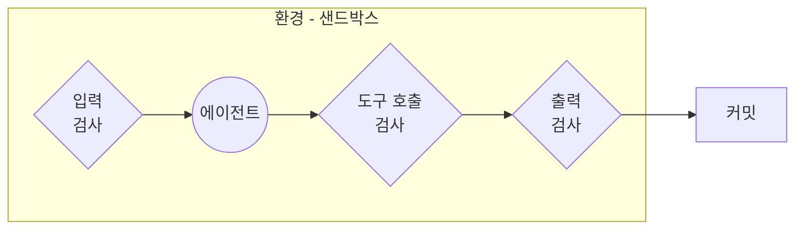
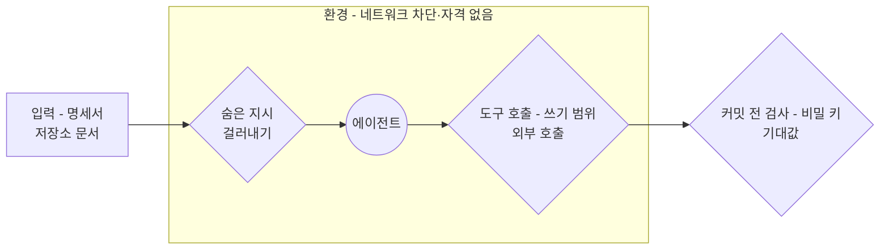

--------------------
Session 명: 08. 실행 흐름
--------------------

## 목차

01. 세션 목표
02. 가드레일이란?
03. 위험의 식별
04. 치명적 삼박자
05. 가드레일의 자리
06. 환경의 경계
07. 주문한다의 가드레일
08. 잘못된 관행
09. 실습 — 가드레일 배치
10. 요약

---

## 01. 세션 목표

프롬프트에 "하지 마"라고 적어도 에이전트는 막히면 그 길로 간다. 가드레일은 **환경과 도구가 그 행동을 거절하게** 만드는 제약이다.

- 어긋난 실행을 막는 네 수단, **멈출 조건·확인 지점·가드레일·센서**를 구분한다.
- 위험을 **확률과 크기**로 적고, 어디까지 감당할지로 막을 것을 고른다.
- 에이전트의 위험 10가지(OWASP)를 알고, 과제에 해당하는 것을 **과제의 말로** 적는다.
- **치명적 삼박자** — 비공개 데이터·신뢰할 수 없는 내용·외부 전송이 모이면 주입을 막을 수 없다. 고리 하나를 끊는다.
- 가드레일을 **입력·도구 호출·출력·환경** 네 자리에 겹으로 쌓는다.
- 기계가 판정할 수 있는 규칙은 **강제**로 옮기고, 판정할 수 없는 것만 글로 남긴다.
- **샌드박스**의 기본값을 정해 어긋난 행동이 번지는 범위를 끊는다.

**강사 노트**

- "세션 06. 작업 위임과 도구·권한·상태의 경계"가 어디까지 맡길지 정하고, "세션 07. 워크플로·에이전트와 사람의 개입"이 사람이 판단할 자리를 정했다. 여기서는 **경계가 글이 아니라 실행으로 지켜지게** 만든다.
- 기준 원전은 [NIST 2023]이고, 위험 목록은 [OWASP 2025], 삼박자는 [Willison 2025a], 겹으로 쌓기는 [OpenAI 2025], 계산적 가이드는 [Böckeler 2026a], 환경의 경계는 [Anthropic 2026c]·[Thoughtworks 2026]으로 받친다.
- 예방(가드레일)과 탐지(센서)의 경계를 세션 내내 짚는다. 센서의 구성과 증거는 "세션 09. 검증 하네스·결과 점검·피드백", 막힌 뒤의 복구는 "세션 10. 실패 대응·재시도·복구"가 맡는다.

---

## 02. 가드레일이란?

"실제 결제 시스템은 부르지 마"라는 말은 사람에게는 지키면 되는 규칙이지만, 에이전트에게는 **지켜질 수도 있고 아닐 수도 있는 지시**다. 가드레일은 그 지시를 어기더라도 호출 자체가 실행되지 않게 만드는 제약이다.

**인용문**

계산적 가이드는 **결정적인 도구**로 좋은 결과의 확률을 높인다, "Computational guides increase the probability of good results with deterministic tooling", [Böckeler 2026a]

**표 — 어긋난 실행을 막는 네 수단**

| 수단 | 작동하는 때 | 한계 |
|---|---|---|
| **멈출 조건** | 에이전트가 경계를 알아볼 때 | 경계로 보지 못하면 그냥 지나간다 |
| **확인 지점** | 사람이 그 단계를 볼 때 | 승인이 많아지면 읽지 않고 누른다 |
| **가드레일** | 행동이 일어나기 전 | 기계가 판정할 수 있는 규칙만 담는다 |
| **센서** | 행동이 끝난 뒤 | 이미 일어난 뒤에야 보인다 |

- 지시는 세 가지로 깨진다. 맥락이 길어지면 **앞의 금지가 묻히고**, 읽는 문서에 숨은 지시가 섞이면 **목표가 바뀌며**, 막히면 **다른 길을 찾는다**.
- 네 수단 가운데 가드레일만 **모델이 지시를 따르는지와 무관하게** 작동한다. 결제 연동 설정과 자격을 에이전트의 환경에 주지 않으면, 호출하는 코드를 쓰더라도 **실행되지 않는다**.

**강사 노트**

- 가드레일은 하네스의 가이드 중 실행 전에 강제되는 것을 가리키는 이 과정의 이름이다(`course-design.md`의 「원전 적용 결정」). [Böckeler 2026a]의 계산적 가이드가 그 근거이며, 가이드·센서의 전체 구조는 "세션 09. 검증 하네스·결과 점검·피드백"이 다룬다.
- 표의 네 수단이 정해지는 곳 — 멈출 조건은 "세션 06. 작업 위임과 도구·권한·상태의 경계"의 「07. 위임 계약」, 확인 지점은 "세션 07. 워크플로·에이전트와 사람의 개입"의 「07. 주문한다의 실행 흐름」이다.
- 첫 문장의 결제 호출 금지는 "세션 06. 작업 위임과 도구·권한·상태의 경계"의 「07. 위임 계약」의 「주문한다의 위임 계약」에 적어 둔 항목이다. 그 한 줄이 왜 호출을 막지 못하는지로 표를 연다.

---

## 03. 위험의 식별

## 위험의 어휘

무엇을 막고 무엇을 지켜볼지 고르려면 위험을 **서로 비교할 수 있는 말**로 적어야 한다. NIST는 그 말을 위험과 위험 허용 수준으로 정의한다.

**인용문**

위험은 사건이 **일어날 확률**과 그 결과의 **크기나 정도**를 합친 척도를 뜻한다, "Risk refers to the composite measure of an event's probability of occurring and the magnitude or degree of the consequences of the corresponding event", [NIST 2023]

  - 위험 허용 수준은 조직이나 AI 관계자가 목표를 이루기 위해 **위험을 감당할 준비가 된 정도**를 뜻한다, "Risk tolerance refers to the organization's or AI actor's … readiness to bear the risk in order to achieve its objectives", [NIST 2023]
  - 부정적 위험을 **완전히 없애려는 시도**는 실제로는 **역효과**를 낼 수 있다, "Attempting to eliminate negative risk entirely can be counterproductive in practice", [NIST 2023]

- 비밀 키 유출은 거의 일어나지 않지만 한 번 새면 **되돌릴 수 없다**. 확률만 보면 뒤로 밀리고, 크기를 함께 적어야 앞으로 나온다.
- 모든 위험을 다 막으면 에이전트가 할 수 있는 일이 남지 않는다. **어디까지 감당할지**를 먼저 정하고 그 선을 넘는 것만 막는다.

**강사 노트**

- 인용 근거: NIST AI RMF 1.0(2023) 원문(PDF) 확인. 위험 허용 수준 문장은 조직의 법·규제 맥락을 든 부분을 생략하고 정의만 인용했다.
- NIST는 위험을 식별·측정·관리하는 **어휘**로만 쓴다. 조직 거버넌스의 상세는 과정의 범위가 아니다.
- 확률·크기의 판정은 과제와 조직에 따라 달라진다. 수업에서는 값보다 **등급을 정한 근거**를 묻는다.

---

## 에이전트의 위험 목록

에이전트의 위험은 모델이 틀린 답을 내는 데서 오지 않고 **행동할 수 있다는 데서** 온다. 열 가지 중 **목표 가로채기·도구 오용·신원 남용·신뢰 악용** 넷이 "주문한다"에서 일어난다.

**표 — 에이전트의 위험 10가지 (OWASP, 2025)**

| 위험 | "주문한다"에서 |
|---|---|
| **ASI01 목표 가로채기** | 연동 규격 문서에 숨은 지시가 섞여 들어온다 |
| **ASI02 도구 오용** | 테스트를 지우거나 실제 결제 시스템을 부른다 |
| **ASI03 신원·권한 남용** | 비밀 키를 읽고 사람의 자격으로 원격 저장소에 쓴다 |
| **ASI09 사람·에이전트 신뢰 악용** | 기대값을 고쳐 통과시키고 완료라고 보고한다 |
| **ASI04 공급망 취약점** | 새 의존성은 사람이 미리 받아 둔 것만 쓴다 |
| **ASI05 예상치 못한 코드 실행** | 빌드가 샌드박스 안에서만 돈다 |
| **ASI06 메모리·맥락 오염** | 맥락 파일은 사람이 쓰고 에이전트는 고치지 않는다 |
| **ASI07 안전하지 않은 에이전트 간 통신** | 에이전트가 하나여서 통신이 없다 |
| **ASI08 연쇄 실패** | 잘못된 주문 금액이 결제·배송까지 번진다 — 수용 테스트가 잡는다 |
| **ASI10 통제를 벗어난 에이전트** | 같은 실패 3회에서 멈추고 사람에게 묻는다 |

**강사 노트**

- 인용 근거: OWASP Gen AI Security Project, "OWASP Top 10 for Agentic Applications for 2026"(2025) 원문과 공개 발표 글에서 열 항목의 식별자와 이름을 확인했다 — Agent Goal Hijack, Tool Misuse, Identity & Privilege Abuse, Agentic Supply Chain Vulnerabilities, Unexpected Code Execution, Memory & Context Poisoning, Insecure Inter-Agent Communication, Cascading Failures, Human-Agent Trust Exploitation, Rogue Agents.
- 한글 이름은 과정의 번역이고, ASI01~ASI10은 OWASP가 붙인 식별자다. 오른쪽 열은 과정의 적용이며 원문의 예가 아니다.
- ASI04의 도구 서버는 "세션 06. 작업 위임과 도구·권한·상태의 경계"의 「04. 도구 연결의 표준」에서 다룬 MCP 서버를 가리킨다. 닿지 않는 ASI07도 **왜 닿지 않는지**를 말해야 목록이 암기가 되지 않는다.

---

## 주문한다의 위험

앞의 네 항목을 "주문한다"의 상황으로 옮기면 **여섯 가지 위험**이 된다. 등급은 일어날 확률이 아니라 **일어난 뒤 되돌릴 수 있는가**로 가른다.

**표 — "주문한다"의 위험과 등급**

| "주문한다"의 위험 | 목록에서 | 확률 | 크기 | 등급 |
|---|---|---|---|---|
| **비밀 키·연동 설정 유출** | ASI03 | 낮다 | 매우 크다 — 되돌릴 수 없다 | 높음 |
| **실제 결제 시스템 호출** | ASI02 | 중간 | 크다 — 고객의 돈이 움직인다 | 높음 |
| **테스트 비활성화·삭제** | ASI02 | 높다 | 중간 — 완료의 증거가 사라진다 | 높음 |
| **숨은 지시가 섞인 문서** | ASI01 | 낮다 | 크다 — 앞의 셋을 불러온다 | 높음 |
| **기대값 변경 후 완료 보고** | ASI09 | 중간 | 중간 — 수용 기준이 흔들린다 | 중간 |
| **원격 저장소 반영** | ASI03 | 낮다 | 크다 — 남이 받는다 | 중간 |

- 자주 일어나는 테스트 삭제와 거의 일어나지 않는 비밀 키 유출이 **같은 등급**이다. 확률이 아니라 되돌릴 수 있는지가 둘을 같은 등급으로 만들었다.
- 높음으로 본 넷은 환경과 도구가 아예 **거절**하게 만들고, 중간인 둘은 쓰기 범위를 좁히고 자격을 주지 않는 것으로 다룬다.

**강사 노트**

- 확률의 값은 교육용 가정이다. 테스트 비활성화를 높게 본 근거는 막힌 에이전트가 가장 쉽게 손대는 곳이 기대값이라는 점이며, 그 관행은 "세션 09. 검증 하네스·결과 점검·피드백"에서 다시 다룬다.
- 여섯 중 다섯은 "세션 06. 작업 위임과 도구·권한·상태의 경계"의 「07. 위임 계약」의 「주문한다의 위임 계약」이 금지로 적은 항목이다. 계약의 글을 실행의 제약으로 옮기는 것이 이 세션의 일이다. 숨은 지시만 새로 더해졌다.
- 등급을 바꿔 보게 한다 — 사내 테스트 결제 계정만 쓴다면 두 번째 위험의 크기가 달라진다.

---

## 04. 치명적 삼박자

## 세 능력이 모일 때

에이전트는 읽은 문서의 문장과 사람이 준 지시를 **구분하지 못한다**. 그래서 아래 세 능력이 한자리에 모이면(치명적 삼박자, lethal trifecta) 문서에 심어 둔 한 줄이 비밀 키를 밖으로 보내는 명령이 된다.

**인용문**

에이전트가 이 **세 가지 기능**을 함께 가지면 공격자는 에이전트를 손쉽게 속여 비공개 데이터에 접근하게 하고 그것을 자기에게 보내게 만들 수 있다, "If your agent combines these three features, an attacker can easily trick it into accessing your private data and sending it to that attacker", [Willison 2025a]

  - 비공개 데이터 접근 — 애초에 **도구를 쓰는 가장 흔한 목적**이다, "Access to your private data — one of the most common purposes of tools in the first place", [Willison 2025a]
  - 신뢰할 수 없는 내용에의 노출 — 공격자가 통제하는 텍스트나 이미지가 **LLM에 닿을 수 있는 모든 경로**다, "Exposure to untrusted content — any mechanism by which text (or images) controlled by a malicious attacker could become available to your LLM", [Willison 2025a]
  - 데이터를 빼내는 데 쓰일 수 있는 **외부 전송 능력**이다, "The ability to externally communicate in a way that could be used to steal your data", [Willison 2025a]

- **"주문한다"에도 셋이 다 있다** — 비밀 키와 연동 설정(데이터), 결제·배송 시스템이 공개한 연동 규격 문서와 새 의존 패키지(신뢰할 수 없는 내용), 결제 시스템 호출(전송)이다. 특별한 설정이 아니라 **기본 상태**가 이미 셋이다.

**강사 노트**

- 인용 근거: Simon Willison, "The lethal trifecta for AI agents"(2025) 원문 확인. 세 능력의 이름과 정의가 원문의 것이다.
- 삼박자는 공격이 아니라 **조건**이다. 코딩 에이전트는 저장소를 읽고 외부 문서를 읽고 네트워크를 쓸 수 있으므로 기본 상태가 이미 셋을 갖춘 것임을 짚는다.
- 프롬프트 주입의 기법을 가르치지 않는다. 과정이 다루는 것은 셋 중 하나를 환경으로 끊는 결정이다.

---

## 막을 수 없다는 전제

세 능력이 모인 상태에서 주입을 **확실히 막는 방법은 없다**. 그래서 방어는 "막는다"가 아니라 **고리 하나를 끊는다**가 된다.

**인용문**

이것이 일어나는 것을 **100% 확실하게 막는 방법**은 아직 알지 못한다, "we still don't know how to 100% reliably prevent this from happening", [Willison 2025a]

  - 웹 애플리케이션 보안에서 **95%는 분명히 낙제 점수**다, "In web application security 95% is very much a failing grade", [Willison 2025a]

**표 — 세 능력을 끊는 자리**

| 능력 | 끊는 방법 | "주문한다"에서 |
|---|---|---|
| **비공개 데이터 접근** | 읽을 범위를 좁힌다 | 비밀 키·연동 설정을 작업 공간 밖에 둔다 |
| **신뢰할 수 없는 내용** | 사람이 확인한 사본만 준다 | 결제 연동 규격은 사람이 저장소에 넣어 둔 문서만 읽는다 |
| **외부 전송** | 밖으로 나가는 통신을 막는다 | 결제는 테스트 대역만, 외부 호출은 환경이 거절한다 |

- 셋 중 **하나만 끊어도** 삼박자가 성립하지 않는다. "주문한다"가 끊는 고리는 **전송**이다 — 읽을 범위와 문서는 사람이 계속 관리해야 유지되지만, 통신은 기계가 막는다.

**강사 노트**

- 인용 근거: [Willison 2025a] 원문 확인. 95%는 확률로 막는 방어의 한계를 말하는 비유이며 특정 제품의 측정값이 아니다.
- 읽을 범위를 좁히는 결정은 "세션 06. 작업 위임과 도구·권한·상태의 경계"의 「05. 최소 권한」의 「네 가지 권한」에서 이미 정했다. 여기서는 그것이 삼박자의 어느 고리인지 보인다.
- 수강생에게 묻는다 — 네트워크를 닫으면 못 하게 되는 일은 무엇인가? 의존성 받기와 규격 조회이며, 그래서 사람이 미리 받아 둔다.

---

## 05. 가드레일의 자리

## 겹으로 쌓는다

가드레일 하나로는 모든 경로를 막지 못한다. 과제가 들어와 커밋으로 나가기까지의 **경로 위 네 지점**에 나누어 두고 서로 겹치게 한다.

**인용문**

가드레일 **하나로는 충분한 보호가 되기 어려우므로** 여러 전문화된 가드레일을 **겹으로 쌓아** 더 견고한 에이전트를 만든다, "Think of guardrails as a layered defense mechanism. While a single one is unlikely to provide sufficient protection, using multiple, specialized guardrails together creates more resilient agents.", [OpenAI 2025]

**도식 — Mermaid — 가드레일의 네 자리**

- **입력** — 함께 읽는 문서에서 지시처럼 보이는 문장을 걸러낸다.
- **도구 호출** — 위험 등급으로 가른다. 읽기는 통과, 쓰기는 범위 안, 외부 호출은 거절이다.
- **출력** — 커밋 전에 비밀 키나 기대값 변경이 섞였는지 본다.
- **환경** — 앞의 세 검사를 감싼다. 검사를 빠져나간 행동도 환경에서 막힌다.

**강사 노트**

- 인용 근거: OpenAI, "A practical guide to building agents"(2025) 원문 확인(받은 PDF). 겹으로 쌓는 방어라는 표현이 원문의 것이다.
- 원문은 입력·출력의 가드레일 종류(관련성, 안전, 개인정보, 도구 위험 등급 등)를 든다. 과정은 코딩 에이전트에 해당하는 네 자리로 정리해 쓴다.
- 네 자리가 모두 필요한 것은 아니다. "주문한다"는 입력·도구 호출·환경을 쓰고 출력은 커밋 전 검사 하나만 둔다(「07. 주문한다의 가드레일」).

---

## 계산적 강제와 지시

위임 계약에 금지로 적은 세 규칙은 **프롬프트에만 적혀 있으면 지켜지지 않는다**. 같은 규칙을 환경과 도구에 걸면 어길 방법 자체가 없어진다.

**표 — 같은 규칙을 지시로 둘 때와 강제로 둘 때**

| 규칙 | 프롬프트의 지시로 두면 | 환경·도구로 강제하면 |
|---|---|---|
| **테스트를 바꾸지 않는다** | 막혔을 때 기대값을 고친다 | 테스트 파일 쓰기가 거절된다 |
| **실제 결제를 부르지 않는다** | 대역 대신 실제 주소를 적는다 | 밖으로 나가는 통신이 막혀 실패한다 |
| **비밀 키를 읽지 않는다** | 찾다가 읽어 맥락에 남는다 | 파일이 보이지 않아 읽을 수 없다 |

- 강제할 수 있는 규칙은 **기계가 판정할 수 있는 것**이다. 파일 경로와 네트워크 주소, 자격은 판정되지만 업무 규칙의 해석은 판정되지 않는다.
- 판정되지 않는 규칙은 멈출 조건으로 남겨 **에이전트가 묻게** 한다. 그 자리에서는 프롬프트의 문장이 유일한 수단이다.
- 거절된 호출은 **기록으로 남긴다**. 기록이 없으면 에이전트가 막힌 뒤 다른 길로 돌아간 것도 보이지 않는다.

**강사 노트**

- 계산적·추론적의 구분은 [Böckeler 2026a]의 것이며, 가이드·센서의 전체 구조는 "세션 09. 검증 하네스·결과 점검·피드백"에서 다룬다. 여기서는 가드레일이 계산적 가이드라는 점만 쓴다.
- 맥락이 길어지면 앞의 지시가 묻힌다. 그 이유는 "세션 05. 도메인·설계 지식과 맥락 구성"의 「03. 주의 예산과 맥락 부패」의 「맥락 부패」에 있다.
- 수강생에게 묻는다 — "기대값을 바꾸지 마"를 강제로 옮기면 어디에 두는가? 테스트 파일의 쓰기 금지다.

---

## 06. 환경의 경계

## 피해 범위를 끊는다

가드레일이 뚫려도 **번지는 범위**는 미리 좁혀 둘 수 있다. 그 범위를 피해 범위(blast radius)라 하고, 에이전트가 쓰는 환경의 경계가 그것을 정한다.

**인용문**

공학의 질문은 **피해 범위를 어떻게 제한하는가**가 된다, "The engineering question becomes how to cap the blast radius", [Anthropic 2026c]

  - 프로세스 샌드박스·가상 머신·파일 시스템 경계·외부 전송 통제로 에이전트가 **어디서 무엇을 할 수 있는지**를 제약한다, "We constrain where and how an agent can act with process sandboxes, VMs, filesystem boundaries, and egress controls", [Anthropic 2026c]

- 범위를 끊을 수 있는 곳은 프로세스·파일 시스템·네트워크·자격이다. "주문한다"는 가상 머신까지 쓰지 않고 **파일 시스템·네트워크·자격** 셋으로 끊는다.
- 작업 공간 안의 변경은 **되돌리기 쉽다**. 그 안에서는 승인 없이 일하게 두고, 밖으로 나가는 길만 막는다.
- 읽고 쓸 범위는 과제의 크기에 맞춘다. 저장소 전체를 쓰게 열어 주면 **경계가 없는 것과 같다**.

**강사 노트**

- 인용 근거: Anthropic, "How we contain Claude across products"(2026) 원문 확인. 피해 범위와 네 가지 제약 수단이 원문의 표현이다.
- 작업 공간(worktree·작업 브랜치)은 "세션 06. 작업 위임과 도구·권한·상태의 경계"의 「06. 상태와 되돌림」의 「변경마다 작업 공간」에서 정했다. 여기서는 그것이 피해 범위를 끊는 수단이라는 점을 더한다.
- 자격을 주지 않는 것이 가장 단순한 가드레일이다. 원격 반영은 사람이 실행한다.

---

## 샌드박스

샌드박스(sandbox)는 에이전트가 쓸 수 있는 자원을 **미리 좁혀 둔 실행 환경**이다. "주문한다"는 읽기·쓰기·네트워크에 기본값을 두고 꼭 필요한 것만 예외로 연다.

**인용문**

샌드박스는 선택적인 추가 장치가 아니라 **합리적인 기본값**으로 본다, "We see sandboxing as a sensible default rather than an optional enhancement", [Thoughtworks 2026]

**표 — "주문한다"의 샌드박스 기본값**

| 자원 | 기본값 | 예외 |
|---|---|---|
| **읽기** | 저장소 안은 허용 | 비밀 키·연동 설정은 작업 공간 밖 |
| **쓰기** | 작업 공간 안만 | 기대값·의존 규칙 파일은 금지 |
| **네트워크** | 차단 | 없음 — 결제는 테스트 대역 |

- 기본값을 거절로 두면 사람에게 물어야 할 일도 줄어든다. 환경 제약으로 바꾼 뒤 권한 요청이 **84% 줄었다**(Anthropic 자사 코딩 도구).
- 네트워크를 닫으면 의존성 받기와 규격 조회가 막힌다. 그 둘은 **사람이 미리 받아 둔다**.

**강사 노트**

- 인용 근거: Thoughtworks Technology Radar Vol. 34(2026-04)의 sandboxed execution for coding agents(Trial) 항목 원문 확인. 표의 세 기본값은 [Anthropic 2026c]가 적은 것과 같다 — "Reads are allowed, writes are allowed inside the workspace, but network is denied by default"(원문 확인).
- 84%도 [Anthropic 2026c]의 보고값이며, 비교 대상은 환경 제약을 도입하기 전의 권한 요청 수다. 일반 수치가 아니다.
- 승인 피로는 "세션 07. 워크플로·에이전트와 사람의 개입"의 「08. 잘못된 관행」의 「모든 단계의 형식적 승인」에서 다뤘다. 샌드박스는 그 문제의 처방이다.
- 샌드박스의 구현(컨테이너·가상 머신·OS 수준 격리)은 도구의 일이며 과정은 **무엇을 기본값으로 둘지**만 결정한다.

---

## 07. 주문한다의 가드레일

## 배치의 그림

"주문한다"는 네 자리 중 **입력·도구 호출·환경** 셋에 가드레일을 두고, 출력에는 커밋 전 검사 하나만 둔다.

**도식 — Mermaid — "주문한다"의 가드레일 배치**

- **입력의 검사** — 연동 규격을 에이전트가 직접 가져오지 않고, **사람이 저장소에 넣어 둔 문서**만 읽는다.
- **도구 호출의 검사** — 쓰기는 `order` 패키지와 테스트 코드만, 외부 호출은 결제 테스트 대역만 통과한다.
- **환경의 테두리** — 네트워크가 닫히고 자격이 없어, 검사를 **지나친 호출도 연결되지 않는다**.

**강사 노트**

- 본문이 가리키는 네 자리는 「05. 가드레일의 자리」의 「겹으로 쌓는다」의 것이다. 같은 그림을 두 번 보이지 않고 값만 채웠다.
- 규격 문서를 넣어 두는 곳은 "세션 05. 도메인·설계 지식과 맥락 구성"의 「06. 맥락 파일」의 「주문한다의 맥락 파일」이 가리키는 저장소의 문서 폴더이며, 예를 들면 `docs/`다. 결제 연동 규격은 거기에 `docs/external/payment-api.md`로 들어 있다. 폴더 이름은 저장소마다 정하는 것이며 에이전트가 미리 아는 이름이 아니다.
- 출력 검사를 커밋 전 하나만 둔 이유를 짚는다 — 산출이 코드와 커밋뿐이고, 그 밖의 결과는 센서가 본다.
- 이 그림이 실습 8의 결과물 형식이다. 수강생은 같은 네 자리에 정기배송의 값을 채운다.

---

## 배치표

앞의 여섯 위험을 **자리와 방식**으로 옮긴다. 어긋났을 때 무엇이 일어나는지까지 적어야 세운 것이 실제로 막는지 확인할 수 있다.

**표 — "주문한다"의 위험별 가드레일**

| 위험 | 자리 | 방식 | 어긋나면 |
|---|---|---|---|
| **비밀 키·연동 설정 유출** | 환경 | 작업 공간 밖에 두고 읽기에서 뺀다 | 파일이 보이지 않는다 |
| **실제 결제 시스템 호출** | 환경·도구 호출 | 네트워크 차단, 결제는 테스트 대역만 | 호출이 연결되지 않는다 |
| **테스트 비활성화·삭제** | 도구 호출 | 테스트 파일은 쓰기 금지 | 쓰기가 거절된다 |
| **숨은 지시가 섞인 문서** | 입력 | 저장소에 넣어 둔 규격 문서만 읽힌다 | 원문에 닿지 못한다 |
| **기대값 변경 후 완료 보고** | 도구 호출 | 쓰기는 `order`와 테스트 코드만 | 쓰기가 거절된다 |
| **원격 저장소 반영** | 환경 | 자격을 주지 않는다 | 인증이 없어 실패한다 |

- 표에 넣지 못한 것도 있다. 명세에 없는 업무 규칙을 정해야 하는 상황은 기계가 판정할 수 없어 **멈출 조건**으로 남기고, 에이전트가 멈춰 사람에게 묻게 한다.
- 여섯 위험을 환경과 도구가 거절해 주므로, 사람이 직접 확인하는 자리는 **계획·결제 관련 변경·병합** 셋으로 줄었다.

**강사 노트**

- 확인 지점 셋은 "세션 07. 워크플로·에이전트와 사람의 개입"의 「07. 주문한다의 실행 흐름」의 「활동 다이어그램」에서 정했다. 가드레일을 세운 덕분에 그 셋만으로 충분하다는 관계를 짚는다.
- 표의 여섯 줄은 「03. 위험의 식별」의 「주문한다의 위험」의 여섯과 순서까지 같다. 위험을 고르는 일과 가드레일을 세우는 일이 한 줄씩 이어지는 것을 보인다.
- 배치표는 저장소에 두고 맥락 파일이 가리킨다. 사람과 에이전트가 같은 표를 본다.

---

## 08. 잘못된 관행

## 모든 검사를 프롬프트에

프롬프트에 적은 금지는 **읽히기를 바라는 글**이다. 자주 적는 세 문장은 막힌 에이전트 앞에서 모두 깨지고, 셋 다 옮겨 둘 자리가 있다.

**표 — 프롬프트에 둔 검사와 옮길 자리**

| 프롬프트의 문장 | 어겨지는 모습 | 옮길 자리 |
|---|---|---|
| **"테스트는 지우지 마"** | 막히면 기대값부터 고친다 | 테스트 파일 쓰기 금지(도구 호출) |
| **"실제 결제는 부르지 마"** | 대역 주소를 실제 주소로 바꾼다 | 네트워크 차단(환경) |
| **"비밀 키는 보지 마"** | 찾다가 읽어 맥락에 남는다 | 작업 공간 밖에 둔다(환경) |

- 사고가 날 때마다 금지문이 한 줄씩 쌓인다. 맥락이 길어지면 **앞의 지시부터 묻힌다**.
- 글로 남길 것은 **사람이 정할 결정과 판단의 기준**이다. 기계가 판정할 수 있는 것은 환경·도구로 옮긴다.

**강사 노트**

- 지시 비대는 "세션 05. 도메인·설계 지식과 맥락 구성"의 「11. 잘못된 관행」의 「지시 비대」에서 다룬 문제다. 같은 현상이 가드레일의 자리를 잘못 고를 때 생긴다.
- 수강생의 저장소 맥락 파일에서 금지문을 찾아보게 한다. 대부분 한두 줄은 환경으로 옮길 수 있다.
- 프롬프트의 금지가 쓸모없다는 말이 아니다. 강제가 불가능한 자리에서는 그것이 유일한 수단이다.

---

## 가드레일 과신

가드레일을 세우고 나면 결과도 안전하다고 여기기 쉽다. **막는 것과 보는 것은 다르다.**

**인용문**

**확률적인 방어**에는 놓치는 비율이 0이 아니다, "Any probabilistic defense has a non-zero miss rate", [Anthropic 2026c]

- 가드레일은 **금지한 행동**만 막는다. 결과가 틀려도 금지된 행동이 아니어서 그대로 통과하고, **수용 테스트가 실패해야** 드러난다.
- 업무 규칙의 해석이나 설계의 적절성은 가드레일이 판정하지 못한다. 그 자리는 **사람의 판단**으로 남는다.
- 거절이 늘어 에이전트가 더 나아가지 못하면 막은 범위를 다시 본다. 다 막는 것은 **아무것도 맡기지 않는 것**과 같다.

**강사 노트**

- 인용 근거: [Anthropic 2026c] 원문 확인. 같은 글은 확률적 방어를 결정적인 환경 제약과 함께 쓰는 이유로 이 문장을 든다.
- 예방과 탐지를 겹치는 구성이 "세션 09. 검증 하네스·결과 점검·피드백"의 하네스다. 가드레일만으로 완료를 받아들이지 않는다.
- 수강생에게 묻는다 — 가드레일이 모두 작동했는데 결과가 틀렸다. 무엇을 보고 알 수 있는가? 센서의 증거뿐이다. 예로 주문 금액을 2,000원이 아니라 결제 직전 판매가인 2,400원으로 계산한 경우를 든다.

---

## 09. 실습 — 가드레일 배치

실습 6의 위임 계약과 실습 7의 실행 흐름을 LLM에 제공하여 **"신청한다"의 가드레일 배치**를 만들고, 점검 항목으로 피드백하여 완성하십시오.

- **투입물**
  + 실습 6의 **위임 계약**, 실습 7의 **실행 흐름과 확인 지점**
- **프롬프트**
  + ① "신청한다 과제의 **위험을 확률과 크기**로 적고, 위험마다 가드레일을 **입력·도구 호출·출력·환경** 중 어디에 어떤 방식으로 둘지 표로 만들어줘."
  + ② "가드레일마다 **어긋나면 무엇이 일어나는지** 적고, 강제할 수 없어 지시나 멈출 조건으로 남기는 것을 구분해줘."
- **점검 항목**
  1. **위험의 범위** — 모델의 오답이 아니라 **행동**(쓰기·외부 호출·자격)이 만드는 위험을 적었는가?
  2. **자리의 명시** — 가드레일마다 입력·도구 호출·출력·환경 중 어디인지 적었는가?
  3. **강제와 지시** — 기계가 판정할 수 있는 규칙을 프롬프트의 금지문으로 남기지 않았는가?
  4. **삼박자** — 비공개 데이터·신뢰할 수 없는 내용·외부 전송 중 **끊은 고리**가 있는가?
  5. **예방과 탐지** — 센서가 할 일(테스트·의존 규칙 검사)을 가드레일로 적지 않았는가?
  6. **일이 되는가** — 모두 막아서 "신청한다" 개발이 진행되지 못하는 항목은 없는가?
- **결과물** — "신청한다"의 가드레일 배치(위험·자리·방식·어긋나면). 실습 9의 입력이 됩니다.

**강사 노트**

- 정기배송의 위험은 회차 금액·만료일의 기대값과 결제 승인 호출에서 나온다. 모델 패키지는 `code/s01/subscription/docs/`에 있다.
- LLM은 위험을 "환각"·"품질 저하"처럼 모델의 능력 문제로 적고, 가드레일을 프롬프트 문장으로 제안한다. 점검 1·3으로 되돌린다.
- 평가는 표의 완성도보다 **자리를 고른 근거**를 본다. 같은 위험을 다른 자리에서 막아도 판정 가능성으로 설명되면 맞는 답이다.

---

## 10. 요약

가드레일은 지켜 주기를 바라는 글이 아니라 **실행 전에 환경과 도구가 거절하는 제약**이다.

### 가드레일의 핵심

- **위험** — 확률과 크기를 합쳐 재고, 허용 수준을 넘는 것만 막는다
- **에이전트의 위험** — 모델의 오답이 아니라 행동에서 온다. OWASP의 열 가지에서 과제에 해당하는 것을 골라 과제의 말로 적는다
- **치명적 삼박자** — 비공개 데이터·신뢰할 수 없는 내용·외부 전송이 모이면 주입을 막을 수 없다. 고리 하나를 끊는다
- **네 자리** — 입력·도구 호출·출력에 검사를 두고 환경이 감싼다
- **강제와 지시** — 기계가 판정할 수 있는 것은 환경·도구로, 판정할 수 없는 것만 글로 남긴다
- **막는 것과 보는 것** — 확률적 방어에는 틈이 있어 센서와 겹쳐 둔다

### 다음 세션

- "**09. 검증 하네스·결과 점검·피드백**" — 막는 것으로 끝나지 않는 결과를, 센서가 낸 증거로 받아들일지 판단한다.

**강사 노트**

- 실습 8의 가드레일 배치가 실습 9의 하네스 배치의 입력이 된다. 가이드와 센서의 짝에서 가드레일이 가이드 쪽이다.
- 이 세션까지가 예방이다. 다음 세션은 같은 하네스의 탐지 쪽을 다룬다.

---

## 별첨. 실습 답

---

## 가드레일 배치 (안)

"신청한다"의 위험도 여섯이고, 막는 자리는 **환경에 셋·도구 호출에 둘·입력에 하나**다. 공휴일 규칙처럼 기계가 판정할 수 없는 것만 멈출 조건으로 남는다.

**표 — "신청한다"의 위험별 가드레일**

| 위험 | 자리 | 방식 | 어긋나면 |
|---|---|---|---|
| **비밀 키·결제 연동 설정 유출** | 환경 | 작업 공간 밖에 두고 읽기에서 뺀다 | 파일이 보이지 않는다 |
| **실제 결제 승인 호출** | 환경·도구 호출 | 네트워크 차단, 결제는 테스트 대역만 | 호출이 연결되지 않는다 |
| **수용 기준의 기대값 변경** | 도구 호출 | 회차 7개·만료일 2월 2일의 기대값 파일은 쓰기 금지 | 쓰기가 거절된다 |
| **숨은 지시가 섞인 문서** | 입력 | 배송 연동 규격은 저장소에 넣어 둔 문서만 읽힌다 | 원문에 닿지 못한다 |
| **쓰기 범위 이탈** | 도구 호출 | 쓰기는 `subscription`과 테스트 코드만 | 쓰기가 거절된다 |
| **원격 저장소 반영** | 환경 | 자격을 주지 않는다 | 인증이 없어 실패한다 |

- **끊은 고리는 외부 전송** — 결제·배송 시스템 호출을 테스트 대역으로 돌리고 밖으로 나가는 통신을 막았다.
- **출력은 커밋 전 한 번** — 비밀 키와 기대값 변경이 섞였는지만 본다. 나머지 판정은 센서의 몫이다.

**강사 노트**

- 입력 자리의 한 행은 실습 7까지의 산출물에 없던 위험이다. 삼박자를 점검하면서 드러난다.
- 회차 7개와 만료일 2월 2일은 "세션 03. 요구의 구체화와 명세"의 실습 답에서 정한 값이다. 기대값을 지키는 것이 수용 기준을 지키는 것이다.
- 쓰기 금지와 "테스트를 고치지 마"라는 지시의 차이를 묻는다. 전자는 거절되고 후자는 막혔을 때 깨진다.

---

## 보완 (안)

새로 발견한 것은 **후속 작업에 영향을 미치는 경우에만** 이전 산출물에 반영한다.

- **위임 계약**(실습 6)
  - **금지를 거절로 옮긴다** — 권한 항목의 "…는 금지한다"를 "환경이 거절한다"로 바꾸고, 어떤 설정이 그렇게 만드는지 한 줄로 적는다.
  - **멈출 조건만 글로 남긴다** — 공휴일 규칙처럼 판정할 수 없는 것만 계약에 남긴다.
- **실행 흐름**(실습 7)
  - **환경이 거절하는 자리에는 확인 지점을 두지 않는다** — 원격 반영은 자격이 없어 실행되지 않으므로, 승인 대신 사람이 실행하는 단계다.
- **맥락 패키지**(실습 5)
  - **배치표를 가리킨다** — 맥락 파일에 가드레일 배치의 자리를 한 줄로 적고, 중복된 금지문은 지운다.
  - **규격 문서의 출처** — 배송 시스템이 공개한 규격은 사람이 받아 저장소에 넣고, 맥락 파일이 그 문서를 가리킨다.
- **※ 현행화 기준**
  - **반영** — 계약의 권한 항목과 맥락 파일의 한 줄. 실습 9의 입력이 된다.
  - **기록만** — 위험과 등급의 표. 배치가 정해진 뒤에는 다시 쓰지 않는다.

**강사 노트**

- 보완의 핵심은 같은 규칙을 두 곳에 적지 않는 것이다. 계약의 글과 환경의 설정이 어긋나면 어느 쪽도 신뢰할 수 없다.
- 맥락 파일에서 금지문을 지우는 것이 수강생에게 가장 낯선 결정이다. 지운 자리를 무엇이 대신하는지 말하게 한다.
