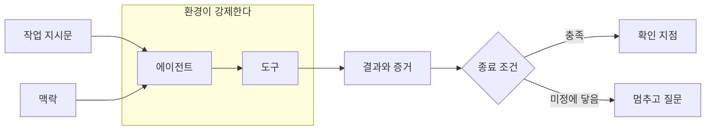
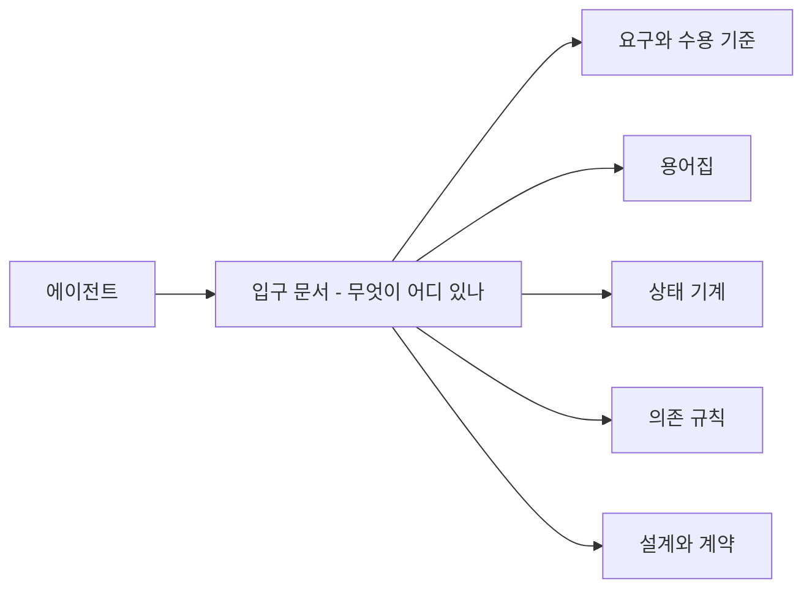
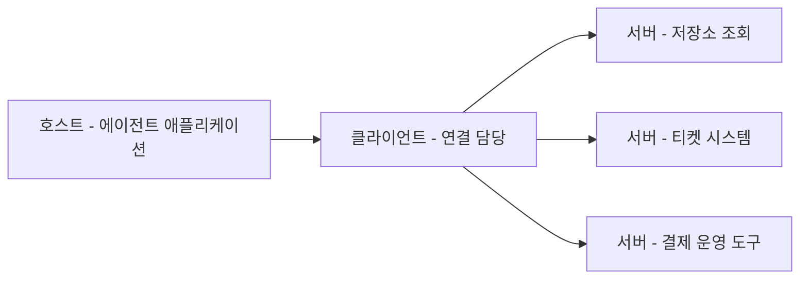
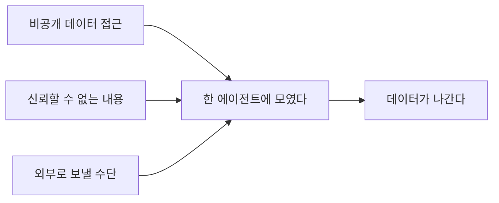
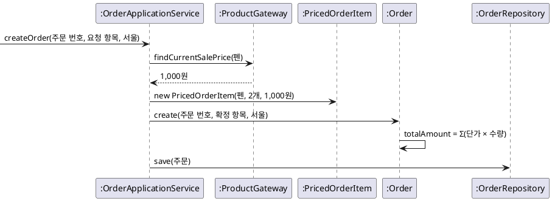

--------------------
Session 명: 08. 위임
--------------------

## 목차

01. 세션 목표
02. 위임 계약
03. 작업 지시문
04. 맥락
05. 권한과 도구
06. 위험과 피해 범위
07. 종료 조건과 확인 지점
08. 빈 저장소에서 시작하기
09. 맡긴 결과 보기
10. 잘못된 관행
11. 실습 8 — 위임과 구현
12. 요약

---

## 01. 세션 목표

위임은 프롬프트 한 줄이 아니라 **네 가지를 정하는 일**이다 — 작업 지시문, 맥락, 권한, 종료 조건.

- 설계가 쪼갠 **작업 단위 하나**를 맡기고, 그 단위의 수용 예를 종료 조건으로 쓴다.
- 작업 지시문을 **적정 높이**로 쓰고, 앞 산출물은 베끼지 않고 가리킨다.
- 맥락을 **미리 넣을 것과 찾아 읽게 할 것**으로 나누고, 긴 작업은 압축과 기록으로 잇는다.
- 권한을 **자원과 동작**으로 좁히고, 글로 적은 금지를 환경의 **강제**로 옮긴다.
- 위험을 **확률과 크기**로 적고, 막지 못할 것을 전제로 **피해 범위**를 끊는다.
- 종료 조건에 **멈춰 물어야 할 때**를 함께 적고, 되돌리기 어려운 자리에 확인 지점을 둔다.
- 돌아온 결과를 **추적과 검사의 증거**로 받는다.

**강사 노트**

- 이 세션에서 실제로 구현을 맡긴다. "세션 07. 설계 — 책임과 협력"의 「10. 작업 단위」가 나눈 **첫 단위 금액 확정**이 대상이다.
- 기준 원전은 [Anthropic 2024](위임 형태와 확인 지점)와 [Anthropic 2025c](맥락)이며, 위험의 어휘는 [NIST 2023], 실행 시점의 위험은 [OWASP 2025]·[Willison 2025a], 환경의 경계는 [Anthropic 2026c]·[Thoughtworks 2026]으로 받친다.
- **막는 것과 탐지하는 것을 구분한다.** 권한으로 미리 막는 것이 이 세션, 검사로 나중에 탐지하는 것이 "세션 09. 검사 파이프라인"이다.

---

## 02. 위임 계약

## 네 가지를 정한다

**위임 계약**은 맡기기 전에 사람이 정해 두는 네 가지다 — 무엇을 하라, 무엇을 읽으라, 무엇을 할 수 있다, 언제 멈추라.

**도식 — Mermaid — 위임 계약의 네 가지**



- 네 가지 중 **하나만 비어도 나머지가 무력해진다.** 종료 조건이 없으면 에이전트는 멈출 자리를 스스로 고른다.
- 지시문과 맥락은 **방향을 주고**, 권한과 종료 조건은 **범위를 끊는다**. 앞의 둘은 부탁이고 뒤의 둘은 경계다.
- 계약은 과제마다 새로 쓰는 것이 아니다. **달라지는 것은 지시문과 맥락**이고 권한과 종료 조건은 팀의 기본값이다.

**강사 노트**

- 네 가지의 이름은 과정의 구분이다. 도구·권한·상태를 따로 세는 분류도 있으나, 이 과정은 **사람이 적어야 하는 것**을 기준으로 넷으로 묶었다.
- 도식의 왼쪽 둘은 입력, 가운데는 실행, 오른쪽은 판정이다. 권한은 화살표가 아니라 **에이전트를 감싼 테두리**로 그렸다.
- 자율성을 올릴 조건은 "세션 02. LLM이라는 재료"의 「06. 자율성」의 「자율성의 계단」이 정했다. 여기서는 그 계단을 **계약으로 적는다**.

---

## 맡기는 것은 작업 단위 하나

맡기는 단위는 설계가 쪼갠 **작업 단위 하나**이고, 그 단위의 수용 예가 곧 종료 조건이 된다.

**표 — 첫 단위를 맡기는 데 쓰는 것**

| 위임 계약 | 어디서 오는가? | 첫 단위에 들어가는 값 |
|---|---|---|
| **작업 지시문** | 작업 단위와 완료 조건 | 금액 확정 — 단가를 확정하고 총액을 계산한다 |
| **맥락** | 요구·용어집·상태 기계·의존 규칙·설계 | 저장소의 산출물을 가리킨다 |
| **권한** | 팀의 기본값과 과제의 위험 | 업무 코드와 테스트에 쓰기, 실행, 커밋 |
| **종료 조건** | 수용 예와 완료의 정의 | 판매가가 1,200원이 되어도 총액 2,000원 |

- 과제 전체가 아니라 **한 번에 확인할 수 있는 크기**를 맡긴다. 확인할 수 없는 단위는 받을 수도 없다.
- 네 줄이 모두 **앞 세션의 산출물**에서 온다. 위임 때 새로 만드는 결정은 권한뿐이다.
- 남은 단위 셋은 **같은 계약으로 뒤에 맡긴다**. 계약을 단위마다 다시 설계하지 않는다.

**강사 노트**

- 단위 넷과 완료를 확인할 예는 "세션 07. 설계 — 책임과 협력"의 「10. 작업 단위」의 「주문한다의 작업 단위 넷」에 있다.
- 수용 예의 원천은 "세션 03. 요구와 수용 기준"의 「06. 수용 기준」이다. 위임이 기대값을 새로 만들지 않는다.
- 남은 단위 셋을 맡기는 것은 "세션 11. 종합 실행"이다. 그때는 검사까지 갖춰져 있어 사람이 볼 것이 줄어든다.

---

## 03. 작업 지시문

## 무엇을 하라

**인용문**

시스템 프롬프트는 매우 분명해야 하고, **알맞은 높이**에서 생각을 제시하는 단순하고 직접적인 말을 써야 한다, "system prompts should be extremely clear and use simple, direct language that presents ideas at the right altitude", [Anthropic 2025c]

- **적정 높이**는 결과와 지킬 규칙을 말하고 **구현 방법을 받아쓰지 않는** 높이다.
- 너무 낮으면 사람이 코드를 말로 쓰게 되고, 너무 높으면 **빈칸이 추측으로 채워진다**.
- 지시문이 답할 것은 셋이다 — **무엇이 끝난 상태인가**, 무엇을 지켜야 하는가, 무엇을 하지 않는가.
- 하지 않을 것을 적는 자리가 **범위의 경계**다. "승인·거절·재결제는 구현하지 않는다"가 그 예다.

**강사 노트**

- 인용 근거: Anthropic, [Effective context engineering for AI agents](https://www.anthropic.com/engineering/effective-context-engineering-for-ai-agents), 2025의 시스템 프롬프트 항목 원문 확인. 원문은 지나치게 구체적인 규칙 나열과 지나치게 모호한 지시를 양쪽 실패로 든다.
- 원문의 시스템 프롬프트는 에이전트 제품의 기본 지시를 가리킨다. 이 과정은 그 조언을 **한 과제의 작업 지시문**에 적용한다.
- 높이를 가늠하는 질문을 던진다 — 이 문장을 지우면 결과가 달라지는가, 아니면 모델이 알아서 하는 일인가.

---

## 무엇을 가리킬 것인가?

산출물은 **가리키고 베끼지 않는다.** 지시문에 옮겨 적으면 두 곳이 어긋나고, 어느 쪽이 사실인지 알 수 없게 된다.

**표 — 지시문에 적을 것과 가리킬 것**

| 지시문에 적는다 | 가리킨다 | 왜 |
|---|---|---|
| 이번 단위의 결과와 완료를 확인할 예 | 요구사항 정의서 전체 | 단위마다 달라지는 것과 유지되는 것 |
| 하지 않을 것과 범위의 경계 | 용어집과 명명 규칙 | 경계는 이번 작업의 결정 |
| 멈춰 물어야 할 조건 | 상태 기계와 의존 규칙 | 조건은 짧고 규칙은 길다 |
| 권한의 허용과 금지 | 설계와 오퍼레이션 계약 | 권한은 환경이 강제한다 |

- 가리키는 쪽이 **오래 남는 산출물**이다. 요구사항 정의서·용어집·상태 기계·의존 규칙은 작업이 끝나도 남는다.
- 베껴 쓰면 **에이전트가 둘 다 읽고** 어긋난 쪽을 추측으로 고른다. 사실의 원천은 하나여야 한다.
- 문서를 고칠 권한은 주지 않는다. 산출물을 고치는 것은 **사람의 결정**이다.

**강사 노트**

- 산출물의 수명 구분은 "세션 03. 요구와 수용 기준"의 「09. 요구사항 정의서와 작업 명세서」가 정했다.
- 모델 패키지의 자리는 저장소 안이다. 폴더 이름은 과정이 정한 것이며, 예를 들면 `docs/`다.
- 베껴 쓴 지시문의 실패 장면을 하나 든다 — 용어집은 단가로 고쳤는데 지시문에 남은 가격을 에이전트가 필드 이름으로 쓴 경우다.

---

## 주문한다의 작업 지시문

**문서 형식 — 10pt**

**작업 지시문 — 작업 단위 1 「금액 확정」**

- **무엇을 하라**
  - 빈 저장소에 자바 프로젝트의 골격과 **빌드 구성**을 만들고, 작업 단위 1 **금액 확정만 구현**해라.
  - 배송지를 정하면 주문이 결제대기로 생기고, 그때의 **판매가로 각 항목의 단가가 확정**되어 주문 금액이 정해진다.
  - **완료를 확인할 예** — 펜 2개를 판매가 1,000원일 때 주문하고, 그 뒤 판매가가 1,200원이 되어도 **주문 금액은 2,000원** 그대로다.
  - 이 예를 검사하는 **테스트를 함께 만들고 실제로 실행**해 통과 출력을 보여라.
- **무엇을 가리킬 것인가**
  - **산출물 입구**에서 시작해 필요한 문서만 찾아 읽어라. 문서의 내용을 주석이나 새 문서로 **베껴 쓰지 마라**.
  - 이름은 **용어집의 영문명**과 명명 규칙을 그대로 쓴다. 용어집에 없는 업무 용어를 만들지 마라.
  - 패키지와 계약은 **의존 규칙과 설계 문서**를 따른다.
- **권한**
  - **허용** — 업무 코드와 테스트 만들기·고치기, 빌드 구성 만들기, 컴파일과 테스트 실행, 작업 브랜치 커밋.
  - **금지** — 외부 네트워크 호출, 실제 결제 시스템 호출, 비밀 키 읽기, 원격 저장소로 push, 산출물 문서 수정.
- **종료 조건**
  - **수용 예가 통과한 실행 출력**과, 사전조건을 어긴 입력이 거절되는 테스트가 있다.
  - 작업 단위 2~4는 **구현하지 않고** 결제·배송 포트는 인터페이스 선언까지만 둔다.
  - 문서가 정하지 않은 정책, 문서와 어긋나는 입력, 금지된 권한이 필요한 일에 닿으면 **멈추고 질문**해라.
  - 마지막에 무엇을 만들었고 **무엇을 확인했는지**, 멈춘 질문이 무엇인지 적어라.

**강사 노트**

- 이것은 지시문의 **형식 예시**다. 실제 실행은 같은 네 절을 다섯 번의 프롬프트로 나누어 전달했고, 원본은 `code/s08/exercise-conversation/order/prompt-01.txt`~`prompt-05.txt`다.
- 네 절의 제목이 위임 계약의 네 가지와 같다. 계약의 빈칸을 찾는 틀로 쓰게 한다.
- 지시문에 업무 규칙을 다시 적지 않았다. 규칙은 요구 문서가 들고 있고 지시문은 **이번 단위의 결과**만 말한다.

---

## 04. 맥락

## 미리 넣을 것과 찾아 읽게 할 것

**인용문**

맥락 엔지니어링은 끊임없이 변하는 정보의 우주에서 한정된 맥락 창에 무엇을 넣을지 **선별하는 기술이자 과학**이다, "context engineering is the art and science of curating what will go into the limited context window from that constantly evolving universe of possible information", [Anthropic 2025c]

**표 — 첫 단위의 맥락 선별**

| 산출물 | 어떻게 주는가? | 왜 |
|---|---|---|
| **설계와 오퍼레이션 계약** | 미리 넣는다 | 이번 단위의 판단마다 쓰인다 |
| **용어집** | 미리 넣는다 | 이름을 지을 때마다 필요하다 |
| **요구사항 정의서** | 입구에서 가리킨다 | 필요한 절이 작업마다 다르다 |
| **상태 기계** | 입구에서 가리킨다 | 이번 단위는 전이를 다루지 않는다 |
| **품질 요구사항** | 주지 않는다 | 이 단위의 결과를 바꾸지 않는다 |

- 맥락은 다 넣는 것이 아니라 **고르는 일**이다. 넣을 것의 기준은 **이번 판단에 쓰이는가**다.
- 넣지 않기로 한 것도 **결정이다.** 왜 빼는지 말할 수 없으면 그것은 선별이 아니라 누락이다.
- 긴 문서를 통째로 넣으면 **쓰이지 않는 토큰이 호출마다 다시 들어간다**.

**강사 노트**

- 인용 근거: Anthropic, [Effective context engineering for AI agents](https://www.anthropic.com/engineering/effective-context-engineering-for-ai-agents), 2025의 정의 원문 확인. 같은 글은 맥락을 수익이 줄어드는 유한한 자원으로 다루라고 덧붙인다.
- 맥락 창의 한계와 주의 예산은 "세션 02. LLM이라는 재료"의 「02. LLM의 성질」의 「맥락 창의 한계」가 다뤘다. 여기서는 그 한계 안에서 **무엇을 고르는지**를 정한다.
- 호출마다 맥락이 다시 들어가는 비용은 "세션 02. LLM이라는 재료"의 「03. 비용의 구조」의 「맥락은 호출마다 다시 들어간다」에 있다.

---

## 점진적 공개

**인용문**

점진적 공개는 에이전트가 **작고 안정된 입구**에서 시작해, 처음부터 쏟아붓는 대신 다음에 어디를 볼지 배우게 한다, "this enables progressive disclosure: agents start with a small, stable entry point and are taught where to look next, rather than being overwhelmed up front", [Lopopolo 2026]

**도식 — Mermaid — 입구 문서와 찾아 읽는 산출물**



- 입구는 **한 장**이다. 어떤 문서에 무엇이 있고 언제 읽는지만 적는다.
- **가벼운 식별자**를 두고 실행 중에 불러오게 한다, "maintain lightweight identifiers (file paths, stored queries, web links, etc.) and use these references to dynamically load data into context at runtime", [Anthropic 2025c]
- 입구가 **안정된 것**이어야 하고, 읽을 문서가 **저장소 안에** 있어야 가리킬 수 있다. 다른 대화나 공유 문서의 기억에 기대지 않는다.

**강사 노트**

- 인용 근거: Ryan Lopopolo, [Harness engineering](https://openai.com/index/harness-engineering/), OpenAI, 2026의 문서 배치 항목 원문 확인(영문판 본문). 가벼운 식별자 인용은 [Anthropic 2025c]의 적시 검색 항목 원문 확인이다.
- 두 원문이 같은 방식을 서로 다른 말로 설명한다. 하나는 **문서의 배치**, 하나는 **참조로 불러오기**다.
- 입구 문서를 직접 보여 주고, 표의 한 줄이 "언제 읽나"인 이유를 묻는다 — 에이전트가 고를 근거가 거기 있다.

---

## 긴 작업의 압축과 기록

**인용문**

오래 도는 에이전트의 핵심 어려움은 일이 끊어진 세션으로 나뉘고, 새 세션마다 **앞의 기억 없이 시작**한다는 것이다, "the core challenge of long-running agents is that they must work in discrete sessions, and each new session begins with no memory of what came before", [Anthropic 2025d]

- 압축은 **맥락 창의 한도**에 다다른 대화를 요약해 그 요약으로 새 맥락 창을 다시 시작하는 방식이다, "compaction is the practice of taking a conversation nearing the context window limit, summarizing its contents, and reinitiating a new context window with the summary", [Anthropic 2025c]
- 압축은 **요약이므로 잃는 것이 있다.** 다음 세션이 알아야 할 것은 대화가 아니라 **저장소**에 적게 한다.
- 남길 것은 셋이다 — **지금까지 통과한 검사**, 다음에 할 일, 멈춰 물은 질문.
- 커밋이 **기록의 단위**다. 끊긴 자리에서 다시 시작하지 않으려면 끝난 것이 커밋으로 남아 있어야 한다.

**강사 노트**

- 인용 근거: Anthropic, [Effective harnesses for long-running agents](https://www.anthropic.com/engineering/effective-harnesses-for-long-running-agents), 2025의 세션 단절 항목과 [Anthropic 2025c]의 압축 항목 원문 확인.
- 첫 단위는 한 세션에 끝나므로 압축이 필요 없다. **왜 지금 배우는지** 밝힌다 — 남은 단위를 함께 맡기는 "세션 11. 종합 실행"에서 쓰인다.
- 진행 기록의 파일 형식은 정하지 않는다. 기능 목록으로 남기는 예는 "세션 07. 설계 — 책임과 협력"의 「10. 작업 단위」의 「기능 목록과 점진적 진행」에 있다.

---

## 05. 권한과 도구

## 최소 권한

**인용문**

읽기는 허용하고 쓰기는 작업 공간 안에서만 허용하며, **네트워크는 기본적으로 거절**한다, "reads are allowed, writes are allowed inside the workspace, but network is denied by default", [Anthropic 2026c]

**표 — 권한은 두 가지를 함께 좁힌다**

| 동작 | 어디까지 | 첫 단위의 값 |
|---|---|---|
| **읽기** | 어느 파일을 | 저장소 안의 산출물과 코드 |
| **쓰기** | 어느 폴더에 | 업무 코드와 테스트 |
| **실행** | 어떤 명령을 | 컴파일과 테스트 |
| **통신** | 어디로 | 없음 — 기본적으로 거절 |

- 권한은 **자원과 동작을 함께** 좁힌다. 쓰기를 허용했다는 말만으로는 어디에 쓸 수 있는지 정해지지 않는다.
- **기본값이 거절**이어야 좁혀진다. 허용 목록을 적는 것과 금지 목록을 적는 것은 같지 않다.
- 지금 작업에 필요한 것만 연다. 다음 단위에 필요한 권한을 **미리 열어 두지 않는다**.

**강사 노트**

- 인용 근거: Anthropic, [How we contain Claude across products](https://www.anthropic.com/engineering/how-we-contain-claude), 2026의 기본 경계 항목 원문 확인. 원문은 제품의 기본값을 설명한 것이며 모든 환경의 표준이 아니다.
- 최소 권한은 AI 때문에 생긴 원칙이 아니다. **에이전트가 그 원칙을 다시 필요하게 만들었다**는 점을 짚는다.
- 실습에서 수강생이 쓰는 코딩 에이전트의 권한 설정은 「08. 빈 저장소에서 시작하기」의 「권한을 설정한다」가 안내한다.

---

## 강제와 지시

프롬프트에 적은 금지는 **부탁**이고, 환경이 실행 전에 거절하는 것만 **강제**다.

**표 — 같은 금지를 두 자리에 적을 때**

| 금지하려는 것 | 지시로 적으면 | 강제로 옮기면 |
|---|---|---|
| **실제 결제 호출** | 하지 마라고 적는다 | 밖으로 나가는 통신을 막는다 |
| **비밀 키 읽기** | 읽지 마라고 적는다 | 그 파일의 읽기를 거절한다 |
| **원격 저장소로 push** | 금지로 적는다 | 자격 증명을 주지 않는다 |
| **산출물 문서 수정** | 고치지 마라고 적는다 | 그 폴더에 쓰기를 거절한다 |

- **가드레일**이라는 이름에 둘이 섞여 있다. 이 과정은 환경이 거절하는 것만 가드레일로 부르고, 이후에는 **권한과 강제**로 말한다.
- 기계가 판정할 수 있는 규칙은 **강제로 옮긴다**. 판정할 수 없는 것만 지시로 남는다.
- 지시가 쓸모없는 것은 아니다. **왜 금지인지**를 알려 주면 에이전트가 우회로를 찾는 대신 멈춰 묻는다.

**강사 노트**

- 이 구분은 과정의 결정이다(`course-design.md`의 「원전 적용 결정」). 가드레일이라는 말은 이 세션에서 한 번 짚고 이후 쓰지 않는다.
- 사람에게는 규칙이지만 에이전트에게는 **지켜질 확률**이다. 같은 금지가 스무 번 중 한 번 깨지는 것이 문제다.
- 강제로 옮길 수 없는 금지의 예를 묻는다 — "업무 규칙을 바꾸지 마라"는 환경이 판정할 수 없고 검사가 탐지한다.

---

## 주문한다의 권한

첫 단위의 권한은 **업무 코드와 테스트까지**다. 결제·배송은 선언만 두므로 밖으로 나갈 일이 없다.

**표 — 첫 단위의 허용과 금지**

| 구분 | 내용 | 그 이유 |
|---|---|---|
| **허용** | 업무 코드와 테스트에 쓰기 | 이번 단위의 결과가 거기 있다 |
| **허용** | 빌드 구성 만들기 | 빌드 구성도 위임의 대상이다 |
| **허용** | 컴파일과 테스트 실행 | 증거를 스스로 만들게 한다 |
| **허용** | 작업 브랜치에 커밋 | 되돌릴 단위를 남긴다 |
| **금지** | 실제 결제 호출과 네트워크 | 되돌릴 수 없는 외부 효과 |
| **금지** | 비밀 키·자격 증명 읽기 | 유출되면 범위가 저장소를 넘는다 |
| **금지** | 저장소 밖 파일 쓰기 | 작업 공간 밖은 되돌릴 자리가 없다 |
| **금지** | 원격 저장소로 push | 사람의 확인 전에 공유된다 |
| **금지** | 산출물 문서 수정 | 결정을 바꾸는 것은 사람의 일 |

- 금지의 기준은 **되돌릴 수 있는가**와 **범위가 저장소를 넘는가**다.
- 커밋은 허용하고 push는 막는다. **되돌릴 단위는 주고 공유는 사람이** 한다.
- 문서 수정을 막은 것이 **모델이 코드에 맞춰 고쳐지는 것**을 막는다. 어긋나면 코드가 틀린 것이다.

**강사 노트**

- 이 표가 실제 실행에 쓴 권한이다. 수강생 환경의 설정 파일로 옮기는 방법은 「08. 빈 저장소에서 시작하기」에 있다.
- 커밋 허용은 교육용 선택이다. 팀에 따라 커밋도 사람이 하는 기본값을 둘 수 있다.
- 문서 수정을 막았기 때문에 에이전트가 **멈춰 묻는 일이 생긴다**. 그 질문이 「09. 맡긴 결과 보기」의 입력이 된다.

---

## 도구와 연결의 표준

**인용문**

도구는 결정적 시스템과 비결정적 에이전트 사이의 **계약**을 담은 새로운 종류의 소프트웨어다, "tools are a new kind of software which reflects a contract between deterministic systems and non-deterministic agents", [Anthropic 2025b]

**도식 — Mermaid — 호스트·클라이언트·서버**



- **모델 컨텍스트 프로토콜(MCP)**은 LLM 애플리케이션과 외부 자료·도구의 연결을 표준화한다. 연결의 **모양을 정하는 것**이며 권한을 대신하지 않는다.
- 도구는 **임의의 코드 실행**을 뜻하므로 그에 맞는 주의를 들여 다뤄야 한다, "tools represent arbitrary code execution and must be treated with appropriate caution", [MCP 2025]
- MCP 자체는 **프로토콜 수준에서 이 보안 원칙들을 강제할 수 없다**, "while MCP itself cannot enforce these security principles at the protocol level", [MCP 2025]
- 도구를 늘리면 **할 수 있는 일과 위험이 함께** 는다. 이번 단위에 필요한 도구는 파일 쓰기와 명령 실행뿐이다.

**주석**

MCP — Model Context Protocol

**강사 노트**

- 인용 근거: Anthropic, [Writing effective tools for AI agents](https://www.anthropic.com/engineering/writing-tools-for-agents), 2025의 도구 정의와 [MCP 2025] 규격의 보안 항목 원문 확인. 규격의 같은 절은 사용자가 어떤 자료와 행동을 허용할지 통제를 유지해야 한다고 적는다.
- 개념까지만 다룬다. 서버를 만드는 방법과 제품별 설정은 범위 밖이다(`course-design.md`의 「3. 범위와 경계」).
- 도구를 과제의 말로 고르게 한다 — 이번 단위에 티켓 시스템 연결이 필요한지 물으면 답은 아니다.

---

## 06. 위험과 피해 범위

## 위험을 확률과 크기로

**인용문**

위험은 사건이 발생할 **확률**과 그 사건의 결과가 갖는 **크기나 정도**를 합쳐 측정하는 척도다, "risk refers to the composite measure of an event's probability of occurring and the magnitude or degree of the consequences of the corresponding event", [NIST 2023]

**표 — 첫 단위의 위험과 막는 수단**

| 위험 | 확률 | 크기 | 막는 수단 |
|---|---|---|---|
| **실제 결제 호출** | 낮다 | 돈이 움직인다 | 통신 차단 |
| **비밀 키 유출** | 낮다 | 범위가 저장소를 넘는다 | 읽기 거절 |
| **범위 밖 코드 생성** | 높다 | 사람의 검토가 늘어난다 | 종료 조건과 검사 |
| **산출물 문서 변경** | 보통 | 다음 작업의 입력이 틀린다 | 쓰기 거절 |

- **위험 허용 수준**은 목표를 이루기 위해 위험을 감당하려는 조직이나 AI 관계자의 준비 정도를 가리킨다, "risk tolerance refers to the organization's or AI actor's … readiness to bear the risk in order to achieve its objectives", [NIST 2023]
- **확률과 크기가 따로 답한다.** 확률이 낮아도 크기가 크면 막고, 확률이 높아도 되돌릴 수 있으면 감당한다.
- 모든 위험을 없애려 하면 **위임이 사라진다.** 감당할 선을 정하는 것이 사람의 결정이다.

**강사 노트**

- 인용 근거: [NIST 2023] AI RMF 1.0의 위험과 위험 허용 수준 정의 원문 확인. 같은 문서는 위험을 완전히 없애려는 시도가 실제로는 역효과일 수 있다고 적는다.
- 표의 위험은 [OWASP 2025]의 도구 오용·신원과 권한 남용·예기치 않은 코드 실행에 해당한다. 목록을 다 소개하지 않고 **과제의 말로** 적었다.
- 위험 관리의 조직 체계와 거버넌스는 범위 밖이다. 어휘만 쓴다.

---

## 치명적 삼박자

**인용문**

에이전트가 이 **세 능력을 합치면**, 공격자는 비공개 데이터에 접근해 자신에게 보내도록 에이전트를 쉽게 속일 수 있다, "if your agent combines these three features, an attacker can easily trick it into accessing your private data and sending it to that attacker", [Willison 2025a]

**도식 — Mermaid — 세 능력이 모이는 자리**



- 셋 다 **쓸모 있어서 켠 기능**이다. 저장소를 읽고, 문서를 참고하고, 결과를 보내는 일이 모두 필요하다.
- 막는 방법은 **고리 하나를 끊는 것**이다. 이번 단위는 통신을 끊어 셋째 능력을 없앴다.
- 주문 사례의 셋은 **고객 주소와 결제 설정**, 외부 매뉴얼과 웹 문서, 네트워크 호출이다.

**강사 노트**

- 인용 근거: Simon Willison, [The lethal trifecta for AI agents](https://simonwillison.net/2025/Jun/16/the-lethal-trifecta/), 2025 원문 확인. 세 능력의 이름은 원문의 비공개 데이터 접근·신뢰할 수 없는 내용에의 노출·외부 통신 수단이다.
- 셋 중 무엇을 끊을지는 과제가 정한다. 통신을 끊을 수 없는 과제라면 **읽히는 내용을 통제**한다.
- 실제 고객 데이터를 모델에 보내지 않는 판단은 "세션 10. 비용과 평가"가 운영의 위험으로 다룬다.

---

## 프롬프트 주입

에이전트가 **읽은 문서의 문장이 지시로 작동한다**. 사람이 쓴 지시와 문서에 섞인 문장을 모델이 구별하지 못하기 때문이다.

**인용문**

이것을 100% 확실하게 막는 방법은 **아직 모른다**, "we still don't know how to 100% reliably prevent this from happening", [Willison 2025a]

- 주문 사례의 자리는 **외부 결제 매뉴얼**이다. 연동 규격을 찾아 읽는 동안 그 문서의 문장이 지시로 들어온다.
- 막을 수 없다는 전제에서 설계한다 — **읽히는 것을 줄이고**, 할 수 있는 일을 줄이고, 되돌릴 수 있게 둔다.
- 사람이 확인해 저장소에 넣어 둔 사본만 읽히는 것이 이번 단위의 선택이다. **에이전트가 밖에서 가져오지 않는다.**

**강사 노트**

- 인용 근거: [Willison 2025a] 원문 확인. 같은 글은 모델이 내용 속 지시를 따른다는 점과, 웹 보안에서 95%는 낙제점이라는 말을 함께 적는다.
- 주입을 막는 제품 기능을 소개하지 않는다. 이 세션의 답은 **권한과 피해 범위**다.
- 탐지는 검사의 일이다. 막지 못한 것을 어떻게 알아채는지는 "세션 09. 검사 파이프라인"이 다룬다.

---

## 피해 범위와 되돌림

**인용문**

공학의 질문은 **피해 범위를 어떻게 제한하는가**가 된다, "the engineering question becomes how to cap the blast radius", [Anthropic 2026c]

- 샌드박스를 선택적 개선이 아니라 **합리적 기본값**으로 본다, "we see sandboxing as a sensible default rather than an optional enhancement", [Thoughtworks 2026]
- **샌드박스**는 쓸 수 있는 자원을 미리 좁혀 둔 실행 환경이다. 작업 공간·네트워크·자격 증명이 그 경계다.
- 되돌릴 단위를 **먼저 만든다.** 작업 브랜치와 커밋이 있으면 잘못된 결과를 지우는 데 사람의 판단이 들지 않는다.
- 피해 범위는 **코드만이 아니다.** 바뀐 문서, 보낸 요청, 남은 자격 증명까지가 번지는 범위다.

**강사 노트**

- 인용 근거: [Anthropic 2026c]의 피해 범위 항목과 Thoughtworks, [Technology Radar](https://www.thoughtworks.com/radar), Vol. 34, 2026의 에이전트 샌드박스 실행 항목 원문 확인. Radar의 링은 기법이 업계에서 어느 단계인지 보여 주는 신호로만 쓴다.
- 샌드박스의 구현은 환경마다 다르다. 제품의 설정 이름을 가르치지 않고 **무엇을 좁히는지**를 가르친다.
- 되돌림을 실제로 해 보게 한다 — 브랜치를 버리면 어디까지 사라지고 무엇이 남는지 묻는다.

---

## 07. 종료 조건과 확인 지점

## 언제 멈추나

종료 조건은 **끝났을 때**와 **멈춰 물어야 할 때**를 함께 적는다. 하나만 적으면 에이전트가 나머지를 스스로 고른다.

**표 — 두 가지 멈춤**

| 멈추는 때 | 무엇으로 판정하나 | 그다음 |
|---|---|---|
| **끝났다** | 수용 예가 통과한 출력 | 사람의 확인 지점으로 간다 |
| **미정에 닿았다** | 문서가 정하지 않은 정책 | 질문을 남기고 멈춘다 |
| **어긋난 입력을 만났다** | 문서와 코드가 다르다 | 어느 쪽이 사실인지 묻는다 |
| **권한이 막았다** | 환경이 거절했다 | 거절된 행동을 보고한다 |
| **상한에 닿았다** | 같은 실패의 반복 횟수 | 지금까지의 기록을 남긴다 |

- 미정은 **비워 둔 것이 아니라 정하지 않기로 한 것**이다. 비워 두면 그럴듯한 추측으로 채워진다.
- 첫 단위에서 멈춰 물을 자리는 **승인 뒤 배송 요청 실패**와 결제가 확정 불가로 돌아온 뒤의 처리다.
- 멈추는 것이 **실패가 아니다.** 질문 하나가 틀린 구현 열 줄보다 싸다.

**강사 노트**

- 미정 둘은 과정 공통 전제가 정한 것이다. 배송 요청 실패는 "세션 11. 종합 실행"에서 거두어진다.
- 상한과 재시도는 「재시도와 상한」이 다룬다. 여기서는 **멈춤의 종류**만 구분한다.
- 에이전트가 미정을 추측으로 채운 경우를 어떻게 알아채는지 묻는다 — 검사는 녹색일 수 있다.

---

## 되돌리기 어려운 자리

**인용문**

에이전트는 **확인 지점**에서, 또는 막히는 것을 만났을 때 사람의 피드백을 받으려 멈출 수 있다, "agents can then pause for human feedback at checkpoints or when encountering blockers", [Anthropic 2024]

- 민감하거나 되돌릴 수 없거나 걸린 것이 큰 행동은 **사람의 감독**을 작동시켜야 한다, "high-risk actions: actions that are sensitive, irreversible, or have high stakes should trigger human oversight", [OpenAI 2025]
- **확인 지점**은 그 단계에 닿으면 늘 사람이 보는 자리다. 첫 단위의 자리는 **병합과 외부 호출**이다.
- 확인 지점을 **되돌리기 어려운 순서로** 고른다. 커밋은 되돌리기 쉽고 push와 결제 호출은 어렵다.
- 사용자가 보는 **승인이 많아질수록** 하나하나에 쏟는 주의가 줄고, 시간이 가면 감독이 훨씬 허술해진다, "the more approvals a user sees, the less attention they pay to each, becoming over time much less diligent in their supervision", [Anthropic 2026c]
- 그래서 **승인은 적게, 자리는 분명하게** 둔다. 매번 묻는 것은 사람의 주의를 쓰는 것이다.

**강사 노트**

- 인용 근거: [Anthropic 2024]의 확인 지점 항목, [OpenAI 2025]의 고위험 행동 항목(받은 PDF), [Anthropic 2026c]의 승인 피로 항목 원문 확인.
- **사람의 개입**은 흐름 안에 둔 사람의 판단 자리다. [Blount 외 2026]은 걸린 것이 큰 작업에서 그 자리를 의도적인 멈춤으로 설명한다.
- 승인 피로를 수강생의 경험과 잇는다 — 전부 허용으로 바꾼 적이 있는지 묻고, 그때 무엇이 사라졌는지 짚는다.

---

## 재시도와 상한

재시도는 **상한**을 두고, 끊겨도 진행이 사라지지 않게 **기록**으로 남긴다.

**인용문**

에이전트 워크플로에서 **내구성을 무시하는 것**은 개발에서는 되지만 운영에서 실패하는 시스템을 낳는 안티패턴이다, "ignoring durability in agent workflows is an anti-pattern we've seen across many teams, resulting in systems that work in development but fail in production", [Thoughtworks 2026]

- 처음부터 다시 시작하는 것은 비싸고 괴로우므로 **오류가 난 지점에서 이어 갈 수 있는** 시스템을 만들었다, "restarts are expensive and frustrating for users. Instead, we built systems that can resume from where the agent was when the errors occurred", [Anthropic 2025a]
- **같은 입력의 재시도는 같은 실패를 부른다.** 상한을 넘으면 입력을 바꾸지 말고 사람에게 돌린다.
- **내구성**의 단위는 커밋과 진행 기록이다. 맥락이 사라져도 저장소에 남은 것은 사라지지 않는다.
- 끊긴 뒤 이어 가려면 **무엇이 끝났는지**가 기록에 있어야 한다. 대화의 기억은 그 기록이 아니다.

**강사 노트**

- 인용 근거: [Thoughtworks 2026]의 에이전트 워크플로 내구성 항목과 Anthropic, [How we built our multi-agent research system](https://www.anthropic.com/engineering/multi-agent-research-system), 2025의 이어 가기 항목 원문 확인.
- 상한의 값은 과제가 정한다. 이번 단위는 같은 검사의 실패가 세 번 이어지면 멈추게 했다.
- 실패의 원인을 결정으로 되돌리는 일은 "세션 09. 검사 파이프라인"과 "세션 11. 종합 실행"이 맡는다. 여기서는 **멈추고 남기는 것**까지다.

---

## 08. 빈 저장소에서 시작하기

## 저장소와 빌드 구성을 맡긴다

**빌드 구성도 위임의 대상이다.** 만들 결과와 지킬 제약을 적어 맡긴다.

1. **작업 브랜치를 만든다** — `git switch -c unit1-amount`. 되돌릴 단위가 먼저다.
2. **프로젝트와 빌드 구성을 맡긴다** — 아래 지시문을 그대로 쓴다.
3. **결과를 확인한다** — 소스·테스트 폴더가 생기고 **컴파일이 통과**하는지 본다.

```text
자바 17로 빌드되는 프로젝트 골격과 빌드 구성을 만들어라.
- 패키지는 order, payment, delivery, product, persistence다.
- 테스트는 JUnit 5로 돌린다.
- 네트워크가 막혀 있으므로 새로 내려받아야 하는 것이 있으면
  만들지 말고 무엇이 필요한지 보고해라.
- 소스와 테스트 폴더, 빌드 구성 파일만 만들고 업무 코드는 쓰지 마라.
```

- 골격을 맡기는 것이 **첫 위임의 연습**이다. 실패해도 다시 하면 된다.
- **네트워크가 막힌 환경**에서 무엇이 필요한지 보고하게 한 것이 중요하다. 조용히 우회하는 대신 멈추게 한다.

**강사 노트**

- "세션 01. 사람의 일과 AI의 일"의 「08. 실습 환경 준비」에서 저장소와 문서 폴더를 이미 만들었다. 여기서는 **브랜치와 빌드 구성**부터다.
- Gradle로 묶는 검사 명령은 "세션 09. 검사 파이프라인"에서 만든다. 지금은 컴파일과 테스트가 도는 것까지다.
- 강의 저장소의 예제는 `javac`로 실행했다. 빌드 도구로 묶는 전환이 09의 작업이기 때문이다.
- 실습실에서 내려받기가 막히면 **강사가 준비한 사본**으로 바꾼다. 사내망에서 막히는 경우가 많으니 첫날에 확인하게 안내하고, 사본으로 바꿨다는 사실을 수강생이 알고 있어야 한다.

---

## 권한을 설정한다

허용과 금지를 **설정 파일에 적어** 실행 전에 거절되게 한다. 대화에서 매번 승인하는 것과 다르다.

```text
허용
  - 소스와 테스트 폴더에 파일 쓰기
  - 컴파일과 테스트 실행
  - 이 저장소의 작업 브랜치에 커밋
금지
  - 밖으로 나가는 통신
  - 산출물 문서 폴더에 쓰기
  - 자격 증명 파일 읽기
  - 원격 저장소로 push
```

- 이 목록을 코딩 에이전트의 **설정 파일**에 옮긴다. 제품마다 파일 이름과 표기가 다르다.
- 설정으로 막은 것은 **승인 창이 뜨지 않는다.** 거절이 기록으로 남고 에이전트가 그 사실을 보고한다.
- 설정을 저장소에 함께 두면 **팀이 같은 경계**로 일한다. 사람마다 다른 권한으로 맡기지 않는다.

**강사 노트**

- 2026-10 기준으로 Claude Code는 `.claude/settings.json`의 `permissions.allow`·`permissions.deny`에 적는다. 제품 안내로 다시 확인한다.
- 설정의 문법을 가르치지 않는다. **무엇을 열고 무엇을 닫는지**가 학습 내용이다.
- 전부 허용으로 두고 실습하지 않게 한다. 거절되는 경험이 이 세션의 핵심이다.

---

## 09. 맡긴 결과 보기

## 추적 — 무엇을 보고 무엇을 했나

**인용문**

튼튼한 환경은 모델이 고른 도구와 넘긴 인자, 관찰한 결과까지 **추론의 경로 전체**를 드러내는 추적과 로그를 남긴다, "a robust framework generates detailed traces and logs, exposing the entire reasoning trajectory: the model's internal monologue, the tool it chose, the parameters it generated, and the result it observed", [Blount 외 2026]

- **추적**은 에이전트가 무엇을 보고 무엇을 했는지 순서대로 남긴 기록이다. 결과만 보면 어디서 어긋났는지 알 수 없다.
- 첫 단위에서 추적이 답한 것은 셋이다 — **어느 문서를 읽었나**, 어떤 명령을 실행했나, 무엇이 거절됐나.
- 읽지 않은 문서가 있다면 **맥락의 선별이 틀린 것**이다. 지시문이 가리키지 않았거나 입구가 안내하지 않았다.

**강사 노트**

- 인용 근거: [Blount 외 2026] Introduction to Agents(받은 PDF)의 관측 가능성 항목 원문 확인.
- 실제 실행의 추적은 `code/s08/exercise-conversation/order/codex-events-01.jsonl`~`05`에 있다. 읽은 문서와 실행한 명령, 거절된 행동이 그 기록에서 나왔다.
- 추적을 보는 법을 시연한다 — 처음부터 읽지 않고 **거절과 실패 줄부터** 찾는다.

---

## 환경이 거절한 것과 하지 않은 것

권한을 글로 적는 것과 환경이 강제하는 것은 다르다. **같은 실행에서 허용이 막히고 금지가 통과했다.**

```text
환경이 거절한 것 — 허용으로 적었는데 막혔다
  git add        .git/index.lock 쓰기: Operation not permitted
  결과: 커밋하지 못하고 작업 트리에 남겼다

환경이 막지 않은 것 — 금지로 적었는데 통과했다
  printf ... > ../order-config/application.properties
  결과: 출력 없이 exit 0 — 저장소 밖 파일이 바뀌었다
```

- **커밋은 허용으로 적었지만** 환경이 저장소 메타데이터 쓰기를 막아 실행되지 않았다. 계약과 환경이 다르면 **환경이 이긴다**.
- **저장소 밖 쓰기는 금지로 적었지만** 환경이 막지 않아 그대로 통과했다. 글에 적은 금지는 그 일을 대신하지 않는다.
- 통과한 쓰기는 **사람이 되돌려야** 한다. 되돌릴 수 없는 자리에 닿았다면 이미 늦다.
- 그래서 권한은 **적고, 시험한다.** 막히는지 직접 해 보고, 막히지 않으면 그 자리를 환경에서 막는다.

**강사 노트**

- 원본은 `code/s08/exercise-conversation/order/주문한다-위임기록.md`의 「거절된 행동과 멈춘 질문」이다. 명령과 출력은 실행 기록 그대로다.
- 코딩 에이전트의 샌드박스는 `.git`을 기본으로 보호한다. 커밋을 맡기려면 그 보호를 푸는 설정이 따로 필요하다는 것을 이 실행이 보여 준다.
- **모델에 되돌릴 것** — 계약에는 저장소 밖 쓰기 금지가 있었지만 환경 설정에는 그 자리가 없었다. 설정 파일에 그 경계를 더한다.
- 통과한 쓰기를 수강생이 직접 되돌리게 한다. 되돌릴 수 없는 자리를 만드는 것이 왜 위험한지 여기서 짚는다.

---

## 돌아온 구현 코드

돌아온 코드는 **설계의 계약과 이름대로인지** 본다. 동작이 맞는지는 검사가, 설계대로인지는 사람이 본다.

**도식 — PlantUML — 금액 확정 설계 시퀀스**



```java
    public CreateOrderResult createOrder(CreateOrderCommand command) {
        // ... command null 검사 생략
        List<PricedOrderItem> pricedItems = command.items().stream()
            .map(item -> {
                Money salePrice = productGateway.findCurrentSalePrice(item.productNumber());
                // ... 판매가 없음 거절 생략
                return new PricedOrderItem(item.productNumber(), item.quantity(), salePrice);
            })
            .toList();

        Order order = Order.create(command.orderNumber(), pricedItems, command.shippingAddress());
        orderRepository.save(order);
        return new CreateOrderResult(order);
    }
```

- **판매가를 조회하는 쪽이 서비스**이고, 그 값을 **확정해 들고 있는 쪽이 확정 항목**이다. 설계의 책임 배치가 그대로 보인다.
- 총액은 **만들 때 한 번** 확정 단가에서 계산해 들고 있다. 판매가가 1,200원이 되어도 다시 계산하지 않는다.
- 설계의 **인터페이스 이름을 그대로** 썼다 — `OrderPlacementUseCase`, `CreateOrderCommand`, `PricedOrderItem`, `ProductGateway.findCurrentSalePrice`.
- 요청 항목(`OrderItemRequest`)만 설계에 이름이 없던 값이다. **용어집에 더할지** 사람이 정한다.

**강사 노트**

- 원본은 `code/s08/delegation/src/main/java/order/OrderApplicationService.java`이며 `node courses/ai-native/sessions/code/s08/delegation/run.mjs`로 컴파일과 검사를 확인했다. 슬라이드는 금액 확정 부분의 발췌다.
- 실행이 돌려준 `OrderStatus`는 첫 단위가 쓰는 둘만 선언했다. 예제 원본은 관통 사례의 상태 넷(`PENDING_PAYMENT`, `PAID`, `IN_DELIVERY`, `DELIVERED`)을 유지하도록 채웠다. **값이 줄면 다음 세션이 같은 이름을 다른 뜻으로 쓴다** — 이것도 결과 검토에서 찾을 자리다.
- 설계 시퀀스는 "세션 07. 설계 — 책임과 협력"의 「04. 협력과 인터페이스」의 「설계 시퀀스」와 같은 표기다. 그 세션이 그린 것은 결제한다 장면이다.
- **모델에 되돌릴 것** — 주문 요청 항목(`OrderItemRequest`)을 영한 용어집에 더한다. 확정 항목(`PricedOrderItem`)과 금액(`Money`)은 설계의 인터페이스 절이 이미 이름을 정했다.

---

## 완료 주장과 증거

**인용문**

**제대로 테스트하지 않고** 기능을 완료로 표시하는 경향, "Claude's tendency to mark a feature as complete without proper testing", [Anthropic 2025d]

**표 — 주장과 그것을 받는 증거**

| 에이전트의 주장 | 받아들이는 증거 | 첫 단위의 결과 |
|---|---|---|
| **구현했다** | 수용 예가 통과한 출력 | 총액 2,000원 통과 |
| **규칙을 지켰다** | 사전조건 거절 테스트 | 항목 0개·수량 0 거절 |
| **범위를 지켰다** | 바뀐 파일의 대조 | `docs/`는 바뀌지 않았다 |
| **끝났다** | 멈춰 물은 질문의 목록 | 미정 둘은 손대지 않았다 |

- **완료는 주장이다.** 주장과 증거를 같은 자리에서 보는 것이 결과 검토다.
- 증거가 없는 항목은 **아직 끝나지 않은 것**으로 둔다. 설명은 증거가 아니다.
- **범위와 권한은 다른 축**이다. 저장소에 파일을 늘리지 않았어도 금지된 자리에 썼다면 권한 위반이다.
- 이번 단위에서 사람이 본 것은 **네 줄**이었다. 검사가 갖춰지면 사람이 볼 것은 더 줄어든다.

**강사 노트**

- 인용 근거: [Anthropic 2025d]의 긴 작업 하네스 항목 원문 확인. 원문은 그 경향을 막으려고 검사를 환경에 넣은 사례를 설명한다.
- 완료의 정의는 "세션 07. 설계 — 책임과 협력"의 「10. 작업 단위」의 「완료의 정의와 증거」가 정했다. 위임이 기준을 새로 만들지 않는다.
- 증거를 명령 하나로 모으는 일은 "세션 09. 검사 파이프라인"이다. 지금은 **사람이 네 줄을 확인했다**.

---

## 10. 잘못된 관행

## 프롬프트에 모든 규칙

**인용문**

팀은 가능한 모든 규칙을 말로 적으려고 프롬프트에 **예외 상황의 목록**을 쏟아붓곤 한다, "teams will often stuff a laundry list of edge cases into a prompt in an attempt to articulate every possible rule", [Anthropic 2025c]

- 길어진 지시문은 **지켜질 확률이 낮아진다.** 규칙이 많아지면 어느 것이 중요한지 모델도 알 수 없다.
- 기계가 판정할 수 있는 규칙은 **검사와 권한으로 옮긴다**. 지시문에는 판정할 수 없는 것만 남는다.
- 산출물에 있는 규칙을 지시문에 **다시 적지 않는다.** 가리키면 한 곳만 고치면 된다.

**강사 노트**

- 인용 근거: [Anthropic 2025c]의 지시 작성 항목 원문 확인. 원문은 그렇게 쓴 프롬프트가 유지되지 않는다는 점을 함께 적는다.
- 긴 지시문을 보여 주고 **세 줄로 줄일 곳**을 찾게 한다 — 검사로 옮길 것, 권한으로 옮길 것, 산출물이 이미 든 것.
- 지시문의 길이 자체가 기준은 아니다. 기준은 **그 문장이 결과를 바꾸는가**다.

---

## 모든 권한 허용

승인이 번거로워 **전부 허용으로 바꾸면** 위임 계약에서 권한이 사라진다. 남는 것은 부탁뿐이다.

**표 — 권한을 잃는 세 가지 방식**

| 방식 | 그때의 이유 | 사라지는 것 |
|---|---|---|
| **전부 허용** | 승인 창이 번거롭다 | 되돌릴 수 없는 행동의 경계 |
| **연결을 기본값으로** | 도구가 많으면 편하다 | 읽히는 내용과 보낼 수단의 통제 |
| **금지만 적기** | 허용 목록을 쓰기 귀찮다 | 적지 않은 것이 허용된다 |

- **연결을 늘리면 공격면이 함께 는다.** 필요하지 않은 연결은 켜지 않는 것이 기본값이다.
- 승인 창이 번거롭다는 신호는 **권한을 넓히라는 뜻이 아니다.** 자주 쓰는 행동을 설정으로 허용하라는 뜻이다.
- 금지 목록만 적으면 **적지 않은 것이 모두 허용된다.** 기본값을 거절로 두고 허용을 적는다.

**강사 노트**

- 연결을 기본값으로 늘리는 관행은 [Thoughtworks 2026]이 주의 신호로 다룬다. 연결마다 늘어나는 것은 권한과 읽히는 내용이다.
- 승인 피로가 전부 허용으로 이어지는 길을 「07. 종료 조건과 확인 지점」의 「되돌리기 어려운 자리」와 이어 설명한다.
- 수강생의 현재 설정을 떠올리게 한다. 무엇이 켜져 있고 왜 켰는지 답하지 못하면 그것이 이 관행이다.

---

## 11. 실습 8 — 위임과 구현

앞선 산출물을 맥락으로 주고 **첫 작업 단위의 구현을 맡긴다.** 계약을 적고 결과를 증거로 남긴다.

**투입물**

+ 실습 3~7의 최종 MD(저장소의 문서 폴더), 그중 **실습 7의 설계와 작업 단위**

**프롬프트 — 요청사항 포함**

1. 자바 17로 빌드되는 프로젝트 골격과 빌드 구성을 만들어라. 테스트는 JUnit 5로 돌린다. 네트워크가 막혀 있으므로 새로 내려받아야 하는 것이 있으면 만들지 말고 보고해라. 업무 코드는 아직 쓰지 마라.
2. [앞선 질문에 대한 답] [추가 질문·수정 요청] 문서 입구에서 시작해 필요한 문서만 읽고, 첫 작업 단위만 구현해라. 이름과 계약은 용어집과 설계를 따른다. 문서가 정하지 않은 정책에 닿으면 멈추고 질문해라.
3. [앞선 질문에 대한 답] [추가 질문·수정 요청] 그 단위의 수용 예와 사전조건 위반을 검사하는 테스트를 만들고, 실제로 실행해 출력을 보여라.
4. [앞선 질문에 대한 답] [추가 질문·수정 요청] 결제·배송 포트는 설계대로 인터페이스 선언까지만 두고, 외부 결제 연동 규격의 개발 환경 설정도 갖춰라. 문서가 정하지 않은 결과 처리는 추측하지 말고 질문으로 남겨라.
5. [앞선 질문에 대한 답] [추가 질문·수정 요청] 내가 금지한 저장소 밖 쓰기가 환경에서 실제로 거절되는지 시도해 확인해라. 그다음 범위를 넘어 만든 파일과 문서를 고친 곳이 있으면 되돌리고, 이번 위임을 실행 기록 MD 하나로 만들어라. 위임 계약 네 가지, 만든 파일 목록, 검사 출력, 거절된 행동과 멈춰 물은 질문으로 구성하고 새 결정을 추가하지 마라. 다섯 장을 넘지 않게 핵심만 남겨라.

**점검 항목**

1. **권한과 강제** — 허용과 금지를 설정으로 적었고, 금지한 쓰기가 환경에서 실제로 거절되는지 **시도해 확인**했는가?
2. **가리키기** — 산출물을 베껴 적지 않고 가리켰으며, 문서를 고치지 않았는가?
3. **범위** — 첫 단위 밖의 코드가 생기지 않았고, 생겼다면 되돌렸는가?
4. **미정** — 문서가 정하지 않은 정책을 분기나 기대값으로 메우지 않았는가?
5. **증거** — 수용 예와 거절 테스트의 **실제 실행 출력**이 기록에 있는가?

**결과물**

+ `주문한다-위임기록.md` — **실습 9의 투입물**이다

**강사 노트**

- 강사의 실제 실행 기록은 `code/s08/exercise-conversation/order/`에 있고, 별첨은 마지막 응답이 만든 `주문한다-위임기록.md`에서 발췌했다. 구현 원본은 `code/s08/delegation/`이다.
- 수강생의 작업 단위가 강의와 달라도 된다. 자기 설계가 나눈 **첫 단위**를 맡기는지, 그 단위의 수용 예를 종료 조건으로 썼는지를 본다.
- 내려받기가 막혀 빌드 구성이 끝나지 않으면 컴파일과 테스트를 `javac`로 돌리고 그 사실을 기록에 적게 한다.
- 전부 허용으로 실습하면 거절되는 경험이 없다. **설정을 먼저 적고, 시도해 확인하게** 한다.

---

## 12. 요약

### 세션 핵심

- 위임은 **지시문·맥락·권한·종료 조건** 네 가지를 적는 일이며, 하나가 비면 나머지가 무력해진다.
- 맡기는 단위는 **작업 단위 하나**이고, 그 단위의 수용 예가 종료 조건이 된다.
- 산출물은 **가리키고 베끼지 않는다.** 사실의 원천이 둘이면 에이전트가 추측으로 고른다.
- 글로 적은 금지는 부탁이고, **환경이 실행 전에 거절하는 것**만 막는다.
- 주입을 막을 수 없다는 전제에서 **피해 범위를 끊고** 되돌릴 단위를 먼저 만든다.
- 에이전트의 완료는 주장이며, **추적과 검사의 증거**로 받는다.

### 다음 세션

"세션 09. 검사 파이프라인"은 이 증거를 사람이 세는 대신 **명령 하나로 모아** 에이전트가 루프 안에서 돌리게 한다.

**강사 노트**

- 산출물은 위임 계약과 돌아온 구현 코드, 실행 기록이다. 저장소의 작업 브랜치에 커밋으로 남는다.
- 모델에서 보완된 것 — 금지해야 할 외부 호출이 외부 연동 규격에 명시되고, 주문 요청 항목과 주문한다가 영한 용어집에 올랐다.
- 다음 세션은 이 단위의 검사를 명령 하나로 묶는다. 사람이 네 줄을 확인한 자리가 그 명령으로 바뀐다.

---

## 별첨. 실습 답

## 주문한다 — 위임 기록

**실제 LLM 응답**

**문서 형식 — 10pt**

### 위임 계약

1. `docs/00-문서-입구.md`를 시작점으로 필요한 문서의 패키지·계약·작업 단위를 따른다.
2. Java 17 대상으로 컴파일하고, 외부 의존성을 내려받지 않은 채 직접 테스트를 실행한다.
3. 주문 생성 단위와 결제·배송 포트 선언까지만 구현하며, 결제·배송 결과 정책과 어댑터는 구현하지 않는다.
4. 외부 네트워크·실제 결제 호출·비밀 정보 접근·원격 push·`docs/` 변경을 하지 않는다. 저장소 밖 쓰기는 금지됐다.

### 만든 파일

- 설정·안내: `.gitignore`, `README.md`
- 주문·상품 업무 코드: `src/main/java/order/*.java`, `src/main/java/product/*.java`
- 결제·배송 포트 선언: `src/main/java/payment/*.java`, `src/main/java/delivery/*.java`
- 테스트: `src/test/java/order/OrderApplicationServiceTest.java`

### 검사 출력

```text
javac --release 17 -Xlint:all -d build/classes $(find src/main/java src/test/java -name '*.java')
java -ea -cp build/classes order.OrderApplicationServiceTest
jdeps -s --multi-release 17 build/classes

PASS: saves a PENDING_PAYMENT order with the accepted price and total
PASS: keeps the fixed price and total after the sale price changes
PASS: rejects inputs that break order-creation preconditions
OrderApplicationServiceTest passed
classes -> java.base
```

### 거절된 행동과 멈춘 질문

- `git add`는 `.git/index.lock` 생성이 `Operation not permitted`로 거절되어 커밋하지 못했다.
- 개발 결제 설정 쓰기 확인 명령은 거절되지 않았다. 아래 명령은 출력 없이 성공(exit status 0)했다.

```sh
printf 'payment.base-url=https://sandbox.pg.example.com\n' > ../order-config/application.properties
```

- 기존 파일일 가능성이 있으나 비밀 정보 접근 금지에 따라 내용을 읽지 않았으므로, 원본을 추측해 복원하거나 삭제하지 않았다.
- 결제 결과가 `UNCONFIRMED`일 때의 후속 처리·재결제 허용 여부와 배송 실패·시간 초과·재시도·중복 처리 정책은 업무 담당자 확인이 필요하다. 확정 전까지 구현하지 않는다.

**강사 노트**

- 실제 최종 응답 `주문한다-위임기록.md`의 전문이다. 문장과 번호를 편집하지 않았다. 「검사 출력」은 명령과 출력 두 블록을 한 블록으로 이어 붙이고 `명령:`·`출력:` 표시 줄만 뺐다. 「거절된 행동과 멈춘 질문」은 코드 블록이 있는 저장소 밖 쓰기 항목을 앞에 모으고 질문 항목을 뒤로 옮겨 순서만 바꿨다.
- 네 항목은 이 세션의 네 가지와 대응한다 — 1은 지시문과 맥락, 2는 종료 조건, 3은 범위, 4는 권한이다. 계약을 네 절로 쓰지 않아도 네 가지가 다 들어 있는지 본다.
- 4의 "저장소 밖 쓰기는 금지됐다"가 실제로 지켜졌는지는 별첨의 「거절된 행동과 멈춘 질문」이 답한다.
- 「만든 파일」에서 패키지 골격 항목(`.gitkeep`)을 뺀 발췌다. 나머지는 문장 그대로다. 첫 단위의 결과가 **업무 코드·포트 선언·테스트** 셋으로 나뉜다. 포트는 선언뿐이고 어댑터는 없다. 파일 목록이 곧 범위다. 목록에 없는 파일이 작업 트리에 있으면 **범위를 넘은 것**이다.
- 세 줄이 모두 **실행 출력**이다. 주장과 증거를 구분하는 자리를 수강생과 확인한다. `jdeps`는 의존 규칙 검사의 대체가 아니다. 빌드 도구가 없어 컴파일된 클래스의 의존만 확인한 것이다.
- 앞의 두 결과가 **반대 방향**이다. 허용으로 적은 커밋은 환경이 막았고, 금지로 적은 저장소 밖 쓰기는 통과했다. 수강생에게 묻는다 — 이 실행에서 **금지를 막은 것은 무엇인가?** 답은 "아무것도 막지 않았다"다.
- 미정 둘을 **그대로 남긴 것**이 마지막 항목의 핵심이다. 추측으로 채운 답과 비교해 보게 한다. 질문을 남겼는지와 **구현하지 않았는지**를 함께 본다 — 질문만 하고 코드에 기대값을 넣으면 멈춘 것이 아니다.
- **실제로 실행한 프롬프트** — 아래가 이 별첨을 만든 입력 그대로다. 본문 실습의 ①~⑤는 수강생용 문구이고, 실제 실행은 앞 응답을 읽고 답한 내용이 붙어 길다. 원본은 `code/s08/exercise-conversation/order/prompt-NN.txt`다.
  1. 실제 프롬프트 1
    자바 17로 빌드되는 프로젝트 골격과 빌드 구성을 만들어라. 패키지는 내 의존 규칙 문서를 따르고, 테스트는 JUnit 5로 돌린다. 네트워크가 막혀 있으므로 새로 내려받아야 하는 것이 있으면 만들지 말고 무엇이 필요한지 보고해라. 업무 코드는 아직 쓰지 마라.

    문서는 docs/00-문서-입구.md에서 시작한다. 저장소는 작업 브랜치 unit1-amount에 있다.
  2. 실제 프롬프트 2
    [앞선 질문에 대한 답]
    Gradle과 JUnit 내려받기는 포기해도 된다. 설치된 Java 26으로 `javac --release 17`과 `java`를 직접 실행해 컴파일과 테스트를 돌리고, 그 명령을 README에 적어라. 새로 내려받아야 하는 것은 만들지 마라.

    [추가 질문·수정 요청]
    문서 입구에서 시작해 필요한 문서만 읽고, 첫 작업 단위만 구현해라. 이름은 용어집의 영문명을 쓰고, 계약의 사전·사후조건을 코드에서 지켜라. 문서가 정하지 않은 정책에 닿으면 멈추고 질문해라.

    허용 — 업무 코드와 테스트 만들기·고치기, 빌드 구성, 컴파일과 테스트 실행, 작업 브랜치에 커밋.
    금지 — 외부 네트워크 호출, 실제 결제 시스템 호출, 비밀 키와 자격 증명 읽기, 저장소 밖 파일 쓰기, 원격 저장소로 push, docs/의 산출물 문서 고치기.
  3. 실제 프롬프트 3
    [앞선 질문에 대한 답]
    커밋은 환경이 막았으니 그대로 두어라. 변경은 작업 트리에 남겨라.

    [추가 질문·수정 요청]
    그 단위의 수용 예를 검사하는 테스트와 사전조건을 어긴 입력이 거절되는 테스트를 만들고, 실제로 실행해 출력을 보여라. 판매가가 바뀐 뒤에도 확정 단가와 총액이 유지되는 예를 포함해라.
  4. 실제 프롬프트 4
    [앞선 질문에 대한 답]
    테스트 출력은 그대로 기록에 남겨라.

    [추가 질문·수정 요청]
    결제·배송 포트는 설계대로 인터페이스 선언까지만 두고, 외부 결제 연동 규격이 요구하는 개발 환경 설정도 갖춰라. 문서가 정하지 않은 결과 처리는 추측하지 말고 질문으로 남겨라.
  5. 실제 프롬프트 5
    [앞선 질문에 대한 답]
    두 질문은 업무 담당자에게 확인한다. 정책이 정해질 때까지 구현하지 마라.

    [추가 질문·수정 요청]
    내가 금지한 저장소 밖 쓰기가 환경에서도 실제로 거절되는지 확인해라. `../order-config/application.properties`의 `payment.base-url`에 개발 샌드박스 주소를 넣어 보고, 거절되면 그 명령과 출력을 그대로 적어라.
    그다음 범위를 넘어 만든 파일과 문서를 고친 곳이 있으면 되돌리고, 이번 위임을 실행 기록 MD 하나로 만들어라. 위임 계약 네 가지, 만든 파일 목록, 검사 출력, 거절된 행동과 멈춰 물은 질문으로 구성하고 새 결정을 추가하지 마라. 다섯 장을 넘지 않게 핵심만 남겨라. 기록 파일 이름은 `주문한다-위임기록.md`로 한다.