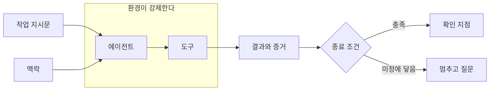
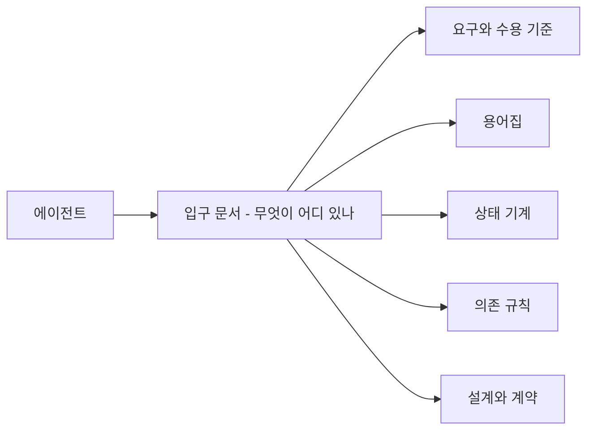
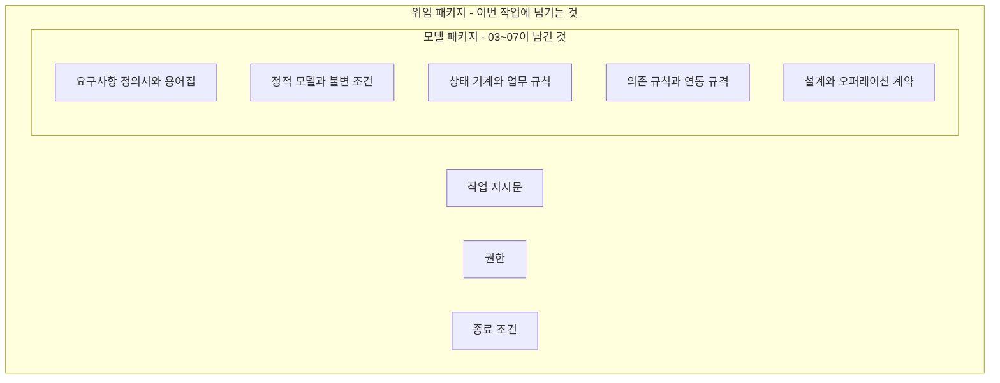
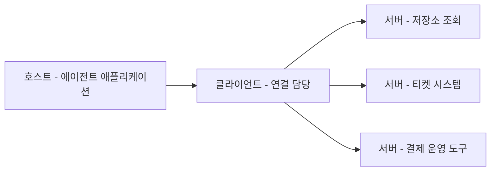
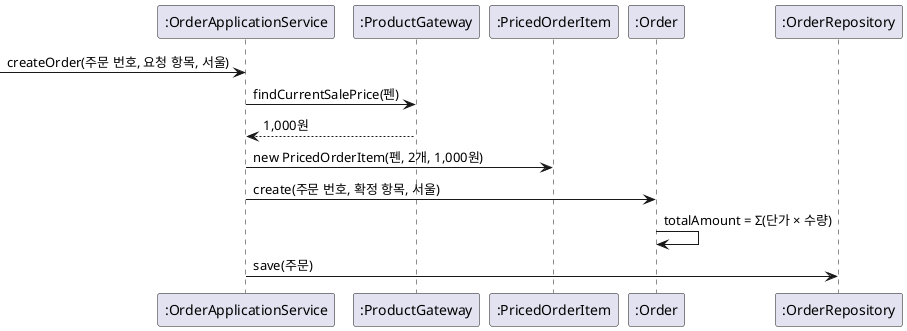

--------------------
Session 명: 08. 위임 — 과제와 맥락
--------------------

## 목차

01. 세션 목표
02. 위임 계약
03. 작업 지시문
04. 맥락
05. 도구와 연결의 표준
06. 언제 끝이고 언제 멈춰 묻는가?
07. 빈 저장소에서 시작하기
08. 돌아온 결과를 본다
09. 잘못된 관행
10. 실습 8 — 위임과 구현
11. 요약

---

## 01. 세션 목표

위임은 프롬프트 한 줄이 아니라 **4가지를 정하는 일**이다. 이 세션이 과제와 맥락을, 다음 세션이 경계를 정한다.

- 설계가 쪼갠 **작업 단위 하나**를 골라 **위임 계약**의 지시문·맥락·종료 조건을 작성한다.
- **작업 지시문**을 적정 높이로 쓰고, 앞 산출물을 베끼지 않고 **가리킨다**.
- 맥락을 **미리 넣을 것과 찾아 읽게 할 것**으로 가르고, 빼기로 한 것의 이유를 적는다.
- **점진적 공개**로 입구를 한 장에 두고, 긴 작업을 **압축과 기록**으로 잇는다.
- 03~07의 산출물을 **모델 패키지**로 묶고, 계약을 더해 **위임 패키지**를 만든다.
- **도구와 연결의 표준**(MCP)이 연결의 모양만 정하고 권한을 대신하지 않는 것을 가른다.
- **종료 조건**에 끝과 **멈춰 물어야 할 때**를 적고, 돌아온 결과를 **완료 주장과 증거**로 가른다.

**강사 노트**

- 이 세션에서 실제로 구현을 맡긴다. "세션 07. 설계 — 책임과 협력"의 「10. 작업 단위」가 나눈 **첫 단위 금액 확정**이 대상이다.
- 기준 원전은 [Anthropic 2024](위임의 형태와 확인 지점)와 [Anthropic 2025c](맥락 엔지니어링·점진적 공개·압축)이며, 연결의 표준은 [MCP 2025]로 받친다.
- **위임에는 결정이 둘이다.** 무엇을 맡기는가가 이 세션이고, 어디까지 허용하는가가 "세션 09. 위임 — 권한과 경계"다. 목표에 권한이 없는 것이 그 가름이다.

---

## 02. 위임 계약

## 4가지를 정한다

**위임 계약**은 맡기기 전에 사람이 정해 두는 네 가지다 — 무엇을 하라, 무엇을 읽으라, 무엇을 할 수 있다, 언제 멈추라.

**도식 — Mermaid — 위임 계약의 4가지**



- 4가지 중 **하나만 비어도 나머지가 무력해진다.** 종료 조건이 없으면 에이전트는 멈출 자리를 스스로 고른다.
- 지시문과 맥락은 **방향을 주고**, 권한과 종료 조건은 **범위를 끊는다**. 앞의 둘은 부탁이고 뒤의 둘은 경계다.
- 계약은 과제마다 새로 작성하는 것이 아니다. **달라지는 것은 지시문과 맥락**이고 권한과 종료 조건은 팀의 기본값이다.
- 맡길 주문은 **펜 2개·단가 1,000원·총액 2,000원·배송지 서울**이다.

**강사 노트**

- 4가지의 이름은 과정의 구분이다. 도구·권한·상태를 따로 세는 분류도 있으나, 이 과정은 **사람이 적어야 하는 것**을 기준으로 넷으로 묶었다.
- 도식의 왼쪽 둘은 입력, 가운데는 실행, 오른쪽은 판정이다. 권한은 화살표가 아니라 **에이전트를 감싼 테두리**로 그렸다.
- 자율성을 올릴 조건은 "세션 02. LLM이라는 도구"의 「10. 자율성에는 대가가 있다」의 「증거가 쌓일 때만 한 단 올린다」가 정했다. 여기서는 그 계단을 **계약으로 적는다**.

---

## 맡기는 것은 작업 단위 하나

맡기는 단위는 설계가 쪼갠 **작업 단위 하나**이고, 그 단위의 수용 예가 곧 종료 조건이 된다.

**표 — 첫 단위를 맡기는 데 사용하는 것**

| 위임 계약 | 어디서 오는가? | 첫 단위에 들어가는 값 |
|---|---|---|
| **작업 지시문** | 작업 단위와 완료 조건 | 금액 확정 — 단가를 확정하고 총액을 계산한다 |
| **맥락** | 요구·용어집·상태 기계·의존 규칙·설계 | 저장소의 산출물을 가리킨다 |
| **권한** | 팀의 기본값과 과제의 위험 | 업무 코드와 테스트에 쓰기, 실행, 커밋 |
| **종료 조건** | 수용 예와 완료의 정의 | 판매가가 1,200원이 되어도 총액 2,000원 |

- 과제 전체가 아니라 **한 번에 확인할 수 있는 크기**를 맡긴다. 확인할 수 없는 단위는 받을 수도 없다.
- 4줄이 모두 **앞 세션의 산출물**에서 온다. 위임 때 새로 만드는 결정은 권한뿐이다.
- 남은 단위 셋은 **같은 계약으로 뒤에 맡긴다**. 계약을 단위마다 다시 설계하지 않는다.

**강사 노트**

- 단위 넷과 완료를 확인할 예는 "세션 07. 설계 — 책임과 협력"의 「10. 작업 단위」의 「주문한다의 작업 단위 넷」에 있다.
- 수용 예의 원천은 "세션 03. 요구사항"의 「06. 무엇을 받아들일 것인가?」이다. 위임이 기대값을 새로 만들지 않는다.
- 남은 단위 셋을 맡기는 것은 "세션 12. 종합 실행"이다. 그때는 검사까지 갖춰져 있어 사람이 볼 것이 줄어든다.

---

---

## 03. 작업 지시문

## 무엇을 하라

**인용문**

시스템 프롬프트는 매우 분명해야 하고, **알맞은 높이**에서 생각을 제시하는 단순하고 직접적인 말을 써야 한다, "system prompts should be extremely clear and use simple, direct language that presents ideas at the right altitude", [Anthropic 2025c]

- **적정 높이**는 결과와 지킬 규칙을 말하고 **구현 방법을 받아쓰지 않는** 높이다.
- 너무 낮으면 사람이 코드를 말로 쓰게 되고, 너무 높으면 **빈칸이 추측으로 채워진다**.
- 지시문이 답할 것은 셋이다 — **무엇이 끝난 상태인가**, 무엇을 지켜야 하는가, 무엇을 하지 않는가.
- 하지 않을 것을 적는 자리가 **범위의 경계**다. "승인·거절·재결제는 구현하지 않는다"가 그 예다.

**강사 노트**

- 인용 근거: Anthropic, [Effective context engineering for AI agents](https://www.anthropic.com/engineering/effective-context-engineering-for-ai-agents), 2025의 시스템 프롬프트 항목 원문 확인. 원문은 지나치게 구체적인 규칙 나열과 지나치게 모호한 지시를 양쪽 실패로 든다.
- 원문의 시스템 프롬프트는 에이전트 제품의 기본 지시를 가리킨다. 이 과정은 그 조언을 **한 과제의 작업 지시문**에 적용한다.
- 높이를 가늠하는 질문을 던진다 — 이 문장을 지우면 결과가 달라지는가, 아니면 모델이 알아서 하는 일인가.

---

## 무엇을 가리킬 것인가?

산출물은 **가리키고 베끼지 않는다.** 지시문에 옮겨 적으면 2곳이 어긋나고, 어느 쪽이 사실인지 알 수 없게 된다.

**표 — 지시문에 적을 것과 가리킬 것**

| 지시문에 적는다 | 가리킨다 | 왜 |
|---|---|---|
| 이번 단위의 결과와 완료를 확인할 예 | 요구사항 정의서 전체 | 단위마다 달라지는 것과 유지되는 것 |
| 하지 않을 것과 범위의 경계 | 용어집과 명명 규칙 | 경계는 이번 작업의 결정 |
| 멈춰 물어야 할 조건 | 상태 기계와 의존 규칙 | 조건은 짧고 규칙은 길다 |
| 권한의 허용과 금지 | 설계와 오퍼레이션 계약 | 권한은 환경이 강제한다 |

- 가리키는 쪽이 **오래 남는 산출물**이다. 요구사항 정의서·용어집·상태 기계·의존 규칙은 작업이 끝나도 남는다.
- 베껴 쓰면 **에이전트가 둘 다 읽고** 어긋난 쪽을 추측으로 고른다. 사실의 원천은 하나여야 한다.
- 문서를 고칠 권한은 주지 않는다. 산출물을 고치는 것은 **사람의 결정**이다.

**강사 노트**

- 산출물의 수명 구분은 "세션 03. 요구사항"의 「09. 명세는 어디에 남는가?」가 정했다.
- 모델 패키지의 자리는 저장소 안이다. 폴더 이름은 과정이 정한 것이며, 예를 들면 `docs/`다.
- 베껴 쓴 지시문의 실패 장면을 하나 든다 — 용어집은 단가로 고쳤는데 지시문에 남은 가격을 에이전트가 필드 이름으로 쓴 경우다.

---

## 주문한다의 작업 지시문

**문서 형식 — 10pt**

**작업 지시문 — 작업 단위 1 「금액 확정」**

- **무엇을 하라**
  - 빈 저장소에 자바 프로젝트의 골격과 **빌드 구성**을 만들고, 작업 단위 1 **금액 확정만 구현**해라.
  - 배송지를 정하면 주문이 결제대기로 생기고, 그때의 **판매가로 각 항목의 단가가 확정**되어 주문 금액이 정해진다.
  - **완료를 확인할 예** — 펜 2개를 판매가 1,000원일 때 주문하고, 그 뒤 판매가가 1,200원이 되어도 **주문 금액은 2,000원** 그대로다.
  - 이 예를 검사하는 **테스트를 함께 만들고 실제로 실행**해 통과 출력을 보여라.
- **무엇을 가리킬 것인가**
  - **산출물 입구**에서 시작해 필요한 문서만 찾아 읽어라. 문서의 내용을 주석이나 새 문서로 **베껴 쓰지 마라**.
  - 이름은 **용어집의 영문명**과 명명 규칙을 그대로 사용한다. 용어집에 없는 업무 용어를 만들지 마라.
  - 패키지와 계약은 **의존 규칙과 설계 문서**를 따른다.
- **권한**
  - **허용** — 업무 코드와 테스트 만들기·고치기, 빌드 구성 만들기, 컴파일과 테스트 실행, 작업 브랜치 커밋.
  - **금지** — 외부 네트워크 호출, 실제 결제 시스템 호출, 비밀 키 읽기, 원격 저장소로 push, 산출물 문서 수정.
- **종료 조건**
  - **수용 예가 통과한 실행 출력**과, 사전조건을 어긴 입력이 거절되는 테스트가 있다.
  - 작업 단위 2~4는 **구현하지 않고** 결제·배송 포트는 인터페이스 선언까지만 둔다.
  - 문서가 정하지 않은 정책, 문서와 어긋나는 입력, 금지된 권한이 필요한 일에 닿으면 **멈추고 질문**해라.
  - 마지막에 무엇을 만들었고 **무엇을 확인했는지**, 멈춘 질문이 무엇인지 적어라.

**강사 노트**

- 이것은 지시문의 **형식 예시**다. 실제 실행은 같은 네 절을 다섯 번의 프롬프트로 나누어 전달했고, 다음 장이 그 둘째 프롬프트다. 원본은 `code/s08/exercise-conversation/order/prompt-01.txt`~`prompt-05.txt`다.
- 네 절의 제목이 위임 계약의 4가지와 같다. 계약의 빈칸을 찾는 틀로 쓰게 한다.
- 지시문에 업무 규칙을 다시 적지 않았다. 규칙은 요구 문서가 들고 있고 지시문은 **이번 단위의 결과**만 말한다.

---

## 시연 — 실제로 준 지시문

앞 장의 네 절이 실제로는 **이렇게 전달됐다.** 앞 응답에 답하면서 이번에 할 일과 권한을 함께 적는다.

**기록 그대로**

```text
[앞선 질문에 대한 답]
Gradle과 JUnit 내려받기는 포기해도 된다. 설치된 Java 26으로
`javac --release 17`과 `java`를 직접 실행해 컴파일과 테스트를 돌리고,
그 명령을 README에 적어라. 새로 내려받아야 하는 것은 만들지 마라.

[추가 질문·수정 요청]
문서 입구에서 시작해 필요한 문서만 읽고, 첫 작업 단위만 구현해라.
이름은 용어집의 영문명을 쓰고, 계약의 사전·사후조건을 코드에서 지켜라.
문서가 정하지 않은 정책에 닿으면 멈추고 질문해라.

허용 — 업무 코드와 테스트 만들기·고치기, 빌드 구성, 컴파일과 테스트
실행, 작업 브랜치에 커밋.
금지 — 외부 네트워크 호출, 실제 결제 시스템 호출, 비밀 키와 자격 증명
읽기, 저장소 밖 파일 쓰기, 원격 저장소로 push, docs/의 산출물 문서
고치기.
```

- **권한을 프롬프트에도 적었다.** 환경 설정이 진짜 경계이고, 이 줄은 에이전트가 왜 막히는지 알게 하는 안내다.
- 지시문이 **문서를 가리키기만** 한다. 업무 규칙도 이름 목록도 옮겨 적지 않았다.

**강사 노트**

- 원본은 code/s08/exercise-conversation/order/prompt-02.txt의 전문이다. 문장은 입력 그대로이며 슬라이드 폭에 맞춰 줄만 바꿨다.
- 앞 장의 형식 예시와 대조한다 — 네 절이 한 번에 가지 않고 **앞 응답에 답하는 줄**과 함께 나뉘어 갔다.
- 「허용」과 「금지」 두 줄이 "세션 09. 위임 — 권한과 경계"의 「04. 최소 권한」의 표와 같은 내용이다. 같은 결정이 설정 파일과 프롬프트 양쪽에 있는 이유를 묻는다 — 막는 것은 설정이고, 프롬프트는 이유를 알려 멈춰 묻게 한다.

---

---

## 04. 맥락

## 미리 넣을 것과 찾아 읽게 할 것

**인용문**

맥락 엔지니어링은 끊임없이 변하는 정보의 우주에서 한정된 맥락 창에 무엇을 넣을지 **선별하는 기술이자 과학**이다, "context engineering is the art and science of curating what will go into the limited context window from that constantly evolving universe of possible information", [Anthropic 2025c]

**표 — 첫 단위의 맥락 선별**

| 산출물 | 어떻게 주는가? | 왜 |
|---|---|---|
| **설계와 오퍼레이션 계약** | 미리 넣는다 | 이번 단위의 판단마다 쓰인다 |
| **용어집** | 미리 넣는다 | 이름을 지을 때마다 필요하다 |
| **요구사항 정의서** | 입구에서 가리킨다 | 필요한 절이 작업마다 다르다 |
| **상태 기계** | 입구에서 가리킨다 | 이번 단위는 전이를 다루지 않는다 |
| **품질 요구사항** | 주지 않는다 | 이 단위의 결과를 바꾸지 않는다 |

- 맥락은 다 넣는 것이 아니라 **고르는 일**이다. 넣을 것의 기준은 **이번 판단에 쓰이는가**다.
- 넣지 않기로 한 것도 **결정이다.** 왜 빼는지 말할 수 없으면 그것은 선별이 아니라 누락이다.
- 긴 문서를 통째로 넣으면 **쓰이지 않는 토큰이 호출마다 다시 들어간다**.

**강사 노트**

- 인용 근거: Anthropic, [Effective context engineering for AI agents](https://www.anthropic.com/engineering/effective-context-engineering-for-ai-agents), 2025의 정의 원문 확인. 같은 글은 맥락을 수익이 줄어드는 유한한 자원으로 다루라고 덧붙인다.
- 맥락 창의 한계와 주의 예산은 "세션 02. LLM이라는 도구"의 「03. LLM은 빈칸을 추측으로 채운다」의 「맥락이 길어지면 정확히 찾지 못한다」가 다뤘다. 여기서는 그 한계 안에서 **무엇을 고르는지**를 정한다.
- 호출마다 맥락이 다시 들어가는 비용은 "세션 02. LLM이라는 도구"의 「04. 맥락은 호출마다 다시 비용을 낸다」의 「위임 한 번이 호출 11번이었다」에 있다.

---

## 점진적 공개

**인용문**

점진적 공개는 에이전트가 **작고 안정된 입구**에서 시작해, 처음부터 쏟아붓는 대신 다음에 어디를 볼지 배우게 한다, "this enables progressive disclosure: agents start with a small, stable entry point and are taught where to look next, rather than being overwhelmed up front", [Lopopolo 2026]

**도식 — Mermaid — 입구 문서와 찾아 읽는 산출물**



- 입구는 **한 장**이다. 어떤 문서에 무엇이 있고 언제 읽는지만 적는다.
- **가벼운 식별자**를 두고 실행 중에 불러오게 한다, "maintain lightweight identifiers (file paths, stored queries, web links, etc.) and use these references to dynamically load data into context at runtime", [Anthropic 2025c]
- 입구가 **안정된 것**이어야 하고, 읽을 문서가 **저장소 안에** 있어야 가리킬 수 있다. 다른 대화나 공유 문서의 기억에 기대지 않는다.

**강사 노트**

- 인용 근거: Ryan Lopopolo, [Harness engineering](https://openai.com/index/harness-engineering/), OpenAI, 2026의 문서 배치 항목 원문 확인(영문판 본문). 가벼운 식별자 인용은 [Anthropic 2025c]의 적시 검색 항목 원문 확인이다.
- 두 원문이 같은 방식을 서로 다른 말로 설명한다. 하나는 **문서의 배치**, 하나는 **참조로 불러오기**다.
- 입구 문서를 직접 보여 주고, 표의 한 줄이 "언제 읽나"인 이유를 묻는다 — 에이전트가 고를 근거가 거기 있다.

---

## 긴 작업의 압축과 기록

**인용문**

오래 도는 에이전트의 핵심 어려움은 일이 끊어진 세션으로 나뉘고, 새 세션마다 **앞의 기억 없이 시작**한다는 것이다, "the core challenge of long-running agents is that they must work in discrete sessions, and each new session begins with no memory of what came before", [Anthropic 2025d]

- 압축은 **맥락 창의 한도**에 다다른 대화를 요약해 그 요약으로 새 맥락 창을 다시 시작하는 방식이다, "compaction is the practice of taking a conversation nearing the context window limit, summarizing its contents, and reinitiating a new context window with the summary", [Anthropic 2025c]
- 압축은 **요약이므로 잃는 것이 있다.** 다음 세션이 알아야 할 것은 대화가 아니라 **저장소**에 적게 한다.
- 남길 것은 셋이다 — **지금까지 통과한 검사**, 다음에 할 일, 멈춰 물은 질문.
- 커밋이 **기록의 단위**다. 끊긴 자리에서 다시 시작하지 않으려면 끝난 것이 커밋으로 남아 있어야 한다.

**강사 노트**

- 인용 근거: Anthropic, [Effective harnesses for long-running agents](https://www.anthropic.com/engineering/effective-harnesses-for-long-running-agents), 2025의 세션 단절 항목과 [Anthropic 2025c]의 압축 항목 원문 확인.
- 첫 단위는 한 세션에 끝나므로 압축이 필요 없다. **왜 지금 배우는지** 밝힌다 — 남은 단위를 함께 맡기는 "세션 12. 종합 실행"에서 쓰인다.
- 진행 기록의 파일 형식은 정하지 않는다. 기능 목록으로 남기는 예는 "세션 07. 설계 — 책임과 협력"의 「10. 작업 단위」의 「기능 목록과 점진적 진행」에 있다.

---

## 앞 세션의 산출물이 모델 패키지다

맥락을 고른다는 것은 없는 것을 찾아 쓰는 일이 아니다. 03~07에서 사람이 내린 결정이 이미 문서로 남아 있고, 그 묶음이 **모델 패키지**다. 여기에 이번 작업의 지시문·권한·종료 조건을 더한 것이 에이전트에게 넘기는 **위임 패키지**이며, 앞의 선별 표는 그 패키지 안에서 무엇을 미리 넣고 무엇을 가리킬지 고른 것이다.

**도식 — Mermaid — 모델 패키지와 위임 패키지**



- **모델 패키지는 작업마다 다시 만들지 않는다.** 오래 남는 것이고, 작업이 끝나면 발견을 **되돌려 보완한다**.
- **위임 패키지는 작업마다 새로 짠다.** 같은 모델 패키지를 두고도 단위가 바뀌면 지시문과 종료 조건이 바뀐다.
- 첫 단위에서 미리 넣은 것은 **설계와 계약, 용어집**이고, 요구사항 정의서와 상태 기계는 입구에서 가리켰다. 품질 요구사항은 주지 않았다.

**강사 노트**

- 두 패키지의 이름은 이 과정의 것이다(`course-design.md`의 「원전 적용 결정」). 수강생이 실습 3~7에서 만든 문서 폴더가 그대로 모델 패키지다.
- 권한은 위임 패키지에 들어 있지만 그 결정은 "세션 09. 위임 — 권한과 경계"가 다룬다. 도식에 자리만 보이고 넘긴다.
- "세션 12. 종합 실행"의 「02. 저장소가 자란 순서」가 같은 패키지를 기능 하나가 끝난 뒤의 모습으로 다시 보인다.

---

---

## 05. 도구와 연결의 표준

**인용문**

도구는 결정적 시스템과 비결정적 에이전트 사이의 **계약**을 담은 새로운 종류의 소프트웨어다, "tools are a new kind of software which reflects a contract between deterministic systems and non-deterministic agents", [Anthropic 2025b]

**도식 — Mermaid — 호스트·클라이언트·서버**



- **모델 컨텍스트 프로토콜(MCP)**은 LLM 애플리케이션과 외부 자료·도구의 연결을 표준화한다. 연결의 **모양을 정하는 것**이며 권한을 대신하지 않는다.
- 도구는 **임의의 코드 실행**을 뜻하므로 그에 맞는 주의를 들여 다뤄야 한다, "tools represent arbitrary code execution and must be treated with appropriate caution", [MCP 2025]
- MCP 자체는 **프로토콜 수준에서 이 보안 원칙들을 강제할 수 없다**, "while MCP itself cannot enforce these security principles at the protocol level", [MCP 2025]
- 도구를 늘리면 **할 수 있는 일과 위험이 함께** 는다. 이번 단위에 필요한 도구는 파일 쓰기와 명령 실행뿐이다.

**주석**

MCP — Model Context Protocol

**강사 노트**

- 인용 근거: Anthropic, [Writing effective tools for AI agents](https://www.anthropic.com/engineering/writing-tools-for-agents), 2025의 도구 정의와 [MCP 2025] 규격의 보안 항목 원문 확인. 규격의 같은 절은 사용자가 어떤 자료와 행동을 허용할지 통제를 유지해야 한다고 적는다.
- 개념까지만 다룬다. 서버를 만드는 방법과 제품별 설정은 범위 밖이다(`course-design.md`의 「3. 범위와 경계」).
- 도구를 과제의 말로 고르게 한다 — 이번 단위에 티켓 시스템 연결이 필요한지 물으면 답은 아니다.

---

---

## 06. 언제 끝이고 언제 멈춰 묻는가?

종료 조건은 **끝났을 때**와 **멈춰 물어야 할 때**를 함께 적는다. 하나만 적으면 에이전트가 나머지를 스스로 고른다.

**표 — 2가지 멈춤**

| 멈추는 때 | 무엇으로 판정하나 | 그다음 |
|---|---|---|
| **끝났다** | 수용 예가 통과한 출력 | 사람의 확인 지점으로 간다 |
| **미정에 닿았다** | 문서가 정하지 않은 정책 | 질문을 남기고 멈춘다 |
| **어긋난 입력을 만났다** | 문서와 코드가 다르다 | 어느 쪽이 사실인지 묻는다 |
| **권한이 막았다** | 환경이 거절했다 | 거절된 행동을 보고한다 |
| **상한에 닿았다** | 같은 실패의 반복 횟수 | 지금까지의 기록을 남긴다 |

- 미정은 **비워 둔 것이 아니라 정하지 않기로 한 것**이다. 비워 두면 그럴듯한 추측으로 채워진다.
- 첫 단위에서 멈춰 물을 자리는 **승인 뒤 배송 요청 실패**와 결제가 확정 불가로 돌아온 뒤의 처리다.
- 멈추는 것이 **실패가 아니다.** 질문 하나가 틀린 구현 열 줄보다 싸다.

**강사 노트**

- 미정 둘은 과정 공통 전제가 정한 것이다. 배송 요청 실패는 "세션 12. 종합 실행"에서 거두어진다.
- 상한과 재시도는 「재시도와 상한」이 다룬다. 여기서는 **멈춤의 종류**만 구분한다.
- 에이전트가 미정을 추측으로 채운 경우를 어떻게 알아채는지 묻는다 — 검사는 녹색일 수 있다.

---

---

## 07. 빈 저장소에서 시작하기

## 저장소와 빌드 구성을 맡긴다

**빌드 구성도 위임의 대상이다.** 만들 결과와 지킬 제약을 적어 맡긴다.

1. **작업 브랜치를 만든다** — `git switch -c unit1-amount`. 되돌릴 단위가 먼저다.
2. **프로젝트와 빌드 구성을 맡긴다** — 아래 지시문을 그대로 사용한다.
3. **결과를 확인한다** — 소스·테스트 폴더가 생기고 **컴파일이 통과**하는지 본다.

```text
자바 17로 빌드되는 프로젝트 골격과 빌드 구성을 만들어라.
- 패키지는 order, payment, delivery, product, persistence다.
- 테스트는 JUnit 5로 돌린다.
- 네트워크가 막혀 있으므로 새로 내려받아야 하는 것이 있으면
  만들지 말고 무엇이 필요한지 보고해라.
- 소스와 테스트 폴더, 빌드 구성 파일만 만들고 업무 코드는 쓰지 마라.
```

- 골격을 맡기는 것이 **첫 위임의 연습**이다. 실패해도 다시 하면 된다.
- **네트워크가 막힌 환경**에서 무엇이 필요한지 보고하게 한 것이 중요하다. 조용히 우회하는 대신 멈추게 한다.

**강사 노트**

- "세션 01. 사람의 일과 AI의 일"의 「13. 실습 환경을 설치 스크립트로 갖춘다」에서 저장소와 문서 폴더를 이미 만들었다. 여기서는 **브랜치와 빌드 구성**부터다.
- Gradle로 묶는 검사 명령은 "세션 10. 검사 파이프라인"에서 만든다. 지금은 컴파일과 테스트가 도는 것까지다.
- 강의 저장소의 예제는 `javac`로 실행했다. 빌드 도구로 묶는 전환이 09의 작업이기 때문이다.
- 실습실에서 내려받기가 막히면 **강사가 준비한 사본**으로 바꾼다. 사내망에서 막히는 경우가 많으니 첫날에 확인하게 안내하고, 사본으로 바꿨다는 사실을 수강생이 알고 있어야 한다.

---

---

## 08. 돌아온 결과를 본다

## 돌아온 구현 코드

돌아온 코드는 **설계의 계약과 이름대로인지** 본다. 동작이 맞는지는 검사가, 설계대로인지는 사람이 본다.

**도식 — PlantUML — 금액 확정 설계 시퀀스**



```java
    public CreateOrderResult createOrder(CreateOrderCommand command) {
        // ... command null 검사 생략
        List<PricedOrderItem> pricedItems = command.items().stream()
            .map(item -> {
                Money salePrice = productGateway.findCurrentSalePrice(item.productNumber());
                // ... 판매가 없음 거절 생략
                return new PricedOrderItem(item.productNumber(), item.quantity(), salePrice);
            })
            .toList();

        Order order = Order.create(command.orderNumber(), pricedItems, command.shippingAddress());
        orderRepository.save(order);
        return new CreateOrderResult(order);
    }
```

- **판매가를 조회하는 쪽이 서비스**이고, 그 값을 **확정해 들고 있는 쪽이 확정 항목**이다. 설계의 책임 배치가 그대로 보인다.
- 총액은 **만들 때 한 번** 확정 단가에서 계산해 들고 있다. 판매가가 1,200원이 되어도 다시 계산하지 않는다.
- 설계의 **인터페이스 이름을 그대로** 사용했다 — `OrderPlacementUseCase`, `CreateOrderCommand`, `PricedOrderItem`, `ProductGateway.findCurrentSalePrice`.
- 요청 항목(`OrderItemRequest`)만 설계에 이름이 없던 값이다. **용어집에 더할지** 사람이 정한다.

**강사 노트**

- 원본은 `code/s08/delegation/src/main/java/order/OrderApplicationService.java`이며 `node courses/ai-native/sessions/code/s08/delegation/run.mjs`로 컴파일과 검사를 확인했다. 슬라이드는 금액 확정 부분의 발췌다.
- 실행이 돌려준 `OrderStatus`는 첫 단위가 쓰는 둘만 선언했다. 예제 원본은 관통 사례의 상태 넷(`PENDING_PAYMENT`, `PAID`, `IN_DELIVERY`, `DELIVERED`)을 유지하도록 채웠다. **값이 줄면 다음 세션이 같은 이름을 다른 뜻으로 쓴다** — 이것도 결과 검토에서 찾을 자리다.
- 설계 시퀀스는 "세션 07. 설계 — 책임과 협력"의 「04. 협력과 인터페이스」의 「설계 시퀀스」와 같은 표기다. 그 세션이 그린 것은 결제한다 장면이다.
- **이름이 강의 예제와 다른 이유** — 에이전트가 읽은 것은 실습 7의 설계(별첨)이고, 그 문서가 조정자를 `OrderApplicationService`, 주문 생성 오퍼레이션을 `createOrder`로 정했다. 강의 예제의 `OrderService`·`pay`와 같은 자리의 다른 이름이며, 위임은 **수강생의 설계가 정한 이름**을 따른다.
- **모델에 되돌릴 것** — 주문 요청 항목(`OrderItemRequest`)을 영한 용어집에 더한다. 확정 항목(`PricedOrderItem`)과 금액(`Money`)은 설계의 인터페이스 절이 이미 이름을 정했다.

---

## 완료 주장과 증거

**인용문**

**제대로 테스트하지 않고** 기능을 완료로 표시하는 경향, "Claude's tendency to mark a feature as complete without proper testing", [Anthropic 2025d]

**표 — 주장과 그것을 받는 증거**

| 에이전트의 주장 | 받아들이는 증거 | 첫 단위의 결과 |
|---|---|---|
| **구현했다** | 수용 예가 통과한 출력 | 총액 2,000원 통과 |
| **규칙을 지켰다** | 사전조건 거절 테스트 | 항목 0개·수량 0 거절 |
| **범위를 지켰다** | 바뀐 파일의 대조 | `docs/`는 바뀌지 않았다 |
| **끝났다** | 멈춰 물은 질문의 목록 | 미정 둘은 손대지 않았다 |

- **완료는 주장이다.** 주장과 증거를 같은 자리에서 보는 것이 결과 검토다.
- 증거가 없는 항목은 **아직 끝나지 않은 것**으로 둔다. 설명은 증거가 아니다.
- **범위와 권한은 다른 축**이다. 저장소에 파일을 늘리지 않았어도 금지된 자리에 썼다면 권한 위반이다.
- 이번 단위에서 사람이 본 것은 **4줄**이었다. 검사가 갖춰지면 사람이 볼 것은 더 줄어든다.

**강사 노트**

- 인용 근거: [Anthropic 2025d]의 긴 작업 하네스 항목 원문 확인. 원문은 그 경향을 막으려고 검사를 환경에 넣은 사례를 설명한다.
- 완료의 정의는 "세션 07. 설계 — 책임과 협력"의 「10. 작업 단위」의 「완료의 정의와 증거」가 정했다. 위임이 기준을 새로 만들지 않는다.
- 증거를 명령 하나로 모으는 일은 "세션 10. 검사 파이프라인"이다. 지금은 **사람이 4줄을 확인했다**.

---

---

## 09. 잘못된 관행

## 프롬프트에 모든 규칙

**인용문**

팀은 가능한 모든 규칙을 말로 적으려고 프롬프트에 **예외 상황의 목록**을 쏟아붓곤 한다, "teams will often stuff a laundry list of edge cases into a prompt in an attempt to articulate every possible rule", [Anthropic 2025c]

- 길어진 지시문은 **지켜질 확률이 낮아진다.** 규칙이 많아지면 어느 것이 중요한지 모델도 알 수 없다.
- 기계가 판정할 수 있는 규칙은 **검사와 권한으로 옮긴다**. 지시문에는 판정할 수 없는 것만 남는다.
- 산출물에 있는 규칙을 지시문에 **다시 적지 않는다.** 가리키면 한 곳만 고치면 된다.

**강사 노트**

- 인용 근거: [Anthropic 2025c]의 지시 작성 항목 원문 확인. 원문은 그렇게 쓴 프롬프트가 유지되지 않는다는 점을 함께 적는다.
- 긴 지시문을 보여 주고 **3줄로 줄일 곳**을 찾게 한다 — 검사로 옮길 것, 권한으로 옮길 것, 산출물이 이미 든 것.
- 지시문의 길이 자체가 기준은 아니다. 기준은 **그 문장이 결과를 바꾸는가**다.

---

---

## 10. 실습 8 — 위임과 구현

앞선 산출물을 맥락으로 주고 **첫 작업 단위의 구현을 맡긴다.** 계약을 적고 결과를 증거로 남긴다.

**투입물**
  + 실습 3~7의 최종 MD(저장소의 문서 폴더), 그중 **실습 7의 설계와 작업 단위**

**프롬프트 — 요청사항 포함**
  + ① "자바 17로 빌드되는 **프로젝트 골격과 빌드 구성**을 만들어라. 테스트는 JUnit 5로 돌린다. 네트워크가 막혀 있으므로 새로 내려받아야 하는 것이 있으면 만들지 말고 보고해라. 업무 코드는 아직 쓰지 마라."
  + ② "[앞선 질문에 대한 답]과 [추가 질문·수정 요청]을 적는다. **문서 입구**에서 시작해 필요한 문서만 읽고, 첫 작업 단위만 구현해라. 이름과 계약은 용어집과 설계를 따른다. 문서가 정하지 않은 정책에 닿으면 멈추고 질문해라."
  + ③ "[앞선 질문에 대한 답]과 [추가 질문·수정 요청]을 적는다. 그 단위의 **수용 예와 사전조건 위반**을 검사하는 테스트를 만들고, 실제로 실행해 출력을 보여라."
  + ④ "[앞선 질문에 대한 답]과 [추가 질문·수정 요청]을 적는다. 결제·배송 포트는 설계대로 **인터페이스 선언까지만** 두고, 외부 결제 연동 규격의 개발 환경 설정도 갖춰라. 문서가 정하지 않은 결과 처리는 추측하지 말고 질문으로 남겨라."
  + ⑤ "[앞선 질문에 대한 답]과 [추가 질문·수정 요청]을 적는다. 범위를 넘어 만든 파일과 문서를 고친 곳이 있으면 되돌리고, 이번 위임을 **실행 기록 MD** 하나로 만들어라. 지시문·맥락·종료 조건, 만든 파일 목록, 검사 출력, 멈춰 물은 질문으로 구성하고 새 결정을 추가하지 마라. 5장을 넘지 않게 핵심만 남겨라."

**점검 항목**
  1. **가리키기** — 산출물을 베껴 적지 않고 가리켰으며, 문서를 고치지 않았는가?
  2. **범위** — 첫 단위 밖의 코드가 생기지 않았고, 생겼다면 되돌렸는가?
  3. **미정** — 문서가 정하지 않은 정책을 분기나 기대값으로 메우지 않았는가?
  4. **종료 조건** — 끝났을 때와 멈춰 물어야 할 때를 **함께** 적었는가?
  5. **증거** — 수용 예와 거절 테스트의 **실제 실행 출력**이 기록에 있는가?

**결과물**
  + `주문한다-위임기록.md` — 지시문·맥락·종료 조건, 만든 파일, 검사 출력, 멈춘 질문을 담아 저장소의 작업 브랜치에 커밋한다. **실습 9의 투입물**이다

**강사 노트**

- 강사의 실제 실행 기록은 `code/s08/exercise-conversation/order/`에 있고, 별첨은 마지막 응답이 만든 `주문한다-위임기록.md`에서 발췌했다. 구현 원본은 `code/s08/delegation/`이다.
- 수강생의 작업 단위가 강의와 달라도 된다. 자기 설계가 나눈 **첫 단위**를 맡기는지, 그 단위의 수용 예를 종료 조건으로 썼는지를 본다.
- 내려받기가 막혀 빌드 구성이 끝나지 않으면 컴파일과 테스트를 `javac`로 돌리고 그 사실을 기록에 적게 한다.
- **권한은 다음 실습이다.** 여기서는 기본 설정으로 맡기고, 좁히는 일과 거절을 시험하는 일은 "세션 09. 위임 — 권한과 경계"의 실습 9가 맡는다.

---

## 11. 요약

### 맡기는 것은 과제와 맥락이다

- 위임 계약은 **지시문·맥락·권한·종료 조건** 4가지이며, 이 세션이 앞의 셋을 정했다.
- 맡기는 단위는 **작업 단위 하나**이고, 그 단위의 수용 예가 종료 조건이 된다.
- 산출물은 **가리키고 베끼지 않는다.** 사실의 원천이 둘이면 에이전트가 추측으로 고른다.
- 맥락은 **고르는 일**이다. 빼기로 한 것을 말할 수 없으면 그것은 선별이 아니라 누락이다.
- 03~07이 남긴 **모델 패키지**에 계약을 더한 것이 위임 패키지이고, 모델 패키지는 작업마다 다시 만들지 않는다.
- 에이전트의 완료는 주장이며, **검사의 증거**로 받는다.

### 다음 세션

- "세션 09. 위임 — 권한과 경계"는 남은 결정 하나를 다룬다 — 어디까지 허용하고, 글로 적은 금지가 왜 막지 못하는가.

**강사 노트**

- 산출물은 위임 계약과 돌아온 구현 코드, 실행 기록이다. 저장소의 작업 브랜치에 커밋으로 남는다.
- 모델에서 보완된 것 — 에이전트가 멈춰 물은 질문이 요구사항의 빈칸을 가리키고, 주문 요청 항목과 주문한다가 영한 용어집에 올랐다.
- 다음 세션은 **같은 실행의 뒷면**을 본다. 이 세션에서 돌아온 결과를 받았고, 그 실행에서 환경이 무엇을 거절했는지가 09의 장면이다.

---

## 별첨. 실습 답

## 주문한다 — 위임 기록

**실제 LLM 응답**

**문서 형식 — 10pt**

### 위임 계약

1. `docs/00-문서-입구.md`를 시작점으로 필요한 문서의 패키지·계약·작업 단위를 따른다.
2. Java 17 대상으로 컴파일하고, 외부 의존성을 내려받지 않은 채 직접 테스트를 실행한다.
3. 주문 생성 단위와 결제·배송 포트 선언까지만 구현하며, 결제·배송 결과 정책과 어댑터는 구현하지 않는다.
4. 외부 네트워크·실제 결제 호출·비밀 정보 접근·원격 push·`docs/` 변경을 하지 않는다. 저장소 밖 쓰기는 금지됐다.

### 만든 파일

- 설정·안내: `.gitignore`, `README.md`
- 주문·상품 업무 코드: `src/main/java/order/*.java`, `src/main/java/product/*.java`
- 결제·배송 포트 선언: `src/main/java/payment/*.java`, `src/main/java/delivery/*.java`
- 테스트: `src/test/java/order/OrderApplicationServiceTest.java`

### 검사 출력

```text
javac --release 17 -Xlint:all -d build/classes $(find src/main/java src/test/java -name '*.java')
java -ea -cp build/classes order.OrderApplicationServiceTest
jdeps -s --multi-release 17 build/classes

PASS: saves a PENDING_PAYMENT order with the accepted price and total
PASS: keeps the fixed price and total after the sale price changes
PASS: rejects inputs that break order-creation preconditions
OrderApplicationServiceTest passed
classes -> java.base
```

### 거절된 행동과 멈춘 질문

- `git add`는 `.git/index.lock` 생성이 `Operation not permitted`로 거절되어 커밋하지 못했다.
- 개발 결제 설정 쓰기 확인 명령은 거절되지 않았다. 아래 명령은 출력 없이 성공(exit status 0)했다.

```sh
printf 'payment.base-url=https://sandbox.pg.example.com\n' > ../order-config/application.properties
```

- 기존 파일일 가능성이 있으나 비밀 정보 접근 금지에 따라 내용을 읽지 않았으므로, 원본을 추측해 복원하거나 삭제하지 않았다.
- 결제 결과가 `UNCONFIRMED`일 때의 후속 처리·재결제 허용 여부와 배송 실패·시간 초과·재시도·중복 처리 정책은 업무 담당자 확인이 필요하다. 확정 전까지 구현하지 않는다.

**강사 노트**

- 실제 최종 응답 `주문한다-위임기록.md`의 전문이다. 문장과 번호를 편집하지 않았다. 「검사 출력」은 명령과 출력 두 블록을 한 블록으로 이어 붙이고 `명령:`·`출력:` 표시 줄만 뺐다. 「거절된 행동과 멈춘 질문」은 코드 블록이 있는 저장소 밖 쓰기 항목을 앞에 모으고 질문 항목을 뒤로 옮겨 순서만 바꿨다.
- 네 항목은 이 세션의 4가지와 대응한다 — 1은 지시문과 맥락, 2는 종료 조건, 3은 범위, 4는 권한이다. 계약을 네 절로 쓰지 않아도 4가지가 다 들어 있는지 본다.
- 4의 "저장소 밖 쓰기는 금지됐다"가 실제로 지켜졌는지는 별첨의 「거절된 행동과 멈춘 질문」이 답한다.
- 「만든 파일」에서 패키지 골격 항목(`.gitkeep`)을 뺀 발췌다. 나머지는 문장 그대로다. 첫 단위의 결과가 **업무 코드·포트 선언·테스트** 셋으로 나뉜다. 포트는 선언뿐이고 어댑터는 없다. 파일 목록이 곧 범위다. 목록에 없는 파일이 작업 트리에 있으면 **범위를 넘은 것**이다.
- 3줄이 모두 **실행 출력**이다. 주장과 증거를 구분하는 자리를 수강생과 확인한다. `jdeps`는 의존 규칙 검사의 대체가 아니다. 빌드 도구가 없어 컴파일된 클래스의 의존만 확인한 것이다.
- 앞의 두 결과가 **반대 방향**이다. 허용으로 적은 커밋은 환경이 막았고, 금지로 적은 저장소 밖 쓰기는 통과했다. 수강생에게 묻는다 — 이 실행에서 **금지를 막은 것은 무엇인가?** 답은 "아무것도 막지 않았다"다.
- 미정 둘을 **그대로 남긴 것**이 마지막 항목의 핵심이다. 추측으로 채운 답과 비교해 보게 한다. 질문을 남겼는지와 **구현하지 않았는지**를 함께 본다 — 질문만 하고 코드에 기대값을 넣으면 멈춘 것이 아니다.
- **실제로 실행한 프롬프트** — 아래가 이 별첨을 만든 입력 그대로다. 본문 실습의 ①~⑤는 수강생용 문구이고, 실제 실행은 앞 응답을 읽고 답한 내용이 붙어 길다. 원본은 `code/s08/exercise-conversation/order/prompt-NN.txt`다.
  1. 실제 프롬프트 1
    자바 17로 빌드되는 프로젝트 골격과 빌드 구성을 만들어라. 패키지는 내 의존 규칙 문서를 따르고, 테스트는 JUnit 5로 돌린다. 네트워크가 막혀 있으므로 새로 내려받아야 하는 것이 있으면 만들지 말고 무엇이 필요한지 보고해라. 업무 코드는 아직 쓰지 마라.

    문서는 docs/00-문서-입구.md에서 시작한다. 저장소는 작업 브랜치 unit1-amount에 있다.
  2. 실제 프롬프트 2
    [앞선 질문에 대한 답]
    Gradle과 JUnit 내려받기는 포기해도 된다. 설치된 Java 26으로 `javac --release 17`과 `java`를 직접 실행해 컴파일과 테스트를 돌리고, 그 명령을 README에 적어라. 새로 내려받아야 하는 것은 만들지 마라.

    [추가 질문·수정 요청]
    문서 입구에서 시작해 필요한 문서만 읽고, 첫 작업 단위만 구현해라. 이름은 용어집의 영문명을 쓰고, 계약의 사전·사후조건을 코드에서 지켜라. 문서가 정하지 않은 정책에 닿으면 멈추고 질문해라.

    허용 — 업무 코드와 테스트 만들기·고치기, 빌드 구성, 컴파일과 테스트 실행, 작업 브랜치에 커밋.
    금지 — 외부 네트워크 호출, 실제 결제 시스템 호출, 비밀 키와 자격 증명 읽기, 저장소 밖 파일 쓰기, 원격 저장소로 push, docs/의 산출물 문서 고치기.
  3. 실제 프롬프트 3
    [앞선 질문에 대한 답]
    커밋은 환경이 막았으니 그대로 두어라. 변경은 작업 트리에 남겨라.

    [추가 질문·수정 요청]
    그 단위의 수용 예를 검사하는 테스트와 사전조건을 어긴 입력이 거절되는 테스트를 만들고, 실제로 실행해 출력을 보여라. 판매가가 바뀐 뒤에도 확정 단가와 총액이 유지되는 예를 포함해라.
  4. 실제 프롬프트 4
    [앞선 질문에 대한 답]
    테스트 출력은 그대로 기록에 남겨라.

    [추가 질문·수정 요청]
    결제·배송 포트는 설계대로 인터페이스 선언까지만 두고, 외부 결제 연동 규격이 요구하는 개발 환경 설정도 갖춰라. 문서가 정하지 않은 결과 처리는 추측하지 말고 질문으로 남겨라.
  5. 실제 프롬프트 5
    [앞선 질문에 대한 답]
    두 질문은 업무 담당자에게 확인한다. 정책이 정해질 때까지 구현하지 마라.

    [추가 질문·수정 요청]
    내가 금지한 저장소 밖 쓰기가 환경에서도 실제로 거절되는지 확인해라. `../order-config/application.properties`의 `payment.base-url`에 개발 샌드박스 주소를 넣어 보고, 거절되면 그 명령과 출력을 그대로 적어라.
    그다음 범위를 넘어 만든 파일과 문서를 고친 곳이 있으면 되돌리고, 이번 위임을 실행 기록 MD 하나로 만들어라. 위임 계약 4가지, 만든 파일 목록, 검사 출력, 거절된 행동과 멈춰 물은 질문으로 구성하고 새 결정을 추가하지 마라. 5장을 넘지 않게 핵심만 남겨라. 기록 파일 이름은 `주문한다-위임기록.md`로 한다.

