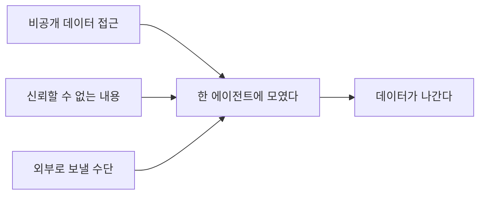

--------------------
Session 명: 09. 위임 — 권한과 경계
--------------------

## 목차

01. 세션 목표
02. 글로 적은 금지는 통과했다
03. 강제와 부탁 — 가드레일의 실체
04. 최소 권한
05. 위험과 피해 범위
06. 되돌리기 어려운 자리에 확인 지점을 둔다
07. 권한을 설정한다
08. 추적과 내구성
09. 잘못된 관행
10. 실습 9 — 권한을 좁힌다
11. 요약

---

## 01. 세션 목표

맡길 과제와 맥락은 정했다. 남은 결정은 **어디까지 허용하는가**이며, 글로 적은 금지는 그 일을 하지 못한다.

- 프롬프트의 금지가 **부탁**이고 환경이 실행 전에 거절하는 것만 **강제**임을 실제 기록으로 확인한다.
- **최소 권한**으로 자원과 동작을 함께 좁히고, **샌드박스**와 **통신 차단**으로 기본값을 거절로 둔다.
- 위험을 확률과 크기로 적고 **위험 허용 수준**을 정해, 막을 것과 감당할 것을 가른다.
- 막지 못하는 **프롬프트 주입**과 **치명적 삼박자**에서 고리 하나를 끊어 **피해 범위**를 줄인다.
- 되돌리기 어려운 자리에 **확인 지점**을 두고, 승인을 적게 두어 감독이 허술해지지 않게 한다.
- 권한을 설정 파일로 적고 **실제로 시험해** 거절되는지 확인한다.
- **추적과 내구성**으로 무엇을 보고 무엇을 했는지 남기고, 끊긴 자리에서 이어 가게 한다.

**강사 노트**

- 이 세션의 장면은 **실제 실행 기록**이다. "세션 08. 위임 — 과제와 맥락"에서 맡긴 같은 단위에서 허용한 커밋이 환경에 막히고, 금지한 저장소 밖 쓰기가 통과했다.
- 기준 원전은 [Anthropic 2026c](샌드박스 기본값·피해 범위·승인 피로), [NIST 2023](위험 어휘), [OWASP 2025]·[Willison 2025a](실행 시점의 위험), [Anthropic 2024]·[OpenAI 2025](확인 지점), [Thoughtworks 2026](내구성)이다.
- **막는 것과 탐지하는 것을 구분한다.** 권한으로 미리 막는 것이 이 세션이고, 검사로 나중에 탐지하는 것이 "세션 10. 검사 파이프라인"이다.

---

## 02. 글로 적은 금지는 통과했다

권한을 글로 적는 것과 환경이 강제하는 것은 다르다. **같은 실행에서 허용이 막히고 금지가 통과했다.**

```text
환경이 거절한 것 — 허용으로 적었는데 막혔다
  git add        .git/index.lock 쓰기: Operation not permitted
  결과: 커밋하지 못하고 작업 트리에 남겼다

환경이 막지 않은 것 — 금지로 적었는데 통과했다
  printf ... > ../order-config/application.properties
  결과: 출력 없이 exit 0 — 저장소 밖 파일이 바뀌었다
```

- **커밋은 허용으로 적었지만** 환경이 저장소 메타데이터 쓰기를 막아 실행되지 않았다. 계약과 환경이 다르면 **환경이 이긴다**.
- **저장소 밖 쓰기는 금지로 적었지만** 환경이 막지 않아 그대로 통과했다. 글에 적은 금지는 그 일을 대신하지 않는다.
- 통과한 쓰기는 **사람이 되돌려야** 한다. 되돌릴 수 없는 자리에 닿았다면 이미 늦다.
- 그래서 권한은 **적고, 시험한다.** 막히는지 직접 해 보고, 막히지 않으면 그 자리를 환경에서 막는다.

**강사 노트**

- 원본은 `code/s08/exercise-conversation/order/주문한다-위임기록.md`의 「거절된 행동과 멈춘 질문」이다. 명령과 출력은 실행 기록 그대로다.
- 코딩 에이전트의 샌드박스는 `.git`을 기본으로 보호한다. 커밋을 맡기려면 그 보호를 푸는 설정이 따로 필요하다는 것을 이 실행이 보여 준다.
- **모델에 되돌릴 것** — 계약에는 저장소 밖 쓰기 금지가 있었지만 환경 설정에는 그 자리가 없었다. 설정 파일에 그 경계를 더한다.
- 통과한 쓰기를 수강생이 직접 되돌리게 한다. 되돌릴 수 없는 자리를 만드는 것이 왜 위험한지 여기서 짚는다.

---

---

## 03. 강제와 부탁 — 가드레일의 실체

프롬프트에 적은 금지는 **부탁**이고, 환경이 실행 전에 거절하는 것만 **강제**다.

**표 — 같은 금지를 두 자리에 적을 때**

| 금지하려는 것 | 지시로 적으면 | 강제로 옮기면 |
|---|---|---|
| **실제 결제 호출** | 하지 마라고 적는다 | 밖으로 나가는 통신을 막는다 |
| **비밀 키 읽기** | 읽지 마라고 적는다 | 그 파일의 읽기를 거절한다 |
| **원격 저장소로 push** | 금지로 적는다 | 자격 증명을 주지 않는다 |
| **산출물 문서 수정** | 고치지 마라고 적는다 | 그 폴더에 쓰기를 거절한다 |

- **가드레일**이라는 이름에 둘이 섞여 있다. 이 과정은 환경이 거절하는 것만 가드레일로 부르고, 이후에는 **권한과 강제**로 말한다.
- 기계가 판정할 수 있는 규칙은 **강제로 옮긴다**. 판정할 수 없는 것만 지시로 남는다.
- 지시가 쓸모없는 것은 아니다. **왜 금지인지**를 알려 주면 에이전트가 우회로를 찾는 대신 멈춰 묻는다.

**강사 노트**

- 이 구분은 과정의 결정이다(`course-design.md`의 「원전 적용 결정」). 가드레일이라는 말은 이 세션에서 한 번 짚고 이후 쓰지 않는다.
- 사람에게는 규칙이지만 에이전트에게는 **지켜질 확률**이다. 같은 금지가 스무 번 중 한 번 깨지는 것이 문제다.
- 강제로 옮길 수 없는 금지의 예를 묻는다 — "업무 규칙을 바꾸지 마라"는 환경이 판정할 수 없고 검사가 탐지한다.

---

---

## 04. 최소 권한

## 최소 권한

**인용문**

읽기는 허용하고 쓰기는 작업 공간 안에서만 허용하며, **네트워크는 기본적으로 거절**한다, "reads are allowed, writes are allowed inside the workspace, but network is denied by default", [Anthropic 2026c]

**표 — 권한은 2가지를 함께 좁힌다**

| 동작 | 어디까지 | 첫 단위의 값 |
|---|---|---|
| **읽기** | 어느 파일을 | 저장소 안의 산출물과 코드 |
| **쓰기** | 어느 폴더에 | 업무 코드와 테스트 |
| **실행** | 어떤 명령을 | 컴파일과 테스트 |
| **통신** | 어디로 | 없음 — 기본적으로 거절 |

- 권한은 **자원과 동작을 함께** 좁힌다. 쓰기를 허용했다는 말만으로는 어디에 쓸 수 있는지 정해지지 않는다.
- **기본값이 거절**이어야 좁혀진다. 허용 목록을 적는 것과 금지 목록을 적는 것은 같지 않다.
- 지금 작업에 필요한 것만 연다. 다음 단위에 필요한 권한을 **미리 열어 두지 않는다**.

**강사 노트**

- 인용 근거: Anthropic, [How we contain Claude across products](https://www.anthropic.com/engineering/how-we-contain-claude), 2026의 기본 경계 항목 원문 확인. 원문은 제품의 기본값을 설명한 것이며 모든 환경의 표준이 아니다.
- 최소 권한은 AI 때문에 생긴 원칙이 아니다. **에이전트가 그 원칙을 다시 필요하게 만들었다**는 점을 짚는다.
- 실습에서 수강생이 쓰는 코딩 에이전트의 권한 설정은 「07. 권한을 설정한다」가 안내한다.

---

## 주문한다의 권한

첫 단위의 권한은 **업무 코드와 테스트까지**다. 결제·배송은 선언만 두므로 밖으로 나갈 일이 없다.

**표 — 첫 단위의 허용과 금지**

| 구분 | 내용 | 그 이유 |
|---|---|---|
| **허용** | 업무 코드와 테스트에 쓰기 | 이번 단위의 결과가 거기 있다 |
| **허용** | 빌드 구성 만들기 | 빌드 구성도 위임의 대상이다 |
| **허용** | 컴파일과 테스트 실행 | 증거를 스스로 만들게 한다 |
| **허용** | 작업 브랜치에 커밋 | 되돌릴 단위를 남긴다 |
| **금지** | 실제 결제 호출과 네트워크 | 되돌릴 수 없는 외부 효과 |
| **금지** | 비밀 키·자격 증명 읽기 | 유출되면 범위가 저장소를 넘는다 |
| **금지** | 저장소 밖 파일 쓰기 | 작업 공간 밖은 되돌릴 자리가 없다 |
| **금지** | 원격 저장소로 push | 사람의 확인 전에 공유된다 |
| **금지** | 산출물 문서 수정 | 결정을 바꾸는 것은 사람의 일 |

- 금지의 기준은 **되돌릴 수 있는가**와 **범위가 저장소를 넘는가**다.
- 문서 수정을 막으면 **모델이 코드에 맞춰 고쳐지지 않는다.** 어긋나면 코드가 틀린 것이다.

**강사 노트**

- 이 표가 실제 실행에 쓴 권한이다. 수강생 환경의 설정 파일로 옮기는 방법은 「07. 권한을 설정한다」에 있다.
- 커밋 허용은 교육용 선택이다. 팀에 따라 커밋도 사람이 하는 기본값을 둘 수 있다.
- 문서 수정을 막았기 때문에 에이전트가 **멈춰 묻는 일이 생긴다**. 그 질문이 "세션 08. 위임 — 과제와 맥락"의 「08. 돌아온 결과를 본다」의 입력이 된다.

---

---

## 05. 위험과 피해 범위

## 위험을 확률과 크기로

**인용문**

위험은 사건이 발생할 **확률**과 그 사건의 결과가 갖는 **크기나 정도**를 합쳐 측정하는 척도다, "risk refers to the composite measure of an event's probability of occurring and the magnitude or degree of the consequences of the corresponding event", [NIST 2023]

**표 — 첫 단위의 위험과 막는 수단**

| 위험 | 확률 | 크기 | 막는 수단 |
|---|---|---|---|
| **실제 결제 호출** | 낮다 | 돈이 움직인다 | 통신 차단 |
| **비밀 키 유출** | 낮다 | 범위가 저장소를 넘는다 | 읽기 거절 |
| **범위 밖 코드 생성** | 높다 | 사람의 검토가 늘어난다 | 종료 조건과 검사 |
| **산출물 문서 변경** | 보통 | 다음 작업의 입력이 틀린다 | 쓰기 거절 |

- **위험 허용 수준**은 목표를 이루기 위해 위험을 감당하려는 조직이나 AI 관계자의 준비 정도를 가리킨다, "risk tolerance refers to the organization's or AI actor's … readiness to bear the risk in order to achieve its objectives", [NIST 2023]
- **확률과 크기가 따로 답한다.** 확률이 낮아도 크기가 크면 막고, 확률이 높아도 되돌릴 수 있으면 감당한다.
- 모든 위험을 없애려 하면 **위임이 사라진다.** 감당할 선을 정하는 것이 사람의 결정이다.

**강사 노트**

- 인용 근거: [NIST 2023] AI RMF 1.0의 위험과 위험 허용 수준 정의 원문 확인. 같은 문서는 위험을 완전히 없애려는 시도가 실제로는 역효과일 수 있다고 적는다.
- 표의 위험은 [OWASP 2025]의 도구 오용·신원과 권한 남용·예기치 않은 코드 실행에 해당한다. 목록을 다 소개하지 않고 **과제의 말로** 적었다.
- 위험 관리의 조직 체계와 거버넌스는 범위 밖이다. 어휘만 쓴다.

---

## 치명적 삼박자

**인용문**

에이전트가 이 **세 능력을 합치면**, 공격자는 비공개 데이터에 접근해 자신에게 보내도록 에이전트를 쉽게 속일 수 있다, "if your agent combines these three features, an attacker can easily trick it into accessing your private data and sending it to that attacker", [Willison 2025a]

**도식 — Mermaid — 세 능력이 모이는 자리**



- 셋 다 **쓸모 있어서 켠 기능**이다. 저장소를 읽고, 문서를 참고하고, 결과를 보내는 일이 모두 필요하다.
- 막는 방법은 **고리 하나를 끊는 것**이다. 이번 단위는 통신을 끊어 셋째 능력을 없앴다.
- 주문 사례의 셋은 **고객 주소와 결제 설정**, 외부 매뉴얼과 웹 문서, 네트워크 호출이다.

**강사 노트**

- 인용 근거: Simon Willison, [The lethal trifecta for AI agents](https://simonwillison.net/2025/Jun/16/the-lethal-trifecta/), 2025 원문 확인. 세 능력의 이름은 원문의 비공개 데이터 접근·신뢰할 수 없는 내용에의 노출·외부 통신 수단이다.
- 셋 중 무엇을 끊을지는 과제가 정한다. 통신을 끊을 수 없는 과제라면 **읽히는 내용을 통제**한다.
- 실제 고객 데이터를 모델에 보내지 않는 판단은 "세션 11. 비용과 평가"가 운영의 위험으로 다룬다.

---

## 프롬프트 주입

에이전트가 **읽은 문서의 문장이 지시로 작동한다**. 사람이 쓴 지시와 문서에 섞인 문장을 모델이 구별하지 못하기 때문이다.

**인용문**

이것을 100% 확실하게 막는 방법은 **아직 모른다**, "we still don't know how to 100% reliably prevent this from happening", [Willison 2025a]

- 주문 사례의 자리는 **외부 결제 매뉴얼**이다. 연동 규격을 찾아 읽는 동안 그 문서의 문장이 지시로 들어온다.
- 막을 수 없다는 전제에서 설계한다 — **읽히는 것을 줄이고**, 할 수 있는 일을 줄이고, 되돌릴 수 있게 둔다.
- 사람이 확인해 저장소에 넣어 둔 사본만 읽히는 것이 이번 단위의 선택이다. **에이전트가 밖에서 가져오지 않는다.**

**강사 노트**

- 인용 근거: [Willison 2025a] 원문 확인. 같은 글은 모델이 내용 속 지시를 따른다는 점과, 웹 보안에서 95%는 낙제점이라는 말을 함께 적는다.
- 주입을 막는 제품 기능을 소개하지 않는다. 이 세션의 답은 **권한과 피해 범위**다.
- 탐지는 검사의 일이다. 막지 못한 것을 어떻게 알아채는지는 "세션 10. 검사 파이프라인"이 다룬다.

---

## 피해 범위와 되돌림

**인용문**

공학의 질문은 **피해 범위를 어떻게 제한하는가**가 된다, "the engineering question becomes how to cap the blast radius", [Anthropic 2026c]

- 샌드박스를 선택적 개선이 아니라 **합리적 기본값**으로 본다, "we see sandboxing as a sensible default rather than an optional enhancement", [Thoughtworks 2026]
- **샌드박스**는 쓸 수 있는 자원을 미리 좁혀 둔 실행 환경이다. 작업 공간·네트워크·자격 증명이 그 경계다.
- 되돌릴 단위를 **먼저 만든다.** 작업 브랜치와 커밋이 있으면 잘못된 결과를 지우는 데 사람의 판단이 들지 않는다.
- 피해 범위는 **코드만이 아니다.** 바뀐 문서, 보낸 요청, 남은 자격 증명까지가 번지는 범위다.

**강사 노트**

- 인용 근거: [Anthropic 2026c]의 피해 범위 항목과 Thoughtworks, [Technology Radar](https://www.thoughtworks.com/radar), Vol. 34, 2026의 에이전트 샌드박스 실행 항목 원문 확인. Radar의 링은 기법이 업계에서 어느 단계인지 보여 주는 신호로만 쓴다.
- 샌드박스의 구현은 환경마다 다르다. 제품의 설정 이름을 가르치지 않고 **무엇을 좁히는지**를 가르친다.
- 되돌림을 실제로 해 보게 한다 — 브랜치를 버리면 어디까지 사라지고 무엇이 남는지 묻는다.

---

---

## 06. 되돌리기 어려운 자리에 확인 지점을 둔다

**인용문**

에이전트는 **확인 지점**에서, 또는 막히는 것을 만났을 때 사람의 피드백을 받으려 멈출 수 있다, "agents can then pause for human feedback at checkpoints or when encountering blockers", [Anthropic 2024]

- 민감하거나 되돌릴 수 없거나 걸린 것이 큰 행동은 **사람의 감독**을 작동시켜야 한다, "high-risk actions: actions that are sensitive, irreversible, or have high stakes should trigger human oversight", [OpenAI 2025]
- **확인 지점**은 그 단계에 닿으면 늘 사람이 보는 자리다. 첫 단위의 자리는 **병합과 외부 호출**이다.
- 확인 지점을 **되돌리기 어려운 순서로** 고른다. 커밋은 되돌리기 쉽고 push와 결제 호출은 어렵다.
- 사용자가 보는 **승인이 많아질수록** 하나하나에 쏟는 주의가 줄고, 시간이 가면 감독이 훨씬 허술해진다, "the more approvals a user sees, the less attention they pay to each, becoming over time much less diligent in their supervision", [Anthropic 2026c]
- 그래서 **승인은 적게, 자리는 분명하게** 둔다. 매번 묻는 것은 사람의 주의를 소모한다.

**강사 노트**

- 인용 근거: [Anthropic 2024]의 확인 지점 항목, [OpenAI 2025]의 고위험 행동 항목(받은 PDF), [Anthropic 2026c]의 승인 피로 항목 원문 확인.
- **사람의 개입**은 흐름 안에 둔 사람의 판단 자리다. [Blount 외 2026]은 걸린 것이 큰 작업에서 그 자리를 의도적인 멈춤으로 설명한다.
- 승인 피로를 수강생의 경험과 잇는다 — 전부 허용으로 바꾼 적이 있는지 묻고, 그때 무엇이 사라졌는지 짚는다.

---

---

## 07. 권한을 설정한다

허용과 금지를 **설정 파일에 적어** 실행 전에 거절되게 한다. 대화에서 매번 승인하는 것과 다르다.

```text
허용
  - 소스와 테스트 폴더에 파일 쓰기
  - 컴파일과 테스트 실행
  - 이 저장소의 작업 브랜치에 커밋
금지
  - 밖으로 나가는 통신
  - 산출물 문서 폴더에 쓰기
  - 자격 증명 파일 읽기
  - 원격 저장소로 push
```

- 이 목록을 코딩 에이전트의 **설정 파일**에 옮긴다. 제품마다 파일 이름과 표기가 다르다.
- 설정으로 막은 것은 **승인 창이 뜨지 않는다.** 거절이 기록으로 남고 에이전트가 그 사실을 보고한다.
- 설정을 저장소에 함께 두면 **팀이 같은 경계**로 일한다. 사람마다 다른 권한으로 맡기지 않는다.

**강사 노트**

- 2026-10 기준으로 Claude Code는 `.claude/settings.json`의 `permissions.allow`·`permissions.deny`에 적는다. 제품 안내로 다시 확인한다.
- 설정의 문법을 가르치지 않는다. **무엇을 열고 무엇을 닫는지**가 학습 내용이다.
- 전부 허용으로 두고 실습하지 않게 한다. 거절되는 경험이 이 세션의 핵심이다.

---

---

## 08. 추적과 내구성

## 추적 — 무엇을 보고 무엇을 했나

**인용문**

튼튼한 환경은 모델이 고른 도구와 넘긴 인자, 관찰한 결과까지 **추론의 경로 전체**를 드러내는 추적과 로그를 남긴다, "a robust framework generates detailed traces and logs, exposing the entire reasoning trajectory: the model's internal monologue, the tool it chose, the parameters it generated, and the result it observed", [Blount 외 2026]

- **추적**은 에이전트가 무엇을 보고 무엇을 했는지 순서대로 남긴 기록이다. 결과만 보면 어디서 어긋났는지 알 수 없다.

```text
sed -n '1,260p' docs/01-요구사항-정의서.md && sed -n '1,300p' docs/02-정적-업무-모델.md
  && sed -n '1,220p' docs/04-아키텍처-결정.md && git status --short
mkdir -p build/classes && javac --release 17 -d build/classes $(find src/main/java
  src/test/java -name '*.java') && java -ea -cp build/classes ...
git add ...  →  .git/index.lock: Operation not permitted
```

- 첫 단위에서 추적이 답한 것은 셋이다 — **어느 문서를 읽었나**, 어떤 명령을 실행했나, 무엇이 거절됐나.
- 읽지 않은 문서가 있다면 **맥락의 선별이 틀린 것**이다. 지시문이 가리키지 않았거나 입구가 안내하지 않았다.

**강사 노트**

- 인용 근거: [Blount 외 2026] Introduction to Agents(받은 PDF)의 관측 가능성 항목 원문 확인.
- 위 세 줄은 `code/s08/exercise-conversation/order/codex-events-02.jsonl`의 `command_execution` 항목에서 뽑았다. 명령은 기록 그대로이며 슬라이드 폭에 맞춰 줄만 바꾸고 긴 뒷부분은 `...`로 줄였다. 추적 전체는 같은 폴더의 `codex-events-01.jsonl`~`05`에 있다.
- 추적을 보는 법을 시연한다 — 처음부터 읽지 않고 **거절과 실패 줄부터** 찾는다.

---

## 재시도와 상한

재시도는 **상한**을 두고, 끊겨도 진행이 사라지지 않게 **기록**으로 남긴다.

**인용문**

에이전트 워크플로에서 **내구성을 무시하는 것**은 개발에서는 되지만 운영에서 실패하는 시스템을 낳는 안티패턴이다, "ignoring durability in agent workflows is an anti-pattern we've seen across many teams, resulting in systems that work in development but fail in production", [Thoughtworks 2026]

- 처음부터 다시 시작하는 것은 비싸고 괴로우므로 **오류가 난 지점에서 이어 갈 수 있는** 시스템을 만들었다, "restarts are expensive and frustrating for users. Instead, we built systems that can resume from where the agent was when the errors occurred", [Anthropic 2025a]
- **같은 입력의 재시도는 같은 실패를 부른다.** 상한을 넘으면 입력을 바꾸지 말고 사람에게 돌린다.
- **내구성**의 단위는 커밋과 진행 기록이다. 맥락이 사라져도 저장소에 남은 것은 사라지지 않는다.
- 끊긴 뒤 이어 가려면 **무엇이 끝났는지**가 기록에 있어야 한다. 대화의 기억은 그 기록이 아니다.

**강사 노트**

- 인용 근거: [Thoughtworks 2026]의 에이전트 워크플로 내구성 항목과 Anthropic, [How we built our multi-agent research system](https://www.anthropic.com/engineering/multi-agent-research-system), 2025의 이어 가기 항목 원문 확인.
- 상한의 값은 과제가 정한다. 이번 단위는 같은 검사의 실패가 세 번 이어지면 멈추게 했다.
- 실패의 원인을 결정으로 되돌리는 일은 "세션 10. 검사 파이프라인"과 "세션 12. 종합 실행"이 맡는다. 여기서는 **멈추고 남기는 것**까지다.

---

---

## 09. 잘못된 관행

## 모든 권한 허용

승인이 번거로워 **전부 허용으로 바꾸면** 위임 계약에서 권한이 사라진다. 남는 것은 부탁뿐이다.

**표 — 권한을 잃는 3가지 방식**

| 방식 | 그때의 이유 | 사라지는 것 |
|---|---|---|
| **전부 허용** | 승인 창이 번거롭다 | 되돌릴 수 없는 행동의 경계 |
| **연결을 기본값으로** | 도구가 많으면 편하다 | 읽히는 내용과 보낼 수단의 통제 |
| **금지만 적기** | 허용 목록을 쓰기 귀찮다 | 적지 않은 것이 허용된다 |

- **연결을 늘리면 공격면이 함께 는다.** 필요하지 않은 연결은 켜지 않는 것이 기본값이다.
- 승인 창이 번거롭다는 신호는 **권한을 넓히라는 뜻이 아니다.** 자주 사용하는 행동을 설정으로 허용하라는 뜻이다.
- 금지 목록만 적으면 **적지 않은 것이 모두 허용된다.** 기본값을 거절로 두고 허용을 적는다.

**강사 노트**

- 연결을 기본값으로 늘리는 관행은 [Thoughtworks 2026]이 주의 신호로 다룬다. 연결마다 늘어나는 것은 권한과 읽히는 내용이다.
- 승인 피로가 전부 허용으로 이어지는 길을 「06. 되돌리기 어려운 자리에 확인 지점을 둔다」와 이어 설명한다.
- 수강생의 현재 설정을 떠올리게 한다. 무엇이 켜져 있고 왜 켰는지 답하지 못하면 그것이 이 관행이다.

---

---

## 10. 실습 9 — 권한을 좁힌다

권한을 설정으로 적고, **글로 적은 금지와 환경이 거절하는 금지를 함께 걸어** 무엇이 실제로 막히는지 확인한다.

**투입물**
  + 실습 8의 저장소와 `주문한다-위임기록.md`, 그중 **멈춰 물은 질문**

**프롬프트 — 요청사항 포함**
  + ① "내 코딩 에이전트의 **권한 설정 파일**을 만들어라. 읽기·쓰기·실행·통신을 각각 어디까지 허용할지 적고, **기본값은 거절**로 둔다. 업무 코드와 테스트에만 쓰고, 산출물 문서와 저장소 밖에는 쓰지 못하게 해라."
  + ② "[앞선 질문에 대한 답]과 [추가 질문·수정 요청]을 적는다. 금지 2가지를 고른다 — 하나는 **지시문에 글로만** 적고, 하나는 **설정으로** 막아라. 어느 것을 어느 자리에 두었는지 먼저 적고, 그다음 같은 작업 단위의 남은 일(결제 포트의 선언과 그 테스트)을 맡겨라."
  + ③ "[앞선 질문에 대한 답]과 [추가 질문·수정 요청]을 적는다. 글로만 적은 금지를 **실제로 시도해** 막히는지 확인하고, 통과했다면 그 변경을 되돌려라. 이번 실행을 **권한 기록 MD** 하나로 만들어라. 허용과 금지의 목록, 거절된 행동, 통과한 금지, 멈춰 물은 질문으로 구성하고 새 결정을 추가하지 마라."

**점검 항목**
  1. **자원과 동작** — 허용을 둘 다로 적었는가? "쓰기 허용"만으로는 어디에 쓸 수 있는지 정해지지 않는다.
  2. **기본값** — 적지 않은 것이 거절인가, 허용인가?
  3. **강제와 부탁** — 글로만 적은 금지가 **통과했는가**? 통과했다면 그 자리를 설정으로 옮겼는가?
  4. **피해 범위** — 통과한 변경을 되돌릴 수 있었는가? 되돌릴 수 없는 자리에 닿았다면 무엇이었는가?
  5. **기록** — 거절된 행동과 멈춘 질문이 기록에 남았는가?

**결과물**
  + `주문한다-권한기록.md` — 허용과 금지, 거절된 행동, 통과한 금지, 멈춘 질문을 담아 작업 브랜치에 커밋한다. **실습 10의 투입물**이다

**강사 노트**

- 강사의 실제 실행에서는 **허용으로 적은 커밋이 막혔고**(`.git/index.lock`) **금지로 적은 저장소 밖 쓰기가 통과했다**. 별첨이 그 기록이다. 수강생의 도구에서는 막히는 자리가 다를 수 있으므로 **결과가 아니라 시도했는지**를 본다.
- 전부 허용으로 실습하면 거절되는 경험이 없다. **설정을 먼저 적고, 시도해 확인하게** 한다.
- 통과한 금지를 찾지 못한 수강생에게는 저장소 밖 경로에 쓰게 해 본다 — 샌드박스의 기본 보호가 어디까지인지 그 자리에서 드러난다.
- 되돌림까지 시키는 이유를 짚는다. 막지 못한 변경은 **사람이 되돌려야** 하고, 그것이 피해 범위의 뜻이다.

---

## 11. 요약

### 막으려면 환경이 거절해야 한다

- 프롬프트의 금지는 **부탁**이고, 환경이 실행 전에 거절하는 것만 **강제**다.
- 강제의 실체는 **최소 권한**이다 — 자원과 동작을 함께 좁히고 기본값을 거절로 둔다.
- **프롬프트 주입**과 **치명적 삼박자**는 권한으로 지우지 못한다. 고리 하나를 끊어 **피해 범위**를 줄인다.
- 통과한 변경은 **사람이 되돌려야** 한다. 되돌릴 수 없는 자리를 만들지 않는 것이 먼저다.
- 되돌리기 어려운 자리에만 **확인 지점**을 둔다. 승인이 많아지면 주의가 줄어든다.
- **추적**으로 무엇을 보고 무엇을 했는지 남기고, 커밋과 기록을 이어 가는 단위로 둔다.

### 다음 세션

- "세션 10. 검사 파이프라인"은 막지 못한 것을 **나중에 탐지하는 쪽**을 다룬다.

**강사 노트**

- 산출물은 권한 설정과 실행 기록이다. 저장소의 작업 브랜치에 커밋으로 남는다.
- 모델에서 보완된 것 — 금지해야 할 외부 호출이 외부 연동 규격에 명시되고, 위임 계약에만 있던 저장소 밖 쓰기 금지가 권한 설정에 더해졌다.
- 이 세션이 **막는 쪽**의 끝이다. 막지 못하는 것이 남아 있다는 것을 다음 세션의 입구로 쓴다 — 권한은 이름을 틀리게 짓는 것도, 업무 규칙을 바꾸는 것도 막지 못한다.

---

## 별첨. 실습 답

## 주문한다 — 거절된 행동과 멈춘 질문

**실제 LLM 응답**

**문서 형식 — 10pt**

### 거절된 행동과 멈춘 질문

- `git add`는 `.git/index.lock` 생성이 `Operation not permitted`로 거절되어 커밋하지 못했다.
- 개발 결제 설정 쓰기 확인 명령은 거절되지 않았다. 아래 명령은 출력 없이 성공(exit status 0)했다.

```sh
printf 'payment.base-url=https://sandbox.pg.example.com\n' > ../order-config/application.properties
```

- 기존 파일일 가능성이 있으나 비밀 정보 접근 금지에 따라 내용을 읽지 않았으므로, 원본을 추측해 복원하거나 삭제하지 않았다.
- 결제 결과가 `UNCONFIRMED`일 때의 후속 처리·재결제 허용 여부와 배송 실패·시간 초과·재시도·중복 처리 정책은 업무 담당자 확인이 필요하다. 확정 전까지 구현하지 않는다.

**강사 노트**

- **기록은 하나다.** 실습 8과 실습 9가 같은 실행의 `주문한다-위임기록.md`를 쓰며, 이 별첨은 그중 권한이 답한 절이다. 계약·만든 파일·검사 출력은 "세션 08. 위임 — 과제와 맥락"의 별첨에 있다. 문장과 순서를 편집하지 않았다.
- 첫 두 줄이 이 세션의 전부다 — **허용으로 적은 커밋이 막혔고, 금지로 적은 저장소 밖 쓰기가 통과했다.** 계약과 환경이 다르면 환경이 이긴다.
- 셋째 줄은 **피해 범위**의 실제 모습이다. 에이전트는 되돌리려 했지만 원본을 모르므로 되돌리지 못했다. 되돌릴 수 없는 자리를 만들지 않는 것이 왜 중요한지 여기서 짚는다.
- 넷째 줄의 질문 둘은 미정이며 "세션 12. 종합 실행"에서 거두어진다.

