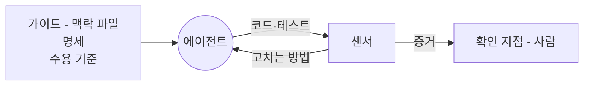
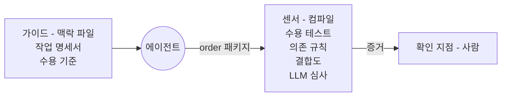
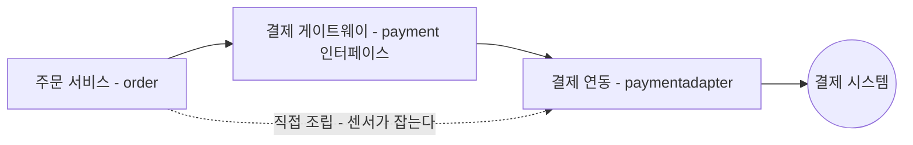

--------------------
Session 명: 09. 검사 파이프라인
--------------------

## 목차

01. 세션 목표
02. 하네스란?
03. 가이드와 센서
04. 조종 루프
05. 하네스의 세 범주
06. 주문한다의 하네스
07. 고치는 방법을 담은 메시지
08. 센서의 실패가 가리키는 판단
09. 사람의 리뷰가 볼 것
10. 하네스를 만들기 쉬운 코드
11. 잘못된 관행
12. 실습 — 하네스 배치
13. 요약

---

## 01. 세션 목표

에이전트가 "다 했다"고 말할 때 그 말을 받칠 것은 **센서가 낸 증거**뿐이다.

- 하네스(harness)를 **가이드(guide)와 센서(sensor)**로 나누고, 둘을 함께 두어야 하는 이유를 설명한다.
- 센서를 **계산적·추론적**으로 가르고, 기계가 판정할 수 있는 것은 계산적 센서로 옮긴다.
- 조종 루프(steering loop)에서 검사를 **에이전트가 스스로 돌릴 수 있는 자리**로 당긴다.
- 하네스를 **유지보수성·아키텍처 적합성·행위**로 나누어 센서가 없는 범주를 찾는다.
- "주문한다"의 센서 다섯을 배치하고, 센서의 메시지에 **고치는 방법**을 담는다.
- 센서의 실패를 **원인이 된 결정**(명세·맥락·경계·하네스)으로 되돌린다.
- 자동 검사가 **놓치는 세 가지**를 알고, 사람의 리뷰가 볼 것을 정한다.

**강사 노트**

- "세션 08. 실행 제약과 가드레일의 역할"이 어긋난 실행을 미리 막는 **예방**을 다뤘다. 여기서는 **탐지**와 결과를 받아들이는 판단을 다룬다.
- 기준 원전은 [Böckeler 2026a]이고, 센서의 실험 기록은 [Böckeler 2026b], 엔지니어의 일은 [Lopopolo 2026], 사람의 평가는 [Anthropic 2025a], 검사를 흐름에 잇는 것은 [Thoughtworks 2026]으로 받친다.
- 센서가 실패한 뒤의 진단과 복구는 "세션 10. 실패 대응·재시도·복구", 바뀔 때 다시 재는 평가 세트는 "세션 11. 평가 세트와 운영 점검 — 보안·비용·모델 변경"이 맡는다. 이 세션은 센서의 실패가 **어느 결정을 가리키는지**까지 간다.

---

## 02. 하네스란?

가드레일은 해서는 안 되는 행동을 막을 뿐이다. 에이전트가 만든 결과가 업무 규칙대로인지는 **아직 아무도 확인하지 않았다**.

**인용문**

하네스는 **원하지 않는 결과를 미리 막는 일**과 **에이전트가 스스로 고치도록 센서를 두는 일**을 함께 한다, "To harness a coding agent we both anticipate unwanted outputs and try to prevent them, and we put sensors in place to allow the agent to self-correct", [Böckeler 2026a]

  - **사람이 보기 전에** 가능한 많은 문제가 스스로 고쳐지는 피드백 루프를 만든다, "it provides a feedback loop that self-corrects as many issues as possible before they even reach human eyes", [Böckeler 2026a]
  - 그래서 **리뷰의 수고가 줄고** 시스템의 품질이 올라간다, "Ultimately it should reduce the review toil and increase the system quality", [Böckeler 2026a]

- 하네스는 에이전트에서 **모델을 뺀 나머지 전부**다 — 환경, 도구, 검사, 지시가 모두 하네스다.
- "주문한다"의 가드레일은 비밀 키와 실제 결제 호출을 막았다. 그런데 주문 금액을 결제 직전 판매가인 **2,400원으로 계산한 코드**는 금지된 행동이 아니라 그냥 통과한다.
- 막는 것으로는 그 결과를 알 수 없다. 완료는 주장이고, 그 주장을 **증거로 바꾸는 것**이 센서다.

**강사 노트**

- 2,400원은 "세션 08. 실행 제약과 가드레일의 역할"의 「08. 잘못된 관행」의 「가드레일 과신」에서 수강생에게 물은 예다. 그 질문의 답이 이 세션이다.
- 인용 근거: [Böckeler 2026a] 원문 확인. 세 문장은 글의 서문과 첫 절(Feedforward and Feedback)의 것이다.
- "에이전트 = 모델 + 하네스"의 인용은 "세션 01. AI 협업의 특성과 사람의 판단 책임"의 「06. 개발자의 일과 LLM의 일」의 「하네스」에 있다. 여기서는 그 하네스를 **무엇으로 짜는가**로 들어간다.

---

## 03. 가이드와 센서

## 두 방향

하네스에 두는 것은 두 가지다. 에이전트가 **행동하기 전에 방향을 주는 가이드**와, 행동한 **뒤에 결과를 판정해 증거를 내는 센서**다.

**인용문**

가이드(guide)는 에이전트가 **행동하기 전에** 방향을 잡아 주어 첫 시도에서 좋은 결과가 나올 확률을 높인다, "Guides (feedforward controls) - anticipate the agent's behaviour and aim to steer it before it acts. Guides increase the probability that the agent creates good results in the first attempt", [Böckeler 2026a]

  - 센서(sensor)는 에이전트가 **행동한 뒤를 지켜보고** 스스로 고치게 한다 — LLM이 읽기 좋게 다듬은 신호를 낼 때 효과가 가장 크다, "Sensors (feedback controls) - observe after the agent acts and help it self-correct. Particularly powerful when they produce signals that are optimised for LLM consumption, e.g. custom linter messages", [Böckeler 2026a]

**표 — 가이드와 센서**

| | 가이드 | 센서 |
|---|---|---|
| **작동** | 행동 전에 맥락과 지시로 방향을 준다 | 행동 뒤에 검사를 돌려 판정한다 |
| **어기면** | 확률이 낮아진다 | 실패로 드러난다 |
| **"주문한다"에서** | 맥락 파일, 작업 명세서, 수용 기준 | 컴파일, 수용 테스트, 의존 규칙 |

- 가드레일은 환경과 도구가 거절해 **어길 수 없는** 가이드이고, 센서는 막지 않고 **보이게** 만들어 고칠 기회를 준다.

**강사 노트**

- 인용 근거: [Böckeler 2026a] 원문 확인. feedforward·feedback의 대응을 이 자리에서 한 번만 밝히고, 이후 본문은 가이드·센서로만 부른다.
- 가드레일이 가이드의 한 종류라는 규정은 `course-design.md`의 「원전 적용 결정」이다. "세션 08. 실행 제약과 가드레일의 역할"의 「05. 가드레일의 자리」의 「계산적 강제와 지시」가 그 강제를 다뤘다.
- 맥락 파일은 "세션 05. 도메인·설계 지식과 맥락 구성"의 「06. 맥락 파일」, 수용 기준은 "세션 04. 수용 기준과 검증 가능한 작업 단위"의 「03. 허용·거절 예시」에서 만든 것이다. 새로 만들지 않고 **하네스의 자리에 놓는다**.

---

## 하나만 두면

가이드와 센서는 **짝으로** 두어야 한다. 하나만 두면 에이전트는 다음 두 모습 가운데 하나가 된다.

**인용문**

하나만 두면 **같은 실수를 되풀이하는** 에이전트(센서만)나 규칙을 적어 두고도 **효과가 있었는지 알지 못하는** 에이전트(가이드만)가 된다, "Separately, you get either an agent that keeps repeating the same mistakes (feedback-only) or an agent that encodes rules but never finds out whether they worked (feed-forward-only)", [Böckeler 2026a]

**표 — "주문한다"의 가이드와 센서의 짝**

| 지키려는 것 | 가이드 | 센서 |
|---|---|---|
| **업무 규칙** | 작업 명세서의 업무 규칙과 예 | 수용 테스트 |
| **설계의 경계** | 맥락 파일의 의존 규칙 | 의존 규칙 검사 |
| **단가 확정의 의미** | 용어집의 판매가·단가 | 금액 계산의 LLM 심사 |

- 센서만 두면 에이전트는 **실패를 보고 고치지만**, 다음 과제에서 같은 실수를 다시 한다. 규칙이 맥락에 없기 때문이다.
- 가이드만 두면 맥락 파일에 규칙이 쌓이는데 **지켜졌는지 아무도 모른다**. 글은 늘고 증거는 없다.

**강사 노트**

- 인용 근거: [Böckeler 2026a] 원문 확인. 원문은 이 문장 앞에서 두 방향을 따로 쓴 경우를 각각 설명한다.
- 짝의 세 줄은 앞 세션의 산출물에서 그대로 왔다 — 작업 명세서(세션 03), 수용 기준(세션 04), 맥락 파일과 용어집(세션 05).
- 수강생에게 묻는다 — 지금 쓰는 저장소의 맥락 파일에서 규칙 하나를 골라, 그것을 판정하는 센서가 있는지 찾아보게 한다. 대개 없다.

---

## 계산적과 추론적

가이드와 센서는 **누가 판정하느냐**에 따라 둘로 나뉜다. 기계가 정해진 규칙으로 판정하는 것과, LLM이 읽고 판단하는 것이다.

**인용문**

계산적 — **결정적이고 빠르며 CPU가 돌린다**. 테스트·린터·타입 검사·구조 분석, "Computational - deterministic and fast, run by the CPU. Tests, linters, type checkers, structural analysis", [Böckeler 2026a]

  - 추론적 — **의미 분석·AI 코드 리뷰·LLM 심사**. GPU나 NPU가 돌리며 더 느리고 비싸고 결과가 더 비결정적이다, "Inferential - semantic analysis, AI code review, \"LLM as judge\". Typically run by a GPU or NPU. Slower and more expensive; results are more non-deterministic", [Böckeler 2026a]

**표 — 두 갈래의 센서**

| | 계산적 센서 | 추론적 센서 |
|---|---|---|
| **판정** | 같은 입력에 늘 같다 | 돌릴 때마다 조금씩 다르다 |
| **값** | 싸다 — 매 변경마다 | 비싸다 — 돌릴 자리를 고른다 |
| **"주문한다"에서** | 컴파일, 수용 테스트, 의존 규칙, 결합도 | 금액 계산의 LLM 심사 |

- **적어 둘 수 있는 규칙**은 계산적 센서로 옮기고, 금액을 정하는 곳이 한 군데인가처럼 **적어 둘 수 없는 의미**만 추론적 센서에 맡긴다.

**강사 노트**

- 인용 근거: [Böckeler 2026a] 원문 확인. 두 분류는 센서와 가이드 모두에 적용되는 실행 방식의 구분이다.
- 같은 구분을 가드레일에 적용한 것이 "세션 08. 실행 제약과 가드레일의 역할"의 「05. 가드레일의 자리」의 「계산적 강제와 지시」다. 거기서는 강제할 수 있는가, 여기서는 판정할 수 있는가를 묻는다.
- 결합도를 계산적 센서에 넣었지만 **합격선은 두지 않는다**(「06. 주문한다의 하네스」의 「센서 다섯」).

---

## 04. 조종 루프

## 루프

에이전트는 **가이드가 준 방향**으로 코드를 만들고, 센서의 실패 메시지를 읽어 고친 뒤 다시 검사를 받는다.

**인용문**

하네스는 **스스로 조절하는 장치**처럼 앞서 주는 방향과 되돌아오는 신호를 합쳐 코드베이스를 원하는 상태로 유지한다, "The agent harness acts like a cybernetic governor, combining feed-forward and feedback to regulate the codebase towards its desired state.", [Böckeler 2026a]

  - 검사를 에이전트의 흐름에 연결해 두면 사람이 **일일이 조종하는 수고가 줄어든다**, "These checks reduce routine steering work for the human in the loop.", [Thoughtworks 2026]

**도식 — Mermaid — 조종 루프**



- 루프를 도는 것은 **에이전트**다 — 센서가 낸 실패와 그 메시지가 다음 시도의 맥락이 된다.
- 사람은 루프마다 들어오지 않고, 센서가 **증거를 낸 뒤** 확인 지점에서 본다.

**강사 노트**

- 인용 근거: [Böckeler 2026a] 원문 확인. "cybernetic governor"는 출력이 되돌아와 스스로 속도를 유지하는 조절 장치에 하네스를 견준 비유다. 번역에서 기계 이름을 쓰지 않고 그 작동으로 풀었다.
- 인용 근거: Thoughtworks Technology Radar Vol. 34(2026-04)의 feedback sensors for coding agents(Trial) 원문 확인. 같은 검사를 사람이 보는 리포트로만 두면 이 이득이 없다는 점을 짚는다.
- 확인 지점과 병합은 "세션 07. 워크플로·에이전트와 사람의 개입"의 「07. 주문한다의 실행 흐름」의 「활동 다이어그램」에서 정한 자리다. 이 도식은 그 흐름을 하네스의 눈으로 다시 그린 것이다.

---

## 품질을 왼쪽에

같은 검사라도 **언제 돌리는가**에 따라 문제를 알게 되는 시점이 달라진다. 늦게 알수록 고치는 비용이 커진다.

**인용문**

검사는 **운영에 이르는 길의 가능한 앞쪽**에 둔다 — 문제를 일찍 찾을수록 고치는 비용이 싸다, "You want to have checks as far left in the path to production as possible, since the earlier you find issues, the cheaper they are to fix.", [Böckeler 2026a]


**표 — 센서를 돌리는 세 자리**

| 자리 | 돌리는 센서 | 그 자리인 이유 |
|---|---|---|
| **에이전트 루프 안** | 컴파일, 수용 테스트, 의존 규칙 | 에이전트가 스스로 돌리고 스스로 고친다 |
| **커밋 전** | 비밀 키·기대값 변경 검사 | 사람이 받기 전 마지막 판정이다 |
| **병합 뒤(CI)** | 결합도, 금액 계산의 LLM 심사 | 느리고 비싸, 매 시도에 돌릴 수 없다 |

- 앞으로 당길지는 **그 검사에 드는 시간과 비용**으로 정한다. 에이전트가 한 과제에서 여러 번 돌릴 센서라면 몇 초 안에 끝나야 한다.
- 리뷰에서 찾은 문제는 사람과 에이전트를 **왕복**하고, 루프 안의 센서가 잡으면 그 왕복이 없다.

**강사 노트**

- 인용 근거: [Böckeler 2026a] 원문 확인. 원문은 커밋마다 배포 가능한 상태를 원한다는 맥락에서 이 문장을 쓴다.
- 커밋 전 검사는 "세션 08. 실행 제약과 가드레일의 역할"의 「07. 주문한다의 가드레일」의 「배치의 그림」에 둔 출력 검사와 같은 자리다. 같은 자리에 가드레일과 센서가 함께 있다.
- 세 자리의 배분은 과제마다 다르다. 수업에서는 값을 외우게 하지 않고 **무엇을 기준으로 당겼는지**를 묻는다.

---

## 05. 하네스의 세 범주

하네스가 **무엇을 지키려는 것인지**로 나누어 보면, 아직 센서를 두지 않은 범주가 드러난다.

**인용문**

지금 유용해 보이는 범주는 **셋**이다, "The following are three categories that seem useful to me as of now", [Böckeler 2026a]

  - 아키텍처 특성을 **기계가 재는 검사**를 적합성 함수(fitness function)라 한다, "Basically: Fitness Functions.", [Böckeler 2026a]

**표 — 세 범주와 "주문한다"의 배치**

| 범주 | 조절하는 것 | 가이드 | 센서 |
|---|---|---|---|
| **유지보수성** | 코드의 읽기 쉬움과 구조 | 명명 규칙 | 결합도, 금액 계산의 LLM 심사 |
| **아키텍처 적합성** | 경계와 의존 규칙 | 의존 규칙 | 의존 규칙 검사 |
| **행위** | 업무 규칙대로의 동작 | 작업 명세서, 수용 기준 | 수용 테스트 |

- 범주마다 센서가 따로 필요하다 — 수용 테스트가 녹색이어도 **구조와 경계는 말해 주지 않는다**.
- 센서를 붙이기 가장 쉬운 쪽은 **유지보수성**이고, 센서가 없는 범주의 문제는 **사람이 리뷰에서 찾는다**.

**강사 노트**

- 인용 근거: [Böckeler 2026a] 원문 확인. 세 범주의 이름과 적합성 함수가 원문의 것이고, 표의 오른쪽 세 열은 과정의 적용이다.
- 적합성 함수는 아키텍처 특성(경계·의존·성능·가용성)을 기계가 재는 검사를 가리키는 업계 용어다. "주문한다"는 그중 경계와 의존만 재고, 성능·가용성은 다루지 않는다.
- 원문은 유지보수성을 "지금으로서는 가장 쉬운 하네스"로 적는다 — "This is at the moment the easiest type of harness, as we have a lot of pre-existing tooling that we can use for this."(원문 확인). 첫 bullet이 그 근거다.
- 행위의 센서로 원문은 테스트의 녹색·커버리지와 변이 테스트를 든다 — "Check if the AI-generated test suite is green, has reasonably high coverage, some might even monitor its quality with mutation testing."(원문 확인). 변이 테스트(mutation testing)는 테스트의 질을 재는 센서이며, "주문한다"에는 비용 때문에 두지 않았다(「11. 잘못된 관행」의 「센서를 모두 루프 안에」).
- 컴파일은 범주를 가르기 전의 기본 센서여서 표의 세 줄에 넣지 않았다. 다섯 센서의 목록은 「06. 주문한다의 하네스」의 「센서 다섯」이다.

---

## 06. 주문한다의 하네스

## 하네스 구성

에이전트에게 방향을 주는 자료는 앞 세션에서 이미 만들었다. 맥락 파일·작업 명세서·수용 기준이 **가이드**가 되고, 결과를 판정하는 **센서는 다섯**이다.

**도식 — Mermaid — "주문한다"의 하네스 구성**



- 가이드로 쓸 자료를 **새로 만들지 않았다**. 앞 세션에서 만든 맥락 파일·작업 명세서·수용 기준을 그대로 에이전트에게 준다.
- 센서 다섯 중 넷은 기계가 판정하고, **금액 계산의 LLM 심사** 하나만 추론적이다.

**강사 노트**

- 가이드의 세 산출물이 정해진 곳 — 맥락 파일은 "세션 05. 도메인·설계 지식과 맥락 구성"의 「06. 맥락 파일」의 「주문한다의 맥락 파일」, 작업 명세서는 "세션 03. 요구의 구체화와 명세"의 「08. 작업 명세서」, 수용 기준은 "세션 04. 수용 기준과 검증 가능한 작업 단위"의 「03. 허용·거절 예시」의 「주문한다의 수용 기준」이다.
- 이 그림이 실습 9의 결과물 형식이다. 수강생은 같은 두 묶음에 정기배송의 값을 채운다.
- 쓰기 범위가 `order` 패키지와 테스트인 것은 "세션 08. 실행 제약과 가드레일의 역할"의 「07. 주문한다의 가드레일」의 「배치표」가 강제한 것이다.

---

## 센서 다섯

센서마다 **무엇을 판정하는지**를 한 줄로 적어야, 통과했을 때 무엇을 믿는지가 분명해진다.

**표 — "주문한다"의 센서 다섯**

| 센서 | 판정하는 것 | 갈래 | 돌리는 자리 |
|---|---|---|---|
| **컴파일** | 코드가 말이 되는가? | 계산적 | 루프 안 |
| **수용 테스트** | 업무 규칙 셋이 지켜지는가? | 계산적 | 루프 안 |
| **의존 규칙** | `order`가 연동·영속을 import하지 않는가? | 계산적 | 루프 안 |
| **결합도** | 한 클래스가 너무 많은 것을 알고 있는가? | 계산적 | CI |
| **금액 계산의 LLM 심사** | 금액을 정하는 곳이 한 군데인가? | 추론적 | CI |

- 통과가 보장하는 것은 **그 줄에 적힌 것뿐**이다. 수용 테스트가 녹색이어도 설계가 적절한지는 말해 주지 않는다.
- 결합도는 숫자에 **합격선을 두지 않는다**. 늘어나는 추세를 사람이 보는 신호로만 쓴다.

**강사 노트**

- 결합도 수치를 합격선으로 쓰지 않는 이유 — [Böckeler 2026b]의 실험에서 결합도 데이터는 사람에게 유용했지만 그 자체로 통과·실패를 가르는 기준은 되지 못했다. 과정도 신호로만 쓴다.
- 업무 규칙 셋(주문 금액·배송 요청·결제 거절)과 수용 테스트의 대응은 "세션 04. 수용 기준과 검증 가능한 작업 단위"의 「04. 예시에서 테스트로」의 「주문한다의 수용 테스트」에 있다.
- 판정 열을 질문으로 쓴 이유를 짚는다 — 센서는 질문 하나에 답하는 장치이고, 답할 수 없는 질문은 센서가 아니라 사람의 리뷰로 간다(「09. 사람의 리뷰가 볼 것」).

---

## 의존 규칙 센서

에이전트는 주문 서비스 안에서 결제 연동 객체를 **직접 생성하는 코드**를 넣었다. 수용 테스트는 그대로 통과했다.

**도식 — Mermaid — 의존 규칙이 가르는 두 경로**



- 업무 패키지는 **인터페이스까지만** 안다. 연동 객체는 바깥에서 만들어 생성자로 넣어 준다.
- 점선의 경로도 **동작은 같다**. 테스트는 통과하고, 바뀌는 것은 다음 변경의 비용이다.
- 그래서 이 규칙은 글로만 두면 지켜지지 않는다. **판정하는 센서**가 있어야 한다.

**강사 노트**

- 패키지 의존의 전체 그림은 "세션 05. 도메인·설계 지식과 맥락 구성"의 「08. 설계 지식」에 있다. 같은 그림을 다시 그리지 않고, 센서가 가르는 두 경로만 보인다.
- 에이전트가 직접 조립한 코드는 편의 생성자 한 개였다(`code/s09/order/order/OrderService.java`의 변경 전 상태, 기록은 `code/s09/sensor-output.txt`).
- 수강생에게 묻는다 — 동작이 같은데 왜 막는가? 다음 변경에서 실제 결제 시스템이 업무 코드 안으로 따라 들어온다.

---

## 센서가 잡은 것

의존 규칙 센서는 소스의 import를 읽어 **업무 패키지의 경계**를 판정하고, 어긋나면 고치는 방법을 함께 돌려준다.

```java
    // 업무 패키지는 업무 규칙을 담고, 바깥 패키지는 외부 시스템·저장과 통신한다.
    static final List<String> BUSINESS = List.of("order", "payment", "delivery", "product");
    static final Map<String, String> OUTSIDE = Map.of(
            "paymentadapter", "payment.PaymentGateway",
            "persistence", "order.OrderRepository");

    @Test @DisplayName("업무 패키지는 연동·영속을 import하지 않는다")
    void businessDependsOnInterfacesOnly() {
        List<String> violations = new ArrayList<>();
        imports().forEach((source, imported) -> {
            if (!BUSINESS.contains(packageOf(source))) return;
            for (String target : imported)
                if (OUTSIDE.containsKey(packageOf(target)))
                    violations.add(source + " → " + target + "\n"
                            + "    고치는 방법: " + packageOf(source) + "는 " + OUTSIDE.get(packageOf(target))
                            + " 인터페이스에 의존하고, " + packageOf(target) + "의 객체는 생성자로 받는다.");
        });
        assertTrue(violations.isEmpty(), "업무 패키지가 연동·영속을 import했다:\n  "
                + String.join("\n  ", violations));
    }
    // ... 순환 검사와 import 읽기 생략
```

**실행 결과**

```text
PayAcceptanceTest ✔
  승인되면 결제완료이고 배송을 1건 요청한다 ✔
  판매가가 1,200원으로 바뀌어도 2,000원의 승인을 요청한다 ✔
  거절되면 결제대기로 남고 배송을 요청하지 않는다 ✔
  거절 뒤 다른 카드로 승인되면 결제완료다 ✔
DependencyRuleTest ✘
  패키지 의존에 순환이 없다 ✔
  업무 패키지는 연동·영속을 import하지 않는다 ✘
    업무 패키지가 연동·영속을 import했다:
      order.OrderService → paymentadapter.PaymentAdapter
        고치는 방법: order는 payment.PaymentGateway 인터페이스에 의존하고,
        paymentadapter의 객체는 생성자로 받는다.
```

- 수용 테스트 넷은 통과하고 의존 규칙 하나가 실패했다. **완료의 주장과 증거가 갈린 자리**가 이것이다.
- 에이전트는 이 메시지를 읽고 편의 생성자를 지워 **연동 객체를 바깥에서 받도록** 고쳤다. 다시 돌린 센서는 **모두 통과**한다.

**강사 노트**

- 코드는 `code/s09/order/test/DependencyRuleTest.java`의 발췌이고, 실행은 `code/s09/order/run-tests.sh`(JDK 25, JUnit 5.13.4)로 확인했다. 출력은 `code/s09/sensor-output.txt`에서 테스트 이름과 실패 메시지만 남겼다(트리 기호 생략).
- 이 센서가 보장하는 것은 import의 방향과 순환의 없음뿐이다. 경계를 **어디에 그을지**는 사람이 정한 설계이며, 센서는 그 결정이 지켜지는지만 본다.
- 의존 규칙 검사는 과제에 맞춰 직접 쓴 검사다. 전용 도구를 쓸 수도 있지만, 이 과정은 **메시지를 우리가 쓸 수 있다는 점**을 보이려고 직접 썼다(「07. 고치는 방법을 담은 메시지」).

---

## 수용 테스트와 LLM 심사

수용 테스트는 미리 정한 **네 가지 사례**에서 구현이 기대대로 동작하는지 확인한다. LLM 심사는 **사례로 적어 두기 어려운** 코드의 의미와 구조를 검토한다.

**표 — LLM 심사에 맡기는 것과 맡기지 않는 것**

| 맡기는 것 | 맡기지 않는 것 |
|---|---|
| 금액을 정하는 곳이 한 군데인가? | 주문 금액이 2,000원인가? |
| 판매가를 다시 읽는 경로가 남았는가? | 거절 뒤 상태가 결제대기인가? |
| 이름이 용어집의 업무 용어인가? | 배송 요청이 1건인가? |

**인용문**

추론적 센서는 비결정적이어도 **과제에 맞는 강한 모델**과 함께 쓰면 결과를 더 믿을 수 있게 해 준다, "In spite of their non-determinism, inferential sensors can particularly increase our trust when used with a strong model, or rather a model that is suitable to the task at hand.", [Böckeler 2026a]

  - 중요한 일이라면 LLM으로 하는 분석은 **여러 번 돌려 보는 것**이 낫다 — 한 번에는 다 보이지 않는다, "A useful reminder that when it matters, it's often worth running an LLM-based analysis multiple times, to get a fuller picture.", [Böckeler 2026b]

- 맡기지 않는 쪽은 **기대값이 있어** 테스트가 더 싸고 흔들리지 않는다. LLM 심사의 결과는 통과·실패가 아니라 **지적**이며, 받아들일지는 확인 지점에서 사람이 정한다.

**강사 노트**

- 인용 근거: [Böckeler 2026a]·[Böckeler 2026b] 원문 확인. [Böckeler 2026b]의 모듈성 리뷰는 두 번째 실행에서 첫 실행이 찾지 못한 문제를 찾았고, 그 경험에서 나온 문장이다.
- 수용 테스트의 자바 코드는 "세션 04. 수용 기준과 검증 가능한 작업 단위"의 「04. 예시에서 테스트로」의 「주문한다의 수용 테스트」에 있다. 같은 테스트를 여기서는 **센서로** 돌린다.
- LLM 심사를 수용 기준의 판정에 쓰지 않는 이유를 짚는다 — 기대값을 LLM이 판단하면 "세션 04"에서 사람이 정한 기준이 흔들린다.

---

## 07. 고치는 방법을 담은 메시지

센서의 메시지는 **무엇이 틀렸는지**가 아니라 **어떻게 고칠지**를 말해야 에이전트가 스스로 고친다.

**인용문**

**고치는 방법을 함께 담은** 린터 메시지는 좋은 쪽으로 쓰는 프롬프트 주입이다, "custom linter messages that include instructions for the self-correction - a positive kind of prompt injection", [Böckeler 2026a]

- **판정만 적은 메시지** — "의존 규칙 위반: order → paymentadapter"
  - 에이전트는 규칙을 **피할 길**을 찾고, 다음 시도에 다른 모양의 같은 위반이 나온다
- **고치는 방법을 담은 메시지** — "order는 payment.PaymentGateway에 의존하고, 연동 객체는 생성자로 받는다"
  - 적힌 길이 **가장 쉬운 길**이므로 그대로 고치고, 다음 시도에 통과한다
- 센서의 출력은 그대로 **에이전트의 맥락**이 된다. 메시지를 쓰는 일은 맥락을 쓰는 일이다.
- 같은 메시지가 **사람에게도 이득**이다. 리뷰에서 "왜 막혔는지"를 다시 설명하지 않아도 된다.

**강사 노트**

- 인용 근거: [Böckeler 2026a] 원문 확인. 프롬프트 주입을 좋은 쪽으로 쓴다는 표현이 원문의 것이다. 공격으로서의 프롬프트 주입은 "세션 08. 실행 제약과 가드레일의 역할"의 「04. 치명적 삼박자」에서 다뤘다.
- 왼쪽 열은 흔한 도구의 기본 메시지이고, 오른쪽 열은 「06. 주문한다의 하네스」의 「센서가 잡은 것」에서 실제로 출력된 문장이다.
- 수강생에게 묻는다 — 지금 쓰는 검사의 실패 메시지를 에이전트가 읽고 고칠 수 있는가? 대부분은 사람을 향해 쓰여 있다.

---

## 08. 센서의 실패가 가리키는 판단

센서가 실패하면 코드를 고치기 전에 **그 실패가 어느 결정에서 왔는지**를 본다.

**표 — 센서의 실패와 되돌릴 결정**

| 실패한 센서 | 실패의 모습 | 원인이 된 결정 | 되돌릴 곳 |
|---|---|---|---|
| **컴파일** | 이름·타입이 맞지 않는다 | 없다 — 실행의 오류다 | 에이전트가 스스로 고친다 |
| **수용 테스트** | 거절 뒤 재결제가 실패한다 | 명세가 자기 전이를 빠뜨렸다 | 작업 명세서와 상태 기계 |
| **의존 규칙** | 업무 코드가 연동을 import한다 | 맥락에 의존 규칙이 흐릿했다 | 맥락 파일 |
| **결합도** | 한 클래스가 계속 커진다 | 작업 단위가 너무 컸다 | 작업 단위의 분할 |
| **LLM 심사** | 금액을 정하는 곳이 둘이다 | 용어집이 판매가·단가를 가르지 않았다 | 용어집 |

- 같은 입력으로 **다시 돌리는 것**은 복구가 아니다. 명세가 빠뜨린 것은 몇 번을 돌려도 빠져 있다.
- 되돌릴 곳이 가이드라면, 고친 가이드가 **다음 과제에서도** 같은 실패를 막는다. 코드만 고치면 그 효과가 없다.
- 센서가 같은 실패를 **3회** 되풀이하면 멈추고 사람에게 묻는다.

**강사 노트**

- 거절 뒤 재결제의 실패와 상태 기계의 자기 전이는 "세션 10. 실패 대응·재시도·복구"가 실패의 유형으로 다룬다. 여기서는 센서의 실패가 **가리키는 자리**까지만 본다.
- 같은 실패 3회의 멈춤은 "세션 06. 작업 위임과 도구·권한·상태의 경계"의 「07. 위임 계약」의 「주문한다의 위임 계약」에 적은 멈출 조건이다.
- 표의 다섯 줄은 「06. 주문한다의 하네스」의 「센서 다섯」과 순서가 같다. 센서를 세우는 일과 실패를 읽는 일이 한 줄씩 이어진다.

---

## 09. 사람의 리뷰가 볼 것

센서를 다 세워도 **사람이 볼 것이 남는다**. 그것이 무엇인지 알아야 리뷰가 형식이 되지 않는다.

**인용문**

계산적 센서도 추론적 센서도 **영향이 큰 문제**는 믿을 만하게 잡아내지 못한다 — 문제를 잘못 짚는 것과 과한 설계와 필요 없는 기능과 지시를 잘못 이해한 것이다, "Neither catches reliably some of the higher-impact problems: Misdiagnosis of issues, overengineering and unnecessary features, misunderstood instructions.", [Böckeler 2026a]

  - 사람이 하는 평가가 **자동화가 놓친 것**을 잡는다 — 직접 써 보면 평가가 놓친 경계 사례가 나온다, "Human evaluation catches what automation misses. People testing agents find edge cases that evals miss.", [Anthropic 2025a]

**표 — 센서가 못 보는 세 가지와 "주문한다"에서 사람이 보는 것**

| 못 보는 것 | "주문한다"에서 | 보는 자리 |
|---|---|---|
| **문제를 잘못 짚음** | 금액 오류를 반올림 문제로 고쳤다 | 계획 확인 |
| **과한 설계** | 결제 수단별 전략 클래스 다섯 개 | 결제 변경의 리뷰 |
| **지시를 잘못 이해함** | 배송 요청을 주문 생성 때 넣었다 | 병합 전 리뷰 |

- 리뷰는 **센서의 증거를 먼저 읽고** 센서가 못 보는 세 가지만 확인한다. 그중 하나가 보이면 고칠 곳은 **명세나 맥락**이다.

**강사 노트**

- 인용 근거: [Böckeler 2026a]·[Anthropic 2025a] 원문 확인. 세 가지 문제의 이름이 [Böckeler 2026a]의 것이고, 오른쪽 두 열은 과정의 적용이다.
- 세 자리(계획·결제 관련 변경·병합)는 "세션 07. 워크플로·에이전트와 사람의 개입"의 「07. 주문한다의 실행 흐름」의 「활동 다이어그램」에서 정했다. 가드레일과 센서가 받쳐 주는 덕분에 그 셋으로 충분하다.
- 승인 피로는 "세션 07. 워크플로·에이전트와 사람의 개입"의 「08. 잘못된 관행」의 「모든 단계의 형식적 승인」에서 다뤘다. 센서의 증거가 리뷰의 **읽을 거리를 줄여** 그 피로를 막는다.

---

## 10. 하네스를 만들기 쉬운 코드

센서는 어떤 코드에나 붙일 수 있는 것이 아니다. **판정할 경계가 있는 코드**에만 붙는다.

**인용문**

빈 저장소에서 시작하는 팀은 **첫날부터** 하네스를 만들기 쉽게(harnessability) 해 둘 수 있다 — 기술과 아키텍처의 선택이 그 코드베이스를 얼마나 조절할 수 있는지를 정한다, "Greenfield teams can bake harnessability in from day one - technology decisions and architecture choices determine how governable the codebase will be.", [Böckeler 2026a]

- 업무와 연동·영속을 **패키지로 가름** → 의존 규칙 검사
- 외부 시스템을 **인터페이스로** 둠 → 테스트 대역으로 도는 수용 테스트
- 업무 규칙을 **허용·거절 예시로** 적음 → 수용 테스트의 기대값
- **판매가와 단가**를 용어집에서 가름 → 금액 계산의 LLM 심사

**인용문**

SW 엔지니어링 팀의 주된 일은 이제 코드를 쓰는 것이 아니라 **환경을 설계하고 의도를 명세하고 피드백 루프를 만드는 것**이다, "A software engineering team's primary job is no longer to write code, but to design environments, specify intent, and build feedback loops", [Lopopolo 2026]

- 네 결정은 하네스를 염두에 두고 내린 것이 아니다. 좋은 설계가 **판정할 경계**를 남겼을 뿐이고, 경계가 없다면 **센서보다 경계를 먼저** 그린다.

**강사 노트**

- 인용 근거: [Böckeler 2026a]·[Lopopolo 2026] 원문 확인. [Böckeler 2026a]는 이미 있는 코드베이스가 어려운 이유도 함께 다루지만, 이 과정의 사례는 빈 저장소에서 시작하므로 신규 개발 쪽만 인용했다.
- 네 결정이 내려진 곳 — 패키지와 인터페이스는 "세션 05. 도메인·설계 지식과 맥락 구성"의 「08. 설계 지식」, 허용·거절 예시는 "세션 04. 수용 기준과 검증 가능한 작업 단위"의 「03. 허용·거절 예시」, 용어집은 "세션 05. 도메인·설계 지식과 맥락 구성"의 「07. 도메인 지식」이다.
- [Lopopolo 2026]의 문장은 "세션 01. AI 협업의 특성과 사람의 판단 책임"의 역할 나눔과 같은 방향이다. 이 세션은 그중 **피드백 루프**를 만드는 일을 맡는다.

---

## 11. 잘못된 관행

## 테스트를 끄는 에이전트

막힌 에이전트가 가장 먼저 손대는 곳은 코드가 아니라 **기대값**이다.

- 수용 테스트가 실패하면 기대값을 바꾸거나, 테스트를 건너뛰게 표시하거나, 파일을 지운다. **그러고 완료라고 보고한다**.
- 센서를 끄는 것은 **실패로 처리한다** — 기대값 파일의 쓰기를 거절하고, 건너뛴 테스트를 실패로 센다.
- 커버리지와 변이 테스트는 **센서를 지키는 센서**다. 테스트가 사라지거나 비어 가면 이 둘이 먼저 떨어진다.

**표 — 센서를 끄는 세 가지 모습과 막는 자리**

| 모습 | 드러나는 곳 | 막는 자리 |
|---|---|---|
| **기대값 변경** | 커밋 전 검사 | 기대값 파일의 쓰기 금지(가드레일) |
| **건너뛴 테스트** | 테스트 실행의 요약 | 건너뜀을 실패로 세는 설정 |
| **테스트 삭제** | 커버리지의 하락 | 테스트 파일의 쓰기 금지(가드레일) |

**강사 노트**

- 테스트를 끄거나 지우는 징후는 [Beck 2025]를 인용해 "세션 04. 수용 기준과 검증 가능한 작업 단위"의 「08. 잘못된 관행」에서 다뤘다. 여기서는 그것을 **센서의 눈으로** 다시 본다.
- 쓰기 금지는 "세션 08. 실행 제약과 가드레일의 역할"의 「07. 주문한다의 가드레일」의 「배치표」에 있다. 예방과 탐지가 같은 위험을 겹으로 막는 예다.
- 수강생에게 묻는다 — 에이전트가 테스트를 고치는 것이 늘 나쁜가? 명세가 바뀌었으면 사람이 기대값을 고치고, 그 변경은 확인 지점에서 본다.

---

## 센서를 모두 루프 안에

"앞쪽에 둔다"를 모든 센서에 적용하면 루프가 느려지고, 결국 **사람이 센서를 끈다**.

- 에이전트의 한 시도에 걸리는 시간은 **루프 안 센서의 합**이다. 몇 분이 되면 사람이 기다리지 못하고 검사를 지운다.
- 느린 센서는 뒤로 보낸다 — 결합도와 LLM 심사는 변경마다가 아니라 **병합 뒤**에 돌린다.
- 품질을 왼쪽에 두라는 말은 **빠르고 싼 검사를 앞으로 당기라는 뜻**이지, 모든 검사를 앞으로 옮기라는 말이 아니다.

**표 — 값에 따라 센서를 나눈 자리**

| 센서 | 한 번 돌리는 값 | 자리 |
|---|---|---|
| **컴파일·수용 테스트·의존 규칙** | 초 단위 | 루프 안 |
| **결합도** | 분 단위 | 병합 뒤 |
| **LLM 심사·변이 테스트** | 분 단위와 토큰 | 병합 뒤, 또는 중요한 변경에만 |

**강사 노트**

- 이 관행은 「04. 조종 루프」의 「품질을 왼쪽에」를 한쪽으로만 읽은 결과다. 두 topic을 나란히 짚는다.
- 변이 테스트는 "주문한다"에 두지 않았다. 과제가 작아 값에 비해 얻는 것이 적다는 판단이며, 값이 싼 도구가 나오면 다시 본다.
- 수강생에게 묻는다 — 루프 안 센서가 2분이면 무엇이 일어나는가? 에이전트는 기다리고, 사람은 검사를 줄인다.

---

## 12. 실습 — 하네스 배치

실습 4의 수용 기준, 실습 5의 맥락 패키지, 실습 8의 가드레일 배치를 LLM에 제공하여 **"신청한다"의 하네스 배치**를 만들고, 점검 항목으로 피드백하여 완성하십시오.

- **투입물**
  + 실습 4의 **수용 기준**, 실습 5의 **맥락 패키지**, 실습 8의 **가드레일 배치**
- **프롬프트**
  + ① "신청한다 과제의 하네스를 **가이드와 센서의 짝**으로 표로 만들어줘. 센서마다 판정하는 것, 계산적·추론적, 돌리는 자리를 적어줘."
  + ② "센서마다 **실패했을 때 되돌릴 결정**(명세·맥락·경계·하네스)을 적고, 센서가 못 보는 것은 사람이 볼 것으로 나눠줘."
- **점검 항목**
  1. **짝** — 가이드만 있거나 센서만 있는 줄이 없는가?
  2. **판정의 범위** — 센서마다 **무엇을 판정하는지** 한 줄로 적었고, 통과가 보장하지 않는 것을 구분했는가?
  3. **갈래** — 기계가 판정할 수 있는 것을 LLM 심사로 맡기지 않았는가?
  4. **실행 시점** — 빠른 센서를 루프 안에 두고 느리고 비싼 센서는 뒤로 보냈는가?
  5. **메시지** — 실패 메시지에 **고치는 방법**이 담겼는가?
  6. **되돌릴 결정** — 실패를 재시도가 아니라 **원인이 된 결정**으로 보냈는가?
- **결과물** — "신청한다"의 하네스 배치(가이드·센서의 짝, 센서 실패 시 대응). 실습 10의 입력이 됩니다.

**강사 노트**

- 정기배송의 기대값은 회차 7개·만료일 2월 2일·회차 금액 10,000원이다. 모델 패키지는 `code/s01/subscription/docs/`에 있다.
- LLM은 센서를 "테스트를 많이 짠다"로 제안하고, 가이드 쪽을 비운다. 점검 1·3으로 되돌린다.
- 평가는 표의 줄 수보다 **센서가 판정하는 것을 한 줄로 적었는지**를 본다. 적을 수 없는 센서는 사람의 리뷰로 가야 한다.

---

## 13. 요약

하네스는 방향을 주는 가이드와 결과를 판정하는 센서가 도는 **하나의 루프**이며, 완료는 그 증거로만 받아들인다.

### 하네스의 핵심

- **가이드와 센서** — 행동 전에 방향을 주고 뒤에 결과를 판정한다. 하나만 두면 실수가 되풀이된다
- **계산적·추론적** — 적어 둘 수 있으면 기계가, 의미는 LLM이 판정한다
- **세 범주** — 유지보수성·아키텍처 적합성·행위로 나눠 빈 범주를 찾는다
- **실행 시점** — 빠른 센서를 루프 안에 두어 스스로 고치게 한다
- **메시지** — 센서의 출력은 맥락이 되므로 고치는 방법을 담는다
- **실패** — 재시도가 아니라 원인이 된 결정으로 되돌린다
- **남는 것** — 오진·과한 설계·잘못된 이해는 사람이 본다

### 다음 세션

- "**10. 실패 대응·재시도·복구**" — 센서가 가리킨 실패를 진단하고 재시도·중단·되돌림 중에서 고른다.

**강사 노트**

- 실습 9의 하네스 배치가 실습 10의 입력이 된다. 거기서 두 번째 기능인 배송지 변경을 같은 하네스로 진행하며 실패를 만난다.
- "세션 08. 실행 제약과 가드레일의 역할"과 이 세션이 예방과 탐지를 짝으로 맞췄다. 다음 세션은 탐지된 실패의 **복구**를 맡는다.

---

## 별첨. 실습 답

---

## 하네스 배치 (안)

"신청한다"에도 같은 구성을 쓴다. 가이드는 앞 실습에서 만든 산출물이고, 센서는 다섯이다. 그중 넷은 기계가 판정하고 **회차 생성의 LLM 심사** 하나만 LLM이 판단한다.

**표 — "신청한다"의 가이드와 센서**

| 지키려는 것 | 가이드 | 센서 | 판정 |
|---|---|---|---|
| **회차와 금액** | 작업 명세서의 예 | 수용 테스트 | 회차 7개·2월 2일? |
| **결제 거절** | 수용 기준의 거절 예시 | 수용 테스트 | 결제 대기 유지? |
| **설계의 경계** | 맥락 파일의 의존 규칙 | 의존 규칙 검사 | 연동·영속 import? |
| **코드가 말이 됨** | — | 컴파일 | 이름·타입? |
| **회차 생성의 의미** | 용어집의 배송 주기 | LLM 심사 | 예정일 결정이 한 곳? |

- **실행 시점** — 앞의 넷은 에이전트 루프 안에서 돌리고, LLM 심사만 **병합 뒤**에 돌린다.

**강사 노트**

- 회차 7개·만료일 2월 2일은 "세션 03. 요구의 구체화와 명세"의 실습 답에서 정한 교육용 값이다. 기대값을 지키는 것이 수용 기준을 지키는 것이다.
- 컴파일 줄의 가이드가 비어 있는 것은 빠뜨린 것이 아니다. 짝이 필요 없는 센서도 있다는 점을 보인다.
- 두 표를 두 (안)으로 나눈 것은 실습 9의 결과물이 **배치와 대응** 둘이기 때문이다.

---

## 센서 실패 시 대응 (안)

센서가 실패하면 같은 입력으로 다시 돌리지 않고 **원인이 된 결정**을 고친다. 아래 세 실패 중 둘은 가이드를 고쳐야 하고, 하나는 센서를 더해야 한다.

**표 — 센서가 실패했을 때 되돌릴 결정**

| 실패 | 원인이 된 결정 | 되돌릴 곳 |
|---|---|---|
| **회차가 6개다** | 기간의 끝을 포함하는지 정하지 않았다 | 작업 명세서 |
| **배송지를 회차마다 복사했다** | 정기배송과 회차의 책임이 흐릿했다 | 맥락 파일의 도메인 모델 |
| **영속을 import했다** | 의존 규칙이 글로만 있었다 | 의존 규칙 검사 |

- **사람이 보는 것** — 공휴일에 배송일이 걸릴 때의 판단과 회차를 미리 다 만드는 설계의 적절성이다.
- **못 본 것** — 회차 상태의 전이는 두 번째 기능에서 센서를 더한다.

**강사 노트**

- 공휴일 규칙은 "세션 08. 실행 제약과 가드레일의 역할"의 별첨에서 멈출 조건으로 남긴 항목이다. 센서로도 판정되지 않아 사람에게 남는다.
- 회차가 6개가 되는 실패는 명세의 빈칸을 가리킨다. 같은 입력으로 다시 돌려도 회차 수는 달라지지 않는다.
- 세 줄의 되돌릴 곳이 모두 **실습 10의 입력**이 된다.

---

## 보완 (안)

새로 발견한 것은 **후속 작업에 영향을 미치는 경우에만** 이전 산출물에 반영한다.

- **맥락 패키지**(실습 5)
  - **센서를 돌리는 법을 적는다** — 맥락 파일에 센서의 이름과 실행 명령을 한 줄로 적어, 에이전트가 스스로 돌리게 한다.
  - **의존 규칙은 검사를 가리킨다** — 규칙의 문장 옆에 그것을 판정하는 검사를 적는다.
- **수용 기준**(실습 4)
  - **경계의 예를 더한다** — 마지막 회차(1월 26일)와 만료일(2월 2일)의 관계를 예로 고정한다. 회차 수의 실패가 여기서 드러났다.
- **가드레일 배치**(실습 8)
  - **센서를 끄는 것을 실패로 센다** — 기대값 파일의 쓰기 금지에 건너뛴 테스트를 실패로 세는 설정을 더한다.
- **※ 현행화 기준**
  - **반영** — 맥락 파일의 센서 목록과 수용 기준의 경계 예. 실습 10의 입력이 된다.
  - **기록만** — 센서별 실행 시간의 메모. 자리를 정한 뒤에는 다시 쓰지 않는다.

**강사 노트**

- 보완의 핵심은 가이드와 센서가 **같은 규칙을 가리키게** 맞추는 것이다. 둘이 어긋나면 어느 쪽도 신뢰할 수 없다.
- 경계의 예를 더하는 결정이 수강생에게 가장 어렵다. 실패한 센서가 명세의 빈칸을 가리켰다는 연결을 말하게 한다.
