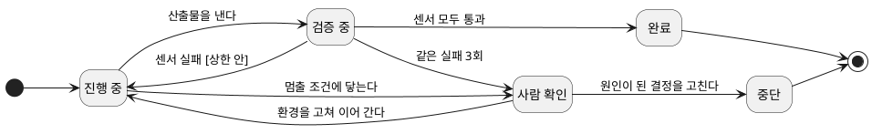
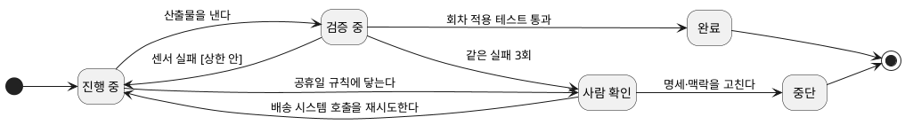

--------------------
Session 명: 10. 실패 대응·재시도·복구
--------------------

## 목차

01. 세션 목표
02. 재시도는 복구가 아니다
03. 실패의 유형
04. 상태와 오류 누적
05. 추적
06. 되돌릴 자리 찾기
07. 작업 상태 기계
08. 표류와 정리
09. 잘못된 관행
10. 실습 — 실패·복구
11. 요약

---

## 01. 세션 목표

센서가 빨간불을 켠 다음에 할 일은 **다시 돌리는 것이 아니라 무엇이 빠졌는지 찾는 것**이다.

- 실패를 **명세 결함·맥락 누락·환경 오류·모델 한계** 네 유형으로 진단한다.
- 유형별로 **재시도·멈춤·되돌림·상위 결정 재검토** 중에서 대응을 고른다.
- 에이전트가 **상태를 지니고 오류가 누적된다**는 것을 알고, 끊긴 작업을 처음이 아니라 **이어서** 진행한다.
- **추적**으로 무엇을 보고 그렇게 했는지 되짚어 실패의 자리를 찾는다.
- 센서의 실패에서 **원인이 된 결정**까지 거슬러 올라 그 자리를 고친다.
- 맡긴 과제의 **작업 상태 기계**를 그려 멈춤과 되돌림의 조건을 미리 정한다.
- 에이전트가 있는 패턴을 복제해 생기는 **표류**를 정리 작업으로 되돌린다.

**강사 노트**

- "세션 09. 검증 하네스·결과 점검·피드백"이 센서로 실패를 **드러냈다**. 여기서는 드러난 실패를 **진단하고 복구한다**.
- 기준 원전이 따로 없는 세션이다. 상태와 오류 누적은 [Anthropic 2025a], 끊긴 세션은 [Anthropic 2025d], 추적은 [Blount 외 2026], 표류와 정리는 [Lopopolo 2026], 내구성과 인지 부채는 [Thoughtworks 2026]으로 받친다.
- 반복되는 실패를 평가 세트에 더하는 일은 "세션 11. 평가 세트와 운영 점검 — 보안·비용·모델 변경"이 맡는다.

---

## 02. 재시도는 복구가 아니다

같은 입력으로 다시 돌리면 **빠진 것은 그대로 빠져 있다**. 모델이 다르게 답할 확률만 다시 굴린 것이다.

- "주문한다"의 수용 테스트 중 **거절 뒤 재결제**가 실패했다. 에이전트는 같은 수정을 세 번 되풀이했다.
- 세 번의 시도는 모두 **같은 맥락과 같은 명세**를 읽었다. 그 안에 없는 규칙은 네 번째에도 없다.
- 재시도가 듣는 실패도 있다. 네트워크가 끊겼거나 도구가 한 번 실패한 경우다 — **입력이 바뀌지 않아도 결과가 바뀔 수 있는 것**만 그렇다.
- 그래서 실패를 만나면 먼저 묻는다. **더 열심히 할 일인가, 무엇이 빠졌는가?**

**강사 노트**

- 거절 뒤 재결제는 "세션 04. 수용 기준과 검증 가능한 작업 단위"의 「03. 허용·거절 예시」에서 사람이 정한 네 번째 예다. 그 기대값은 에이전트가 바꿀 수 없다.
- 같은 실패 3회의 상한은 "세션 06. 작업 위임과 도구·권한·상태의 경계"의 「07. 위임 계약」에서 정했다. 이 세션은 그 상한에 닿은 뒤를 다룬다.
- 수강생에게 묻는다 — 재시도로 풀리는 실패와 풀리지 않는 실패를 어떻게 가르는가? 입력이 같을 때 결과가 바뀔 수 있는지로 가른다.

---

## 03. 실패의 유형

## 네 유형

실패는 **무엇이 빠졌는가**로 갈린다. 빠진 것이 다르면 고칠 자리도 다르다.

**표 — 실패의 네 유형**

| 유형 | 빠진 것 | 드러나는 모습 | 대응 |
|---|---|---|---|
| **명세 결함** | 사람이 정할 결정 | 센서는 통과하는데 기대와 다르다 | 작업 명세서로 되돌린다 |
| **맥락 누락** | 판단을 바꾸는 지식 | 이름·구조를 지어낸다 | 맥락 파일로 되돌린다 |
| **환경 오류** | 없음 — 도구가 실패했다 | 같은 입력에 결과가 다르다 | 상한 안에서 재시도한다 |
| **모델 한계** | 과제에 비한 능력 | 상한까지 같은 실패를 되풀이한다 | 작업을 쪼개거나 사람이 한다 |

- 네 유형을 가르는 질문은 둘이다 — **다시 돌리면 달라지는가**, 그리고 **사람이 정할 것이 빠졌는가**.
- 유형을 먼저 정하지 않으면 모든 실패가 재시도로 간다. 가장 싸 보이지만 **가장 늦게 드러나는** 대응이다.

**강사 노트**

- 네 유형은 과정의 정리다. 원전의 분류가 아니며, 수업에서는 이름보다 **가르는 두 질문**을 외우게 한다.
- 모델 한계는 모델을 바꾸면 사라지기도 한다. 그 판단은 "세션 11. 평가 세트와 운영 점검 — 보안·비용·모델 변경"의 평가 세트로 한다.
- 맥락 누락과 명세 결함은 겹칠 때가 있다. 둘 다면 **명세를 먼저** 고친다 — 맥락은 명세가 가리키는 것이기 때문이다.

---

## 주문한다의 진단

거절 뒤 재결제의 실패는 **명세 결함**이었다. 수용 기준과 맥락이 서로 다른 말을 하고 있었다.

**표 — 세 번의 시도에서 드러난 것**

| 본 것 | 읽은 것 | 진단 |
|---|---|---|
| 거절 뒤 두 번째 결제가 거절된다 | 수용 기준은 재결제를 허용한다 | 기대값은 맞다 |
| 주문이 결제대기에 남지 않는다 | 상태 기계에 결제대기의 **자기 전이가 없다** | 맥락이 기대와 어긋난다 |
| 에이전트는 상태 기계대로 구현했다 | 둘 중 무엇이 옳은지는 **사람이 정한다** | 명세 결함 |

- 에이전트는 틀리지 않았다. **준 모델을 따랐고**, 그 모델에 규칙이 없었다.
- 고칠 자리는 코드가 아니라 **상태 기계와 그것을 가리키는 작업 명세서**다. 고친 뒤 같은 테스트가 한 번에 통과한다.
- 이 실패가 비싸지 않았던 이유는 **센서가 세 번째 시도에서 멈춰 세웠기** 때문이다.

**강사 노트**

- 결제가 거절되면 주문이 결제대기에 머문다(자기 전이)는 규칙은 `course-design.md`의 공통 전제이며 "세션 01. AI 협업의 특성과 사람의 판단 책임"의 첫 시도에서 이미 문제로 드러났다.
- 상태 기계는 "세션 05. 도메인·설계 지식과 맥락 구성"의 「07. 도메인 지식」에서 맥락으로 준 것이다. 맥락의 그림 하나가 기대값과 어긋나면 에이전트는 그림을 따른다.
- 수강생에게 묻는다 — 수용 기준과 맥락이 다르면 무엇이 옳은가? 기계는 답하지 못한다. 사람이 정하고 둘을 맞춘다.

---

## 재시도의 조건과 상한

재시도는 **환경 오류에만** 값을 한다. 나머지에서는 토큰과 시간만 쓴다.

**표 — 재시도할 것과 멈출 것**

| 실패 | 재시도 | 멈춤의 조건 |
|---|---|---|
| **도구 호출 오류** | 상한 안에서 재시도 | 같은 도구가 3회 실패 |
| **센서 실패** | 메시지를 읽고 1회 고쳐 본다 | 같은 센서가 3회 실패 |
| **판정할 수 없는 결정** | 하지 않는다 | 닿는 즉시 멈추고 묻는다 |
| **권한·경계에 막힘** | 하지 않는다 | 닿는 즉시 멈추고 묻는다 |

- 상한은 **숫자보다 기록**이 중요하다. 세 번을 어디에 썼는지 남아야 다음 판단이 선다.
- 멈춤은 실패가 아니라 **설계된 종료**다. 사람에게 넘길 자리를 미리 정해 둔 것이다.

**강사 노트**

- 실패 한도의 근거는 [OpenAI 2025]이며 "세션 07. 워크플로·에이전트와 사람의 개입"의 「06. 사람의 개입」의 「개입의 계기」에서 인용했다. 여기서는 그 한도에 닿은 **뒤의 처리**를 다룬다.
- 3회는 교육용 값이다. 과제의 값과 한 번의 비용으로 정하며, 비싼 과제일수록 작아진다.
- "메시지를 읽고 1회 고쳐 본다"가 "세션 09. 검증 하네스·결과 점검·피드백"의 조종 루프다. 그 한 번이 듣지 않으면 유형을 다시 본다.

---

## 04. 상태와 오류 누적

## 에이전트는 상태를 지닌다

에이전트의 실패는 **그 순간의 실패로 끝나지 않는다**. 앞의 결과 위에 다음 수를 쌓기 때문이다.

**인용문**

에이전트는 **상태를 지니고 오류는 누적된다** — 오랜 시간 실행되며 여러 도구 호출에 걸쳐 상태를 유지한다, "Agents are stateful and errors compound. Agents can run for long periods of time, maintaining state across many tool calls.", [Anthropic 2025a]

  - 효과적인 완화 수단이 없으면 **작은 시스템 고장도 에이전트에게 치명적**일 수 있다, "Without effective mitigations, minor system failures can be catastrophic for agents.", [Anthropic 2025a]

- 첫 수에서 이름을 잘못 지으면 **그 이름 위에** 파일과 테스트가 쌓인다. 뒤에서 고치는 값이 커진다.
- 그래서 실패는 **빨리** 드러나야 한다. 센서를 루프 안에 두는 이유가 여기에도 있다.
- 오래 도는 작업일수록 **중간에 끊길 확률**이 커진다. 끊김은 예외가 아니라 조건이다.

**강사 노트**

- 인용 근거: [Anthropic 2025a] 원문 확인. 두 문장은 긴 작업의 공학 과제를 다루는 절의 것이다.
- 센서를 앞쪽에 두는 판단은 "세션 09. 검증 하네스·결과 점검·피드백"의 「04. 조종 루프」의 「품질을 왼쪽에」에서 정했다.
- "주문한다"는 한 시간 안에 끝나는 과제여서 끊김의 비용이 작다. 수강생의 실제 과제는 그렇지 않다는 점을 짚는다.

---

## 진행의 저장과 되돌림

끊긴 작업은 **처음부터가 아니라 이어서** 간다. 그러려면 진행이 저장되어 있어야 한다.

**인용문**

다시 시작하는 것은 비싸고 사람을 지치게 하므로 **오류가 난 지점에서 이어 가는** 시스템을 만든다, "restarts are expensive and frustrating for users. Instead, we built systems that can resume from where the agent was when the errors occurred.", [Anthropic 2025a]

  - 긴 작업의 핵심 어려움은 **끊어진 세션들로 일해야 한다**는 것이다 — 새 세션은 앞의 기억 없이 시작한다, "The core challenge of long-running agents is that they must work in discrete sessions, and each new session begins with no memory of what came before.", [Anthropic 2025d]

**표 — "주문한다"가 진행을 남기는 두 자리**

| 자리 | 남는 것 | 이어 갈 때 읽는 것 |
|---|---|---|
| **커밋** | 작업 단위마다의 코드와 테스트 | 마지막 녹색 상태 |
| **진행 기록** | 한 일과 남은 일과 멈춘 이유 | 다음 수의 출발점 |

- 되돌림의 단위도 같다. **커밋 하나**를 지우면 그 작업 단위만 사라진다.
- 진행 기록은 사람에게도 쓸모가 있다. 멈춘 작업을 **사람이 이어받을** 때 읽는 것이 같다.

**강사 노트**

- 인용 근거: [Anthropic 2025a]·[Anthropic 2025d] 원문 확인. 두 번째 문장은 긴 작업의 하네스를 다룬 글의 문제 제기다.
- 커밋 단위의 작업 공간과 진행 기록은 "세션 06. 작업 위임과 도구·권한·상태의 경계"의 「06. 상태와 되돌림」에서 정했다. 여기서는 그것이 **복구의 단위**가 된다는 점을 더한다.
- 영어의 checkpoint를 이 자리에서 쓰지 않는다 — 이 과정에서 그 말은 사람이 판단하는 **확인 지점**이다(`course-design.md`의 용어 표).

---

## 05. 추적

왜 그렇게 했는지 남아 있지 않으면, 실패는 **다시 겪어 보는 수밖에** 없다.

**인용문**

견고한 프레임워크는 상세한 추적과 로그를 남겨 **추론의 궤적 전체**를 드러낸다 — 모델의 내적 독백과 고른 도구와 만들어 낸 인자와 관찰한 결과다, "A robust framework generates detailed traces and logs, exposing the entire reasoning trajectory: the model's internal monologue, the tool it chose, the parameters it generated, and the result it observed.", [Blount 외 2026]

  - 운영 전 구간에 **추적을 붙이면** 에이전트가 왜 실패했는지 진단하고 문제를 체계적으로 고칠 수 있다, "Adding full production tracing let us diagnose why agents failed and fix issues systematically.", [Anthropic 2025a]

- 추적이 답하는 질문은 **무엇을 읽었고 무엇을 불렀는가**다. 결과만 보면 "왜"가 비어 있다.
- "주문한다"의 추적에서 읽은 것은 하나다 — 에이전트가 **상태 기계 문서를 읽은 뒤** 자기 전이 없이 구현했다는 사실이다.
- 같은 프롬프트로도 실행마다 달라지므로, 실패한 **그 실행의 기록**이 있어야 한다.

**강사 노트**

- 인용 근거: [Blount 외 2026]·[Anthropic 2025a] 원문 확인. 앞의 문장은 프레임워크가 갖출 조건, 뒤의 문장은 추적을 붙인 뒤의 경험이다.
- 도구가 남기는 기록의 형식(OpenTelemetry 등)은 과정의 범위가 아니다. 무엇이 남아야 진단되는지만 정한다.
- 수강생에게 묻는다 — 지금 쓰는 에이전트에서 실패한 실행의 기록을 다시 열어 볼 수 있는가? 대개 화면을 닫으면 사라진다.

---

## 06. 되돌릴 자리 찾기

센서가 가리킨 실패를 **원인이 된 결정까지** 거슬러 올린다. 고치는 자리는 대개 코드가 아니다.

**표 — 실패에서 결정으로 거슬러 오르기**

| 물음 | 아니라면 | 그렇다면 |
|---|---|---|
| 다시 돌리면 달라지는가? | 다음 물음으로 | 환경 오류 — 재시도 |
| 기대값이 옳은가? | 수용 기준을 고친다 | 다음 물음으로 |
| 맥락에 그 규칙이 있는가? | 맥락 파일·모델을 고친다 | 다음 물음으로 |
| 경계가 막은 것인가? | 작업을 쪼갠다 | 위임 계약을 고친다 |

- 순서가 중요하다. **기대값 → 맥락 → 경계**의 차례로 묻고, 코드는 그 결정이 고쳐진 뒤에 다시 만든다.
- 고친 결정은 **다음 과제에서도** 같은 실패를 막는다. 코드만 고치면 그 효과가 없다.
- 되돌릴 자리가 여럿이면 **가장 위의 것**부터 고친다. 명세가 틀린 채로 맥락을 고치면 둘 다 틀린다.

**강사 노트**

- 이 표는 "세션 09. 검증 하네스·결과 점검·피드백"의 「08. 센서의 실패가 가리키는 판단」을 한 걸음 더 끌고 간 것이다. 거기서는 센서별 되돌릴 곳을, 여기서는 묻는 **순서**를 정한다.
- "주문한다"의 거절 뒤 재결제는 둘째 물음에서 기대값이 옳았고 셋째 물음에서 맥락이 어긋났다.
- 수강생에게 묻는다 — 코드를 고쳐 테스트를 통과시키면 무엇이 남는가? 다음 과제에서 같은 실패가 다시 난다.

---

## 07. 작업 상태 기계

멈춤과 되돌림의 조건을 미리 그려 두면, 실패한 자리에서 **무엇을 할지 즉흥으로 정하지 않는다**.

**도식 — PlantUML — 작업 상태 기계**

- **두 가지 끝** — 완료는 센서의 증거로, 중단은 사람의 판단으로 닿는다. 둘 다 정상이다.
- **사람 확인에서 갈린다** — 환경 오류면 이어 가고, 그 밖의 유형이면 결정을 고쳐 **새 과제로 다시 맡긴다**. 상태를 적어 두면 에이전트의 보고도 **같은 말**로 돌아온다.

**강사 노트**

- 이 상태 기계의 대상은 업무 객체가 아니라 **맡긴 과제**다. 상태 기계 표기 자체는 "객체지향 분석과 설계 실무" 과정이 가르친다.
- 전이의 조건은 앞 세션에서 정한 것들이다 — 센서는 "세션 09. 검증 하네스·결과 점검·피드백", 멈출 조건과 상한은 "세션 06. 작업 위임과 도구·권한·상태의 경계"의 「07. 위임 계약」이다.
- 중단에서 [*]로 가는 전이를 짚는다. 같은 과제를 이어 가는 것이 아니라 **고친 입력으로 새로 시작**한다.

---

## 08. 표류와 정리

에이전트는 저장소에 있는 것을 보고 배운다. 그래서 **한 번 들어온 나쁜 패턴은 복제된다**.

**인용문**

에이전트는 저장소에 이미 있는 패턴을 복제한다 — **고르지 않거나 최선이 아닌 것까지** 복제하므로 시간이 지나면 반드시 **표류**로 이어진다, "Codex replicates patterns that already exist in the repository—even uneven or suboptimal ones. Over time, this inevitably leads to drift.", [Lopopolo 2026]

  - 우리 팀은 매주 금요일(주의 20%)을 AI가 남긴 지저분한 코드를 치우는 데 썼지만 당연하게도 그 방식은 **확장되지 않았다**, "Our team used to spend every Friday (20% of the week) cleaning up \"AI slop.\" Unsurprisingly, that didn't scale.", [Lopopolo 2026]
  - 대신 **골든 프린시플이라 부르는 원칙**을 저장소에 직접 적어 넣고 **주기적으로 정리하는 과정**을 만들었다, "we started encoding what we call \"golden principles\" directly into the repository and built a recurring cleanup process", [Lopopolo 2026]

- 표류는 실패로 드러나지 않는다. 테스트는 녹색이고 **코드만 조금씩 나빠진다**.
- 사람이 손으로 치우는 방식은 에이전트의 속도를 따라가지 못한다. 규칙은 **맥락 파일과 센서**에 적고, 정리는 **주기로 돌린다**.
- "주문한다"에서 정리의 대상은 중복된 테스트 대역과 쓰이지 않는 설정이다. 한 번에 하나씩 작업 단위로 맡긴다.

**강사 노트**

- 인용 근거: [Lopopolo 2026] 원문 확인. golden principles는 저자 팀이 붙인 이름이며, 이 과정은 그 방식(규칙을 저장소에 적고 정리를 주기로 돌린다)만 가져온다.
- 표류(drift)는 `course-design.md`의 용어 표에 있다. 엔트로피라는 말은 쓰지 않는다 — 뜻이 넓어 과제에서 무엇을 할지 말해 주지 않는다.
- 규칙을 적는 자리는 "세션 05. 도메인·설계 지식과 맥락 구성"의 맥락 파일, 판정하는 자리는 "세션 09. 검증 하네스·결과 점검·피드백"의 센서다.

---

## 09. 잘못된 관행

## 무한 재시도와 실패 숨기기

상한 없는 재시도는 **비용만 쌓는다**. 그보다 나쁜 것은 실패를 통과로 바꾸는 것이다.

**표 — 두 관행과 막는 자리**

| 관행 | 일어나는 일 | 막는 자리 |
|---|---|---|
| **무한 재시도** | 같은 실패에 토큰과 시간을 쓴다 | 같은 실패 3회의 상한 |
| **기대값 바꾸기** | 테스트가 통과하고 규칙이 사라진다 | 기대값 파일의 쓰기 금지 |
| **실패 숨기기** | 건너뛴 테스트가 녹색으로 보인다 | 건너뜀을 실패로 세는 설정 |

- 셋 다 **사람이 보기 전에** 일어난다. 그래서 가드레일과 센서가 겹쳐 있어야 한다.
- 재시도의 기록이 없으면 무한 재시도는 **비싼 성공**처럼 보인다. 멈춘 횟수와 이유를 남긴다.

**강사 노트**

- 기대값 변경과 테스트 끄기는 "세션 09. 검증 하네스·결과 점검·피드백"의 「11. 잘못된 관행」의 「테스트를 끄는 에이전트」에서, 쓰기 금지는 "세션 08. 실행 제약과 가드레일의 역할"의 「07. 주문한다의 가드레일」의 「배치표」에서 다뤘다.
- [Beck 2025]가 지니의 속임수로 든 징후가 이것이다. 이 세션은 그 징후를 **실패 처리**의 관점에서 다시 본다.
- 수강생에게 묻는다 — 상한을 늘리면 성공률이 오르는가? 환경 오류가 아니면 오르지 않는다.

---

## 내구성 없는 작업

개발에서는 되는데 **운영에서 무너지는** 흐름이 있다. 끊기면 진행이 사라지는 작업이다.

**인용문**

에이전트 흐름에서 **내구성을 무시하는 것**은 여러 팀에서 본 안티패턴이며 **개발에서는 되지만 운영에서 실패하는** 시스템을 낳는다, "Ignoring durability in agent workflows is an anti-pattern we've seen across many teams, resulting in systems that work in development but fail in production.", [Thoughtworks 2026]

  - 팀은 **설계 의도와 숨은 결합**을 놓치고 이것이 늘어나는 기술 부채와 맞물려 **시스템을 점점 더 이해하기 어렵게** 만드는 고리를 이룬다, "teams can lose track of design intent and hidden coupling. This, combined with rising technical debt, creates a reinforcing loop that makes systems progressively harder to reason about.", [Thoughtworks 2026]

- 끊김은 네트워크·시간 초과·사람의 중단으로 온다. **다시 돌리면 되는 작업**과 **처음부터 해야 하는 작업**의 값은 다르다.
- 속도가 올라가면 사람이 **코드를 모르는 채로** 쌓인다. 정리와 리뷰를 같이 올리지 않으면 다음 과제의 판단이 흐려진다.

**강사 노트**

- 인용 근거: Thoughtworks Technology Radar Vol. 34(2026-04)의 ignoring durability in agent workflows·codebase cognitive debt(둘 다 Caution) 원문 확인.
- 내구성의 구현(작업 큐·재개 가능한 실행)은 도구의 일이다. 과정은 **진행을 어디에 남기는가**만 정한다(「04. 상태와 오류 누적」).
- 인지 부채는 "세션 09. 검증 하네스·결과 점검·피드백"의 「09. 사람의 리뷰가 볼 것」과 이어진다. 센서가 녹색이어도 사람이 모르는 코드는 다음 결정을 어렵게 한다.

---

## 10. 실습 — 실패·복구

실습 9의 하네스 배치로 **"배송지를 변경한다"**를 진행하고, 드러난 실패를 LLM과 함께 진단해 되돌릴 자리를 정하고 점검 항목으로 완성하십시오.

- **투입물**
  + 실습 9의 **하네스 배치**, 실습 5의 **맥락 패키지**, 실습 3의 **작업 명세서**
- **프롬프트**
  + ① "배송지를 변경한다를 맡겼더니 **회차 상태별 적용이 틀렸다**. 이 실패를 명세 결함·맥락 누락·환경 오류·모델 한계로 **진단하고 근거**를 적어줘."
  + ② "진단한 실패마다 **되돌릴 자리**(명세·맥락·경계·하네스)와 다시 맡길 입력을 적고, 작업의 **상태와 전이**를 상태 기계로 그려줘."
- **점검 항목**
  1. **유형** — 다시 돌리면 달라지는지로 환경 오류를 먼저 갈랐는가?
  2. **근거** — 진단의 근거가 **본 것**(센서 출력·추적)인가, 짐작인가?
  3. **되돌릴 자리** — 코드가 아니라 **결정**을 고쳤는가?
  4. **순서** — 기대값 → 맥락 → 경계의 차례로 물었는가?
  5. **멈춤** — 상한과 멈출 조건이 상태 기계에 있는가?
  6. **이어 가기** — 끊긴 작업을 처음이 아니라 **이어서** 진행할 수 있는가?
- **결과물** — "배송지를 변경한다"의 실패 진단과 되돌림, 작업 상태 기계. 실습 11의 입력이 됩니다.

**강사 노트**

- 회차 상태별 적용은 `course-design.md`의 공통 전제다 — 예정은 배송 요청 때, 배송 요청됨은 배송 시스템에 알리고, 배송중·배송됨은 다음 회차부터다.
- LLM은 모든 실패를 "프롬프트를 더 구체적으로"로 답한다. 점검 1·3으로 되돌린다.
- 평가는 진단의 정답보다 **근거와 되돌릴 자리**를 본다. 같은 실패를 다르게 진단해도 근거가 서면 맞는 답이다.

---

## 11. 요약

실패는 다시 돌릴 일이 아니라 **무엇이 빠졌는지 가리키는 신호**이며, 고칠 자리는 대개 코드가 아니다.

### 실패 대응의 핵심

- **네 유형** — 명세 결함·맥락 누락·환경 오류·모델 한계로 가른다
- **두 질문** — 다시 돌리면 달라지는가, 사람이 정할 것이 빠졌는가
- **재시도** — 환경 오류에만 쓰고 상한에서 멈춘다
- **누적** — 에이전트는 상태를 지니므로 실패가 빨리 드러나야 한다
- **이어 가기** — 커밋과 진행 기록으로 처음이 아니라 중간에서 잇는다
- **추적** — 무엇을 읽고 무엇을 불렀는지가 남아야 진단된다
- **표류** — 복제된 패턴은 정리를 주기로 돌려 되돌린다

### 다음 세션

- "**11. 평가 세트와 운영 점검 — 보안·비용·모델 변경**" — 한 번 고친 실패가 다시 나지 않는지를 평가 세트로 확인한다.

**강사 노트**

- 실습 10의 실패 진단과 상태 기계가 실습 11의 평가 세트에 들어간다. 반복된 실패가 평가의 과제가 된다.
- 이 세션까지가 한 과제의 안쪽이다. 다음 세션은 **바뀔 때 다시 확인하는** 바깥의 일을 다룬다.

---

## 별첨. 실습 답

---

## 실패 진단과 되돌림 (안)

"배송지를 변경한다"에서 드러난 실패는 셋이고, 그중 **재시도로 푸는 것은 하나**다. 나머지 둘은 명세와 맥락으로 되돌린다.

**표 — 실패의 진단과 되돌릴 자리**

| 실패 | 유형 | 근거 | 되돌릴 자리 |
|---|---|---|---|
| **배송 요청됨 회차에 알리지 않았다** | 명세 결함 | 수용 기준에 그 회차의 예가 없다 | 작업 명세서의 예 |
| **배송중 회차의 배송지를 바꿨다** | 맥락 누락 | 회차 상태 기계에 적용 범위가 없다 | 맥락 파일의 상태 기계 |
| **배송 시스템 호출이 한 번 실패했다** | 환경 오류 | 같은 입력에 두 번째는 성공한다 | 없음 — 상한 안에서 재시도 |

- **고치는 순서** — 작업 명세서의 예를 먼저 더하고, 그 예가 가리키는 상태 기계를 맞춘다.
- **다시 맡길 입력** — 고친 명세와 맥락으로 **새 과제**를 만든다. 멈춘 과제를 이어 가지 않는다.

**강사 노트**

- 세 실패는 모두 회차 상태로 적용을 가르는 규칙에서 나온다. 수강생의 답이 다른 실패를 들어도 근거가 서면 맞는 답이다.
- 두 번째 실패는 "세션 05. 도메인·설계 지식과 맥락 구성"의 실습에서 만든 맥락 파일로 되돌아간다. 맥락은 한 번 만들고 끝나지 않는다.
- 환경 오류 한 줄을 일부러 넣었다. 셋 다 결정으로 되돌리는 답은 재시도의 자리를 잃은 것이다.

---

## 작업 상태 기계 (안)

"배송지를 변경한다"의 작업도 **완료와 중단의 두 끝**을 가진다. 멈춤의 조건은 상한과 판정할 수 없는 결정이다.

**도식 — PlantUML — 배송지를 변경한다의 작업 상태 기계**

- **멈출 조건 둘** — 같은 실패 3회와 공휴일 규칙처럼 사람이 정할 결정이다.
- **사람 확인에서 갈린다** — 환경 오류는 이어 가고, 명세·맥락의 결함은 고쳐 새로 맡긴다.

**강사 노트**

- 공휴일 규칙은 "세션 08. 실행 제약과 가드레일의 역할"의 별첨에서 멈출 조건으로 남긴 항목이다. 기계가 판정할 수 없어 사람에게 온다.
- 상태 이름은 강의의 것과 같다. 과제가 달라도 작업의 상태는 같은 틀을 쓴다는 점을 보인다.

---

## 보완 (안)

새로 발견한 것은 **후속 작업에 영향을 미치는 경우에만** 이전 산출물에 반영한다.

- **작업 명세서**(실습 3)
  - **배송 요청됨 회차의 예를 더한다** — 실패가 가리킨 빈칸이다. 수용 기준과 테스트가 함께 늘어난다.
- **맥락 패키지**(실습 5)
  - **회차 상태 기계에 적용 범위를 적는다** — 예정·배송 요청됨·배송중·배송됨에서 무엇이 달라지는지 한 줄씩.
- **하네스 배치**(실습 9)
  - **재시도의 기록을 남긴다** — 센서 실패와 재시도 횟수를 진행 기록에 적어 다음 판단의 근거로 쓴다.
- **※ 현행화 기준**
  - **반영** — 작업 명세서의 예와 맥락 파일의 상태 기계. 실습 11의 평가 세트가 이 둘을 쓴다.
  - **기록만** — 환경 오류의 발생 횟수. 추세가 보일 때만 다시 본다.

**강사 노트**

- 보완의 핵심은 실패가 가리킨 **빈칸을 메우는 것**이다. 코드를 고친 것으로 끝내면 다음 기능에서 같은 실패가 난다.
- 재시도 기록을 하네스에 더하는 것이 수강생에게 가장 낯설다. 센서는 판정만 하고 횟수는 남기지 않는다는 점을 짚는다.
