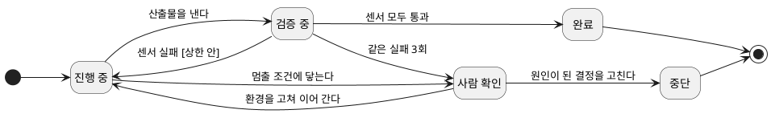
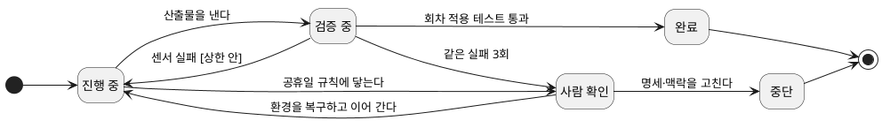

--------------------
Session 명: 10. 비용과 평가
--------------------

## 목차

01. 세션 목표
02. 재시도는 복구가 아니다
03. 실패의 유형
04. 상태와 오류 누적
05. 추적
06. 되돌릴 자리 찾기
07. 작업 상태 기계
08. 표류와 정리
09. 잘못된 관행
10. 실습 — 실패·복구
11. 요약

---

## 01. 세션 목표

작업이 실패하면 **실행 기록과 입력을 확인해 원인을 찾고**, 재시도할지 입력을 고칠지 판단한다.

- 실패를 **명세 결함·맥락 누락·환경 오류·모델 한계** 네 유형으로 진단한다.
- 원인에 따라 **재시도·중단·되돌림·결정 재검토** 중에서 대응을 고른다.
- **오류 누적**을 줄이도록 검증하고, **커밋과 진행 기록**으로 끊긴 작업을 이어 간다.
- **추적 기록**에서 읽은 자료와 도구 호출을 확인해 실패의 원인을 찾는다.
- 코드뿐 아니라 **명세·맥락·경계·하네스**에 원인이 있는지 확인하고 수정한다.
- 맡긴 과제의 **작업 상태 기계**를 그려 멈춤과 되돌림의 조건을 미리 정한다.
- 기존의 잘못된 패턴이 반복되어 생기는 **표류**를 정기적인 코드 정리로 줄인다.

**강사 노트**

- "세션 09. 검증 하네스·결과 점검·피드백"이 센서로 실패를 **드러냈다**. 여기서는 드러난 실패를 **진단하고 복구한다**.
- 기준 원전이 따로 없는 세션이다. 상태와 오류 누적은 [Anthropic 2025a], 끊긴 세션은 [Anthropic 2025d], 추적은 [Blount 외 2026], 표류와 정리는 [Lopopolo 2026], 내구성과 인지 부채는 [Thoughtworks 2026]으로 받친다.
- 반복되는 실패를 평가 세트에 더하는 일은 "세션 11. 평가 세트와 운영 점검 — 보안·비용·모델 변경"이 맡는다.

---

## 02. 재시도는 복구가 아니다

명세나 맥락에 원인이 있다면 **다시 실행하는 것만으로는 원인이 해결되지 않는다**. 결과가 달라져도 같은 문제가 다시 생길 수 있다.

- "주문한다"의 수용 테스트 중 **거절 뒤 재결제**가 실패했다. 에이전트는 같은 수정을 세 번 되풀이했다.
- 세 번 모두 **같은 명세와 상태 기계**를 읽었다. 두 문서의 불일치를 고치지 않으면 재결제의 동작을 계속 잘못 구현할 수 있다.
- **일시적인 도구 오류**는 원인이 다르다. 네트워크가 복구되었다면 같은 요청을 다시 실행해 작업을 이어 갈 수 있다.
- **먼저 확인할 것** — 도구가 실패했는지, 기대한 결과가 잘못됐는지, 필요한 규칙을 빠뜨렸는지 실행 기록과 입력을 함께 살핀다.

**강사 노트**

- 거절 뒤 재결제는 "세션 04. 수용 기준과 검증 가능한 작업 단위"의 「03. 허용·거절 예시」에서 사람이 정한 네 번째 예다. 그 기대값은 에이전트가 바꿀 수 없다.
- 같은 실패 3회의 상한은 "세션 06. 작업 위임과 도구·권한·상태의 경계"의 「07. 위임 계약」에서 정했다. 이 세션은 그 상한에 닿은 뒤를 다룬다.
- 수강생에게 묻는다 — 재시도하기 전에 어떤 근거를 확인해야 하는가? 도구의 오류 메시지와 실행 기록을 본다. 결과가 달라졌다는 사실만으로 환경 오류라고 단정하지 않는다.

---

## 03. 실패의 유형

## 네 유형

실패의 원인이 **명세·맥락·실행 환경·모델의 수행 능력** 중 어디에 있는지에 따라 대응이 달라진다.

**표 — 실패의 네 유형**

| 유형 | 확인할 원인 | 확인할 근거 | 대응 |
|---|---|---|---|
| **명세 결함** | 규칙·기대값이 미정이거나 잘못됨 | 요구와 수용 기준의 불일치 | 업무 담당자와 명세를 고친다 |
| **맥락 누락** | 필요한 지식이 없거나 서로 다름 | 명세와 모델·문서의 불일치 | 맥락 자료를 보완한다 |
| **환경 오류** | 도구·네트워크 등 실행 환경 | 오류 메시지와 호출 기록 | 환경을 확인하고 재시도한다 |
| **모델 한계** | 과제 수행 능력의 부족 가능성 | 입력·환경 점검 뒤에도 실패 | 작업을 나누거나 사람이 한다 |

- **기록에 근거한 진단** — 도구 오류와 입력 문서의 불일치를 먼저 확인한다. 실패가 반복된다는 이유만으로 모델 한계라고 단정하지 않는다.
- **진단이 어려운 경우** — 부족한 증거와 추가로 확인할 사항을 남긴다. 원인을 모른 채 재시도 횟수만 늘리지 않는다.

**강사 노트**

- 네 유형은 과정의 정리다. 원전의 분류가 아니며, 유형 이름보다 어떤 근거로 진단했는지 설명하게 한다.
- 모델 한계는 모델을 바꾸면 사라지기도 한다. 그 판단은 "세션 11. 평가 세트와 운영 점검 — 보안·비용·모델 변경"의 평가 세트로 한다.
- 맥락 누락과 명세 결함은 겹칠 때가 있다. 둘 다면 **명세를 먼저** 고친다 — 맥락은 명세가 가리키는 것이기 때문이다.

---

## 주문한다의 진단

거절 뒤 재결제의 실패에서는 **수용 기준과 상태 기계가 일치하지 않았다**. 이미 정한 업무 규칙이 맥락 문서에 빠져 있었던 것이다.

**표 — 세 번의 시도에서 드러난 것**

| 본 것 | 읽은 것 | 진단 |
|---|---|---|
| 거절 뒤 두 번째 결제가 거절된다 | 수용 기준은 재결제를 허용한다 | 기대값은 맞다 |
| 주문이 결제대기에 남지 않는다 | 상태 기계에 결제대기의 **자기 전이가 없다** | 맥락이 기대와 어긋난다 |
| 에이전트는 상태 기계대로 구현했다 | 확정한 업무 규칙은 재결제를 허용한다 | 맥락 누락·불일치 |

- **원인 확인** — 에이전트가 읽은 상태 기계에는 거절 뒤에도 결제대기를 유지한다는 규칙이 없었다. 코드만 고치면 같은 자료를 읽는 다음 작업에서도 문제가 반복될 수 있다.
- **입력 수정** — 상태 기계에 빠진 전이를 반영하고 작업 명세서의 참조도 확인한다. 이후 구현을 고쳐 같은 수용 테스트로 검증한다.
- **반복 제한** — 같은 실패가 세 번 반복되어 실행을 멈췄다. 센서 결과와 시도 횟수가 원인을 재검토하는 근거가 됐다.

**강사 노트**

- 결제가 거절되면 주문이 결제대기에 머문다(자기 전이)는 규칙은 `course-design.md`의 공통 전제이며 "세션 01. AI 협업의 특성과 사람의 판단 책임"의 첫 시도에서 이미 문제로 드러났다.
- 상태 기계는 "세션 05. 도메인·설계 지식과 맥락 구성"의 「07. 도메인 지식」에서 맥락으로 준 것이다. 맥락의 그림 하나가 기대값과 어긋나면 에이전트는 그림을 따른다.
- 수강생에게 묻는다 — 수용 기준과 맥락이 다르면 무엇이 옳은가? 기계는 답하지 못한다. 사람이 정하고 둘을 맞춘다.

---

## 재시도의 조건과 상한

**같은 요청의 재시도**와 **실패 원인을 수정한 뒤의 재검증**을 구분한다. 어느 쪽이든 반복 횟수와 중단 조건을 정해야 한다.

**표 — 재시도할 것과 멈출 것**

| 실패 | 재시도 | 멈춤의 조건 |
|---|---|---|
| **일시적 도구 오류** | 복구·중복 실행 여부를 확인한다 | 같은 도구가 3회 실패 |
| **센서 실패** | 원인을 수정하고 다시 검사한다 | 같은 센서가 3회 실패 |
| **판정할 수 없는 결정** | 하지 않는다 | 닿는 즉시 멈추고 묻는다 |
| **권한·경계에 막힘** | 하지 않는다 | 닿는 즉시 멈추고 묻는다 |

- **시도 기록** — 무엇을 바꿨고 결과가 어땠는지 남긴다. 횟수만 알아서는 같은 수정을 반복했는지 판단할 수 없다.
- **멈춘 뒤의 처리** — 상한에 닿으면 기록을 사람에게 전달한다. 원인과 입력을 다시 확인한 뒤 다음 작업을 정한다.

**강사 노트**

- 실패 한도의 근거는 [OpenAI 2025]이며 "세션 07. 워크플로·에이전트와 사람의 개입"의 「06. 사람의 개입」의 「개입의 계기」에서 인용했다. 여기서는 그 한도에 닿은 **뒤의 처리**를 다룬다.
- 3회는 교육용 값이다. 과제의 값과 한 번의 비용으로 정하며, 비싼 과제일수록 작아진다.
- 실패 원인을 수정한 뒤 다시 검사하는 것이 "세션 09. 검증 하네스·결과 점검·피드백"의 조종 루프다. 같은 실패가 반복되면 진단을 재검토한다.

---

## 04. 상태와 오류 누적

## 에이전트는 상태를 지닌다

에이전트는 앞서 읽은 자료와 수정한 파일을 바탕으로 다음 작업을 진행하므로, **초기의 오류가 후속 작업에 영향을 줄 수 있다**.

**인용문**

에이전트는 **상태를 지니고 오류는 누적된다** — 오랜 시간 실행되며 여러 도구 호출에 걸쳐 상태를 유지한다, "Agents are stateful and errors compound. Agents can run for long periods of time, maintaining state across many tool calls.", [Anthropic 2025a]

  - 효과적인 완화 수단이 없으면 **작은 시스템 고장도 에이전트에게 치명적**일 수 있다, "Without effective mitigations, minor system failures can be catastrophic for agents.", [Anthropic 2025a]

- **오류 누적** — 잘못 정한 이름을 여러 파일과 테스트에서 사용하면, 나중에 수정할 범위가 커진다.
- **조기 검증** — 작업 단위마다 검사하면 오류가 다른 코드로 퍼지기 전에 수정할 수 있다.
- **중단 대비** — 긴 작업은 도구 오류나 세션 종료로 끊길 수 있으므로, 중간 결과와 진행 상황을 남겨야 한다.

**강사 노트**

- 인용 근거: [Anthropic 2025a] 원문 확인. 두 문장은 긴 작업의 공학 과제를 다루는 절의 것이다.
- 센서를 앞쪽에 두는 판단은 "세션 09. 검증 하네스·결과 점검·피드백"의 「04. 조종 루프」의 「품질을 왼쪽에」에서 정했다.
- "주문한다"는 한 시간 안에 끝나는 과제여서 끊김의 비용이 작다. 수강생의 실제 과제는 그렇지 않다는 점을 짚는다.

---

## 진행의 저장과 되돌림

중단된 작업은 **검증된 코드와 진행 기록**을 확인하고 재개한다.

**인용문**

다시 시작하는 것은 비싸고 사람을 지치게 하므로 **오류가 난 지점에서 이어 가는** 시스템을 만든다, "restarts are expensive and frustrating for users. Instead, we built systems that can resume from where the agent was when the errors occurred.", [Anthropic 2025a]

  - 긴 작업의 핵심 어려움은 **끊어진 세션들로 일해야 한다**는 것이다 — 새 세션은 앞의 기억 없이 시작한다, "The core challenge of long-running agents is that they must work in discrete sessions, and each new session begins with no memory of what came before.", [Anthropic 2025d]

**표 — "주문한다"의 작업 재개에 필요한 기록**

| 기록 | 남기는 내용 | 재개할 때 확인할 것 |
|---|---|---|
| **커밋** | 검증한 작업 단위의 코드·테스트 | 마지막으로 검사를 통과한 변경 |
| **진행 기록** | 완료·미완료 작업과 중단 이유 | 이어 할 일과 남은 문제 |

- **되돌림의 기준** — 커밋과 미완료 변경을 구분하고, 문제가 생긴 작업 단위를 되돌려 검증한다.
- **작업 인계** — 사람도 같은 기록으로 현재 상태와 다음 작업을 확인한다.

**강사 노트**

- 인용 근거: [Anthropic 2025a]·[Anthropic 2025d] 원문 확인. 두 번째 문장은 긴 작업의 하네스를 다룬 글의 문제 제기다.
- 커밋 단위의 작업 공간과 진행 기록은 "세션 06. 작업 위임과 도구·권한·상태의 경계"의 「06. 상태와 되돌림」에서 정했다. 여기서는 그것이 **복구의 단위**가 된다는 점을 더한다.
- 영어의 checkpoint를 이 자리에서 쓰지 않는다 — 이 과정에서 그 말은 사람이 판단하는 **확인 지점**이다(`course-design.md`의 용어 표).

---

## 05. 추적

진행 기록이 **어디까지 했는지**를 알려 준다면, 추적 기록은 **어떤 자료와 도구를 사용했는지**를 확인하는 데 쓰인다.

**인용문**

견고한 프레임워크는 상세한 추적과 로그를 남겨 **추론의 궤적 전체**를 드러낸다 — 모델의 내적 독백과 고른 도구와 만들어 낸 인자와 관찰한 결과다, "A robust framework generates detailed traces and logs, exposing the entire reasoning trajectory: the model's internal monologue, the tool it chose, the parameters it generated, and the result it observed.", [Blount 외 2026]

  - 운영 전 구간에 **추적을 붙이면** 에이전트가 왜 실패했는지 진단하고 문제를 체계적으로 고칠 수 있다, "Adding full production tracing let us diagnose why agents failed and fix issues systematically.", [Anthropic 2025a]

- **진단에 필요한 기록** — 읽은 문서, 호출한 도구와 인자, 반환 결과를 확인한다. 도구의 실행 기록과 모델 내부의 추론은 구분한다.
- **"주문한다"의 확인 사항** — 에이전트가 읽은 상태 기계와 실제 변경을 비교해, 빠진 전이가 구현에도 반영됐는지 확인한다.
- **실행별 기록** — 같은 지시에도 결과가 달라질 수 있으므로 실패한 실행의 기록을 보관한다. 기록만으로 원인을 단정할 수 없으면 입력과 코드를 함께 검토한다.

**강사 노트**

- 인용 근거: [Blount 외 2026]·[Anthropic 2025a] 원문 확인. 앞의 문장은 프레임워크가 갖출 조건, 뒤의 문장은 추적을 붙인 뒤의 경험이다.
- 도구가 남기는 기록의 형식(OpenTelemetry 등)은 과정의 범위가 아니다. 무엇이 남아야 진단되는지만 정한다.
- 수강생에게 묻는다 — 지금 쓰는 에이전트에서 실패한 실행의 기록을 다시 열어 볼 수 있는가? 저장 여부와 보관 기간을 확인하게 한다.

---

## 06. 되돌릴 자리 찾기

검사 실패가 곧 코드만의 문제라는 뜻은 아니다. **기대값·맥락·권한 경계**를 확인해 원인이 있는 부분을 수정한다.

**표 — 실패에서 결정으로 거슬러 오르기**

| 확인할 질문 | 확인 결과에 따른 대응 |
|---|---|
| 도구·환경 오류가 기록에 있는가? | 복구 여부를 확인하고 재시도를 판단한다 |
| 기대값이 업무 규칙과 맞는가? | 다르면 업무 담당자와 수용 기준을 고친다 |
| 필요한 규칙을 읽을 수 있었는가? | 빠졌거나 다르면 맥락 문서를 고친다 |
| 권한 경계에 막혔는가? | 의도한 제한인지 확인하고 위임 범위를 검토한다 |

- **입력 점검** — 기대값이 잘못되었다면 먼저 확정하고, 맥락과 위임 범위를 그 기준에 맞춘다.
- **구현 점검** — 입력과 환경이 올바르면 코드와 검사 자체의 결함을 확인한다. 여전히 수행하기 어렵다면 작업을 나누거나 사람이 맡는다.
- **수정 후 검증** — 고친 입력과 코드로 같은 수용 테스트를 실행해, 기대한 동작을 회복했는지 확인한다.

**강사 노트**

- 이 표는 "세션 09. 검증 하네스·결과 점검·피드백"의 「08. 센서의 실패가 가리키는 판단」을 한 걸음 더 끌고 간 것이다. 거기서는 센서별 되돌릴 곳을, 여기서는 묻는 **순서**를 정한다.
- "주문한다"의 거절 뒤 재결제는 둘째 물음에서 기대값이 옳았고 셋째 물음에서 맥락이 어긋났다.
- 수강생에게 묻는다 — 코드가 원인이면 코드 수정으로 충분할 수 있다. 입력 문서가 원인이라면 코드만 수정했을 때 다음 작업에 어떤 문제가 남는가?

---

## 07. 작업 상태 기계

작업 상태 기계는 **진행·검증·사람 확인·종료의 조건**을 정한다. 실패했을 때 계속 수정할지, 사람에게 넘길지 일관되게 판단할 수 있다.

**도식 — PlantUML — 작업 상태 기계**

- **완료와 중단** — 정한 검사를 통과하면 완료한다. 상한이나 멈출 조건에 닿으면 사람이 기록을 확인해 재개 또는 중단을 결정한다.
- **재개와 재위임** — 환경을 복구한 경우에는 저장된 진행에서 이어 간다. 명세나 맥락을 바꿨다면 기존 결과의 재사용 범위를 확인하고, 고친 입력으로 새 과제를 맡긴다.

**강사 노트**

- 이 상태 기계의 대상은 업무 객체가 아니라 **맡긴 과제**다. 상태 기계 표기 자체는 "객체지향 분석과 설계 실무" 과정이 가르친다.
- 전이의 조건은 앞 세션에서 정한 것들이다 — 센서는 "세션 09. 검증 하네스·결과 점검·피드백", 멈출 조건과 상한은 "세션 06. 작업 위임과 도구·권한·상태의 경계"의 「07. 위임 계약」이다.
- 중단에서 [*]로 가는 전이를 짚는다. 같은 과제를 이어 가는 것이 아니라 **고친 입력으로 새로 시작**한다.

---

## 08. 표류와 정리

기존의 잘못된 패턴이 반복되면, 코드가 **의도한 구조와 규칙에서 점차 벗어날 수 있다**.

**인용문**

Codex는 저장소의 **일관되지 않거나 바람직하지 않은 패턴까지** 복제하므로, 시간이 지나면 필연적으로 **표류**가 생긴다, "Codex replicates patterns that already exist in the repository—even uneven or suboptimal ones. Over time, this inevitably leads to drift.", [Lopopolo 2026]

  - 우리 팀은 매주 금요일(주간 업무의 20%)을 AI가 남긴 조잡한 코드 정리에 썼지만, **작업량이 늘자 유지할 수 없었다**, "Our team used to spend every Friday (20% of the week) cleaning up \"AI slop.\" Unsurprisingly, that didn't scale.", [Lopopolo 2026]
  - 대신 **골든 프린시플이라 부르는 원칙**을 저장소에 명시하고, **정기적으로 코드를 정리하는 절차**를 만들었다, "we started encoding what we call \"golden principles\" directly into the repository and built a recurring cleanup process", [Lopopolo 2026]

- **발견의 어려움** — 기능 테스트가 통과해도 중복이나 불필요한 의존은 늘어날 수 있다.
- **정리 방법** — 규칙을 문서와 검사에 반영하고, 작은 정리 작업을 주기적으로 수행한다.
- **"주문한다"의 예** — 중복된 테스트 대역과 미사용 설정을 정리한 뒤 수용 테스트로 기존 동작을 확인한다.

**강사 노트**

- 인용 근거: [Lopopolo 2026] 원문 확인. golden principles는 저자 팀이 붙인 이름이며, 이 과정은 그 방식(규칙을 저장소에 적고 정리를 주기로 돌린다)만 가져온다.
- 표류(drift)는 `course-design.md`의 용어 표에 있다. 엔트로피라는 말은 쓰지 않는다 — 뜻이 넓어 과제에서 무엇을 할지 말해 주지 않는다.
- 규칙을 적는 자리는 "세션 05. 도메인·설계 지식과 맥락 구성"의 맥락 파일, 판정하는 자리는 "세션 09. 검증 하네스·결과 점검·피드백"의 센서다.

---

## 09. 잘못된 관행

## 무한 재시도와 실패 숨기기

원인을 확인하지 않고 재시도를 반복하면 **시간과 비용을 낭비할 수 있다**. 통과시키려고 기대값을 바꾸거나 테스트를 건너뛰면 문제 자체가 숨겨진다.

**표 — 실패를 반복하거나 숨기는 관행과 방지 방법**

| 관행 | 일어나는 일 | 방지 방법 |
|---|---|---|
| **무한 재시도** | 같은 실패에 토큰과 시간을 쓴다 | 같은 실패 3회의 상한 |
| **기대값 바꾸기** | 테스트가 통과하고 규칙이 사라진다 | 기대값 파일의 쓰기 금지 |
| **실패 숨기기** | 건너뛴 테스트가 녹색으로 보인다 | 건너뜀을 실패로 세는 설정 |

- **검증 기준의 보호** — 기대값 변경과 테스트 비활성화를 제한하고, 건너뛴 검사가 있는지도 확인한다.
- **실행 비용의 확인** — 최종 통과 여부와 함께 시도 횟수·소요 시간·중단 이유를 남긴다. 마지막 성공만으로 전체 실행을 평가하지 않는다.

**강사 노트**

- 기대값 변경과 테스트 끄기는 "세션 09. 검증 하네스·결과 점검·피드백"의 「11. 잘못된 관행」의 「테스트를 끄는 에이전트」에서, 쓰기 금지는 "세션 08. 실행 제약과 가드레일의 역할"의 「07. 주문한다의 가드레일」의 「배치표」에서 다뤘다.
- [Beck 2025]가 지니의 속임수로 든 징후가 이것이다. 이 세션은 그 징후를 **실패 처리**의 관점에서 다시 본다.
- 수강생에게 묻는다 — 상한을 늘리기 전에 무엇을 확인할 것인가? 이전 시도에서 바꾼 내용과 실패 원인을 확인하게 한다.

---

## 내구성 없는 작업

중단되었을 때 진행 상황을 복원할 수 없는 작업은 **실행 시간이 길어질수록 복구 부담이 커진다**.

**인용문**

에이전트 흐름에서 **내구성을 무시하는 것**은 여러 팀에서 본 안티패턴이며 **개발에서는 되지만 운영에서 실패하는** 시스템을 낳는다, "Ignoring durability in agent workflows is an anti-pattern we've seen across many teams, resulting in systems that work in development but fail in production.", [Thoughtworks 2026]

  - 팀은 **설계 의도와 숨은 결합**을 놓치고 이것이 늘어나는 기술 부채와 맞물려 **시스템을 점점 더 이해하기 어렵게** 만드는 고리를 이룬다, "teams can lose track of design intent and hidden coupling. This, combined with rising technical debt, creates a reinforcing loop that makes systems progressively harder to reason about.", [Thoughtworks 2026]

- **중단에 대한 대비** — 네트워크 오류·시간 초과·사람의 중단에 대비해 코드와 진행 기록을 저장한다. 재개할 때 이미 완료한 작업을 확인한다.
- **재개에 필요한 이해** — 기록뿐 아니라 설계 의도도 남아 있어야 한다. 생성된 코드를 검토하지 않으면, 다음 사람이 변경의 이유와 영향을 파악하기 어렵다.

**강사 노트**

- 인용 근거: Thoughtworks Technology Radar Vol. 34(2026-04)의 ignoring durability in agent workflows·codebase cognitive debt(둘 다 Caution) 원문 확인.
- 내구성의 구현(작업 큐·재개 가능한 실행)은 도구의 일이다. 과정은 **진행을 어디에 남기는가**만 정한다(「04. 상태와 오류 누적」).
- 인지 부채는 "세션 09. 검증 하네스·결과 점검·피드백"의 「09. 사람의 리뷰가 볼 것」과 이어진다. 센서가 녹색이어도 사람이 모르는 코드는 다음 결정을 어렵게 한다.

---

## 10. 실습 — 실패·복구

실습 9의 하네스로 **"배송지를 변경한다"**를 진행하고, 실행 기록과 입력을 LLM에 제공해 실패 원인과 복구 방법을 검토하십시오.

- **투입물**
  + 실습 9의 **하네스 배치**, 실습 5의 **맥락 패키지**, 실습 3의 **작업 명세서**, **실패한 실행의 테스트 출력·도구 호출 기록**
- **프롬프트**
  + ① "'배송지를 변경한다'의 **실행 기록과 입력**을 비교해 실패 원인을 진단해줘. **관찰한 사실과 추정을 구분**하고, 근거가 없으면 추가로 확인할 것을 적어줘."
  + ② "실패마다 **수정할 입력·코드·환경과 재검증 방법**을 적고, 재개·중단 조건을 작업 상태 기계로 그려줘."
- **점검 항목**
  1. **유형** — 도구 오류와 입력의 누락·불일치를 기록으로 확인했는가?
  2. **근거** — 테스트 출력·추적에서 확인한 사실과 추정을 구분했는가?
  3. **수정 대상** — 명세·맥락·경계·하네스·코드 중 원인이 있는 부분을 골랐는가?
  4. **재검증** — 고친 뒤 같은 수용 기준을 충족하는지 확인하는가?
  5. **멈춤** — 상한과 멈출 조건이 상태 기계에 있는가?
  6. **재개** — 저장한 진행과 새로 검증할 범위를 구분했는가?
- **결과물** — "배송지를 변경한다"의 실패 진단과 되돌림, 작업 상태 기계. 실습 11의 입력이 됩니다.

**강사 노트**

- 회차 상태별 적용은 `course-design.md`의 공통 전제다 — 예정은 배송 요청 때, 배송 요청됨은 배송 시스템에 알리고, 배송중·배송됨은 다음 회차부터다.
- 실패 기록이 없으면 원인을 확정하지 않게 한다. 별첨은 교육용 관찰에 따른 진단 예시이며 실제 수강생의 실행 결과를 대신하지 않는다.
- LLM이 근거 없이 "프롬프트를 더 구체적으로"라고 제안하면 점검 1·3으로 되돌린다.
- 평가는 진단의 정답보다 **근거와 되돌릴 자리**를 본다. 같은 실패를 다르게 진단해도 근거가 서면 맞는 답이다.

---

## 11. 요약

실패하면 **기록과 입력으로 원인을 확인하고**, 필요한 부분을 수정한 뒤 다시 검증한다.

### 실패 대응의 핵심

- **원인 진단** — 명세·맥락·환경·모델의 문제를 실행 기록에 근거해 구분한다
- **재시도와 재검증** — 같은 요청의 반복과 원인 수정 후의 검증을 구분하고 상한을 둔다
- **진행 저장** — 작업 단위로 검증하고, 커밋과 진행 기록으로 재개할 지점을 남긴다
- **추적** — 읽은 자료와 도구 호출·결과를 보관해 실패한 실행을 검토한다
- **표류 관리** — 규칙을 문서와 검사에 반영하고, 작은 정리 작업을 주기적으로 수행한다

### 다음 세션

- "**11. 평가 세트와 운영 점검 — 보안·비용·모델 변경**" — 한 번 고친 실패가 다시 나지 않는지를 평가 세트로 확인한다.

**강사 노트**

- 실습 10의 실패 진단과 상태 기계가 실습 11의 평가 세트에 들어간다. 반복된 실패가 평가의 과제가 된다.
- 이 세션까지가 한 과제의 안쪽이다. 다음 세션은 **바뀔 때 다시 확인하는** 바깥의 일을 다룬다.

---

## 별첨. 실습 답

---

## 실패 진단과 되돌림 (안)

"배송지를 변경한다"의 실패는 **관찰한 결과와 입력 문서를 비교**해 진단한다. 명세·맥락의 보완과 환경 복구를 구분한다.

**표 — 실패의 진단과 되돌릴 자리**

| 실패 | 유형 | 근거 | 되돌릴 자리 |
|---|---|---|---|
| **배송 요청됨 회차에 알리지 않았다** | 명세 결함 | 수용 기준에 그 회차의 예가 없다 | 작업 명세서의 예 |
| **배송중 회차의 배송지를 바꿨다** | 맥락 누락 | 회차 상태 기계에 적용 범위가 없다 | 맥락 파일의 상태 기계 |
| **배송 시스템 호출이 실패했다** | 환경 오류 | 호출 기록에 연결 오류가 남았다 | 환경 복구 후 재시도 판단 |

- **입력 보완** — 작업 명세서에 빠진 예를 추가하고, 상태 기계에 회차별 적용 범위를 반영한다.
- **재위임과 재개** — 입력을 고쳤다면 새 과제로 맡기고 수용 테스트로 확인한다. 환경 오류라면 기존 진행을 확인하고 재개할 수 있다.

**강사 노트**

- 이 표는 교육용 관찰을 가정한 답안이다. 앞의 두 실패는 회차 상태별 적용 규칙의 누락, 마지막은 도구 호출 오류다. 실제 진단은 실행 기록에 근거해야 한다.
- 두 번째 실패는 "세션 05. 도메인·설계 지식과 맥락 구성"의 실습에서 만든 맥락 파일로 되돌아간다. 맥락은 한 번 만들고 끝나지 않는다.
- 환경 오류 한 줄을 일부러 넣었다. 셋 다 결정으로 되돌리는 답은 재시도의 자리를 잃은 것이다.

---

## 작업 상태 기계 (안)

"배송지를 변경한다"에서도 **검사 통과·반복 상한·사람의 판단이 필요한 조건**을 정해 작업의 종료와 재개를 관리한다.

**도식 — PlantUML — 배송지를 변경한다의 작업 상태 기계**

- **사람에게 넘기는 조건** — 같은 실패가 세 번 반복되거나, 공휴일 규칙처럼 미정인 업무 판단에 닿으면 멈춘다.
- **다음 실행의 입력** — 환경 복구 후에는 진행 기록을 읽고 재개한다. 명세·맥락을 고쳤다면 고친 입력과 검증 기준으로 새 과제를 맡긴다.

**강사 노트**

- 공휴일 규칙은 "세션 08. 실행 제약과 가드레일의 역할"의 별첨에서 멈출 조건으로 남긴 항목이다. 기계가 판정할 수 없어 사람에게 온다.
- 상태 이름은 강의의 것과 같다. 과제가 달라도 작업의 상태는 같은 틀을 쓴다는 점을 보인다.

---

## 보완 (안)

새로 발견한 것은 **후속 작업에 영향을 미치는 경우에만** 이전 산출물에 반영한다.

- **작업 명세서**(실습 3)
  - **배송 요청됨 회차의 예를 더한다** — 배송 시스템에 변경을 알려야 한다는 규칙을 수용 기준과 테스트에 반영한다.
- **맥락 패키지**(실습 5)
  - **회차 상태 기계에 적용 범위를 적는다** — 예정·배송 요청됨·배송중·배송됨에서 배송지 변경이 어떻게 적용되는지 명시한다.
- **하네스 배치**(실습 9)
  - **재시도의 기록을 남긴다** — 센서 실패와 재시도 횟수를 진행 기록에 적어 다음 판단의 근거로 쓴다.
- **※ 현행화 기준**
  - **반영** — 작업 명세서의 예와 맥락 파일의 상태 기계. 실습 11의 평가 세트가 이 둘을 쓴다.
  - **기록만** — 환경 오류의 발생 횟수. 추세가 보일 때만 다시 본다.

**강사 노트**

- 입력 문서가 원인인 실패는 문서와 코드를 함께 보완해야 한다. 코드 수정만으로 끝내지 않는 이유를 설명하게 한다.
- 검사 도구에 따라 실행 횟수의 기록 여부가 다르다. 사용 환경에서 시도 횟수와 실패 이유를 어디에 남기는지 확인하게 한다.
