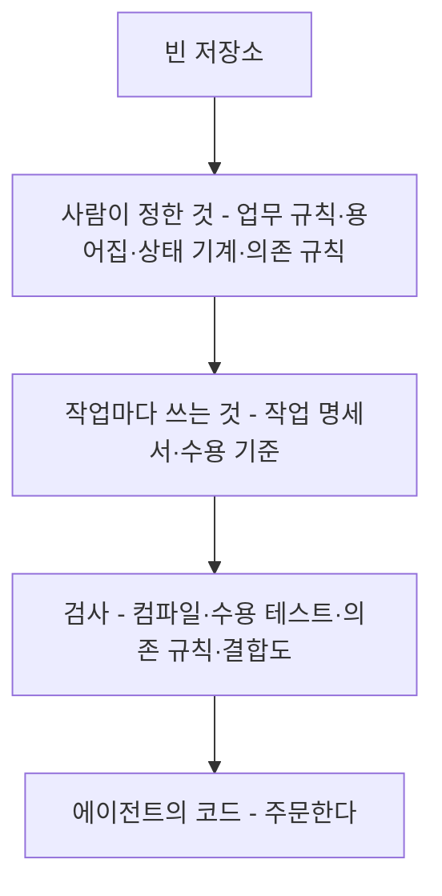
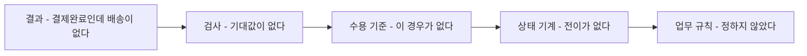

--------------------
Session 명: 11. 종합 실행
--------------------

## 목차

01. 세션 목표
02. 저장소가 자란 순서
03. 남은 단위를 맡긴다
04. 두 번째 위임이 첫 번째와 다른 점
05. 결과 검토
06. 미정이 드러나는 자리
07. 어느 결정이 비었나
08. 모델의 보완과 전파
09. 기능 하나가 끝났다
10. 사람이 남긴 결정
11. 실습 11 — 종합 실행
12. 요약

---

## 01. 세션 목표

빈 저장소에서 시작해 **기능 하나를 끝까지** 맡긴다. 남는 것은 코드가 아니라 **그 코드를 옳다고 말할 수 있게 한 기록**이다.

- 저장소에 쌓인 것을 되짚고, **위임 패키지**가 무엇으로 이루어지는지 말한다.
- 남은 작업 단위 셋을 같은 패키지로 맡기고 **기능을 끝낸다**.
- 두 번째 위임이 첫 번째와 무엇이 달라졌는지 **환경의 차이**로 설명한다.
- **검사가 준 증거**와 **사람이 볼 것**을 구분해 결과를 검토한다.
- **녹색인데도 미정이 추측으로 채워진 자리**를 찾아낸다.
- 그 자리를 코드가 아니라 **원인이 된 결정**으로 되돌리고 모델에 전파한다.

**강사 노트**

- 이 세션은 새 개념을 거의 더하지 않는다. 03~10이 만든 것을 **한 번에 돌려 보는 자리**다.
- Anchor는 "위임 결과의 문제는 프롬프트가 아니라 원인이 된 결정에서 고친다"이다. 「07. 어느 결정이 비었나」가 그 자리다.
- 강의 사례의 실제 실행 기록은 `code/s11/demo-results/`에 있다. 과제·지시문, 출발과 끝의 검사 출력, 에이전트의 보고가 그대로 들어 있다.

---

## 02. 저장소가 자란 순서

## 빈 저장소에서 여기까지

첫 시간의 저장소는 비어 있었다. 지금 그 안에는 **코드보다 기록이 먼저** 있다.

**배치 — 좌우**

**도식 — Mermaid — 저장소가 자란 순서**



- **사람이 정한 것** — 업무 규칙과 용어, 상태와 전이, 의존 규칙은 회사가 정한다. 한 번 정하면 계속 사용한다.
- **작업마다 작성하는 것** — 작업 명세서와 수용 기준만 작업 단위마다 새로 작성한다.
- **코드가 마지막이다** — 기록이 없으면 **무엇이 옳은 결과인지** 아무도 말할 수 없다.

**강사 노트**

- "세션 01. 사람의 일과 AI의 일"의 「02. 첫 시도」와 비교한다. 같은 기능을 같은 모델에게 맡기는데 결과가 달라지는 까닭은 저장소에 쌓인 기록이다.
- 각 기록을 정한 자리 — 업무 규칙과 수용 기준은 "세션 03. 요구와 수용 기준", 용어집은 "세션 04. 정적 모델", 상태와 전이는 "세션 05. 동적 모델", 의존 규칙은 "세션 06. 아키텍처", 작업 단위는 "세션 07. 설계 — 책임과 협력", 검사는 "세션 09. 검사 파이프라인"이다.
- 화살표는 쌓인 순서이며 고정된 개발 절차가 아니다.

---

## 위임 패키지를 이루는 것

에이전트에게 주는 것은 프롬프트 한 줄이 아니라 **저장소 전체**다. 그중 꼭 읽히는 것은 **안내 하나**다.

**표 — 위임 패키지의 문서**

| 문서 | 답하는 질문 | 바뀌는 때 |
|---|---|---|
| **안내** | 무엇을 먼저 읽는가? | 저장소 구조가 바뀔 때 |
| **용어집** | 무엇이라고 부르는가? | 새 업무 용어가 생길 때 |
| **업무 규칙** | 무엇이 옳은 결과인가? | 정책이 바뀔 때 |
| **상태 기계** | 어떤 전이가 허용되는가? | 업무 담당자가 상태를 더할 때 |
| **의존 규칙** | 무엇을 몰라야 하는가? | 아키텍처를 바꿀 때 |
| **작업 명세서** | 이번에 무엇을 만드는가? | 작업 단위마다 |

- **안내가 나머지를 가리킨다** — 꼭 읽는 것은 안내 하나이고 나머지는 **찾아 읽는다**. 점진적 공개다.
- **작업 명세서에 미정이 함께 있다** — 범위·제외와 나란히 적힌 미정이 이번 실행의 **관찰 지점**이 된다.

**강사 노트**

- 실제 파일은 `code/s11/order/`다. 안내가 `AGENTS.md`, 나머지는 `docs/` 아래에 있다. 이름과 위치는 과정이 그렇게 두기로 한 것이지 도구가 아는 규칙이 아니다. 안내 파일을 저장소에 두고 `AGENTS.md`로 부르는 것은 [AGENTS.md]의 관례를 따른 것이다.
- 점진적 공개는 "세션 08. 위임"의 「04. 맥락」에서 정했다. 여기서는 그 구성이 실제 실행에서 작동하는지 본다.
- 검사 명령과 금지 사항도 안내에 함께 적었다. 에이전트가 완료를 스스로 판정할 수 있어야 한다.

---

## 03. 남은 단위를 맡긴다

## 과제와 지시문

맡기는 것은 **남은 작업 단위 셋**이다. 지시문은 짧고, 가리키는 것이 많다.

```text
AGENTS.md를 먼저 읽고, 거기서 가리키는 문서만 필요할 때 찾아 읽어라.
docs/작업명세서.md가 정한 남은 작업 단위 셋(승인·거절·재결제)을 구현해라.
수용 기준 넷이 각각 테스트로 확인되어야 하고, ./gradlew check가 녹색이어야 끝난 것이다.

- 문서를 고치지 마라. 기존 테스트와 build.gradle.kts도 고치지 마라.
- 문서가 정하지 않은 정책에 닿으면 멈추고 물어라. 추측으로 채우지 마라.
- 저장소 밖에 파일을 만들지 마라.
```

- **완료 조건이 명령 하나다** — `./gradlew check`가 녹색이면 끝이다. 에이전트가 스스로 판정한다.
- **고치면 안 되는 것을 적었다** — 문서와 검사와 빌드 구성이다. 검사를 고쳐 녹색을 만드는 길을 막는다.

**강사 노트**

- 지시문 원본은 `code/s11/demo-results/prompt.txt`다. "세션 08. 위임"의 위임 계약 4가지(지시문·맥락·권한·종료 조건)가 모두 들어 있다.
- 첫 위임의 지시문과 비교하면 **맥락을 베껴 적은 곳이 없다.** 전부 가리키기만 한다.
- 금지를 적는 것만으로 막히지 않는다는 것은 "세션 08. 위임"에서 보았다. 여기서는 권한 설정이 함께 있다는 전제로 진행한다.

---

## 에이전트가 한 일

19턴, 약 100초가 걸렸다. **검사는 녹색**이고 테스트는 셋에서 일곱이 되었다.

**표 — 돌아온 결과**

| 구분 | 내용 |
|---|---|
| **만든 것** | 결제 서비스와 그 입출력 넷, 테스트 하나(수용 기준 넷) |
| **고친 것** | 주문에 승인 전이 하나 |
| **고치지 않은 것** | 문서, 기존 테스트, 빌드 구성 |
| **멈추고 물은 것** | 셋 — 확정 불가, 배송 요청 실패, 없는 주문의 처리 |

- **기존 코드를 건드리지 않으려 새 서비스를 만들었다** — 기존 테스트가 주문 서비스의 생성자를 쓰고 있어 그것을 고칠 수 없다고 판단했다.
- **질문을 남기고 멈췄다** — 문서가 정하지 않은 셋을 보고에 적었다.

**강사 노트**

- 보고 원문은 `code/s11/demo-results/agent-report.md`, 출발과 끝의 검사 출력은 같은 폴더의 `check-before.txt`·`check-after.txt`다. 실행은 Claude Opus 5.5로 2026-10-28에 1회다.
- 새 서비스를 만든 판단은 **지시문이 금지한 것을 피한 결과**다. 설계로는 논쟁의 여지가 있다 — 수강생에게 묻는다. 기존 테스트를 고칠 수 있었다면 더 나은 설계가 나왔을까?
- 돌아온 결과를 강사가 직접 다시 돌려 확인했다. 에이전트의 보고와 실제 출력이 같다.

---

## 04. 두 번째 위임이 첫 번째와 다른 점

같은 사람이 같은 모델에게 맡겼는데 **사람이 볼 것이 줄었다**. 달라진 것은 환경이다.

**표 — 첫 위임과 두 번째 위임**

| | 첫 위임(세션 08) | 두 번째 위임 |
|---|---|---|
| **저장소** | 비어 있다 | 코드·문서·검사가 있다 |
| **완료의 판정** | 사람이 읽는다 | 명령 하나가 판정한다 |
| **맡긴 범위** | 작업 단위 하나 | 작업 단위 셋 |
| **사람이 본 것** | 만든 파일 전부 | 질문 셋과 검사 출력 |

- **환경이 자란 만큼 맡길 수 있는 범위가 커졌다** — 검사가 있어 에이전트가 스스로 고치고, 사람은 증거만 본다.

**인용문**

사람이 자는 동안에도 실행 하나가 한 과제를 **여섯 시간 넘게** 붙들고 일하는 것을 자주 본다, "We regularly see single Codex runs work on a single task for upwards of six hours (often while the humans are sleeping).", [Lopopolo 2026]

- **긴 실행을 가능하게 하는 것은 모델이 아니라 환경이다** — 스스로 판정할 검사가 없으면 길게 돌릴수록 어긋난다.

**강사 노트**

- 인용 근거: [Lopopolo 2026] 원문 확인. 저자의 팀이 하네스를 갖춘 뒤의 경험이다.
- 자율성은 선언으로 올리지 않는다. "세션 02. LLM이라는 재료"의 자율성의 계단에서 올리는 조건이 **증거**였다. 여기서 그 증거가 검사 출력이다.
- 이번 실행이 100초였던 것은 과제가 작기 때문이다. 시간의 크기가 아니라 **사람이 보는 양이 줄었다**는 것이 요점이다.

---

## 05. 결과 검토

## 검사가 준 증거

검사가 낸 것은 **7줄의 통과**와 규칙 하나의 판정, 그리고 신호 하나다.

```text
> Task :coupling
결합도 — 가장 많이 아는 클래스 다섯
  order.OrderPaymentService              15
  order.OrderApplicationService          13
  order.Order                             6

> Task :dependencyRules
의존 규칙 통과: 업무의 연동·영속 의존 없음, 업무 간 허용 목록 준수

OrderPaymentServiceTest > 결제대기 주문이 승인되면 결제완료가 되고 배송 요청이 1회 나간다 PASSED
OrderPaymentServiceTest > 결제가 거절되면 주문은 결제대기로 남고 배송 요청은 0회다 PASSED
OrderPaymentServiceTest > 거절된 주문을 다른 카드로 다시 결제해 승인되면 결제완료가 되고 배송 요청은 총 1회다 PASSED

BUILD SUCCESSFUL
```

- **수용 기준 넷이 각각 한 줄로** 확인된다. 완료의 주장이 아니라 증거다.
- **의존 규칙이 통과했다** — 새 서비스가 연동을 직접 조립하지 않았다.
- **결합도가 신호를 냈다** — 새 결제 서비스가 15로 가장 높다. 합격선은 아니지만 다음 작업에서 볼 자리다.

**강사 노트**

- 출력 원본은 `code/s11/demo-results/check-after.txt`다. 슬라이드는 발췌이며 출발 상태는 `check-before.txt`에 있다.
- 결합도 15는 **작업 단위 셋을 한 클래스에 넣은 결과**다. "세션 09. 검사 파이프라인"의 실패 표에서 "한 클래스가 계속 커진다 → 작업 단위의 분할"로 적은 바로 그 자리다.
- 녹색을 먼저 읽지 말고 **무엇이 녹색인지** 읽게 한다. 수용 기준 넷과 규칙 하나다.

---

## 사람이 보는 것

검사가 다 통과해도 사람이 볼 것이 남는다. 이번에는 **셋**이었다.

**표 — 녹색 뒤에 남은 것**

| 본 것 | 왜 검사가 못 잡았나 |
|---|---|
| **질문 셋** | 정책이 없어 기대값을 작성할 수 없었다 |
| **결합도 15** | 신호일 뿐 통과·실패를 구분하지 않는다 |
| **낡은 기록** | 검사가 보지 않는 파일이다 |

- **질문이 가장 중요하다** — 에이전트가 멈춰 물은 것은 **사람이 정하지 않은 것**의 목록이다.
- **낡은 기록** — 작업 단위의 검사 기록 파일이 "테스트 3개"로 남아 있었다. 에이전트가 그 사실을 보고에 적었다.

**강사 노트**

- 낡은 기록을 찾은 것은 검사가 아니라 **에이전트의 보고**다. 검사 대상이 아닌 파일은 녹색이 보장하지 않는다 — "세션 09. 검사 파이프라인"의 「08. 녹색이 보장하지 않는 것」과 같은 자리다.
- 사람이 볼 것 셋 중 둘(결합도·낡은 기록)은 **다음 작업으로 미룰 수 있다.** 질문 셋은 미룰 수 없다.
- 자동 검사가 놓치는 높은 수준의 문제(문제를 잘못 짚음·과한 설계·지시를 잘못 이해함)는 "세션 10. 비용과 평가"가 다뤘다. 여기서는 실제로 무엇이 남았는지 센다.

---

## 06. 미정이 드러나는 자리

에이전트는 배송 요청 실패를 **물었다**. 그런데 코드는 이미 **한 가지 처리를 하고 있다**.

```java
        // ... 주문 조회와 상태 검사, 승인 요청 생략
        switch (result) {
            case APPROVED -> {
                Order paid = order.approvePayment();
                orderRepository.save(paid);
                // 배송 요청이 실패했을 때의 처리는 정하지 않았다(docs/업무규칙.md). 복구하지 않고 그대로 전한다.
                deliveryGateway.request(new DeliveryRequest(
                    paid.orderNumber().value(), paid.shippingAddress().value()
                ));
                return new PayOrderResult(paid, result);
            }
```

- **결제완료를 먼저 저장하고 배송을 요청한다** — 배송이 실패하면 **결제완료인데 배송이 없는 주문**이 남는다.
- **검사는 녹색이다** — 수용 기준 넷 어디에도 이 경우가 없기 때문이다.
- **같은 미정인데 처리가 달랐다** — 확정 불가는 예외를 던져 멈췄고, 배송 요청 실패는 **조용히 지나갔다**.

**강사 노트**

- 이것이 이 세션의 핵심 장면이다. 미정은 **비어 있는 채로 남지 않는다.** 코드는 어떤 식으로든 돌아가야 하므로 한 가지를 고르게 된다.
- 에이전트는 정직했다 — 주석으로 표시하고 질문으로 올렸다. 그래도 **실행되는 동작은 이미 정해졌다.**
- 확정 불가는 `UnsupportedOperationException`으로 멈춘다. 두 미정을 왜 다르게 다뤘는지 수강생에게 묻는다. 하나는 분기의 끝이고 하나는 정상 흐름의 중간이기 때문이다.
- "세션 03. 요구와 수용 기준"에서 미정으로 남긴 그 항목이 여기서 거두어진다. 7세션을 건너 돌아온 것이다.

---

## 07. 어느 결정이 비었나

## 되돌리는 길

문제를 본 자리에서 고치지 않는다. **그 결과를 낳은 결정**까지 거슬러 올라간다.

**도식 — Mermaid — 결과에서 결정으로**



- **맨 끝이 업무 규칙이다** — 프롬프트를 다시 쓰거나 코드를 고쳐서는 같은 일이 다음 작업에서 또 생긴다.
- **중간을 건너뛰지 않는다** — 규칙을 정하면 상태 기계·수용 기준·검사가 차례로 채워진다.

**강사 노트**

- "세션 09. 검사 파이프라인"의 「09. 실패가 가리키는 결정」과 같은 방법이다. 거기서는 **실패한 검사**가 출발점이었고, 여기서는 **녹색인데 남은 질문**이 출발점이다.
- 되돌릴 곳이 코드면 그 작업만 고쳐지고, 가이드면 다음 작업도 함께 고쳐진다.

---

## 이번 실행의 되돌림

업무 담당자에게 물어 규칙을 정했다. 정한 뒤에 **네 자리를 차례로** 채운다.

**표 — 정한 것과 채울 자리**

| 자리 | 채우는 내용 |
|---|---|
| **업무 규칙** | 배송 요청이 실패하면 주문은 결제완료로 두고 사람에게 알린다 |
| **상태 기계** | 결제완료에서 나가는 전이를 더하지 않는다. 실패는 통보로 처리한다 |
| **수용 기준** | 승인 뒤 배송 요청 실패 → 결제완료 유지, 통보 1회 |
| **검사** | 그 기대값을 재는 테스트 하나를 더한다 |

- **상태를 더하지 않기로 한 것도 결정이다** — 비어 있던 자리가 "없음"으로 확정된다.
- **확정 불가는 아직 미정이다** — 한 번에 다 정하지 않는다. 남은 미정은 목록에 그대로 둔다.

**강사 노트**

- 표의 규칙은 **교육용 결정**이다. 실제 업무에서는 취소·재요청·보상 트랜잭션 중 무엇을 고를지 운영과 물류가 함께 정한다. 수강생에게 다른 답을 말하게 하고, 그 답이 아래 3줄을 어떻게 바꾸는지 따라가게 한다.
- 확정 불가를 남긴 이유를 짚는다. 미정을 발견했다고 전부 그 자리에서 정하는 것이 아니다. **이번 작업이 닿은 것부터** 정한다.
- 되돌림을 적는 자리는 실습의 기록이다. 코드만 고치면 다음 작업에서 같은 질문이 다시 온다.

---

## 08. 모델의 보완과 전파

한 곳을 고치면 **그것을 읽는 모든 곳**이 따라 바뀐다. 전파를 확인하지 않으면 문서끼리 어긋난다.

**표 — 하나를 고치면 따라 바뀌는 것**

| 고친 것 | 따라 바뀌는 것 |
|---|---|
| **업무 규칙** | 상태 기계, 수용 기준, 평가 세트의 능력 과제 |
| **용어집** | 코드의 타입·필드 이름, LLM 심사의 기준 |
| **의존 규칙** | 의존 규칙 검사의 허용 목록 |
| **작업 단위** | 작업 명세서, 완료의 정의 |

- **평가 세트도 바뀐다** — "세션 10. 비용과 평가"에서 **능력 과제**로 두었던 배송 요청 실패가 정책이 생기면서 **회귀 과제**로 옮겨 간다.
- **낡은 기록을 함께 고친다** — 이번에 드러난 검사 기록 파일도 일곱으로 맞춘다.

**강사 노트**

- 능력 과제가 회귀 과제로 옮겨 가는 것은 "세션 10. 비용과 평가"의 「04. 평가의 구조」가 말한 과제의 이동이다. 실제로 일어나는 순간이 여기다.
- 전파를 사람이 손으로 확인한다. 문서 사이의 일치를 재는 검사는 아직 없다 — 그것을 만들지 말지가 다음 판단이다.
- 과정 전체에서 **남는 것은 도메인 모델**이라고 말해 온 이유가 여기서 보인다. 코드는 다시 만들 수 있지만 결정의 기록은 그렇지 않다.

---

## 09. 기능 하나가 끝났다

작업 단위 넷이 모두 통과했다. **"주문한다"가 끝났다.**

**표 — 네 단위의 끝**

| 작업 단위 | 맡긴 자리 | 완료의 증거 |
|---|---|---|
| **금액 확정** | 세션 08 | 판매가가 바뀌어도 총액 2,000원 |
| **승인** | 이 세션 | 결제완료와 배송 요청 1회 |
| **거절** | 이 세션 | 결제대기 유지, 배송 요청 0회 |
| **재결제** | 이 세션 | 다른 카드로 승인, 배송 요청 총 1회 |

- **남은 것** — 확정 불가의 처리, 배송 시작·완료의 통보, 연동의 실제 구현이다. 모두 **미정이거나 범위 밖**으로 적혀 있다.
- **다음 기능은 더 싸다** — 업무 규칙·용어집·상태 기계·의존 규칙·검사를 다시 작성하지 않는다. 작업 명세서와 수용 기준만 새로 작성한다.

**강사 노트**

- 끝났다는 말의 뜻을 분명히 한다 — **정한 것을 다 지켰다**는 뜻이지 모든 경우를 처리했다는 뜻이 아니다.
- 다음 기능에서 다시 쓰는 것과 새로 쓰는 것의 구분이 "세션 10. 비용과 평가"의 중기·장기 판단과 이어진다. 투자는 오래 남는 것에 했다.

---

## 10. 사람이 남긴 결정

11세션 동안 AI가 한 일은 많았다. 그러나 **옳은 결과가 무엇인지는 한 번도 AI가 정하지 않았다**.

**표 — 이 과정에서 사람이 정한 것**

| 자리 | 사람이 정한 것 |
|---|---|
| **요구** | 범위·제외·미정과 받아들일 조건 |
| **모델** | 개념과 관계, 사건과 전이, 금지된 순서 |
| **설계** | 책임의 자리와 계약, 작업 단위 |
| **위임** | 읽힐 범위와 열어 줄 권한, 멈출 조건 |
| **검사** | 무엇을 통과로 볼 것인지의 기준 |
| **판단** | 계속 맡길지와 되돌릴지 |

**인용문**

AI 도구는 **이미 가진 전문성을 증폭한다** — 소프트웨어 엔지니어로서 기술과 경험이 많을수록 LLM과 코딩 에이전트에서 **더 빠르고 더 좋은 결과**를 얻는다, "AI tools amplify existing expertise. The more skills and experience you have as a software engineer the faster and better the results you can get from working with LLMs and coding agents.", [Willison 2025b]

- **증폭에는 방향이 없다** — 결정이 비어 있으면 빈 채로, 검사가 없으면 없는 채로 빨라진다.

**강사 노트**

- 인용 근거: [Willison 2025b] 원문 확인. 저자가 바이브 엔지니어링을 설명하며 든 첫 항목이다.
- "세션 01. 사람의 일과 AI의 일"의 첫 시도로 돌아간다. 같은 모델, 같은 기능인데 결과가 달랐다. 달라진 것은 사람이 정한 것의 양이다.
- 과정의 마지막 장이다. 수강생에게 자기 팀에서 **지금 비어 있는 결정**이 무엇인지 하나만 말하게 한다.

---

## 11. 실습 11 — 종합 실행

**①로 시작해 답·질문·수정 요청을 주고받는다.** ②~④는 보완 예시다. ⑤로 MD를 만들고 필요하면 보완·재생성한다.

**투입물**

+ 자기 저장소 전체와 실습 10의 `주문한다-평가기록.md`, 실습 7의 **남은 작업 단위**

**프롬프트 — 요청사항 포함**

1. 저장소의 안내 문서를 먼저 읽게 하고, **남은 작업 단위**를 구현해라. 수용 기준이 각각 테스트로 확인되어야 하고 검사 명령이 녹색이어야 끝이다. 문서와 검사와 빌드 구성은 고치지 마라.
2. [앞선 질문에 대한 답] [추가 질문·수정 요청] 문서가 정하지 않은 정책에 닿으면 **멈추고 물어라.** 무엇을 묻는지와 지금 코드가 그 자리에서 무엇을 하고 있는지 함께 적어라.
3. [앞선 질문에 대한 답] [추가 질문·수정 요청] 검사가 녹색인데도 **기대값이 없어 그냥 지나간 자리**를 찾아 목록으로 적어라.
4. [앞선 질문에 대한 답] [추가 질문·수정 요청] 내가 정한 정책을 반영해 **업무 규칙 → 상태 → 수용 기준 → 검사** 순서로 채워라. 그 정책이 평가 세트의 과제를 어떻게 옮기는지도 적어라.
5. [앞선 질문에 대한 답] [추가 질문·수정 요청] 이번 실행을 MD 하나로 정리해라. 맡긴 단위와 결과, 검사 출력, 멈춰 물은 것, 되돌린 결정과 전파한 자리, 남은 미정으로 구성하고 새 결정을 추가하지 마라. 5장을 넘지 않게 핵심만 남겨라.

**점검 항목**

1. **완료의 증거** — 수용 기준마다 통과한 줄이 **출력에** 있는가?
2. **멈춤** — 미정에 닿았을 때 추측으로 채우지 않고 물었는가?
3. **조용히 지나간 자리** — 녹색인데 기대값이 없는 곳을 찾아냈는가?
4. **되돌림** — 코드가 아니라 **원인이 된 결정**을 고쳤는가?
5. **전파** — 고친 결정이 상태·수용 기준·검사·평가 세트까지 갔는가?

**결과물**

+ `주문한다-실행기록.md` — **과정의 마지막 산출물**이다

**강사 노트**

- 강사의 실제 실행은 `code/s11/demo-results/`에 있다. 수강생의 결과가 달라도 된다 — **멈춰 물은 것과 조용히 지나간 자리를 찾았는지**를 본다.
- 조용히 지나간 자리를 못 찾으면 ③을 다시 시킨다. 녹색만 보고 끝내는 것이 이 실습이 막으려는 습관이다.
- 시간이 모자라면 ④의 전파를 업무 규칙과 수용 기준까지만 해도 된다. 전파가 **일어난다는 것**을 보는 것이 목적이다.
- 수강생의 미정이 하나도 남지 않았다면 요구 단계에서 추측으로 채웠을 가능성이 크다. 실습 3의 미정 목록과 대조하게 한다.

---

## 12. 요약

빈 저장소에서 기능 하나를 끝냈다. 남는 것은 코드가 아니라 **결정과 그 결정을 확인하는 검사**다.

### 종합 실행

- **환경이 자란 만큼 맡길 수 있다** — 검사가 있어 사람이 보는 양이 줄었다
- **녹색은 작성한 검사만큼만** 보장한다 — 기대값이 없는 자리는 조용히 지나간다
- **미정은 비어 있지 않다** — 정하지 않으면 코드가 한 가지를 고른다
- **되돌릴 곳은 코드가 아니라 결정**이고, 고친 결정은 상태·기준·검사로 전파된다
- **AI는 증폭한다** — 결정이 비어 있으면 빈 채로 빨라진다

**강사 노트**

- 모델에서 보완된 것 — 미정이던 배송 요청 실패의 정책이 정해지고, 검사가 보지 않아 낡아 있던 기록이 드러났다.
- 과정의 마지막 세션이라 다음 세션을 두지 않는다. 수강생이 가져갈 것은 자기 저장소와 거기 쌓인 기록이다.

---

## 별첨. 실습 답

## 주문한다 — 실행 기록

**문서 형식 — 10pt**

남은 작업 단위 셋을 같은 위임 패키지로 맡겨 "주문한다"를 끝냈다. 검사는 녹색이고 수용 기준 넷이 각각 통과했다. 그러나 **녹색 뒤에 질문 셋이 남았고**, 그중 하나는 코드가 이미 조용히 처리하고 있었다.

### 맡긴 것과 돌아온 것

| 구분 | 내용 |
| --- | --- |
| 맡긴 단위 | 승인 · 거절 · 재결제 |
| 만든 것 | 결제 서비스와 입출력 넷, 테스트 하나(수용 기준 넷) |
| 고친 것 | 주문에 승인 전이 하나 |
| 검사 | 테스트 3 → 7, 의존 규칙 통과, 결합도 최고 15 |

### 멈춰 물은 것과 조용히 지나간 자리

1. 결제가 **확정 불가**로 돌아오면? — 예외를 던져 멈춘다.
2. 승인 뒤 **배송 요청이 실패**하면? — 복구 없이 그대로 전한다.
3. 없는 주문·결제대기가 아닌 주문은? — 오류로 보고 승인 요청을 보내지 않는다.

**2번이 조용히 지나간 자리다.** 결제완료를 먼저 저장하고 배송을 요청하므로, 배송이 실패하면 **결제완료인데 배송이 없는 주문**이 남는다. 수용 기준에 이 경우가 없어 **검사는 녹색**이다.

### 되돌린 결정과 남은 미정

업무 규칙에 "배송 요청 실패 시 결제완료를 유지하고 사람에게 알린다"를 더했다. 상태 기계는 **전이를 더하지 않기로** 확정하고, 수용 기준에 "결제완료 유지·통보 1회"를 더해 검사 하나를 추가한다. 평가 세트에서 이 과제는 **능력에서 회귀로** 옮겨 간다. 확정 불가 뒤의 처리는 **그대로 미정**이다 — 이번 작업이 닿지 않았다.

**강사 노트**

- 이 별첨은 `code/s11/demo-results/`의 실제 실행(Claude Opus 5.5, 2026-10-28, 19턴)에서 읽은 것을 실습 결과물 형식으로 정리한 것이다. 에이전트의 보고 원문은 `agent-report.md`, 검사 출력은 `check-after.txt`다.
- 되돌린 결정의 내용은 **교육용 결정**이다. 에이전트가 정한 것이 아니라 업무 담당자 역할의 사람이 정한 것으로 둔다.
- 수강생의 기록에서 「조용히 지나간 자리」가 비어 있으면 아직 찾지 못한 것이다. 녹색인 채로 끝낸 실행에도 그런 자리는 있다.
- **실제로 실행한 프롬프트** — 아래 하나를 `code/s11/order`에서 보냈다. 본문 「11. 실습 11 — 종합 실행」의 ①~⑤는 수강생용으로 나눈 것이고, 강의 사례는 한 번에 맡겼다. 원본은 `code/s11/demo-results/prompt.txt`다.
  1. 실제 프롬프트 1
    이 저장소의 `AGENTS.md`를 먼저 읽고, 거기서 가리키는 문서만 필요할 때 찾아 읽어라.

    `docs/작업명세서.md`가 정한 남은 작업 단위 셋(승인·거절·재결제)을 구현해라. 수용 기준 넷이 각각 테스트로 확인되어야 하고, `./gradlew check`가 녹색이어야 끝난 것이다.

    지켜야 할 것

    - 문서를 고치지 마라. 기존 테스트와 `build.gradle.kts`도 고치지 마라.
    - 문서가 정하지 않은 정책에 닿으면 멈추고 물어라. 추측으로 채우지 마라.
    - 저장소 밖에 파일을 만들지 마라.

    끝나면 다음을 적어 보고해라.

    1. 만든 파일과 고친 파일의 목록
    2. `./gradlew check`의 실제 출력
    3. 문서가 정하지 않아 멈추고 묻는 것이 있으면 그 질문
- 맥락으로 준 문서는 `code/s11/order/AGENTS.md`와 `docs/` 다섯이다. 수강생이 같은 것을 재현하려면 그 여섯 파일과 위 프롬프트가 입력의 전부다.
