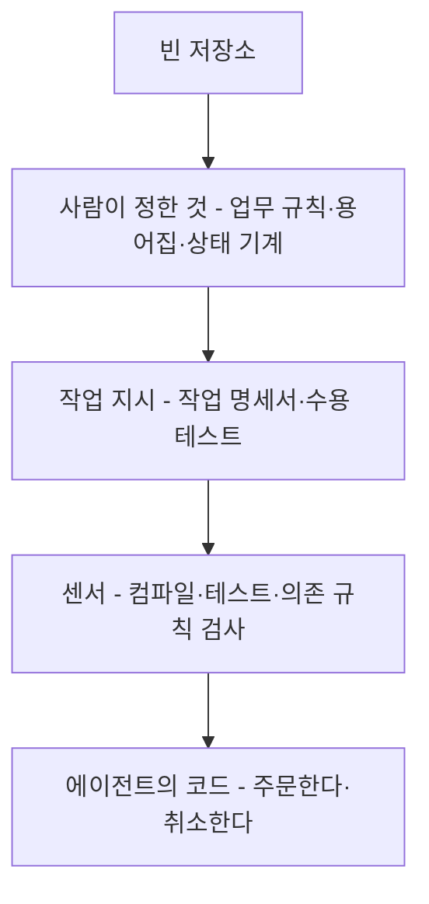
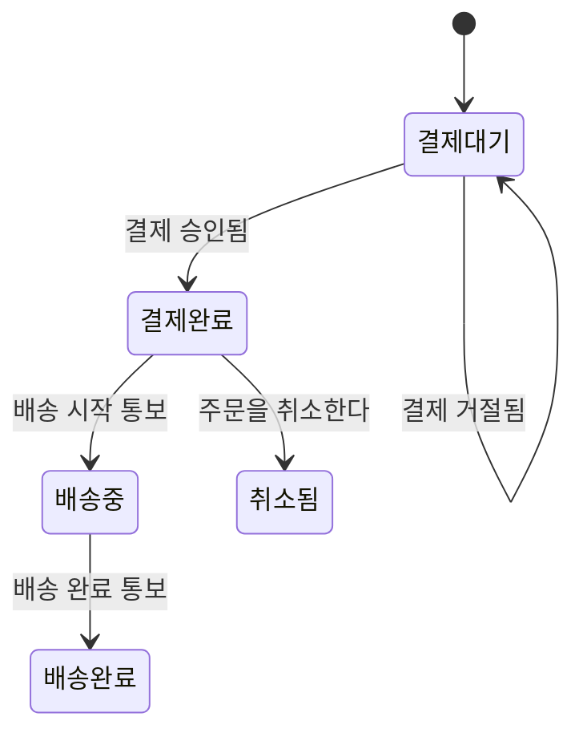
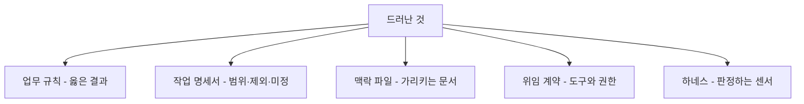

--------------------
Session 명: 12. 종합 실행
--------------------

## 목차

01. 세션 목표
02. 위임 패키지
03. 종합 실행
04. 결과 검토
05. 미정과 질문
06. 원인 결정으로 되돌리기
07. 자율성의 다음 단계
08. 사람이 남긴 결정
09. 실습 — 종합 실행
10. 요약

---

## 01. 세션 목표

지금까지 만든 산출물을 **하나의 위임 패키지**로 모아 실제 에이전트에게 맡기고, 돌아온 결과를 증거로 검토한다.

- 명세·수용 기준·맥락·경계·하네스가 저장소에서 **한 벌로 맞물리는 모습**을 확인한다.
- 실행의 조건(출발 상태·과제·도구·권한·모델)을 정하고 **다시 돌릴 수 있게** 기록한다.
- 센서의 출력과 바뀐 파일을 **증거**로 읽고, 센서가 판정할 것과 사람이 볼 것을 가른다.
- 에이전트가 멈추고 남긴 **질문**을 업무 담당자의 결정으로 되돌린다.
- 드러난 문제를 프롬프트가 아니라 **명세·맥락·경계·하네스의 결정**에서 고친다.
- 이번 실행이 쌓은 증거로 **다음 작업의 자율성**을 어디까지 올릴지 판단한다.

**강사 노트**

- 이 세션의 강의 사례는 실제로 코딩 에이전트에게 맡긴 실행이다. 과제·프롬프트·센서 출력·바뀐 파일·남은 질문을 `code/s12/demo-results/`에 그대로 두었다.
- 기준 원전은 [Lopopolo 2026]과 [Willison 2025b]다. 자율성의 단계는 "세션 02. 작업 특성에 따른 AI 활용 방식"의 계단을 그대로 쓴다.
- 이 세션은 새 기법을 들이지 않는다. 앞 열한 세션의 결정이 한 번의 실행에서 어떻게 작동하는지 확인하는 자리다.

---

## 02. 위임 패키지

## 빈 저장소에서 여기까지

저장소에는 지금 **업무 규칙·용어집·상태 기계·의존 규칙·수용 테스트·센서**가 있다. 첫 시도와 달라진 것은 **코드 밖의 기록**이다.

**배치 — 좌우**

**도식 — Mermaid — 저장소가 자란 순서**



- **사람이 정한 것** — 업무 규칙과 용어, 상태 기계, 의존 규칙은 회사가 정한다.
- **작업마다 쓰는 것** — 유저 스토리와 수용 기준만 기능마다 새로 쓴다.
- **코드는 마지막** — 기록이 없으면 **무엇이 옳은 결과인지** 알 수 없다.

**강사 노트**

- "세션 01. AI 협업의 특성과 사람의 판단 책임"의 「02. 첫 시도」와 비교한다. 같은 기능을 같은 모델에게 맡기는데 결과가 달라지는 까닭은 저장소에 쌓인 기록이다.
- 각 기록을 정한 자리는 업무 규칙과 명세가 "세션 03. 요구의 구체화와 명세", 수용 기준이 "세션 04. 수용 기준과 검증 가능한 작업 단위", 용어집·상태 기계·맥락 파일이 "세션 05. 도메인·설계 지식과 맥락 구성", 센서가 "세션 09. 검증 하네스·결과 점검·피드백"이다.
- 도식의 화살표는 저장소에 쌓인 순서이며 필수 개발 절차가 아니다.

---

## 패키지를 이루는 문서

위임 패키지는 저장소의 문서 일곱이다. 각 문서는 서로 다른 질문에 답하고, **바뀌는 때도 다르다**.

- **오래 남는 다섯** — 지도·용어집·상태 기계·업무 규칙·의존 규칙은 계속 가리킨다.
- **작업마다 쓰는 둘** — 작업 명세서와 수용 테스트만 기능마다 새로 쓴다.
- **지도가 나머지를 가리킨다** — 꼭 읽는 것은 지도 하나이고, 나머지는 **찾아간다**.

**표 — 위임 패키지의 문서**

| 문서 | 답하는 질문 | 바뀌는 때 |
|---|---|---|
| **지도** | 무엇을 먼저 읽는가? | 저장소 구조가 바뀔 때 |
| **용어집** | 무엇이라고 부르는가? | 새 업무 용어가 생길 때 |
| **상태 기계** | 어떤 전이가 허용되는가? | 업무 담당자가 상태를 더할 때 |
| **업무 규칙** | 무엇이 옳은 결과인가? | 정책이 바뀔 때 |
| **의존 규칙** | 무엇을 몰라야 하는가? | 아키텍처를 바꿀 때 |
| **작업 명세서** | 이번에 무엇을 만드는가? | 작업마다 |
| **수용 테스트** | 무엇으로 통과를 판정하는가? | 작업마다 |

**강사 노트**

- 지도의 역할과 점진적 공개는 "세션 05. 도메인·설계 지식과 맥락 구성"의 「06. 맥락 파일」에서 정했다. 여기서는 그 구성이 실제 실행에서 작동하는지 본다.
- 일곱 문서가 실제 파일로 모인 곳은 `code/s12/order`다. 지도는 `AGENTS.md`, 나머지는 `docs/` 아래에 있다. "세션 05. 도메인·설계 지식과 맥락 구성"이 보인 것은 지도의 형식이고, 저장소에 한 벌로 갖춘 것은 이 세션이다.
- 이름과 위치는 이 과정이 그렇게 두기로 한 것이지 도구가 아는 규칙이 아니다.
- 작업 명세서에는 범위·제외·미정이 함께 있다. 미정이 이번 실행의 관찰 지점이 된다.

---

## 03. 종합 실행

## 실행의 조건

같은 결과를 다시 얻으려면 과제만 적어서는 부족하다. **출발 상태·도구·권한·모델**을 함께 적어야 실행을 되풀이하고 비교할 수 있다.

**표 — 이번 실행의 조건**

| 항목 | 이번 실행 |
|---|---|
| **출발 상태** | 취소의 수용 테스트가 컴파일 단계에서 실패 |
| **과제** | 작업 명세서를 읽고 취소를 구현한다 |
| **도구** | 파일 읽기·쓰기·검색과 센서 실행 |
| **권한** | 센서 명령 하나만 허용, 그 밖의 명령은 거절 |
| **모델** | Opus 5, 한 번의 실행 |
| **멈추는 조건** | 명세에 없는 업무 규칙이 필요하면 질문으로 남긴다 |

- **조건이 없으면 비교가 없다** — 모델이나 맥락을 바꾼 뒤의 결과를 **앞의 실행과 견줄** 수 없다.

**강사 노트**

- 도구와 권한은 "세션 06. 작업 위임과 도구·권한·상태의 경계"의 「07. 위임 계약」에서 정한 모양이다. 허용한 명령은 센서 실행 하나뿐이다.
- 모델 이름과 실행 횟수를 적어 두는 까닭은 "세션 11. 평가 세트와 운영 점검 — 보안·비용·모델 변경"의 비교 때문이다.
- 출발 상태를 적는 칸이 가장 중요하다. 같은 과제라도 출발이 다르면 결과를 비교할 수 없다.

---

## 과제와 프롬프트

에이전트에게 준 지시문은 네 줄이다. 업무 규칙을 옮겨 적지 않고 **저장소의 문서를 가리킨다**.

```text
AGENTS.md와 docs/task-spec.md를 읽고 "주문을 취소한다"를 구현해줘.
업무 규칙과 수용 기준은 사람이 정한 것이다. test/ 아래 테스트의 기대값은 바꾸지 않는다.
끝내기 전에 ./run-tests.sh를 돌려 모두 통과하는지 확인하고, 통과한 출력과 바꾼 파일을 보고해줘.
명세에 없는 업무 규칙을 정해야 하면 멈추고 질문으로 남겨줘.
```

- **규칙이 바뀌면 문서만 고친다** — 지시문에 업무 규칙을 적어 두면 **바뀔 때마다 지시문을** 고쳐야 한다.
- **보고를 요구한다** — 센서의 출력과 바꾼 파일을 함께 내게 해, 사람이 검토할 **증거**를 만든다.
- **멈추는 조건을 미리 적는다** — 명세에 없는 규칙이 필요하면 **질문으로 남기라고** 지시에 넣는다.

**강사 노트**

- 프롬프트 전문은 `code/s12/demo-results/prompt.txt`에 있다. 수업에서는 이 네 줄을 함께 읽고 무엇을 가리키는지 짚는다.
- 지시문이 짧은 것은 생략이 아니라 **맥락이 저장소에 있기 때문**이다. 맥락 파일이 없으면 같은 지시가 작동하지 않는다.
- 기대값을 바꾸지 말라는 한 줄은 지도에도 있다. 지시와 지도에 함께 두는 것은 중복이 아니라 **되풀이해 읽히는 자리**다.

---

## 에이전트가 한 일

에이전트는 문서를 읽고 코드를 고치고 센서를 돌리기를 **28번의 차례** 동안 되풀이해, 114초에 수용 테스트 10개를 모두 통과시켰다.

**도식 — Mermaid — 주문 상태 기계**



```java
    // 취소할 수 있는 상태 — 결제완료인 주문만 취소할 수 있다
    public boolean cancellable() { return status == OrderStatus.PAID; }

    // 결제완료 → 취소됨 : 주문을 취소한다
    public void cancel() {
        if (!cancellable()) throw new IllegalStateException("허용되지 않은 상태 전이");
        status = OrderStatus.CANCELLED;
    }
```

```java
    public void cancel(OrderNumber number) {
        Order order = repository.findBy(number);
        // 취소할 수 없는 상태 — 배송중·배송완료·취소됨·결제대기는 아무것도 바뀌지 않는다
        // ... 미정을 가리키는 주석 생략
        if (!order.cancellable()) return;
        order.cancel();
        repository.save(order);
    }
```

- **금지된 전이를 지켰다** — 결제완료에서만 취소로 가고, 그 밖의 상태에서는 **아무것도 바꾸지 않는다**.
- **기대값은 그대로다** — 사람이 쓴 `test/` 아래 파일은 한 줄도 바뀌지 않았다.
- **막힌 명령 네 번** — 허용되지 않은 형태의 명령과 저장소 상태 조회는 거절됐고, 에이전트는 **허용된 센서 명령**으로 다시 돌렸다.

**강사 노트**

- 코드 원본은 `code/s12/order/order/Order.java`와 `OrderService.java`다. 발췌는 에이전트가 더한 부분이다.
- 상태 기계는 `docs/order-state.md`로 저장소에 있었다. 금지된 전이를 지킨 것은 프롬프트가 아니라 **그 문서와 수용 테스트** 덕이다.
- 막힌 네 번은 절대 경로로 센서를 부른 두 번, 저장소 파일 목록 조회, 변경 파일 조회다. 가드레일이 실제로 거절한 기록이며 `demo-results/result.json`에 남아 있다.
- 거절된 뒤 에이전트가 허용된 형태를 찾아낸 것은 운이 아니다. 지도에 센서를 부르는 방법을 한 줄로 적어 두었다.

---

## 04. 결과 검토

## 센서가 준 증거

출발은 **컴파일이 되지 않는 실패**였고, 끝은 수용 테스트 10개가 모두 통과한 상태다. 통과를 말하는 것은 에이전트의 보고가 아니라 **센서의 출력**이다.

```text
출발 — 컴파일 실패
  ./test/CancelAcceptanceTest.java:29: error: cannot find symbol
          service.cancel(order.number());
    symbol: method cancel(OrderNumber)

끝 — 수용 테스트 10개 통과
  CancelAcceptanceTest
    결제완료 주문을 취소하면 취소됨이다
    취소된 주문은 다시 결제할 수 없다
    결제대기 주문은 취소할 수 없고 상태가 그대로다
    배송중 주문은 취소할 수 없고 상태가 그대로다
  [ 10 tests successful ]
```

- **실패에서 출발한다** — 사람이 쓴 수용 테스트가 **먼저 실패하는 상태**에서 작업을 맡긴다. 통과한 상태에서 맡기면 무엇이 더해졌는지 알 수 없다.
- **같은 명령이 함께 판정한다** — 의존 규칙 검사도 같은 실행에 들어 있어, 업무 패키지가 연동·영속을 모르는지 함께 확인된다.
- **출력을 그대로 남긴다** — 실행 전후의 출력을 저장소에 두면 다음 실행과 비교할 수 있다.

**강사 노트**

- 전체 출력은 `code/s12/demo-results/before-tests.txt`와 `after-tests.txt`다. 본문의 블록은 가지 문자를 뺀 발췌다.
- 센서의 구성은 "세션 09. 검증 하네스·결과 점검·피드백"의 「06. 주문한다의 하네스」에서 정했다. 이번 실행은 그 센서를 한 줄도 고치지 않고 썼다.
- 출발이 실패인지 먼저 확인하는 습관을 강조한다. 실패를 보지 않고 통과만 보면 테스트가 실제로 무엇을 재는지 모른 채 넘어간다.

---

## 사람이 보는 것

센서가 모두 통과해도 검토가 끝난 것은 아니다. 사람은 **명세에 없던 변경과 낡은 기록**을 본다.

**표 — 증거와 보는 눈**

| 증거 | 센서가 판정하는 것 | 사람이 보는 것 |
|---|---|---|
| **센서 출력** | 수용 테스트 10개 통과 | 출발이 실패였는가? |
| **바뀐 파일** | 의존 규칙 위반 없음 | 명세 밖의 변경이 있는가? |
| **남은 질문** | 판정하지 않는다 | 업무 담당자가 정할 일인가? |
| **기능 목록** | 보지 않는다 | 실제와 어긋났는가? |

- **명세 밖의 변경** — 결제 요청 앞에 결제대기인지 확인하는 한 줄이 생겼다. 업무 규칙은 **취소된 주문**만 말했는데 에이전트는 모든 상태로 넓혔다.
- **낡은 기록** — 기능 목록은 주문한다의 네 단위를 아직 **실패로 적고 있다**. 센서가 보지 않으니 아무도 고치지 않았다.
- **센서는 자기가 보는 것만 안다** — 판정 대상에서 빠진 기록은 실행을 거듭할수록 실제와 멀어진다.

**강사 노트**

- 사람이 볼 항목은 "세션 09. 검증 하네스·결과 점검·피드백"의 「09. 사람의 리뷰가 볼 것」에서 정했다. 명세 밖의 변경과 과한 구현이 그 목록에 있다.
- 기능 목록은 "세션 04. 수용 기준과 검증 가능한 작업 단위"의 「05. 작업 단위」의 「기능 목록과 점진적 진행」에서 만든 파일이다. 지도가 가리키지 않았고 센서도 읽지 않았다.
- 낡은 기록은 "세션 10. 실패 대응·재시도·복구"의 「08. 표류와 정리」가 말한 표류의 한 모습이다. 수강생에게 원인을 먼저 물어본다.

---

## 05. 미정과 질문

에이전트는 작업 명세서가 **미정으로 남긴 자리**에서 멈추고 물었다. 미정을 코드로 정해 버리지 않은 것이 이번 실행의 가장 중요한 결과다.

- **안내 문구** — 취소할 수 없는 주문의 요청에 무엇을 안내하는가? 지금 구현은 상태를 바꾸지 않고 조용히 돌아온다.
  - 안내가 필요하면 취소가 **결과를 돌려주는 형태**로 바뀌어야 한다. 업무 담당자의 답이 설계를 바꾼다.
- **넓힌 규칙** — 결제대기가 아닌 주문의 재결제 요청도 승인을 요청하지 않게 했다.
  - 업무 규칙은 취소된 주문만 말한다. 에이전트는 **상태 기계의 금지된 전이**를 근거로 넓혔고, 그 사실을 질문으로 남겼다.
- **미정은 미정으로 남는다** — 질문은 업무 담당자에게 가고, 답이 오면 **업무 규칙과 수용 테스트에 먼저** 적는다. 코드가 먼저 정하지 않는다.

**강사 노트**

- 두 질문의 원문은 `code/s12/demo-results/result.json`의 보고에 있다. 에이전트가 스스로 "코드에서 정하지 않았다"고 밝힌 점을 짚는다.
- 미정을 분기나 테스트 기대값으로 대신 정하지 않는 원칙은 "세션 03. 요구의 구체화와 명세"의 작업 명세서와 "세션 04. 수용 기준과 검증 가능한 작업 단위"가 함께 정한 것이다.
- 넓힌 규칙은 잘못이 아니라 **확인이 필요한 판단**이다. 근거를 함께 적었기 때문에 업무 담당자가 판단할 수 있다.

---

## 06. 원인 결정으로 되돌리기

## 되돌리는 길

결과의 문제는 프롬프트를 고쳐 덮지 않는다. **그 결과를 만든 결정으로 되돌려** 고치면 효과가 저장소에 남는다.

**도식 — Mermaid — 결과에서 결정으로 되돌리기**



- **먼저 묻는 것** — 무엇이 빠져서 이 결과가 나왔는가?
- **프롬프트는 마지막** — 같은 지시로 다시 돌려도 저장소가 그대로면 **같은 결과**가 나온다.
- **한 번 고치면 다음에도 쓴다** — 결정을 고친 효과는 저장소에 남아 다음 작업에도 적용된다.

**강사 노트**

- 역추적의 순서는 센서의 출력 → 수용 기준 → 작업 명세서 → 맥락·경계 → 업무 규칙이다. 코드부터 고치면 같은 문제가 다음 작업에서 다시 나온다.
- 도식의 다섯 갈래는 이 과정이 세운 결정의 자리다. "세션 01. AI 협업의 특성과 사람의 판단 책임"의 「07. 결정 지도」와 같은 순서로 읽는다.
- 과정 밖의 원인 분석 기법을 끌어오지 않는다. 되돌릴 자리는 이 과정이 만든 산출물 안에 있다.

---

## 이번 실행의 되돌림

이번 실행에서 드러난 넷은 모두 **프롬프트가 아닌 다른 자리**에서 고친다.

**표 — 이번 실행에서 되돌릴 자리**

| 드러난 것 | 원인이 된 결정 | 고치는 자리 |
|---|---|---|
| **낡은 기능 목록** | 지도가 기능 목록을 가리키지 않았다 | 맥락 파일에 한 줄 |
| **넓힌 재결제 규칙** | 업무 규칙이 다른 상태를 말하지 않았다 | 업무 규칙과 수용 테스트 |
| **안내 문구 미정** | 업무 담당자가 아직 정하지 않았다 | 업무 규칙, 정한 뒤 수용 테스트 |
| **막힌 센서 명령** | 허용 목록이 명령의 형태까지 묶었다 | 위임 계약의 도구 |

- **고칠 양은 적다** — 지도 한 줄, 업무 규칙 한 줄, 허용 목록 한 줄이 이번 실행의 되돌림이다.
- **답을 기다리는 것 하나** — 안내 문구는 업무 담당자가 정할 때까지 **미정으로 남긴다**.

**강사 노트**

- 막힌 센서 명령은 거절이 과했던 사례다. 허용 목록을 넓히는 것과 좁게 두고 호출 방법을 지도에 적는 것 중 무엇이 나은지 수강생에게 묻는다.
- 되돌림을 적는 자리는 실습의 보완 (안)과 같다. 강의에서도 같은 표를 쓴다.
- 넓힌 재결제 규칙은 업무 담당자의 확인을 받은 뒤 수용 테스트를 더한다. 코드를 먼저 되돌리지 않는다.

---

## 07. 자율성의 다음 단계

이번 실행은 **과제 하나를 끝까지 맡겨도 된다는 증거**를 남겼다. 긴 실행이 가능한 까닭은 모델이 아니라 저장소가 갖춘 **판정과 기록**이다.

**인용문**

사람이 자는 동안에도 Codex 실행 하나가 한 과제를 **여섯 시간 넘게** 붙들고 일하는 것을 자주 본다, "We regularly see single Codex runs work on a single task for upwards of six hours (often while the humans are sleeping).", [Lopopolo 2026]

**표 — 이번 실행이 채운 증거**

| 올리려는 단계 | 필요한 증거 | 이번 실행 |
|---|---|---|
| **과제 하나를 끝까지** | 수용 테스트와 센서가 판정한다 | 채웠다 |
| **여러 과제를 이어서** | 작업 상태가 저장소에 남는다 | 기능 목록이 낡았다 |
| **사람 확인을 줄여서** | 평가 세트를 반복해 통과한다 | 아직 재지 않았다 |

- **증거가 없으면 올리지 않는다** — 계단마다 필요한 증거는 "세션 02. 작업 특성에 따른 AI 활용 방식"의 「09. 자율성을 높이는 조건」이 정했다.
- **다음 할 일** — 기능 목록을 센서가 읽게 하고, 평가 세트를 돌려 **통과율과 비용**을 잰다.

**강사 노트**

- 인용 근거: Ryan Lopopolo, "Harness engineering: leveraging Codex in an agent-first world", OpenAI, 2026 영문 원문 확인. 원문은 저장소의 지식과 하네스를 갖춘 뒤의 관찰을 적은 부분이다.
- 여섯 시간을 목표로 제시하지 않는다. 이 과정의 사례는 한 과제 114초이며, 두 수치의 차이는 작업의 크기와 하네스의 성숙도다.
- 평가 세트의 실행은 "세션 11. 평가 세트와 운영 점검 — 보안·비용·모델 변경"의 「04. 주문한다의 평가 세트」가 정한 과제로 한다.

---

## 08. 사람이 남긴 결정

열두 세션에서 사람이 한 일은 코드를 쓰는 일이 아니라, **무엇이 옳은 결과인지 정하고 그것을 검증 가능하게 남기는 일**이었다.

**인용문**

AI 도구는 **이미 가진 전문성을 증폭한다** — 소프트웨어 엔지니어로서 기술과 경험이 많을수록 LLM과 코딩 에이전트에서 **더 빠르고 더 좋은 결과**를 얻는다, "AI tools amplify existing expertise. The more skills and experience you have as a software engineer the faster and better the results you can get from working with LLMs and coding agents.", [Willison 2025b]

**표 — 사람이 정한 것과 LLM이 한 것**

| 결정 | 사람 | LLM |
|---|---|---|
| **활용 방식** | 작업 특성으로 고른다 | 고르지 않는다 |
| **업무 규칙** | 정한다 | 추측하지 않고 묻는다 |
| **수용 기준** | 기대값을 쓴다 | 통과시킨다 |
| **맥락** | 저장소에 남긴다 | 읽는다 |
| **경계** | 도구와 권한을 정한다 | 그 안에서 일한다 |
| **하네스** | 판정 장치를 만든다 | 출력을 보고 자기 교정한다 |
| **실패와 평가** | 되돌릴 자리를 정한다 | 다시 시도한다 |

**강사 노트**

- 표의 왼쪽 열은 이 과정이 세션마다 내린 결정이다. 사람의 열을 먼저 읽고, LLM의 열이 그 결정 없이 성립하는지 묻는다.
- 인용 근거: Simon Willison, "Vibe engineering", 2025 원문 확인. 원문은 이 방식에 필요한 실천으로 자동화된 테스트, 미리 세우는 계획, 충실한 문서, 코드 리뷰 문화, 버전 관리 습관, 수동 품질 확인을 꼽는다.
- "세션 01. AI 협업의 특성과 사람의 판단 책임"의 「07. 결정 지도」와 대조한다. 지도에 있던 결정이 모두 사람의 열에 있는지 확인한다.
- 과정을 닫는 메시지는 하나다 — 에이전트에게 맡길 수 있는 범위는 사람이 남긴 기록의 품질이 정한다.

---

## 09. 실습 — 종합 실행

실습 1~11의 산출물을 **하나의 위임 패키지**로 모아 실제 에이전트에게 "배송지를 변경한다"를 맡기고, 결과를 증거로 검토해 원인이 된 결정으로 되돌리십시오.

- **투입물**
  + 실습 3의 **작업 명세서**, 실습 4의 **수용 기준**, 실습 5의 **맥락 패키지**, 실습 6의 **위임 계약**
  + 실습 8의 **가드레일 배치**, 실습 9의 **하네스 배치**, 실습 11의 **평가 세트**
- **프롬프트**
  + ① "아래 문서를 **지도와 참고 문서로 정리**하고, 에이전트가 무엇을 먼저 읽을지 지도에 적어줘."
  + ② "지도와 작업 명세서를 읽고 '**배송지를 변경한다**'를 구현해줘. 기대값은 바꾸지 말고, 센서를 돌려 통과한 출력과 바꾼 파일을 보고해줘. 명세에 없는 업무 규칙이 필요하면 멈추고 질문으로 남겨줘."
- **점검 항목**
  1. **출발 상태** — 수용 테스트가 먼저 **실패하는 상태**에서 맡겼는가?
  2. **기대값** — 에이전트가 테스트의 기대값이나 업무 규칙을 바꾸지 않았는가?
  3. **센서의 출력** — 통과를 보고가 아니라 **센서의 출력**으로 확인했는가?
  4. **명세 밖의 변경** — 바뀐 파일에 작업 범위를 넘는 변경이 있는가?
  5. **남은 질문** — 미정에서 멈춰 **질문으로 남겼는가**?
  6. **되돌릴 자리** — 문제마다 명세·맥락·경계·하네스 중 **고칠 결정**을 정했는가?
- **결과물** — 실행 기록(조건·센서 출력·바뀐 파일·남은 질문)과 되돌림 표입니다.

**강사 노트**

- 실행은 수강생이 쓰는 코딩 에이전트로 한다. 모델과 도구가 달라도 조건을 적어 두면 비교할 수 있다.
- 시간이 모자라면 ①까지를 각자 하고 ②는 한 팀의 실행을 함께 본다. 중요한 것은 결과가 아니라 **증거를 읽는 순서**다.
- 저장소 경로는 수강생의 실습 저장소를 쓴다. 강의 저장소의 위임 패키지는 `code/s12/order/`에서 보인다.
- 세부 검토 기준은 센서 출력의 출발과 끝, `test/` 변경 여부, 명세 밖 변경의 수, 남긴 질문의 수다.

---

## 10. 요약

명세·수용 기준·맥락·경계·하네스를 **한 벌로 모아 맡기고**, 돌아온 결과를 증거로 검토해 원인이 된 결정으로 되돌린다.

### 종합 검토의 핵심

- **위임 패키지** — 오래 남는 규칙과 작업마다 쓰는 지시를 저장소 한 곳에 둔다
- **실행의 조건** — 출발 상태·과제·도구·권한·모델을 적어 다시 돌릴 수 있게 한다
- **증거로 검토** — 센서의 출력이 통과를 판정하고, 사람은 명세 밖의 변경과 낡은 기록을 본다
- **질문은 되돌린다** — 미정에서 멈춘 질문은 업무 규칙과 수용 테스트로 답한다
- **원인에서 고친다** — 프롬프트가 아니라 명세·맥락·경계·하네스의 결정을 고친다
- **자율성은 증거만큼** — 판정과 기록이 쌓인 만큼 사람의 확인을 줄인다

**강사 노트**

- 과정의 마지막 슬라이드다. 수강생이 자기 저장소에서 가장 먼저 만들 것 하나를 말하게 하고 마친다.
- 다음 세션은 없다. 이어지는 학습은 각자의 저장소에서 위임 패키지를 세우고 평가 세트를 돌리는 일이다.

---

## 별첨. 실습 답

---

## 종합 실행의 결과와 되돌림 (안)

센서는 모두 통과했고, 사람이 본 것은 **명세 밖의 변경 하나와 남은 질문 하나**다.

**표 — 정기배송의 종합 실행 결과**

| 보는 것 | 결과 |
|---|---|
| **출발 상태** | 배송지 변경의 수용 테스트가 컴파일 단계에서 실패 |
| **센서 출력** | 수용 테스트 전부 통과, 의존 규칙 위반 없음 |
| **평가 세트** | 회귀 여섯 통과, 능력 하나는 멈추고 물었다 |
| **바뀐 파일** | 정기배송과 배송 회차, 정기배송 서비스 |
| **명세 밖의 변경** | 회차에 변경 이력을 남기는 필드 |
| **남은 질문** | 공휴일에 걸린 배송일의 처리 |

**표 — 되돌릴 자리**

| 드러난 것 | 원인이 된 결정 | 고치는 자리 |
|---|---|---|
| **변경 이력 필드** | 작업 명세서에 제외가 없었다 | 작업 명세서의 제외 |
| **공휴일 질문** | 업무 담당자가 아직 정하지 않았다 | 업무 규칙, 정한 뒤 수용 기준 |
| **배송중 회차의 알림** | 센서가 알림 건수를 보지 않았다 | 하네스의 센서 |

**강사 노트**

- 증거는 출발의 실패, 끝의 통과, 바뀐 파일, 남은 질문의 순서로 읽는다. 순서를 바꾸면 통과만 보고 넘어간다.
- 공휴일 규칙은 업무 담당자가 정한다. 답이 오면 업무 규칙과 수용 기준에 먼저 적고 코드를 고친다.

- 회귀 여섯과 능력 하나는 실습 11의 평가 세트를 그대로 쓴 것이다. 답안은 그 세트가 이미 있다고 가정한다.
- 변경 이력 필드는 LLM이 흔히 더하는 과한 구현이다. 쓸모가 있어도 이번 범위가 아니므로 명세의 제외로 되돌린다.
- 배송중 회차의 알림은 수용 테스트가 판정하지만 건수를 세지 않는다. 센서를 한 줄 늘리는 것이 답이다.

---

## 보완 (안)

새로 발견한 것은 **후속 작업에 영향을 미치는 경우에만** 이전 산출물에 반영한다.

- **맥락 패키지**(실습 5)
  - **지도가 작업 상태를 가리킨다** — 기능 목록의 위치와 갱신 시점을 지도에 한 줄로 적는다.
  - **제외를 지도에 올리지 않는다** — 작업마다 달라지는 제외는 작업 명세서에 둔다.
- **작업 명세서**(실습 3)
  - **제외를 명시한다** — 이력·통계·알림처럼 더하기 쉬운 것을 제외로 적는다.
- **하네스 배치**(실습 9)
  - **센서가 건수를 센다** — 배송 시스템에 보낸 알림 건수를 수용 테스트가 확인하게 한다.
  - **기능 목록을 판정에 넣는다** — 통과한 단위와 기록이 어긋나면 실패로 판정한다.
- **※ 현행화 기준**
  - **반영** — 지도의 한 줄, 작업 명세서의 제외, 센서 두 가지. 다음 기능의 실행에 바로 쓰인다.
  - **기록만** — 실행 조건과 비용. 모델을 바꿀 때 다시 본다.

**강사 노트**

- 보완의 핵심은 **센서가 보는 범위를 넓히는 것**이다. 사람이 매번 눈으로 찾던 것을 판정에 넣는다.
- 기능 목록을 판정에 넣으면 표류가 줄지만 센서가 복잡해진다. 비용과 효과를 수강생과 함께 따진다.
- 과정의 마지막 보완이다. 수강생의 저장소에 남는 것은 패키지와 센서, 그리고 되돌림의 습관이다.
